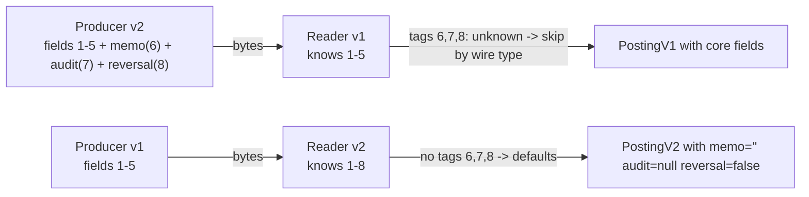

# Serialization: JSON, Protobuf-style Binary, and Schema Evolution

> Hand-encode a varint and never fear a wire format again.

**Type:** Build
**Languages:** Java, Python, Go
**Prerequisites:** Phase 1 Lesson 11 (Bit Manipulation and Compact Encodings), Phase 1 Lesson 12 (Strings and Encodings), Phase 0 Lesson 06 (Reading a Spec)
**Time:** ~90 minutes

## Learning Objectives

- Encode and decode unsigned integers as base-128 varints and signed integers with ZigZag, and state why a refund of -19.99 costs 2 bytes one way and 10 the other
- Build a tag-length-value binary codec with protobuf's four wire types and reproduce the byte sequences from the official encoding specification
- Decode a message written by a newer schema with an older reader, and a message written by an older schema with a newer reader, by skipping unknown fields and defaulting missing ones
- State the five rules of schema evolution that keep a payments wire format compatible for a decade, and show what breaks when each is violated
- Explain what JSON cannot carry (64-bit integers above 2^53, decimal amounts, binary) and how production APIs work around it

## The Problem

A payments platform publishes a `PostingCreated` event for every ledger entry. The event is JSON: `{"id": 9007199254740993, "amountMinor": -1999, "currency": "USD", ...}`. The ledger is in Java; the fraud consumer is in Node.js; the reporting consumer is in Python. For a year the ids are small and everything works. Then the id generator (Lesson 13) rolls past 2^53, and the fraud consumer, which parses JSON numbers into IEEE 754 doubles because that is what `JSON.parse` does, starts seeing `9007199254740992` for `9007199254740993`. Two different postings now have the same id on the fraud side. Deduplication drops the second one. The fraud model is silently trained on 0.3% fewer transactions than exist, and the discrepancy is found by a reconciliation job six weeks later, in a different team.

The same platform's settlement service talks to a clearing partner over a binary protocol the partner defined in 2009: fixed-width fields, big-endian integers, amounts as 12-digit ASCII with an implied two decimal places. The partner adds a field. Every message is now 8 bytes longer, every field after the insertion has moved, and the settlement service, which parses by offset, reads the counterparty id out of the middle of the new field. The partner's release notes mentioned the change; the service's parser had no way to notice.

A third team proposes fixing both problems by switching every internal service to Protocol Buffers. The proposal is sound, but the team treats the library as magic: they renumber fields when they rename them "for tidiness", they change an `int32 amount` to a `string amount` when someone points out the float problem, and they reuse field number 6 after deleting a deprecated field. Each of those is a wire-incompatible change that the library cannot stop them making, and each surfaces as a consumer reading garbage from a producer that was deployed an hour earlier.

The fix for all three is to understand the wire format rather than the library. Protobuf's binary encoding is two primitives, a varint and a length prefix, plus one rule, that every field is tagged with a number and a wire type so a reader can skip what it does not understand. The whole codec is under 200 lines, and once you have written it the five evolution rules stop being folklore and become consequences.

## The Concept

### Why tag-length-value

A serialization format answers three questions for each field: *which* field is this, *how long* is it, and *what* does it mean. Formats differ in how much of that is on the wire and how much is in the reader's head:

| Format | Field identity | Length | Type | Unknown fields | Example cost of `amountMinor = -1999` |
|--------|----------------|--------|------|----------------|----------------------------------------|
| Fixed-offset binary (ISO 8583 fixed fields, the clearing partner above) | by position | by position | by position | impossible: any insertion shifts everything | 8 bytes |
| JSON (RFC 8259) | by name, as text | by delimiters | by syntax | skipped naturally | 20 bytes (`"amountMinor":-1999,`) |
| Protobuf binary | by number, as a varint tag | varint prefix for bytes; implicit for numbers | wire type in the tag, meaning in the schema | skipped by wire type | 3 bytes (`10 9d 1f`) |
| Avro binary | by position in the writer's schema | implicit | from the writer's schema, resolved against the reader's | handled by schema resolution; needs both schemas | 2 bytes |

Protobuf's position is the middle one: enough on the wire to skip a field you do not know (its number and wire type), not enough to decode it without the schema (you need the schema to know that field 2's varint is a ZigZag-encoded signed amount, not an unsigned count). That is the trade that makes it both compact and evolvable, and the reason the schema file is part of the contract.

### Varints: base-128, little-endian, continuation bit

A varint stores an unsigned integer in as many bytes as it needs. Each byte carries 7 bits of payload in its low bits; the high bit is 1 if another byte follows and 0 on the last byte. Bytes come least-significant group first.

Worked example, 300:

```text
300 = 0b 1_0010_1100
split into 7-bit groups from the low end:  0101100  0000010
emit low group first with continuation bit: 1_0101100 = 0xAC
emit high group with the bit clear:         0_0000010 = 0x02
300 -> AC 02
```

Decoding reverses it: read a byte, take its low 7 bits, shift them into place by `7 * (byte index)`, stop at the first byte whose high bit is clear. Values below 128 take one byte, below 16,384 two, below 2^21 three; a full 64-bit value takes ten bytes (nine groups of 7 bits plus one group with the top bit). The scheme rewards small numbers, which is why protobuf uses it for field tags, lengths, enums, and most integers: a field number under 16 and any wire type fit a one-byte tag.

The cost of the scheme is that a negative number stored in two's complement is enormous as an unsigned value: `-1` is `0xFFFF_FFFF_FFFF_FFFF`, which is ten bytes. A ledger full of refunds would pay ten bytes per amount.

### ZigZag: making negatives small

ZigZag maps signed integers onto unsigned ones by interleaving: `0 -> 0, -1 -> 1, 1 -> 2, -2 -> 3, 2 -> 4`. The formula is `(n << 1) ^ (n >> 63)` using an arithmetic shift, so that the sign bit, replicated across all 64 bits by `>> 63`, flips every bit of a negative number after the doubling. Decoding is `(n >>> 1) ^ -(n & 1)`.

```text
-1999 in two's complement: 0xFFFF_FFFF_FFFF_F831
n << 1               = 0xFFFF_FFFF_FFFF_F062
n >> 63              = 0xFFFF_FFFF_FFFF_FFFF  (arithmetic shift of a negative: all ones)
xor                  = 0x0000_0000_0000_0F9D = 3997
3997 as a varint     = 0x9D 0x1F              (2 bytes)
```

A refund of 19.99 USD costs two bytes as a `sint64` and ten as an `int64`. Protobuf offers both because an `int64` that is almost never negative (a count, a timestamp) is cheaper without ZigZag: the encoding transformation is free but the doubling pushes values near 2^(7k) into an extra byte half the time. The rule: fields that can be negative are `sint64`; fields that cannot are `uint64` or `int64`.

### Tags and wire types

Every field is preceded by a tag, itself a varint, equal to `(fieldNumber << 3) | wireType`. The three low bits say how to find the end of the value without knowing the schema:

| Wire type | Code | Used for | How to skip it |
|-----------|------|----------|----------------|
| VARINT | 0 | int32, int64, uint64, sint64, bool, enum | read one varint |
| FIXED64 | 1 | fixed64, sfixed64, double | read 8 bytes |
| LENGTH_DELIMITED | 2 | string, bytes, nested messages, packed repeated fields | read a varint length, then that many bytes |
| FIXED32 | 5 | fixed32, sfixed32, float | read 4 bytes |

Codes 3 and 4 (start and end group) are deprecated and rejected by this lesson's decoder. The specification's own test vectors, reproduced by the tests:

```text
message { int32 a = 1; }  with a = 150     ->  08 96 01
   08 = 0000 1000 = field 1, wire type 0; 96 01 = varint 150
message { string b = 2; } with b = "testing"  ->  12 07 74 65 73 74 69 6e 67
   12 = 0001 0010 = field 2, wire type 2; 07 = length; then UTF-8 bytes
message { Inner c = 3; }  with c = { a = 150 }  ->  1a 03 08 96 01
   1a = field 3, wire type 2; 03 = length; the inner message's bytes verbatim
```

The third line is the one that makes nesting trivial: a nested message is just bytes, encoded on its own and written length-delimited. A reader that does not know field 3 skips three bytes. A reader that does know it hands those three bytes to the inner decoder.

### Decoding a posting by hand

The demo's `PostingV2` for a 19.99 USD refund serializes to 94 bytes. Decoded with nothing but the wire-type table above:

| Bytes | Tag | Field, wire type | Value |
|-------|-----|------------------|-------|
| `08` | 0x08 | 1, VARINT | |
| `81 80 40` | | | varint: `0x01 + (0x00 << 7) + (0x40 << 14)` = 1,048,577 (the id) |
| `10` | 0x10 | 2, VARINT | |
| `9d 1f` | | | varint 3997, ZigZag-decoded: -1999 (the amount in minor units) |
| `1a` | 0x1a | 3, LENGTH_DELIMITED | |
| `03 55 53 44` | | | length 3, `USD` |
| `22` | 0x22 | 4, LENGTH_DELIMITED | |
| `12 61 63 63 74 3a 6d 65 72 63 68 61 6e 74 3a 34 34 37 31` | | | length 18, `acct:merchant:4471` |
| `2a` | 0x2a | 5, LENGTH_DELIMITED | |
| `0f 61 63 63 74 3a ...` | | | length 15, `acct:customer:9` |
| `32` | 0x32 | 6, LENGTH_DELIMITED | length 17, `refund order 5512` (v2 only) |
| `3a` | 0x3a | 7, LENGTH_DELIMITED | length 22, a nested `Audit` message: `0a 0b 73 76 63 ...` is its field 1, `11 00 c0 2c c8 99 01 00 00` its field 2 as FIXED64 |
| `40 01` | 0x40 | 8, VARINT | 1 = true (v2 only) |

Every field costs one tag byte because all the numbers are below 16. The two account strings are 35 of the 94 bytes; in a real system they would be account ids as `uint64` (two tags plus about ten bytes) and the message would be under 60. The JSON form of the same posting is 229 bytes, of which 136 are field names, quotes, and punctuation that the binary form replaces with eight tag bytes and six length bytes.

### Size budget

| Representation | Bytes for the sample posting | Bytes per 10,000 random postings (demo section 7) | Notes |
|----------------|------------------------------|---------------------------------------------------|-------|
| Protobuf-style binary | 94 | 566,960 | tags are 1 byte, amounts 1 to 3 bytes, strings exact |
| JSON, ids and amounts as strings | 233 | 1,618,646 | field names repeated per message; quotes around numbers |
| JSON, gzip | 180 (one message alone) | about 310,000 (the batch compressed together) | a lone message barely compresses; a batch compresses below the binary size, at CPU cost on both ends |
| Fixed-width ISO 8583-style | about 120 | 1,200,000 | padding on every field; no evolution without a bitmap change |

The ratio that matters at scale is bytes per message times messages per second times the number of consumers. A platform that publishes 20,000 postings per second to six consumers moves 68 MB/s of JSON or 24 MB/s of binary before compression. Neither number is alarming on its own; the CPU to parse 68 MB/s of JSON on six consumers is where the difference is felt.

### The invariant: every reader can find the end of every field

**A decoder that knows only the wire type of a field can locate the end of that field.** That is the whole mechanism of forward compatibility: an old reader sees a tag with a field number it has never heard of, uses the wire type to skip the value, and continues with the next tag. It needs no schema update, no redeploy, and it loses nothing it was going to use. Backward compatibility is the mirror image and even simpler: a new reader that finds no tag for a field it expects uses the field's default (zero, empty string, false, null message). Together they let producers and consumers deploy in any order, which in a payments platform with fifty services is not a convenience but a requirement.



### The five rules of schema evolution

Each rule follows from the invariant, and each violation has a specific failure:

| Rule | Why | What breaks if violated |
|------|-----|-------------------------|
| 1. Never change a field's number | The number is the field's identity on the wire; names are not transmitted | Old data decodes into the wrong field, silently, if types match; a type error if they do not |
| 2. Never change a field's wire type | The reader uses the type to find the end of the value | `int64 amount` to `string amount`: an old reader finds LENGTH_DELIMITED where it expects VARINT and fails; a new reader does the reverse |
| 3. Never reuse a deleted number; reserve it | Old messages in a log or a queue still carry the number with its old meaning | A new `string note = 6` reads an old `int64 legacy_flag = 6`: type error at best, nonsense at worst |
| 4. New fields are optional with sensible defaults | An old producer will never send them | A reader that treats "field absent" as an error rejects every message from the previous release |
| 5. Do not make a value's meaning depend on another field's presence | Skipped fields are invisible to the reader that skipped them | A v2 `reversal=true` with a v1 reader that still sees a positive-looking posting: the reader is not wrong by its schema, but the producer changed what the amount *means* without the reader's consent |

Rule 5 is the one that no library enforces and the one that bites payments systems. Adding a `reversal` flag whose presence flips the sign convention of `amountMinor` is wire-compatible and semantically catastrophic. The compatible way to add a reversal is a new field that an old reader can ignore *without being wrong*: keep `amountMinor` negative for a refund, as the lesson's example does, and let `reversal` carry extra information rather than reinterpretation.

### JSON: what it carries and what it does not

JSON is the right format for a public API and the wrong one for an internal event bus at volume, and the reasons are specific. RFC 8259 says a number is a sequence of digits with optional fraction and exponent and gives no precision guarantee; in practice every JavaScript consumer and most others parse numbers as IEEE 754 doubles, which hold integers exactly only up to 2^53 (9,007,199,254,740,992). A 64-bit id above that is corrupted on parse. The universal fix, used by Twitter (`id_str`), Stripe, and this lesson, is to send 64-bit integers as strings. Decimal amounts have the same problem with `0.1 + 0.2`; the fix from Phase 10, Lesson 01 is integer minor units, and the JSON-specific corollary is to send them as strings too once they can exceed 2^53 (about 90 trillion dollars in cents, so in practice ids are the problem and amounts are not). Binary data needs base64, a 33% expansion. Field names are repeated in every message: `"creditAccount":` is 16 bytes of the 229 in the demo's posting, and the binary encoding carries the same information in one tag byte.

What JSON does give you: human readability in logs, universal parsers, no schema registry to run, and a natural model for optional fields. The size demo in this lesson shows JSON at 2.89x the binary size for a realistic posting; gzip over a batch of 10,000 messages brings the JSON below the uncompressed binary (about 310 KB against 567 KB) because the repeated field names compress almost to nothing, which is why many teams run JSON over compressed transports and never notice the overhead until the CPU cost of compressing and parsing shows up in a profile. A single message compressed alone barely shrinks (233 to 180 bytes), so the comparison depends on batching.

### What this codec does not do

- It does not carry the schema. A `.proto` file, or this lesson's field-number constants, is the contract; a reader with the wrong schema decodes nonsense without an error if wire types happen to line up.
- It does not canonicalize. Two encoders can serialize the same message with fields in different orders or with defaults present or omitted, producing different bytes. Hashing or signing serialized protobuf is therefore unreliable unless you define a canonical form (Lesson 09 hashed a hand-defined canonical string for this reason).
- It does not handle `repeated` fields, `oneof`, maps, or packed encoding. They are all compositions of the primitives here: a repeated field is the same tag appearing more than once, a packed repeated field is one LENGTH_DELIMITED value containing concatenated varints, a map is a repeated nested message with fields 1 and 2.
- It does not bound memory on malicious input. A length prefix of 2^31 on a one-kilobyte message is rejected only because the bounds check fails at the end of the buffer; a production decoder also enforces a maximum message size up front.

## Build It

### Step 1: Writing and reading a varint

```java
static void writeUnsigned(ByteSink out, long value) {
    while ((value & ~0x7FL) != 0) {
        out.write((int) ((value & 0x7F) | 0x80));
        value >>>= 7;
    }
    out.write((int) value);
}

static long readUnsigned(ByteSource in) {
    long result = 0;
    for (int shift = 0; shift < 64; shift += 7) {
        int b = in.readByte();
        result |= (long) (b & 0x7F) << shift;
        if ((b & 0x80) == 0) {
            if (shift == 63 && (b & 0x7E) != 0) throw new MalformedMessageException("varint overflows 64 bits");
            return result;
        }
    }
    throw new MalformedMessageException("varint longer than 10 bytes");
}
```

The writer's loop condition, "any bit above the low seven is set", is the test for "another byte is needed". The `>>>` is the unsigned shift; with `>>` a negative value would never reach zero and the loop would not terminate. The reader is defensive in two places: a tenth byte that has payload bits above the 64th position means the encoder produced something that cannot be a 64-bit value, and an eleventh continuation byte means the same. Both are errors, not values, because a varint decoder that silently wraps is how a 65-bit amount becomes a plausible-looking 1-bit one.

**Predict:** how many bytes does `writeUnsigned` emit for `16_384`, and what is the first byte?

### Step 2: ZigZag

```java
static long zigzagEncode(long n) { return (n << 1) ^ (n >> 63); }

static long zigzagDecode(long n) { return (n >>> 1) ^ -(n & 1); }
```

Two lines, both bit tricks from Phase 1, Lesson 11. `n >> 63` is 0 for non-negative `n` and all ones for negative, so the XOR either does nothing or flips every bit. On decode, `n & 1` is the sign (1 for negatives), `-(n & 1)` is all ones for negatives, and the XOR undoes the flip. The tests reproduce the specification's table (`2147483647 -> 4294967294`, `-2147483648 -> 4294967295`) and round-trip 10,000 random longs.

**Predict:** what does `zigzagEncode(Long.MIN_VALUE)` return, and how many varint bytes does it take?

### Step 3: Tags and the encoder

```java
private void tag(int field, WireType type) {
    if (field < 1 || field > 536_870_911) throw new IllegalArgumentException("field number out of range: " + field);
    Varint.writeUnsigned(out, ((long) field << 3) | type.code);
}

Encoder uint64(int field, long value) { tag(field, WireType.VARINT); Varint.writeUnsigned(out, value); return this; }
Encoder sint64(int field, long value) { tag(field, WireType.VARINT); Varint.writeSigned(out, value); return this; }
Encoder bytes(int field, byte[] value) {
    tag(field, WireType.LENGTH_DELIMITED);
    Varint.writeUnsigned(out, value.length);
    out.write(value);
    return this;
}
Encoder message(int field, Encoder nested) { return bytes(field, nested.toByteArray()); }
```

Field numbers run from 1 to 2^29 - 1 because the tag is a varint with three bits taken by the wire type; 19,000 to 19,999 are reserved by protobuf for its own use, which this lesson does not enforce. Numbers 1 to 15 fit a single-byte tag, so they should go to the fields that appear most often. `message` is one line because a nested message is just bytes.

**Predict:** `new Encoder().uint64(16, 1)` produces how many bytes, and why is it one more than for field 15?

### Step 4: The decoder and `skip`

```java
boolean next() {
    if (!in.hasMore()) return false;
    long tag = Varint.readUnsigned(in);
    field = (int) (tag >>> 3);
    if (field == 0) throw new MalformedMessageException("field number 0 is reserved");
    type = WireType.of((int) (tag & 0x7));
    return true;
}

void skip() {
    skipped++;
    switch (type) {
        case VARINT -> Varint.readUnsigned(in);
        case FIXED64 -> in.readBytes(8);
        case FIXED32 -> in.readBytes(4);
        case LENGTH_DELIMITED -> in.readBytes((int) Varint.readUnsigned(in));
    }
}
```

`skip` is the method that makes evolution work, and it is seven lines. Every typed accessor (`uint64()`, `string()`, `message()`) first checks that the current wire type is the one it expects and throws a `MalformedMessageException` otherwise; that check is what turns a violated Rule 2 into an error at the boundary instead of a corrupted value inside the ledger. `message()` returns a decoder over a *slice* of the same buffer (no copy) bounded by the length prefix, so a nested decoder cannot read past its message.

**Predict:** a message is `08 96 01 2d 01 02 03 04`. The reader knows field 1 only. What does it return, and how many bytes did `skip` consume?

### Step 5: Two schema versions of a posting

```java
static PostingV1 decode(Decoder d) {
    long id = 0, minor = 0;
    String currency = "", debit = "", credit = "";
    while (d.next()) {
        switch (d.field()) {
            case F_ID -> id = d.uint64();
            case F_AMOUNT -> minor = d.sint64();
            case F_CURRENCY -> currency = d.string();
            case F_DEBIT -> debit = d.string();
            case F_CREDIT -> credit = d.string();
            default -> d.skip();                       // a field from the future: preserve nothing, break nothing
        }
    }
    if (currency.isEmpty()) throw new MalformedMessageException("posting without a currency");
    return new PostingV1(id, Money.ofMinor(minor, Currency.of(currency)), debit, credit);
}
```

The loop shape is the same in every generated protobuf parser: read a tag, dispatch on the field number, default to skip. `PostingV2` adds cases 6, 7, and 8 and nothing else changes. Note what is validated after the loop: a posting without a currency is rejected, because a default of `""` would construct a `Currency` that does not exist. Protobuf's default-value semantics are convenient and dangerous in equal measure: an absent `amountMinor` decodes as `0`, which for a posting may be a legitimate value or a producer bug, and the wire format cannot tell you which. Fields whose absence must be distinguishable from their zero value need either explicit presence tracking or a wrapper message.

`PostingV2.encode` omits fields at their default values (`memo` empty, `audit` null, `reversal` false), as protobuf 3 does, so a v2 message with no v2 data is byte-for-byte identical to a v1 message. The tests check that.

**Predict:** a v1 producer sends a posting; the v2 reader decodes it. What is `reversal`, and is that correct for a refund that the v1 producer encoded with a negative amount?

### Step 6: Run it

```bash
cd phases/03-systems-data-structures/15-serialization-formats/code/java
javac -d .out *.java && java -cp .out Main
java -cp .out MainTest
```

Expected output, abbreviated:

```console
== 1. Varints: 7 bits per byte, little-endian, continuation bit ==
                   150 -> 96 01                          (2 bytes)
                   300 -> ac 02                          (2 bytes)
   9223372036854775807 -> ff ff ff ff ff ff ff ff 7f     (9 bytes)
  -1 as a plain varint = ff ff ff ff ff ff ff ff ff 01 (10 bytes: the sign bit is 63 bits up)

== 2. ZigZag: small negatives stay small ==
  a refund of -19.99 USD as sint64 = 9d 1f (2 bytes, versus 10 as uint64)

== 3. Tags and wire types: the protobuf.dev test vectors ==
  field 1 = 150        -> 08 96 01   (tag 0x08 = field 1 << 3 | VARINT)
  field 2 = "testing"  -> 12 07 74 65 73 74 69 6e 67   (tag 0x12 = field 2 << 3 | LENGTH_DELIMITED, length 7)

== 4. A posting on the wire ==
  binary (94 bytes): 08 81 80 40 10 9d 1f 1a 03 55 53 44 22 12 61 63 63 74 ...
  json   (229 bytes): {"id":1048577,"amountMinor":-1999,"currency":"USD", ...}

== 5. Schema evolution ==
  v1 reader on v2 bytes: PostingV1[id=1048577, amount=-19.99 USD, ...]  (skipped 3 unknown fields by wire type)
  v2 reader on v1 bytes: memo="" audit=null reversal=false  (defaults, not errors)

== 6. What JSON numbers cannot carry ==
  id 9007199254740993 through a JSON parser that uses double -> 9007199254740992  (lost: 1)

== 7. Size over 10,000 random postings ==
  binary 566960 bytes, json 1638646 bytes, ratio 2.89x; all 10000 round-tripped

== 8. Malformed input is an error, not a guess ==
  last 3 bytes cut off: truncated: nested message of 22 bytes at offset 70
  type changed on field 2: field 2: expected VARINT but found LENGTH_DELIMITED
55 passed, 0 failed
```

Read section 4's first bytes against the spec: `08` is field 1 VARINT, `81 80 40` is the varint for 1,048,577 (that is 2^20 + 1, needing 21 bits, three groups), `10` is field 2 VARINT, `9d 1f` is ZigZag(-1999), `1a 03 55 53 44` is field 3 LENGTH_DELIMITED, length 3, `USD`. You can now decode a protobuf message with a hex dump and a pencil.

### In Python

`code/python/main.py` has the same classes (`ByteSink`, `ByteSource`, `Varint`, `WireType`, `Encoder`, `Decoder`, `PostingV1`, `Audit`, `PostingV2`, `Json`) and the same `MalformedMessageException`. It produces the same 94 bytes for the sample posting and the same totals over the 10,000 seeded postings. Three things differ. **A `long` has to be modelled:** Python integers are unbounded, so a value has no sign bit at position 63 until you give it one. Every value that is a Java `long` passes through `to_int64`, and the unsigned view is `value & MASK64`, which stands in for Java's `>>>`. Without that, `zigzag_encode(Long.MIN_VALUE)` returns `2**64 - 1` instead of `-1`, and reading `ff ... 01` returns `2**64 - 1` instead of `-1`; the tests pin both cases. Python's `>>` on a negative `int` is arithmetic, like Java's `>>`, so the ZigZag sign trick ports unchanged. **No overloading:** `ByteSink.write` takes either an `int` or `bytes`, `Decoder(...)` takes either raw bytes or a `ByteSource` slice, and `PostingV1.decode` takes bytes or a `Decoder`. Methods named `bytes` and `bool` on `Encoder` and `Decoder` keep the Java names; they shadow the built-ins only as attributes, not inside method bodies. `ByteSource.slice` is a bounded window over the same buffer, as in Java, so a nested decoder cannot read past its length prefix. **Records print like records:** `PostingV1.__str__` reproduces Java's `PostingV1[id=..., amount=...]`, so the schema-evolution line of the demo matches. `int(float(2**53 + 1))` shows the same lost unit as Java's `(long)(double)` cast. The 10,000 random postings come from `JavaRandom`, with each draw in Java's left-to-right argument order, so the binary and JSON byte totals match.

Run it from `code/python/` with `python3 main.py`; test with `python3 -m unittest -v`.

#### Step 1: Writing and reading a varint

`write_unsigned` first masks to the unsigned 64-bit view, after which `>>= 7` is the logical shift Java spells `>>>=`; `~0x7F` on a non-negative masked value tests "any bit above the low seven". `read_unsigned` keeps both overflow checks and converts the result back to a signed `long` with `to_int64`, so `ff ... 01` decodes to `-1` as in Java.

```python
    @staticmethod
    def write_unsigned(out: ByteSink, value: int) -> None:
        """Little-endian base-128: 7 payload bits per byte, high bit set on every byte but the last."""
        value &= MASK64  # the unsigned view; Java's >>> does this implicitly
        while value & ~0x7F:
            out.write((value & 0x7F) | 0x80)
            value >>= 7
        out.write(value)

    @staticmethod
    def read_unsigned(src: ByteSource) -> int:
        result = 0
        for shift in range(0, 64, 7):
            b = src.read_byte()
            result |= (b & 0x7F) << shift
            if b & 0x80 == 0:
                if shift == 63 and (b & 0x7E) != 0:
                    raise MalformedMessageException("varint overflows 64 bits")
                return to_int64(result)
        raise MalformedMessageException("varint longer than 10 bytes")
```

#### Step 2: ZigZag

Python's `>>` on a negative int is arithmetic like Java's `>>`, so `n >> 63` is 0 or -1 as required; the encode result is truncated to a `long` with `to_int64`. Decode takes the unsigned view before the logical shift.

```python
    @staticmethod
    def zigzag_encode(n: int) -> int:
        """0,-1,1,-2,2 -> 0,1,2,3,4. Python's >> on a negative int is arithmetic, like Java's >>."""
        return to_int64((n << 1) ^ (n >> 63))

    @staticmethod
    def zigzag_decode(n: int) -> int:
        return to_int64(((n & MASK64) >> 1) ^ -(n & 1))
```

#### Step 3: Tags and the encoder

`_tag` validates the field number and writes `(field << 3) | code`. Each typed writer returns `self` so calls chain like the Java builder; `bytes` and `message` keep the Java names, and `string` encodes UTF-8 before delegating.

```python
    def _tag(self, field: int, type_: WireType) -> None:
        if field < 1 or field > 536_870_911:
            raise ValueError(f"field number out of range: {field}")
        Varint.write_unsigned(self.out, (field << 3) | type_.code)

    def uint64(self, field: int, value: int) -> "Encoder":
        self._tag(field, WireType.VARINT)
        Varint.write_unsigned(self.out, value)
        return self

    def sint64(self, field: int, value: int) -> "Encoder":
        self._tag(field, WireType.VARINT)
        Varint.write_signed(self.out, value)
        return self

    def bytes(self, field: int, value: bytes) -> "Encoder":
        self._tag(field, WireType.LENGTH_DELIMITED)
        Varint.write_unsigned(self.out, len(value))
        self.out.write(value)
        return self

    def message(self, field: int, nested: "Encoder") -> "Encoder":
        """A nested message is just bytes: encode it separately, then write it length-delimited."""
        return self.bytes(field, nested.to_byte_array())
```

#### Step 4: The decoder and `skip`

`next` reads the tag, takes the unsigned view before shifting out the field number, and rejects field 0. `skip` dispatches on the `WireType` enum with `is` comparisons; the length-delimited arm reads the length as a varint and then that many bytes.

```python
    def next(self) -> bool:
        """Advance to the next field. False at end of message."""
        if not self._in.has_more():
            return False
        tag = Varint.read_unsigned(self._in)
        self._field = to_int32((tag & MASK64) >> 3)
        if self._field == 0:
            raise MalformedMessageException("field number 0 is reserved")
        self._type = WireType.of(tag & 0x7)
        return True

    def skip(self) -> None:
        """Skip the current field's value using only its wire type."""
        self.skipped += 1
        if self._type is WireType.VARINT:
            Varint.read_unsigned(self._in)
        elif self._type is WireType.FIXED64:
            self._in.read_bytes(8)
        elif self._type is WireType.FIXED32:
            self._in.read_bytes(4)
        elif self._type is WireType.LENGTH_DELIMITED:
            self._in.read_bytes(to_int32(Varint.read_unsigned(self._in)))
```

#### Step 5: Two schema versions of a posting

`decode` accepts bytes or a `Decoder` (the Java overload pair) and runs the generated-parser loop: read a tag, dispatch on the field number with an `if`/`elif` chain, default to `skip`. The post-loop currency check is unchanged.

```python
    @staticmethod
    def decode(source: Union[bytes, Decoder]) -> "PostingV1":
        d = source if isinstance(source, Decoder) else Decoder(source)
        id_ = minor = 0
        currency = debit = credit = ""
        while d.next():
            f = d.field()
            if f == PostingV1.F_ID:
                id_ = d.uint64()
            elif f == PostingV1.F_AMOUNT:
                minor = d.sint64()
            elif f == PostingV1.F_CURRENCY:
                currency = d.string()
            elif f == PostingV1.F_DEBIT:
                debit = d.string()
            elif f == PostingV1.F_CREDIT:
                credit = d.string()
            else:
                d.skip()  # a field from the future: preserve nothing, break nothing
        if not currency:
            raise MalformedMessageException("posting without a currency")
        return PostingV1(id_, Money.of_minor(minor, Currency.of(currency)), debit, credit)
```

#### Step 6: Run it

```bash
cd phases/03-systems-data-structures/15-serialization-formats/code/python
python3 main.py
python3 -m unittest -v
```

```console
== 1. Varints: 7 bits per byte, little-endian, continuation bit ==
                     0 -> 00                             (1 byte)
                     1 -> 01                             (1 byte)
                   127 -> 7f                             (1 byte)
                   128 -> 80 01                          (2 bytes)

== 7. Size over 10,000 random postings ==
  binary 566960 bytes, json 1638646 bytes, ratio 2.89x; all 10000 round-tripped
```

The 94-byte posting, the spec vectors, and both totals in section 7 are the same numbers the Java program prints.

### In Go

`code/go/main.go` has the same types (`ByteSink`, `ByteSource`, the `Varint` functions, `WireType`, `Encoder`, `Decoder`, `PostingV1`, `Audit`, `PostingV2`, and the `Json` functions) and produces the same 94 bytes for the sample posting and the same totals over the 10,000 seeded postings. The spec vectors (`08 96 01`, `12 07 74 65 73 74 69 6e 67`, `1a 03 08 96 01`) are pinned in `main_test.go` as the cross-language contract. Three things differ. **Unsigned is a type, not a view:** Java carries unsigned varints in a `long` and reads them with `>>>`; Go gives them their own type, so `WriteUnsigned` takes a `uint64` and `ZigzagEncode(int64) uint64` has no sign bit to misread. Java's `writeUnsigned(-1)` is `WriteUnsigned(math.MaxUint64)` here, and the ZigZag table's "all ones" is `math.MaxUint64` instead of `-1L`. **Malformed input is an error value:** every read on `ByteSource` and `Decoder` returns `(value, error)`, and every failure wraps `ErrMalformed`, so the decode loops check `err` after each field and the tests use `errors.Is(err, ErrMalformed)`. The `Encoder` keeps the Java builder chain by remembering the first invalid field number and reporting it from `ToByteArray() ([]byte, error)`; the constant field numbers in `Encode` cannot fail, so those discard the error. **No overloading, no null:** `ByteSink.Write` takes a byte and `WriteBytes` a slice; `NewDecoder` takes bytes and `NewDecoderFrom` a `*ByteSource` view, which is a bounded window over the same buffer so a nested decoder cannot read past its length prefix. `PostingV2.Audit` is a `*Audit` so that "absent" is `nil`, which is why `PostingV2` has an `Equal` method instead of relying on `==`. `0.1 + 0.2` is computed from variables because Go folds constant expressions exactly and would print `0.3`. The 10,000 random postings come from `JavaRandom` (`javarandom.go`), with each draw in Java's left-to-right argument order, so the binary and JSON byte totals match.

Run it from `code/go/` with `go run .`; test with `go test ./...`.

#### Step 1: Writing and reading a varint

With a `uint64` the writer is the Java loop with `&^` (bit clear) for `& ~0x7FL` and a plain `>>=`. The reader returns `(uint64, error)`; `malformed(...)` builds an error wrapping `ErrMalformed`, and a short read from `ByteSource` propagates as the same kind of error.

```go
func WriteUnsigned(out *ByteSink, value uint64) {
	for value&^0x7F != 0 {
		out.Write(byte(value&0x7F | 0x80))
		value >>= 7
	}
	out.Write(byte(value))
}

func ReadUnsigned(in *ByteSource) (uint64, error) {
	var result uint64
	for shift := 0; shift < 64; shift += 7 {
		b, err := in.ReadByte()
		if err != nil {
			return 0, err
		}
		result |= uint64(b&0x7F) << shift
		if b&0x80 == 0 {
			if shift == 63 && b&0x7E != 0 {
				return 0, malformed("varint overflows 64 bits")
			}
			return result, nil
		}
	}
	return 0, malformed("varint longer than 10 bytes")
}
```

#### Step 2: ZigZag

The signed-to-unsigned mapping is in the types: `n >> 63` on an `int64` is arithmetic, the conversion to `uint64` reinterprets the bits, and decode shifts the `uint64` logically before converting back.

```go
// ZigzagEncode maps signed to unsigned so small negatives stay small: 0,-1,1,-2,2 -> 0,1,2,3,4.
func ZigzagEncode(n int64) uint64 { return uint64((n << 1) ^ (n >> 63)) }

func ZigzagDecode(n uint64) int64 { return int64(n>>1) ^ -int64(n&1) }
```

#### Step 3: Tags and the encoder

To keep the chainable builder without exceptions, `tag` records the first bad field number in `e.err` and returns `false`, after which every writer becomes a no-op and `ToByteArray` reports the error. `Message` encodes the nested builder and forwards its error the same way.

```go
func (e *Encoder) tag(field int, t WireType) bool {
	if e.err != nil {
		return false
	}
	if field < 1 || field > 536_870_911 {
		e.err = fmt.Errorf("%w: field number out of range: %d", ErrInvalidArgument, field)
		return false
	}
	WriteUnsigned(&e.out, uint64(field)<<3|uint64(t))
	return true
}

func (e *Encoder) Uint64(field int, value uint64) *Encoder {
	if e.tag(field, VARINT) {
		WriteUnsigned(&e.out, value)
	}
	return e
}

func (e *Encoder) Sint64(field int, value int64) *Encoder {
	if e.tag(field, VARINT) {
		WriteSigned(&e.out, value)
	}
	return e
}

func (e *Encoder) Bytes(field int, value []byte) *Encoder {
	if e.tag(field, LENGTH_DELIMITED) {
		WriteUnsigned(&e.out, uint64(len(value)))
		e.out.WriteBytes(value)
	}
	return e
}

func (e *Encoder) String(field int, value string) *Encoder { return e.Bytes(field, []byte(value)) }
```

#### Step 4: The decoder and `skip`

`Next` returns `(more, error)` so a decode loop can tell "end of message" from "corrupt tag". `Skip` is a `switch` whose arms return the error of the read they perform; `LENGTH_DELIMITED` is the `default` arm.

```go
func (d *Decoder) Next() (bool, error) {
	if !d.in.HasMore() {
		return false, nil
	}
	tag, err := ReadUnsigned(d.in)
	if err != nil {
		return false, err
	}
	d.field = int(tag >> 3)
	if d.field == 0 {
		return false, malformed("field number 0 is reserved")
	}
	if d.typ, err = WireTypeOf(int(tag & 0x7)); err != nil {
		return false, err
	}
	return true, nil
}

func (d *Decoder) Skip() error {
	d.Skipped++
	switch d.typ {
	case VARINT:
		_, err := ReadUnsigned(d.in)
		return err
	case FIXED64:
		_, err := d.in.ReadBytes(8)
		return err
	case FIXED32:
		_, err := d.in.ReadBytes(4)
		return err
	default: // LENGTH_DELIMITED
		n, err := ReadUnsigned(d.in)
		if err != nil {
			return err
		}
		_, err = d.in.ReadBytes(int(n))
		return err
	}
}
```

#### Step 5: Two schema versions of a posting

The generated-parser loop in Go: `Next` is called at the top of an infinite `for`, the `switch` assigns both the value and `err`, and one `if err != nil` after the switch covers every arm including `Skip`. The missing-currency check returns a `malformed` error.

```go
func DecodePostingV1From(d *Decoder) (PostingV1, error) {
	var id uint64
	var minor int64
	currency, debit, credit := "", "", ""
	for {
		more, err := d.Next()
		if err != nil {
			return PostingV1{}, err
		}
		if !more {
			break
		}
		switch d.Field() {
		case F_ID:
			id, err = d.Uint64()
		case F_AMOUNT:
			minor, err = d.Sint64()
		case F_CURRENCY:
			currency, err = d.String()
		case F_DEBIT:
			debit, err = d.String()
		case F_CREDIT:
			credit, err = d.String()
		default:
			err = d.Skip() // a field from the future: preserve nothing, break nothing
		}
		if err != nil {
			return PostingV1{}, err
		}
	}
	if currency == "" {
		return PostingV1{}, malformed("posting without a currency")
	}
	return PostingV1{id, OfMinor(minor, CurrencyOf(currency)), debit, credit}, nil
}
```

#### Step 6: Run it

```bash
cd phases/03-systems-data-structures/15-serialization-formats/code/go
go run .
go test ./...
```

```console
== 7. Size over 10,000 random postings ==
  binary 566960 bytes, json 1638646 bytes, ratio 2.89x; all 10000 round-tripped

== 8. Malformed input is an error, not a guess ==
  last 3 bytes cut off: truncated: nested message of 22 bytes at offset 70
  type changed on field 2: field 2: expected VARINT but found LENGTH_DELIMITED
```

Sections 1 through 6 print the same varints, tags, 94-byte posting, and schema-evolution lines as the Java program.

## Use It

### Protocol Buffers and gRPC

`protoc` generates the encoder and decoder you just wrote, plus the field-number constants from a `.proto` file, plus a `skip`-based unknown-field *retention* that this lesson omits: a proto3 parser keeps unknown fields and re-emits them on serialization, so a v1 service that reads, modifies, and forwards a v2 message does not strip the v2 fields. What the library cannot do is stop you violating the five rules; `buf breaking` and the Confluent Schema Registry's compatibility checks exist to catch renumbering and type changes in CI before they reach production. gRPC puts these messages over HTTP/2 with a 5-byte frame header (compressed flag plus 4-byte length) in front of each one.

### Avro and the schema registry

Avro, the format Kafka ecosystems lean on, makes the opposite trade: no tags on the wire at all, so a message is smaller than protobuf's, but the reader must have the exact writer's schema to decode anything, and compatibility is resolved by comparing the writer's and reader's schemas field by name. The schema travels as a 4-byte id pointing into a registry (Phase 8, Lesson 11). Protobuf's tags let a reader decode without the registry; Avro's registry lets the bytes be smaller. Both end up with the same five rules, phrased differently.

### JSON in practice: Stripe, ISO 20022, and `BigDecimal`

Stripe's API is JSON with amounts as integers in minor units and ids as strings, which is exactly the two workarounds from this lesson. ISO 20022, the XML standard behind SEPA and modern wires, carries amounts as decimal text with the currency as an attribute (`<InstdAmt Ccy="EUR">1999.00</InstdAmt>`), and a Java parser reads that into `BigDecimal`, never `double`. Jackson's `USE_BIG_DECIMAL_FOR_FLOATS` and `USE_BIG_INTEGER_FOR_INTS` features exist for the same reason. In JavaScript, `JSON.parse` with a `reviver` cannot save a number that has already been parsed as a double; the id must arrive as a string.

### ISO 8583 and fixed-width formats

The card networks' authorization message format, ISO 8583, is the fixed-offset style from The Problem's second scenario, with a bitmap announcing which of 128 fields are present and most fields either fixed-width or prefixed with a 2- or 3-digit ASCII length. It predates protobuf by two decades and is still what runs between acquirers, networks, and issuers (Phase 11). Reading its spec after this lesson, you will recognise the bitmap as the tag, the LLVAR prefix as the length-delimited wire type, and the absence of a wire type as the reason every implementer keeps a table of field formats by hand.

### Java serialization and why nobody uses it on the wire

`java.io.Serializable` writes class names, field names, and a version UID into the stream. It is verbose, Java-only, and the deserializer instantiates whatever class the stream names, which is the root of a decade of remote-code-execution vulnerabilities (the `ObjectInputStream` gadget-chain attacks). JEP 290 added filters; the practical advice is that it is not a wire format and never was.

## Ship It

`outputs/checklist-schema-evolution.md` is the review checklist for any change to a message schema, event, or API payload: the five rules as checkboxes with the test that proves each, the JSON-specific traps, and the deployment-order questions (old reader, new writer; new reader, old writer; a message that sits in a queue for a week). Attach it to every pull request that touches a `.proto`, an Avro schema, or an API response shape.

## Exercises

1. **Reinforce.** Add `fixed32` and `sfixed64` to the encoder and decoder, and a `double` accessor that round-trips through `Double.doubleToLongBits` on a FIXED64. Then write a comment in the test explaining why no field in `PostingV1` or `PostingV2` should ever use it.
2. **Apply.** Implement `repeated sint64 adjustments = 9` for `PostingV2` in both encodings protobuf allows: unpacked (one tag per element) and packed (one LENGTH_DELIMITED field containing the concatenated varints). Make the decoder accept either, as proto3 parsers must, and measure the size of each for 100 small adjustments.
3. **Extend.** Combine this lesson with Lesson 09: define a canonical serialization for `PostingV2` (fields in ascending number order, defaults always omitted, no unknown fields) and build a Merkle tree over the canonical bytes of 1,000 postings. Then show that a non-canonical encoder, one that writes the fields in a different order, produces a different root for identical data, and explain in a comment why signing protobuf bytes without a canonical form is a reconciliation bug waiting to happen.

## Key Terms

| Term | What people say | What it actually means |
|------|-----------------|------------------------|
| Varint | "variable-length integer" | Base-128 little-endian encoding with a continuation bit per byte; 1 byte below 128, 10 bytes for a full 64-bit value |
| ZigZag | "the signed varint trick" | Interleaving negatives and positives (`-1 -> 1, 1 -> 2`) so small magnitudes of either sign encode in few bytes |
| Tag | "field header" | `varint((fieldNumber << 3) | wireType)`; the field's identity and how to skip it, in one to five bytes |
| Wire type | "the type on the wire" | One of VARINT, FIXED64, LENGTH_DELIMITED, FIXED32: enough to find the end of a value, not enough to interpret it |
| Forward compatibility | "old code reads new data" | An old reader skips unknown fields by wire type and keeps working |
| Backward compatibility | "new code reads old data" | A new reader supplies defaults for fields the old writer never sent |
| Schema registry | "where the schemas live" | A service that stores versioned schemas and checks compatibility rules before a new version is accepted (Confluent, Buf) |
| 2^53 | "the JavaScript integer limit" | The largest integer a double represents exactly (9,007,199,254,740,992); 64-bit ids above it must travel as strings in JSON |

## Further Reading

- [Protocol Buffers: Encoding](https://protobuf.dev/programming-guides/encoding/) — the specification this lesson implements: varints, ZigZag table, tags, wire types, and the `08 96 01` and `12 07 ...` vectors used in the tests.
- [Protocol Buffers: Language Guide (proto3), "Updating a Message Type"](https://protobuf.dev/programming-guides/proto3/#updating) — the official statement of the evolution rules and the `reserved` keyword.
- [RFC 8259: The JavaScript Object Notation (JSON) Data Interchange Format](https://www.rfc-editor.org/rfc/rfc8259) — section 6 on numbers, including the interoperability note about IEEE 754 doubles and 2^53.
- [Apache Avro Specification: Schema Resolution](https://avro.apache.org/docs/current/specification/#schema-resolution) — the tagless alternative and how reader/writer schema resolution replaces wire types.
- [ISO 8583 overview](https://en.wikipedia.org/wiki/ISO_8583) — the fixed-width-plus-bitmap format that card authorization still runs on; compare its LLVAR fields to LENGTH_DELIMITED.
- [JEP 290: Filter Incoming Serialization Data](https://openjdk.org/jeps/290) — why Java's built-in serialization needed a filter mechanism and should stay off the wire.
