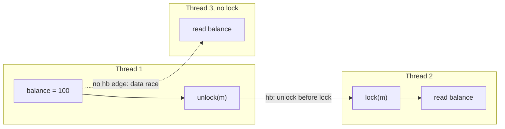
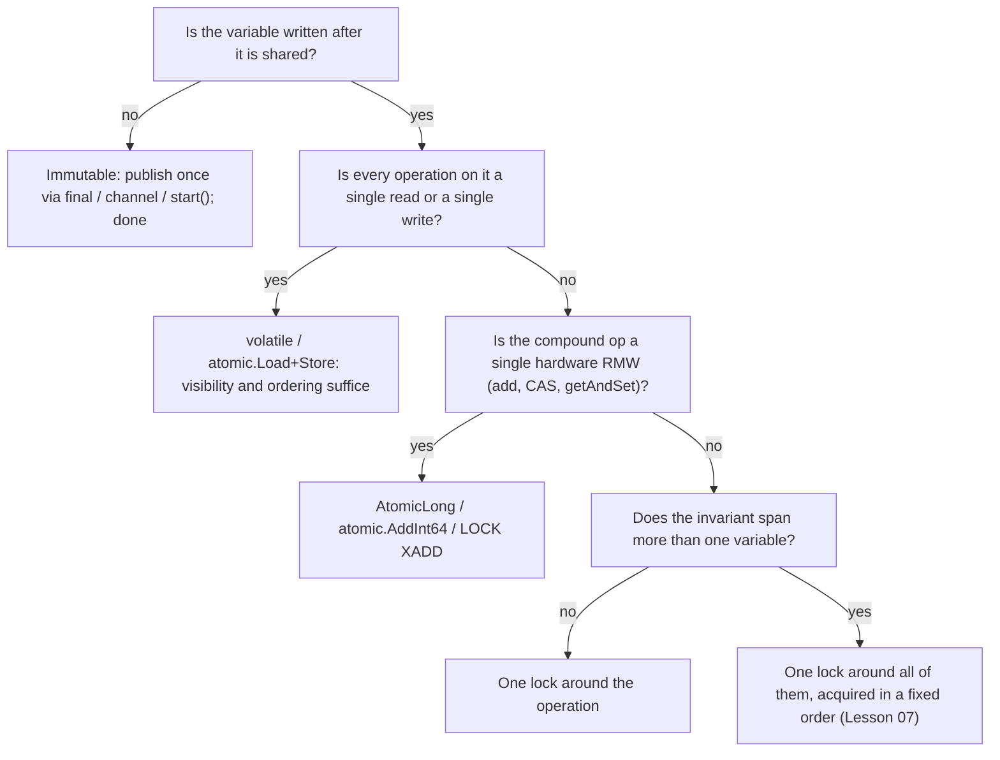

# Threads and the Memory Model

> A data race is not a bug that fails sometimes; it is a program whose meaning the language never defined.

**Type:** Learn
**Languages:** —
**Prerequisites:** Phase 0, Lesson 07 (Decimal and Integer Arithmetic in Three Runtimes); Phase 3, Lesson 01 (Hash Maps)
**Time:** ~75 minutes

## Learning Objectives

- Define a data race precisely, in terms of two conflicting accesses not ordered by happens-before, and distinguish it from a race condition at the application level
- Separate the three properties a correct concurrent access needs: atomicity, visibility, and ordering, and name which tool in Java, Go, and Python gives which
- Trace a lost update on an account balance instruction by instruction in JVM bytecode, CPython bytecode, and amd64 machine code
- State the happens-before rules of JLS 17.4.5 and the Go memory model that make a lock, a volatile, or a channel operation publish a write
- Explain why the GIL makes CPython bytecodes atomic but does not make `balance += amount` atomic
- Argue from the memory model, not from test results, why a program that passed ten thousand runs can still be wrong

## The Problem

A wallet service keeps each customer's available balance in an in-process object so that authorization decisions do not wait on the database. The object has one field, `long balance`, and two methods, `credit(amount)` and `debit(amount)`, each a single line: `balance += amount` and `balance -= amount`. The service handles a few hundred requests per second per instance, on a thread pool of 32 platform threads. The code has unit tests, a load test, and eleven months in production.

On a Friday a merchant runs a promotion and sends two refunds for the same customer within the same millisecond, each for 25.00 USD. Both land on the same instance and are picked up by two different pool threads. Both threads read the balance, 100.00 USD, into a register. Both add 25.00. Both write 125.00 back. The customer was refunded 50.00 and received 25.00. The database write-behind job later persists 125.00, so the discrepancy survives the restart. Nobody notices until the monthly reconciliation finds 1,912 accounts whose in-memory balance disagrees with the sum of their postings, in both directions, by exact multiples of recent transaction amounts.

The team's first instinct is to write a test: start 32 threads, credit a thousand times each, assert the balance equals 32,000. The test passes on the laptop. It passes in CI. It passes a thousand times in a loop. Someone adds a `volatile` to the field and the test still passes; someone removes it and the test still passes. The failure is real, it is reproducible in production, and no test anyone writes can reliably show it. This lesson is about why: the program is not "buggy under load", it is undefined, and the specification that says so is the language's memory model. Reading that specification is the only way to know whether code is correct, because no amount of running it can tell you.

## The Concept

### Three properties, not one

When one thread writes a variable and another reads it, "correct" means three separate things, and a fix that provides one does not provide the others.

| Property | Question it answers | Violated when | Tool that provides it |
|----------|---------------------|---------------|-----------------------|
| Atomicity | Can another thread observe a half-done operation? | Two threads interleave inside `balance += amount` | A lock around the whole operation; a hardware atomic such as `AtomicLong.addAndGet`, `atomic.AddInt64`, or a single CPython bytecode |
| Visibility | When thread B reads, does it see A's latest write or a stale copy? | A writes, B spins on a cached register or a hoisted read forever | `volatile` in Java, a channel or `sync` operation in Go, any GIL hand-off in CPython |
| Ordering | If A writes `x` then `y`, can B see the new `y` and the old `x`? | The compiler or CPU reorders independent stores; B publishes an object before its fields are written | The same tools: every one of them is defined as a happens-before edge |

`balance += amount` is a read, an addition, and a write. A `volatile` field makes the read and the write individually visible and ordered, but says nothing about what happens between them: two threads can still both read 100, both add 25, both write 125. Atomicity is the property that is missing, and it is the hardest one to see because the source code is a single token.

### What a data race is

The Java Language Specification, section 17.4.5, defines it in two steps. Two accesses to the same variable *conflict* if at least one is a write. A program contains a *data race* when two conflicting accesses are not ordered by *happens-before*. Go's memory model (the 2022 revision) uses the same definition: "A data race is defined as a write to a memory location happening concurrently with another read or write to that same location, unless all the accesses involved are atomic data accesses."

This is narrower than the everyday phrase "race condition", and the difference matters:

- A **data race** is about memory: unsynchronized conflicting accesses. The language memory model says what you may observe (Java: a value from some write, possibly surprising; Go: an arbitrary value, a crash, or a report from the race detector; C and C++: undefined behaviour). It is a property of the program text and the model, not of any particular run.
- A **race condition** is about logic: the outcome depends on timing even though every individual access is properly synchronized. Two correctly locked `read-balance` then `write-balance` calls in separate critical sections are still a lost update. The ledger lessons in Phase 10 fix this kind with transactions and version checks; this phase fixes the first kind with memory-model tools.

Both appear in the wallet failure above. The `long balance` field has a data race (two unsynchronized writes). Even if each access were made volatile, the *compound* operation would still be a race condition. The lock in Lesson 02 fixes both at once, which is why locks are the default and atomics are the optimization.

### Happens-before

Happens-before (written `hb(a, b)`) is a partial order over the actions in an execution. If `hb(write, read)` then the read is guaranteed to see that write or a later one in the order. If two conflicting accesses have no `hb` relation in either direction, you have a data race. The rules that create edges are small in number and worth memorizing.

From JLS 17.4.5, where `hb` is the transitive closure of these:

1. **Program order.** Within one thread, each action happens-before every later action in that thread's source order.
2. **Monitor unlock then lock.** An unlock of monitor `m` happens-before every subsequent lock of `m`. This is what `synchronized` gives you: whatever thread A wrote before releasing the lock is visible to thread B after it acquires the same lock.
3. **Volatile write then read.** A write to a volatile field happens-before every subsequent read of that field. Volatile is a one-field channel for publishing.
4. **Thread start.** `t.start()` happens-before every action in `t`. Whatever you set up before starting a worker is visible to it.
5. **Thread termination.** Every action in `t` happens-before any other thread detecting that `t` has terminated via `t.join()` or `t.isAlive() == false`.
6. **Interruption, default field values, and finalization** have their own rules; the one that matters daily is that `Thread.interrupt()` happens-before the interrupted thread observing the interrupt.

`java.util.concurrent` extends the same idea by contract: "Actions in a thread prior to placing an object into any concurrent collection happen-before actions subsequent to the access or removal of that element from the collection in another thread." The same holds for `ExecutorService.submit` and the `Future.get` that observes it, for `CountDownLatch.countDown` and `await`, and for every `AtomicX` write and read.

The Go memory model has the same shape with different primitives:

- A `go` statement happens-before the goroutine's execution begins.
- A send on a channel is synchronized before the completion of the corresponding receive. For an unbuffered channel, the receive is also synchronized before the send completes, which is why an unbuffered channel is a rendezvous.
- The k-th receive on a channel with capacity C is synchronized before the (k+C)-th send completes. This is what makes a buffered channel a counting semaphore.
- For a `sync.Mutex`, call n of `Unlock` is synchronized before call m of `Lock` returns for n < m. `sync.WaitGroup.Done` is synchronized before `Wait` returns. `sync.Once` runs `f` synchronized before any `Do` returns.
- All `sync/atomic` operations behave as if sequentially consistent: they are the Go equivalent of `volatile` reads and writes plus `AtomicLong`.



Thread 2's read is ordered after Thread 1's write by program order, the unlock/lock edge, and program order again, so it must see 100. Thread 3's read has no path to or from the write. The model says Thread 3 may see 100, may see the previous value, and in Java may even see a value that no single write produced if the field were a non-volatile `long` on a 32-bit JVM (JLS 17.7 permits a 64-bit write to be split into two 32-bit halves).

### The guarantee you actually use: DRF-SC

Both Java and Go make the same promise, often called *DRF-SC*: a program that is **data-race free** behaves as if it were **sequentially consistent**, meaning every execution is some interleaving of the threads' program-order actions on a single shared memory. If you eliminate every data race with happens-before edges, you may reason about your program as if the hardware were a simple interleaving machine. If you leave one race in, you lose that right everywhere: the compiler is free to hoist a read out of a loop, keep a value in a register indefinitely, or reorder stores, and the hardware is free to let one core see stores in a different order than another core issued them.

This is why "it is just a flag, a race on a boolean is harmless" is wrong. The classic example is a worker that spins on `while (!done) {}` where `done` is a plain field. The JIT is allowed to read `done` once, see `false`, and compile the loop to `while (true) {}`. The program does not fail intermittently; after warm-up, it fails every time, and only on the one JIT tier that performs the hoist. The fix is a `volatile boolean done`, and the reason it works is rule 3 above, not "volatile goes to main memory", which is a hardware story and not what the specification says.

### Worked example: a lost update, instruction by instruction

Take the one-line method and look at what each runtime actually executes.

**Java.** `javap -c` on

```java
final class Account {
    long balance;
    void credit(long amount) { balance += amount; }
}
```

produces, for `credit`:

```text
0: aload_0            // push this
1: dup                // push this again (one for getfield, one for putfield)
2: getfield balance   // READ: pop this, push balance (64-bit)
5: lload_1            // push amount
6: ladd               // ADD: pop two longs, push the sum
7: putfield balance   // WRITE: pop sum and this, store
10: return
```

Two threads, both calling `credit(2500)` on an account whose balance is `10000` minor units (100.00 USD). The scheduler is free to interleave at any bytecode boundary, and the JIT is free to keep the value loaded at offset 2 in a register for as long as it likes:

```text
step  thread A                          thread B                         field balance
 1    getfield -> A.stack = 10000                                         10000
 2                                      getfield -> B.stack = 10000       10000
 3    ladd     -> A.stack = 12500                                         10000
 4                                      ladd     -> B.stack = 12500       10000
 5    putfield                                                            12500
 6                                      putfield                          12500   <- 2500 lost
```

Fifty dollars were credited; twenty-five arrived. Nothing threw. No log line fired. The balance is a perfectly plausible number.

**Python.** `dis.dis` on the same method in CPython 3.11:

```python
import dis

class Account:
    def __init__(self) -> None:
        self.balance = 0
    def credit(self, amount: int) -> None:
        self.balance += amount

dis.dis(Account.credit)
```

```text
LOAD_FAST        self
COPY             1
LOAD_ATTR        balance        # READ
LOAD_FAST        amount
BINARY_OP        13 (+=)        # ADD: for int, allocates a new int object
SWAP             2
STORE_ATTR       balance        # WRITE
```

The GIL guarantees that a thread cannot be preempted *inside* one of these instructions: `LOAD_ATTR` runs to completion, `STORE_ATTR` runs to completion. It makes no guarantee *between* them. The interpreter checks for a pending switch request every few bytecodes (`sys.getswitchinterval()`, 5 ms by default, is how long a thread may hold the GIL before it is asked to yield), and a switch between `LOAD_ATTR` and `STORE_ATTR` produces exactly the table above. Because the default interval is long, the window is rarely hit in a short test; call `sys.setswitchinterval(1e-6)` and Lesson 02's Python demo loses updates on nearly every run.

The GIL is often described as "making Python thread-safe". What it makes safe is the interpreter's own data structures: reference counts, the object allocator, the dict implementation. A single bytecode that calls into C, such as `list.append` or `dict.__setitem__`, is atomic as a CPython implementation detail. Your invariants, which span several bytecodes, are not. The free-threaded build of CPython 3.13 (PEP 703) removes the GIL and replaces it with per-object locks; it keeps `list.append` atomic and leaves `self.balance += amount` exactly as broken as before, now with a wider window. Python has no written memory model comparable to JLS 17.4; the closest primary source is the FAQ entry "What kinds of global value mutation are thread-safe?", which answers for CPython only.

**Go.** `go tool compile -S` on

```go
func (a *Account) Credit(amount int64) { a.balance += amount }
```

emits, on amd64, either a three-instruction sequence or a single read-modify-write:

```text
MOVQ (AX), CX      // READ
ADDQ BX, CX        // ADD
MOVQ CX, (AX)      // WRITE
```

or, after optimization,

```text
ADDQ BX, (AX)      // one instruction: still not atomic
```

The second form surprises people. A single x86 instruction that reads, adds, and writes memory is not atomic with respect to other cores unless it carries the `LOCK` prefix; the hardware performs the load and the store as two bus transactions and another core's store can land between them. `atomic.AddInt64` compiles to `LOCK XADDQ`, which is a different instruction. Atomicity is a property the language model grants to specific operations, never something you can read off the instruction count.

Go's model goes one step further than Java's in what it refuses to define. A Go program with a data race "may crash or be incorrect", the race detector is permitted to terminate it, and a racy read of a multi-word value such as an interface or a slice header can observe a torn mixture of two writes, which is how a data race on a `map` becomes a segmentation fault. The one guarantee kept is that a racy read of a single word sees some value that was actually written, never an out-of-thin-air value.

### Why running it proves nothing

Every argument of the form "we ran it a thousand times and it passed" fails for the same four reasons:

1. **The window is nanoseconds wide.** The interleaving in the table requires thread B's `getfield` to land in the roughly 1 to 3 ns between A's `getfield` and `putfield`. On a quiet two-core laptop the probability per operation is tiny. On a 64-core box under GC pressure it is large. The test environment is systematically the one where the bug hides.
2. **The compiler changes the program after the test observed it.** HotSpot runs code interpreted, then C1-compiled, then C2-compiled. The hoisting that turns `while (!done)` into an infinite loop happens at C2, after roughly ten thousand iterations. A test that completes in two thousand iterations never meets the compiled code that production runs.
3. **The hardware differs.** x86 is a strong memory model (TSO: stores may be reordered after later loads, nothing else). ARM is weak: independent loads and stores may be reordered freely. Code that is "fine" on an x86 build server fails on the ARM instances it is deployed to, and the specification was always the only thing that said whether it was correct.
4. **Absence of evidence is the wrong direction.** A failing test proves a race exists. A passing test proves nothing, because the model permits the good outcome too. The only positive evidence is a happens-before argument: for every pair of conflicting accesses, name the edge that orders them.

The practical consequence is a discipline, not a test: for every shared field, write down which lock, atomic, or channel orders every write against every read. Where you cannot, the field is a race, however many times the test passed. Tools can then help find what the argument missed: the Go race detector (`go test -race`) instruments every memory access and reports conflicting unsynchronized pairs it actually observed; Java's `jcstress` runs tiny concurrent tests millions of times across JIT tiers and reports which outcomes the model allows versus which it observed. Both tools report races that happened; neither can report that none exist. Lesson 12 of this phase makes the scheduler itself the test input, which is the only way to turn a race into a deterministic failure.

### Comparison: the three runtimes

| Question | Java (JLS 17.4) | Go (memory model, 2022) | CPython (GIL) |
|----------|-----------------|-------------------------|---------------|
| Written specification | Yes, formal, with happens-before and causality requirements | Yes, informal but precise; defines data race and DRF-SC | No; FAQ notes on what CPython makes atomic |
| Behaviour of a racy program | Every read sees a value from some write; plain `long`/`double` may tear; no out-of-thin-air values | May be incorrect, crash, or be terminated by the race detector; word-sized reads do not tear | Each bytecode is atomic; interleaving between bytecodes is arbitrary |
| Per-field visibility and ordering | `volatile` | `sync/atomic` Load/Store | Any GIL hand-off (effectively free, but unordered with respect to your invariant) |
| Atomic read-modify-write | `AtomicLong`, `VarHandle.getAndAdd` | `atomic.AddInt64`, `atomic.Int64` | None for Python-level arithmetic; use `threading.Lock` |
| Mutual exclusion | `synchronized`, `ReentrantLock` | `sync.Mutex`, `sync.RWMutex` | `threading.Lock`, `threading.RLock` |
| Publication through a queue | `java.util.concurrent` collections, `ExecutorService` | Channels | `queue.Queue` |
| Race detection tool | `jcstress`, `-XX:+UseThreadSanitizer` (experimental) | `go test -race` (ThreadSanitizer) | None built in; 3.13t exposes more races, not fewer |

### Safe publication and immutability

The most common race in application code is not a counter but a hand-off: thread A builds an object, assigns it to a shared field, and thread B reads the field and uses the object. Without an edge, B may see the reference but not the fields the constructor wrote, because the store of the reference and the stores of the fields are independent and may be reordered. The fix is any one of:

- Make the field `volatile` (Java) or an `atomic.Pointer` (Go): rule 3 orders every write before the publication after it.
- Hand the object over through a synchronizing structure: a concurrent queue, an executor, a channel. The structure's contract provides the edge.
- Make every field `final` (Java). JLS 17.5 gives `final` fields a special guarantee: a thread that sees the reference after the constructor completes sees the `final` fields correctly initialized, even with no other synchronization. This is why the `Money` record in Phase 10 is safe to share freely: records are immutable and all fields are `final`.

Immutability is the cheapest concurrency tool there is. An object that is never written after construction has no conflicting accesses, so it cannot participate in a data race once published correctly. Every value type in this course is designed that way for exactly this reason.

### A decision procedure

For any shared variable, walk this:



The two questions people skip are the first and the last. Many "we need a lock" discussions end at the first box: make the thing immutable and copy on change. Many "we have a lock" bugs are the last box: two variables, each with its own lock, and an invariant between them that neither lock protects.

### Hardware, briefly

The memory model is a contract between you and the compiler, and between the compiler and the hardware. Knowing roughly what the hardware does explains why the rules are shaped as they are and why bugs are platform-dependent:

| Reordering | x86-64 (TSO) | ARMv8 / Apple silicon | What forbids it in your code |
|------------|--------------|------------------------|-------------------------------|
| Store then later load to a different address | Allowed (store buffer) | Allowed | Volatile store, `LOCK` instruction, mutex release |
| Load then later load | Not allowed | Allowed | Volatile load, acquire on lock |
| Store then later store | Not allowed | Allowed | Volatile store, release on unlock |
| Load then later store | Not allowed | Allowed | Same |

x86 forbids most reorderings on its own, so a racy program often "works" there: a plain store becomes visible to other cores within tens of nanoseconds and in order. ARM forbids almost nothing, so the same binary logic fails on the ARM instances that most clouds now sell cheaply. The compiler is the other half: even on x86, HotSpot and the Go compiler may reorder or eliminate plain accesses whenever the language model permits, which is whenever there is no happens-before edge. The rules you memorized above are what stop both.

### What the memory model does not do

It does not make your algorithm correct. A happens-before edge on every access turns `balance += amount` into a well-defined interleaving of well-defined operations; it does not stop two well-defined operations from together violating an invariant such as "balance never goes negative". That is the race condition of the earlier definition, and it needs a lock or a transaction around the *decision*, not just the access. It does not make a slow program fast; a `volatile` read is cheap on x86 and a `volatile` write costs a full fence, around 20 to 40 cycles, so volatile is not "free safety". And it says nothing about fairness or progress: a correctly synchronized program may still starve a thread or deadlock, which is Lesson 07.

## Worked Example

A second trace, this time of a *correctly* synchronized credit, to see what the lock buys. The code is Lesson 02's `synchronized` variant:

```java
synchronized void credit(long amount) { balance += amount; }
```

The bytecode is identical except that the JVM acquires the monitor on `this` on entry and releases it on exit. Thread A enters first:

```text
step  thread A                        thread B                       balance   monitor
 1    monitorenter(this)                                              10000     A
 2    getfield -> 10000                                               10000     A
 3                                    monitorenter(this): blocks      10000     A
 4    ladd -> 12500                                                   10000     A
 5    putfield                                                        12500     A
 6    monitorexit(this)                                               12500     free
 7                                    monitorenter(this): acquires    12500     B
 8                                    getfield -> 12500               12500     B
 9                                    ladd -> 15000                   12500     B
10                                    putfield                        15000     B
11                                    monitorexit(this)               15000     free
```

Two things changed. Atomicity: steps 2 through 5 cannot be interleaved with B's steps 8 through 10, because B cannot pass step 3 until step 6. Visibility and ordering: rule 2 (unlock happens-before subsequent lock) plus program order gives `hb(A.putfield, B.getfield)`, so B is guaranteed to read 12500 and not a stale 10000 from its own core's cache or a register. Without the edge, even a serialized-by-luck execution would not be guaranteed to see the fresh value; the edge is what turns "happened to run after" into "must see".

The cost is also visible: step 3 is a blocked thread. On an uncontended lock the JVM's fast path is a single compare-and-swap on the object header, roughly the price of an `AtomicLong.addAndGet`. Under contention, threads park and unpark through the OS, which is microseconds. Lesson 02 measures all three.

## Exercises

1. **Reinforce.** For each of the following, say which of the three properties (atomicity, visibility, ordering) it fails and which single change fixes it: (a) a plain `boolean running` that a worker loop checks and a controller sets to `false`; (b) a `volatile long counter` incremented with `counter++` from eight threads; (c) a `HashMap` built by one thread and handed to another via a plain field before `start()` is called; (d) the same map handed over after `start()` through a plain field. Justify each answer with a numbered rule from the happens-before list.
2. **Apply.** Write the Python `Account.credit` above, start two threads that each call it 200,000 times with `sys.setswitchinterval(1e-6)`, and record how many updates were lost over ten runs. Then set the interval back to the default 0.005 and repeat. Explain, using the bytecode listing, why the loss count depends on the interval and why neither result tells you the code is correct.
3. **Extend.** In Lesson 02 you will build the counter three ways. Before you do, predict for each variant (`synchronized`, `AtomicLong`, striped `LongAdder`-style) which happens-before rule orders a reader's `get()` after every writer's `add()`, and whether `get()` can return a value that was never the true total at any instant. Write your predictions down; the lesson's tests check the second question and your prediction for the striped counter is probably wrong.

## Key Terms

| Term | What people say | What it actually means |
|------|-----------------|------------------------|
| Data race | "a race condition" | Two conflicting accesses (at least one a write) to the same variable with no happens-before order between them; a property of the program under the memory model, not of a run |
| Race condition | "a timing bug" | An outcome that depends on the interleaving of correctly synchronized operations; fixed by widening the critical section or using a transaction, not by `volatile` |
| Happens-before | "memory barrier" | A partial order over actions defined by the language (program order, unlock then lock, volatile write then read, start, join, channel send then receive); a read ordered after a write by this relation must see it |
| Sequential consistency | "runs like one thread at a time" | Every execution is some interleaving of program-order actions on a single memory; guaranteed only for data-race-free programs (DRF-SC) |
| Atomicity | "thread-safe" | Other threads see either none or all of an operation; `volatile` does not provide it for compound operations, `AtomicLong.addAndGet` and `LOCK XADD` do |
| Visibility | "flushing to main memory" | The guarantee that a read observes a particular write; granted by a happens-before edge, not by hardware folklore about caches |
| GIL | "Python is thread-safe" | CPython's interpreter lock that makes each bytecode atomic and protects interpreter internals; it does not make a multi-bytecode statement such as `x += 1` atomic |
| Word tearing | "half a write" | A multi-word value observed as a mixture of two writes; permitted for non-volatile `long`/`double` in Java (JLS 17.7) and for interfaces and slices in racy Go |

## Further Reading

- [JLS Chapter 17, Threads and Locks, section 17.4 Memory Model](https://docs.oracle.com/javase/specs/jls/se21/html/jls-17.html#jls-17.4) — the primary source for happens-before (17.4.5), well-formed executions, and the non-atomic treatment of `long` and `double` (17.7). Read 17.4.5 twice.
- [The Go Memory Model](https://go.dev/ref/mem) — the 2022 revision by Russ Cox; short, and it defines data race, DRF-SC, and every synchronization primitive's edge in one page.
- [Updating the Go Memory Model](https://research.swtch.com/gomm) — Cox's design notes on why Go chose to limit the damage of racy programs rather than declare them undefined behaviour.
- [JSR 133 (Java Memory Model) FAQ](https://www.cs.umd.edu/~pugh/java/memoryModel/jsr-133-faq.html) — Manson and Goetz's explanation of what the 2004 revision fixed, including the `while (!done)` hoisting example and double-checked locking.
- [Python FAQ: What kinds of global value mutation are thread-safe?](https://docs.python.org/3/faq/library.html#what-kinds-of-global-value-mutation-are-thread-safe) — the only official statement of CPython's bytecode-level atomicity; note how much it does not promise.
- [PEP 703: Making the Global Interpreter Lock Optional in CPython](https://peps.python.org/pep-0703/) — what the free-threaded build keeps atomic (per-object locks on lists and dicts) and what it does not.
- [`java.util.concurrent` package summary, Memory Consistency Properties](https://docs.oracle.com/en/java/javase/21/docs/api/java.base/java/util/concurrent/package-summary.html#MemoryVisibility) — the happens-before contract that every concurrent collection, executor, and atomic in the JDK promises.
