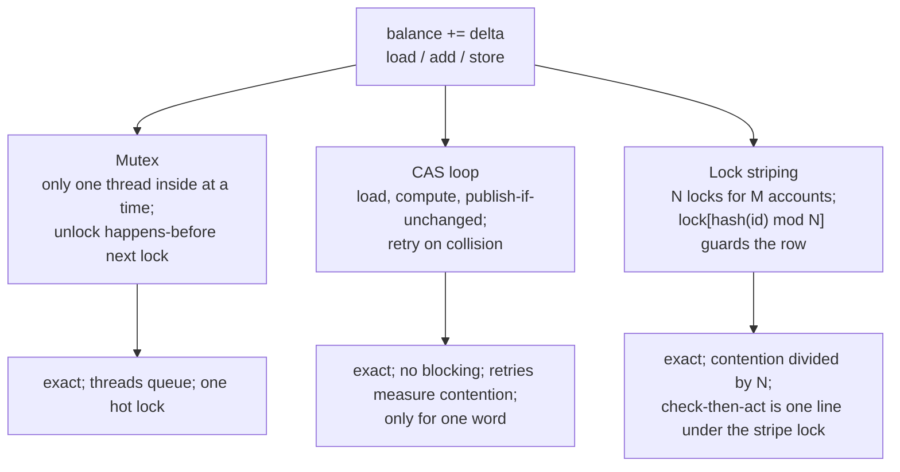

# Locks, Atomics, and a Balance That Never Lies

> Lose money with a race, then fix it three ways and measure each.

**Type:** Build
**Languages:** Java, Python, Go
**Prerequisites:** Phase 4, Lesson 01 (Threads and the Memory Model); Phase 3, Lesson 01 (Hash Maps); Phase 10, Lesson 01 (Representing Money)
**Time:** ~90 minutes

## Learning Objectives

- Force a lost update deterministically by injecting the interleaving instead of hoping the scheduler produces it, and explain why that is the only honest way to test the unsafe code
- Build the same balance counter three ways: a mutex, a compare-and-swap retry loop, and a lock-striped per-account map, with identical behaviour in Java, Python, and Go
- State the invariant each fix provides (atomicity plus visibility of the read-modify-write) and the one a bare atomic cannot provide (a check-then-act such as "debit only if the balance covers it")
- Measure contention as operations per second and CAS retries, and explain why the racy version is the fastest and the striped map is exact without a global lock
- Identify the production equivalents (`LongAdder`, `ConcurrentHashMap.compute`, `SELECT ... FOR UPDATE`, Redis `INCRBY`, conditional writes) and what each one hides

## The Problem

Lesson 01 showed the wallet service that lost refunds: two threads read `100.00 USD`, both add `25.00`, both write `125.00`, and one refund evaporates. It showed the bytecode (`getfield`, `ladd`, `putfield`) and the memory-model argument for why no test that just runs the code can prove it correct. It did not fix anything. This lesson fixes it, three times, and the fixes are the tools you will reach for in every later concurrency lesson.

The team that owned the wallet tried the obvious patch first: a `volatile` on the field. The reconciliation gap did not close, because `volatile` makes each read and each write visible, but the read and the write are still two separate operations with a gap between them. Their second patch wrapped the whole service in one global `synchronized`. The gap closed. Throughput dropped from 60,000 balance updates per second to 9,000, because a credit to account A now waited behind a debit to account Z that had nothing to do with it, and the p99 latency of the authorization endpoint went from 4 ms to 70 ms. Finance was happy and the merchants were not. The third patch is this lesson: understand exactly what the lock provides, pick the narrowest tool that provides it, and measure.

There is a second bug hiding behind the first. A debit must not take an account below zero. The code reads the balance, compares it with the amount, and if the balance covers it, subtracts. Two debits of `1.00 USD` from a balance of `1.50 USD` both pass the check and both subtract, and the balance is `-0.50 USD`. An atomic counter does not help here even though every individual operation on it is atomic: the check and the act are two operations. This "check-then-act" shape appears everywhere money moves (reserve funds, consume an idempotency key, claim an outbox row), and it is the reason a lock, or a CAS loop over the whole decision, is sometimes mandatory where an atomic increment is not enough.

## The Concept

### What `balance += delta` really is

In every runtime, `balance += delta` is three steps: load the current value into a register or stack slot, add, store the result back. The lost update happens when thread B's load falls between thread A's load and thread A's store. Both threads compute from the same stale value, and the second store overwrites the first:

| Step | Thread A | Thread B | `balance` in memory |
|------|----------|----------|---------------------|
| 1 | load → 10000 | | 10000 |
| 2 | | load → 10000 | 10000 |
| 3 | add 2500 → 12500 | | 10000 |
| 4 | | add 2500 → 12500 | 10000 |
| 5 | store 12500 | | 12500 |
| 6 | | store 12500 | 12500 |

Expected 15000 (150.00 USD); observed 12500. The amount lost is exactly one transaction's delta, which is why the reconciliation discrepancies in Lesson 01 were "exact multiples of recent transaction amounts". Nothing is corrupted in the memory-safety sense; the value is a legal `long`. It is simply not the sum of the postings.

The scheduler decides whether step 2 lands before step 5. On a 4-core machine with 250,000 increments per thread it does so tens of thousands of times a run; on a laptop running the unit test with two threads and ten increments it may never do so. That is why this lesson's tests never race the unsafe counter. Instead, `RacyCounter` takes a hook that runs between the load and the store, and the test uses the hook to run a complete second `add` at exactly that point. The interleaving above is reproduced, in one thread, every time, in every language.

### Three properties, three tools

A correct concurrent update needs the whole load-add-store to be **atomic** (no other thread observes or interleaves with the middle), the result to be **visible** to the next thread that reads, and the operations to be **ordered** so that "next" means something. Lesson 01 covered the definitions. The three fixes provide them differently:



**Mutex.** `lock(); balance += delta; unlock();`. Only one thread holds the lock, so the three steps of one thread cannot interleave with another's. Visibility comes from the memory model: in Java (JLS 17.4.5) an unlock happens-before every subsequent lock of the same monitor; the Go memory model says the same for `sync.Mutex`; in CPython, `threading.Lock` is a pthread mutex and releasing it is a full barrier. The cost is that threads wait. With four threads hammering one lock, three are parked at any instant, and the operating system's wake-ups set the throughput ceiling.

**Compare-and-swap.** Load the current value `c`, compute `n = c + delta`, then execute one hardware instruction (`LOCK CMPXCHG` on x86, `LDXR/STXR` or `CAS` on arm64) that says "if the word still equals `c`, store `n` and report success; otherwise report failure and change nothing". On failure, loop. No thread ever sleeps; a thread that loses the race simply recomputes from the fresh value. The retry count is a direct measurement of how often two threads collided, which makes it a better contention metric than wall-clock time. The limit: the hardware instruction operates on one machine word. You can CAS a balance. You cannot CAS "subtract from this balance and append to that journal" as one step.

**Lock striping.** The wallet has millions of accounts and the invariant is per account: a credit to A and a debit to Z do not need to serialize. One lock per account is the ideal, but a million `ReentrantLock` objects is a lot of memory and a map-of-locks has its own races. Striping compromises: allocate a fixed array of N locks and guard account `id` with `locks[hash(id) mod N]`. Two accounts on different stripes never contend; two on the same stripe contend as before. With N = 16 and uniformly hashed ids, the expected contention is one sixteenth of the global lock's. This is exactly the design of `java.util.concurrent.ConcurrentHashMap` before Java 8 (16 segments by default) and of Go's `sync.Map` shards in several third-party implementations.

### Why a bare atomic cannot do a debit

`debit(amount)` must refuse if `balance < amount`. With an atomic counter the natural code is:

```text
if (counter.get() >= amount)      <- check
    counter.add(-amount)          <- act
```

Each line is atomic. The pair is not. Two threads both check `150 >= 100`, both act, balance `-50`. There are two correct shapes:

1. **Under a lock.** Take the stripe lock, read, compare, write, release. The lock holds the world still between the check and the act. This is what `StripedAccountMap.debit` does.
2. **As one CAS loop over the decision.** Load `c`; if `c < amount` return refused; else CAS `c → c - amount`; on failure reload and re-decide. The decision is recomputed from the fresh value on every retry, so no stale check is ever acted on. Exercise 2 asks you to build this one.

The rule: an atomic primitive gives you atomicity for one operation on one word. The moment a decision depends on a value you read earlier, you need either a lock or a CAS whose expected value *is* the value the decision was based on.

### Worked example: two debits race for 1.50 USD

Account `w` holds 150 minor units. Threads P and Q each attempt `debit(100)` through `StripedAccountMap`, which has two stripes. `stableHash("w") = 119`, `119 mod 2 = 1`, so both threads need `locks[1]`.

```text
P: lock(locks[1])           acquired
Q: lock(locks[1])           parked: P holds it
P: read 150; 150 >= 100     ok
P: write 50
P: unlock(locks[1])         happens-before Q's acquisition below
Q:                          acquired; sees 50 (visibility guaranteed by the unlock/lock edge)
Q: read 50; 50 < 100        refuse: InsufficientFunds("w", 50, 100)
Q: unlock(locks[1])
```

Final balance 50, exactly one success. Which thread succeeds is up to the scheduler; *that* exactly one succeeds is not. The test `two racing debits of 1.00 from 1.50: exactly one succeeds` asserts the invariant without asserting the order, which is the pattern for every concurrency test in this course: assert what must be true in every schedule, never what happened to be true in this one.

### Measuring contention

Run four threads, each adding `1` minor unit 250,000 times, with every thread released by the same latch so the collisions are maximal. Numbers from a 2-core container, Java 21:

| Counter | Observed | Lost | ops/s (varies) | What the number means |
|---------|----------|------|----------------|-----------------------|
| racy | 9476.41 USD | 523.59 USD | 54,000,000 | fastest and wrong; 52,359 of 1,000,000 updates vanished |
| locked | 10000.00 USD | 0 | 22,000,000 | threads queue on one lock |
| atomic | 10000.00 USD | 0 | 26,000,000 | 19,608 CAS retries: that many collisions |
| striped-map(16), 8 accounts | 10000.00 USD | 0 | 4,000,000 | exact; slower here because each op is a hash plus a map write, not a bare add |

Three readings matter. First, the racy counter is the fastest. Correctness has a cost and anyone benchmarking without checking the result will pick the wrong implementation. Second, the striped map's ops/s is not comparable to the counters' because each operation does more work (hash the id, lock, look up a map entry, write); its advantage shows up when you compare it with the *same map behind one global lock*, which Exercise 1 asks you to do. Third, every number in the ops/s column changes run to run and machine to machine. The `lost` column does not. That is why the tests assert `lost == 0` and never assert a throughput.

The benchmark harness takes an injected `Stopwatch`. With `FakeStopwatch(1_000_000, 3_000_000)` the elapsed time is exactly 2 ms and `4 threads x 1,000 ops` is exactly 2,000,000 ops/s, so the arithmetic in `BenchmarkResult` is tested deterministically while the live numbers are left to the demo.

### What these tools do not do

- **They do not make a multi-account transfer atomic.** `debit(A); credit(B)` under two stripe locks is two atomic operations with a window between them in which the money is in neither account. Taking both stripe locks is the answer, and taking them in the wrong order is a deadlock. That is Lesson 07.
- **They do not survive the process.** Everything here is in-memory. The database row lock (`SELECT ... FOR UPDATE`) and the ledger's double-entry invariant (Phase 10) are what make a balance durable and auditable; this lesson is the in-process cache in front of them.
- **They do not give you a consistent read across stripes for free.** `total()` takes every stripe lock, in index order, so the sum is a snapshot. A cheaper `total()` that reads stripe by stripe without locking all of them can return a value that was never the true total at any instant. `LongAdder.sum()` has exactly that caveat in its Javadoc.
- **The Python atomic is a lock.** CPython exposes no compare-and-swap, so `AtomicLong.compare_and_set` is implemented with `threading.Lock`. The CAS *shape* is preserved so the retry loop reads the same as Java and Go, but the performance story is the mutex's.

## Build It

The walkthrough is in Java. Python and Go implement the same names and the same tests; the subsections at the end show only what differs.

### Step 1: The bug, with a seam for the test

```java
final class RacyCounter implements BalanceCounter {
    private long balance;
    private final Runnable betweenLoadAndStore;

    RacyCounter() { this(() -> { }); }

    RacyCounter(Runnable betweenLoadAndStore) {
        this.balance = 0;
        this.betweenLoadAndStore = Objects.requireNonNull(betweenLoadAndStore);
    }

    @Override
    public void add(long delta) {
        long loaded = balance;          // 1. load
        betweenLoadAndStore.run();      //    (another thread may run here)
        balance = loaded + delta;       // 2. store a value computed from a possibly stale load
    }

    @Override public long get() { return balance; }
    @Override public String name() { return "racy"; }
}
```

The hook is the whole trick. Production code has no hook; the scheduler *is* the hook, and it fires wherever it likes. Making the gap explicit lets a test put a second `add` into it:

```java
racy[0] = new RacyCounter(() -> {
    if (!fired[0]) { fired[0] = true; racy[0].add(5); }
});
racy[0].add(5);
check("scripted interleaving loses one update (5 not 10)", racy[0].get() == 5);
```

The outer `add` loads 0, the hook runs a complete inner `add` (loads 0, stores 5), then the outer `add` stores `0 + 5 = 5`. Two credits, balance 5. Single-threaded, so Go's race detector does not fire and the result is identical on every run.

**Predict:** the `fired` guard stops the inner `add` from recursing forever. What would `get()` return if the hook ran the inner `add` *twice* before returning?

### Step 2: Fix 1, a mutex

```java
final class LockedCounter implements BalanceCounter {
    private final ReentrantLock lock = new ReentrantLock();
    private long balance;

    @Override
    public void add(long delta) {
        lock.lock();
        try {
            balance = Math.addExact(balance, delta);
        } finally {
            lock.unlock();
        }
    }

    @Override
    public long get() {
        lock.lock();
        try {
            return balance;
        } finally {
            lock.unlock();
        }
    }
}
```

Two things people get wrong. The `finally` is not optional: `Math.addExact` throws on overflow, and a lock that is not released on the exception path is held forever by a thread that has moved on, which deadlocks every later caller. And `get()` locks too. A plain read of a non-volatile `long` written under a lock has no happens-before edge to the writer unless the reader also acquires the lock (or the field is `volatile`); without it, the JIT is entitled to return a value it cached before the writer ran. `synchronized` would do the same job in fewer lines; `ReentrantLock` is used here because Lesson 07 needs `tryLock`.

**Predict:** if `get()` were an unlocked read of a `volatile long balance`, would the lost-update bug come back? Would the visibility bug?

### Step 3: Fix 2, compare-and-swap

```java
final class AtomicCounter implements BalanceCounter {
    private final AtomicLong value = new AtomicLong();
    private final AtomicLong retries = new AtomicLong();

    @Override
    public void add(long delta) {
        while (true) {
            long current = value.get();
            long next = Math.addExact(current, delta);
            if (value.compareAndSet(current, next)) return;
            retries.incrementAndGet();
        }
    }

    @Override public long get() { return value.get(); }
    long casRetries() { return retries.get(); }
}
```

`compareAndSet(expected, next)` is the hardware CAS. If another thread stored between our `get()` and our CAS, the word no longer equals `current`, the CAS fails, and we loop with a fresh read. No thread parks; no operating system call; the loser does one more iteration. `AtomicLong.addAndGet` does exactly this loop internally (or a single `LOCK XADD` where the hardware has it), so the explicit loop is here to make the retry visible and countable. The `retries` counter is itself an `AtomicLong` because the racy alternative would under-count by the same mechanism we are fixing.

**Predict:** on a machine with one core, how many CAS retries will four threads produce? Why is the answer not "zero"?

### Step 4: Fix 3, lock striping over a per-account map

```java
final class StripedAccountMap {
    private final Currency currency;
    private final ReentrantLock[] locks;
    private final HashMap<String, Long>[] buckets;

    int stripeIndex(String accountId) {
        return Math.floorMod(stableHash(accountId), locks.length);
    }

    static int stableHash(String s) {
        int h = 0;
        for (int i = 0; i < s.length(); i++) h = 31 * h + s.charAt(i);
        return h;
    }

    void credit(String accountId, Money amount) {
        requireValid(amount);
        int s = stripeIndex(accountId);
        locks[s].lock();
        try {
            long current = requireOpen(s, accountId);
            buckets[s].put(accountId, Math.addExact(current, amount.minorUnits()));
        } finally {
            locks[s].unlock();
        }
    }
}
```

Each stripe owns one lock and one `HashMap`. The map is a plain `HashMap`, not a concurrent one, because every access to `buckets[s]` happens under `locks[s]`; the stripe lock protects the map structure *and* the balance in it. `stableHash` is Java's `String.hashCode` written out so that Python (whose built-in `hash` is salted per process) and Go compute the identical value and `"acct-1"` lands on the same stripe in all three languages. `Math.floorMod` rather than `%` because the hash can be negative and `-5 % 16` is `-5` in Java.

```java
void debit(String accountId, Money amount) {
    requireValid(amount);
    int s = stripeIndex(accountId);
    locks[s].lock();
    try {
        long current = requireOpen(s, accountId);
        if (current < amount.minorUnits()) throw new InsufficientFundsException(accountId, current, amount.minorUnits());
        buckets[s].put(accountId, current - amount.minorUnits());
    } finally {
        locks[s].unlock();
    }
}
```

The check (`current < amount`) and the act (`put`) are inside the same lock hold, so the balance the check saw is the balance the act modifies. This is the check-then-act that the atomic counter could not express.

```java
Money total() {
    for (ReentrantLock lock : locks) lock.lock();
    try {
        long sum = 0;
        for (var bucket : buckets) for (long v : bucket.values()) sum = Math.addExact(sum, v);
        return Money.ofMinor(sum, currency);
    } finally {
        for (int i = locks.length - 1; i >= 0; i--) locks[i].unlock();
    }
}
```

`total()` takes every stripe lock, always in index order. If two threads call `total()` at once, both try `locks[0]` first; one wins, the other waits, and neither can hold a higher stripe while waiting for a lower one. Lesson 07 turns that observation into a rule.

**Predict:** `stripeIndex` for `"acct-1"` through `"acct-8"` with 16 stripes. Do any two collide? (The demo prints one of them.)

### Step 5: The benchmark harness

```java
static BenchmarkResult run(String name, int threads, int opsPerThread, long delta, Worker worker,
                           LongSupplier observe, Stopwatch stopwatch) throws InterruptedException {
    CountDownLatch start = new CountDownLatch(1);
    CountDownLatch done = new CountDownLatch(threads);
    Thread[] pool = new Thread[threads];
    for (int t = 0; t < threads; t++) {
        final int threadIndex = t;
        pool[t] = new Thread(() -> {
            try {
                start.await();
                for (int i = 0; i < opsPerThread; i++) worker.run(threadIndex, i);
            } finally {
                done.countDown();
            }
        });
        pool[t].start();
    }
    long before = stopwatch.nanos();
    start.countDown();               // all threads begin together: maximum contention
    done.await();                    // countDown() happens-before await() returning
    long after = stopwatch.nanos();
    return new BenchmarkResult(name, threads, opsPerThread, delta, observe.getAsLong(), after - before);
}
```

The `start` latch matters more than it looks. Without it, thread 0 may finish all its iterations before thread 3 has been scheduled, and a racy counter will pass by accident. The `done` latch provides the happens-before edge that makes `observe()` see every worker's writes, including the racy counter's, so the *observed* loss is measured correctly even though the counter itself is broken. The exception path (`failure`, omitted above, present in the file) rethrows a worker's exception on the benchmark thread so a test cannot pass while a worker died.

**Predict:** `Benchmark.measure` passes `counter::get` as `observe`. For `StripedAccountMap`, `measureMap` passes `map::totalMinor`. Why is `total()` the right thing to observe rather than summing `balance(id)` over the ids?

### Step 6: Run it

```bash
cd phases/04-concurrency/02-locks-and-atomic-counters/code/java
javac -d .out *.java && java -cp .out Main
java -cp .out MainTest
```

Expected output, abbreviated (ops/s and the racy loss vary):

```console
== A lost update, forced deterministically ==
two credits of 0.01 USD, balance = 0.01 USD (expected 0.02 USD): the second write overwrote the first

== 4 threads each credit 0.01 USD 250,000 times: expected 10000.00 USD ==
racy             observed    9476.41 USD  lost   523.59 USD    54,446,869 ops/s   <- varies run to run; any loss is the proof
locked           observed   10000.00 USD  lost     0.00 USD    22,409,190 ops/s
atomic           observed   10000.00 USD  lost     0.00 USD    26,604,607 ops/s   CAS retries: 19,608 (varies)
striped-map(16)  observed   10000.00 USD  lost     0.00 USD     3,989,050 ops/s

== Check-then-act: a debit that cannot overdraw ==
acct-1 balance 2505.00 USD on stripe 7
rejected: account acct-1 has 250500 minor units, debit of 1000000 refused

== Deterministic replay with an injected stopwatch ==
4 threads x 1,000 ops in 2.000 ms = 2,000,000 ops/s, lost 0
```

### In Python

```python
class RacyCounter:
    def add(self, delta: int) -> None:
        loaded = self.balance          # LOAD_ATTR
        self._between()
        self.balance = loaded + delta  # STORE_ATTR
```

Differences, all in `code/python/main.py`:

- **The GIL does not save you.** `self.balance += delta` is `LOAD_ATTR`, `BINARY_OP`, `STORE_ATTR`, and the interpreter may release the GIL between any two bytecodes. With the default switch interval of 5 ms the race is rare; the demo calls `sys.setswitchinterval(1e-6)` for the racy run and loses roughly a third of the updates. Lesson 10 covers the GIL in depth. The scripted interleaving is the proof in the tests either way.
- **There is no CAS.** `AtomicLong.compare_and_set` is a lock around a compare and a store. The retry loop in `AtomicCounter.add` is kept so the three implementations read the same, and `cas_retries` still counts real collisions, but the throughput is the mutex's.
- **`hash()` is salted.** `stable_hash` reimplements the 31-multiplier hash with 32-bit wrap-around (`& 0xFFFFFFFF`, then sign-fold) so stripe assignment matches Java and Go.
- **`threading.Event` is the start latch and `join()` is the done latch.** `Thread.join()` is specified to publish everything the joined thread wrote, so `observe()` after the joins is sound.

### In Go

```go
func (c *AtomicCounter) Add(delta int64) {
    for {
        current := c.value.Load()
        if c.value.CompareAndSwap(current, current+delta) {
            return
        }
        c.retries.Add(1)
    }
}
```

Differences, all in `code/go/main.go`:

- **`-race` is part of the test command.** `go test -race ./...` instruments every memory access and fails the test on any unsynchronized pair. The racy counter is therefore run concurrently only in `main`, never in a test; the test suite reaches it through the injected hook alone. If you add a concurrent racy test, the detector will fail it, which is the detector doing its job.
- **`atomic.Int64` is a real CAS**, compiling to `LOCK CMPXCHG` on amd64. `sync.Mutex` is the lock; `Unlock` happens-before the next `Lock` returns (Go memory model, "Locks").
- **Errors are values.** `Debit` returns `ErrInsufficientFunds` wrapped with `%w` so callers use `errors.Is`; `Credit` returns `ErrCurrencyMismatch` or `ErrNegativeAmount`. Java throws; Python raises.
- **A closed channel is the start latch and `sync.WaitGroup` is the done latch.** `close(start)` releases every goroutine blocked on `<-start` at once.

## Use It

### `java.util.concurrent`

- **`AtomicLong.addAndGet`** is Step 3 without the visible loop. **`LongAdder`** is the striped version of it: each thread adds to its own cell and `sum()` adds the cells, so writers almost never collide. Its Javadoc warns that `sum()` "is NOT an atomic snapshot" while writers are active; it is a counter for statistics, not a balance. Use `AtomicLong` for a value you read back and act on; use `LongAdder` for a metric.
- **`ConcurrentHashMap.compute(key, (k, v) -> ...)`** runs the function atomically with respect to other operations on the same key: a check-then-act per account in one call, with the striping (bin-level locking since Java 8) done for you. `merge(key, delta, Long::sum)` is the per-account credit. The trap: the function must not touch other keys of the same map, or you reintroduce the two-account deadlock of Lesson 07.
- **`ReentrantLock`** versus **`synchronized`**: same memory-model guarantees; the lock object adds `tryLock`, timed waits, fairness, and multiple `Condition`s (Lesson 05). `synchronized` is shorter and the JIT can elide it when it proves the object does not escape.

### Python

`threading.Lock` is the only primitive you need for a counter. The `atomics` and `multiprocessing.Value` modules exist but a lock is clearer. For a per-account map, a dictionary guarded by a lock is correct; `collections.defaultdict` with striped locks is the pattern above. Free-threaded CPython (PEP 703, Lesson 10) removes the GIL and makes the lost update as frequent as in Java and Go, which is why the lock belongs in the code today, not when you upgrade.

### Go

`sync.Mutex` and `sync/atomic` are what this lesson built on. `sync.Map` is optimized for keys written once and read many times (caches), not for balances that change constantly; its own documentation says so and recommends a plain map with a mutex otherwise. The striped map above is what most Go payment services actually run, often with a power-of-two stripe count and `hash & (n-1)`.

### Databases and caches

- **PostgreSQL `SELECT ... FOR UPDATE`** is the row-level lock: read the balance, hold the lock until commit, write. `UPDATE accounts SET balance = balance - 100 WHERE id = $1 AND balance >= 100` is the check-then-act as a single statement; it returns zero rows affected when the check fails, which is a CAS in SQL.
- **Redis `INCRBY`** is a single-threaded atomic add, exact by construction. `WATCH`/`MULTI`/`EXEC` is optimistic CAS over a key; a Lua script is a lock-free check-then-act.
- **DynamoDB conditional writes** (`ConditionExpression: balance >= :amt`) are CAS at the item level; `ConditionalCheckFailedException` is the CAS failure, and the retry loop is yours to write.

Every one of these is one of the three shapes in this lesson. Knowing which shape a production primitive is tells you what it cannot do.

## Ship It

`outputs/checklist-shared-counter-review.md` is a review checklist for any change that updates a shared number: which of the three shapes it uses, whether every check-then-act is inside the same critical section as its act, whether the test forces the interleaving rather than hoping for it, and whether the benchmark asserts correctness before reporting speed. Use it when reviewing a counter, a rate limiter, an inventory decrement, or a balance cache.

## Exercises

1. **Reinforce.** Add a `GlobalLockAccountMap` with one `ReentrantLock` guarding a single `HashMap`, give it the same methods as `StripedAccountMap`, and run `Benchmark.measureMap` against both with 8 threads and 8 accounts. Report the ops/s ratio. Then run both with a single account and explain, in two sentences, why the ratio collapses to about 1.
2. **Apply.** Implement `AtomicCounter.debitIfSufficient(long amount)` as a CAS loop: load `current`; if `current < amount` return `false`; else `compareAndSet(current, current - amount)`; on CAS failure reload and re-decide. Write the two-racing-debits test for it and confirm exactly one succeeds. State in a comment why reloading before re-deciding is what makes it correct.
3. **Extend.** Combine with Phase 3, Lesson 01 (Hash Maps): replace the per-stripe `HashMap` with your own open-addressing table from that lesson. Then measure stripe collision: with 16 stripes and 1,000 account ids `acct-0 ... acct-999`, count how many ids land on each stripe and compute the maximum load. Compare `stableHash` with a hash that mixes the bits (multiply by `0x9E3779B9` and xor-shift) and decide whether the simple hash is good enough for this key shape.

## Key Terms

| Term | What people say | What it actually means |
|------|-----------------|------------------------|
| Lost update | "the counter is off" | Two read-modify-write sequences interleave so the second store overwrites the first; the loss is exactly one operation's delta, and the value is still a legal number |
| Mutex | "a lock" | A primitive that admits one thread at a time to a region; its release happens-before the next acquisition, which provides both atomicity and visibility for the region |
| Compare-and-swap | "an atomic" | One hardware instruction that stores a new value only if the word still holds the expected value; the basis of every lock-free algorithm and of `AtomicLong` |
| CAS retry | "spinning" | An iteration of a CAS loop that failed because another thread stored first; counting retries measures contention directly |
| Check-then-act | "if balance is enough, subtract" | A decision based on a value read earlier, followed by a write; correct only if the read and the write are in the same critical section or the write's CAS expects the read value |
| Lock striping | "sharded locks" | A fixed array of N locks where key `k` is guarded by `locks[hash(k) mod N]`; contention divided by N for keys that hash apart, no per-key lock allocation |
| Contention | "the lock is hot" | Multiple threads needing the same lock or word at the same time; visible as parked threads (mutex) or retries (CAS), and as ops/s that stop scaling with cores |
| Snapshot read | "the total" | A read of several values that were all true at the same instant; requires holding every relevant lock at once, which `LongAdder.sum()` and a stripe-by-stripe sum do not do |

## Further Reading

- [JLS Chapter 17.4.5, Happens-before Order](https://docs.oracle.com/javase/specs/jls/se21/html/jls-17.html#jls-17.4.5) — the unlock/lock and volatile rules that make the locked counter's `get()` sound and the racy counter's `get()` unspecified.
- [The Go Memory Model](https://go.dev/ref/mem) — "Locks" and "Atomic Values" sections: the guarantees `sync.Mutex` and `sync/atomic` provide, in one page.
- [`java.util.concurrent.atomic.LongAdder` Javadoc](https://docs.oracle.com/en/java/javase/21/docs/api/java.base/java/util/concurrent/atomic/LongAdder.html) — the striped-counter design and the explicit warning that `sum()` is not a snapshot.
- [`ConcurrentHashMap` Javadoc, Java 21](https://docs.oracle.com/en/java/javase/21/docs/api/java.base/java/util/concurrent/ConcurrentHashMap.html) — `compute` and `merge` as per-key atomic check-then-act; the implementation notes describe bin-level locking.
- [Herlihy & Shavit, *The Art of Multiprocessor Programming*, Chapter 5](https://www.sciencedirect.com/book/9780124159501/the-art-of-multiprocessor-programming) — why compare-and-swap has infinite consensus number and a read-write register does not, i.e. why CAS can build any lock-free object and a plain `balance += delta` can build nothing.
- [PostgreSQL: Explicit Locking, row-level locks](https://www.postgresql.org/docs/current/explicit-locking.html#LOCKING-ROWS) — `FOR UPDATE` semantics, the database's version of the stripe lock.
