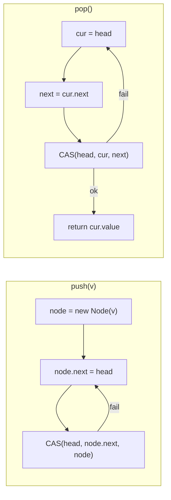

# Compare-and-Swap and Lock-Free Structures

> A lock-free stack and the ABA problem that breaks it.

**Type:** Build
**Languages:** Java, Python, Go
**Prerequisites:** Phase 4, Lesson 01 (Threads and the Memory Model); Phase 4, Lesson 02 (Locks, Atomics, and a Balance That Never Lies); Phase 1, Lesson 05 (Stacks, Queues, and Deques)
**Time:** ~90 minutes

## Learning Objectives

- Build Treiber's lock-free stack on a single `AtomicReference` and explain why one compare-and-swap per operation is enough to make it linearizable
- Reproduce the ABA problem deterministically, show that it hands the same payment job to two workers, and explain why node reuse is what makes it possible
- Fix ABA with a stamped reference and connect the stamp to the version column in an optimistic-locking `UPDATE`
- Implement the Michael-Scott queue's two-pointer design, including the step where a thread helps another thread finish its enqueue
- Place blocking, obstruction-free, lock-free, and wait-free on one ladder and say which rung each structure in this lesson reaches
- Decide, for a given hot path, when a CAS loop beats a lock and when it does not

## The Problem

A payment processor runs a fleet of capture workers. When an authorization is approved, the API tier pushes a `CaptureJob` (payment id, amount in minor units) onto a shared work stack; workers pop jobs and send the capture to the card network. The stack is the hottest object in the service: 40,000 pushes and pops per second across 32 worker threads. The first version used a `synchronized` stack and the lock became the bottleneck Lesson 02 predicted, with p99 pop latency at 18 ms while the actual work took 200 microseconds. A senior engineer replaced it with a lock-free stack: one `compareAndSet` on the head pointer per push and per pop, no lock, no parked threads. Latency dropped to 40 microseconds and the team moved on.

Six weeks later a merchant reported being paid twice for the same order. Then another. The pattern was rare, about one in eight million captures, and it never reproduced on a laptop. The duplicate captures always involved a job that had been popped, processed, and then popped *again* a few microseconds later, as if it had been pushed back. Nobody pushed it back. The engineer who wrote the stack had also written a node pool to avoid allocating on the hot path: popped nodes went to a free list and `push` reused them. That optimisation, combined with the one-word CAS, is the whole bug. Thread A reads the head node, call it N3, and the node below it, N2. Before A's CAS runs, thread B pops N3 and N2, then pushes a new job, which reuses N3 from the pool. A's CAS compares the head against N3, finds it equal, and swings the head to N2, a node that is sitting in the free list with the already-processed job still in it. The stack now offers that job again. The CAS asked "is the head still N3?" when the question that mattered was "has anything happened since I looked?"

This is the ABA problem, and it is the reason compare-and-swap is harder than it looks. The fix is cheap, a stamp that changes on every successful CAS, and the same idea shows up as a `version` column in every optimistic-locking `UPDATE` a payments database runs. This lesson builds the stack, breaks it on purpose in a single thread so the failure is reproducible, fixes it, builds the queue that most lock-free message passing is based on, and names exactly what "lock-free" promises.

## The Concept

### What a CAS is

`compareAndSet(expected, next)` is a single hardware instruction (`LOCK CMPXCHG` on x86, `LDXR/STXR` or `CAS` on ARM) with the semantics:

```text
atomically:
  if (memory == expected) { memory = next; return true; }
  else                    { return false; }
```

It is the only primitive you need to build everything else in this lesson. The pattern that uses it is always the same three lines, which Lesson 02 called a CAS loop:

1. Read the current value.
2. Compute what the new value should be, given what you read.
3. CAS from what you read to what you computed. If it fails, another thread published between steps 1 and 3; go back to step 1.

The CAS loop converts the "load, modify, store" race from Lesson 01 into "load, modify, store-if-unchanged". The loser of a race does not lose an update; it repeats. That is the entire difference between a racy counter and `AtomicLong`.

### Treiber's stack: one pointer, one CAS

A stack is a singly linked list where the head is the top. Treiber (1986) observed that both operations change exactly one shared word, `head`, so each can be a single CAS:



The invariant is simple: **`head` always points at a node whose `next` chain is a valid stack, and the CAS is the only write to `head`.** Setting `node.next` before the CAS is what makes this work: a thread that reads the new head after the CAS is guaranteed by the memory model (the CAS is a volatile write; the earlier plain write to `node.next` happens-before it) to see the correct `next`. The structure is linearizable: every operation appears to take effect at the instant of its successful CAS, and the CASes on one word are totally ordered.

Complexity is O(1) per operation in the absence of contention. Under contention, a thread may retry an unbounded number of times, which is the subject of the progress section below.

### The ABA problem, by hand

Start with a stack of three capture jobs and a node pool. Node identities (N1, N2, N3) matter here, so the table tracks them.

| Step | Thread A (popping) | Thread B | `head` | Free list |
|------|--------------------|----------|--------|-----------|
| 0 | | | N3(pay_003) -> N2(pay_002) -> N1(pay_001) | empty |
| 1 | `cur = head` = N3; `next = cur.next` = N2 | | N3 | empty |
| 2 | descheduled | `pop()` -> pay_003; N3 freed | N2 -> N1 | [N3] |
| 3 | | `pop()` -> pay_002; N2 freed | N1 | [N3, N2] |
| 4 | | `push(pay_004)` reuses N3; N3.next = N1 | N3(pay_004) -> N1 | [N2] |
| 5 | `CAS(head, N3, N2)` **succeeds**: head is N3 | | N2(pay_002) -> N1 | [N2] |
| 6 | returns N3.value = pay_004 | | N2 -> N1 | [N2] |

After step 5 the stack says its top is pay_002, a job that was popped and processed at step 3. The next worker pops it and captures the payment a second time. N2 is simultaneously on the stack and in the free list, so the next push will overwrite its contents while it is still reachable, and the corruption spreads. Note that A's CAS did exactly what it was asked: the head *was* N3. The reference was the same; the world was not.

Three conditions had to hold for this to happen, and removing any one of them removes the bug:

1. **A reference was reused.** Under a garbage collector with fresh nodes (the first `TreiberStack` in the code), N3 cannot be reused while thread A still holds a reference to it, so `head` can never equal A's stale `cur` unless nothing happened. The JVM's GC is an ABA defence that C programmers have to build by hand (hazard pointers, epoch reclamation). The moment you add a node pool, you give it up.
2. **The CAS compared only the reference.** It had no way to express "and nothing changed in between".
3. **The structure's correctness depended on a value read before the CAS** (`next` = N2). A CAS loop that recomputes everything from the single word it is CASing (an `AtomicLong` counter) cannot have ABA, because there is no second value to go stale.

### The fix: tag the word with a version

`AtomicStampedReference<V>` packs a reference and an `int` stamp into one atomically-updatable pair. Every successful CAS increments the stamp. Thread A read (N3, stamp 3); after B's three operations the head is (N3, stamp 6). A's `compareAndSet(N3, N2, 3, 4)` fails because 3 != 6, A re-reads, sees (N3(pay_004), 6) with `next` = N1, and pops pay_004 correctly. The stamp does not say *what* changed; it says *that* something changed, which is the question A should have been asking.

This is exactly a database's optimistic lock:

```sql
UPDATE payments SET state = 'CAPTURED', version = version + 1
 WHERE id = 'pay_002' AND version = 3;
-- 0 rows updated means someone else moved it first: re-read and decide again
```

A 32-bit stamp wraps after 4.29 billion CASes; for a wrap to cause ABA, a thread would have to be descheduled for exactly 2^32 operations and resume to find the same reference. In practice that is treated as impossible; `AtomicStampedReference` is the standard answer and the one the JDK ships. For the minimal version, `AtomicMarkableReference` carries one bit instead of an int and is what the Harris-Michael lock-free linked list uses to mark a node logically deleted.

### The Michael-Scott queue

A FIFO queue needs two pointers, `head` for dequeue and `tail` for enqueue, and two words cannot be CASed together. Michael and Scott (1996) solved it with a sentinel node and a tolerance for a lagging tail:

- `head` points at a sentinel; the first real element is `head.next`. Dequeue reads `head.next.value` and CASes `head` forward; the old first element becomes the new sentinel.
- Enqueue is two CASes: link the new node onto `tail.next` (this is the linearization point; the element is now in the queue), then swing `tail` to the new node. Between the two CASes `tail` lags by one.
- Any thread that observes `tail.next != null` knows some enqueuer is between its two CASes. Instead of waiting, it **helps**: it swings `tail` forward itself, then retries its own operation. Because the helper's CAS and the original enqueuer's CAS expect the same old value, exactly one succeeds and both are satisfied.

| Operation | Shared words touched | Linearization point | Why it never blocks |
|-----------|---------------------|---------------------|---------------------|
| `enqueue` | `tail.next`, then `tail` | the CAS on `tail.next` | a lagging `tail` is fixed by whoever sees it |
| `dequeue` | `head` | the CAS on `head` | if `head == tail` but `head.next != null`, the dequeuer helps swing `tail` first |

Helping is the idea that separates lock-free from blocking designs: a thread that is descheduled halfway through an operation leaves the structure in a state that other threads can finish for it. With a lock, a descheduled holder leaves everyone stuck. `java.util.concurrent.ConcurrentLinkedQueue` is this algorithm with a few optimisations (lazy tail updates every other node), and the Javadoc cites the paper.

### Progress guarantees

"Lock-free" has a precise meaning and most code that avoids `synchronized` does not meet it.

| Guarantee | Promise | Example | Failure it rules out |
|-----------|---------|---------|----------------------|
| Blocking | none: a thread that holds a lock and is descheduled stops everyone | `synchronized` stack | priority inversion, convoying, deadlock |
| Obstruction-free | a thread that runs alone long enough finishes | some software transactional memories | deadlock, but not livelock |
| Lock-free | in any finite number of steps across all threads, *some* thread completes | Treiber stack, Michael-Scott queue, `AtomicLong` loops | livelock; an individual thread may still retry forever |
| Wait-free | *every* thread completes in a bounded number of its own steps | `AtomicLong.getAndIncrement` on hardware with `LOCK XADD`; single-reader single-writer ring buffers | starvation |

The Treiber stack is lock-free because a CAS fails only when another CAS succeeded, so system-wide progress is guaranteed. It is not wait-free: an unlucky thread can lose every race. The practical consequence for a payments hot path is that lock-free structures give excellent throughput and no deadlocks but **no latency bound per operation**; if you need a p99.99 guarantee for a single caller, you need a wait-free design or a bounded retry that falls back to a lock.

### When a CAS loop is the wrong tool

- **Multiple words must change together.** A transfer between two balances is two words. A CAS on one does not cover the other; you need a lock, a transaction, or a single-word encoding (Lesson 08's actor model sidesteps this by owning both in one thread).
- **The computation between read and CAS is expensive.** Under contention, every retry redoes it; a lock serialises the work instead of repeating it.
- **Fairness matters.** Spinning CAS loops favour whichever thread the cache coherence protocol favours. `ReentrantLock(true)` is unfair in throughput but fair in order.
- **The structure has a size or needs to block when empty.** Lesson 05 built the bounded queue precisely because an unbounded lock-free queue cannot say "wait, there is nothing here".

### What this lesson does not do

It does not teach memory reclamation without a GC (hazard pointers, epochs, RCU), which is the hard part of lock-free programming in C, C++, and Rust. It does not cover elimination backoff for stacks or flat combining. And it does not claim lock-free is faster: under low contention a `ReentrantLock` and a CAS loop cost about the same, and Lesson 02 showed that the right fix is to measure.

## Build It

All code is in `code/java/Main.java`; tests in `MainTest.java`.

### Step 1: The lock-free stack

```java
final class TreiberStack<T> {
    static final class Node<T> {
        final T value;
        Node<T> next;
        Node(T value) { this.value = value; }
    }

    private final AtomicReference<Node<T>> head = new AtomicReference<>();
    private final AtomicLong casRetries = new AtomicLong();

    void push(T value) {
        Objects.requireNonNull(value, "value");
        Node<T> node = new Node<>(value);
        while (true) {
            Node<T> current = head.get();
            node.next = current;
            if (head.compareAndSet(current, node)) return;
            casRetries.incrementAndGet();
        }
    }
```

`node` is private to this thread until the CAS publishes it, so writing `node.next` with a plain field write is safe: the CAS is a volatile write, and everything this thread did before it is visible to any thread that reads `head` afterwards. `casRetries` is an `AtomicLong` because a plain counter would under-count by the very race the stack avoids.

**Predict:** if two threads push simultaneously and both read `current = null`, what does the loser see on its retry, and what is the final `size()`?

```java
    Optional<T> pop() {
        while (true) {
            Node<T> current = head.get();
            if (current == null) return Optional.empty();
            Node<T> next = current.next;
            if (head.compareAndSet(current, next)) return Optional.of(current.value);
            casRetries.incrementAndGet();
        }
    }
```

`pop` reads two things before its CAS, `current` and `current.next`, and the correctness of the CAS depends on `next` still being the right successor. With fresh nodes and a garbage collector, it is: `current` cannot be collected or reused while this thread references it, so if `head` still equals `current`, nothing was popped and pushed in between. This stack is ABA-safe for a reason that has nothing to do with the stack and everything to do with the runtime.

### Step 2: Reintroduce the bug with a node pool

```java
class PooledStack {
    static final class Node {
        final int id;
        CaptureJob value;
        Node next;
        Node(int id) { this.id = id; }
    }

    protected final AtomicReference<Node> head = new AtomicReference<>();
    protected final ArrayDeque<Node> freeList = new ArrayDeque<>();   // FIFO: oldest freed node reused first
    protected final Runnable beforeCas;

    protected synchronized Node allocate(CaptureJob value) {
        Node node = freeList.isEmpty() ? new Node(nextId++) : freeList.pollFirst();
        node.value = value;
        return node;
    }

    Optional<CaptureJob> pop() {
        while (true) {
            Node current = head.get();
            if (current == null) return Optional.empty();
            Node next = current.next;
            beforeCas.run();                                           // the gap
            if (head.compareAndSet(current, next)) {
                CaptureJob value = current.value;
                free(current);
                return Optional.of(value);
            }
        }
    }
}
```

Two changes from Step 1. Nodes are mutable and recycled through `freeList`, which is the optimisation the capture service made. And `beforeCas` is a test seam, the same device Lesson 02 used for the racy counter: it runs in the gap between reading `head` and the CAS, so a test can execute thread B's entire pop/pop/push sequence at exactly that point, in one thread, deterministically. The `synchronized` on `allocate`/`free` is deliberate: it keeps the free list itself correct so that the only bug in this class is ABA, not a second race that would muddy the demonstration.

The demo in `Main.demoAba` arms the seam once, so the first `pop` is interrupted and the pops inside the hook are not:

```java
PooledStack stack = new PooledStack(() -> {
    if (!armed[0]) return;
    armed[0] = false;
    PooledStack s = holder[0];
    s.pop();                                   // pay_003; N3 to free list
    s.pop();                                   // pay_002; N2 to free list
    s.push(new CaptureJob("pay_004", 4_000));  // reuses N3
});
```

**Predict:** the free list is FIFO. If it were LIFO (`pollLast`), which node would `push(pay_004)` reuse, and would the stale CAS still succeed?

### Step 3: The stamped fix

```java
final class StampedPooledStack {
    private final AtomicStampedReference<PooledStack.Node> head = new AtomicStampedReference<>(null, 0);

    void push(CaptureJob value) {
        PooledStack.Node node = allocate(value);
        int[] stamp = new int[1];
        while (true) {
            PooledStack.Node current = head.get(stamp);
            node.next = current;
            if (head.compareAndSet(current, node, stamp[0], stamp[0] + 1)) return;
        }
    }

    Optional<CaptureJob> pop() {
        int[] stamp = new int[1];
        while (true) {
            PooledStack.Node current = head.get(stamp);
            if (current == null) return Optional.empty();
            PooledStack.Node next = current.next;
            beforeCas.run();
            if (head.compareAndSet(current, next, stamp[0], stamp[0] + 1)) {
                CaptureJob value = current.value;
                free(current);
                return Optional.of(value);
            }
            staleCasRejected.incrementAndGet();
        }
    }
}
```

`head.get(stamp)` is the JDK's slightly awkward way to return two values: the reference as the result and the stamp through the array. The CAS now takes four arguments, expected and new for both halves. Same pool, same seam, same interleaving; the only difference is that the CAS at step 5 of the table compares (N3, 3) against (N3, 6) and fails. The test asserts `staleCasRejected() == 1` and that pay_002 is never popped twice.

**Predict:** after three pushes, B's two pops and one push, A's failed CAS, A's retry, and one more pop by the test, what is the stamp? (The test checks it.)

### Step 4: The Michael-Scott queue

```java
void enqueue(T value) {
    Node<T> node = new Node<>(value);
    while (true) {
        Node<T> last = tail.get();
        Node<T> next = last.next.get();
        if (last != tail.get()) { casRetries.incrementAndGet(); continue; }
        if (next == null) {
            if (last.next.compareAndSet(null, node)) {      // linearization point
                tail.compareAndSet(last, node);             // may fail: a helper got there first
                return;
            }
            casRetries.incrementAndGet();
        } else {
            helpedTail.incrementAndGet();
            tail.compareAndSet(last, next);                 // help the lagging enqueuer, then retry
        }
    }
}
```

The `last != tail.get()` re-check is a cheap consistency test: if `tail` moved between the two reads, `next` may belong to a different node and the thread restarts rather than reason about stale data. The `else` branch is the helping step. The thread does not wait for the enqueuer whose second CAS has not run; it performs that CAS on its behalf. The enqueuer's own `tail.compareAndSet(last, node)` will then fail, harmlessly.

```java
Optional<T> dequeue() {
    while (true) {
        Node<T> first = head.get();
        Node<T> last = tail.get();
        Node<T> next = first.next.get();
        if (first != head.get()) { casRetries.incrementAndGet(); continue; }
        if (next == null) return Optional.empty();
        if (first == last) {                                // tail lags behind a real element
            helpedTail.incrementAndGet();
            tail.compareAndSet(last, next);
            continue;
        }
        T value = next.value;
        if (head.compareAndSet(first, next)) return Optional.of(value);
        casRetries.incrementAndGet();
    }
}
```

`value` is read *before* the CAS on `head`. After the CAS, `next` is the new sentinel, and another dequeuer may CAS past it and let it be collected; reading `next.value` after our CAS would be a use-after-free in C and merely a stale read in Java, but it is wrong in both. The `first == last` case is the queue with one element and a lagging tail: dequeuing would make `tail` point behind `head`, so the dequeuer helps first.

**Predict:** with four producers and no consumers, can `helpedTail` be zero at the end? Can `casRetries`?

### Step 5: Progress as a type

```java
enum Progress {
    BLOCKING("a thread holding a lock that is descheduled blocks every other thread"),
    OBSTRUCTION_FREE("a thread running alone for long enough completes; contention may livelock"),
    LOCK_FREE("some thread completes in a bounded number of steps; an individual thread may starve"),
    WAIT_FREE("every thread completes in a bounded number of its own steps");
}
```

The enum exists so the demo prints the ladder and the test pins its order. When you review a pull request that says "lock-free", ask which rung and why; the honest answer for most CAS loops is `LOCK_FREE`, and for anything with a fallback lock it is `BLOCKING`.

### Step 6: Run it

```bash
cd phases/04-concurrency/03-compare-and-swap-and-lock-free-structures/code/java
javac -d .out *.java && java -cp .out Main
java -cp .out MainTest
```

Expected output, abbreviated:

```console
== ABA: the same node, a different stack ==
before: [N3=pay_003, N2=pay_002, N1=pay_001]
  thread A paused between reading head=N3 and its CAS
  thread B: pop -> pay_003  (N3 goes to the free list)
  thread B: pop -> pay_002  (N2 goes to the free list)
  thread B: push pay_004 reuses N3; stack is now [N3=pay_004, N1=pay_001]
thread A resumes: CAS(head, N3 -> N2) succeeds, returns pay_004
after:  [N2=pay_002, N1=pay_001]   <- pay_002 is back on the stack and will be captured twice

== The fix: a stamp that changes on every CAS ==
before: [N3=pay_003, N2=pay_002, N1=pay_001] stamp = 3
  thread B: pop, pop, push pay_004 -> stamp is now 6, stack [N3=pay_004, N1=pay_001]
thread A: CAS expecting (N3, stamp 3) rejected (1 stale CAS), retried, returned pay_004
after:  [N1=pay_001]   <- every job captured exactly once

== Michael-Scott queue: two CAS pointers and a helping step ==
4 producers x 20000 enqueues -> dequeued 80000, every value exactly once: true
```

The test file runs the same ABA interleaving and asserts the duplicate pop, then asserts the stamped version rejects exactly one stale CAS. It also runs real multi-threaded stress on both structures and checks conservation: every pushed value is popped exactly once. Those stress tests cannot prove the absence of a race (Lesson 01), but they would catch a broken `next` ordering within a few runs.

### In Python

```python
class AtomicReference(Generic[T]):
    """java.util.concurrent.atomic.AtomicReference: compare_and_set compares by identity (`is`), like Java's ==."""

    def compare_and_set(self, expected: Optional[T], new: Optional[T]) -> bool:
        with self._lock:
            if self._value is expected:
                self._value = new
                return True
            return False
```

`code/python/main.py` keeps `TreiberStack`, `PooledStack`, `StampedPooledStack`, `MichaelScottQueue`, and `Progress`, with every CAS loop written line for line. What differs:

- **There is no CAS instruction to call.** CPython exposes no atomic compare-and-swap to Python code, so the port supplies `AtomicReference`, `AtomicLong`, and `AtomicStampedReference` whose `compare_and_set` holds a private `threading.Lock` for the compare and the write. The CAS is therefore blocking, and the structures are lock-free in shape only; what carries over is the algorithm: read, compute, CAS, retry. `compare_and_set` compares with `is`, not `==`, because Java's CAS compares references, and the ABA bug depends on that.
- **The GIL hides races, so the seam matters more.** Python threads switch only between bytecodes (every 5 ms by default), so the window between `head.get()` and the CAS is rarely hit by chance and the stress tests mostly check conservation. The ABA bug is not left to chance in either language: `before_cas` runs thread B's pop, pop, push inside thread A's gap, and the tests assert the duplicate pop of `pay_002` and, with the stamp, exactly one rejected stale CAS and a final stamp of 8.
- **`Optional` becomes `None`.** `pop`, `peek`, and `dequeue` return the value or `None`; `push` and `enqueue` reject `None` with `TypeError` (Java's `NullPointerException`), so `None` can only mean empty. `Thread.onSpinWait()` becomes `on_spin_wait()`, which calls `time.sleep(0)` to release the GIL so a spinning consumer does not starve the producers.
- **Real threads still run.** The stress test pushes 80,000 values from four `threading.Thread`s and the queue test runs four producers against four consumers; both pass reliably because every shared counter is an `AtomicLong` rather than a bare `+=`, which the GIL does not make atomic.

```bash
cd phases/04-concurrency/03-compare-and-swap-and-lock-free-structures/code/python
python3 main.py
python3 -m unittest -v
```

### In Go

```go
type TreiberStack[T any] struct {
    head       atomic.Pointer[treiberNode[T]]
    casRetries atomic.Int64
}

func (s *TreiberStack[T]) Push(value T) {
    node := &treiberNode[T]{value: value}
    for {
        current := s.head.Load()
        node.next = current // link before publishing
        if s.head.CompareAndSwap(current, node) {
            return
        }
        s.casRetries.Add(1)
    }
}

// stamped is a (pointer, stamp) pair behind one atomic.Pointer: Go has no double-word CAS,
// so every successful CAS installs a freshly allocated pair, as AtomicStampedReference does internally.
type stamped struct {
    node  *PooledNode
    stamp int
}
```

`code/go/main.go` keeps `TreiberStack`, `PooledStack`, `StampedPooledStack`, `MichaelScottQueue`, and `Progress`, with every CAS loop written line for line. What differs:

- **The CAS is real.** `sync/atomic.Pointer[T]` has `Load`, `Store`, and `CompareAndSwap`, which compile to the processor's compare-exchange instruction and compare pointer identity exactly as `AtomicReference` does, so the Treiber stack and the Michael-Scott queue are genuinely lock-free. `atomic.Int64` replaces `AtomicLong` for the retry counters. Only the free lists in the pooled stacks take a `sync.Mutex`, where Java used `synchronized`.
- **The stamp is a pair behind a pointer.** Go has no `AtomicStampedReference`, so `StampedPooledStack.head` is an `atomic.Pointer[stamped]`; `compareAndSet` checks that the pair read earlier still holds the expected node and stamp, then CASes the pointer to a new pair. The ABA test shows exactly one rejected stale CAS and a final stamp of 8, the same numbers as Java.
- **`(T, bool)` instead of `Optional`.** `Pop`, `Peek`, and `Dequeue` return a second result that says whether a value existed; a zero value is a legal element. Java's `requireNonNull` checks have no counterpart for a generic `T`, so the test instead pushes the empty string and reads it back with `ok == true`.
- **Goroutines, channels, and `sync.WaitGroup`.** `CountDownLatch` becomes a closed channel for the start signal and a `WaitGroup` for completion; `Thread.onSpinWait()` becomes `runtime.Gosched()`. The stress tests run four goroutines against the stack and four producers against four consumers on the queue, and the whole suite passes under `go test -race ./...`, which is the proof that the publish-before-CAS ordering is right: the race detector treats `atomic` operations as synchronization and would flag a node field read without one.

```bash
cd phases/04-concurrency/03-compare-and-swap-and-lock-free-structures/code/go
go run .
go test -race ./...
```

## Use It

### `java.util.concurrent`

`ConcurrentLinkedQueue` is the Michael-Scott queue; `ConcurrentLinkedDeque` is the Sundell-Tsigas lock-free deque. There is no lock-free stack in the JDK because a `ConcurrentLinkedDeque` used from one end is one, and because the Treiber stack is three lines on an `AtomicReference`. `AtomicReference.updateAndGet(fn)` and `accumulateAndGet` are packaged CAS loops; `fn` may run more than once, so it must be pure. `AtomicStampedReference` and `AtomicMarkableReference` are the ABA tools. `LongAdder` (Lesson 02) is the reminder that the fastest concurrent counter avoids contending on one word at all.

What the library does for you that the scratch version made explicit: it chooses when to spin versus park, it pads hot fields against false sharing (`@Contended`), and it has been reviewed by people who found the bugs you have not thought of. What it does not do: tell you whether a lock-free structure is what your problem needs. A `ConcurrentLinkedQueue` with no size bound in front of a slow card-network client is a memory leak with excellent throughput; Lesson 05's bounded queue is usually the right answer.

### Databases: the CAS you already use

Every optimistic-locking update is a CAS with a stamp: `UPDATE ... WHERE id = ? AND version = ?`. DynamoDB conditional writes, Redis `WATCH/MULTI/EXEC`, etcd's `Txn().If(Compare(Version(key), "=", v))`, and Stripe's idempotency-key store all implement "store if unchanged since I read". Payment state machines (Phase 12) are built on this: a capture must transition `AUTHORIZED -> CAPTURED` exactly once, and the condition in the `WHERE` clause is what makes two concurrent capture requests produce one capture and one "already captured" response.

### Go and Python equivalents

Go's `sync/atomic` has typed `atomic.Pointer[T]` with `CompareAndSwap`, and the runtime's own scheduler run queues are lock-free structures. Python's standard library has no CAS; `queue.SimpleQueue` is a C-implemented lock-protected queue, and the free-threaded build (Lesson 10) adds per-object locks rather than lock-free structures.

## Ship It

`outputs/checklist-lock-free-review.md` is a review checklist for any pull request that introduces an `AtomicReference`, a CAS loop, or the words "lock-free". It asks the five questions this lesson answered: is the CAS the only write, what is read before the CAS and can it go stale, can a reference be reused, which progress rung is claimed, and what bounds memory.

## Exercises

1. **Reinforce.** Add `size()` to `MichaelScottQueue` as an O(1) `AtomicLong` incremented after a successful enqueue CAS and decremented after a successful dequeue CAS. Write a test that shows it can be transiently wrong (observe a moment where `size()` is 0 while `dequeue()` returns a value, or vice versa) and explain in the test's comment why this is acceptable for metrics and unacceptable for a capacity check.
2. **Apply.** Implement `pushAll(List<T>)` on `TreiberStack` that links the whole batch into a private chain and publishes it with one CAS. Measure CAS retries for 4 threads pushing 50,000 items one at a time versus in batches of 100, and explain why the retry count falls faster than 100x.
3. **Extend.** Combine with Lesson 02: build `CasBalance`, a per-account balance stored as an `AtomicStampedReference<Long>` where `debit(amount)` is a CAS loop that refuses to go below zero. Then introduce a free list of boxed `Long` values the way `PooledStack` did, show that a plain `AtomicReference<Long>` version can double-debit under the seam, and show that the stamped version cannot. Relate the stamp to the `version` column you would add to the `accounts` table.

## Key Terms

| Term | What people say | What it actually means |
|------|-----------------|------------------------|
| Compare-and-swap | "atomic update" | One hardware instruction: write `next` only if the word still equals `expected`; returns whether it did |
| Linearization point | "where it happens" | The single instant at which an operation takes effect for every observer; for a CAS loop it is the successful CAS |
| ABA problem | "the CAS lied" | A word returns to a previously seen value after intermediate changes, so a CAS that compares only the value succeeds on stale assumptions |
| Stamped reference | "version counter" | A reference paired with an integer incremented on every update, so equality of the pair implies nothing changed in between |
| Helping | "finish the other thread's work" | A thread that observes a half-complete operation performs the remaining step itself instead of waiting; the basis of lock-free progress |
| Lock-free | "no locks" | A formal guarantee that some thread completes in a bounded number of total steps; a `synchronized`-free design with a spin-wait on another thread's flag is not lock-free |
| Wait-free | "lock-free but better" | Every thread completes in a bounded number of its own steps; rules out starvation, which lock-free does not |
| Node reuse | "object pooling" | Returning a popped node to a free list for a later push; the optimisation that re-enables ABA under a GC |

## Further Reading

- [Treiber, R. K. "Systems Programming: Coping with Parallelism." IBM Research Report RJ 5118, 1986](https://dominoweb.draco.res.ibm.com/58319a2ed2b1078985257003004617ef.html) — the original lock-free stack, including the observation that the head pointer should carry a counter.
- [Michael, M. M. and Scott, M. L. "Simple, Fast, and Practical Non-Blocking and Blocking Concurrent Queue Algorithms." PODC 1996](https://www.cs.rochester.edu/~scott/papers/1996_PODC_queues.pdf) — the two-pointer queue with helping; Section 2 is the algorithm this lesson implements.
- [Herlihy, M. and Shavit, N. The Art of Multiprocessor Programming, chapters 3 and 11](https://www.sciencedirect.com/book/9780124159501/the-art-of-multiprocessor-programming) — linearizability (ch. 3) and the Treiber stack with elimination (ch. 11); the progress-guarantee definitions used here are from section 3.7.
- [`java.util.concurrent.atomic` package documentation](https://docs.oracle.com/en/java/javase/21/docs/api/java.base/java/util/concurrent/atomic/package-summary.html) — memory-ordering guarantees of `compareAndSet` and the purpose of `AtomicStampedReference`.
- [`ConcurrentLinkedQueue` Javadoc](https://docs.oracle.com/en/java/javase/21/docs/api/java.base/java/util/concurrent/ConcurrentLinkedQueue.html) — states that the implementation is the Michael-Scott algorithm and documents the weakly consistent `size()`.
- [Michael, M. M. "Hazard Pointers: Safe Memory Reclamation for Lock-Free Objects." IEEE TPDS 2004](https://ieeexplore.ieee.org/document/1291819) — what you must build to run these structures without a garbage collector; read it to appreciate what the JVM gives you.
