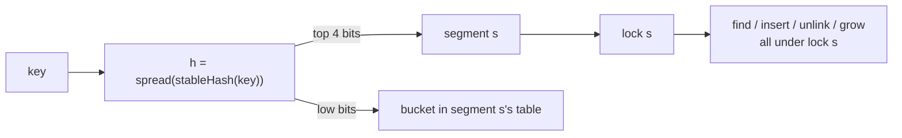

# Concurrent Hash Maps: Striping and Lock-Free Reads

> How ConcurrentHashMap and sync.Map avoid a global lock.

**Type:** Build
**Languages:** Java, Python, Go
**Prerequisites:** Phase 1 Lesson 06 (Hash Maps), Phase 4 Lesson 02 (Locks and Atomics), Phase 4 Lesson 03 (Compare-and-Swap and Lock-Free Structures)
**Time:** ~90 minutes

## Learning Objectives

- Build a lock-striped hash map whose segments resize independently, and state the invariant that lets one segment lock protect both the bucket structure and the values in it
- Build a second map whose reads take no lock at all, by making bucket chains immutable and publishing them with a volatile store, and prove with the Java Memory Model why a reader can never see a half-built chain
- Mix hash bits properly and show, with real keys, what happens to stripe distribution when you do not
- Force a check-then-act race deterministically with a barrier in the gap, and show that only a per-key atomic operation (`putIfAbsent`, `compute`) closes it
- Write a concurrent test whose assertions hold under every legal interleaving, using barriers to make the phases deterministic
- Explain what `ConcurrentHashMap` does beyond this lesson (CAS on empty bins, per-bin locks, treeified bins, counter cells) and what it still cannot do for you

## The Problem

An idempotent payment API (Phase 12, Lesson 01) keeps an in-memory map from idempotency key to the result of the first request that carried it. Every incoming `POST /payments` checks the map; a hit returns the stored response, a miss runs the payment and stores the result. Traffic is 95% lookups because clients retry aggressively, and the map sees 80,000 operations per second across 32 request threads.

Version one used `Collections.synchronizedMap(new HashMap<>())`. It was correct, and the lock was the hottest object in the process: p99 latency for a lookup that should take 200 nanoseconds was 11 milliseconds, because a lookup for key `idem-7a3f` waited behind an insert for key `idem-91c0` that had nothing to do with it, which in turn waited behind a resize that rehashed two million entries under the same lock. The on-call engineer's dashboard showed 31 threads parked on one monitor.

Version two swapped in a `ConcurrentHashMap` and the latency problem vanished. Then finance found a merchant charged twice for one order, same idempotency key, 400 microseconds apart. The code was:

```java
if (store.get(key) == null) {          // check
    PaymentResult r = charge(request);
    store.put(key, r);                 // act
}
```

Two retries of the same request arrived on two threads, both saw `null`, both charged. The map was thread-safe; the code around it was not. Thread safety of a structure means each *operation* is atomic. It says nothing about two operations in a row. The fix is one line, `store.putIfAbsent(key, PENDING)` as the claim, and this lesson explains why that line is atomic and the two-line version cannot be, by building both maps the hard way: first lock striping, then lock-free reads.

## The Concept

### What a global lock costs

A hash map's operations touch one bucket, and a resize touches all of them. A single lock serialises everything: two threads operating on different buckets wait for each other for no reason, and every thread waits during a resize. On a 32-thread service with 95% reads, the lock is held almost continuously and the service runs at the speed of one core plus the cost of parking and waking 31 threads.

Three facts make the fix possible:

1. Operations on different buckets are independent. Protecting them with different locks loses nothing.
2. A read does not modify anything. If a reader can be guaranteed to see a consistent chain, it needs no lock at all.
3. Resize is rare. It can be expensive as long as it does not block readers.

### Lock striping

Split the key space into N segments, each with its own lock, bucket table, and count. The segment is chosen from the hash, so the same key always goes to the same segment. Two operations contend only when their keys share a segment, so contention is divided by N. Java 5 through 7's `ConcurrentHashMap` was exactly this, with 16 segments by default.

The invariant: **every read or write of `segments[s].table`, its chains, its count, or any value in it happens while holding `segments[s].lock`.** Because the invariant covers the values too, a check-then-act inside one lock hold is atomic: `putIfAbsent` finds the node (or not) and inserts under the same lock, so no other thread can insert the same key between the find and the insert. Each segment resizes on its own when its load factor crosses 0.75; a resize of segment 3 does not block an operation on segment 11.



The segment is chosen by the *high* bits of the hash and the bucket by the *low* bits. If both used the low bits, every key in segment 3 would land in the same bucket of segment 3's table (because `i mod 16 == 3` fixes the low four bits), and each segment would degrade to a linked list.

### Why the hash must be mixed

`String.hashCode` for `"acct-1"` through `"acct-8"` differs only in the last character, so the eight hashes are consecutive integers: all the variation is in the low three bits. Take the top four bits for the segment and all eight keys land in segment 10. The demo shows this with and without mixing. The fix is a *finaliser*: a few multiply-and-xorshift steps that spread every input bit into every output bit (`spread` in the code is MurmurHash3's `fmix32`). Java 7's `ConcurrentHashMap` applied a Wang/Jenkins hash for exactly this reason. Java 8 reduced it to `h ^ (h >>> 16)` because it only selects bins with low bits and relies on treeified bins to absorb bad distributions; that is a design decision that belongs with the structure, not a general-purpose shortcut. Phase 1, Lesson 07 covers hash quality in depth; the point here is that the stripe choice is only as good as the bits you feed it.

### Lock-free reads: immutable chains plus a volatile publish

Striping still makes 95% of operations take a lock. Readers can avoid the lock entirely if two conditions hold:

1. **Chains are immutable.** Every `Node` has `final key`, `final value`, `final next`. A writer never mutates a node; it builds a new chain that shares the untouched tail and replaces the bucket's head reference.
2. **The bucket head is published with a volatile store and read with a volatile load.** `AtomicReferenceArray.set` and `get` are volatile. The Java Memory Model (JLS 17.4.5) says a volatile write happens-before every subsequent volatile read of the same variable, and JLS 17.5 adds that `final` fields written in a constructor are visible to any thread that obtains a reference to the object after the constructor completes. Together: a reader that loads the new head sees every `final` field of every node reachable from it.

The reader therefore executes two volatile loads (the table reference, then the bucket head) and walks plain `final` fields. It sees either the chain before the write or the chain after. There is no third possibility, because the old chain is never modified and the new chain is complete before its head is stored.

Writers still take a stripe lock, for one reason: two writers to the same bucket must not both build a new chain from the same old head and then each publish, because the second publish would silently drop the first write. The stripe is `spread(hash) & (stripes - 1)` and the bucket is `spread(hash) & (buckets - 1)`; since both are powers of two and `buckets >= stripes`, two keys in the same bucket always share a stripe. One bucket, one lock, even across resizes.

| | `GlobalLockMap` | `StripedHashMap` | `LockFreeReadMap` | `ConcurrentHashMap` (Java 8+) |
|---|---|---|---|---|
| Read | takes the lock | takes 1 of N locks | no lock: 2 volatile loads | no lock: volatile loads |
| Write | takes the lock | takes 1 of N locks | takes 1 of N locks, copies the chain | CAS on empty bin, else lock the bin head |
| Resize | under the lock | per segment, under its lock | under all N locks, readers keep going | cooperative, writers help transfer bins |
| `size()` | exact | exact, under all locks | weakly consistent counter | weakly consistent counter cells |
| Check-then-act | `putIfAbsent` under the lock | under the stripe lock | under the stripe lock | under the bin lock |

### Worked example: one write against one lock-free read

Bucket 5 holds the chain `idem-3 -> idem-1` (newest first). A writer runs `compute("idem-3", mark CAPTURED)` while a reader runs `get("idem-1")`.

| Step | Writer (holds stripe lock for bucket 5) | Reader (no lock) | Bucket 5 head |
|------|----------------------------------------|------------------|---------------|
| 1 | | `t = table`; `n = t.get(5)` = node(idem-3, PENDING) | idem-3(PENDING) -> idem-1 |
| 2 | `without(head, "idem-3")` returns `rest` = node(idem-1); removed = PENDING record | walking: `n.key` is idem-3, not a match | idem-3(PENDING) -> idem-1 |
| 3 | `fn` returns the CAPTURED record | `n = n.next` = node(idem-1) | idem-3(PENDING) -> idem-1 |
| 4 | `t.set(5, new Node(idem-3, CAPTURED, rest))` | | idem-3(CAPTURED) -> idem-1 |
| 5 | unlock | `n.key` matches: return idem-1's value | idem-3(CAPTURED) -> idem-1 |

The reader started on the old chain and finished on it. The old chain was never modified (the writer built a new head node and reused `rest`), so every field the reader touched was exactly what it was at step 1. A reader that started at step 5 would load the new head and see CAPTURED. Both outcomes are correct linearizations: the read happened either before or after the write. Note also that `rest` is the same `idem-1` node in both chains; one allocation for the write, not a copy of the whole bucket.

### Resize without stopping readers

`LockFreeReadMap.resizeTo` takes every stripe lock in index order (so two concurrent resizes, or a resize and a `size()` in `StripedHashMap`, cannot deadlock), builds a fresh table, and publishes it with one volatile store to `table`. A reader that loaded the old table reference before the publish keeps walking it. That is safe because the old table is frozen: every write goes through a stripe lock, and the resizer holds all of them. Readers that load `table` after the publish see the new one. Nobody sees a half-copied table because the copy completes before the store.

A writer must never grow while holding its own stripe lock: it would then try to acquire stripe 0 while holding stripe 7, and another writer doing the same from stripe 2 would deadlock with it (Lesson 07's lock-ordering rule). So the writer releases its lock, then checks the load factor and calls `resizeTo`, which re-checks under all locks in case another thread grew first. The count that drives the decision is an `AtomicInteger`, which is why `size()` is weakly consistent: a writer that has published its node but not yet incremented the counter is a legal state. `ConcurrentHashMap.size()` has the same caveat for the same reason.

### Check-then-act, forced with a barrier

Lesson 02 showed that a bare atomic cannot do a debit-if-sufficient; the same shape appears here as get-then-put. A stress test might never catch it. The honest way to show it is to make the interleaving mandatory:

```text
thread 1..8:  existing = store.get("idem-7")        // all read null
              barrier.await()                        // nobody proceeds until all eight have read
              if (existing == null) store.put(...)   // all eight write
```

A `CyclicBarrier(8)` in the gap guarantees the bad schedule on every run, on any machine. Eight threads believe they created the record. Replace the two lines with `store.putIfAbsent("idem-7", record)` and exactly one thread gets `null` back, on every run, because the check and the insert happen under one lock hold. The barrier is the test's scheduler, which is the idea Lesson 12 generalises.

### What these maps do not do

They do not provide multi-key atomicity: transferring a value from key A to key B is two operations and needs a lock over both (or Lesson 08's actor). They do not provide iteration snapshots; walking all entries while writers run gives a weakly consistent view, like `ConcurrentHashMap`. They do not bound memory; an idempotency store needs expiry (Phase 3, Lesson 08's caches, or a TTL wheel from Lesson 12). And `LockFreeReadMap` trades write cost for read speed: each write allocates a new node and copies the chain prefix in front of the changed key, so a write-heavy workload should prefer `StripedHashMap`.

## Build It

All code is in `code/java/Main.java`; tests in `MainTest.java`. The three maps implement one interface so the benchmark and the tests treat them identically.

### Step 1: The interface and the hash

```java
interface ConcurrentStore<K, V> {
    V get(K key);
    V put(K key, V value);
    V putIfAbsent(K key, V value);
    V remove(K key);
    V compute(K key, BiFunction<? super K, ? super V, ? extends V> fn);
    int size();
}

final class Hashing {
    static int stableHash(Object key) { /* String.hashCode written out; stable across languages */ }

    static int spread(int h) {           // MurmurHash3 fmix32
        h ^= h >>> 16;
        h *= 0x85ebca6b;
        h ^= h >>> 13;
        h *= 0xc2b2ae35;
        h ^= h >>> 16;
        return h;
    }

    static int bucketIndex(Object key, int tableLength) { return spread(stableHash(key)) & (tableLength - 1); }
}
```

`stableHash` exists so that a Python or Go port puts `"acct-1"` in the same stripe (Python's `hash()` is salted per process). `spread` is the mixing step; delete it and run the demo to watch eight accounts collapse onto one stripe.

**Predict:** `stableHash("acct-2") - stableHash("acct-1")` is 1. Which bits differ, and which bits does a 16-way segment selector that uses `h >>> 28` look at?

### Step 2: A segment is a tiny single-threaded hash map

```java
static final class Segment<K, V> {
    final ReentrantLock lock = new ReentrantLock();
    Node<K, V>[] table;
    int count;

    Node<K, V> find(K key) {
        for (Node<K, V> n = table[Hashing.bucketIndex(key, table.length)]; n != null; n = n.next) {
            if (n.key.equals(key)) return n;
        }
        return null;
    }

    void insert(K key, V value) {
        if (count + 1 > table.length * 3 / 4) grow();
        int i = Hashing.bucketIndex(key, table.length);
        table[i] = new Node<>(key, value, table[i]);
        count++;
    }
}
```

Nothing in `Segment` is thread-safe on its own, and that is the design: the segment assumes its caller holds `lock`. Keeping the data structure and the synchronization in separate layers means the hash-map logic is the Phase 1 code you already tested, and the concurrency is confined to the few methods that take and release the lock.

### Step 3: Choosing the segment with the high bits

```java
StripedHashMap(int stripes) {
    if (Integer.bitCount(stripes) != 1) throw new IllegalArgumentException("stripes must be a power of two");
    segments = new Segment[stripes];
    for (int i = 0; i < stripes; i++) segments[i] = new Segment<>(4);
    segmentShift = 32 - Integer.numberOfTrailingZeros(stripes);
}

int segmentIndex(K key) {
    return segments.length == 1 ? 0 : Hashing.spread(Hashing.stableHash(key)) >>> segmentShift;
}
```

For 16 stripes, `segmentShift` is 28 and `>>> 28` yields the top four bits as a number 0..15. The unsigned shift matters: `>>` would sign-extend a negative hash into a negative index.

**Predict:** with `stripes = 1`, `numberOfTrailingZeros(1)` is 0 and the shift would be 32, which Java treats as a shift by 0. Why does the code special-case a single stripe instead of relying on the shift?

### Step 4: Every operation is find-then-act under one lock

```java
@Override
public V putIfAbsent(K key, V value) {
    Segment<K, V> s = segmentFor(key);
    s.lock.lock();
    try {
        Node<K, V> n = s.find(key);          // check ...
        if (n != null) return n.value;
        s.insert(key, value);                // ... and act, under the same lock hold
        return null;
    } finally { s.lock.unlock(); }
}

@Override
public V compute(K key, BiFunction<? super K, ? super V, ? extends V> fn) {
    Segment<K, V> s = segmentFor(key);
    s.lock.lock();
    try {
        Node<K, V> n = s.find(key);
        V next = fn.apply(key, n == null ? null : n.value);
        if (next == null) { if (n != null) s.unlink(key); return null; }
        if (n != null) n.value = next; else s.insert(key, next);
        return next;
    } finally { s.lock.unlock(); }
}
```

`compute` runs the caller's function while holding the segment lock. That is what makes `compute(k, (key, v) -> v + 1)` an atomic increment, and it is also the trap: the function must be short and must not touch the map (it would deadlock on a reentrant lock or, worse, corrupt a different segment). `ConcurrentHashMap`'s Javadoc says the same about its `compute`.

`size()` takes all segment locks in index order and releases in reverse. Two threads calling `size()` at once both try segment 0 first, so neither can hold a higher segment while waiting on a lower one.

### Step 5: Immutable chains and a lock-free `get`

```java
static final class Node<K, V> {
    final K key;
    final V value;
    final Node<K, V> next;
    Node(K key, V value, Node<K, V> next) { this.key = key; this.value = value; this.next = next; }
}

private volatile AtomicReferenceArray<Node<K, V>> table;

@Override
public V get(K key) {
    AtomicReferenceArray<Node<K, V>> t = table;                       // one volatile read
    Node<K, V> n = t.get(Hashing.bucketIndex(key, t.length()));       // one volatile read
    for (; n != null; n = n.next) {                                   // final fields: no further synchronization
        if (n.key.equals(key)) return n.value;
    }
    return null;
}
```

Read `get` with the memory model in mind. `table` is read once into a local so the length and the bucket come from the same table even if a resize publishes a new one mid-call. `t.get(i)` is the volatile load that pairs with the writer's `t.set(i, ...)`. After that, every field is `final` and was written before the node was reachable, so the walk needs no synchronization at all. There is no lock, no CAS, and no retry: this read is wait-free.

**Predict:** a writer replaces bucket 5's chain while a reader is halfway down the old chain. What does the reader return for a key that the writer just removed? Is that answer wrong?

### Step 6: Writers copy the prefix and publish

```java
private Node<K, V> without(Node<K, V> head, K key, Object[] removed) {
    if (head == null) return null;
    if (head.key.equals(key)) { removed[0] = head.value; return head.next; }
    Node<K, V> rest = without(head.next, key, removed);
    return removed[0] == null && rest == head.next ? head : new Node<>(head.key, head.value, rest);
}

@Override
public V compute(K key, BiFunction<? super K, ? super V, ? extends V> fn) {
    int s = stripeFor(key);
    boolean inserted = false;
    V result;
    stripeLocks[s].lock();
    try {
        AtomicReferenceArray<Node<K, V>> t = table;
        int i = Hashing.bucketIndex(key, t.length());
        Object[] removed = new Object[1];
        Node<K, V> rest = without(t.get(i), key, removed);
        V old = (V) removed[0];
        V next = fn.apply(key, old);
        if (next == null) {
            if (old != null) { t.set(i, rest); count.decrementAndGet(); }
            result = null;
        } else {
            t.set(i, new Node<>(key, next, rest));                   // updated node in front of the untouched rest
            if (old == null) { count.incrementAndGet(); inserted = true; }
            result = next;
        }
    } finally { stripeLocks[s].unlock(); }
    if (inserted) growIfCrowded();
    return result;
}
```

`without` is a persistent-list operation: it copies the nodes *before* the removed key and shares everything after it. If the key is absent it returns the original head unchanged (no allocation). The writer then puts the new node at the front of the rebuilt chain and stores the head. Readers who loaded the old head still have a complete, correct chain; readers who load the new head see the update. `growIfCrowded` runs *after* the unlock, for the lock-ordering reason explained above.

**Predict:** chain `a -> b -> c`, `compute("b", ...)`. How many new nodes are allocated, and which old nodes does the new chain share?

### Step 7: Resize under all locks

```java
void resizeTo(int newBuckets) {
    for (ReentrantLock l : stripeLocks) l.lock();
    try {
        AtomicReferenceArray<Node<K, V>> old = table;
        if (newBuckets <= old.length()) return;                      // another thread grew first
        AtomicReferenceArray<Node<K, V>> fresh = new AtomicReferenceArray<>(newBuckets);
        for (int i = 0; i < old.length(); i++) {
            for (Node<K, V> n = old.get(i); n != null; n = n.next) {
                int j = Hashing.bucketIndex(n.key, newBuckets);
                fresh.set(j, new Node<>(n.key, n.value, fresh.get(j)));
            }
        }
        table = fresh;
        resizes++;
    } finally {
        for (int i = stripeLocks.length - 1; i >= 0; i--) stripeLocks[i].unlock();
    }
}
```

Every node is copied into the new table (the chains are immutable, so nodes cannot be re-linked in place), and then `table = fresh` is the single volatile store that makes the new table visible. Readers are never blocked, which is the property `StripedHashMap` lacks, and `MainTest.readersNeverSeeTornState` checks it by running two readers flat out while two writers churn 40,000 operations through a table that starts at four buckets.

### Step 8: Run it

```bash
cd phases/04-concurrency/04-concurrent-hash-maps/code/java
javac -d .out *.java && java -cp .out Main
java -cp .out MainTest
```

Expected output, abbreviated:

```console
== Where keys land: 16 stripes, top 4 bits of the mixed hash ==
acct-1->s8  acct-2->s4  acct-3->s13  acct-4->s7  acct-5->s0  acct-6->s1  acct-7->s7  acct-8->s5
stableHash("acct-1") = -1423448841, stableHash("acct-2") = -1423448840 (differ by 1: all low bits); ...

== Lock-free reads: a writer replaces the chain, a reader sees old or new, never half ==
3 puts into a 4-bucket table -> buckets = 4, size = 3 (load 3/4: not yet)
4th put -> buckets = 8, resizes = 1 (load crossed 75%)

== Check-then-act, forced with a barrier in the gap (8 threads, one idempotency key) ==
get-then-put on StripedHashMap:   8 threads believe they created the record
putIfAbsent on StripedHashMap:    1 thread created it
get-then-put on LockFreeReadMap:  8 threads believe they created the record
putIfAbsent on LockFreeReadMap:   1 thread created it
```

The throughput section prints operations per millisecond for the three maps on a 95/5 read/write mix. On a machine with four or more cores the order is global lock < striped < lock-free reads; on one or two cores the numbers converge because there is no parallelism left to win. As in Lesson 02, the ratio is the lesson and the absolute number is your machine.

The test suite runs the same single-threaded contract against all three maps, then a four-phase barrier-synchronised concurrent test against each: disjoint inserts, cross reads, contended `compute` increments on 100 shared keys, and removals. The assertions (every shared key equals `threads x bumps`; size after removals equals the shared-key count) hold under every legal interleaving, which is what makes a concurrent test deterministic even though the schedule is not.

### In Python

The Python port (`code/python/main.py`) keeps `ConcurrentStore`, `GlobalLockMap`, `StripedHashMap` (one `threading.Lock` per segment), `LockFreeReadMap`, and the barrier-forced races. Four things differ. **The hash is rebuilt in 32-bit arithmetic.** Python's `hash(str)` is salted per process, so `Hashing.stable_hash` computes `String.hashCode` over UTF-16 code units and masks to 32 bits after each step, and `spread` masks after each multiply. The segment index uses the unsigned view of the hash before shifting, which is Java's `>>>`. The result: every key lands in the same stripe and bucket as in Java (`acct-1->s8 ... acct-8->s5`), and a test pins those placements. **The publish guarantee comes from the interpreter, not `volatile`.** Python has no `final` fields and no `volatile`. Reading `self._table` and `t[i]` are single atomic operations under the GIL (and under the free-threaded build's per-object locks), so a reader still sees the old chain or the new one. Nodes are made immutable by refusing `__setattr__` after construction, and a test asserts the `AttributeError`, so the "walk without synchronization" argument holds for the same reason it does in Java: nothing a reader can reach is ever mutated. **The GIL changes the throughput story, not the race story.** Only one thread runs bytecode at a time, so striping cannot add parallelism and the benchmark measures lock and hashing overhead instead (Python runs 20,000 benchmark ops per thread rather than 100,000, and the barrier test runs 2,000 keys x 200 bumps rather than 5,000 x 1,000, to stay fast on a two-core CI runner where contended Python locks convoy). The check-then-act race is unchanged: `threading.Barrier` holds all eight threads in the gap after `get`, so all eight still believe they created the record, and `put_if_absent` still produces exactly one winner. **Counters and nulls.** `size()` uses an `AtomicInteger` built on a lock, because `+=` is a read, an add, and a write that a thread switch can split. `None` keys and values raise `TypeError` where Java throws `NullPointerException`, so `None` from `get` always means absent.

Run it from `code/python/` with `python3 main.py`; test with `python3 -m unittest -v`.

#### Step 1: The interface and the hash

`ConcurrentStore` is a plain base class whose methods raise `NotImplementedError`; the three maps subclass it so the benchmark and tests treat them alike. `stable_hash` encodes the key as UTF-16 big-endian so each two-byte pair is one `charAt()` code unit, masks with `MASK32` after each multiply-add, and finally folds to a signed `int` with `to_int32`. `spread` does the same masking dance on the unsigned view so the MurmurHash3 multiplications cannot grow past 32 bits.

```python
class Hashing:
    @staticmethod
    def stable_hash(key) -> int:
        """Java's String.hashCode written out; stable across processes and languages (Python's hash() is salted)."""
        if isinstance(key, str):
            h = 0
            data = key.encode("utf-16-be")  # charAt() returns UTF-16 code units
            for i in range(0, len(data), 2):
                h = (31 * h + ((data[i] << 8) | data[i + 1])) & MASK32
            return to_int32(h)
        return to_int32(hash(key))  # non-string keys: only stable within one process

    @staticmethod
    def spread(h: int) -> int:
        """The MurmurHash3 finaliser in 32-bit arithmetic: every input bit reaches every output bit."""
        u = h & MASK32
        u ^= u >> 16
        u = (u * 0x85EBCA6B) & MASK32
        u ^= u >> 13
        u = (u * 0xC2B2AE35) & MASK32
        u ^= u >> 16
        return to_int32(u)

    @staticmethod
    def bucket_index(key, table_length: int) -> int:
        return Hashing.spread(Hashing.stable_hash(key)) & (table_length - 1)
```

#### Step 2: A segment is a tiny single-threaded hash map

`Segment` owns a `threading.Lock`, a list of chain heads, and a count. `find` and `insert` do no locking of their own; the caller is expected to hold `segment.lock`, which keeps the Phase 1 hash-map logic separate from the synchronization. `_StripedNode` is a mutable `__slots__` class because it is only ever touched under the segment lock.

```python
class Segment:
    def __init__(self, initial_buckets: int) -> None:
        self.lock = threading.Lock()
        self.table: list[Optional[_StripedNode]] = [None] * initial_buckets
        self.count = 0
        self.resizes = 0

    def find(self, key) -> Optional[_StripedNode]:
        n = self.table[Hashing.bucket_index(key, len(self.table))]
        while n is not None:
            if n.key == key:
                return n
            n = n.next
        return None

    def insert(self, key, value) -> None:
        if self.count + 1 > len(self.table) * 3 // 4:
            self.grow()
        i = Hashing.bucket_index(key, len(self.table))
        self.table[i] = _StripedNode(key, value, self.table[i])
        self.count += 1
```

#### Step 3: Choosing the segment with the high bits

`bin(stripes).count("1") != 1` is the power-of-two check, and `(stripes & -stripes).bit_length() - 1` is `numberOfTrailingZeros`. Python's `>>` on a negative int would sign-extend forever, so `segment_index` masks the spread hash with `MASK32` first to get the unsigned view, which is exactly what Java's `>>>` does.

```python
class StripedHashMap(ConcurrentStore[K, V]):
    def __init__(self, stripes: int = 16) -> None:
        if stripes <= 0 or bin(stripes).count("1") != 1:
            raise ValueError(f"stripes must be a power of two: {stripes}")
        self._segments = [Segment(4) for _ in range(stripes)]
        self._segment_shift = 32 - ((stripes & -stripes).bit_length() - 1)  # 32 - numberOfTrailingZeros

    def segment_index(self, key) -> int:
        """Segment by the HIGH bits of the spread hash (Java's >>>); the bucket inside it by the low bits."""
        if len(self._segments) == 1:
            return 0
        return (Hashing.spread(Hashing.stable_hash(key)) & MASK32) >> self._segment_shift
```

#### Step 4: Every operation is find-then-act under one lock

`with s.lock:` holds the segment for the whole check-and-act, and releases on any exception the way Java's `finally` does. `compute` calls the caller's `fn` inside the block, which is what makes an increment atomic and also why `fn` must never touch the map: `threading.Lock` is not reentrant, so a re-entry on the same segment would deadlock rather than recurse.

```python
    def put_if_absent(self, key, value):
        _require(value, "value")
        s = self._segment_for(key)
        with s.lock:
            n = s.find(key)  # check ...
            if n is not None:
                return n.value
            s.insert(key, value)  # ... and act, under the same lock hold
            return None

    def compute(self, key, fn):
        s = self._segment_for(key)
        with s.lock:
            n = s.find(key)
            nxt = fn(key, None if n is None else n.value)
            if nxt is None:
                if n is not None:
                    s.unlink(key)
                return None
            if n is not None:
                n.value = nxt
            else:
                s.insert(key, nxt)
            return nxt
```

#### Step 5: Immutable chains and a lock-free `get`

`_FrozenNode` sets its three fields through `object.__setattr__` in `__init__` and then overrides `__setattr__` to raise, which is the closest Python gets to `final`. `get` reads `self._table` once into a local and indexes it once; both are single bytecode-level loads that the GIL makes atomic, and after that it walks fields that are never mutated. No lock, no retry.

```python
class _FrozenNode:
    __slots__ = ("key", "value", "next")

    def __init__(self, key, value, nxt) -> None:
        object.__setattr__(self, "key", key)
        object.__setattr__(self, "value", value)
        object.__setattr__(self, "next", nxt)

    def __setattr__(self, name, value):
        raise AttributeError("chain nodes are immutable; build a new chain instead")
```

```python
    def get(self, key):
        _require(key, "key")
        t = self._table                                   # one atomic load of the table reference
        n = t[Hashing.bucket_index(key, len(t))]           # one atomic load of the bucket
        while n is not None:                               # immutable nodes: no further synchronization
            if n.key == key:
                return n.value
            n = n.next
        return None
```

#### Step 6: Writers copy the prefix and publish

`_without` is the same persistent-list recursion; a one-element list `removed` plays the Java `Object[]` out-parameter. `compute` builds the new chain under the stripe lock, publishes it with a single list-slot store `t[i] = ...`, and only after leaving the `with` block calls `_grow_if_crowded`, so a writer never holds one stripe while asking for all of them.

```python
    def _without(self, head: Optional[_FrozenNode], key, removed: list):
        """Rebuild the chain without `key`; the removed node's value goes to removed[0]."""
        if head is None:
            return None
        if head.key == key:
            removed[0] = head.value
            return head.next
        rest = self._without(head.next, key, removed)
        return head if removed[0] is None and rest is head.next else _FrozenNode(head.key, head.value, rest)
```

```python
    def compute(self, key, fn):
        _require(key, "key")
        s = self._stripe_for(key)
        inserted = False
        with self._stripe_locks[s]:
            t = self._table
            i = Hashing.bucket_index(key, len(t))
            removed = [None]
            rest = self._without(t[i], key, removed)
            old = removed[0]
            nxt = fn(key, old)
            if nxt is None:
                if old is not None:
                    t[i] = rest
                    self._count.decrement_and_get()
                result = None
            else:
                t[i] = _FrozenNode(key, nxt, rest)  # updated node in front of the untouched rest
                if old is None:
                    self._count.increment_and_get()
                    inserted = True
                result = nxt
        if inserted:
            self._grow_if_crowded()
        return result
```

#### Step 7: Resize under all locks

Every stripe lock is acquired in index order and released in reverse inside `finally`. Each node is copied into `fresh` (chains are frozen, so nothing can be re-linked), and `self._table = fresh` is the one attribute store that publishes the new table. A reader that already loaded the old list keeps walking it unharmed.

```python
    def resize_to(self, new_buckets: int) -> None:
        if new_buckets <= 0 or (new_buckets & (new_buckets - 1)) != 0 or new_buckets < len(self._stripe_locks):
            raise ValueError("bad bucket count")
        for lock in self._stripe_locks:
            lock.acquire()
        try:
            old = self._table
            if new_buckets <= len(old):
                return  # another thread grew first
            fresh: list[Optional[_FrozenNode]] = [None] * new_buckets
            for head in old:
                n = head
                while n is not None:
                    j = Hashing.bucket_index(n.key, new_buckets)
                    fresh[j] = _FrozenNode(n.key, n.value, fresh[j])
                    n = n.next
            self._table = fresh
            self._resizes += 1
```

#### Step 8: Run it

```bash
cd phases/04-concurrency/04-concurrent-hash-maps/code/python
python3 main.py
python3 -m unittest -v
```

The stripe placements and the barrier results match Java exactly; the throughput section is where Python tells a different story:

```console
== Where keys land: 16 stripes, top 4 bits of the mixed hash ==
acct-1->s8  acct-2->s4  acct-3->s13  acct-4->s7  acct-5->s0  acct-6->s1  acct-7->s7  acct-8->s5

== Check-then-act, forced with a barrier in the gap (8 threads, one idempotency key) ==
get-then-put on StripedHashMap:   8 threads believe they created the record
putIfAbsent on StripedHashMap:    1 thread created it
get-then-put on LockFreeReadMap:  8 threads believe they created the record
putIfAbsent on LockFreeReadMap:   1 thread created it

== Throughput, 4 threads x 20,000 ops, 95% get / 5% compute, 1,024 keys (ops per ms; varies by machine) ==
GlobalLockMap          1509
StripedHashMap          222
LockFreeReadMap         321
```

The global-lock map wins in Python because a `dict` operation under one lock is a handful of C calls, while the striped maps run their hashing and chain walks in bytecode. The ordering says nothing about the algorithms and everything about the GIL; Lesson 10's free-threaded build is where striping starts to pay.

### In Go

The Go port (`code/go/main.go`) keeps `ConcurrentStore`, `GlobalLockMap`, `StripedHashMap` (one `sync.Mutex` per segment), `LockFreeReadMap`, and the barrier-forced races. Four things differ. **`atomic.Pointer` plays `volatile` and `final`.** Go has neither keyword. Each bucket is an `atomic.Pointer[lfNode]` and the whole table sits behind another; a writer publishes a rebuilt chain with `Store`, a reader takes it with `Load`, and the Go memory model makes everything the writer did before the store visible after the load. The nodes are never mutated after publication, which is what the walk relies on. `go test -race ./...` is the proof: the race detector flags any plain read that is not ordered by an atomic or a lock, and the suite passes with two readers hammering 64 keys while two writers churn and resize. **The hash is rebuilt in 32-bit arithmetic.** `StableHash` computes `String.hashCode` over UTF-16 code units and `Spread` runs the MurmurHash3 finaliser on a `uint32`, so every key lands in the same stripe and bucket as in Java (`acct-1->s8 acct-2->s4 ... acct-8->s5`); a test pins those placements. Java's `>>>` becomes a shift on the `uint32` view. **`(V, bool)` instead of `null`.** `Get`, `Put`, `PutIfAbsent`, and `Remove` return a second result that says whether a value existed, and `Compute` takes a `ComputeFn` that receives `(current, present)` and returns `(next, absent)`, because a zero `int64` is a legal value. The constructors return `ErrBadShape` for stripe or bucket counts that are not powers of two. **A hand-written `Barrier`.** The standard library has no `CyclicBarrier`, so the port carries a small reusable one built on `sync.Cond`; it holds all eight goroutines in the gap between `Get` and `Put`, so all eight still believe they created the record and `PutIfAbsent` still produces exactly one winner. `CountDownLatch` becomes `sync.WaitGroup`. The throughput table measures real parallelism; Go's built-in `map` under one mutex is fast enough that on a small machine the global lock can win, which is a reason to measure rather than assume.

Run it from `code/go/` with `go run .`; test with `go test -race ./...`.

#### Step 1: The interface and the hash

The interface is generic over a `comparable` key and returns `(V, bool)` wherever Java returned a nullable `V`. `StableHash` iterates `utf16.Encode` of the key so each code unit matches `charAt()`, and `int32` arithmetic wraps the way Java `int` does. `Spread` casts to `uint32` so the shifts are logical and the multiplications truncate at 32 bits; `BucketIndex` masks on the unsigned view.

```go
type ConcurrentStore[K comparable, V any] interface {
	Get(key K) (V, bool)
	Put(key K, value V) (V, bool)
	PutIfAbsent(key K, value V) (V, bool)
	Remove(key K) (V, bool)
	Compute(key K, fn ComputeFn[K, V]) (V, bool)
	Size() int
}

func StableHash(key string) int32 {
	var h int32
	for _, cu := range utf16.Encode([]rune(key)) {
		h = 31*h + int32(cu)
	}
	return h
}

func Spread(h int32) int32 {
	u := uint32(h)
	u ^= u >> 16
	u *= 0x85ebca6b
	u ^= u >> 13
	u *= 0xc2b2ae35
	u ^= u >> 16
	return int32(u)
}

func BucketIndex(key string, tableLength int) int {
	return int(uint32(Spread(StableHash(key))) & uint32(tableLength-1))
}
```

#### Step 2: A segment is a tiny single-threaded hash map

`Segment` embeds its own `sync.Mutex` and a slice of chain heads. `find` and `insert` are unexported and assume `mu` is held by the caller; `stripedNode` is a plain mutable struct for the same reason. The `*3/4` load check and the head insertion are the Phase 1 code unchanged.

```go
type Segment[V any] struct {
	mu      sync.Mutex
	table   []*stripedNode[V]
	count   int
	resizes int
}

func (s *Segment[V]) find(key string) *stripedNode[V] {
	for n := s.table[BucketIndex(key, len(s.table))]; n != nil; n = n.next {
		if n.key == key {
			return n
		}
	}
	return nil
}

func (s *Segment[V]) insert(key string, value V) {
	if s.count+1 > len(s.table)*3/4 {
		s.grow()
	}
	i := BucketIndex(key, len(s.table))
	s.table[i] = &stripedNode[V]{key, value, s.table[i]}
	s.count++
}
```

#### Step 3: Choosing the segment with the high bits

`bits.OnesCount` and `bits.TrailingZeros` from `math/bits` replace `Integer.bitCount` and `numberOfTrailingZeros`; a bad stripe count comes back as `ErrBadShape` rather than a panic. `SegmentIndex` shifts the `uint32` view of the spread hash, which is Java's unsigned `>>>`, and keeps the single-stripe special case because a shift by 32 on a `uint32` is zero in Go, not a no-op.

```go
func NewStripedHashMap[V any](stripes int) (*StripedHashMap[V], error) {
	if stripes < 1 || bits.OnesCount(uint(stripes)) != 1 {
		return nil, fmt.Errorf("%w: stripes=%d", ErrBadShape, stripes)
	}
	m := &StripedHashMap[V]{segments: make([]*Segment[V], stripes), segmentShift: uint(32 - bits.TrailingZeros(uint(stripes)))}
	for i := range m.segments {
		m.segments[i] = &Segment[V]{table: make([]*stripedNode[V], 4)}
	}
	return m, nil
}

func (m *StripedHashMap[V]) SegmentIndex(key string) int {
	if len(m.segments) == 1 {
		return 0
	}
	return int(uint32(Spread(StableHash(key))) >> m.segmentShift)
}
```

#### Step 4: Every operation is find-then-act under one lock

`defer s.mu.Unlock()` is the `finally`. `Compute` cannot pass `nil` for "absent" with a generic `V`, so the callback receives `(current, present)` and signals removal by returning `absent == true`; the rest is the Java logic. As with `ReentrantLock`, the callback runs under the segment mutex, and `sync.Mutex` is not reentrant, so a callback that touches the map deadlocks immediately.

```go
func (m *StripedHashMap[V]) PutIfAbsent(key string, value V) (V, bool) {
	s := m.segmentFor(key)
	s.mu.Lock()
	defer s.mu.Unlock()
	if n := s.find(key); n != nil { // check ...
		return n.value, true
	}
	s.insert(key, value) // ... and act, under the same lock hold
	var zero V
	return zero, false
}

func (m *StripedHashMap[V]) Compute(key string, fn ComputeFn[string, V]) (V, bool) {
	s := m.segmentFor(key)
	s.mu.Lock()
	defer s.mu.Unlock()
	n := s.find(key)
	var cur V
	if n != nil {
		cur = n.value
	}
	next, absent := fn(key, cur, n != nil)
	if absent {
		if n != nil {
			s.unlink(key)
		}
		var zero V
		return zero, false
	}
	if n != nil {
		n.value = next
	} else {
		s.insert(key, next)
	}
	return next, true
}
```

#### Step 5: Immutable chains and a lock-free `get`

`lfNode` has no `final`, but its fields are written once before the node is handed to an atomic `Store`, and nothing ever writes them again; that discipline plus the atomic publish is what the Go memory model needs. The table is an `atomic.Pointer[lfTable]` whose buckets are each an `atomic.Pointer[lfNode]`, which replaces `AtomicReferenceArray`. `Get` is two `Load`s and a walk.

```go
type lfNode[V any] struct {
	key   string
	value V
	next  *lfNode[V]
}

type lfTable[V any] struct {
	buckets []atomic.Pointer[lfNode[V]]
}

type LockFreeReadMap[V any] struct {
	table       atomic.Pointer[lfTable[V]]
	stripeLocks []sync.Mutex
	count       atomic.Int64 // like ConcurrentHashMap, Size is a weakly consistent snapshot
	resizes     atomic.Int32
}

func (m *LockFreeReadMap[V]) Get(key string) (V, bool) {
	t := m.table.Load()                                     // one atomic read
	n := t.buckets[BucketIndex(key, len(t.buckets))].Load() // one atomic read
	for ; n != nil; n = n.next {                            // immutable fields: no further synchronization
		if n.key == key {
			return n.value, true
		}
	}
	var zero V
	return zero, false
}
```

#### Step 6: Writers copy the prefix and publish

`without` returns three values instead of filling an out-array: the rebuilt rest, the removed value, and whether it was found. `Compute` holds the stripe mutex with explicit `Lock`/`Unlock` rather than `defer`, because `growIfCrowded` must run *after* the unlock; the bucket `Store` is the publish point.

```go
func without[V any](head *lfNode[V], key string) (rest *lfNode[V], removed V, found bool) {
	if head == nil {
		return nil, removed, false
	}
	if head.key == key {
		return head.next, head.value, true
	}
	rest, removed, found = without(head.next, key)
	if !found {
		return head, removed, false
	}
	return &lfNode[V]{head.key, head.value, rest}, removed, true
}
```

```go
func (m *LockFreeReadMap[V]) Compute(key string, fn ComputeFn[string, V]) (V, bool) {
	s := m.stripeFor(key)
	m.stripeLocks[s].Lock()
	t := m.table.Load()
	i := BucketIndex(key, len(t.buckets))
	rest, old, had := without(t.buckets[i].Load(), key)
	next, absent := fn(key, old, had)
	inserted := false
	var result V
	present := false
	if absent {
		if had {
			t.buckets[i].Store(rest)
			m.count.Add(-1)
		}
	} else {
		t.buckets[i].Store(&lfNode[V]{key, next, rest}) // updated node in front of the untouched rest
		if !had {
			m.count.Add(1)
			inserted = true
		}
		result, present = next, true
	}
	m.stripeLocks[s].Unlock()
	if inserted {
		m.growIfCrowded()
	}
	return result, present
}
```

#### Step 7: Resize under all locks

`ResizeTo` locks every stripe in index order and defers a reverse unlock. The copy loop reads old buckets with `Load` and fills fresh ones with `Store`; nobody else can see `fresh` yet, but using the atomic API keeps the race detector satisfied and the code uniform. `m.table.Store(fresh)` is the single publish.

```go
func (m *LockFreeReadMap[V]) ResizeTo(newBuckets int) error {
	if newBuckets < 1 || bits.OnesCount(uint(newBuckets)) != 1 || newBuckets < len(m.stripeLocks) {
		return fmt.Errorf("%w: buckets=%d", ErrBadShape, newBuckets)
	}
	for i := range m.stripeLocks {
		m.stripeLocks[i].Lock()
	}
	defer func() {
		for i := len(m.stripeLocks) - 1; i >= 0; i-- {
			m.stripeLocks[i].Unlock()
		}
	}()
	old := m.table.Load()
	if newBuckets <= len(old.buckets) { // another goroutine grew first
		return nil
	}
	fresh := &lfTable[V]{buckets: make([]atomic.Pointer[lfNode[V]], newBuckets)}
	for i := range old.buckets {
		for n := old.buckets[i].Load(); n != nil; n = n.next {
			j := BucketIndex(n.key, newBuckets)
			fresh.buckets[j].Store(&lfNode[V]{n.key, n.value, fresh.buckets[j].Load()})
		}
	}
	m.table.Store(fresh)
	m.resizes.Add(1)
	return nil
}
```

#### Step 8: Run it

```bash
cd phases/04-concurrency/04-concurrent-hash-maps/code/go
go run .
go test -race ./...
```

Placements and barrier results are identical to Java; absent values print as `present=false`. On this two-core machine the throughput table already shows lock-free reads ahead:

```console
== Where keys land: 16 stripes, top 4 bits of the mixed hash ==
acct-1->s8  acct-2->s4  acct-3->s13  acct-4->s7  acct-5->s0  acct-6->s1  acct-7->s7  acct-8->s5

== Check-then-act, forced with a barrier in the gap (8 goroutines, one idempotency key) ==
get-then-put on StripedHashMap:   8 goroutines believe they created the record
putIfAbsent on StripedHashMap:    1 goroutine created it
get-then-put on LockFreeReadMap:  8 goroutines believe they created the record
putIfAbsent on LockFreeReadMap:   1 goroutine created it

== Throughput, 4 goroutines x 100,000 ops, 95% get / 5% compute, 1,024 keys (ops per ms; varies by machine) ==
GlobalLockMap          5555
StripedHashMap         5970
LockFreeReadMap       15384
```

## Use It

### `java.util.concurrent.ConcurrentHashMap`

The Java 8 rewrite dropped segments. The table is one array of bins; a write to an empty bin is a single CAS on the array slot (Lesson 03), a write to a non-empty bin synchronizes on the bin's first node, and a bin that grows past eight entries is converted to a red-black tree so an adversarial hash cannot turn lookups into O(n). Reads are lock-free through volatile loads, as here. `size()` and `mappingCount()` sum striped counter cells (`LongAdder`-style, Lesson 02) and are documented as estimates. Resize is cooperative: writers that encounter a `ForwardingNode` help transfer bins before continuing.

What it does for you beyond this lesson: tree bins, cooperative resize, `computeIfAbsent` with a per-bin reservation node so two threads never run the mapping function for the same key, bulk parallel operations, and twenty years of review. What it does not do: make `if (get(k) == null) put(k, v)` atomic. Use `putIfAbsent`, `computeIfAbsent`, or `compute`, and keep the function short because it runs under the bin lock. Also, `ConcurrentHashMap` does not allow `null` keys or values precisely because `get` returning `null` must mean "absent" without a second `containsKey` call that would reintroduce the race.

### Go `sync.Map` and Python `dict`

`sync.Map` is not a general-purpose concurrent map; the documentation says so and recommends a plain `map` with a `sync.RWMutex` for most uses. It optimises the case where keys are written once and read many times: an atomic read-only map served without locks, and a locked dirty map for new keys that is promoted after enough misses. That is the idempotency-store shape exactly. Python's `dict` is thread-safe per operation under the GIL, and the free-threaded build gives it a per-object lock; the check-then-act problem is identical and `dict.setdefault(key, value)` is the atomic `putIfAbsent`.

### Databases and caches

The production idempotency store is usually Redis `SET key value NX` (set if not exists) or a database `INSERT ... ON CONFLICT DO NOTHING` with the key as a unique constraint. Both are the same `putIfAbsent`, and the unique constraint is the stripe lock: the database serialises inserts for one key and lets inserts for different keys proceed. Phase 5, Lesson 09 builds the full idempotency-key protocol on top of this primitive.

## Ship It

`outputs/checklist-concurrent-map-usage.md` is a review checklist for any code that uses a concurrent map: the check-then-act patterns to grep for, what may and may not run inside `compute`, how to interpret `size()`, and when a map is the wrong tool because two keys must change together.

## Exercises

1. **Reinforce.** Add `containsKey` and `getOrDefault` to `ConcurrentStore` and all three maps. Then write a test that uses a `CyclicBarrier` to show that `if (!containsKey(k)) put(k, v)` lets eight threads through, exactly like get-then-put, and that `putIfAbsent` does not.
2. **Apply.** Give `StripedHashMap` a `transfer(K from, K to, long amount)` operation that moves `amount` from one `Long` value to another atomically, taking both segment locks. Order the locks by segment index (and by key when the segments are equal) so that `transfer(a, b)` and `transfer(b, a)` cannot deadlock. Write the barrier-driven test that would have deadlocked without the ordering. This is Lesson 07 in miniature.
3. **Extend.** Combine with Phase 3, Lesson 08: add an expiry timestamp to `IdempotencyRecord` and a `sweep(now)` method to `LockFreeReadMap` that removes expired records bucket by bucket, one stripe lock at a time, while readers continue. Inject the clock. Then measure how long readers wait during `sweep` (they should not wait at all) versus during `StripedHashMap`'s equivalent (they wait for each stripe in turn).

## Key Terms

| Term | What people say | What it actually means |
|------|-----------------|------------------------|
| Lock striping | "more locks" | Partitioning a structure into N independently locked segments so operations on different segments never contend |
| Segment | "a shard of the map" | One stripe's lock, bucket table, count, and resize policy; a complete single-threaded hash map that assumes its caller holds the lock |
| Hash spreading | "mixing the hash" | A finaliser that diffuses every input bit into every output bit so that both high and low bits select stripes and buckets well |
| Immutable chain | "copy on write" | A bucket's linked list whose nodes have only `final` fields; writers build a new chain and share the untouched suffix |
| Volatile publish | "make it visible" | A volatile store of a reference after the referenced object is fully built; JLS 17.4.5 guarantees readers of the reference see the object's contents |
| Weakly consistent | "approximately right" | A `size()` or iteration that reflects some state between the call's start and end but not necessarily a single instant |
| Check-then-act | "read then write" | Two separate operations whose combined correctness depends on nothing happening in between; thread-safe individual operations do not make the pair atomic |
| `putIfAbsent` / `compute` | "upsert" | Per-key read-modify-write that runs under the key's lock; the only way to make a check-then-act atomic on a concurrent map |

## Further Reading

- [`ConcurrentHashMap` Javadoc (Java 21)](https://docs.oracle.com/en/java/javase/21/docs/api/java.base/java/util/concurrent/ConcurrentHashMap.html) — the retrieval-without-locking guarantee, the "estimate" wording on `size()`, and the restrictions on functions passed to `compute`.
- [`ConcurrentHashMap.java` source, "Overview" comment](https://github.com/openjdk/jdk/blob/master/src/java.base/share/classes/java/util/concurrent/ConcurrentHashMap.java) — Doug Lea's design notes: CAS on empty bins, bin locking, treeification threshold, counter cells, and cooperative resize.
- [JLS 17.4 and 17.5: Memory Model and `final` Field Semantics](https://docs.oracle.com/javase/specs/jls/se21/html/jls-17.html) — the two rules that make lock-free reads correct: volatile happens-before and `final` field visibility.
- [Herlihy, M. and Shavit, N. The Art of Multiprocessor Programming, chapter 13](https://www.sciencedirect.com/book/9780124159501/the-art-of-multiprocessor-programming) — striped, refinable, and lock-free hash sets, with proofs.
- [Go `sync.Map` documentation](https://pkg.go.dev/sync#Map) — states the two use cases it is optimised for and recommends a mutex-guarded map otherwise.
- [Appleby, A. MurmurHash3 `fmix32`](https://github.com/aappleby/smhasher/blob/master/src/MurmurHash3.cpp) — the finaliser used by `spread`; read it alongside the avalanche tests in the same repository.
