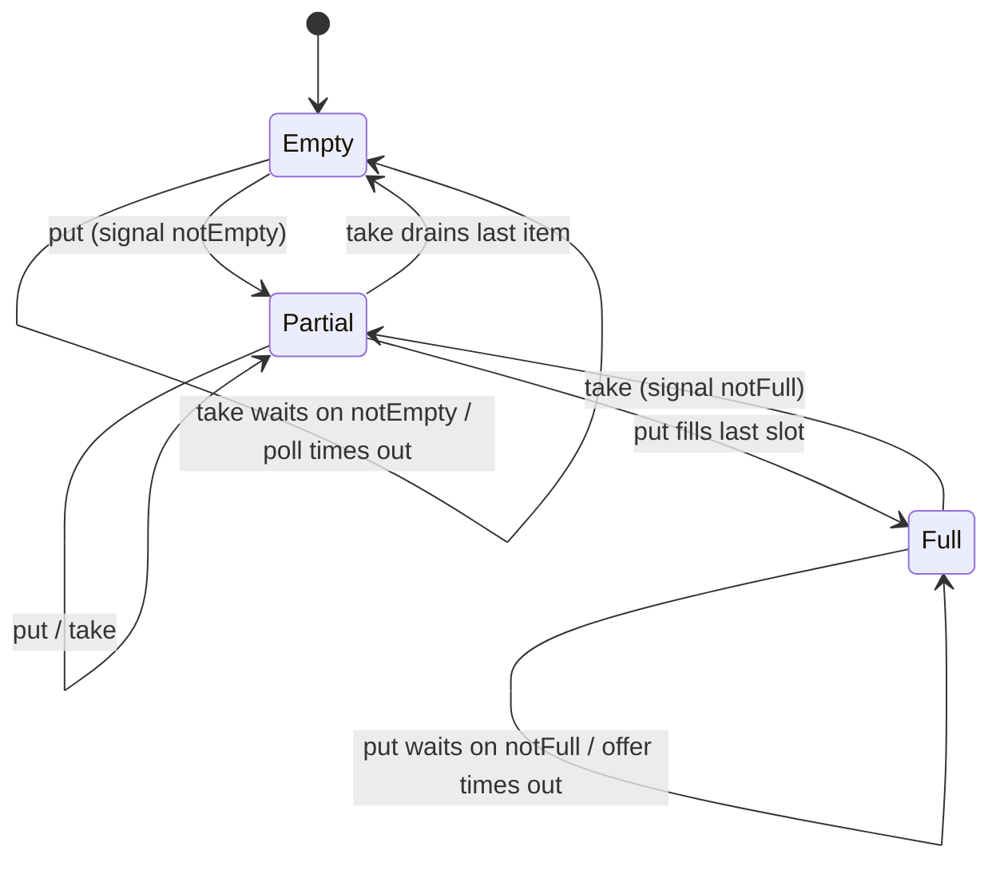

# Producers, Consumers, and Bounded Queues

> Backpressure begins with a queue that refuses to grow.

**Type:** Build
**Languages:** Java, Python, Go
**Prerequisites:** Phase 4, Lesson 02 (Locks, Atomics, and a Balance That Never Lies); Phase 1, Lesson 04 (Queues and Ring Buffers); Phase 10, Lesson 01 (Representing Money)
**Time:** ~75 minutes

## Learning Objectives

- Build a bounded FIFO queue from one mutex and two condition variables, with blocking `put`/`take` and timed `offer`/`poll`, in Java, Python, and Go
- Explain why every wait is inside a `while` loop (spurious wakeups, stolen wakeups) and why the queue signals one waiter per state change rather than broadcasting
- Inject a clock so that timeouts are tested to the nanosecond without any real waiting, and state what the fake clock does and does not prove
- Describe backpressure as a mechanism, not a slogan: the bound converts a fast producer's surplus into blocked time or refused requests instead of heap growth
- Write concurrency tests that coordinate with latches, events, and bounded spins, and assert invariants (FIFO, conservation, high-water mark) rather than schedules
- Compare the from-scratch queue with `ArrayBlockingQueue`, `queue.Queue`, buffered channels, and the bounded buffers in Kafka producers and HTTP servers

## The Problem

A card-acquiring gateway receives authorization results from the network at whatever rate the network sends them, and posts each one to a ledger service that writes two rows and an outbox entry per payment. On a normal day both sides run at about 2,000 events per second. The gateway hands events to the ledger writer through an in-memory queue, because coupling the network-facing thread directly to a database write would make the network see every database hiccup.

The queue is a `LinkedList` guarded by a lock. It has no capacity. On a Friday afternoon the ledger database fails over to a replica; writes stall for forty seconds and then resume at half speed while the replica warms its cache. The network does not slow down. In forty seconds the queue absorbs 80,000 events, each holding a parsed message of a few kilobytes. The heap grows by a few hundred megabytes, the garbage collector starts running every second, and the collector's pauses slow the ledger writer further, which makes the queue grow faster. Twenty minutes later the process dies with `OutOfMemoryError`. Every event in the queue, including authorizations that the network believes were delivered, is gone. The team spends the weekend reconstructing them from network settlement files.

The root cause is not the failover; failovers happen. It is that nothing in the system told the producer to slow down. An unbounded queue has one promise, "I will always accept", and it keeps that promise right up to the moment the process dies. A bounded queue has a different promise: "I will accept up to N items, and then the producer waits or is refused." Waiting means the network-facing thread stops reading from its socket, the socket's receive buffer fills, TCP flow control tells the network's sender to pause, and the backlog moves to the party that can actually hold it. Refusing means the gateway returns a retryable error with a `Retry-After`, and the network's own retry schedule takes over. Either way the pressure propagates backward, from the slow consumer to the source, instead of accumulating in your heap. That propagation is what backpressure means, and the bound is where it starts.

This lesson builds that queue from the two primitives underneath every blocking queue in every standard library: a mutex and condition variables. Not because you will ship your own (you will use `ArrayBlockingQueue` or a channel), but because the three decisions inside it, when to wait, when to wake whom, and what to do when the wait times out, are the decisions you make again every time you size a thread pool, a channel, or a Kafka producer buffer.

## The Concept

### A monitor: one lock, several conditions

A condition variable is a waiting room attached to a lock. A thread that holds the lock and finds the state it needs is false (queue full, for a producer) calls `await`, which atomically releases the lock and parks the thread. Another thread that changes the state (a consumer that took an item) calls `signal`, which moves one parked thread to the lock's entry queue; that thread re-acquires the lock and continues. The lock plus its conditions is what Hoare (1974) called a monitor; `synchronized`/`wait`/`notify` is Java's one-condition monitor, `ReentrantLock` with `newCondition()` is the general form.

The bounded queue needs two conditions on the same lock because it has two different things to wait for:

| Condition | Who waits on it | Who signals it | When |
|-----------|-----------------|----------------|------|
| `notFull` | producers, while `count == capacity` | consumers | after every `dequeue` (one slot opened) |
| `notEmpty` | consumers, while `count == 0` | producers | after every `enqueue` (one item arrived) |

With one condition shared by both roles, a consumer's signal could wake another consumer instead of a producer, which would then re-check `count == 0`, go back to sleep, and leave the producer parked with a slot free: a *lost wakeup*. Two conditions make "wake someone who can make progress" exact.



### The invariant and the two loops

The state is a ring buffer: an array of `capacity` slots, a `head` index for the next take, a `tail` index for the next put, and a `count`. The invariant, which holds whenever the lock is free, is:

```text
0 <= count <= capacity
the items in FIFO order are items[head], items[head+1 mod cap], ..., items[(head+count-1) mod cap]
tail == (head + count) mod capacity
```

Every method takes the lock, loops until its precondition holds, mutates under the invariant, signals the opposite condition, releases. The loops are the part people get wrong:

```text
while (count == capacity) notFull.await();    // never "if"
```

Two reasons it must be `while`. First, **spurious wakeups**: POSIX and the JVM both permit `await` to return without any signal, and the `Condition` Javadoc says so explicitly. Second, **stolen wakeups**: a consumer signals `notFull`, the parked producer is moved to the lock's entry queue, but before it re-acquires the lock a *third* thread calls `put`, finds the slot free, and fills it. The woken producer must re-check or it will write into a full buffer. A `while` loop makes both harmless.

The `signal` versus `signalAll` choice is the other decision. `enqueue` adds exactly one item, so exactly one waiting consumer can make progress; waking all of them would make N−1 threads re-check and re-park, which under load is a thundering herd. `signal` is correct here *because* every waiter on `notEmpty` is waiting for the same predicate (`count > 0`). The moment different waiters need different predicates on one condition, `signal` becomes a lost-wakeup bug and `signalAll` is the only safe choice. `ArrayBlockingQueue` uses `signal` for exactly this reason; `Object.notify()` in Java is dangerous for exactly the opposite reason (one monitor, mixed predicates).

### Timeouts, and why the clock is injected

`offer(item, timeout)` is `put` that gives up. It records a deadline, and each time around the loop computes `remaining = deadline - now`; if nothing is left it returns `false`, otherwise it waits at most `remaining`. The loop shape matters: a single `awaitNanos(timeout)` is wrong because a spurious or stolen wakeup would return early and the method would either give up too soon or, if written as "wait again for the full timeout", wait too long.

Testing this honestly is the problem. A test that calls `offer` with a 250 ms timeout on a full queue and asserts `false` takes 250 ms and asserts nothing about *how long* it waited; a test with a 5 ms timeout is flaky on a loaded CI machine. So the queue takes a `Clock` with two operations: `nanos()` to read the time, and `await(condition, nanos)` to perform a timed wait. The system clock's `await` is `condition.awaitNanos(nanos)`. The fake clock's `await` adds `nanos` to its own time and returns immediately, without parking, which is precisely what an unsignalled timed wait looks like from the caller's point of view. With the fake clock the timed test is:

```text
clock at 1,000 ns; queue capacity 1, one item inside
offer(x, 250,000,000)  ->  false
clock now 250,001,000  ->  it waited exactly the timeout, once
```

Deterministic, instant, exact. What it does *not* prove: that the real `awaitNanos` wakes up when a consumer signals. That is covered by the blocking tests with real threads, where a parked producer is released by a `take` and the test asserts only that it eventually completed, not when.

### Worked example: capacity 4, 20 payments, consumer starts late

Twenty authorization events of 19.99 USD each are produced into a queue of capacity 4. The consumer is held back until the producer is blocked (the demo spins on `stats().waitingProducers() == 1`), then takes all twenty.

```text
puts 1-4      count 0 -> 4, high-water mark 4, no waiting
put 5         count == capacity -> producerWaits = 1, park on notFull
consumer      take -> item 1, count 3, signal notFull
producer      wakes, re-checks count (3 < 4), enqueues item 5, count 4, signal notEmpty
consumer      take -> item 2, count 3, signal notFull
...
```

What the stats say afterwards: `highWaterMark == 4`, exactly the capacity, because the producer could never get a fifth item in; `producerWaits` somewhere between 1 and 16 depending on how the scheduler interleaved the two threads; `consumerWaits` a few, from moments when the consumer drained the buffer before the woken producer refilled it. The items arrive in order 1..20 and the sum of amounts is `20 * 1999 = 39980` minor units, 399.80 USD. The test asserts FIFO, conservation, `highWaterMark == 4`, `producerWaits >= 1`, and `waitingProducers == 0` at the end. It does not assert `producerWaits == 5`, because that number is the scheduler's, not the queue's.

The contrast demo runs the same 20 items into a queue of capacity 1,000: `producerWaits == 0`, `highWaterMark == 20`. Nothing told the producer to slow down, and with 80,000 items instead of 20 that is the Friday failover.

### Three responses to a full queue

| Policy | Call | What the caller experiences | When to use it |
|--------|------|-----------------------------|----------------|
| Block | `put` | thread stops until there is room | internal pipeline stages where the producer's thread *is* the right place to hold the backlog (it stops reading its socket; TCP pushes back) |
| Timed | `offer(item, timeout)` | waits a bounded time, then `false` | request handlers with a latency budget: wait up to the budget, then shed |
| Refuse | `offer(item, 0)` | immediate `false` | admission control at the edge: reply `429`/`503` with `Retry-After`, let the client's retry schedule be the buffer |

A fourth policy, drop the *oldest* item to make room, is right for telemetry and wrong for money; `put` and `offer` in this lesson never discard anything that was accepted, and that is the property that makes "accepted" meaningful to the caller.

### Complexity

Every operation is O(1): array index, increment modulo capacity, one signal. The lock is held for a handful of instructions, so the queue itself is never the bottleneck; the bottleneck is whichever side is slower, which is exactly what the `waiting*` counters show. Memory is `capacity` references, allocated once. There is no per-item allocation, which is the reason ring buffers beat linked lists for queues of fixed maximum size.

### What this queue does not do

- **It does not persist.** A process crash loses everything inside. The bound limits the blast radius to `capacity` items, which is a reason to keep it small, and the outbox pattern (Phase 7) is how an event becomes durable before it is acknowledged.
- **It does not prioritize.** FIFO only. A priority queue (Phase 1, Lesson 05) is a heap, with O(log n) operations and a different fairness story.
- **It does not shut down.** There is no `close()`; a consumer blocked in `take` on a queue that will never receive another item waits forever. Exercise 2 adds a poison pill; Lesson 11 adds cancellation.
- **It does not fence producers from each other.** Items from one producer arrive in that producer's order; items from two producers interleave arbitrarily. The multi-producer test asserts per-producer order and nothing more.

## Build It

The walkthrough is in Java. Python and Go implement the same names and the same tests; the subsections at the end show only what differs.

### Step 1: The clock seam

```java
interface Clock {
    long nanos();
    void await(Condition condition, long nanos) throws InterruptedException;

    static Clock system() {
        return new Clock() {
            @Override public long nanos() { return System.nanoTime(); }
            @Override public void await(Condition condition, long nanos) throws InterruptedException { condition.awaitNanos(nanos); }
        };
    }
}

final class FakeClock implements Clock {
    private long now;
    FakeClock(long startNanos) { this.now = startNanos; }
    @Override public long nanos() { return now; }
    @Override public void await(Condition condition, long nanos) { now += Math.max(0, nanos); }
}
```

The fake clock's `await` ignores the condition entirely. It is only ever called with the queue lock held and only from the timed loops, so advancing the time and returning is indistinguishable, to the loop, from a wait that expired. `System.nanoTime` rather than `currentTimeMillis` because it is monotonic; a wall-clock adjustment during a wait would otherwise make `remaining` negative or enormous.

**Predict:** if `FakeClock.await` were used by `put` (the untimed version), what would happen on a full queue?

### Step 2: State and the invariant

```java
final class BoundedBlockingQueue<T> {
    private final Object[] items;
    private int head;        // next take
    private int tail;        // next put
    private int count;
    private final ReentrantLock lock = new ReentrantLock();
    private final Condition notFull = lock.newCondition();
    private final Condition notEmpty = lock.newCondition();
    private final Clock clock;
    private long producerWaits, consumerWaits;
    private int highWaterMark, waitingProducers, waitingConsumers;

    BoundedBlockingQueue(int capacity, Clock clock) {
        if (capacity <= 0) throw new IllegalArgumentException("capacity must be positive: " + capacity);
        this.items = new Object[capacity];
        this.clock = Objects.requireNonNull(clock);
    }
}
```

Every field after `items` is guarded by `lock`, including the statistics. `highWaterMark` is the maximum `count` ever observed; it is the single most useful number for sizing, because a queue whose high-water mark never approaches its capacity is not providing backpressure, and one that sits at capacity is a consumer that cannot keep up. Capacity 0 is rejected rather than treated as a synchronous hand-off; `SynchronousQueue` is a different structure.

### Step 3: Blocking put and take

```java
void put(T item) throws InterruptedException {
    Objects.requireNonNull(item, "item");
    lock.lock();
    try {
        while (count == items.length) {          // while, not if: wakeups can be spurious or stolen
            producerWaits++;
            waitingProducers++;
            try { notFull.await(); } finally { waitingProducers--; }
        }
        enqueue(item);
    } finally {
        lock.unlock();
    }
}

T take() throws InterruptedException {
    lock.lock();
    try {
        while (count == 0) {
            consumerWaits++;
            waitingConsumers++;
            try { notEmpty.await(); } finally { waitingConsumers--; }
        }
        return dequeue();
    } finally {
        lock.unlock();
    }
}
```

`await` releases the lock while parked and re-acquires it before returning, so the `waitingProducers--` in the inner `finally` runs with the lock held, and so does the re-check of `count`. The inner `finally` matters for interruption: if the thread is interrupted while parked, `await` throws, and without the `finally` the queue would report a phantom waiter forever. `null` is rejected because `poll` uses `Optional.empty()` to mean "nothing", and a stored `null` would be indistinguishable from it; `ArrayBlockingQueue` rejects `null` for the same reason.

**Predict:** two consumers are parked on `notEmpty`. A producer puts one item. How many consumers wake, and what does the other one do?

### Step 4: Timed offer and poll

```java
boolean offer(T item, long timeoutNanos) throws InterruptedException {
    Objects.requireNonNull(item, "item");
    lock.lock();
    try {
        long deadline = clock.nanos() + timeoutNanos;
        while (count == items.length) {
            long remaining = deadline - clock.nanos();
            if (remaining <= 0) return false;
            producerWaits++;
            waitingProducers++;
            try { clock.await(notFull, remaining); } finally { waitingProducers--; }
        }
        enqueue(item);
        return true;
    } finally {
        lock.unlock();
    }
}
```

The deadline is computed once; `remaining` is recomputed on every iteration, so a spurious wakeup after 100 ms of a 250 ms timeout waits a further 150 ms, not another 250. `offer(item, 0)` is the non-blocking try: `remaining` is `0` on the first check and the method returns `false` at once without recording a wait. `poll` is the mirror image, returning `Optional<T>` so an empty result and an item are different types rather than `null` versus not.

**Predict:** `offer` on a queue with free space and a fake clock. Does the clock advance? Does `producerWaits` change?

### Step 5: The two helpers that touch the ring

```java
private void enqueue(T item) {
    items[tail] = item;
    tail = (tail + 1) % items.length;
    count++;
    if (count > highWaterMark) highWaterMark = count;
    notEmpty.signal();                           // one waiting consumer is enough: one item arrived
}

@SuppressWarnings("unchecked")
private T dequeue() {
    T item = (T) items[head];
    items[head] = null;                          // let the GC have it
    head = (head + 1) % items.length;
    count--;
    notFull.signal();                            // one waiting producer is enough: one slot opened
    return item;
}
```

Both are called only with the lock held and only after the caller's loop established the precondition. `signal` rather than `signalAll` because each call changes `count` by exactly one, so exactly one waiter on the opposite condition can proceed. Nulling the slot on dequeue is not cosmetic: a queue of capacity 10,000 that cycled through large messages would otherwise pin the last 10,000 of them in memory indefinitely.

**Predict:** a queue of capacity 3 receives `put a, put b, put c, take, take, put d, put e`. What are `head`, `tail`, and `count`, and in what order do the next three `take` calls return?

### Step 6: A producer, and how the demo waits without sleeping

```java
static void untilProducerWaiting(BoundedBlockingQueue<?> queue) {
    long deadline = System.nanoTime() + 5_000_000_000L;
    while (queue.stats().waitingProducers() == 0) {
        if (System.nanoTime() > deadline) throw new IllegalStateException("producer never blocked");
        Thread.onSpinWait();
    }
}
```

The demo and tests need to know "the producer is now blocked at the bound" before the consumer starts, otherwise the high-water mark would depend on which thread the scheduler ran first. A `Thread.sleep(100)` would usually work and occasionally would not. A spin on the queue's own `waitingProducers` counter is exact: it is incremented under the lock immediately before `await`, so once it reads 1 the producer has committed to parking. The five-second deadline turns a hypothetical bug (producer never blocks) into a failed test rather than a hung one.

### Step 7: Run it

```bash
cd phases/04-concurrency/05-producers-consumers-and-bounded-queues/code/java
javac -d .out *.java && java -cp .out Main
java -cp .out MainTest
```

Expected output, abbreviated (the two wait counts vary):

```console
== A full queue refuses, it does not grow ==
offer auth-1 -> accepted  (size 1/3)
offer auth-3 -> accepted  (size 3/3)
offer auth-4 -> REFUSED: reply 429 Retry-After  (size 3/3)

== A timed offer against a full queue, with a fake clock ==
offer with 250 ms timeout -> false; clock advanced 250 ms; producer waits = 1

== Backpressure: a fast producer, a slow consumer, capacity 4 ==
producer blocked with 4/4 items queued; it cannot run ahead of the ledger
consumed 20 payments in FIFO order: true; posted 399.80 USD
high-water mark 4 (never above capacity), producer waited 5 times, consumer waited 4 times

== Without the bound, the backlog lives in your heap ==
capacity 1000: all 20 queued, producer waited 0 times, high-water mark 20: nothing told the producer to slow down
```

### In Python

```python
self._lock = threading.Lock()
self._not_full = threading.Condition(self._lock)
self._not_empty = threading.Condition(self._lock)
```

Differences, all in `code/python/main.py`:

- **Two `Condition` objects share one `Lock`** by passing the lock to each constructor; this is the direct equivalent of `lock.newCondition()` twice. `with self._lock:` is the `try/finally`.
- **`Condition.wait(timeout)` takes seconds as a float**; the `Clock.wait` seam converts from nanoseconds so the queue's arithmetic stays in integers and matches Java and Go exactly.
- **`poll` returns `T | None`** rather than `Optional`, which is why `put(None)` is rejected: a stored `None` would be indistinguishable from "empty".
- **The GIL does not make this simpler.** `self._count == len(self._items)` followed by `self._items[self._tail] = item` is two bytecodes with a possible switch between them; the lock is what makes the check-then-act atomic, exactly as in Lesson 02.
- **Yielding is `time.sleep(0)`.** There is no `onSpinWait`; `sleep(0)` releases the GIL and returns at the next opportunity. It is a yield, not a delay, and the spin loop still checks the queue's own counter.

### In Go

```go
func (c *SystemClock) Wait(cond *sync.Cond, nanos int64) {
    timer := time.AfterFunc(time.Duration(nanos), func() {
        cond.L.Lock()
        cond.Broadcast()
        cond.L.Unlock()
    })
    cond.Wait()
    timer.Stop()
}
```

Differences, all in `code/go/main.go`:

- **`sync.Cond` has no timed wait.** This is a deliberate omission by the Go team (the idiomatic answer is a channel plus `select` with `time.After`). The lesson keeps the condition-variable design to match the other languages and implements the timed wait with a timer that `Broadcast`s at the deadline. The callback takes the lock first so it cannot run in the gap between the caller's check and its `Wait`, which would be a lost wakeup; `Broadcast` rather than `Signal` because the timer does not know which waiter it is waking, and the `for` loops make the extra wakeups harmless. `TestSystemClockTimedOfferReallyTimesOut` is the one test that uses the real clock, with a 5 ms timeout, to prove the timer path works.
- **Generics.** `BoundedBlockingQueue[T any]` with a zero value written back on dequeue (`var zero T`), the equivalent of nulling the slot. `Poll` returns `(T, bool)`.
- **`-race` is the test command.** Every field is accessed under `mu`, including the stats; the race detector confirms it on every run.
- **Yielding is `runtime.Gosched()`.** A closed channel or `sync.WaitGroup` replaces `CountDownLatch`.

## Use It

### `java.util.concurrent.ArrayBlockingQueue`

This lesson is `ArrayBlockingQueue` with the statistics added and the fairness option removed. Its source uses one `ReentrantLock`, two `Condition`s named `notEmpty` and `notFull`, a circular array with `takeIndex` and `putIndex`, and `signal` (not `signalAll`) after each enqueue and dequeue. What it adds: optional fair ordering of blocked threads (FIFO lock acquisition, at a throughput cost), `drainTo`, iterators that tolerate concurrent modification, and `remainingCapacity`. `LinkedBlockingQueue` uses two locks (one per end) for higher throughput at the cost of a node allocation per item; `SynchronousQueue` has capacity zero; `ThreadPoolExecutor` takes any `BlockingQueue` and its `RejectedExecutionHandler` is exactly the "what to do when `offer` returns false" policy from the table above.

### Python's `queue.Queue`

`queue.Queue(maxsize)` is this design with a third condition, `all_tasks_done`, for `join()`. `put(item, block=True, timeout=None)` combines `put`, `offer`, and `offer(x, 0)` into one signature; `queue.Full` and `queue.Empty` are the refusals. `asyncio.Queue` is the same shape for coroutines, with `await put()` suspending the task instead of parking a thread.

### Go channels

`make(chan Payment, 4)` is a bounded queue of capacity 4 built into the language. `ch <- p` is `put`, `<-ch` is `take`, and `select { case ch <- p: ... default: ... }` is `offer(p, 0)`. A timed offer is `select` with `case <-time.After(d)`. What a channel adds that this lesson's queue lacks: `close(ch)` for shutdown, `range` over the channel, and `select` across several. The Go team's position is that `sync.Cond` is almost never the right tool in Go, and this lesson agrees; the condition-variable version exists to show what the channel is made of.

### Beyond one process

Every production system that moves events has this queue somewhere, with the same three policies:

- **Kafka producers** have `buffer.memory` (the bound) and `max.block.ms` (the `offer` timeout); when the buffer is full, `send()` blocks for up to `max.block.ms` and then throws. The consumer side's `max.poll.records` and the broker's quotas are the pressure propagating backward.
- **HTTP servers** bound their accept and request queues (Tomcat's `acceptCount`, Go's `net/http` relying on the kernel listen backlog); when full, connections are refused and the client sees `ECONNREFUSED` or a `503`. A `429` with `Retry-After` is `offer(x, 0)` returning `false` with instructions.
- **Reactive Streams** (`java.util.concurrent.Flow`) make the bound explicit in the protocol: a subscriber calls `request(n)` and the publisher may send at most `n` items. That is this queue's `capacity - count`, sent over the wire.

The trap in all of them is the same: a bound that is never reached is a bound that is not doing anything, and a bound that is reached with `put` semantics in a thread that also holds other resources (a database connection, a lock) turns backpressure into a stall. Measure the high-water mark; decide which policy each boundary gets.

## Ship It

`outputs/runbook-queue-backpressure.md` is a runbook for the on-call engineer who sees a queue-depth alert: what the high-water mark and wait counts mean, how to tell a slow consumer from a producer burst, which of the three policies the boundary should have, and what to change (capacity, timeout, consumer parallelism, shedding) in which order. It also lists the symptoms of an unbounded queue so the problem is recognized before the heap dump.

## Exercises

1. **Reinforce.** Add `drainTo(Collection<T> sink, int max)` that removes up to `max` items under one lock acquisition, signalling `notFull` once per removed item. Write a test with a fake clock showing that a producer blocked in `offer` is admitted after a drain, and a test that `drainTo` on an empty queue returns 0 without waiting.
2. **Apply.** Implement shutdown with a poison pill: a `close()` method that puts a sentinel the consumers recognize, after which `take` returns the sentinel to every consumer and `put` throws `IllegalStateException`. Decide, and defend in a comment, whether `close()` should wait for the queue to drain first. Then compare with Go's `close(ch)` semantics (sends panic, receives drain then return zero).
3. **Extend.** Combine with Lesson 02: build a `MeteredQueue` that wraps this queue and records, per producer thread, total nanoseconds spent blocked in `put`, using the striped-counter design so producers do not contend on the metric itself. Run 4 producers against 1 consumer and 1 producer against 4 consumers, and use the per-side blocked time to say which side is the bottleneck in each case.

## Key Terms

| Term | What people say | What it actually means |
|------|-----------------|------------------------|
| Condition variable | "wait/notify" | A waiting room attached to a lock: `await` atomically releases the lock and parks; `signal` moves one parked thread back to competing for the lock |
| Monitor | "a synchronized object" | A lock plus the conditions that share it; the structure Hoare described in 1974 and that `ReentrantLock` + `Condition` implements |
| Spurious wakeup | "it woke up for no reason" | A permitted return from `await` with no corresponding signal; the reason every wait is inside a `while` that re-checks the predicate |
| Lost wakeup | "the thread never woke up" | A signal delivered when no one was waiting, or to a waiter whose predicate is still false; caused by checking state outside the lock or by sharing one condition between different predicates |
| Backpressure | "slow down the producer" | The mechanism by which a bounded consumer's inability to keep up is propagated to the producer as blocked time or refusals, instead of accumulating as memory |
| High-water mark | "max queue depth" | The largest `count` the queue has ever held; equal to capacity means the producer was held back, far below capacity means the bound is not doing anything |
| Load shedding | "return 429" | Refusing work at admission (`offer` returning false) so the system stays within capacity, delegating the retry to the caller |
| Ring buffer | "circular array" | A fixed array with wrapping head and tail indices; O(1) enqueue and dequeue with no per-item allocation |

## Further Reading

- [C. A. R. Hoare, "Monitors: An Operating System Structuring Concept" (CACM, 1974)](https://dl.acm.org/doi/10.1145/355620.361161) — the paper that defined the lock-plus-conditions structure, including the bounded buffer as its worked example.
- [`java.util.concurrent.locks.Condition` Javadoc](https://docs.oracle.com/en/java/javase/21/docs/api/java.base/java/util/concurrent/locks/Condition.html) — the "Implementation Considerations" section on spurious wakeups is the authoritative reason for the `while` loop; the class comment contains a bounded buffer almost identical to this lesson's.
- [`ArrayBlockingQueue` source, OpenJDK](https://github.com/openjdk/jdk/blob/master/src/java.base/share/classes/java/util/concurrent/ArrayBlockingQueue.java) — read `enqueue`, `dequeue`, `put`, and `offer(E, long, TimeUnit)` next to this lesson's; the structure is the same.
- [Python `threading.Condition` documentation](https://docs.python.org/3/library/threading.html#condition-objects) — the `wait(timeout)` contract and the producer-consumer example in the standard docs.
- [Go `sync.Cond` documentation](https://pkg.go.dev/sync#Cond) and [Effective Go: Channels](https://go.dev/doc/effective_go#channels) — why `Cond` has no timed wait and how a buffered channel is the idiomatic bounded queue.
- [Reactive Streams specification](https://www.reactive-streams.org/) — backpressure as a protocol: `request(n)` is the queue's free capacity, made explicit between processes.
- [Apache Kafka producer configuration: `buffer.memory`, `max.block.ms`](https://kafka.apache.org/documentation/#producerconfigs_buffer.memory) — a production bounded queue with a timed offer, documented as configuration.
