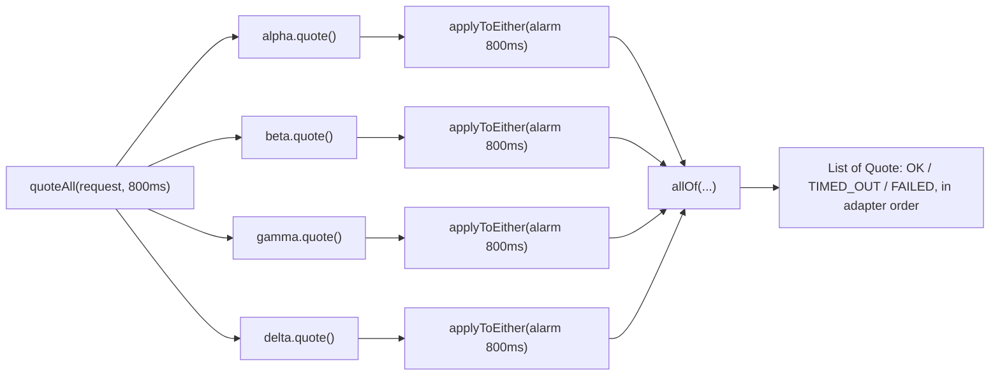

# Executors, Goroutines, and asyncio

> Three concurrency models, one fan-out/fan-in problem.

**Type:** Build
**Languages:** Java, Python, Go
**Prerequisites:** Phase 4 Lesson 01 (Threads and the Memory Model), Phase 4 Lesson 05 (Producers, Consumers, and Bounded Queues)
**Time:** ~90 minutes

## Learning Objectives

- State the one problem all three models solve (many independent waits, one combined answer) and the resource each model spends while waiting: a platform thread, a goroutine stack, or a coroutine frame
- Demonstrate thread-pool starvation deterministically and explain why the same blocking code on virtual threads does not starve
- Build a fan-out over payment-processor adapters with `CompletableFuture`, where each call races its own timeout and the fan-in completes when every adapter has answered, failed, or timed out
- Inject time through a `Timer` interface so the fan-out, its timeouts, and its tests run on a simulated clock and never sleep
- Explain why a timeout abandons a wait but does not cancel the request, and what that means for a payment that may still be processed
- Map every piece of the Java design onto goroutines with channels and `context`, and onto asyncio with `gather` and `wait_for`

## The Problem

A checkout service routes each card payment to the cheapest of four processors. Before authorising, it asks all four for a fee quote, waits for the answers, and picks the lowest. Each quote is an HTTP call that takes 80 to 400 milliseconds; sequentially that is up to 1.6 seconds, so the calls run in parallel. Version one submitted the four calls to a fixed pool of 64 threads shared by the whole service, then called `future.get()` on each. This lesson pairs with Phase 5 Lesson 08 (Timeouts and Deadline Propagation), which comes later.

One Tuesday a processor's quote endpoint stopped answering. It accepted connections and never replied. Each call to it held a pool thread until the socket timeout of 30 seconds. At 50 checkouts per second, 50 threads per second entered that 30-second wait; within two seconds all 64 pool threads were parked on a processor that had nothing to do with 75% of the work. Quotes from the three healthy processors could not start because there was no thread to run them. The service's own health check, which also used the pool, timed out, and the orchestrator restarted every instance. The three healthy processors were fine. The pool was the failure.

Two more problems came out of the post-mortem. The 30-second timeout was a socket setting, not a decision; the business rule was "a quote is worthless after 800 ms". And when a quote did time out, the code treated the timeout as the end of the story, but the request was still in flight at the processor. For quotes that is harmless. For the authorisation call that came next, with the same code shape, it meant a timed-out authorisation could still succeed at the processor while the service told the customer it had failed, and the customer paid twice when they retried.

The fix has three parts, and they are the three models in this lesson's title. Decouple the number of concurrent waits from the number of threads: virtual threads in Java, goroutines in Go, coroutines in Python. Express the fan-out as a composition of futures with a per-call deadline that is a business number, not a socket default. And inject time, so the whole thing can be tested without a 30-second sleep.

## The Concept

### One problem, three ways to wait

Fan-out/fan-in is: start N independent operations, wait for all (or the first, or the first K) to finish, combine the results. The operations are I/O; the CPU is idle while they run. The models differ in what a waiting operation costs and who schedules it.

| Model | Unit of concurrency | What a blocked wait costs | Who schedules | Fan-in primitive |
|-------|---------------------|---------------------------|---------------|------------------|
| Platform threads + executor (Java pre-21, C#, C++) | OS thread, ~1 MB stack reserved | an OS thread, parked | kernel | `invokeAll`, `Future.get` |
| Virtual threads (Java 21, JEP 444) | JVM-managed thread, a few hundred bytes of stack on heap | a heap object; the carrier thread is released | JVM scheduler (a `ForkJoinPool` of carriers) | same code: `invokeAll`, `Future.get` |
| Goroutines (Go) | runtime-managed green thread, 2 KB initial stack | a heap object; the M:N scheduler parks it | Go runtime | `sync.WaitGroup`, channels, `errgroup` |
| Coroutines on an event loop (Python asyncio, JavaScript) | a frame suspended at `await` | a frame; the single loop thread moves on | the event loop | `asyncio.gather`, `asyncio.wait` |
| Futures composition (`CompletableFuture`, Rust futures) | a callback chain | nothing: no thread waits; a callback runs on completion | whoever completes the future | `allOf`, `anyOf`, `thenCombine` |

The first row is the only one where a wait holds a scarce resource, and that is why the fixed pool starved. Every other row makes a blocked wait cheap, by different mechanisms: virtual threads and goroutines unmount the stack from the carrier when the code blocks; asyncio and futures never block at all, they register a continuation.

### Pool starvation, precisely

A fixed pool of N threads can have at most N tasks in progress. If a task blocks, its thread is in progress and idle at the same time. With N = 2 and three blocking tasks, the third task sits in the queue until one of the first two finishes; if they are waiting on something that will not happen until the third runs, the pool is deadlocked without a lock in sight. The demo shows the simple version: three tasks that block on a gate, pool of two, exactly two start. Switch to `Executors.newVirtualThreadPerTaskExecutor()` and all three start, because a blocked virtual thread yields its carrier.

The payments consequence is bulkheading (Phase 5, Lesson 11): one slow dependency must not consume the threads another dependency needs. Virtual threads make the thread budget large enough that this stops being the constraint; the constraint moves to the dependency itself (connection limits, rate limits), which is where a bounded queue or semaphore belongs.

### Timeouts are decisions, not socket settings

A quote is worth collecting for 800 ms. After that the checkout proceeds with whatever answered. That number belongs in the fan-out, per call, as a deadline that races the call:



Each adapter's future is combined with an alarm future using `applyToEither`: whichever completes first wins. If the call wins, the alarm is cancelled; if the alarm wins, the result is a `TIMED_OUT` quote. Exceptions become `FAILED` quotes. The fan-in `allOf` therefore completes at the latest at the deadline, with one outcome per adapter, in adapter order. No thread blocked anywhere in this diagram.

The combined future's latency is `min(deadline, slowest answer)`, which is the property the fixed-pool version lacked: there, the slowest answer was a 30-second socket timeout and nothing in the code could shorten it.

### Abandon is not cancel

When the alarm wins, the adapter's call is still outstanding. The demo prints `gamma still has 1 outstanding call`. In the quote case this is a wasted response. In the authorisation case it is a payment that may complete after the caller gave up. Three facts follow:

1. A timed-out write must be **reconciled**, not assumed failed. The idempotency key from Phase 5, Lesson 09 is what lets a retry discover that the first attempt succeeded.
2. Cancellation is a separate mechanism from timeout. `CompletableFuture.cancel` does not interrupt anything; it only completes the future exceptionally. Interrupting the underlying HTTP call needs cooperation from the client library, and Lesson 11 (structured concurrency, Go's `context`) is about making that cooperation systematic.
3. Resource hygiene matters: a winning call should cancel its alarm, or the timer keeps a reference until the deadline. The code does this with `whenComplete`.

### Injected time

Every timeout in this lesson goes through one interface:

```java
interface Timer {
    CompletableFuture<Void> after(long millis);
    long nowMillis();
}
```

`RealTimer` uses `CompletableFuture.delayedExecutor`. `ManualTimer` keeps a list of (deadline, future) pairs and fires the due ones when the test calls `advance(ms)`. The fan-out code does not know which one it has. That means the test for "a silent processor times out at 800 ms" runs in microseconds, with the exact ordering the test chooses: beta answers at 250, delta fails at 550, the deadline fires at 800. No `Thread.sleep`, no flakiness, no test that passes on a fast CI box and fails on a slow one. This is the same discipline as the injected clock in Lesson 02's benchmark and the simulated network in Phase 5.

### Worked example by hand

Four processors, 800 ms budget, a 129.99 USD payment:

| Time | Event | alpha | beta | gamma | delta | `allOf` done? |
|------|-------|-------|------|-------|-------|---------------|
| 0 | fan-out issued; alpha is immediate | OK 3.29 | pending | pending | pending | no |
| 250 | beta answers 2.75 | OK 3.29 | OK 2.75 | pending | pending | no |
| 550 | delta returns HTTP 503 | OK 3.29 | OK 2.75 | pending | FAILED | no |
| 800 | alarms fire; gamma's alarm wins its race | OK 3.29 | OK 2.75 | TIMED_OUT | FAILED | yes |

`cheapest` filters to OK and takes the minimum fee: beta at 2.75 USD. Had gamma answered at 799 with 2.00 USD, it would have won; the budget is what the business decided a quote is worth waiting for, and the code makes that decision visible and testable.

### The fan-in variants

- **All:** `allOf`, then collect. The checkout quote.
- **First OK:** complete the result on the first OK answer; if everyone fails or times out, complete empty. Useful for redundant reads (two replicas, take whichever answers), where a late second answer is simply dropped. `firstOk` in the code shows it needs a counter for the "everyone answered, none OK" case, because `anyOf` would return the first *completion*, including failures.
- **Quorum:** complete on the K-th OK. Phase 6's replication lessons build this on the same pattern.

### Sizing a pool, if you must have one

For code that stays on platform threads, Little's law gives the minimum pool size: concurrency = arrival rate x time in system. At 50 checkouts per second, each holding a thread for 0.4 seconds (the slowest healthy processor), the quote fan-out alone needs 50 x 0.4 x 4 adapters = 80 threads in steady state. On the Tuesday in The Problem, time in system became 30 seconds and the requirement became 6,000 threads; the pool had 64. No fixed pool survives a dependency whose latency grows by two orders of magnitude, which is why the real fixes are a deadline the fan-out controls and a thread model where a blocked wait is cheap.

`ThreadPoolExecutor` has three knobs worth knowing even when you plan to use virtual threads: core size, maximum size, and the work queue. An unbounded `LinkedBlockingQueue` (what `newFixedThreadPool` uses) means the pool never grows past core and never rejects; work piles up invisibly. A bounded queue with a `RejectedExecutionHandler` is backpressure (Lesson 05): the caller learns immediately that the system is full instead of waiting behind thirty seconds of queued work.

### Choosing a model

| Situation | Use | Because |
|-----------|-----|---------|
| Blocking client libraries, Java 21+ | virtual threads, blocking style (Step 5) | simplest code; the runtime makes waits cheap; stack traces stay readable |
| Composition with deadlines, partial results, first-K rules | `CompletableFuture` (Steps 3-4) | the combining rule is explicit in the code and testable with an injected timer |
| CPU-bound parallel work | a fixed pool sized to cores (or `ForkJoinPool`) | virtual threads buy nothing when nothing blocks; more threads than cores only adds switching |
| Must run on Java 17 or earlier with blocking I/O | a dedicated bounded pool per dependency | the bulkhead is the only protection against the Tuesday failure |
| Go | goroutine per call, `context` deadline, channel or `WaitGroup` fan-in | the runtime's M:N scheduler is virtual threads by default, and `context` cancels as well as abandons |
| Python | `asyncio.gather` over async clients; `TaskGroup` for structured cancellation | blocking clients on threads hit the GIL and the pool limits; async clients make waits free |

### What this lesson does not do

It does not cancel in-flight work when the fan-in is done; Lesson 11 does. It does not bound how many fan-outs run at once; Lesson 05's bounded queue and a `Semaphore` do. It does not retry; Phase 5, Lesson 10 does, and retrying inside a fan-out without a budget is how retry storms start. And it does not make timeouts a substitute for health signals: a circuit breaker (Phase 5, Lesson 11) stops asking a processor that has timed out fifty times in a row.

## Build It

All code is in `code/java/Main.java`; tests in `MainTest.java`. The three models are three ways to run the same `ProcessorAdapter`.

### Step 1: The adapter and a deterministic stand-in

```java
interface ProcessorAdapter {
    String name();
    CompletableFuture<Quote> quote(PaymentRequest request);
}

final class ScriptedAdapter implements ProcessorAdapter {
    static ScriptedAdapter immediate(String name, Money fee) { ... }   // answers at once
    static ScriptedAdapter scripted(String name) { ... }              // answers when respond() or fail() is called

    synchronized void respond(Money fee) {
        for (CompletableFuture<Quote> f : pending) f.complete(Quote.ok(name, fee));
        pending.clear();
    }

    synchronized void fail(String message) {
        for (CompletableFuture<Quote> f : pending) f.completeExceptionally(new IllegalStateException(message));
        pending.clear();
    }
}
```

The adapter returns a future rather than a value so the same interface serves the blocking model (call `join()` on it) and the async model (compose it). `ScriptedAdapter` is the test double: the test decides when each processor answers, in what order, and whether it answers at all. A `scripted` adapter nobody answers is a hung processor.

**Predict:** `ScriptedAdapter.scripted("gamma")` receives two `quote` calls and then `respond(fee)`. How many futures complete?

### Step 2: Time as an interface

```java
final class ManualTimer implements Timer {
    private record Pending(long deadline, long seq, CompletableFuture<Void> future) {}
    private final List<Pending> pending = new ArrayList<>();
    private long now = 0;

    @Override public synchronized CompletableFuture<Void> after(long millis) {
        CompletableFuture<Void> f = new CompletableFuture<>();
        pending.add(new Pending(now + millis, seq++, f));
        return f;
    }

    void advance(long millis) {
        List<Pending> due = new ArrayList<>();
        synchronized (this) {
            now += millis;
            pending.sort(Comparator.comparingLong(Pending::deadline).thenComparingLong(Pending::seq));
            for (var it = pending.iterator(); it.hasNext();) {
                Pending p = it.next();
                if (p.future.isCancelled()) { it.remove(); continue; }
                if (p.deadline <= now) { due.add(p); it.remove(); }
            }
        }
        for (Pending p : due) p.future.complete(null);        // outside the lock: completion runs callbacks
    }
}
```

Two details matter. Alarms fire in deadline order with creation order as the tiebreak, so a test's observations are reproducible. And completion happens *outside* the monitor, because `complete` runs dependent callbacks synchronously on the calling thread, and a callback that called `after` again would deadlock on a non-reentrant design or, with `synchronized`, silently mutate the list mid-iteration.

**Predict:** `after(100)`, `after(50)`, `advance(49)`, `advance(1)`. Which futures are done, and what does `outstanding()` return?

### Step 3: A call that races its deadline

```java
static CompletableFuture<Quote> withTimeout(ProcessorAdapter adapter, PaymentRequest request, long timeoutMillis, Timer timer) {
    CompletableFuture<Quote> call;
    try {
        call = adapter.quote(request);
    } catch (RuntimeException e) {
        return CompletableFuture.completedFuture(Quote.failed(adapter.name(), e));
    }
    CompletableFuture<Void> alarm = timer.after(timeoutMillis);
    CompletableFuture<Quote> deadline = alarm.thenApply(v -> Quote.timedOut(adapter.name(), timeoutMillis));
    call.whenComplete((q, t) -> alarm.cancel(false));
    return call.applyToEither(deadline, q -> q)
               .exceptionally(t -> Quote.failed(adapter.name(), t));
}
```

`applyToEither` completes with whichever of `call` and `deadline` finishes first. If `call` completes exceptionally first, `exceptionally` converts it to a `FAILED` quote; the fan-in never sees an exception, so one broken processor cannot fail the whole checkout. The `try/catch` around `adapter.quote` handles the adapter that throws before returning a future, which a misconfigured client does. Every path produces exactly one `Quote`.

The `whenComplete` line is the hygiene step from the Concept: an answered call releases its alarm. Without it, a service doing 50 fan-outs a second would hold 200 scheduled alarms at any moment for no reason.

**Predict:** gamma times out at 800 ms, and at 900 ms it finally responds. What does the returned future hold, and why is the late response not an error?

### Step 4: Fan-out and fan-in

```java
static CompletableFuture<List<Quote>> quoteAll(List<ProcessorAdapter> adapters, PaymentRequest request, long timeoutMillis, Timer timer) {
    List<CompletableFuture<Quote>> futures = new ArrayList<>();
    for (ProcessorAdapter a : adapters) futures.add(withTimeout(a, request, timeoutMillis, timer));
    return CompletableFuture.allOf(futures.toArray(CompletableFuture[]::new))
            .thenApply(v -> futures.stream().map(CompletableFuture::join).toList());
}
```

`allOf` returns `CompletableFuture<Void>`; the `thenApply` collects the individual results in adapter order. The `join()` calls inside it cannot block, because `allOf` has already completed, which is the only situation where calling `join` in a callback is acceptable. The result list has the same length and order as the input, so the caller can line up quotes with adapters without a map.

```java
static CompletableFuture<Optional<Quote>> firstOk(List<ProcessorAdapter> adapters, PaymentRequest request, long timeoutMillis, Timer timer) {
    ...
    CompletableFuture<Optional<Quote>> winner = new CompletableFuture<>();
    AtomicInteger remaining = new AtomicInteger(futures.size());
    for (CompletableFuture<Quote> f : futures) {
        f.thenAccept(q -> {
            if (q.outcome() == Outcome.OK) winner.complete(Optional.of(q));
            if (remaining.decrementAndGet() == 0) winner.complete(Optional.empty());
        });
    }
    return winner;
}
```

`winner.complete` is idempotent: the first call wins and later calls return false. That is what makes "first OK" correct without a lock. The counter handles the all-failed case, which `CompletableFuture.anyOf` cannot express because `anyOf` fires on the first completion of any kind.

**Predict:** two adapters; the first fails at t=0, the second answers OK at t=100. When does `winner` complete, and with what?

### Step 5: The same fan-out, blocking, on two kinds of thread

```java
static List<Quote> quoteAll(ExecutorService executor, List<ProcessorAdapter> adapters, PaymentRequest request) throws InterruptedException {
    List<Callable<Quote>> tasks = new ArrayList<>();
    for (ProcessorAdapter a : adapters) tasks.add(() -> a.quote(request).join());   // blocks this task's thread
    List<Quote> out = new ArrayList<>();
    List<Future<Quote>> futures = executor.invokeAll(tasks);
    for (int i = 0; i < futures.size(); i++) {
        try { out.add(futures.get(i).get()); }
        catch (ExecutionException e) { out.add(Quote.failed(adapters.get(i).name(), e.getCause())); }
    }
    return out;
}
```

This is the code most services have. It is simpler to read than Step 4 and it is correct. Its only problem is the executor it is given. `invokeAll` returns when every task is done, so with a fixed pool smaller than the adapter list, tasks queue behind blocked tasks; with `newVirtualThreadPerTaskExecutor()` each task gets its own cheap thread and `join()` parks it without holding a carrier. Same code, different resource.

```java
static int countStartedBeforeRelease(ExecutorService executor, int tasks, int expectedStarted) throws InterruptedException {
    CountDownLatch gate = new CountDownLatch(1);
    CountDownLatch startedLatch = new CountDownLatch(expectedStarted);
    AtomicInteger started = new AtomicInteger();
    for (int i = 0; i < tasks; i++) futures.add(executor.submit(new GatedTask(i, gate, started, startedLatch)));
    startedLatch.await();
    int observed = started.get();
    gate.countDown();
    ...
    return observed;
}
```

The starvation demo is deterministic without timing: with a pool of two and three tasks, the latch for two started tasks releases, and at that instant the third task cannot have started because both threads are inside `gate.await()`. No sleep, no "wait a bit and see". The test asserts 2 for the fixed pool and 3 (and 200) for virtual threads.

**Predict:** what does `countStartedBeforeRelease(fixedPool(2), 3, 3)` do? Why is passing the right `expectedStarted` the test author's responsibility?

### Step 6: Run it

```bash
cd phases/04-concurrency/06-executors-goroutines-and-async/code/java
javac -d .out *.java && java -cp .out Main
java -cp .out MainTest
```

Expected output, abbreviated:

```console
== Model 1: a fixed thread pool and blocking calls ==
3 blocking adapter calls on a pool of 2 threads: 2 started; the third waits for a thread that is itself waiting

== Model 2: virtual threads, same blocking code ==
3 blocking adapter calls on virtual threads: 3 started; a blocked virtual thread parks, it does not hold a carrier

== Model 3: CompletableFuture fan-out with per-adapter timeouts (simulated clock) ==
t=0ms  fan-out issued to 4 processors; alpha answered immediately; combined future done: false
t=250ms  beta answered; combined future done: false
t=550ms  delta failed; gamma silent; combined future done: false
t=800ms  deadline passed; combined future done: true
  alpha   OK fee 3.29 USD
  beta    OK fee 2.75 USD
  gamma   TIMED_OUT (no answer within 800 ms)
  delta   FAILED (IllegalStateException: HTTP 503 from processor)
cheapest OK quote: beta at 2.75 USD
gamma still has 1 outstanding call: the timeout abandoned the wait, it did not cancel the request
```

The whole run takes well under a second because no code path sleeps. The 800 ms in the output is simulated.

### In Python

The Python port (`code/python/main.py`) keeps `ScriptedAdapter`, `ManualTimer`, `FanOut` (`with_timeout`, `quote_all`, `first_ok`, `cheapest`), `BlockingFanOut`, and `count_started_before_release`, and prints the same timeline and outcomes. Four things differ. **`CompletableFuture` becomes `concurrent.futures.Future` plus five helpers.** A `Future` runs its done-callbacks synchronously in the completing thread, just as a `CompletableFuture` runs its dependents, so `then_apply`, `when_complete`, `apply_to_either`, `exceptionally`, and `all_of` are a few lines each and the simulated clock stays deterministic. One trap is real: `Future` runs callbacks in registration order, while `CompletableFuture` keeps its dependents on a stack and typically runs the most recently registered first. Registering the alarm cancellation before the race (the Java order) lets the cancelled alarm win, and every quote that arrives after the fan-out starts comes back `FAILED (CancelledError)`. The port registers `apply_to_either` first, and `test_answer_wins_over_its_own_alarm_cancellation` pins it. **There are no virtual threads.** Model 1 is `ThreadPoolExecutor(max_workers=2)` and starves exactly as the Java pool does: 2 of 3 gated tasks start. Model 2 uses `ThreadPerTaskExecutor`, a small `Executor` that starts a fresh OS thread per task. It has the same shape as `newVirtualThreadPerTaskExecutor`, so all 3 tasks (and, in the tests, all 200) start, but each blocked task holds a real kernel thread, so it does not scale to a hundred thousand waits. The scalable Python model is `asyncio`, where a waiting coroutine holds no thread at all. **`asyncio.wait_for` cancels; this port abandons.** `FanOut.with_timeout`, like Java's `applyToEither` and the gamma line in the demo, stops waiting and leaves the request outstanding. `asyncio.wait_for` cancels the awaited task. `wait_for_cancels_inner` shows this with `timeout=0`, so nothing waits on a real clock, and `AsyncioContrastTest` asserts the inner task was cancelled. **Exceptions and names.** `IllegalStateException` from `fail` becomes `RuntimeError`, so the demo prints `FAILED (RuntimeError: HTTP 503 from processor)`. `Optional` becomes `None`. Python has no `CountDownLatch`, so the port defines one on `threading.Condition`.

Run it from `code/python/` with `python3 main.py`; test with `python3 -m unittest -v`.

#### Step 1: The adapter and a deterministic stand-in

`ProcessorAdapter` is an abstract base whose `quote` returns a `concurrent.futures.Future`. `ScriptedAdapter` holds a `threading.Lock` where Java used `synchronized`; `respond` and `fail` swap the pending list out under the lock and complete the futures *after* releasing it, because completing a `Future` runs its callbacks on the calling thread and those callbacks may call back into the adapter. `fail` raises `RuntimeError` in place of `IllegalStateException`.

```python
class ScriptedAdapter(ProcessorAdapter):
    def __init__(self, name: str, immediate_fee: Optional[Money]) -> None:
        self._name = name
        self._immediate_fee = immediate_fee  # None -> scripted
        self._pending: list[Future] = []
        self._calls = AtomicInteger()
        self._lock = threading.Lock()  # Java: synchronized

    def quote(self, request: PaymentRequest) -> Future:
        with self._lock:
            self._calls.increment_and_get()
            if self._immediate_fee is not None:
                return completed_future(Quote.ok(self._name, self._immediate_fee))
            f: Future = Future()
            self._pending.append(f)
            return f

    def respond(self, fee: Money) -> None:
        """Answer every outstanding call with this fee."""
        with self._lock:
            pending, self._pending = self._pending, []
        for f in pending:
            complete(f, Quote.ok(self._name, fee))

    def fail(self, message: str) -> None:
        with self._lock:
            pending, self._pending = self._pending, []
        for f in pending:
            complete_exceptionally(f, RuntimeError(message))  # Java: IllegalStateException
```

#### Step 2: Time as an interface

Pending alarms are `(deadline, seq, future)` tuples sorted by the first two fields, so firing order is deadline then creation. `advance` partitions the list under the lock, drops cancelled alarms, and completes the due ones outside the lock, for the same reason as the Java: `complete` runs callbacks, and a callback that calls `after` must not find the lock held.

```python
class ManualTimer(Timer):
    def after(self, millis: int) -> Future:
        if millis < 0:
            raise ValueError("negative delay")
        with self._lock:
            f: Future = Future()
            self._pending.append((self._now + millis, self._seq, f))
            self._seq += 1
            return f

    def advance(self, millis: int) -> None:
        due = []
        with self._lock:
            self._now += millis
            self._pending.sort(key=lambda p: (p[0], p[1]))
            keep = []
            for p in self._pending:
                if p[2].cancelled():
                    continue  # the caller no longer needs this alarm
                if p[0] <= self._now:
                    due.append(p)
                else:
                    keep.append(p)
            self._pending = keep
        for p in due:
            complete(p[2], None)  # outside the lock: completion runs callbacks
```

#### Step 3: A call that races its deadline

The five helpers map one-to-one onto the Java calls: `then_apply` turns the alarm into a `TIMED_OUT` quote, `apply_to_either` is the race, `when_complete` cancels the alarm, `exceptionally` converts any failure into a `FAILED` quote. The one ordering difference is spelled out in the comment: the race must be registered before the cancellation, or the cancelled alarm reaches `either` first and every real answer reads as `CancelledError`.

```python
    @staticmethod
    def with_timeout(adapter: ProcessorAdapter, request: PaymentRequest, timeout_millis: int, timer: Timer) -> Future:
        try:
            call = adapter.quote(request)
        except Exception as e:  # a synchronous throw is still a failed quote, not a crashed fan-out
            return completed_future(Quote.failed(adapter.name(), e))
        alarm = timer.after(timeout_millis)
        deadline = then_apply(alarm, lambda _: Quote.timed_out(adapter.name(), timeout_millis))
        # Register the race before the alarm cancellation: Future runs callbacks in registration order, so the call's
        # answer must reach apply_to_either before cancelling the alarm completes `deadline` with CancelledError.
        # (CompletableFuture keeps dependents on a stack and typically runs the newest first, which is why the Java
        # version can register in the opposite order.)
        either = apply_to_either(call, deadline)
        when_complete(call, lambda: alarm.cancel())  # the answer arrived: the alarm is no longer needed
        return exceptionally(either, lambda t: Quote.failed(adapter.name(), t))
```

`apply_to_either` itself is two done-callbacks feeding one destination; `complete` is "complete if not already done", so the second arrival is a no-op.

```python
def apply_to_either(a: Future, b: Future) -> Future:
    """Completes with whichever of a or b completes first (a is checked first when both are already done)."""
    dst: Future = Future()
    a.add_done_callback(lambda s: _propagate(s, dst, lambda v: v))
    b.add_done_callback(lambda s: _propagate(s, dst, lambda v: v))
    return dst
```

#### Step 4: Fan-out and fan-in

`quote_all` is one line because the port's `all_of` already collects results in input order (it folds Java's `allOf(...).thenApply(join)` into one helper). `first_ok` uses the idempotent `complete` for the winner and an `AtomicInteger` countdown for the all-failed case, completing with `None` where Java used `Optional.empty()`.

```python
    @staticmethod
    def quote_all(adapters: list[ProcessorAdapter], request: PaymentRequest, timeout_millis: int,
                  timer: Timer) -> Future:
        return all_of([FanOut.with_timeout(a, request, timeout_millis, timer) for a in adapters])

    @staticmethod
    def first_ok(adapters: list[ProcessorAdapter], request: PaymentRequest, timeout_millis: int,
                 timer: Timer) -> Future:
        futures = [FanOut.with_timeout(a, request, timeout_millis, timer) for a in adapters]
        winner: Future = Future()
        remaining = AtomicInteger(len(futures))

        def on_quote(f: Future) -> None:
            q = f.result()
            if q.outcome is Outcome.OK:
                complete(winner, q)  # first OK completes; later ones are no-ops
            if remaining.decrement_and_get() == 0:
                complete(winner, None)  # everyone answered, none OK

        for f in futures:
            f.add_done_callback(on_quote)
        return winner
```

#### Step 5: The same fan-out, blocking, on two kinds of thread

`BlockingFanOut.quote_all` calls `.result()` inside each task, which blocks that task's thread; `invoke_all` is a small reimplementation of `ExecutorService.invokeAll` over any `concurrent.futures.Executor`. The lambda default argument `a=a` pins the adapter per task, the Python equivalent of the effectively-final capture in Java.

```python
class BlockingFanOut:
    @staticmethod
    def quote_all(executor: Executor, adapters: list[ProcessorAdapter], request: PaymentRequest) -> list[Quote]:
        tasks = [(lambda a=a: a.quote(request).result()) for a in adapters]  # result() blocks this task's thread
        out = []
        for i, f in enumerate(invoke_all(executor, tasks)):
            exc = f.exception()
            out.append(Quote.failed(adapters[i].name(), exc) if exc is not None else f.result())
        return out
```

The starvation demo uses a `threading.Event` as the one-shot gate and the port's own `CountDownLatch` for "N tasks have started". With `ThreadPoolExecutor(2)` the latch for 2 releases while the third task has no thread to run on; with `ThreadPerTaskExecutor` all 3 start.

```python
def count_started_before_release(executor: Executor, tasks: int, expected_started: int) -> int:
    gate = threading.Event()  # CountDownLatch(1)
    started_latch = CountDownLatch(expected_started)
    started = AtomicInteger()
    futures = [executor.submit(GatedTask(i, gate, started, started_latch)) for i in range(tasks)]
    started_latch.await_()
    observed = started.get()  # tasks beyond the pool size cannot have started: no thread exists for them
    gate.set()
    for f in futures:
        f.result()
    return observed
```

#### Step 6: Run it

```bash
cd phases/04-concurrency/06-executors-goroutines-and-async/code/python
python3 main.py
python3 -m unittest -v
```

Model 2's heading is honest about what Python provides, and delta's failure carries the Python exception name; otherwise the timeline matches Java:

```console
== Model 1: a fixed thread pool and blocking calls ==
3 blocking adapter calls on a pool of 2 threads: 2 started; the third waits for a thread that is itself waiting

== Model 2: a thread per task, same blocking code (Python has no virtual threads) ==
3 blocking adapter calls on a thread per task: 3 started; no task waits for a pool slot, but each blocked one holds an OS thread

== Model 3: Future fan-out with per-adapter timeouts (simulated clock) ==
t=0ms  fan-out issued to 4 processors; alpha answered immediately; combined future done: false
t=250ms  beta answered; combined future done: false
t=550ms  delta failed; gamma silent; combined future done: false
t=800ms  deadline passed; combined future done: true
  alpha   OK fee 3.29 USD
  beta    OK fee 2.75 USD
  gamma   TIMED_OUT (no answer within 800 ms)
  delta   FAILED (RuntimeError: HTTP 503 from processor)
cheapest OK quote: beta at 2.75 USD
gamma still has 1 outstanding call: the timeout abandoned the wait, it did not cancel the request
```

### In Go

The Go port (`code/go/main.go` and `future.go`) keeps `ScriptedAdapter`, `ManualTimer`, `WithTimeout`, `QuoteAll`, `FirstOK`, `Cheapest`, `BlockingQuoteAll`, and `CountStartedBeforeRelease`, and prints the same timeline and outcomes. Four things differ. **Goroutines are the virtual threads.** Model 2 is `GoroutinePerTask`, which runs `go task()` and nothing else: a blocked goroutine costs a few kilobytes of stack and no OS thread, so all 3 gated tasks (and all 200 in the test) start, exactly as under `newVirtualThreadPerTaskExecutor`. Model 1 is `FixedPool`, a semaphore channel of `n` permits; a task that blocks while holding a permit starves the task behind it, so 2 of 3 start. `Executor` is the one-method `java.util.concurrent.Executor` shape plus `Close`, which waits on a `sync.WaitGroup`, and a generic `Submit[T]` plays `ExecutorService.submit`. **`CompletableFuture` becomes a 100-line `Future[T]`.** The standard library has no promise type, so `future.go` defines one on a mutex, a closed-on-settle channel, and callbacks that run synchronously in the completing goroutine. That synchronous rule is what keeps `ManualTimer.Advance` deterministic: when it returns, every consequence of the alarms it fired has already happened, so the tests assert `IsDone()` without sleeping or polling. `Then` and `AllOf` are `thenApply` and `allOf`; `Get` is `join()`; `Done()` returns the channel for callers who prefer `select`. The race in `WithTimeout` is first-completion-wins, which is what `applyToEither` computes. **Errors instead of exceptions.** `ProcessorAdapter.Quote` returns `(*Future[Quote], error)`, so a client library that fails before sending is an error value rather than a synchronous throw, and `WithTimeout` turns it into a `FAILED` quote with the same message. `Fail` settles a future with an `error`; `Quote.Detail` carries `err.Error()`, so the demo prints `FAILED (HTTP 503 from processor)` where Java prefixes the exception class. `Optional<Quote>` becomes `*Quote` (nil for none) and `Cheapest` returns `(Quote, bool)`. **The abandon-versus-cancel point is the same.** `WithTimeout` stops waiting and leaves gamma's request outstanding, as Java's `applyToEither` does; a production Go service would pass a `context.WithTimeout` into the adapter so the HTTP call is cancelled too. `CountDownLatch` is a few lines on a channel in `future.go`. The suite passes under `go test -race ./...`.

Run it from `code/go/` with `go run .`; test with `go test -race ./...`.

#### Step 1: The adapter and a deterministic stand-in

`Quote` returns `(*Future[Quote], error)`: the error is the synchronous failure path that Java expressed as a throw. `ScriptedAdapter` guards its pending slice with a `sync.Mutex`; `takePending` swaps the slice out under the lock so `Respond` and `Fail` complete futures with the lock released, since completion runs callbacks synchronously. `immediateFee` is a `*Money` so `nil` can mean "scripted".

```go
type ProcessorAdapter interface {
	Name() string
	Quote(request PaymentRequest) (*Future[Quote], error)
}

func (a *ScriptedAdapter) Quote(PaymentRequest) (*Future[Quote], error) {
	a.mu.Lock()
	defer a.mu.Unlock()
	a.calls.Add(1)
	if a.immediateFee != nil {
		return Completed(quoteOK(a.name, *a.immediateFee)), nil
	}
	f := NewFuture[Quote]()
	a.pending = append(a.pending, f)
	return f, nil
}

func (a *ScriptedAdapter) takePending() []*Future[Quote] {
	a.mu.Lock()
	defer a.mu.Unlock()
	pending := a.pending
	a.pending = nil
	return pending
}

func (a *ScriptedAdapter) Respond(fee Money) {
	for _, f := range a.takePending() {
		f.Complete(quoteOK(a.name, fee))
	}
}

func (a *ScriptedAdapter) Fail(message string) {
	for _, f := range a.takePending() {
		f.Fail(errors.New(message))
	}
}
```

#### Step 2: Time as an interface

`After` returns a `*Future[struct{}]`, the Go spelling of `CompletableFuture<Void>`. `Advance` sorts with `sort.SliceStable` on `(deadline, seq)`, filters in place with the `keep := t.pending[:0]` idiom, and unlocks explicitly before completing the due alarms, because `Complete` runs callbacks that may call `After` and take the same mutex.

```go
func (t *ManualTimer) After(millis int64) *Future[struct{}] {
	if millis < 0 {
		panic("negative delay")
	}
	t.mu.Lock()
	defer t.mu.Unlock()
	f := NewFuture[struct{}]()
	t.pending = append(t.pending, pendingAlarm{t.now + millis, t.seq, f})
	t.seq++
	return f
}

func (t *ManualTimer) Advance(millis int64) {
	var due []pendingAlarm
	t.mu.Lock()
	t.now += millis
	sort.SliceStable(t.pending, func(i, j int) bool {
		if t.pending[i].deadline != t.pending[j].deadline {
			return t.pending[i].deadline < t.pending[j].deadline
		}
		return t.pending[i].seq < t.pending[j].seq
	})
	keep := t.pending[:0]
	for _, p := range t.pending {
		switch {
		case p.future.IsCancelled(): // the caller no longer needs this alarm
		case p.deadline <= t.now:
			due = append(due, p)
		default:
			keep = append(keep, p)
		}
	}
	t.pending = keep
	t.mu.Unlock()
	for _, p := range due {
		p.future.Complete(struct{}{})
	}
}
```

#### Step 3: A call that races its deadline

With no `applyToEither`, the race is written out: one `result` future and two `OnComplete` callbacks, each trying to `Complete` it. `Complete` is first-wins, so whichever settles first decides. The call's callback cancels the alarm (hygiene) and maps an error to `FAILED`; the alarm's callback only fires a `TIMED_OUT` quote when the alarm completed normally, not when it was cancelled. Every path yields exactly one `Quote`.

```go
func WithTimeout(adapter ProcessorAdapter, request PaymentRequest, timeoutMillis int64, timer Timer) *Future[Quote] {
	call, err := adapter.Quote(request)
	if err != nil { // a synchronous error is still a failed quote, not a crashed fan-out
		return Completed(quoteFailed(adapter.Name(), err))
	}
	result := NewFuture[Quote]()
	alarm := timer.After(timeoutMillis)
	call.OnComplete(func(q Quote, err error) {
		alarm.Cancel() // the answer arrived: the alarm is no longer needed
		if err != nil {
			result.Complete(quoteFailed(adapter.Name(), err))
			return
		}
		result.Complete(q)
	})
	alarm.OnComplete(func(_ struct{}, err error) {
		if err == nil { // fired, not cancelled
			result.Complete(quoteTimedOut(adapter.Name(), timeoutMillis))
		}
	})
	return result
}
```

`OnComplete` in `future.go` either appends the callback or, if the future is already settled, runs it immediately on the caller's goroutine; that is what makes an `Immediate` adapter's answer flow through the same code path.

```go
func (f *Future[T]) OnComplete(cb func(T, error)) {
	f.mu.Lock()
	if !f.completed {
		f.callbacks = append(f.callbacks, cb)
		f.mu.Unlock()
		return
	}
	value, err := f.value, f.err
	f.mu.Unlock()
	cb(value, err)
}
```

#### Step 4: Fan-out and fan-in

`AllOf` returns a `*Future[[]Quote]` in adapter order, folding Java's `allOf` plus `thenApply(join)`. `FirstOK` completes a `*Future[*Quote]` with a pointer to the first OK quote and `nil` when the atomic countdown reaches zero without one; `quote := q` takes a per-callback copy so the pointer does not alias a loop variable.

```go
func QuoteAll(adapters []ProcessorAdapter, request PaymentRequest, timeoutMillis int64, timer Timer) *Future[[]Quote] {
	futures := make([]*Future[Quote], 0, len(adapters))
	for _, a := range adapters {
		futures = append(futures, WithTimeout(a, request, timeoutMillis, timer))
	}
	return AllOf(futures)
}

func FirstOK(adapters []ProcessorAdapter, request PaymentRequest, timeoutMillis int64, timer Timer) *Future[*Quote] {
	winner := NewFuture[*Quote]()
	var remaining atomic.Int32
	remaining.Store(int32(len(adapters)))
	if len(adapters) == 0 {
		winner.Complete(nil)
	}
	for _, a := range adapters {
		WithTimeout(a, request, timeoutMillis, timer).OnComplete(func(q Quote, _ error) {
			if q.Outcome == OK {
				quote := q
				winner.Complete(&quote) // first OK completes; later ones are no-ops
			}
			if remaining.Add(-1) == 0 {
				winner.Complete(nil) // everyone answered, none OK
			}
		})
	}
	return winner
}
```

#### Step 5: The same fan-out, blocking, on two kinds of thread

`BlockingQuoteAll` submits one closure per adapter that calls `call.Get()`, blocking its goroutine, and then `Get`s each result in order. What differs between the two models is only the `Executor`: `FixedPool.Execute` must send on a buffered permit channel before running the task, so the third task waits for a permit held by a blocked task, while `GoroutinePerTask.Execute` just starts a goroutine.

```go
func BlockingQuoteAll(ex Executor, adapters []ProcessorAdapter, request PaymentRequest) []Quote {
	futures := make([]*Future[Quote], len(adapters))
	for i, a := range adapters {
		adapter := a
		futures[i] = Submit(ex, func() (Quote, error) {
			call, err := adapter.Quote(request)
			if err != nil {
				return Quote{}, err
			}
			return call.Get() // blocks this task's goroutine
		})
	}
	out := make([]Quote, len(adapters))
	for i, f := range futures {
		q, err := f.Get() // returns only when every task is done
		if err != nil {
			q = quoteFailed(adapters[i].Name(), err)
		}
		out[i] = q
	}
	return out
}
```

```go
func (p *FixedPool) Execute(task func()) {
	p.wg.Add(1)
	go func() {
		defer p.wg.Done()
		p.permits <- struct{}{} // no permit free: this task waits for a goroutine that is itself waiting
		defer func() { <-p.permits }()
		task()
	}()
}

func CountStartedBeforeRelease(ex Executor, tasks, expectedStarted int) int {
	gate := make(chan struct{})
	startedLatch := NewCountDownLatch(expectedStarted)
	var started atomic.Int32
	futures := make([]*Future[int], 0, tasks)
	for i := 0; i < tasks; i++ {
		id := i
		futures = append(futures, Submit(ex, func() (int, error) {
			started.Add(1)
			startedLatch.CountDown()
			<-gate // a blocked goroutine: a card network that has not answered yet
			return id, nil
		}))
	}
	startedLatch.Await()
	observed := int(started.Load()) // tasks beyond the pool size cannot have started: no permit exists for them
	close(gate)
	for _, f := range futures {
		f.MustGet()
	}
	return observed
}
```

#### Step 6: Run it

```bash
cd phases/04-concurrency/06-executors-goroutines-and-async/code/go
go run .
go test -race ./...
```

```console
== Model 1: a bounded pool and blocking calls ==
3 blocking adapter calls on a pool of 2: 2 started; the third waits for a permit held by a task that is itself waiting

== Model 2: a goroutine per task, same blocking code ==
3 blocking adapter calls on goroutines: 3 started; a blocked goroutine parks, it does not hold an OS thread

== Model 3: Future fan-out with per-adapter timeouts (simulated clock) ==
t=0ms  fan-out issued to 4 processors; alpha answered immediately; combined future done: false
t=250ms  beta answered; combined future done: false
t=550ms  delta failed; gamma silent; combined future done: false
t=800ms  deadline passed; combined future done: true
  alpha   OK fee 3.29 USD
  beta    OK fee 2.75 USD
  gamma   TIMED_OUT (no answer within 800 ms)
  delta   FAILED (HTTP 503 from processor)
cheapest OK quote: beta at 2.75 USD
gamma still has 1 outstanding call: the timeout abandoned the wait, it did not cancel the request
```

The run finishes in milliseconds: the 800 ms is `ManualTimer` time, and nothing in the program sleeps.

## Use It

### `java.util.concurrent`

`Executors.newFixedThreadPool`, `newCachedThreadPool`, and `newVirtualThreadPerTaskExecutor` are the three executor shapes; `ThreadPoolExecutor` exposes the queue, the rejection policy, and the sizes. `ExecutorService.invokeAll(tasks, timeout, unit)` is the blocking fan-out with a collective deadline; it cancels tasks that have not finished, which for a blocking task means interrupting the thread. `CompletableFuture.orTimeout` and `completeOnTimeout` are the per-future deadline using a shared scheduler thread, which is what `RealTimer` wraps; the lesson keeps its own `Timer` so the deadline can be simulated. `allOf`, `anyOf`, `thenCombine`, and `exceptionally` are the composition vocabulary. The default async executor for `supplyAsync` is the common `ForkJoinPool`, which is sized for CPU work and must never be used for blocking calls; pass an explicit executor.

Virtual threads (JEP 444) are the JDK's statement that the blocking style in Step 5 is the recommended one. The remaining trap is pinning: a virtual thread blocked inside a `synchronized` block or a native call holds its carrier (improved in JDK 24 by JEP 491). Prefer `ReentrantLock` in code that runs on virtual threads.

### Go and Python

In Go, every HTTP client call takes a `context.Context` and the fan-out's deadline propagates automatically to the socket; a timed-out context also *cancels* the request because `net/http` watches `ctx.Done()`. That is the cooperation Java lacks by default. The shape of `withTimeout` in Go is a `select`:

```go
ctx, cancel := context.WithTimeout(ctx, 800*time.Millisecond)
defer cancel()
results := make(chan Quote, len(adapters))
for _, a := range adapters {
    go func(a ProcessorAdapter) { results <- a.Quote(ctx, req) }(a)   // Quote returns TIMED_OUT when ctx expires
}
quotes := make([]Quote, 0, len(adapters))
for range adapters {
    quotes = append(quotes, <-results)                                // fan-in: one receive per goroutine
}
```

The buffered channel of capacity `len(adapters)` is what lets every goroutine finish even if the receiver has moved on; an unbuffered channel here is a goroutine leak. In Python, `asyncio.wait_for` cancels the awaited coroutine on timeout, and `asyncio.TaskGroup` (3.11) cancels siblings when one fails, which is the structured-concurrency model Lesson 11 builds:

```python
async def quote_all(adapters, req, timeout=0.8):
    calls = [asyncio.wait_for(a.quote(req), timeout) for a in adapters]
    raw = await asyncio.gather(*calls, return_exceptions=True)
    return [Quote.timed_out(a.name, timeout) if isinstance(r, asyncio.TimeoutError)
            else Quote.failed(a.name, r) if isinstance(r, Exception) else r
            for a, r in zip(adapters, raw)]
```

`return_exceptions=True` is the Python equivalent of the `exceptionally` step: without it, the first failure raises out of `gather` and the healthy answers are lost.

### Payment processors

Stripe, Adyen, and Checkout.com all document idempotency keys for exactly the abandon-is-not-cancel case: a client that times out resends with the same key and receives the original outcome rather than a second charge. Adyen's and Stripe's client libraries expose per-request timeouts; the business deadline in the fan-out should be shorter than the client's socket timeout, so the fan-out, not the socket, decides when to stop waiting.

## Ship It

`outputs/checklist-fan-out-review.md` is a review checklist for any code that calls several dependencies in parallel: which executor, what deadline and who chose it, what happens to the in-flight call on timeout, whether the fan-in can be poisoned by one failure, and whether the test runs on a simulated clock.

## Exercises

1. **Reinforce.** Add `quorum(adapters, request, k, timeout, timer)` that completes with the first `k` OK quotes, or with whatever OK quotes exist once every adapter has answered or timed out. Test it with `ManualTimer`: three adapters, `k = 2`, answers at 100 and 300 ms, and a third that never answers.
2. **Apply.** Add a `Semaphore(2)` bulkhead around calls to any single adapter so a slow processor cannot have more than two requests in flight from this service, and return `Quote.failed(name, "bulkhead full")` immediately when the permit is unavailable. Show with `ScriptedAdapter` and a gate that the third concurrent call to the same adapter fails fast while calls to other adapters proceed. This is Phase 5, Lesson 11 in miniature.
3. **Extend.** Combine with Phase 5, Lesson 09: wrap `ProcessorAdapter.quote` in an idempotent `authorize(request)` whose request carries an idempotency key. Make `ScriptedAdapter` remember the outcome per key. Simulate a timeout at 800 ms followed by a late success at 900 ms, then a client retry with the same key, and assert the retry returns the original success rather than a second authorisation. Write down which component (timer, adapter, fan-out) would have to change for a real HTTP client.

## Key Terms

| Term | What people say | What it actually means |
|------|-----------------|------------------------|
| Fan-out / fan-in | "parallel calls" | Start N independent operations, then combine their results with a rule: all, first, first K |
| Executor | "thread pool" | An object that runs submitted tasks on threads it owns; the pool size bounds concurrency and, for blocking tasks, is a starvation risk |
| Pool starvation | "the pool is full" | Every pool thread is blocked waiting, so queued tasks, possibly the ones being waited for, cannot start |
| Virtual thread | "lightweight thread" | A JVM-scheduled thread whose stack lives on the heap; blocking unmounts it from its carrier so millions can wait at once (JEP 444) |
| Carrier thread | "the real thread" | The platform thread a virtual thread runs on while it is not blocked; a small pool of them serves all virtual threads |
| Deadline | "timeout" | A point in time after which a result is not worth having; a business decision, distinct from a socket or connection timeout |
| Abandon vs cancel | "it timed out" | Abandoning stops waiting for a result; cancelling stops the work. A timeout alone abandons, and the request may still complete |
| Injected timer | "mocking time" | Routing every delay through an interface whose test implementation is advanced by the test, so timeouts are tested without sleeping |

## Further Reading

- [JEP 444: Virtual Threads](https://openjdk.org/jeps/444) — the design, the "thread-per-request with cheap threads" argument, and the pinning caveat.
- [`CompletableFuture` Javadoc (Java 21)](https://docs.oracle.com/en/java/javase/21/docs/api/java.base/java/util/concurrent/CompletableFuture.html) — `allOf`, `anyOf`, `applyToEither`, `orTimeout`, and the warning about the common pool.
- [`ExecutorService` Javadoc (Java 21)](https://docs.oracle.com/en/java/javase/21/docs/api/java.base/java/util/concurrent/ExecutorService.html) — `invokeAll` with a timeout and the shutdown protocol.
- [The Go Memory Model](https://go.dev/ref/mem) and [Go Concurrency Patterns: Context](https://go.dev/blog/context) — how goroutines synchronise through channels and how deadlines propagate and cancel.
- [Python `asyncio` documentation: coroutines and tasks](https://docs.python.org/3/library/asyncio-task.html) — `gather`, `wait_for` (and its cancellation semantics), and `TaskGroup`.
- [Stripe API: Idempotent requests](https://docs.stripe.com/api/idempotent_requests) — the production answer to a timed-out write that may have succeeded.
