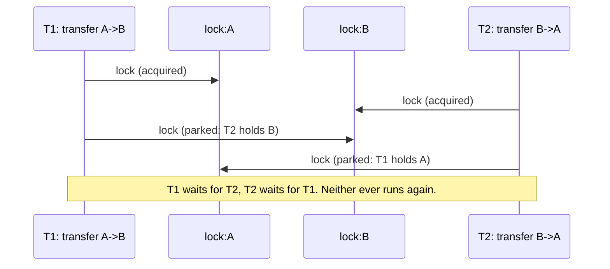

# Deadlocks, Lock Ordering, and Detection

> Transfer from A to B while B transfers to A.

**Type:** Build
**Languages:** Java, Python, Go
**Prerequisites:** Phase 4 Lesson 02 (Locks and Atomics), Phase 2 Lesson 08 (Graph Traversal), Phase 0 Lesson 07 (Decimal and Integer Arithmetic)
**Time:** ~60 minutes

## Learning Objectives

- State the four Coffman conditions for deadlock and identify which one each of the three fixes removes
- Build a two-account transfer that deadlocks under the opposite-direction interleaving, and force that interleaving deterministically with an injected barrier instead of waiting for it to happen
- Prevent the deadlock by a global lock order (smallest account id first) and prove, by argument and by test, that no cycle can form
- Avoid the deadlock with try-lock and backoff, and explain why releasing everything before backing off is what makes it safe, and what livelock it trades for
- Detect the deadlock from recorded lock requests by building a wait-for graph and finding a cycle with depth-first search, then refuse the request that would close the cycle
- Recognize the same three strategies in PostgreSQL's deadlock detector, Java's `ThreadMXBean`, and Go's runtime panic, and know which one to reach for

## The Problem

A ledger service holds one lock per account so that a transfer can debit one and credit the other atomically: lock the source, lock the destination, check the balance, write both, unlock both. It passed every test. In production it handled 400 transfers per second for six weeks. Then a merchant with two settlement accounts ran a sweep job that moved funds from account A to account B every minute, while a refund job moved funds from B to A on roughly the same schedule. On the fourth day both jobs fired in the same millisecond. Thread 1 locked A and reached for B. Thread 2 locked B and reached for A. Neither ever let go.

Nothing crashed. The two threads sat parked forever, consuming no CPU. Every later transfer that touched A or B queued behind them, which within a minute was every thread in the pool, which meant the health check endpoint stopped answering, which meant the load balancer removed the instance, which moved the same two jobs to the next instance. Over twenty minutes every instance in the fleet locked up in the same way. The on-call engineer's first thread dump showed 200 threads `WAITING` on `ReentrantLock` and no stack trace pointing at anything that looked wrong, because the code was correct on every path except the one where two specific paths interleave.

A deadlock is the one concurrency bug that no amount of load testing finds reliably and that no retry fixes: the threads are not slow, they are permanently stuck, and the only remedy at runtime is to kill one of them. This lesson builds the stuck version so you can see it, then removes it three ways: by making the cycle impossible (ordering), by never waiting while holding (try-lock), and by watching for the cycle and refusing to complete it (detection). The third is what every relational database does when it reports `deadlock detected` and aborts your transaction, and knowing how it works tells you what to do when it happens to you.

## The Concept

### The four conditions

Coffman, Elphick, and Shoshani (1971) showed that a deadlock requires all four of:

| Condition | In the transfer | Which fix removes it |
|-----------|-----------------|----------------------|
| Mutual exclusion | an account lock can be held by one thread at a time | none; it is the point of the lock |
| Hold and wait | a thread holds A while waiting for B | try-lock: release A, then wait |
| No preemption | a lock cannot be taken away from its holder | detection: abort one holder so it releases |
| Circular wait | T1 waits for T2's lock, T2 waits for T1's | ordering: every thread takes locks in the same order, so no cycle |

Remove any one and the deadlock cannot happen. Each of the three fixes attacks a different condition, which is why they have different costs and different failure modes.

### The classic interleaving



The window between "lock the first" and "lock the second" is a few nanoseconds, and both threads must be inside it at once. That is why the bug survived six weeks and why the tests in this lesson do not wait for it: `TransferService` takes a `betweenLocks` hook that runs after the first lock and before the second, and the deadlock test injects a two-party barrier. Both threads take their first lock, both arrive at the barrier, both are released together, both reach for their second lock. The interleaving above is reproduced every run, in every language.

### The wait-for graph

Record, for every thread, which lock it holds and which lock it is waiting for. Draw an edge from each waiting thread to the thread that holds the lock it wants. That is the wait-for graph, and the deadlock is a cycle in it:

```text
holders:  lock:A -> T1,  lock:B -> T2
waiting:  T1 -> lock:B,  T2 -> lock:A
edges:    T1 -> T2 (T1 wants B, T2 holds B)
          T2 -> T1 (T2 wants A, T1 holds A)
cycle:    T1 -> T2 -> T1
```

Three facts about the graph decide the detector's design. A *chain* (`T1 -> T2 -> T3`, nobody waiting on T1) is not a deadlock: T3 will finish, release, and the chain drains. A thread waiting *behind* a cycle (`T4 -> T1` where `T1 <-> T2` is the cycle) is stuck, but it is not on the cycle and aborting it would not help; the detector must report `[T1, T2]`, not `[T1, T2, T4]`. And a thread re-requesting a lock it already holds is not a self-deadlock when the lock is reentrant, so the tracker draws no edge from a thread to itself.

Finding the cycle is depth-first search with three colours (Phase 2, Lesson 03): white for unvisited, grey for "on the current path", black for finished. An edge to a grey node is a back edge and closes a cycle; walking the parent pointers from the current node back to that grey node recovers the cycle's members. Visiting nodes in sorted order and rotating the result to start from the smallest id makes the output identical on every run, which the tests rely on. The cost is O(V + E) per detection, with V the number of waiting-or-holding threads and E at most one edge per waiting thread, so running it on every lock request is cheap: a thread pool of 200 is a graph of at most 200 edges.

### Fix 1: ordering (remove circular wait)

Give every lock a position in a total order and require every thread to acquire locks in increasing position. For accounts, the order is the account id: `orderedTransfer(from, to)` locks `min(from.id, to.id)` first regardless of direction. The proof that no cycle can form is three lines: a cycle `T1 -> T2 -> ... -> Tk -> T1` means T1 waits for a lock Tk holds while holding a lock T2 wants; following the chain, each thread holds a lock of lower position than the one it waits for; around the cycle that gives `pos(L1) < pos(L2) < ... < pos(L1)`, a contradiction.

Ordering is the cheapest fix and the one to reach for first. It costs nothing at runtime; the two `compareTo` calls are the whole price. Its limits are organizational, not technical: every code path that takes two of these locks must respect the order, including paths written next year by someone who never read this lesson; and the order must be decidable before the first lock is taken, which fails when the second lock's identity is only known after reading data under the first (`lock(account); lock(account.linkedAccount)`). The `total()` method in Lesson 02 took the stripes in index order for exactly this reason.

### Fix 2: try-lock with backoff (remove hold-and-wait)

`tryLock` returns at once with `false` if the lock is busy. `tryLockTransfer` tries the first, then tries the second; if the second is busy it releases the first, pauses, and starts over. Because no thread ever *waits* while holding, the hold-and-wait condition is gone and so is the deadlock, regardless of the order anyone else uses.

What it trades for: **livelock**. Two threads can take their first locks, both fail on their second, both release, both retry at the same instant, and repeat. No one is stuck, no one makes progress. The `Backoff` breaks the symmetry: a random spin, exponentially growing with the attempt number (capped at 1,024 iterations), then a yield to the scheduler, so the two retries land at different moments. The seed is injected so a test can reproduce the sequence of pauses. `Backoff.pauses()` counts how many times anyone had to retry; in the demo with eight threads hammering two accounts it runs into the tens of thousands, which is the price of never waiting. A `maxAttempts` bound turns a pathological livelock into an exception instead of a hang; the test for it holds one account's lock on another thread and asserts the transfer gives up after exactly five pauses with nothing held.

Try-lock is the fix when the order is not knowable in advance, or when the locks belong to different subsystems that cannot agree on one. It is not the fix for a hot pair of accounts under heavy contention: the retry storm costs more than the ordered version's queueing.

### Fix 3: detection (remove no-preemption)

Keep the wait-for graph live. Before a thread blocks on a lock, record the request and run the cycle check. If granting the request would put the requester on a cycle, refuse it: throw `DeadlockDetectedException`, which unwinds the transfer, releases the lock it already holds, and lets the other thread proceed. This is preemption by cooperation: the victim gives up its lock because the detector told it to, before it ever blocked.

`LockTracker.requesting(owner, lockId)` does this under its own mutex: add `owner -> lockId` to the waiting map, build the graph, find a cycle, and if `owner` is on it, remove the waiting entry and throw. `TrackedLock.lock` calls `requesting` before the real `lock()` and `acquired` after; `unlock` calls `released` before the real `unlock()`. The ordering of those calls is what keeps the graph a conservative picture of reality: a thread is recorded as waiting before it can block, and a lock is recorded as free before anyone else can take it, so the detector never sees a cycle that is not about to be real.

Detection is what databases do, because a database cannot know in advance which rows a transaction will lock and cannot force applications to agree on an order. PostgreSQL waits `deadlock_timeout` (default one second) before checking, on the theory that most waits resolve themselves and checking is not free at thousands of lock requests a second; this lesson checks on every request because the graph is tiny. The cost of detection is that *one transfer fails* and someone must retry it; the benefit is that the other one completes and nothing hangs.

### Worked example: the live demo, event by event

Two naive transfers, A→B for 25.00 and B→A for 10.00, both accounts opening at 100.00, with the barrier forcing the interleaving. The recorded events from one run:

```text
T1 requests lock:A        T1 acquired lock:A
T2 requests lock:B        T2 acquired lock:B
                          (both at the barrier; both released)
T2 requests lock:A        graph: T2 -> T1. No cycle. T2 parks on lock:A.
T1 requests lock:B        graph: T2 -> T1, T1 -> T2. Cycle [T1, T2]. T1 is on it: refused.
T1 aborted: deadlock [T1, T2]
T1 released lock:A        (the transfer's finally block)
T2 acquired lock:A        T2's park ends; it now holds A and B
T2 released lock:A        T2 released lock:B      (10.00 moved B -> A)
```

Final balances A = 110.00, B = 90.00, sum 200.00. Which thread is refused depends on which one's `requesting` ran second; the tests therefore assert `aborted == 1 && committed == 1`, that the sum is conserved, that the balances are one whole transfer (`(75.00, 125.00)` or `(110.00, 90.00)`, never a mix), and that no lock is left held. The scheduler chooses the victim; the invariants do not move.

### Comparing the three

| | Ordering | Try-lock + backoff | Detection |
|---|---|---|---|
| Coffman condition removed | circular wait | hold and wait | no preemption |
| Runtime cost | two comparisons | retries and pauses under contention | graph build per request, plus one aborted operation per deadlock |
| Needs to know both locks up front | yes | no | no |
| Failure mode | a path that violates the order (silent until it deadlocks) | livelock under contention | a transaction fails and must be retried |
| Where you see it | `total()` over stripes; database row locks taken in primary-key order | `ReentrantLock.tryLock`, `Mutex.TryLock`, optimistic retries | PostgreSQL, MySQL InnoDB, Oracle; JVM `ThreadMXBean.findDeadlockedThreads` |

In practice: order when you can, try-lock when you cannot know the order, and run detection as a safety net under both, because the path that violates the order will be written eventually.

### What this lesson does not do

- **It does not recover a real deadlock.** Once two threads are parked on uninterruptible monitors, nothing in the process can free them; the detector in this lesson works because it refuses *before* blocking. `ReentrantLock.lockInterruptibly` and Go contexts give a way to unpark a victim after the fact; Lesson 11 covers cancellation.
- **It does not handle locks across processes.** A row lock in one database and a row lock in another, taken in opposite orders by two services, is a distributed deadlock that no single detector can see. Phase 7 (two-phase commit, sagas) is where that lives.
- **It does not make the transfer durable.** Both balances are in memory. The ledger lessons (Phase 10) make the two writes one durable transaction.

## Build It

The walkthrough is in Java. Python and Go implement the same names and the same tests; the subsections at the end show only what differs.

### Step 1: The graph and the cycle search

```java
final class WaitForGraph {
    private final Map<String, Set<String>> edges = new TreeMap<>();

    void addEdge(String waiter, String holder) {
        edges.computeIfAbsent(waiter, k -> new TreeSet<>()).add(holder);
        edges.computeIfAbsent(holder, k -> new TreeSet<>());
    }

    List<String> findCycle() {
        Map<String, Integer> colour = new HashMap<>();           // absent = white, 1 = grey, 2 = black
        Map<String, String> parent = new HashMap<>();
        for (String start : edges.keySet()) {
            if (colour.containsKey(start)) continue;
            Deque<String> stack = new ArrayDeque<>();
            stack.push(start);
            while (!stack.isEmpty()) {
                String node = stack.peek();
                if (!colour.containsKey(node)) {
                    colour.put(node, 1);
                    for (String next : successors(node)) {
                        Integer c = colour.get(next);
                        if (c == null) { parent.put(next, node); stack.push(next); }
                        else if (c == 1) return pathOfCycle(parent, node, next);  // back edge
                    }
                } else {
                    stack.pop();
                    colour.put(node, 2);
                }
            }
        }
        return List.of();
    }
}
```

`TreeMap` and `TreeSet` keep nodes and successors sorted, so the search order and therefore the reported cycle are deterministic. The iterative stack avoids recursion depth limits on long chains. The node stays on the stack while grey and is popped (turned black) when all its successors are done, which is the standard way to make iterative DFS distinguish "on the current path" from "visited earlier".

**Predict:** for the graph `T4 -> T1, T1 -> T2, T2 -> T1`, which node does the search start from, and why is `T4` not in the returned cycle?

### Step 2: The tracker that refuses

```java
void requesting(String owner, String lockId) {
    synchronized (mutex) {
        waiting.put(owner, lockId);
        events.add(owner + " requests " + lockId);
        List<String> cycle = graph().findCycle();
        if (cycle.contains(owner)) {
            waiting.remove(owner);
            events.add(owner + " aborted: deadlock " + cycle);
            throw new DeadlockDetectedException(cycle);
        }
    }
}

WaitForGraph graph() {
    synchronized (mutex) {
        WaitForGraph g = new WaitForGraph();
        for (Map.Entry<String, String> w : waiting.entrySet()) {
            String holder = holders.get(w.getValue());
            if (holder != null && !holder.equals(w.getKey())) g.addEdge(w.getKey(), holder);
        }
        return g;
    }
}
```

The graph is rebuilt from `waiting` and `holders` on each request rather than maintained incrementally, because with a handful of threads a rebuild is microseconds and an incremental graph is a second source of truth that can drift. The `!holder.equals(w.getKey())` clause is the reentrancy rule: a thread that holds `lock:A` and requests `lock:A` again draws no edge. The `cycle.contains(owner)` check matters: the graph might contain a cycle among *other* threads (one that was already refused and is unwinding); this request is refused only if granting it is what closes a cycle through the requester.

**Predict:** both T1 and T2 call `requesting` at the same instant. Why can they not both be told "no cycle"?

### Step 3: A lock that reports

```java
final class TrackedLock {
    void lock(String owner) {
        if (tracker != null) tracker.requesting(owner, id);   // throws instead of blocking into a cycle
        lock.lock();
        if (tracker != null) tracker.acquired(owner, id);
    }

    boolean tryLock(String owner) {
        if (!lock.tryLock()) return false;
        if (tracker != null) tracker.acquired(owner, id);
        return true;
    }

    void unlock(String owner) {
        if (tracker != null) tracker.released(owner, id);
        lock.unlock();
    }
}
```

`requesting` before `lock()`, `acquired` after it, `released` before `unlock()`. If `requesting` throws, the lock was never taken, and the caller's `finally` for *this* lock must not run; that is why the transfer methods take the second lock inside the first lock's `try` but open the second `try` only after the second `lock()` returned. `tryLock` does not call `requesting`: a try never waits, so it can never be part of a cycle. A `null` tracker makes the lock a plain `ReentrantLock`, which the ordered and try-lock benchmarks use so the detector's cost does not muddy their numbers.

### Step 4: The transfer, three ways

```java
void naiveTransfer(Account from, Account to, Money amount, String owner) {
    requireDistinct(from, to);
    from.lock().lock(owner);
    try {
        betweenLocks.run();
        to.lock().lock(owner);
        try {
            move(from, to, amount);
        } finally {
            to.lock().unlock(owner);
        }
    } finally {
        from.lock().unlock(owner);
    }
}
```

Correct on its own, deadlock-prone against its mirror image. `betweenLocks` is the seam: a no-op in production, a barrier in the deadlock test, `Thread::yield` in the contention tests to widen the window.

```java
void orderedTransfer(Account from, Account to, Money amount, String owner) {
    requireDistinct(from, to);
    Account first = from.id().compareTo(to.id()) < 0 ? from : to;
    Account second = first == from ? to : from;
    first.lock().lock(owner);
    try {
        betweenLocks.run();
        second.lock().lock(owner);
        try {
            move(from, to, amount);
        } finally {
            second.lock().unlock(owner);
        }
    } finally {
        first.lock().unlock(owner);
    }
}
```

Two lines of difference. `move(from, to, …)` still debits `from` and credits `to`; only the lock order changed. The test `ordered transfer locks the smaller id first even when sending from the larger` checks the tracker's first event is `requests lock:E` for a transfer from F to E.

```java
void tryLockTransfer(Account from, Account to, Money amount, String owner) {
    requireDistinct(from, to);
    for (int attempt = 1; attempt <= maxAttempts; attempt++) {
        if (from.lock().tryLock(owner)) {
            try {
                betweenLocks.run();
                if (to.lock().tryLock(owner)) {
                    try {
                        move(from, to, amount);
                        return;
                    } finally {
                        to.lock().unlock(owner);
                    }
                }
            } finally {
                from.lock().unlock(owner);       // release before backing off: hold nothing while waiting
            }
        }
        backoff.pause(attempt);
    }
    throw new IllegalStateException("transfer " + from.id() + " -> " + to.id() + " gave up after " + maxAttempts + " attempts");
}
```

The `finally` that releases `from` runs *before* `backoff.pause`, which is the whole fix: while this thread pauses, it holds nothing, so nothing can wait on it. Move the pause inside the `try` and the deadlock is back, in slow motion.

**Predict:** eight threads, four transferring C→D and four D→C, all with `tryLockTransfer`. Which lock do the C→D threads try first, which do the D→C threads try first, and why does that make the retry count high even though no thread ever deadlocks?

### Step 5: Backoff that never sleeps

```java
final class Backoff {
    private final Random random;
    private final AtomicLong pauses = new AtomicLong();

    Backoff(long seed) { this.random = new Random(seed); }

    void pause(int attempt) {
        pauses.incrementAndGet();
        int spins;
        synchronized (random) { spins = random.nextInt(1 << Math.min(attempt, 10)); }
        for (int i = 0; i < spins; i++) Thread.onSpinWait();
        Thread.yield();
    }
}
```

Randomized exponential backoff: attempt 1 spins 0 or 1 iterations, attempt 5 up to 31, attempt 10 and beyond up to 1,023, then yields the CPU. No `Thread.sleep`: a sleep would make the demo and tests take wall-clock time and would turn a CPU-bound retry into an I/O-shaped one. The seed makes the spin sequence reproducible; `pauses` makes contention measurable. In production you might replace the spin with `LockSupport.parkNanos` for longer backoffs, but the shape is the same.

### Step 6: Run it

```bash
cd phases/04-concurrency/07-deadlocks-and-lock-ordering/code/java
javac -d .out *.java && java -cp .out Main
java -cp .out MainTest
```

Expected output, abbreviated (which thread is aborted, and the pause count, vary):

```console
== A wait-for graph, by hand ==
edges T1->T2, T2->T3, T3->T1, T4->T1: cycle = [T1, T2, T3]
edges T1->T2, T2->T3: cycle = [] (a chain waits, it does not deadlock)

== The classic: A->B while B->A, replayed from recorded lock requests ==
after T1 requests lock:B: cycle = []
T2 requests lock:A -> deadlock: T1 -> T2 -> T1

== Live: two naive transfers, forced to interleave, caught by the detector ==
  T1 A->B aborted: deadlock: T1 -> T2 -> T1
  T2 B->A 10.00 committed
  balances A=110.00 USD B=90.00 USD (sum 200.00 USD)

== Fix 1: lock ordering, 8 threads x 500 transfers each way ==
  completed; C=1000.00 USD D=1000.00 USD sum 2000.00 USD

== Fix 2: try-lock with backoff, same load ==
  completed; E=1000.00 USD F=1000.00 USD sum 2000.00 USD; backoff pauses: 17891 (varies)
```

### In Python

The Python port (`code/python/main.py`) is the same design with four differences. **`threading.Lock` is not reentrant**, so unlike `ReentrantLock` a thread that locks the same account twice deadlocks with itself. The transfer methods never do that (`_require_distinct` rejects same-account transfers before any lock is taken), and the tracker's reentrancy rule is kept so the design matches; `threading.RLock` is the reentrant alternative. **`acquire(blocking=False)`** is `tryLock`; `threading.Barrier(2).wait` is the barrier hook, passed as a bound method. **Yielding is `time.sleep(0)`**, a syscall under the GIL, which makes each backoff pause more expensive than Java's `onSpinWait`/`yield`. The try-lock demo and test therefore run 200 transfers per thread instead of 500; the invariant checks are identical. **Exceptions:** `DeadlockDetectedError` carries `.cycle`; `InsufficientFundsError` and `ValueError` replace the Java exception types. The `run_all` helper joins each thread with a 10-second timeout and raises if one is still alive, so a real deadlock fails the test rather than hanging it.

Run it from `code/python/` with `python3 main.py`; test with `python3 -m unittest -v`.

#### Step 1: The graph and the cycle search

Python dicts and sets are unordered for this purpose, so `nodes()` and `successors()` return `sorted(...)` lists; that is what `TreeMap`/`TreeSet` gave Java and it keeps the reported cycle identical on every run. The iterative DFS uses a plain list as the stack: `stack[-1]` peeks, `append` pushes, `pop` turns a finished node black.

```python
    def find_cycle(self) -> list[str]:
        colour: dict[str, int] = {}          # absent = white, 1 = grey, 2 = black
        parent: dict[str, str] = {}
        for start in self.nodes():
            if start in colour:
                continue
            stack = [start]
            while stack:
                node = stack[-1]
                if node not in colour:
                    colour[node] = 1
                    for nxt in self.successors(node):
                        c = colour.get(nxt)
                        if c is None:
                            parent[nxt] = node
                            stack.append(nxt)
                        elif c == 1:
                            return self._path_of_cycle(parent, node, nxt)   # back edge: nxt is on the current path
                else:
                    stack.pop()
                    colour[node] = 2
        return []
```

#### Step 2: The tracker that refuses

`requesting` records the wait, rebuilds the graph from `_waiting` and `_holders` under the tracker's own mutex, and raises `DeadlockDetectedError` only if the requester is on the cycle. `_graph_locked` draws no edge when the holder is the requester, which is where the reentrancy rule lives even though `threading.Lock` itself would not allow a re-entry.

```python
    def requesting(self, owner: str, lock_id: str) -> None:
        with self._mutex:
            self._waiting[owner] = lock_id
            self._events.append(f"{owner} requests {lock_id}")
            cycle = self._graph_locked().find_cycle()
            if owner in cycle:
                del self._waiting[owner]
                self._events.append(f"{owner} aborted: deadlock {cycle}")
                raise DeadlockDetectedError(cycle)

    def _graph_locked(self) -> WaitForGraph:
        """One edge per waiting owner: waiter -> whoever holds the lock it wants (if anyone does)."""
        g = WaitForGraph()
        for waiter, lock_id in self._waiting.items():
            holder = self._holders.get(lock_id)
            if holder is not None and holder != waiter:
                g.add_edge(waiter, holder)
        return g
```

#### Step 3: A lock that reports

The three calls bracket the real `threading.Lock` in the same order as Java: `requesting` before `acquire()`, `acquired` after it, `released` before `release()`. `try_lock` is `acquire(blocking=False)` and skips `requesting`, because a try never waits and so can never close a cycle. A `None` tracker leaves a plain lock for the benchmarks.

```python
class TrackedLock:
    def __init__(self, lock_id: str, tracker: LockTracker | None) -> None:
        self.id = lock_id
        self._lock = threading.Lock()
        self._tracker = tracker                          # None = untracked, plain lock

    def lock(self, owner: str) -> None:
        if self._tracker is not None:
            self._tracker.requesting(owner, self.id)   # raises instead of blocking into a cycle
        self._lock.acquire()
        if self._tracker is not None:
            self._tracker.acquired(owner, self.id)

    def try_lock(self, owner: str) -> bool:
        if not self._lock.acquire(blocking=False):
            return False
        if self._tracker is not None:
            self._tracker.acquired(owner, self.id)
        return True

    def unlock(self, owner: str) -> None:
        if self._tracker is not None:
            self._tracker.released(owner, self.id)
        self._lock.release()
```

#### Step 4: The transfer, three ways

The nested `try/finally` is written out rather than using `with`, because `TrackedLock` needs the owner name on both `lock` and `unlock`. The second lock's `try` opens only after the second `lock()` returned, so a `DeadlockDetectedError` raised by `requesting` unwinds through the outer `finally` alone and releases only what was actually held.

```python
    def naive_transfer(self, frm: Account, to: Account, amount: Money, owner: str) -> None:
        self._require_distinct(frm, to)
        frm.lock.lock(owner)
        try:
            self._between_locks()
            to.lock.lock(owner)
            try:
                self._move(frm, to, amount)
            finally:
                to.lock.unlock(owner)
        finally:
            frm.lock.unlock(owner)
```

The ordered version picks `first, second` with one tuple expression comparing account ids as strings; `_move` still debits `frm` and credits `to`.

```python
    def ordered_transfer(self, frm: Account, to: Account, amount: Money, owner: str) -> None:
        self._require_distinct(frm, to)
        first, second = (frm, to) if frm.id < to.id else (to, frm)
        first.lock.lock(owner)
        try:
            self._between_locks()
            second.lock.lock(owner)
            try:
                self._move(frm, to, amount)
            finally:
                second.lock.unlock(owner)
        finally:
            first.lock.unlock(owner)
```

The try-lock version releases `frm` in the `finally` before `pause` runs, so the thread holds nothing while backing off. Giving up raises a `RuntimeError` in place of `IllegalStateException`.

```python
    def try_lock_transfer(self, frm: Account, to: Account, amount: Money, owner: str) -> None:
        self._require_distinct(frm, to)
        for attempt in range(1, self._max_attempts + 1):
            if frm.lock.try_lock(owner):
                try:
                    self._between_locks()
                    if to.lock.try_lock(owner):
                        try:
                            self._move(frm, to, amount)
                            return
                        finally:
                            to.lock.unlock(owner)
                finally:
                    frm.lock.unlock(owner)           # release before backing off: hold nothing while waiting
            self._backoff.pause(attempt)
        raise RuntimeError(f"transfer {frm.id} -> {to.id} gave up after {self._max_attempts} attempts")
```

#### Step 5: Backoff that never sleeps

A seeded `random.Random` under a mutex (the generator is not thread-safe), the same `1 << min(attempt, 10)` cap, an empty spin loop, then `time.sleep(0)`, which releases the GIL and lets another thread run. It is a yield, not a delay, but it is a system call, which is why the Python try-lock demo runs fewer transfers.

```python
class Backoff:
    def __init__(self, seed: int) -> None:
        self._random = random.Random(seed)
        self._pauses = 0
        self._mutex = threading.Lock()

    def pause(self, attempt: int) -> None:
        with self._mutex:
            self._pauses += 1
            spins = self._random.randrange(1 << min(attempt, 10))   # exponential cap at 1024
        for _ in range(spins):
            pass
        time.sleep(0)                                    # yield the GIL; a yield, not a delay

    def pauses(self) -> int:
        with self._mutex:
            return self._pauses
```

#### Step 6: Run it

```bash
cd phases/04-concurrency/07-deadlocks-and-lock-ordering/code/python
python3 main.py
python3 -m unittest -v
```

Cycles print as Python lists; which of T1/T2 is aborted depends on which thread reaches its second lock first, and the pause count varies:

```console
== A wait-for graph, by hand ==
edges T1->T2, T2->T3, T3->T1, T4->T1: cycle = ['T1', 'T2', 'T3']
edges T1->T2, T2->T3: cycle = [] (a chain waits, it does not deadlock)

== The classic: A->B while B->A, replayed from recorded lock requests ==
after T1 requests lock:B: cycle = []
T2 requests lock:A -> deadlock: T1 -> T2 -> T1

== Live: two naive transfers, forced to interleave, caught by the detector ==
  T1 A->B aborted: deadlock: T1 -> T2 -> T1
  T2 B->A 10.00 committed
  balances A=110.00 USD B=90.00 USD (sum 200.00 USD)

== Fix 1: lock ordering, 8 threads x 500 transfers each way ==
  completed; C=1000.00 USD D=1000.00 USD sum 2000.00 USD

== Fix 2: try-lock with backoff, 8 threads x 200 transfers each way ==
  completed; E=1000.00 USD F=1000.00 USD sum 2000.00 USD; backoff pauses: 27135 (varies)
```

### In Go

The Go port (`code/go/main.go`) is the same design with five differences. **`sync.Mutex.TryLock`** exists since Go 1.18, with a documentation note that its use is "rare" and usually a sign of a design problem; this lesson is one of the legitimate cases. `sync.Mutex` is not reentrant and has no `IsLocked`, so `TrackedLock` keeps a flag beside it for the tests. **Errors, not exceptions.** `Lock` returns `error`; a `*DeadlockDetectedError` is matched with `errors.As`, and `ErrInsufficientFunds`, `ErrSameAccount`, `ErrGaveUp` are sentinels for `errors.Is`. `defer` replaces `finally`, which is why the try-lock body is split into `tryBoth`: a `defer` runs at function exit, so releasing `from` before the backoff needs its own function. **`runtime.Gosched()`** is the yield; `math/rand` is seeded with `rand.NewSource` and guarded by a mutex because the generator is not goroutine-safe. **Go's runtime has its own detector**: if every goroutine is blocked, the program dies with `fatal error: all goroutines are asleep - deadlock!`. It does not fire here because `main` is alive, which is the usual case in a server, and it is why the `RunAll` helper has a ten-second timeout of its own. **`-race` is the test command**, and the tracker, the lock flags, and the balances are all guarded, so it passes clean.

Run it from `code/go/` with `go run .`; test with `go test -race ./...`.

#### Step 1: The graph and the cycle search

Go map iteration order is randomized, so `Nodes()` and `Successors()` sort before returning; without that the cycle reported would differ between runs. The DFS stack is a slice, with `stack[len(stack)-1]` as peek and reslicing as pop; `FindCycle` returns `nil` for "no cycle", which prints as `[]`.

```go
func (g *WaitForGraph) FindCycle() []string {
	colour := map[string]int{} // absent = white, 1 = grey, 2 = black
	parent := map[string]string{}
	for _, start := range g.Nodes() {
		if _, seen := colour[start]; seen {
			continue
		}
		stack := []string{start}
		for len(stack) > 0 {
			node := stack[len(stack)-1]
			if _, seen := colour[node]; !seen {
				colour[node] = 1
				for _, next := range g.Successors(node) {
					c, visited := colour[next]
					if !visited {
						parent[next] = node
						stack = append(stack, next)
					} else if c == 1 {
						return pathOfCycle(parent, node, next) // back edge: next is on the current path
					}
				}
			} else {
				stack = stack[:len(stack)-1]
				colour[node] = 2
			}
		}
	}
	return nil
}
```

#### Step 2: The tracker that refuses

`Requesting` returns a `*DeadlockDetectedError` instead of throwing; the caller decides whether to unwind. Everything runs under `t.mu` with a `defer`, and `graphLocked` rebuilds the graph from the two maps each time, skipping the edge where the holder is the requester.

```go
func (t *LockTracker) Requesting(owner, lockID string) error {
	t.mu.Lock()
	defer t.mu.Unlock()
	t.waiting[owner] = lockID
	t.events = append(t.events, owner+" requests "+lockID)
	cycle := t.graphLocked().FindCycle()
	for _, n := range cycle {
		if n == owner {
			delete(t.waiting, owner)
			t.events = append(t.events, fmt.Sprintf("%s aborted: deadlock %v", owner, cycle))
			return &DeadlockDetectedError{Cycle: cycle}
		}
	}
	return nil
}

func (t *LockTracker) graphLocked() *WaitForGraph {
	g := NewWaitForGraph()
	for waiter, lockID := range t.waiting {
		if holder, held := t.holders[lockID]; held && holder != waiter {
			g.AddEdge(waiter, holder)
		}
	}
	return g
}
```

#### Step 3: A lock that reports

`Lock` returns the tracker's error before touching `mu`, so a refused request never holds anything. `TryLock` wraps `sync.Mutex.TryLock` and skips `Requesting`. Because `sync.Mutex` cannot be queried, a second tiny mutex guards a `locked` flag that `IsLocked` reads for the tests; the flag is set after `mu.Lock()` and cleared before `mu.Unlock()`.

```go
type TrackedLock struct {
	ID      string
	mu      sync.Mutex
	tracker *LockTracker // nil = untracked, plain lock
	held    sync.Mutex   // guards the locked flag below
	locked  bool
}

func (l *TrackedLock) Lock(owner string) error {
	if l.tracker != nil {
		if err := l.tracker.Requesting(owner, l.ID); err != nil {
			return err // refuse instead of blocking into a cycle
		}
	}
	l.mu.Lock()
	l.setLocked(true)
	if l.tracker != nil {
		l.tracker.Acquired(owner, l.ID)
	}
	return nil
}

func (l *TrackedLock) TryLock(owner string) bool {
	if !l.mu.TryLock() {
		return false
	}
	l.setLocked(true)
	if l.tracker != nil {
		l.tracker.Acquired(owner, l.ID)
	}
	return true
}

func (l *TrackedLock) Unlock(owner string) {
	if l.tracker != nil {
		l.tracker.Released(owner, l.ID)
	}
	l.setLocked(false)
	l.mu.Unlock()
}
```

#### Step 4: The transfer, three ways

`defer` is registered only after each `Lock` has returned `nil`, which gives the same guarantee as the nested `try`: a refused second lock returns the error with only the first lock deferred for release. The ordered variant swaps `first, second` when `to.ID < from.ID`.

```go
func (s *TransferService) NaiveTransfer(from, to *Account, amount Money, owner string) error {
	if err := requireDistinct(from, to); err != nil {
		return err
	}
	if err := from.Lock.Lock(owner); err != nil {
		return err
	}
	defer from.Lock.Unlock(owner)
	s.betweenLocks()
	if err := to.Lock.Lock(owner); err != nil {
		return err
	}
	defer to.Lock.Unlock(owner)
	return move(from, to, amount)
}
```

```go
func (s *TransferService) OrderedTransfer(from, to *Account, amount Money, owner string) error {
	if err := requireDistinct(from, to); err != nil {
		return err
	}
	first, second := from, to
	if to.ID < from.ID {
		first, second = to, from
	}
	if err := first.Lock.Lock(owner); err != nil {
		return err
	}
	defer first.Lock.Unlock(owner)
	s.betweenLocks()
	if err := second.Lock.Lock(owner); err != nil {
		return err
	}
	defer second.Lock.Unlock(owner)
	return move(from, to, amount)
}
```

Because a `defer` fires only at function exit, the try-lock loop delegates to `tryBoth`, whose deferred `Unlock` of `from` has run by the time `Pause` is called. That split is the Go spelling of "release in `finally` before backing off"; the retry loop itself holds nothing. Exhaustion is `ErrGaveUp`, wrapped with `%w`.

```go
func (s *TransferService) TryLockTransfer(from, to *Account, amount Money, owner string) error {
	if err := requireDistinct(from, to); err != nil {
		return err
	}
	for attempt := 1; attempt <= s.maxAttempts; attempt++ {
		if from.Lock.TryLock(owner) {
			done, err := s.tryBoth(from, to, amount, owner)
			if done {
				return err
			}
		}
		s.backoff.Pause(attempt)
	}
	return fmt.Errorf("%w: %s -> %s after %d attempts", ErrGaveUp, from.ID, to.ID, s.maxAttempts)
}

// tryBoth runs with from locked and always releases it before returning, so nothing is held while backing off.
func (s *TransferService) tryBoth(from, to *Account, amount Money, owner string) (done bool, err error) {
	defer from.Lock.Unlock(owner)
	s.betweenLocks()
	if !to.Lock.TryLock(owner) {
		return false, nil
	}
	defer to.Lock.Unlock(owner)
	return true, move(from, to, amount)
}
```

#### Step 5: Backoff that never sleeps

`rand.New(rand.NewSource(seed))` gives a reproducible generator that must be guarded by a mutex; the count and the draw happen under it, the spin and the `runtime.Gosched()` outside it. The cap is written as an explicit `if shift > 10` because Go has no `Math.min` for `int`.

```go
type Backoff struct {
	mu     sync.Mutex
	random *rand.Rand
	pauses int64
}

func NewBackoff(seed int64) *Backoff { return &Backoff{random: rand.New(rand.NewSource(seed))} }

func (b *Backoff) Pause(attempt int) {
	b.mu.Lock()
	b.pauses++
	shift := attempt
	if shift > 10 {
		shift = 10 // exponential cap at 1024
	}
	spins := b.random.Intn(1 << shift)
	b.mu.Unlock()
	for i := 0; i < spins; i++ {
		// spin
	}
	runtime.Gosched()
}
```

#### Step 6: Run it

```bash
cd phases/04-concurrency/07-deadlocks-and-lock-ordering/code/go
go run .
go test -race ./...
```

Cycles print with Go's slice formatting. In the live section the goroutine that is aborted is whichever one requests its second lock last, so T1 or T2 may be the one that commits:

```console
== A wait-for graph, by hand ==
edges T1->T2, T2->T3, T3->T1, T4->T1: cycle = [T1 T2 T3]
edges T1->T2, T2->T3: cycle = [] (a chain waits, it does not deadlock)

== The classic: A->B while B->A, replayed from recorded lock requests ==
after T1 requests lock:B: cycle = []
T2 requests lock:A -> deadlock: T1 -> T2 -> T1

== Live: two naive transfers, forced to interleave, caught by the detector ==
  T1 A->B 25.00 committed
  T2 B->A aborted: deadlock: T1 -> T2 -> T1
  balances A=75.00 USD B=125.00 USD (sum 200.00 USD)

== Fix 1: lock ordering, 8 goroutines x 500 transfers each way ==
  completed; C=1000.00 USD D=1000.00 USD sum 2000.00 USD

== Fix 2: try-lock with backoff, same load ==
  completed; E=1000.00 USD F=1000.00 USD sum 2000.00 USD; backoff pauses: 46899 (varies)
```

## Use It

### Databases: detection as the default

PostgreSQL maintains a wait-for graph over row and table locks. A backend that has waited `deadlock_timeout` (1 s by default) runs the cycle check; if it finds one it aborts its own transaction with `ERROR: deadlock detected` and a `DETAIL` naming the processes and locks on the cycle, which is this lesson's `DeadlockDetectedException.cycle()`. MySQL InnoDB checks on every lock wait and picks the transaction that has done the least work as the victim. In both, the application's job is to retry the aborted transaction, and the usual way to *avoid* the abort is ordering: update rows in primary-key order, lock parent before child, `SELECT ... FOR UPDATE` in a consistent sequence.

### The JVM: `ThreadMXBean` and `jstack`

`ManagementFactory.getThreadMXBean().findDeadlockedThreads()` runs the same cycle search over monitors and `ReentrantLock` owners and returns the thread ids on a cycle, or `null`. `jstack` prints `Found one Java-level deadlock` with the full cycle. Neither can break the deadlock; both can tell you which threads to look at, and a watchdog that calls `findDeadlockedThreads` every few seconds and pages is cheap insurance. `ReentrantLock.lockInterruptibly` plus a watchdog that interrupts one victim is the JVM's version of preemption; `tryLock(timeout, unit)` is the bounded wait.

### Go: `TryLock`, contexts, and the runtime panic

Go's answer to "never wait while holding" is usually structural: give each account to one goroutine and send it messages (Lesson 08, the actor model), so no goroutine ever holds two locks. Where locks are used, `TryLock` and `select` with a `context.Done()` channel give the bounded-wait escape. The runtime's `all goroutines are asleep` check catches whole-program deadlocks in tests and short programs and nothing in a long-running server; `go test -timeout` is the practical safety net.

### Python

`threading.Lock.acquire(timeout=...)` is the bounded wait; `faulthandler.dump_traceback_later` is the poor engineer's watchdog, printing every thread's stack after N seconds so a deadlock in a test shows where it stuck. SQLAlchemy and Django surface the database's `deadlock detected` as `OperationalError`, and the retry is yours to write, ideally with the exponential backoff from Step 5.

## Ship It

`outputs/checklist-multi-lock-review.md` is a review checklist for any code path that acquires more than one lock, row, or lease: is the order documented and enforced, is every wait bounded, is the retry on `deadlock detected` written, and is the deadlock test a forced interleaving rather than a hope. Use it on transfers, batch updates, cache-plus-database writes, and any `synchronized` method that calls another object's `synchronized` method.

## Exercises

1. **Reinforce.** Add a third account and a three-way cycle: T1 transfers A→B, T2 transfers B→C, T3 transfers C→A, all `naiveTransfer`, with a three-party barrier. Assert exactly one is aborted, the cycle reported has three members, and the sum is conserved. Then run the same three with `orderedTransfer` and no barrier and assert none is aborted.
2. **Apply.** Implement `LockTracker.victim()` that, instead of refusing the requesting thread, chooses the thread on the cycle that holds the *fewest* locks (InnoDB's "least work" heuristic, approximately) and records it as the victim. Discuss in a comment why refusing the requester is simpler and safer in this lesson's design (hint: who is still running when the decision is made?).
3. **Extend.** Combine with Lesson 05: build a `TransferQueue` where a single consumer thread applies transfers from a bounded queue, so no transfer ever holds two locks concurrently with another transfer. Measure throughput against `orderedTransfer` with eight threads on two accounts, then on 1,000 accounts with random pairs, and explain when serializing through one consumer wins and when it loses.

## Key Terms

| Term | What people say | What it actually means |
|------|-----------------|------------------------|
| Deadlock | "it hung" | A set of threads each waiting for a resource held by another member of the set; none can proceed without an external action |
| Coffman conditions | "the four conditions" | Mutual exclusion, hold-and-wait, no preemption, circular wait; all four are necessary, so removing any one prevents deadlock |
| Wait-for graph | "who is blocking whom" | Directed graph with an edge from each waiting thread to the holder of the lock it wants; a cycle is a deadlock, a chain is not |
| Lock ordering | "always lock A before B" | A total order on locks that every thread respects; makes circular wait impossible by a three-line proof |
| Try-lock | "non-blocking acquire" | An acquire that returns false instead of waiting; with release-before-retry it removes hold-and-wait |
| Livelock | "busy but stuck" | Threads repeatedly retry and fail without blocking; the failure mode try-lock trades deadlock for, broken by randomized backoff |
| Victim | "the one that got killed" | The thread or transaction a detector aborts to break a cycle; databases pick it by cost, this lesson picks the requester that would close the cycle |
| Reentrancy | "can I lock it twice" | Whether a lock's holder may acquire it again without blocking; `ReentrantLock` and `RLock` yes, `threading.Lock` and `sync.Mutex` no |

## Further Reading

- [E. G. Coffman, M. J. Elphick, A. Shoshani, "System Deadlocks" (ACM Computing Surveys 3(2), 1971)](https://dl.acm.org/doi/10.1145/356586.356588) — the four conditions and the prevention/avoidance/detection taxonomy this lesson follows.
- [PostgreSQL documentation: Deadlocks](https://www.postgresql.org/docs/current/explicit-locking.html#LOCKING-DEADLOCKS) and [`deadlock_timeout`](https://www.postgresql.org/docs/current/runtime-config-locks.html) — a production wait-for-graph detector, its victim choice, and the official advice to acquire locks in a consistent order.
- [`java.lang.management.ThreadMXBean.findDeadlockedThreads`](https://docs.oracle.com/en/java/javase/21/docs/api/java.management/java/lang/management/ThreadMXBean.html#findDeadlockedThreads()) — the JVM's built-in cycle detector over monitors and ownable synchronizers.
- [`java.util.concurrent.locks.Lock` Javadoc, `tryLock`](https://docs.oracle.com/en/java/javase/21/docs/api/java.base/java/util/concurrent/locks/Lock.html#tryLock()) — the contract that makes release-before-retry possible; note the class comment's warning about fairness.
- [Go `sync.Mutex.TryLock`](https://pkg.go.dev/sync#Mutex.TryLock) — including the note that most uses of TryLock indicate a deeper problem; this lesson's is one of the exceptions.
- [MySQL 8.0 Reference Manual: InnoDB Deadlock Detection](https://dev.mysql.com/doc/refman/8.0/en/innodb-deadlock-detection.html) — a detector that checks on every wait and chooses the smallest transaction as victim, for comparison with PostgreSQL's timeout-then-check.
