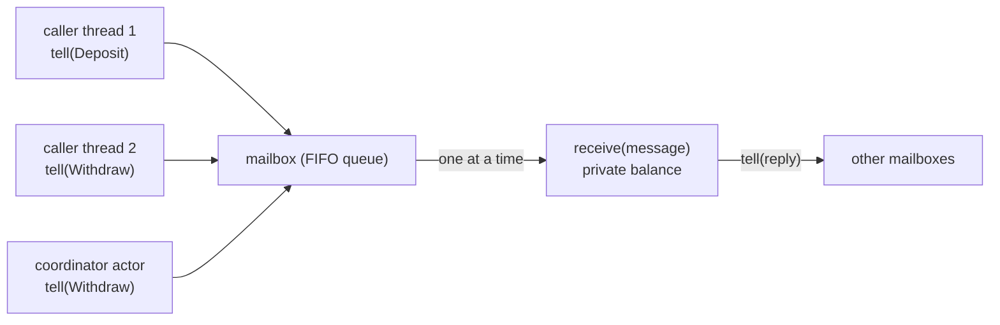
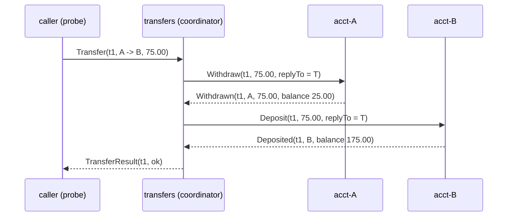

# The Actor Model

> One account, one mailbox, no locks.

**Type:** Build
**Languages:** Java, Python, Go
**Prerequisites:** Phase 4 Lesson 02 (Locks and Atomics), Phase 4 Lesson 05 (Producers, Consumers, and Bounded Queues), Phase 4 Lesson 07 (Deadlocks, Lock Ordering, and Detection)
**Time:** ~75 minutes

## Learning Objectives

- State the three rules of the actor model (private state, immutable messages, one message at a time) and show how together they make a check-then-act atomic without a lock
- Build a minimal actor runtime: references, mailboxes, cells, a supervision strategy, and two schedulers that share one contract
- Prove, with a CAS-guarded scheduling flag and the Java Memory Model, that an actor's `receive` never runs on two threads at once and that each run sees the previous run's writes
- Express a transfer between two account actors as a two-message protocol with a coordinator, and explain what it gives up compared with a locked transfer
- Choose between RESUME, RESTART, and STOP for a failing actor and predict what happens to its state and its mailbox under each
- Make the scheduler a test input, so that a concurrency bug is replayed by seed instead of hoped for by stress

## The Problem

Lesson 02 made a balance exact with a lock per account. Lesson 07 showed what happens when a transfer takes two of those locks: `transfer(A, B)` and `transfer(B, A)` deadlock unless every caller agrees on an order, and the order has to be enforced by discipline across every code path that touches two accounts. A wallet service that had learned both lessons still had a page every few weeks. Each time, the cause was a new code path that touched two accounts in a new order: a bulk payout job, a fee sweep, a dispute reversal. The lock discipline was correct in every reviewed file and wrong in the one nobody thought was a transfer.

The team also had a subtler problem. Their account object had fourteen methods, and each one was individually `synchronized`, so each was atomic, and the sequences of calls that the business logic needed, "check the daily limit, then debit, then record the velocity counter", were not. Every one of those sequences needed a lock held across three calls, by a caller who knew to take it. Thread-safety had been pushed to the callers, and the callers were many.

The actor model removes both problems by removing the thing that caused them: shared access. An account is an actor. Its balance is a private field that no other object can reference. The only way to affect it is to send it a message, and the runtime guarantees that the actor processes one message at a time. There is nothing to lock because there is nothing two threads can touch. A transfer becomes a conversation between three actors, and a deadlock becomes impossible by construction, because no actor ever waits for another; it sends and moves on. The cost is real too: a transfer is no longer one atomic step, and the lesson is honest about what that means.

## The Concept

### Three rules

An actor is a unit of state plus behaviour that obeys three rules:

1. **Private state.** No other code holds a reference to the actor object. Callers hold an `ActorRef`, which can only `tell`.
2. **Immutable messages.** Everything sent is a value (a Java `record` here). Once sent, neither party can change it, so there is no shared mutable data to race on.
3. **One message at a time.** The runtime delivers messages from an actor's mailbox sequentially. `receive` for message N+1 begins after `receive` for message N has returned, and sees everything N wrote.

From these three rules, a check-then-act is atomic for free. `AccountActor` handles `Withdraw` by comparing the balance with the amount and then subtracting. Nothing can interleave, because nothing else can run `receive` on this actor until this one returns. The same code with the same shape in Lesson 02 needed a lock around it; here the mailbox is the lock, and it is one the actor never forgets to take.



### The scheduling contract

Rule 3 is the runtime's job, and the whole runtime reduces to one promise: **for each actor, at most one `receive` is executing at any instant, and consecutive executions are ordered by happens-before.** Two schedulers deliver that promise differently.

The `DeterministicScheduler` is single-threaded. It keeps a queue of actors with non-empty mailboxes and, per step, picks one and delivers one message. Which one it picks is decided by a seeded `Random` (or round-robin for seed 0). The promise holds trivially: there is one thread. What this scheduler adds is replay. A test that fails under seed 17 fails under seed 17 every time, with the same trace, on every machine.

The `ThreadedScheduler` runs actors on an `ExecutorService`. Its promise rests on one `AtomicBoolean` per actor, `scheduled`:

```text
tell(msg):   mailbox.offer(msg); if (scheduled.compareAndSet(false, true)) executor.execute(run)
run:         process up to `throughput` messages
             scheduled.set(false)
             if (!mailbox.isEmpty()) schedule again
```

Only the thread that wins the CAS submits a run, and the run is the only thing that calls `receive`, so two runs for one actor cannot overlap. The order of the last two lines is the subtle part: release first, then re-check. A message that arrives after the drain loop saw an empty mailbox but before `scheduled` is cleared finds `scheduled == true` and does not submit; the re-check after the clear catches it. Reverse the two lines and that message sits in the mailbox until the next `tell`, which may never come. This is the dispatcher design Akka documents, reduced to its essentials.

Visibility across runs comes from the memory model: `scheduled.set(false)` is a volatile write, the next run's winning `compareAndSet` is a volatile read of the same variable, and JLS 17.4.5 says the write happens-before the read. Everything the previous run wrote to `balance` is therefore visible to the next run, even on a different pool thread, with no `synchronized` and no `volatile` on `balance` itself.

### Supervision: what happens when `receive` throws

An exception inside an actor is not the caller's problem; the caller already returned from `tell`. Erlang's answer, which every actor runtime copied, is that a *supervisor* decides, and the choice is a policy, not a try/catch in every handler:

| Strategy | Failing message | Actor state | Mailbox | When to use |
|----------|-----------------|-------------|---------|-------------|
| RESUME | dropped | kept | kept | the message was bad, the actor is fine (a wrong-currency deposit) |
| RESTART | dropped | replaced by a fresh instance from the factory | kept | the actor's state is suspect (a corrupted cache); state must be recoverable from elsewhere |
| STOP | dropped | discarded | drained to dead letters; later sends are dead letters | the actor cannot be trusted and someone upstream will notice |

The demo sends an EUR deposit to a USD account. `Money.plus` throws `CurrencyMismatchException`; the supervisor's RESUME policy drops the message, records the failure, and the next message in the mailbox is processed against an unchanged balance. The same demo sends `Crash` to three counters with three strategies and asks each for its count afterwards: 3 (RESUME: 2 before, 1 after), 1 (RESTART: the fresh instance saw only the increment after the crash), and nothing (STOP: the increment and the query became dead letters).

The RESTART row carries a warning that matters for money. Restarting an `AccountActor` from its factory would reset the balance to the opening amount. That is why accounts in the demo use RESUME, and why a real account actor's factory would reload state from a journal (Phase 7's write-ahead log, Phase 10's ledger). "Let it crash" works when state lives somewhere durable; an in-memory balance is not that place.

### Transfers as a protocol

A locked transfer is one atomic step: take both locks, check, debit, credit, release. An actor transfer is three actors and four messages:



The coordinator holds a map from `transferId` to the pending `Transfer` and reacts to replies; the `correlationId` on every message is what lets one coordinator run many transfers at once. It never touches a balance. It cannot deadlock, because it never waits. And it is honest about partial failure: `InsufficientFunds` arrives before any money moved, so the transfer fails with nothing to undo.

What the protocol gives up: between `Withdrawn` and `Deposited`, 75.00 USD is in neither account. A `GetBalance` to both at that instant sums to 225.00. The locked version never exposes that state; the actor version exposes it for one message hop. For a wallet this is acceptable and is exactly the "in transit" state a double-entry ledger represents explicitly (Phase 10, Lesson 03). For a protocol where the deposit *can* fail (a closed destination account), the coordinator needs a compensating `Deposit` back to the source, which is the saga pattern of Phase 7, Lesson 12. The actor model does not make distributed atomicity free; it makes the steps and the failure points visible.

### Worked example by hand

Three accounts with 100.00 USD each, six scripted transfers, round-robin scheduler (seed 0). Follow the first two:

| Step | Runnable actors | Delivered | Effect |
|------|-----------------|-----------|--------|
| 1 | transfers | `Transfer(t1, A -> B, 75.00)` | coordinator records t1, tells A `Withdraw(t1, 75.00)` |
| 2 | transfers, acct-A | `Transfer(t2, B -> C, 120.00)` | coordinator records t2, tells B `Withdraw(t2, 120.00)` |
| 3 | transfers, acct-A, acct-B | `Transfer(t3, ...)` | ... |
| ... | | | |
| k | acct-A | `Withdraw(t1, 75.00)` | balance 100.00 >= 75.00: A becomes 25.00, replies `Withdrawn` |
| k+1 | acct-B | `Withdraw(t2, 120.00)` | balance 100.00 < 120.00: replies `InsufficientFunds`, balance unchanged |
| ... | transfers | `Withdrawn(t1)` | tells B `Deposit(t1, 75.00)` |
| ... | transfers | `InsufficientFunds(t2)` | t2 fails: `TransferResult(t2, failed: acct-B has 100.00 USD, needs 120.00 USD)` |

Thirty-two messages later the system is idle: 6 transfers in, 6 results out, 4 succeeded, 2 rejected, and A + B + C = 300.00 USD. Change the seed and the order of the trace changes; the sum does not. The test runs 25 seeds and asserts conservation, non-negativity, one result per transfer, and an empty in-flight map for every one of them. That is the actor model's version of Lesson 02's "lost 0.00 USD" line, with the scheduler as the test input instead of the thread count.

### Locks versus actors, side by side

| Concern | Lock per account (Lesson 02) | Lock ordering for transfers (Lesson 07) | Actor per account (this lesson) |
|---------|------------------------------|------------------------------------------|---------------------------------|
| Check-then-act on one account | caller must hold the lock across both steps | same | automatic: one message, one handler |
| Transfer between two accounts | two locks | two locks in a global order every code path must honour | four messages via a coordinator; no waiting, no deadlock |
| Intermediate state visible? | no | no | yes, for one hop (funds in transit) |
| Failure inside the operation | exception propagates to caller; locks released by `finally` | same | supervisor policy; caller learns via reply or timeout |
| Who enforces discipline | every caller | every caller, plus a reviewer who knows the order | the runtime |
| Testing the interleaving | injected hook between load and store | injected hook plus a barrier | the scheduler itself is the input (seed) |
| Latency per operation | one lock acquisition | two acquisitions | one or more queue hand-offs |

The row that matters most for a growing codebase is "who enforces discipline". Locks are correct until the next engineer forgets one; actors are correct until the next engineer puts a mutable object in a message, which is a smaller and more visible mistake.

### Complexity and cost

`tell` is O(1): an enqueue and a CAS. Delivery is O(1) amortised per message. The runtime cost is one object per message (a record) and one queue node, which is why actor systems care about allocation rate and why Akka and Erlang both have mailbox back-pressure options. The latency cost is a hop: a transfer that was one lock acquisition is now four messages, each a queue operation and possibly a thread hand-off. For a wallet doing thousands of transfers per second this is fine; for a matching engine doing millions, a single-threaded loop over a ring buffer (the LMAX Disruptor design) is the same idea without the per-message queue.

### Ordering guarantees, precisely

Two guarantees hold and one does not. Messages from one sender to one receiver are processed in send order, because `tell` appends to a FIFO and the receiver drains it in order. Messages a single actor processes are totally ordered, because there is one run at a time. But messages from *different* senders to one receiver have no defined order beyond "each sender's own sequence is preserved": if the coordinator and a customer both send to `acct-A`, which arrives first depends on the scheduler. A protocol that needs "the Withdraw must be processed before the customer's next Deposit" has to encode that in the messages (a sequence number the actor checks) rather than assume it from timing. The deterministic scheduler is the tool for finding code that silently assumed otherwise: a seed that delivers the customer's message first will expose it.

### What the actor model does not do

- It does not bound mailboxes. An actor slower than its senders accumulates messages without limit; Lesson 05's bounded queue is the fix, and Akka's bounded mailboxes are that fix.
- It does not make a multi-actor operation atomic. See the transfer discussion above and Phase 7, Lesson 12.
- It does not survive a process crash. State is in memory unless the actor journals it; Phase 7's WAL and event sourcing are how.
- It does not stop you from sharing a mutable object by putting it in a message. Java cannot enforce rule 2; the discipline is `record`s and immutable collections, and a review checklist.

## Build It

All code is in `code/java/Main.java`; tests in `MainTest.java`.

### Step 1: Messages are records, references can only tell

```java
sealed interface Message permits Deposit, Withdraw, GetBalance, Deposited, Withdrawn, InsufficientFunds, BalanceIs,
        Transfer, TransferResult, Increment, CountIs, Crash {}

record Deposit(String correlationId, Money amount, ActorRef replyTo) implements Message {}
record Withdraw(String correlationId, Money amount, ActorRef replyTo) implements Message {}
record Transfer(String transferId, String from, String to, Money amount, ActorRef replyTo) implements Message {}

final class ActorRef {
    private final String name;
    private final ActorCell cell;
    void tell(Message message) { cell.enqueue(Objects.requireNonNull(message, "message")); }
}
```

The sealed interface lets `receive` use an exhaustive `switch` and the compiler tells you when a new message type is unhandled. `replyTo` is how an actor answers: it tells the reference it was given. There is no return value from `tell`, no future, no blocking; if you want an answer, say where to send it.

**Predict:** why does `Deposit` carry a `correlationId` when a plain deposit from a customer does not need one?

### Step 2: The actor and its cell

```java
abstract class Actor {
    abstract void receive(Message message);
    void preStart() {}
}

final class ActorCell {
    final ConcurrentLinkedQueue<Message> mailbox = new ConcurrentLinkedQueue<>();
    final AtomicBoolean scheduled = new AtomicBoolean(false);
    private volatile Actor actor;

    void enqueue(Message message) {
        if (stopped) { deadLetters.incrementAndGet(); system.deadLetter(name, message); return; }
        mailbox.offer(message);
        system.scheduler().schedule(this);
    }

    boolean processOne() {
        Message message = mailbox.poll();
        if (message == null) return false;
        int now = concurrentReceives.incrementAndGet();
        maxConcurrentReceives.accumulateAndGet(now, Math::max);
        try {
            actor.receive(message);
        } catch (RuntimeException e) {
            supervise(message, e);
        } finally {
            concurrentReceives.decrementAndGet();
        }
        return true;
    }
}
```

The cell is the runtime's view of an actor: the mailbox, the current instance, the factory for restarts, and counters. `concurrentReceives` exists only to *check* the scheduling promise; the test asserts `maxConcurrentReceives == 1` after 40,000 deposits from four threads. Lesson 03's Michael-Scott queue is what `ConcurrentLinkedQueue` is, which is why multiple threads can `offer` into one mailbox without a lock.

**Predict:** `processOne` reads `actor` into no local variable; it calls `actor.receive` directly. After a RESTART replaces `actor`, which instance handles the next message, and why is a `volatile` field enough here?

### Step 3: Supervision

```java
private void supervise(Message message, RuntimeException e) {
    system.failure(name, message, e, strategy);
    switch (strategy) {
        case RESUME -> { /* state kept, message dropped */ }
        case RESTART -> {
            restarts.incrementAndGet();
            actor = factory.get();
            actor.bind(new ActorContext(self, system));
            actor.preStart();
        }
        case STOP -> {
            stopped = true;
            Message m;
            while ((m = mailbox.poll()) != null) { deadLetters.incrementAndGet(); system.deadLetter(name, m); }
        }
    }
}
```

The failing message is gone in all three cases: re-delivering it would re-throw. RESTART calls the same `Supplier<Actor>` that created the actor, which is why the factory, not the instance, is what `spawn` takes. The `ActorRef` other actors hold is unchanged across a restart; they keep talking to the same mailbox and never learn that the instance behind it was replaced.

**Predict:** an `AccountActor` with RESTART receives `Crash` after 40 deposits. What is its balance afterwards, and what would a production system do about that?

### Step 4: The deterministic scheduler

```java
final class DeterministicScheduler implements Scheduler {
    private final ArrayDeque<ActorCell> runnable = new ArrayDeque<>();
    private final Random random;

    @Override public void schedule(ActorCell cell) {
        if (!runnable.contains(cell)) runnable.addLast(cell);
    }

    boolean step() {
        if (runnable.isEmpty()) return false;
        ActorCell cell = roundRobin ? runnable.pollFirst() : pickRandomAndRemove();
        cell.processOne();
        if (!cell.mailbox.isEmpty() && !runnable.contains(cell)) runnable.addLast(cell);
        return true;
    }

    int runUntilIdle() { int n = 0; while (step()) n++; return n; }
}
```

One message per step, one actor chosen per step, chosen by seed. `runUntilIdle` runs the whole system to quiescence, which is how every deterministic test ends: send the script, run until idle, assert on the end state and the trace. There is no `sleep`, no `await`, no "wait for the system to settle". The number of steps is the number of messages, and the test asserts that too.

**Predict:** `runnable.contains` is O(n) in the number of runnable actors. Why is that acceptable here and what would you change for a system with 100,000 actors?

### Step 5: The threaded scheduler

```java
final class ThreadedScheduler implements Scheduler {
    @Override public void schedule(ActorCell cell) {
        if (cell.scheduled.compareAndSet(false, true)) executor.execute(() -> run(cell));
    }

    private void run(ActorCell cell) {
        try {
            for (int i = 0; i < throughput && cell.processOne(); i++) { /* drain a batch */ }
        } finally {
            cell.scheduled.set(false);                      // release first ...
            if (!cell.mailbox.isEmpty()) schedule(cell);    // ... then re-check
        }
    }
}
```

`throughput` is the fairness knob: a run processes at most that many messages before giving the executor thread back, so one busy account cannot monopolise a pool thread while others wait. Akka's dispatcher calls this the same thing. The `finally` guarantees the flag is cleared even if `processOne` throws something supervision did not catch (an `Error`), so the actor is not wedged forever.

**Predict:** swap the two lines in `finally`. Construct the exact sequence of events in which a message is stranded in the mailbox.

### Step 6: The account and the coordinator

```java
case Withdraw w -> {
    if (balance.compareTo(w.amount()) < 0) {
        if (w.replyTo() != null) w.replyTo().tell(new InsufficientFunds(w.correlationId(), accountId, w.amount(), balance));
    } else {
        balance = balance.minus(w.amount());
        if (w.replyTo() != null) w.replyTo().tell(new Withdrawn(w.correlationId(), accountId, w.amount(), balance));
    }
}
```

Compare this with Lesson 02's `debit`: same check, same act, no `lock()`/`unlock()`, no `synchronized`. The mailbox guarantees what the lock guaranteed.

```java
case Transfer t -> {
    inFlight.put(t.transferId(), t);
    context().lookup(t.from()).tell(new Withdraw(t.transferId(), t.amount(), self()));
}
case Withdrawn w -> {
    Transfer t = inFlight.get(w.correlationId());
    context().lookup(t.to()).tell(new Deposit(t.transferId(), t.amount(), self()));
}
case Deposited d -> {
    Transfer t = inFlight.remove(d.correlationId());
    completed++;
    if (t.replyTo() != null) t.replyTo().tell(new TransferResult(t.transferId(), true, ""));
}
```

The coordinator is a state machine driven by replies. `inFlight` is a plain `HashMap` because only this actor touches it, one message at a time. `context().lookup(name)` resolves a name to an `ActorRef`; the coordinator never holds an `AccountActor`.

### Step 7: Run it

```bash
cd phases/04-concurrency/08-the-actor-model/code/java
javac -d .out *.java && java -cp .out Main
java -cp .out MainTest
```

Expected output, abbreviated:

```console
== One account, one mailbox: six transfers on a deterministic scheduler ==
seed 42: 32 messages delivered, 32 traced
  TransferResult(t2, failed: acct-B has 100.00 USD, needs 120.00 USD)
  TransferResult(t4, failed: acct-A has 25.00 USD, needs 90.00 USD)
  TransferResult(t1, ok)
  ...
  balances: A=100.00 USD B=160.00 USD C=40.00 USD  total=300.00 USD

== Supervision: RESUME keeps state, RESTART resets it, STOP turns the mailbox into dead letters ==
  acct-X failed on Deposit(d1, 1.00 EUR): cannot combine USD with EUR -> RESUME
  acct-X balance after the bad deposit was dropped: 50.00 USD
  counter-resume reports 3 (2 before the crash + 1 after); counter-restart reports 1 (state reset); counter-stop reports nothing, dead letters = 2

== Threaded scheduler: 4 threads x 25,000 deposits into one account, no locks in AccountActor ==
  balance = 1000.00 USD (expected 1000.00 USD); messages processed = 100001; max concurrent receive() = 1
```

### In Python

`code/python/main.py` is the same runtime class for class: `ActorCell`, `DeterministicScheduler`, `ThreadedScheduler`, `AccountActor`, `TransferCoordinator`. Four things differ.

- **Messages are frozen dataclasses and `receive` is a `match`.** Python has no sealed hierarchy, so the exhaustiveness check the Java compiler gives you becomes a `case _:` that raises `ValueError`, exactly like the Java `default` branch. `Transfer.from_` carries a trailing underscore because `from` is a keyword.
- **The mailbox is a `collections.deque`.** `append` and `popleft` are atomic in CPython, which is the property `ConcurrentLinkedQueue` gives Java. `AtomicBoolean` and `AtomicInteger` are tiny lock-guarded classes: the GIL makes `count += 1` *look* atomic, but it is a read, an add and a write, and a thread switch can land between them.
- **The GIL does not change the lesson.** Only one thread runs Python bytecode at a time, but the interpreter switches threads between bytecodes, so two pool threads can still both be inside `receive` for the same actor if the CAS on `scheduled` is removed. The `max_concurrent_receives == 1` assertion is what proves the scheduler, not the GIL, keeps rule 3.
- **The seeded scheduler uses a port of `java.util.Random`.** `JavaRandom` reproduces the JDK's 48-bit LCG and `nextInt(bound)`, so seed 42 picks the same actor at every step in both languages and the demo traces are identical line for line.

```python
def _run(self, cell: ActorCell) -> None:
    try:
        for _ in range(self._throughput):  # drain a batch
            if not cell.process_one():
                break
    finally:
        cell.scheduled.set(False)          # release first ...
        if cell.mailbox:                   # ... then re-check: a message may have landed in between
            self.schedule(cell)
```

```bash
cd phases/04-concurrency/08-the-actor-model/code/python
python3 main.py
python3 -m unittest -v
```

### In Go

`code/go/main.go` keeps the same runtime: `ActorCell`, `DeterministicScheduler`, `ThreadedScheduler`, `AccountActor`, `TransferCoordinator`, and the same seeded `JavaRandom` (`javarandom.go`), so seed 42 produces the same 32-line trace as Java. Four things differ.

- **Failures are returned, not thrown.** `Receive(message Message) error` replaces `void receive(Message)`. A wrong-currency deposit returns a `*CurrencyMismatchError` (which matches `ErrCurrencyMismatch` under `errors.Is`), a `Crash` returns `errors.New(reason)`, and `ProcessOne` hands any non-nil error to `supervise`. A `panic` is reserved for programming errors the Java code also treats as such: `Tell(nil)` and a negative opening balance in a factory that cannot return an error.
- **The sealed hierarchy is a marker interface.** `type Message interface{ isMessage() }` closes the set to the structs in this package; `Describe`'s type switch is the exhaustive case list. `Spawn` and `Ref` return `(*ActorRef, error)` with `ErrActorExists` and `ErrNoSuchActor` instead of throwing.
- **The mailbox is a mutex-guarded slice and the counters are `sync/atomic` types.** Go's `atomic.Bool.CompareAndSwap` is the real CAS the `scheduled` flag needs. `MaxConcurrentReceives` is updated with a CAS loop, the hand-written form of `accumulateAndGet(now, Math::max)`.
- **The executor is a bounded semaphore.** `ThreadedScheduler` runs each drain in its own goroutine but holds a slot in a channel of capacity `workers`, so at most four drains run at once, and `Close()` waits on a `sync.WaitGroup` the way closing an `ExecutorService` does. `go test -race ./...` is the proof that rule 3 holds: with the CAS removed, the detector reports the overlapping `Receive` calls on `balance`.

```go
func (s *ThreadedScheduler) run(cell *ActorCell) {
    defer func() {
        cell.Scheduled.Store(false)  // release first ...
        if !cell.Mailbox.IsEmpty() { // ... then re-check: a message may have landed in between
            s.Schedule(cell)
        }
    }()
    for i := 0; i < s.throughput && cell.ProcessOne(); i++ {
        // drain a batch
    }
}
```

```bash
cd phases/04-concurrency/08-the-actor-model/code/go
go run .
go test -race ./...
```

## Use It

### Akka / Pekko, Erlang/OTP, Orleans

Akka (and its Apache fork Pekko) is this runtime with everything the lesson left out: bounded and priority mailboxes, dispatchers with configurable throughput, supervision hierarchies where a parent supervises its children and failures escalate, persistence (event-sourced actors that replay a journal on restart, which is the answer to the RESTART-loses-the-balance problem), cluster sharding (an account actor lives on exactly one node and messages are routed to it), and `ask` (a `tell` plus a temporary actor that completes a future). Erlang/OTP is the origin of supervision trees and "let it crash"; `gen_server` is the `Actor` class and a supervisor's restart strategy is the enum here with intensity limits added. Microsoft Orleans calls actors "grains" and adds automatic activation and placement, so you never spawn an account; you address it by key and the runtime creates it on first message.

What they do for you: distribution, persistence, back-pressure, and failure escalation. What they do not do: make a multi-actor operation atomic, or stop you from putting a mutable object in a message.

### Payments systems that are actors without the name

Kafka Streams partitions: every event for an account key goes to one partition, processed by one thread, with state in a local store. That is one actor per key with the mailbox being the partition. Ledger engines that shard by account id and run one single-threaded worker per shard (the design behind several high-throughput wallets) are the same model. The LMAX Disruptor runs the whole matching engine on one thread fed by a ring buffer: one actor, one very fast mailbox.

### When not to use it

Read-heavy data that many parties need at once does not want to be an actor; every read becomes a message round-trip. Operations that must be atomic across many keys (end-of-day reconciliation across all accounts) want a database transaction or a stop-the-world batch, not a conversation. And a CPU-bound computation does not benefit from a mailbox at all.

## Ship It

`outputs/design-doc-actor-boundary.md` is a design-review template for proposing "make X an actor": what the private state is, what the messages are, which ones are check-then-act, what the supervision policy is and why RESTART is safe (or not), how the mailbox is bounded, and how the multi-actor operations fail.

## Exercises

1. **Reinforce.** Add a `Bounded` mailbox option to `ActorCell` with a capacity, and make `tell` return a `boolean` (or throw) when the mailbox is full. Show with the deterministic scheduler that a coordinator flooding a slow account hits the bound, and decide what the coordinator should do with the `Transfer` it could not forward. This is Lesson 05's back-pressure inside the actor model.
2. **Apply.** Add an `ask` helper: `CompletableFuture<Message> ask(ActorRef target, Function<ActorRef, Message> build)` that spawns a temporary actor as `replyTo`, completes the future on the first message it receives, and stops itself. Use it to query all three balances from the threaded demo without a `ProbeActor`. Then explain why `ask` from *inside* an actor's `receive`, followed by `join()`, would deadlock on a single-threaded scheduler.
3. **Extend.** Combine with Phase 7, Lesson 12 (sagas): make `Deposit` able to fail (add a `Frozen` state to `AccountActor` that rejects deposits), and extend `TransferCoordinator` to compensate by depositing the withdrawn amount back to the source. Run the 25-seed conservation test with some accounts frozen and assert that money is conserved and every transfer ends in exactly one of `ok`, `rejected`, or `compensated`.

## Key Terms

| Term | What people say | What it actually means |
|------|-----------------|------------------------|
| Actor | "an object with a queue" | Private state plus a `receive` function, reachable only through a reference, processing one message at a time |
| Mailbox | "the inbox" | A FIFO queue per actor that any thread may append to and only the actor's run may drain; it replaces the lock |
| ActorRef | "a handle" | The only thing other code holds; it supports `tell` and nothing else, so no caller can read or mutate state directly |
| Dispatcher / scheduler | "the thread pool" | The component that decides when an actor's mailbox is drained and on which thread, while guaranteeing at most one run per actor at a time |
| Throughput (dispatcher) | "batch size" | The maximum number of messages one run processes before yielding the thread; a fairness knob, not a performance one |
| Supervision | "error handling" | A policy, chosen by whoever spawned the actor, applied by the runtime when `receive` throws: resume, restart, or stop |
| Dead letter | "lost message" | A message sent to a stopped actor, or drained from its mailbox when it stopped; counted and logged, never silently dropped |
| Correlation id | "request id" | A value carried on a request and echoed on its reply so that a coordinator handling many conversations can match them |

## Further Reading

- [Hewitt, C., Bishop, P., Steiger, R. "A Universal Modular ACTOR Formalism for Artificial Intelligence." IJCAI 1973](https://www.ijcai.org/Proceedings/73/Papers/027B.pdf) — the original formulation; the three rules are here in 1973 vocabulary.
- [Armstrong, J. "Making reliable distributed systems in the presence of software errors." PhD thesis, KTH, 2003](https://erlang.org/download/armstrong_thesis_2003.pdf) — supervision trees and "let it crash", with the reasoning about why isolation makes restart safe.
- [Akka documentation: Dispatchers](https://doc.akka.io/libraries/akka-core/current/typed/dispatchers.html) and [Mailboxes](https://doc.akka.io/libraries/akka-core/current/typed/mailboxes.html) — the production version of `ThreadedScheduler`, including throughput and bounded mailboxes.
- [Akka documentation: Fault Tolerance](https://doc.akka.io/libraries/akka-core/current/typed/fault-tolerance.html) — resume, restart, stop, and restart-with-backoff, and what each does to state and mailbox.
- [JLS 17.4.5: Happens-before Order](https://docs.oracle.com/javase/specs/jls/se21/html/jls-17.html#jls-17.4.5) — the rule that makes the `scheduled` flag sufficient for visibility between runs.
- [Thompson, M. et al. "Disruptor: High performance alternative to bounded queues for exchanging data between concurrent threads." LMAX, 2011](https://lmax-exchange.github.io/disruptor/disruptor.html) — one actor, one ring buffer, millions of messages per second; the design to read when the per-message queue becomes the cost.
