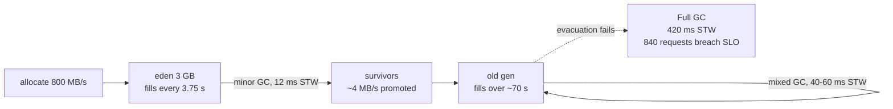

# JVM Garbage Collection and the Go Runtime

> Pause times are latency SLOs in disguise.

**Type:** Learn
**Languages:** —
**Prerequisites:** Phase 4 Lesson 01 (Threads and the Memory Model), Phase 0 Lesson 05 (Benchmarking and Profiling)
**Time:** ~75 minutes

## Learning Objectives

- Explain the generational hypothesis and derive from it why young collections are short and old collections are the ones that hurt
- Distinguish the pause profile and the throughput cost of Serial, Parallel, G1, ZGC, and Shenandoah, and choose one for a given latency SLO and heap size
- Compute allocation pressure for a request-serving process from the per-request allocation and the request rate, and predict the collection frequency it implies
- Read a JVM unified GC log and a Go `gctrace` line and extract pause duration, heap before and after, and the cause of the collection
- Describe Go's concurrent mark-sweep collector, the role of `GOGC` and `GOMEMLIMIT`, and why Go pauses are short without being free
- Translate a p99 latency SLO into a maximum tolerable pause duration and frequency, and recognise the GC death spiral before it takes a service down

## The Problem

A card authorization service has a 100 ms p99 latency target, because the issuer's switch times out at 150 ms and a timeout becomes a retry, and a retry becomes a duplicate authorization unless the idempotency layer catches it. The service runs on a JVM with an 8 GB heap, handles 2,000 requests per second, and allocates around 400 KB per request: the parsed ISO 8583 message, a few `Money` objects, a risk-feature vector, the JSON for the fraud call, and the buffers for the response. The median latency is 9 ms. The p99 is 96 ms on a good day. Every 70 seconds or so it is 420 ms, and the dashboard shows a spike that nobody can tie to any request.

The spike is the collector. 400 KB per request at 2,000 requests per second is 800 MB per second of allocation. The young generation is 3 GB, so it fills every 3.75 seconds and the JVM collects it; those pauses are 8 to 15 ms and show up only as a slight thickening of the p99. But a fraction of each request's objects survives, because the service keeps a per-merchant rate-limit window and a 60-second response cache, and the old generation fills at a few megabytes a second. Every 70 seconds G1 runs a mixed collection that evacuates old regions, and twice an hour the heap is fragmented enough that an evacuation fails, G1 falls back to a full compaction, and every thread stops for 420 ms. During that pause 840 requests are in flight. All 840 miss the issuer's 150 ms timeout. 840 retries arrive. The idempotency layer catches 838 of them; the two that slip through are the two whose first attempt had not yet written its key when the pause began. Two duplicate authorizations an hour is 48 a day, and the chargeback team notices after a week.

Nothing in this service is leaking, and nothing is wrong with the code in the sense that any test could show. The runtime is doing exactly what it was configured to do. The failure is that nobody translated the latency SLO into a constraint on the collector: a 100 ms p99 with an issuer timeout at 150 ms means **no pause longer than about 40 ms, ever**, and a pause frequency low enough that fewer than one percent of requests overlap one. This lesson is about making that translation, for the JVM and for the Go runtime, and about reading the logs that tell you whether you are meeting it.

## The Concept

### Why collectors are generational

Ungar's 1984 observation, the **weak generational hypothesis**, is that most objects die young. A request's parsed message, its intermediate strings, its iterator objects, all become garbage when the response is written, within milliseconds of allocation. A small fraction, the cache entries and the long-lived session state, survive for minutes or hours. A collector that treats both populations the same wastes most of its effort re-examining old objects that have not changed.

So the heap is split. New objects go into a **young generation** (eden plus two survivor spaces in the classic HotSpot layout; young regions in G1). When eden fills, a **minor collection** copies the live young objects, which are few, to a survivor space or, after surviving enough collections, to the **old generation**, and declares everything else in eden free in one step. The cost of a minor collection is proportional to the number of **live** objects, not to the size of eden, which is why a 3 GB eden can be collected in 10 ms when 99 percent of it is dead.

The old generation is collected rarely, and the cost is proportional to the live set, which is large. Old collections are where pauses come from. The whole art of GC tuning for latency is to keep objects from being promoted when they do not need to be, to make old collections concurrent with the application, and to make sure the collector never falls so far behind that it has to stop everything and catch up.

Two mechanisms make generational collection practical. **Thread-local allocation buffers** (TLABs) give each thread its own slice of eden so allocation is a pointer bump with no lock, which is why `new` is cheap and why "allocation pressure" rather than "allocation cost" is the thing to worry about. **Card tables** or **remembered sets** record which old objects point into the young generation, so a minor collection can find young objects reachable from old ones without scanning the whole old generation.

### The vocabulary of a pause

| Term | Meaning | Who pays |
|------|---------|----------|
| Stop-the-world (STW) | every application thread is paused at a safepoint while the collector works | every in-flight request, as added latency |
| Concurrent | collector threads run alongside application threads | CPU and memory bandwidth taken from the application; throughput |
| Parallel | several collector threads work during a pause | shortens the pause on a multi-core machine |
| Incremental | the work is split into bounded slices | more total overhead; bounded worst case |
| Compacting | live objects are moved together to eliminate fragmentation | needs either a pause or a barrier that handles moving objects underfoot |
| Safepoint | a point where a thread's stack and registers are in a known state so the collector can scan them | time-to-safepoint adds to every pause; a thread in a long counted loop or JNI call delays everyone |

A collector's design is a choice of which boxes to tick. Every collector must mark the live graph and reclaim the dead; the differences are in whether marking and compaction happen with the world stopped or concurrently, and what that costs.

### The HotSpot collectors

| Collector | Flag | Design | Typical pause | Throughput cost | Use when |
|-----------|------|--------|---------------|-----------------|----------|
| Serial | `-XX:+UseSerialGC` | single-threaded, STW, generational, compacting | 10s of ms to seconds, scales with heap | lowest overhead | small heaps, one core, batch jobs, containers under 2 GB |
| Parallel | `-XX:+UseParallelGC` | multi-threaded STW, generational, compacting | 100s of ms on large heaps | lowest for throughput | batch, settlement files, anything where total time matters and latency does not |
| G1 | `-XX:+UseG1GC` (default since JDK 9, JEP 248) | region-based, concurrent marking, STW evacuation, pause-time goal | 10 to 200 ms, targets `MaxGCPauseMillis` (default 200) | moderate | general-purpose services with heaps of 4 to 64 GB and p99 targets in the hundreds of ms |
| ZGC | `-XX:+UseZGC` (production JDK 15, JEP 377; generational JDK 21, JEP 439; generational by default JDK 23) | concurrent marking **and** compaction via coloured pointers and load barriers | sub-millisecond, independent of heap size | roughly 10 to 15 percent more CPU, more memory headroom | latency-sensitive services, heaps from 8 GB to multiple TB |
| Shenandoah | `-XX:+UseShenandoahGC` (production JDK 15, JEP 379) | concurrent compaction via load-reference barriers; generational mode experimental | sub-millisecond to low ms | similar to ZGC | same as ZGC; the choice is usually which one your JDK build ships |

Two patterns to hold on to:

- **G1's pause-time goal is a target, not a bound.** G1 chooses how many regions to evacuate per pause to fit the goal, which works when the live set is predictable. When an evacuation runs out of free regions ("to-space exhausted") it falls back to a full, STW, single-collection compaction of the whole heap. That fallback is the 420 ms pause in the Problem.
- **ZGC and Shenandoah move the cost from pauses to barriers.** Every reference load checks a few bits of the pointer (ZGC's colours) or follows a forwarding pointer (Shenandoah's barrier). The pause no longer depends on the heap size because compaction happens while the application runs, but the application runs a few percent slower all the time, and the collector needs headroom: if allocation outruns concurrent collection, ZGC makes the allocating thread wait (an **allocation stall**), which is a pause by another name and the thing to watch in its logs.

### Worked example: allocation pressure and the p99

Take the authorization service and make the arithmetic explicit.

```text
allocation per request      = 400 KB
request rate                = 2,000 / s
allocation rate             = 400 KB * 2,000 = 800 MB / s
young generation            = 3 GB
minor collection every      = 3 GB / 800 MB/s = 3.75 s
minor pause (observed)      = 12 ms
request duration (median)   = 9 ms

fraction of requests that overlap a minor pause
  = (pause + request) / interval = (12 + 9) ms / 3750 ms = 0.56 %
```

Half a percent of requests see +12 ms. That is invisible at p99. Now the old generation:

```text
survival per request        = 2 KB (rate-limit window entry, cache entry)
promotion rate              = 2 KB * 2,000 / s = 4 MB / s
old generation free         = 1 GB after the last mixed cycle
mixed cycle every           = 1 GB / 4 MB/s = 250 s   (G1 starts earlier, at ~45 % occupancy: ~70 s observed)
mixed pause                 = 40 to 60 ms
fraction overlapping        = (50 + 9) / 70,000 = 0.08 %

full GC fallback            = 420 ms, twice an hour
requests in flight          = 420 ms * 2,000 / s = 840
fraction overlapping        = (420 + 9) / 1,800,000 = 0.024 %, but every one of them breaches 150 ms
```

The lesson of the arithmetic is that **the p99 is set by the frequent small pause, and the incident is set by the rare large one**. The small pauses are tuned by sizing eden against the allocation rate; the large one is eliminated by choosing a collector that never falls back to a full STW compaction, or by giving G1 enough headroom that it never has to. Reducing allocation per request (reuse the parse buffer, avoid the intermediate JSON string) attacks both at once, which is why allocation profiling comes before collector tuning.



### Reading a JVM GC log

Enable unified logging (JEP 158, JDK 9+) with `-Xlog:gc*:file=gc.log:time,uptime,level,tags`. The lines that matter:

```console
[2026-10-13T09:14:02.118+0000][71.204s][info][gc,start   ] GC(41) Pause Young (Normal) (G1 Evacuation Pause)
[2026-10-13T09:14:02.130+0000][71.216s][info][gc,phases  ] GC(41)   Evacuate Collection Set: 9.8ms
[2026-10-13T09:14:02.131+0000][71.217s][info][gc,heap    ] GC(41) Eden regions: 1496->0(1480)
[2026-10-13T09:14:02.131+0000][71.217s][info][gc,heap    ] GC(41) Survivor regions: 24->32(190)
[2026-10-13T09:14:02.131+0000][71.217s][info][gc,heap    ] GC(41) Old regions: 1612->1618
[2026-10-13T09:14:02.131+0000][71.217s][info][gc         ] GC(41) Pause Young (Normal) (G1 Evacuation Pause) 6264M->3302M(8192M) 12.417ms
[2026-10-13T09:14:02.131+0000][71.217s][info][gc,cpu     ] GC(41) User=0.09s Sys=0.00s Real=0.01s
...
[2026-10-13T09:15:11.502+0000][140.588s][info][gc         ] GC(60) Pause Full (G1 Compaction Pause) 7811M->3390M(8192M) 421.883ms
```

How to read `GC(41)`: eden went from 1,496 regions to 0 (the whole young generation collected), 8 regions' worth of objects were promoted (old went 1,612 to 1,618 and survivor grew), the heap went from 6,264 MB to 3,302 MB, and the pause was 12.4 ms of real time using 90 ms of CPU across the parallel GC threads. `GC(60)` is the incident: a `Pause Full`, 422 ms. The word `Full` in a G1 log is always a finding. The cause in parentheses tells you why: `G1 Compaction Pause` after to-space exhaustion, `System.gc()` if something called it explicitly (a remote-management agent, a misguided cache), `Metadata GC Threshold` if class metadata filled.

Three derived numbers to compute from any log: the **allocation rate** (heap growth between consecutive collections divided by the interval), the **promotion rate** (old-generation growth per young collection), and the **pause-time histogram** split by cause. The first two tell you whether you have a leak (promotion rate that never comes back down after mixed collections) or just pressure. The third is your SLO.

### The Go runtime's collector

Go's collector is **concurrent, tri-colour mark-sweep, non-generational, non-compacting**. Each word is a deliberate trade against the JVM's design:

- **Concurrent marking** with a hybrid write barrier (Yuasa deletion plus Dijkstra insertion, since Go 1.8) means the application keeps running while the live graph is traced. There are two short STW phases, at the start of marking (to enable the write barrier and scan stacks) and at mark termination, each typically tens of microseconds. Go documents the design target as sub-millisecond pauses, and in practice most services see pauses under 100 µs.
- **Non-generational.** Go relies on escape analysis to keep short-lived objects on the stack in the first place (`go build -gcflags=-m` shows which allocations escape), and on cheap size-classed allocation for the rest. Without generations there is no promotion and no card table, but every GC cycle marks the entire live heap.
- **Non-compacting.** Memory is organised in spans of fixed size classes; freeing an object marks its slot free, and fragmentation is bounded by the size-class scheme rather than fixed by moving objects. This is what makes concurrent operation simple, because objects never move underfoot and no load barrier is needed.
- **Sweeping is lazy and concurrent**, done by allocating goroutines as they need spans.

The cost is CPU, not pauses. During a cycle the collector takes 25 percent of `GOMAXPROCS` as dedicated mark workers, and if allocation outpaces marking, allocating goroutines are charged **mark assist**: they do GC work proportional to what they allocate before they are allowed to continue. Assist is Go's equivalent of ZGC's allocation stall: not a global pause, but latency added exactly to the goroutines that are allocating, which in a request server is every request.

### `GOGC`, `GOMEMLIMIT`, and the pacer

The **pacer** decides when the next cycle starts. With `GOGC=100` (the default) the goal is to start so that the heap peaks at roughly twice the live heap after the previous cycle: a 1 GB live set means a 2 GB heap goal and a cycle every time 1 GB is allocated. `GOGC=200` trades memory for fewer cycles; `GOGC=50` the reverse; `GOGC=off` disables collection.

`GOMEMLIMIT` (Go 1.19) adds a soft ceiling on total runtime memory. As the heap approaches the limit the pacer collects more aggressively regardless of `GOGC`, which lets a container-bound service use all the memory it has without being killed. The trap is a live set close to the limit: the collector runs continuously and the service spends most of its CPU on marking. The runtime caps GC CPU at roughly 50 percent in that regime so the application cannot be starved entirely, but 50 percent is still a service running at half speed, and it is the Go shape of the death spiral.

```text
live heap after cycle N   = 1.0 GB
GOGC                      = 100
heap goal for cycle N+1   = 1.0 GB * (1 + 100/100) = 2.0 GB
allocation rate           = 500 MB / s
cycle interval            = (2.0 - 1.0) GB / 500 MB/s = 2 s
mark CPU                  = 25 % of GOMAXPROCS for the duration of marking, plus assists if behind
```

### Reading a Go `gctrace` line

Run with `GODEBUG=gctrace=1` and the runtime prints one line per cycle to stderr:

```console
gc 18 @12.407s 3%: 0.041+2.8+0.019 ms clock, 0.33+0.55/2.1/4.9+0.15 ms cpu, 1021->1035->512 MB, 1047 MB goal, 0 MB stacks, 0 MB globals, 8 P
```

Field by field: cycle 18, at 12.4 s of uptime, 3 percent of total CPU spent on GC so far. The clock times are the three phases: `0.041` ms STW sweep termination and mark start, `2.8` ms concurrent marking (the application was running), `0.019` ms STW mark termination. So the **pauses** were 41 µs and 19 µs; the 2.8 ms was concurrent. The CPU field breaks marking into assist/background/idle time. `1021->1035->512 MB` is heap at the start of marking, heap at the end, and **live heap after** marking; `1047 MB goal` was the pacer's target. With a 512 MB live set and `GOGC=100`, the next goal will be about 1,024 MB.

The numbers to watch across many lines: a live heap (third number) that climbs without plateauing is a leak; a large assist component in the CPU field means allocation is outrunning the collector and request latency is paying for it; a goal that keeps overshooting means the pacer is being surprised by allocation bursts.

### Choosing: a decision procedure

```text
1. Write the SLO as a pause budget: p99 target minus median, divided by a safety factor of 2.
   Authorization service: (100 - 9) / 2 ~= 45 ms maximum pause. Issuer timeout 150 ms: no pause above ~100 ms, ever.
2. Measure allocation rate and live set under production load (gc log or gctrace, not a guess).
3. JVM, heap under 4 GB, pause budget above 100 ms              -> Parallel if batch, G1 if serving
   JVM, pause budget under 50 ms, or heap above 16 GB            -> ZGC (generational on JDK 21+) or Shenandoah
   JVM, pause budget under 10 ms                                 -> ZGC/Shenandoah AND reduce allocation; verify no allocation stalls in logs
   Go, any budget                                                -> the one collector; tune GOGC and GOMEMLIMIT, then reduce allocation
4. Re-measure. If the pause histogram's maximum is above the budget, you are not done.
5. Alert on: any Pause Full (G1), any allocation stall (ZGC), assist > 10 % of GC CPU (Go), live heap trend over 24 h (both).
```

### The flags and settings that matter

Most GC tuning advice is folklore from a previous collector. The short list that is still worth knowing:

```bash
# JVM: always on in production; the log is cheap and the first thing you will need
-Xlog:gc*:file=/var/log/app/gc.log:time,uptime,level,tags:filecount=10,filesize=50m
-Xlog:safepoint:file=/var/log/app/safepoint.log

# Heap: fixed size avoids resize pauses; leave 25 % of the container for off-heap and the collector
-Xms6g -Xmx6g

# G1: the pause goal is advisory; lower it only with headroom to spare
-XX:+UseG1GC -XX:MaxGCPauseMillis=50 -XX:G1HeapRegionSize=4m

# ZGC (JDK 21+): generational mode; SoftMaxHeapSize lets it return memory without a hard limit
-XX:+UseZGC -XX:+ZGenerational -XX:SoftMaxHeapSize=5g

# Go: percent growth trigger and soft memory limit; set the limit a little below the container limit
GOGC=100 GOMEMLIMIT=5GiB GODEBUG=gctrace=1
```

What is deliberately absent: `-XX:NewRatio`, `-XX:SurvivorRatio`, and other generation-sizing flags, which G1 and ZGC size adaptively and which usually make things worse when set by hand; `System.gc()` calls and `-XX:+DisableExplicitGC`, which treat a symptom; and `GOGC=off`, which is a batch-job trick that turns a service into a memory leak with a deadline.

### Failure modes

- **The death spiral.** Live set approaches heap size, collections become back-to-back, each one reclaims little, throughput collapses, request queues grow, more objects are live because more requests are in flight, and the cycle feeds itself. The fix is never a bigger heap alone; find the growth (a cache without a bound, a listener never removed, a `ThreadLocal` on a pooled thread) and cap it.
- **Humongous allocations in G1.** An object larger than half a region (regions are 1 to 32 MB) is allocated directly in the old generation as a humongous object. A settlement job that reads a 50 MB file into one byte array on the same JVM as the authorization path promotes 50 MB per file and fragments the old generation, which is the fastest route to to-space exhaustion.
- **Safepoint delays.** The pause clock starts when the collector asks for a safepoint and ends when the last thread arrives. A thread in a long counted loop without a safepoint poll, or returning from a long JNI call, stretches the pause for everyone. `-Xlog:safepoint` separates time-to-safepoint from the collection itself.
- **Finalizers and `Cleaner`s.** An object with a finalizer survives at least one extra collection and is processed by a single finalizer thread; a backlog of finalizable objects is a leak with extra steps. Use `try`-with-resources for anything that holds a native resource.
- **Object pooling as a cure.** Pooling defeats the generational hypothesis: pooled objects are old, so every write to them is a write into the old generation that the card table must track, and the pool itself is a live set that grows. Pool only when a profile shows allocation of a specific large object dominating, and measure after.
- **Go: goroutine leaks.** A goroutine blocked forever on a channel nobody will send to holds its stack and everything it references. The live heap climbs, cycles get longer, and `gctrace` shows it before the dashboard does. Lesson 11's structured scopes are the fix at the design level.

### What this lesson does not cover

It does not cover the JIT, which interacts with GC through escape analysis and scalar replacement (an object the JIT proves never escapes is never allocated on the heap at all), nor off-heap memory, nor CPython's reference counting and cyclic collector, which Lesson 10 touches on. It describes HotSpot; OpenJ9 and GraalVM Native Image have different collectors with different trade-offs.

## Worked Example

### Tuning the authorization service, step by step

Start from the Problem's configuration and the log it produced. Each step changes one thing and re-reads the log.

**Step 0: the baseline.** G1, 8 GB heap, defaults. Over one hour the pause histogram, grouped by the cause string in the `gc` tag, is:

```text
cause                                   count   p50      p99      max
Pause Young (Normal) (G1 Evacuation)     960    11 ms    16 ms    22 ms
Pause Young (Mixed)                       51    44 ms    58 ms    71 ms
Pause Full (G1 Compaction Pause)           2   415 ms   420 ms   422 ms
requests breaching 150 ms                1,680  (all during the two Full pauses)
```

The budget derived from the SLO is 45 ms per pause and no pause above 100 ms. The young pauses pass. The mixed pauses are over budget at p99. The full pauses are the incident.

**Step 1: find the humongous allocations.** `-Xlog:gc+humongous=debug` shows the settlement-file importer, which shares the JVM, allocating 48 MB byte arrays: with 4 MB regions, each is 12 contiguous regions of old space. Moving the importer to its own process removes the fragmentation that caused to-space exhaustion. After one more hour:

```text
Pause Young (Normal)                      955    11 ms    16 ms    21 ms
Pause Young (Mixed)                        49    43 ms    57 ms    69 ms
Pause Full                                  0
```

The incident is gone. The mixed pauses are still over budget.

**Step 2: cut promotion.** The promotion rate (old-region growth per young collection, from the `gc,heap` lines) is 4 MB per second. Allocation profiling shows the 60-second response cache stores the full serialised response, 3 KB each, when the fraud decision alone, 40 bytes, would do. After the change the promotion rate is 0.3 MB per second, mixed collections happen every 15 minutes instead of every 70 seconds, and each one has less to evacuate:

```text
Pause Young (Normal)                      958    10 ms    15 ms    20 ms
Pause Young (Mixed)                         4    28 ms    31 ms    31 ms
```

Within budget. The service now meets the SLO on G1 with no collector flags changed, because the problem was the allocation profile, not the collector.

**Step 3 (optional): ZGC.** Switching to generational ZGC on the same build gives:

```text
Pause Young / Pause Old (ZGC phases)    4,120    0.04 ms  0.11 ms  0.9 ms
Allocation Stall                             0
CPU: +9 % versus G1 at the same throughput
```

Every pause is under a millisecond, at a nine percent CPU cost. For this service G1 after Steps 1 and 2 is sufficient; ZGC is the right answer when the budget is 10 ms, or when the heap grows past what G1 can evacuate in 45 ms.

### A Go service with a slow leak

The same arithmetic in Go, from `gctrace` lines sampled one per minute. The third heap number is the live heap after marking:

```console
gc 211  @60.0s   2%: 0.05+3.1+0.02 ms clock,  ... 1021->1034->514 MB,  1028 MB goal, 8 P
gc 430  @120.0s  2%: 0.05+3.4+0.02 ms clock,  ... 1105->1118->556 MB,  1112 MB goal, 8 P
gc 640  @180.0s  3%: 0.06+3.9+0.02 ms clock,  ... 1190->1203->598 MB,  1196 MB goal, 8 P
gc 1810 @600.0s  5%: 0.07+7.8+0.03 ms clock,  ... 1790->1810->902 MB,  1804 MB goal, 8 P
gc 3020 @1200.0s 11%: 0.09+16.2+0.04 ms clock, ... 2580->2610->1302 MB, 2604 MB goal, 8 P
```

Three things are visible without any other tool. The live heap grows by about 42 MB per minute and never comes back down: a leak, and the growth rate tells you how long until the memory limit. The concurrent mark time grows with the live heap (3.1 ms to 16.2 ms), because a non-generational collector marks the whole live set each cycle. The GC CPU share has gone from 2 to 11 percent. The pauses (first and third clock fields) are still well under 100 µs, which is the point of the design, and also why a dashboard showing only pause time would miss this entirely until the process is killed.

The goroutine count from `runtime.NumGoroutine()` over the same window climbs from 180 to 9,400: a goroutine per webhook that blocks forever on a channel the handler stopped reading after a timeout. Lesson 11 is the fix.

### Translating an SLO into a pause budget

```text
p99 target                    = 100 ms
median request                = 9 ms
headroom for the collector    = (100 - 9) / 2 = 45 ms       <- max pause, with a safety factor of 2
hard ceiling (issuer timeout) = 150 ms - 9 ms - network 20 ms = ~120 ms  <- never, under any cause
tolerable overlap             = 1 % of requests
pause frequency bound         = (pause + request) / interval <= 1 %
                                (45 + 9) ms / interval <= 0.01  ->  interval >= 5.4 s
```

Written as alerts: any pause over 45 ms is a warning, any pause over 120 ms is a page, and more than one pause per 5.4 seconds is a warning. These three numbers are the SLO, restated for the collector.

## Exercises

1. **Reinforce.** A service allocates 1.2 MB per request at 500 requests per second with a 2 GB young generation and 15 ms minor pauses. Compute the allocation rate, the collection interval, and the fraction of 20 ms requests that overlap a pause. Then recompute with the allocation reduced to 300 KB per request and state which change in the request path you would look for first.
2. **Apply.** Take any JVM program you own (or Phase 4, Lesson 02's benchmark), run it with `-Xlog:gc*:file=gc.log` under G1 and then under `-XX:+UseZGC`, and produce a table of pause count, maximum pause, total pause time, and wall-clock run time for each. Explain the row where ZGC is slower in wall-clock time but better on every pause metric.
3. **Extend.** Write a 40-line Go program that allocates 64 KB per iteration in a loop while holding a slice of long-lived objects that grows by one entry per iteration, run it with `GODEBUG=gctrace=1` and then with `GOMEMLIMIT=256MiB`, and plot live heap and GC CPU percentage from the trace. Identify the iteration at which the memory limit turns the pacer into a death spiral, and relate the shape to the Problem section's JVM incident.

## Key Terms

| Term | What people say | What it actually means |
|------|-----------------|------------------------|
| Generational hypothesis | "most objects die young" | Ungar's empirical observation that object lifetime is bimodal, which makes collecting the young generation cheap because cost scales with survivors, not with allocation |
| Stop-the-world pause | "the GC pause" | An interval during which every application thread is halted at a safepoint; the thing a latency SLO constrains directly |
| Allocation pressure | "we allocate a lot" | The allocation rate in bytes per second; with eden size it determines minor-collection frequency, and with survival rate it determines promotion rate |
| Promotion | "tenuring" | Copying a young object that has survived enough collections into the old generation; the promotion rate is what fills the old generation and schedules the expensive collections |
| Concurrent compaction | "pauseless GC" | Moving live objects while the application runs, made safe by load barriers (ZGC, Shenandoah); the pause stops depending on heap size, the application pays a few percent on every reference load |
| Allocation stall / mark assist | "GC backpressure" | ZGC making an allocating thread wait, or Go charging an allocating goroutine with marking work, when allocation outruns concurrent collection; latency that lands only on allocators |
| `GOGC` | "the GC percent" | The pacer's target growth: start the next cycle when the heap has grown by this percent over the last live heap; 100 means collect every time the heap doubles |
| Death spiral | "GC thrashing" | Live set near the heap or memory limit, so collections run back to back and reclaim little while queued requests add to the live set; fixed by bounding growth, not by adding heap |

## Further Reading

- [JEP 439: Generational ZGC](https://openjdk.org/jeps/439) — the design of ZGC's coloured pointers and load barriers, and why adding generations to a concurrent collector cut its CPU and memory overhead.
- [JEP 248: Make G1 the Default Garbage Collector](https://openjdk.org/jeps/248) and the [HotSpot Garbage Collection Tuning Guide](https://docs.oracle.com/en/java/javase/21/gctuning/) — the official description of each collector, its flags, and G1's pause-time goal mechanism.
- [JEP 158: Unified JVM Logging](https://openjdk.org/jeps/158) — the `-Xlog` syntax and tag set used to produce the GC log in this lesson.
- [A Guide to the Go Garbage Collector](https://go.dev/doc/gc-guide) — the Go team's own explanation of the pacer, `GOGC`, `GOMEMLIMIT`, mark assist, and the memory-limit death spiral, with interactive diagrams.
- [Go `runtime` package documentation, `GODEBUG` settings](https://pkg.go.dev/runtime) — the authoritative definition of every field in a `gctrace=1` line.
- [Ungar, "Generation Scavenging: A Non-disruptive High Performance Storage Reclamation Algorithm" (1984)](https://dl.acm.org/doi/10.1145/800020.808261) — the paper that introduced generational collection and measured the hypothesis it rests on.
- [Dean and Barroso, "The Tail at Scale" (CACM 2013)](https://cacm.acm.org/research/the-tail-at-scale/) — why a rare 400 ms pause on one of a hundred backends becomes a common slow request at the front door.
