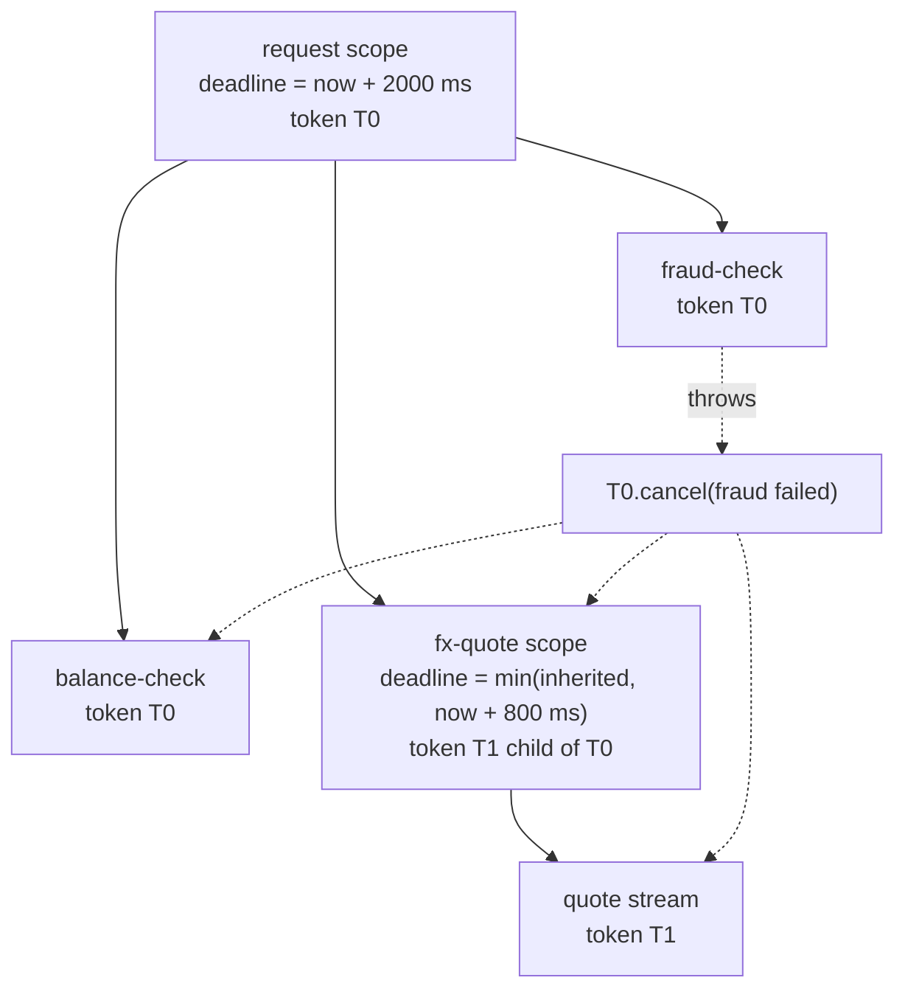

# Structured Concurrency and Cancellation

> Context in Go, virtual threads in Java, task groups in Python.

**Type:** Build
**Languages:** Java, Python, Go
**Prerequisites:** Phase 4, Lesson 06 (Executors, Goroutines, and asyncio); Phase 4, Lesson 01 (Threads and the Memory Model); Phase 10, Lesson 01 (Representing Money)
**Time:** ~75 minutes

## Learning Objectives

- Explain why a task that outlives the request that started it is a correctness bug, not a resource leak, and name the payments incident it causes
- Build a cancellation token tree in which cancelling a parent cancels every descendant, callbacks run exactly once, and a deadline turns into a cancellation without a timer thread
- Build a structured scope on top of a plain `ExecutorService` that forks subtasks, joins all of them, cancels siblings on the first failure, and guarantees on `close` that no subtask is still running
- Compose deadlines so that a child scope can tighten but never loosen the budget it inherits, and compute a request's remaining budget at each hop
- State what cooperative cancellation cannot do (stop a thread that never checks) and where the backstop for that gap lives in a payment system
- Map the design onto `StructuredTaskScope`, Go's `context`, and Python's `asyncio.TaskGroup`, and say which part each one leaves to you

## The Problem

A card authorization service fans out three calls for every request: a fraud score, a balance check, and an FX quote. Each call runs on its own thread from a shared pool, and the request handler waits on three futures with a two-second timeout. When the timeout fires the handler returns `504` to the merchant gateway and moves on. The code passed review because it has a timeout, and timeouts are what you add to be safe.

On a Tuesday the fraud vendor's p99 climbs from 80 ms to 11 seconds. Every request now times out at two seconds and returns a `504`. But the fraud call does not know that. It keeps running for 11 seconds, holding a pool thread, a connection, and a slot in the vendor's rate limiter. The pool has 200 threads; at 60 requests per second, each one parking three threads for 11 seconds, the pool is exhausted in about a second. Now the balance check and the FX quote, which were healthy, cannot get a thread either. The service's error rate goes to 100 percent and stays there until someone restarts it, at which point the orphaned work is discarded and the system recovers for roughly a second before the same thing happens again. The timeout did not protect the service; it only made the caller leave early while the work carried on.

There is a worse version. The merchant gateway treats `504` as "unknown outcome" and retries, with a new request id. The original request's three calls eventually finish, and because the handler already returned, nobody cancelled the final step: the authorization is placed with the issuer. The retry places a second one. The cardholder sees two holds for 25.00 USD on a 25.00 USD purchase. Nothing in this chain was wrong in isolation: the timeout was reasonable, the retry was reasonable, each call completed correctly. What was missing is the rule that **work must not outlive the scope that started it**, and when that scope ends, every piece of work under it must be told, must stop, and must release what it held before the scope is allowed to return.

That rule is structured concurrency. This lesson builds it from an `ExecutorService`, a token, and a clock, because Java 21's `StructuredTaskScope` is a preview API and the course does not use preview features. The thing you build is small enough to read in full and is the same shape as Go's `context`, Trio's nurseries, and Python's `asyncio.TaskGroup`, so the lesson is really about the shape, not the library.

## The Concept

### Concurrency with a block structure

In single-threaded code a function call has a lifetime nested inside its caller's: the caller cannot return until the callee has. Resources follow the same nesting (`try`-with-resources, `defer`, `with`). Unstructured concurrency breaks this: `executor.submit(task)` starts work whose lifetime is unrelated to the block that started it, like a `goto` into another thread. Nathaniel Smith's 2018 essay made the analogy explicit: the "go statement" (and `Thread.start`, `submit`, `asyncio.create_task`) is to concurrency what `goto` was to control flow. It makes every function a potential source of background work the caller cannot see.

Structured concurrency restores the nesting with one object, a **scope**, and three rules:

1. **Every subtask is forked inside a scope and the scope joins all of them before it exits.** Normal exit, exception, or early return, the scope does not complete until its children have.
2. **Failure in one child cancels its siblings.** If the fraud check throws, there is no point finishing the FX quote; the answer is already "declined", and finishing would waste the resources the Problem section ran out of.
3. **Cancellation is a tree.** The scope holds a token; children get child tokens; cancelling a parent cancels all descendants. Cancelling a child never affects the parent, because a child has no business ending its caller.

Lifetime nesting is what makes the Problem's leak impossible by construction. The handler's scope cannot return `504` while the fraud call is still running: either the call finishes, or the scope cancels it and waits for it to acknowledge, and only then does the handler return.



### Cancellation is cooperative, and that is a feature

No mainstream runtime can safely stop a thread from outside. Java removed `Thread.stop` because killing a thread mid-update leaves locks held and invariants broken; Go has no goroutine kill at all; Python's `asyncio` cancellation is an exception delivered at the next `await`. What every one of them offers instead is a **signal the work must check**: Java's interrupt flag, Go's `ctx.Done()` channel, Python's `CancelledError`.

Cooperative cancellation has a precise contract. The canceller promises to set the signal exactly once and to deliver it to everyone below the cancelled point. The cancelled code promises to check the signal at every point where it would otherwise block or begin an irreversible step, and to release what it holds when it sees it. Neither side can do the other's job. A token that is never checked cancels nothing; a check with no token to read is dead code.

The consequence for payments is the rule from Phase 12 that a cancellation check must sit **immediately before the side effect**: before the authorization is placed with the issuer, before the ledger posting is committed, before the webhook is sent. A token observed one line too late is the duplicate hold in the Problem. The backstop when even that fails is idempotency (Phase 12, Lesson 01): the retry carries the same key and the issuer deduplicates. Structured concurrency reduces how often you need the backstop; it does not remove the need for it.

### Deadlines compose by taking the minimum

A deadline is an absolute instant, not a duration. "Two seconds" means nothing to a downstream call that starts 1.7 seconds in; "no later than 14:03:07.250" does. The arithmetic every hop performs is:

```text
budget_remaining = deadline - now
if budget_remaining <= reserve_for_own_work: fail fast, do not call downstream
propagate deadline' = min(deadline, now + my_own_timeout_for_this_call)
```

Worked example with the demo's numbers. The gateway gives the authorization service a 200 ms budget. The FX quote code asks for 800 ms because the FX vendor is usually slow:

```text
t = 0 ms     request token:   deadline = 200 ms
t = 0 ms     fx-quote token:  asked for 0 + 800 = 800 ms
             effective      = min(200, 800) = 200 ms      <- the child cannot outlive the parent
t = 250 ms   request token:   250 >= 200 -> expired -> cancelled("deadline exceeded")
             fx-quote token:  cancelled by propagation, same reason
             root token:      untouched; cancellation never travels upward
```

Google's SRE book calls this deadline propagation and treats it as a first-class defence against cascading failure: a request whose deadline has already passed is dropped at the first hop that notices, instead of consuming work along the whole chain for a response nobody will read. gRPC carries the deadline in a `grpc-timeout` header for exactly this reason.

### The invariant

The scope guarantees one thing, and the tests check it from several angles: **when `join` or `close` returns, no subtask forked in this scope is still executing, and every subtask has reached exactly one terminal state.**

| Terminal state | Meaning | How the scope reached it |
|----------------|---------|--------------------------|
| `SUCCESS` | body returned a value | normal completion before any cancellation |
| `FAILED` | body threw, and the token was not cancelled at the time | the first such subtask cancels the scope; `throwIfFailed` rethrows it |
| `CANCELLED` | body observed the token or was interrupted, or never started because the token was already cancelled | deadline, sibling failure, external cancel, or `close` without `join` |

Two cases in that table deserve attention. A body that throws **after** the scope was cancelled is recorded as `CANCELLED`, not `FAILED`: when you interrupt a thread that is blocked in a socket read, it throws, and that throw is a consequence of the cancellation rather than a new failure. Reporting it as a failure would bury the real cause. And a body that never ran at all because the token was already cancelled at fork time is also `CANCELLED`, with its `onCancel` callbacks never registered because there was nothing to clean up.

### What this design does not do

- It does not pre-empt. A subtask that spins in a loop without ever calling `token.isCancelled()`, or that blocks in a non-interruptible call (a `synchronized` monitor enter, some file I/O), will be waited for by `join`. The scope is honest about this: it will not return until the task does. Production systems bound that wait with a second, longer timeout and then alarm, because a task that ignores cancellation is a bug to fix, not a condition to handle.
- It does not retry, rate-limit, or circuit-break. Those live in Phase 5, Lessons 10 and 11. A scope decides when work stops; it has no opinion about when it starts again.
- It does not deliver a result to a caller that has already left. The merchant gateway that timed out gets nothing more from us. Reconciling the outcome it missed is what idempotent retries and webhooks are for.
- Its deadline check is lazy. A deadline becomes a cancellation the next time anyone asks the token, which `join` does every few milliseconds and well-written bodies do before each blocking step. There is no timer thread. Go's `context.WithDeadline` starts a timer so the `Done` channel closes even if nobody is asking; the lazy version is simpler to test and sufficient when every waiter polls.

## Build It

The walkthrough is Java 21 with no preview features. The full implementation is `code/java/Main.java`; the tests are `code/java/MainTest.java`.

### Step 1: A clock and a deadline

```java
interface Clock {
    long nanos();
}

final class ManualClock implements Clock {
    private final AtomicLong now = new AtomicLong();
    @Override public long nanos() { return now.get(); }
    void advance(Duration d) { now.addAndGet(d.toNanos()); }
}

record Deadline(long atNanos) {
    static final Deadline NONE = new Deadline(Long.MAX_VALUE);

    static Deadline after(Clock clock, Duration d) {
        return new Deadline(Math.addExact(clock.nanos(), d.toNanos()));
    }

    Deadline earliest(Deadline other) { return atNanos <= other.atNanos ? this : other; }
    boolean isExpired(Clock clock) { return atNanos != Long.MAX_VALUE && clock.nanos() >= atNanos; }
}
```

The clock is injected for the same reason as in every other lesson: the tests advance it by 301 ms in one line rather than sleeping for 301 ms, and the demo is deterministic. `Deadline` is an absolute instant on that clock. `earliest` is the only way two deadlines combine, which is what makes "a child cannot outlive its parent" a one-line theorem rather than a policy someone has to remember. `NONE` is `Long.MAX_VALUE`, so it loses every `earliest` and never expires.

**Predict:** `Deadline.after(clock, Duration.ofMillis(200))` is created at `clock.nanos() == 0`. After `clock.advance(Duration.ofMillis(200))`, is it expired? (Check the comparison operator.)

### Step 2: The cancellation token tree

```java
final class CancellationToken {
    private final CancellationToken parent;
    private final Clock clock;
    private final Deadline deadline;
    private final AtomicReference<String> reason = new AtomicReference<>();
    private final List<Runnable> callbacks = new CopyOnWriteArrayList<>();
    private final List<CancellationToken> children = new CopyOnWriteArrayList<>();

    CancellationToken child(Deadline own) {
        CancellationToken c = new CancellationToken(this, clock, deadline.earliest(own));
        children.add(c);
        if (isCancelled()) c.cancel(reason.get());
        return c;
    }

    boolean cancel(String why) {
        if (!reason.compareAndSet(null, Objects.requireNonNull(why))) return false;
        for (Runnable r : callbacks) r.run();
        for (CancellationToken c : children) c.cancel(why);
        return true;
    }

    boolean isCancelled() {
        if (reason.get() == null && deadline.isExpired(clock)) cancel("deadline exceeded");
        return reason.get() != null;
    }

    void onCancel(Runnable callback) {
        callbacks.add(callback);
        if (isCancelled()) callback.run();
    }
}
```

Four decisions, each closing a hole that a naive version has:

- **`compareAndSet(null, why)` makes `cancel` idempotent and makes the first reason win.** Two threads may race to cancel (a sibling fails at the same instant the deadline passes). Exactly one wins the CAS, exactly one runs the callbacks, and `reason()` tells you which cause came first. This is the Lesson 03 compare-and-swap doing the job a lock would otherwise do.
- **The child's deadline is `parent.earliest(own)`.** The tightening happens at construction, so a token never needs to consult its parent to know its budget. This is also why cancellation of a child cannot reach the parent: the parent is not in the child's `children` list, and nothing in `cancel` walks upward.
- **A child of a cancelled token is born cancelled.** Without this, a fork that happens after the scope was cancelled would get a live token and run to completion, which is exactly the orphan from the Problem.
- **`onCancel` after cancellation runs the callback immediately.** Registration and cancellation race; whichever order they happen in, the callback runs exactly once. Go's `context.AfterFunc` and .NET's `CancellationToken.Register` have the same rule for the same reason.

The lazy deadline in `isCancelled` means expiry has no timer: the next observer converts it. `join` observes every few milliseconds, so in practice expiry is noticed within one polling interval.

**Predict:** `root.cancel("a")` then `root.cancel("b")`. What does the second call return, and what does `child.reason()` say?

### Step 3: The subtask handle

```java
final class Subtask<T> {
    enum State { UNAVAILABLE, SUCCESS, FAILED, CANCELLED }

    private volatile State state = State.UNAVAILABLE;
    private volatile T value;
    private volatile Throwable failure;
    private Thread runner;             // guarded by this; non-null only while the body is executing

    synchronized void started(Thread t) { runner = t; }
    synchronized void finished() { runner = null; }
    synchronized void interrupt() { if (runner != null) runner.interrupt(); }

    T get() {
        if (state != State.SUCCESS) throw new IllegalStateException(name + " is " + state + ", not SUCCESS");
        return value;
    }
}
```

`get` refuses to return anything unless the state is `SUCCESS`. A `Future.get()` on a cancelled future throws `CancellationException`, which is fine, but a `Future.get()` on a future that has not completed *blocks*, which is how callers accidentally wait forever on a task the scope already gave up on. Here a value is only readable after `join`, and the state is always explicit.

The three `synchronized` methods around `runner` solve a bug that the first version of this lesson had. The obvious way to interrupt a subtask is `future.cancel(true)`. But if the scope is cancelled before the executor has started running the task, `FutureTask.cancel` marks the task cancelled and the executor **never runs it**, so any bookkeeping in the task's `finally` block never executes and `join` waits for a count that never reaches zero. Interrupting the recorded runner thread directly, only while it is non-null, sidesteps the race and also guarantees that a pooled thread never carries a stale interrupt into its next task.

**Predict:** why is `interrupt` a no-op rather than an error when `runner == null`?

### Step 4: Forking inside a scope

```java
<T> Subtask<T> fork(String taskName, Task<T> body) {
    if (joined || closed) throw new IllegalStateException(name + ": cannot fork after join or close");
    Subtask<T> subtask = new Subtask<>(taskName);
    subtasks.add(subtask);
    running.incrementAndGet();
    executor.execute(() -> {
        subtask.started(Thread.currentThread());
        try {
            if (token.isCancelled()) {
                subtask.cancelled();
            } else {
                subtask.succeed(body.call(token));
            }
        } catch (CancelledException | InterruptedException | CancellationException e) {
            subtask.cancelled();
        } catch (Throwable t) {
            if (token.isCancelled()) subtask.cancelled();
            else { subtask.fail(t); onFailure(subtask); }
        } finally {
            subtask.finished();
            running.decrementAndGet();
            synchronized (completion) { completion.notifyAll(); }
        }
    });
    return subtask;
}
```

The body receives the scope's token as its argument. That is the whole mechanism for propagation: a body that calls a downstream service passes `token` (or a `token.child(tighterDeadline)`) along, and a body that opens a nested `StructuredScope` passes `token` as the parent. Nothing is ambient, nothing is thread-local, so virtual threads, pooled threads, and the caller's own thread all behave identically.

The `catch` ordering encodes the state table from The Concept. Cancellation-shaped exceptions are `CANCELLED`. Any other throwable is `FAILED` only if the token was still live when it happened; otherwise it is the knock-on effect of a cancellation and is recorded as such. `onFailure` is where rule 2 lives:

```java
private void onFailure(Subtask<?> failed) {
    synchronized (this) {
        if (firstFailure == null) firstFailure = failed;
    }
    token.cancel(name + ": " + failed.name() + " failed: " + failed.exception());
    interruptRunning();
}
```

Record the first failure, cancel the token (which runs every registered cleanup and cancels every child token), then interrupt the sibling threads so that the ones blocked in `sleep`, `wait`, a `BlockingQueue`, or an interruptible channel wake up. Both signals are sent because Java has two: the token is the one your own code checks; the interrupt is the one the JDK's blocking calls check.

**Predict:** a body registers `token.onCancel(cleanup)` and then throws before doing anything else. Does `cleanup` run? Does the sibling's?

### Step 5: Join, rethrow, and the close guarantee

```java
void join() throws InterruptedException {
    joined = true;
    while (running.get() > 0) {
        if (token.isCancelled()) interruptRunning();
        synchronized (completion) {
            if (running.get() > 0) completion.wait(5);
        }
    }
    for (Subtask<?> s : subtasks) {
        if (s.state() == Subtask.State.UNAVAILABLE) s.cancelled();
    }
}

void throwIfFailed() throws ExecutionException, TimeoutException {
    Subtask<?> f = firstFailure;
    if (f != null) throw new ExecutionException(f.name() + " failed", f.exception());
    if (token.isCancelled() && token.reason().startsWith("deadline")) throw new TimeoutException(name + ": " + token.reason());
}

@Override public void close() {
    if (closed) return;
    closed = true;
    if (!joined) {
        token.cancel(name + ": scope closed without join");
        /* join(), retrying through InterruptedException, then restore the interrupt flag */
    }
}
```

`join` is a loop, not a single blocking wait, because the deadline lives on an injected clock that another thread may advance. Each iteration asks the token whether it is cancelled (which is where a passed deadline becomes a cancellation), interrupts anything still running if so, then waits at most five milliseconds for a completion notification. The real cost is a wake-up every 5 ms while waiting, which is nothing for a request handler and avoids a timer thread entirely.

`throwIfFailed` is separate from `join` so the caller can inspect subtask states before deciding what to throw, which is also how `StructuredTaskScope.ShutdownOnFailure` splits the two. A deadline surfaces as `TimeoutException`, a body failure as `ExecutionException` with the original as its cause.

`close` is the structured-concurrency guarantee itself. The `try`-with-resources that owns the scope may exit early through a `return` or an exception thrown by the handler's own code between `fork` and `join`. `close` treats that as a cancellation (it is one: the caller has stopped caring) and then joins anyway. A scope's children cannot outlive the block that created the scope. Period.

**Predict:** a handler forks three tasks and then throws `IllegalArgumentException` from its own validation code before calling `join`. In what state are the three subtasks when the exception reaches the caller?

### Step 6: The authorization fan-out

```java
try (StructuredScope scope = new StructuredScope("authorize", pool, parent, Deadline.after(clock, budget), clock)) {
    Subtask<Boolean> fraud = scope.fork("fraud-check", token -> {
        siblingsStarted.await();
        if (fraudFails) throw new IllegalStateException("velocity rule tripped");
        return true;
    });
    Subtask<Boolean> funds = scope.fork("balance-check", token -> {
        token.onCancel(() -> log.add("balance-check: released hold"));
        siblingsStarted.countDown();
        waitForSignalOrCancel(token);
        return balance.covers(amount);
    });
    Subtask<Long> fx = scope.fork("fx-quote", token -> {
        token.onCancel(() -> log.add("fx-quote: closed quote stream"));
        siblingsStarted.countDown();
        if (slowBank != null) slowBank.advance(budget.plusMillis(1));
        waitForSignalOrCancel(token);
        return 10_000L;
    });
    scope.join();
    try {
        scope.throwIfFailed();
    } catch (ExecutionException e) {
        return "DECLINED (" + e.getCause().getMessage() + ")";
    } catch (TimeoutException e) {
        return "TIMEOUT (" + e.getMessage() + ")";
    }
    return fraud.get() && funds.get() ? "APPROVED at rate " + fx.get() : "DECLINED (insufficient funds)";
}
```

The `CountDownLatch` exists only to make the demo's output identical on every run: the fraud check waits until both siblings have registered their cleanup before it fails, so the cleanup log always has two lines. Production code would not have it; in production, a sibling that had not yet started would simply be born cancelled and never run, which is the correct outcome and the one the tests check separately.

The slow-bank case advances the manual clock past the budget from inside the FX task, standing in for a vendor that takes longer than we have. `join` notices on its next poll, cancels, and both waiters wake. Amounts are `Money` in minor units from Phase 10, Lesson 01; `covers` refuses to compare across currencies.

### Step 7: Run it

```bash
cd phases/04-concurrency/11-structured-concurrency-and-cancellation/code/java
javac -d .out *.java && java -cp .out Main
java -cp .out MainTest
```

Expected output, abbreviated:

```console
== Deadlines compose by taking the earliest ==
request budget  = 200 ms
bank-call asked = 800 ms, got 200 ms (inherited)
after 250 ms: request cancelled? true (deadline exceeded)
              bank-call cancelled? true, root cancelled? false

== One sibling fails: the others are cancelled and clean up ==
DECLINED (velocity rule tripped)
  cleanup: balance-check: released hold
  cleanup: fx-quote: closed quote stream

== The bank is slower than the budget: deadline cancels everything ==
TIMEOUT (authorize: deadline exceeded)
  cleanup: balance-check: released hold
  cleanup: fx-quote: closed quote stream

== Leaving a scope without join still waits for every child ==
scope cancelled on close: leaky: scope closed without join
subtasks cancelled = 3 of 3; completed normally = 0; still running after close = 0
```

The last line is the one to keep. "Still running after close = 0" is the property the Problem's service lacked.

### In Python

`code/python/main.py` keeps the thread-based design class for class (`CancellationToken`, `Subtask`, `StructuredScope`, `authorize`) rather than switching to `asyncio`, so the walkthrough above reads the same. Four things differ.

- **There is no thread interrupt.** Python cannot interrupt a thread blocked in `Condition.wait` or `Lock.acquire`, so `Subtask.interrupt()` only sets a flag a body may poll. That loses nothing here because every blocking body in the lesson waits through `wait_for_signal_or_cancel`, which registers an `on_cancel` callback that notifies its condition: the token is the one signal Python has, and it is enough. A body that blocks in something the token cannot wake (a socket read with no timeout) would make `join` wait, which is the same honesty the Java scope has about non-interruptible calls.
- **Durations are integer nanoseconds.** `Deadline.after(clock, millis(200))` takes an `int`, not a `timedelta`, because `timedelta` stops at microseconds and the clock is in nanoseconds. `NONE` is `2**63 - 1` and `add_exact` reproduces `Math.addExact`'s overflow error, since a Python `int` would otherwise grow without complaint.
- **Exceptions.** `IllegalStateException` becomes `RuntimeError`, `ExecutionException` is a small class whose original failure is `__cause__` (raised with `raise ... from`), and the deadline surfaces as the built-in `TimeoutError`. `CancelledException` keeps its name.
- **The scope is a context manager.** `with StructuredScope(...) as scope:` is the `try`-with-resources; `__exit__` calls `close()`, so an early `return` inside the block still cancels and joins.

```python
def wait_for_signal_or_cancel(token: CancellationToken) -> None:
    monitor = threading.Condition()

    def wake() -> None:
        with monitor:
            monitor.notify_all()

    token.on_cancel(wake)
    with monitor:
        while not token.is_cancelled():
            monitor.wait(0.005)
    token.throw_if_cancelled()
```

The executor is `ThreadPerTaskExecutor`, one new thread per task, the closest standard-library match for `newVirtualThreadPerTaskExecutor`; a fixed `ThreadPoolExecutor` would deadlock the fan-out if it had fewer workers than blocked siblings. The demo output is identical to Java's.

```bash
cd phases/04-concurrency/11-structured-concurrency-and-cancellation/code/python
python3 main.py
python3 -m unittest -v
```

### In Go

`code/go/main.go` keeps the same names (`Deadline`, `CancellationToken`, `Subtask`, `StructuredScope`, `Authorize`) but this is the language the lesson was describing all along, so three things get simpler and one needs care.

- **The token is a `context.Context`.** `CancellationToken` implements `Done()`, `Err()`, `Deadline()` and `Value()`, so a body can hand it to any API that takes a `ctx`, and `context.WithCancel(token)` derives a standard child that follows it (the tests prove this). `Err()` returns `context.DeadlineExceeded` or `context.Canceled` exactly as the standard package would; `Reason()` keeps the first-reason-wins string. The lesson builds its own token instead of calling `context.WithDeadline` for one reason: the deadline lives on the injected clock, so the tests advance a `ManualClock` instead of sleeping.
- **There is no interrupt, and nothing is lost.** A body ends because `<-token.Done()` fires. That is why `ManualClock.Advance` notifies every token with a deadline (eager expiry closes `Done()`), while a deadline on the `SystemClock` arms a `time.AfterFunc`. `Subtask.interrupt()` has no counterpart; the Java comment about non-interruptible calls becomes the Go rule that a blocking call without a `ctx` cannot be cancelled.
- **The scope is a `sync.WaitGroup` plus goroutines.** `Fork` is a generic function (`Fork[T](scope, name, body)`) because Go methods cannot have type parameters; each body gets its own goroutine, the equivalent of the virtual-thread-per-task executor, and `Join` is `wg.Wait()`. A body's `panic` is recovered and recorded as a `FAILED` subtask. `defer scope.Close()` is the try-with-resources.
- **Errors are values.** Bodies return `(T, error)`; `ErrCancelled` (via `*CancelledError`) marks a cooperative exit, anything else is a failure that cancels the siblings. `scope.Err()` returns an `*ExecutionError` whose `Unwrap` is the body's error, or an error matching `context.DeadlineExceeded`. Because `Advance` cancels eagerly, the slow-bank demo waits (`holdPlaced`) until the balance check has registered its cleanup before the FX task moves the clock, so the cleanup log is identical to Java's.

```go
func WaitForSignalOrCancel(token *CancellationToken) error {
    <-token.Done()
    return token.CheckCancelled()
}

func (s *StructuredScope) Join() {
    s.joined.Store(true)
    s.wg.Wait()
    // every subtask has settled; anything still UNAVAILABLE is marked CANCELLED
}
```

```bash
cd phases/04-concurrency/11-structured-concurrency-and-cancellation/code/go
go run .
go test -race ./...
```

## Use It

### `java.util.concurrent.StructuredTaskScope` (preview in 21, JEP 453)

The JDK's version has the same three operations with the same names: `fork`, `join` (and `joinUntil(Instant)` for the deadline), and `throwIfFailed` on the `ShutdownOnFailure` policy. `Subtask.State` is `UNAVAILABLE`, `SUCCESS`, `FAILED`. Three things it does that this lesson's version made explicit:

- It is bound to the **thread that created it**: only the owner may call `join`, forks from other threads are rejected, and nesting is tracked so a child scope cannot be joined after its parent. The lesson's version trusts you.
- It propagates **`ScopedValue`s** (JEP 446, also preview) into forked subtasks, which is how the request id and the deadline travel without being passed as an argument. The lesson passes the token explicitly instead; both are valid, and explicit is easier to test.
- It uses **virtual threads** by default, one per subtask, so forking ten thousand subtasks is cheap. The lesson uses `Executors.newVirtualThreadPerTaskExecutor()` for the same effect; JEP 444 made virtual threads final in Java 21, so that part needs no preview flag.

What it does not do: there is no cancellation token. Cancellation is the interrupt flag, so a body that wants to be cancellable must call blocking methods that throw `InterruptedException` or check `Thread.interrupted()` itself. The lesson's token gives you a reason string and callbacks, which the JDK leaves to you.

### Go's `context` package

```go
ctx, cancel := context.WithTimeout(parent, 200*time.Millisecond)
defer cancel()
```

`context` is the token tree with one extra property the lesson's version lacks: `Done()` is a channel, so a body can `select` on it alongside its own I/O without polling. `ctx.Err()` returns `context.Canceled` or `context.DeadlineExceeded`, which is the lesson's `reason()` as a typed value. The idiom `defer cancel()` is the `close` guarantee: it releases the timer and marks the subtree done even if the function returns early. The thing Go leaves to you is the join; without `errgroup` (not standard library) you write the `WaitGroup` yourself, and forgetting it is the Problem.

### Python's `asyncio.TaskGroup`

```python
async with asyncio.timeout(0.2):
    async with asyncio.TaskGroup() as tg:
        fraud = tg.create_task(check_fraud(req))
        funds = tg.create_task(check_balance(req))
```

Exiting the `async with` block is the join; an exception in one task cancels the rest and the group raises an `ExceptionGroup`. This is the closest standard-library match to the lesson's design and the direct descendant of Trio's nurseries.

### Where it meets payments

Deadlines travel with the request: gRPC's `grpc-timeout` header, Envoy's `x-envoy-expected-rq-timeout-ms`, and the per-attempt budgets in Phase 5, Lesson 08 (Timeouts and Deadline Propagation) and Lesson 10 (Retries). The scope is what makes a `504` honest: when the handler returns it, nothing it started is still running, so the retry the client sends is the only live attempt. And the check immediately before the irreversible step, `token.throwIfCancelled()` just before the issuer call, is what the idempotency key in Phase 12 backs up when the check is too late.

## Ship It

`outputs/checklist-cancellation-review.md` is a review checklist for any handler that fans out: deadline arithmetic, token propagation, cleanup registration, the check before the side effect, and the "nothing outlives the scope" test. Attach it to the PR template for services that call other services.

## Exercises

1. **Reinforce.** Add a `ShutdownOnSuccess` policy: the first subtask to succeed cancels the others, and `result()` returns its value. Use it to race two FX providers for a quote. Write the test that proves the losing provider's cleanup ran exactly once.
2. **Apply.** Give `join` a second, longer `drainTimeout`. If a subtask ignores cancellation for longer than that, `join` returns anyway and `subtasks()` reports it as a new state `UNRESPONSIVE`. Decide what the demo's handler should do with that information, and write it in the test's name.
3. **Extend.** Combine this lesson with Phase 4, Lesson 05 (bounded queues). Build a pipeline of three stages connected by bounded queues inside one scope, where cancelling the scope drains the queues and stops every stage without a stage blocking forever on `put`. The test must pass with the clock never advanced and with every queue full at the moment of cancellation.

## Key Terms

| Term | What people say | What it actually means |
|------|-----------------|------------------------|
| Structured concurrency | "task groups" | The discipline that a task's lifetime is nested inside the lifetime of the scope that started it, so a scope cannot exit while any child runs |
| Cancellation token | "a context" | A tree-shaped, idempotent, cooperative signal: cancelling a node cancels its subtree, runs callbacks exactly once, and never travels upward |
| Cooperative cancellation | "killing the task" | The task is told to stop and must check; nothing stops it from outside. Java interrupts, Go closes `Done()`, Python raises `CancelledError` at an `await` |
| Deadline | "a timeout" | An absolute instant on a clock. Timeouts are durations and do not compose across hops; deadlines compose by taking the minimum |
| Deadline propagation | "passing the timeout along" | Each hop forwards `min(inherited deadline, own)` and fails fast when the remaining budget is below what its own work needs |
| Orphaned task | "a leak" | Work still running after its caller returned; in a payment flow it is a side effect nobody is waiting for, and the usual cause of duplicate holds after a timeout |
| Shutdown on failure | "fail fast" | The scope policy that the first subtask failure cancels the siblings; the alternative, shutdown on success, is for racing redundant providers |

## Further Reading

- [JEP 453: Structured Concurrency (Preview)](https://openjdk.org/jeps/453) — the JDK API this lesson re-derives; read the "Motivation" section for the same orphaned-task argument made by the JDK team.
- [JEP 444: Virtual Threads](https://openjdk.org/jeps/444) — why one thread per subtask is affordable, and the exact semantics of interruption and pinning that the scope relies on.
- [Go `context` package documentation](https://pkg.go.dev/context) — the token tree in production form; compare `WithDeadline`'s "if the parent's deadline is already earlier" sentence with `Deadline.earliest`.
- [Nathaniel J. Smith, "Notes on structured concurrency, or: Go statement considered harmful" (2018)](https://vorpus.org/blog/notes-on-structured-concurrency-or-go-statement-considered-harmful/) — the essay that named the idea and designed Trio's nurseries, which `asyncio.TaskGroup` later adopted.
- [Python `asyncio` Task Groups and `asyncio.timeout`](https://docs.python.org/3/library/asyncio-task.html#task-groups) — the standard-library scope and deadline, with the cancellation semantics that differ from Java's.
- [Site Reliability Engineering, Chapter 22: Addressing Cascading Failures](https://sre.google/sre-book/addressing-cascading-failures/) — deadline propagation and "do not do work for a request whose deadline has passed", with the cascading-failure incident shape from The Problem.
