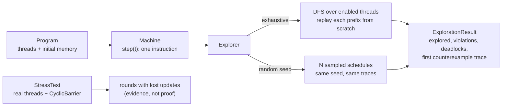

# Testing Concurrent Code: Stress, Model Checking, and Determinism

> Make the scheduler your test input.

**Type:** Build
**Languages:** Java
**Prerequisites:** Phase 4, Lesson 02 (Locks, Atomics, and a Balance That Never Lies); Phase 4, Lesson 07 (Deadlocks, Lock Ordering, and Detection); Phase 4, Lesson 01 (Threads and the Memory Model)
**Time:** ~75 minutes

## Learning Objectives

- Explain why a concurrency test that passes is weak evidence, in terms of the number of interleavings and the probability a stress run visits the bad ones
- Build a small machine whose threads execute one instruction at a time under a scheduler the test controls, and model a lost update, a check-then-act overdraft, and a lock-ordering deadlock as programs for it
- Build an exhaustive explorer that enumerates every interleaving by stateless depth-first search and returns the first counterexample trace, and a seeded random explorer for programs too large to enumerate
- Compute the number of interleavings of a program as a multinomial coefficient and state why locks shrink the explored space from hundreds of thousands to two
- Build a barrier-synchronised stress harness and say exactly what a passing run does and does not prove
- Choose between stress, randomised exploration, exhaustive model checking, race detection, and formal specification for a given piece of concurrent payments code

## The Problem

Lesson 01 ended with a team that could not write a failing test for a bug they could reproduce in production. Their counter lost refunds. The test started 32 threads, credited a thousand times each, and asserted the total. It passed on every laptop and every CI run. Then someone added a `volatile`, the test still passed; someone removed the `volatile`, the test still passed; someone replaced the whole method with a `synchronized` block, and the test still passed. A test that returns the same answer for the bug and for the fix is not measuring anything.

The numbers explain why. Two threads each performing `balance += 25` execute three steps apiece: load, add, store. There are twenty ways to interleave six steps, and eighteen of them lose an update. In a model with a fair coin at every step, a single pair of concurrent increments fails ninety percent of the time. On real hardware the window is different: the three steps take a few nanoseconds, the threads are rarely in the window at the same moment, and the operating system's scheduler and the CPU's caches push the threads apart rather than together. A stress test of a million increments sees the collision a handful of times, or not at all, depending on the core count, the JIT's decisions that run, and what else the machine is doing. The bug has not changed; the probability of observing it has, and it is the probability, not the bug, that the test reports.

A second failure is subtler. The team's debit path checks the balance, then decrements it with an `AtomicLong`. Each operation is atomic, the race detector is quiet, and no stress test has ever driven the balance negative, because the window between the check and the decrement is a single instruction wide. In production, with a thousand instances and a promotion that sends paired debits for the same account, the balance goes to -0.50 USD a few dozen times a day. The code has a bug that is essentially unobservable by running it and completely obvious the moment you enumerate its interleavings: the check and the act are separate steps, and any schedule in which both checks precede either act overdraws.

Both problems have the same shape. The scheduler is an input to the program, and the team was letting the hardware pick it at random, then hoping. This lesson takes the input back. It builds a machine where the test chooses which thread steps next, an explorer that tries every choice, and a stress harness that is honest about what it shows. The model checker will find both bugs above in under a millisecond, with a trace you can paste into the bug report.

## The Concept

### Three ways to choose a schedule

| Strategy | Who picks the schedule | What a pass means | What a fail gives you | Cost | Finds |
|----------|------------------------|-------------------|-----------------------|------|-------|
| Stress test | hardware and OS, at random | the bad schedules are rare on this machine today | a failure count, no trace | seconds, real threads | races with wide windows |
| Seeded random exploration | a PRNG you control | N sampled schedules were clean | a reproducible trace from the seed | milliseconds, one thread | most bugs in medium programs |
| Exhaustive exploration | a depth-first search | **every** schedule was clean | the first bad trace | exponential in steps | every schedule-dependent bug in a small model |
| Race detector (`-race`, TSan) | hardware, but every access is instrumented | the schedules that ran had no unsynchronised conflicting access | the two stack traces | 5-10x slowdown | data races, not logic races |
| Formal specification (TLA+) | the model checker, over an abstract spec | the spec's invariant holds in every reachable state | a state trace | hours to write, minutes to check | design bugs before code exists |

The rows are not alternatives; they are layers. A stress test with a barrier is cheap and catches the embarrassing bugs. Random exploration with a seed turns "it failed once in CI" into "run with seed 8812 to see it". Exhaustive exploration of a small model proves the algorithm. The race detector proves the code's synchronisation matches the model. The specification proves the design. This lesson builds the middle three and uses the rest.

### The scheduler as an input

A sequential program maps an input to an output. A concurrent program maps an input **and a schedule** to an output. Testing it with the schedule left implicit is like testing a parser with the input left implicit: you are testing whatever happened to come along. The fix is to make the schedule explicit and controllable, which requires two things. First, the program must be broken into steps between which the schedule may switch. Second, nothing else in the program may introduce nondeterminism, so that the same schedule always gives the same result.

The machine in this lesson does both by construction. A thread is a list of instructions. An instruction is one atomic step: load a shared variable into a register, store a register to a shared variable, add to a register, add to shared memory atomically, lock, unlock, or branch on a register. The machine executes one instruction of one thread per `step(t)` call, on the caller's thread. There are no real threads at all. A schedule is a list of thread indices, and the explorer is just a loop that generates lists.

This is the generalisation of the hook in Lesson 02's `RacyCounter`. There, `betweenLoadAndStore.run()` opened one gap at one place so the test could force one interleaving. Here, every instruction boundary is a gap, and the explorer forces every interleaving.

### Counting interleavings

If thread i has n_i steps and nothing ever blocks, the number of distinct interleavings is the multinomial coefficient:

```text
(n_1 + n_2 + ... + n_k)! / (n_1! * n_2! * ... * n_k!)

2 threads x 3 steps  = 6! / (3! 3!)       = 20
2 threads x 5 steps  = 10! / (5! 5!)      = 252
2 threads x 10 steps = 20! / (10! 10!)    = 184,756
3 threads x 5 steps  = 15! / (5! 5! 5!)   = 756,756
4 threads x 10 steps = 40! / (10!)^4      = about 4.7 x 10^21
```

The last line is why nobody enumerates the schedules of a real service. Three things make exhaustive exploration useful anyway:

1. **Models are small.** You do not check the service; you check the five-instruction core that moves the money, with two or three threads. The last row of the table is a program nobody should write a model of; the first row is the lost update.
2. **Blocking prunes.** A thread whose next instruction is `lock L` while another thread holds `L` is not enabled, so the search never branches on it. The locked increment has 252 interleavings on paper and exactly 2 in practice, because once a thread holds the lock the other thread has nothing to do until it is released. The locked transfer in Lesson 07 drops from 184,756 to 2 for the same reason.
3. **Partial-order reduction and context bounding.** Two steps that touch different variables commute, so schedules that differ only in their order are equivalent and one representative suffices (Flanagan and Godefroid's DPOR). And empirically, almost every real concurrency bug needs only one or two pre-emptions at the right places (Musuvathi and Qadeer's CHESS found that bounding the number of pre-emptions to two caught nearly every bug in their corpus). This lesson implements neither; Exercise 3 asks you to add the second.

### Worked example: the twenty schedules of a lost update

Memory starts with `balance = 10000` (100.00 USD in minor units). Threads T1 and T2 each run `r = load balance; r += 2500; store balance = r`. Write a schedule as the sequence of threads that step. The invariant is `balance == 15000` at the end.

```text
schedule           what happens                                        final balance
T1 T1 T1 T2 T2 T2  T1 completes, then T2 loads the stored 12500         15000  ok
T2 T2 T2 T1 T1 T1  symmetric                                            15000  ok
T1 T1 T2 T1 T2 T2  T2 loads 10000 before T1's store; T2 stores 12500    12500  LOST
T1 T2 T1 T2 T1 T2  both load 10000; whoever stores last writes 12500    12500  LOST
... 16 more ...                                                         12500  LOST
```

A schedule is correct exactly when one thread's `store` precedes the other thread's `load`. Of the twenty schedules only the two sequential ones have that property, so eighteen violate the invariant. The explorer reports `explored = 20, violations = 18` and prints the first bad trace it meets in depth-first order:

```text
T1: r = load balance
T1: r += 2500
T2: r = load balance
T1: store balance = r
T2: r += 2500
T2: store balance = r
```

Read it against Lesson 01's instruction-by-instruction table: it is the same trace, found by search instead of written by hand.

### Deadlock is "nobody is enabled"

A thread is **enabled** when it has an instruction left and that instruction can execute now. Every instruction is always enabled except `lock L` while another thread holds `L`. The machine is **deadlocked** when at least one thread has instructions left and no thread is enabled. For Lesson 07's transfer, `AtoB` locks `A` then `B` while `BtoA` locks `B` then `A`:

```text
AtoB: lock A        A owned by AtoB
BtoA: lock B        B owned by BtoA
enabled(AtoB)? next is lock B, owned by BtoA  -> no
enabled(BtoA)? next is lock A, owned by AtoB  -> no
deadlock after 2 steps
```

Two of the schedules reach this state (the two orders of those first two steps). With both threads locking in alphabetical order the first thread to take `A` runs to completion before the other can start, there are two schedules, and neither deadlocks. The explorer does not know what a deadlock is in any deep sense; it just notices that the search has nowhere to go.



### Determinism is a property you build, not one you get

The explorer's guarantee ("same seed, same traces") holds only because every source of nondeterminism other than the schedule was removed. The same discipline applies to any test of concurrent code, and the usual leaks are predictable:

| Source of nondeterminism | Where it hides | What the lesson does instead |
|--------------------------|----------------|------------------------------|
| Scheduler | every real thread | no real threads in the explorer; the schedule is an explicit list |
| Time | `System.nanoTime`, timeouts, `sleep` | no clock in the model; the stress harness measures nothing time-based |
| Randomness | `new Random()`, `ThreadLocalRandom`, `UUID.randomUUID` | `new Random(seed)` with the seed in the test name and the failure report |
| Iteration order | `HashMap`, `HashSet` over objects with identity hash codes | `LinkedHashMap` for memory snapshots; thread lists are indexed, never hashed |
| Allocation and GC | identity hash codes, finalizers, weak references | none of these appear in the model |
| Environment | core count, CPU frequency scaling, other processes | the stress result is labelled nondeterministic and never asserted on |

A test that leaks any of these can fail without the code being wrong and pass without it being right. When a concurrency test is flaky, the first question is not "which thread won" but "which of these six did we forget to pin".

### What the model checker does not do

- **It checks the model, not the code.** If the model says `AtomicAdd` and the code says `balance -= amount`, the model is wrong and the proof is worthless. The discipline is to write the model by transliterating the real method, one instruction per real step, and to keep the two side by side in review. Tools like Lincheck and jcstress run the real code under a controlled scheduler to close this gap; see Use It.
- **It assumes sequential consistency.** Every `store` is immediately visible to every later `load`. Real hardware and real compilers reorder (Lesson 01), so a program the model calls correct can still fail without proper synchronisation. The model finds **logic races** (check-then-act, lost update, deadlock). The race detector finds **data races** (unsynchronised conflicting access). You need both.
- **It checks safety, not liveness.** "The balance is never negative" is a safety property: a violation is a finite trace. "Every transfer eventually completes" is a liveness property and needs fairness assumptions and a different search. Deadlock is the one liveness-flavoured thing this explorer catches, and only because it manifests as a finite dead end.
- **It does not scale past small models** without the reductions mentioned above. The random explorer is the fallback; its guarantee is statistical.

## Build It

The walkthrough is Java 21. The full implementation is `code/java/Main.java`; the tests are `code/java/MainTest.java`.

### Step 1: The instruction set

```java
sealed interface Instruction permits Load, Store, Add, AtomicAdd, Lock, Unlock, BranchIfLess {}

record Load(String var, String reg) implements Instruction {}          // reg = memory[var]
record Store(String var, String reg) implements Instruction {}         // memory[var] = reg
record Add(String reg, long k) implements Instruction {}               // reg += k
record AtomicAdd(String var, long k) implements Instruction {}         // memory[var] += k, indivisible
record Lock(String lock) implements Instruction {}                     // blocks while held by another thread
record Unlock(String lock) implements Instruction {}
record BranchIfLess(String reg, long k, int target) implements Instruction {}   // if reg < k goto target
```

Seven instructions are enough to model everything in Lessons 02 and 07. `Load`/`Add`/`Store` is a non-atomic read-modify-write: `getfield`, `ladd`, `putfield` from Lesson 01. `AtomicAdd` is `AtomicLong.addAndGet`, Redis `INCRBY`, or `UPDATE ... SET balance = balance - 100`: one step the scheduler cannot split. `Lock`/`Unlock` is a `synchronized` block or `ReentrantLock`. `BranchIfLess` gives the check in check-then-act. The sealed interface means the `switch` in the machine is exhaustive and the compiler tells you when you add an instruction and forget to execute it.

**Predict:** which of these seven can ever make a thread *not enabled*?

### Step 2: The machine

```java
boolean enabled(int t) {
    if (finished(t)) return false;
    Instruction next = program.threads().get(t).code().get(pc[t]);
    if (next instanceof Lock l) {
        Integer owner = lockOwner.get(l.lock());
        return owner == null || owner == t;
    }
    return true;
}

boolean deadlocked() { return !allFinished() && enabledThreads().isEmpty(); }

void step(int t) {
    if (!enabled(t)) throw new IllegalStateException("thread " + t + " is not enabled");
    Instruction ins = spec.code().get(pc[t]);
    int next = pc[t] + 1;
    switch (ins) {
        case Load l -> regs.put(l.reg(), memory.getOrDefault(l.var(), 0L));
        case Store s -> memory.put(s.var(), regs.getOrDefault(s.reg(), 0L));
        case Add a -> regs.put(a.reg(), Math.addExact(regs.getOrDefault(a.reg(), 0L), a.k()));
        case AtomicAdd a -> memory.put(a.var(), Math.addExact(memory.getOrDefault(a.var(), 0L), a.k()));
        case Lock l -> lockOwner.put(l.lock(), t);
        case Unlock u -> { /* must be the owner */ lockOwner.remove(u.lock()); }
        case BranchIfLess b -> { if (regs.getOrDefault(b.reg(), 0L) < b.k()) next = b.target(); }
    }
    pc[t] = next;
    trace.add(new TraceStep(spec.name(), ins));
}
```

The machine holds shared memory, one program counter and one register file per thread, lock ownership, and the trace of what ran. `step` executes exactly one instruction of one thread on the caller's thread. That single fact is what makes everything downstream deterministic: there is no second thread anywhere in the explorer, so there is nothing to race with, so the same schedule produces the same memory every time. A `Lock` held by the stepping thread itself is enabled (reentrancy), and an `Unlock` by a non-owner is an error, because in the real code it would be an `IllegalMonitorStateException`.

**Predict:** after `step(0)` on the unordered transfer program followed by `step(1)`, what does `enabledThreads()` return?

### Step 3: Exhaustive exploration by replay

```java
private void dfs(Program program, Invariant invariant, List<Integer> prefix) {
    Machine m = replay(program, prefix);
    if (m.allFinished() || m.deadlocked()) {
        record(m, invariant);
        return;
    }
    for (int t : m.enabledThreads()) {
        prefix.add(t);
        dfs(program, invariant, prefix);
        prefix.remove(prefix.size() - 1);
    }
}

private static Machine replay(Program program, List<Integer> schedule) {
    Machine m = new Machine(program);
    for (int t : schedule) m.step(t);
    return m;
}
```

This is **stateless** model checking, the VeriSoft approach: the search keeps only the current schedule prefix and re-executes the program from the initial state to reach the node it wants, instead of snapshotting and restoring machine state at every branch. It costs a factor of the trace length in time and buys a search that needs no copyable state and no hash of visited states. For a twenty-schedule program the whole exploration is a few hundred instruction executions.

`record` evaluates the invariant on the final memory, counts violations and deadlocks, and keeps the first bad trace. Depth-first order means the first counterexample is the one that switches threads as late as possible, which tends to be the shortest explanation.

**Predict:** the DFS visits enabled threads in index order. For the racy increment, what is the very first complete schedule it records, and does it violate the invariant?

### Step 4: Seeded random exploration

```java
static ExplorationResult random(Program program, Invariant invariant, long seed, int schedules) {
    Explorer e = new Explorer();
    Random rng = new Random(seed);
    for (int i = 0; i < schedules; i++) {
        Machine m = new Machine(program);
        while (!m.allFinished() && !m.deadlocked()) {
            List<Integer> choices = m.enabledThreads();
            m.step(choices.get(rng.nextInt(choices.size())));
        }
        e.record(m, invariant);
    }
    return e.result();
}
```

When the multinomial is too large, sample. The generator is seeded, so a failure in CI is reported as "seed 42, schedule 17" and reproduced locally by running the same call. The demo runs a thousand random schedules of the racy increment with seed 42 and finds 735 violations; running it again with the same seed finds the same 735 with the same first trace, and the test asserts the two `ExplorationResult`s are equal. This is the property stress tests lack and the reason a seeded explorer belongs in CI while a stress test belongs in a nightly job.

Note that a uniform choice among enabled threads at each step is **not** a uniform choice among schedules: schedules that keep one thread running are weighted differently from schedules that alternate. For bug-finding that is fine; for estimating a failure probability it is not, which is another reason not to read the violation count as "the bug fires 73.5 percent of the time".

### Step 5: The programs

```java
static Program checkThenActDebit(long initial, long debit) {
    List<Instruction> body = List.of(
            new Load("balance", "r"),              // 0: check...
            new BranchIfLess("r", debit, 3),       // 1: insufficient -> skip to end
            new AtomicAdd("balance", -debit));     // 2: ...then act, atomically but too late
    return new Program(Map.of("balance", initial), List.of(new ThreadSpec("D1", body), new ThreadSpec("D2", body)));
}
```

Each program in `Programs` is a transliteration of a class from an earlier lesson. `racyIncrement` is `RacyCounter.add`. `lockedIncrement` is `LockedCounter.add`. `checkThenActDebit` is the debit that Lesson 02 said a bare atomic cannot make safe, and the explorer agrees: from 1.50 USD, two 1.00 USD debits overdraw in eighteen of twenty schedules even though the subtraction itself is atomic, because any schedule in which both loads precede either `AtomicAdd` passes both checks. `transferUnordered` and `transferOrdered` are Lesson 07's deadlock and its fix, with the invariant that `a + b` is conserved.

Invariants are named predicates over final memory: `balance == 15000`, `balance >= 0`, `a + b == 200`. The name is printed with the counterexample so the bug report says what was violated, not just that something was.

**Predict:** with `initial = 250` and `debit = 100`, how many of the twenty schedules of `checkThenActDebit` overdraw?

### Step 6: A stress harness that tells the truth

```java
for (int r = 0; r < rounds; r++) {
    BalanceCounter counter = factory.get();
    CyclicBarrier barrier = new CyclicBarrier(threads);
    Thread[] ts = new Thread[threads];
    for (int i = 0; i < threads; i++) {
        ts[i] = new Thread(() -> {
            try { barrier.await(); } catch (InterruptedException | BrokenBarrierException e) { return; }
            for (int k = 0; k < opsPerThread; k++) counter.add(delta);
        });
        ts[i].start();
    }
    for (Thread t : ts) t.join();
    long lost = expected - counter.get();
    if (lost != 0) { badRounds++; totalLost += lost; }
}
```

The barrier is the one technique that materially improves a stress test: without it, thread 1 has often finished its twenty thousand increments before thread 4 has been scheduled for the first time, and the "concurrent" test ran sequentially. With it, all four threads leave the gate on the same tick and collide for the whole run. Multiple rounds with a fresh counter each round catch the cases where the JIT's first compilation happened to serialise things.

What the result means: for `LockedCounter`, zero bad rounds is a necessary condition for correctness and the test asserts it. For `RacyCounter`, the test asserts only that the harness never reports a *gain* and that it ran every round; it does not assert that updates were lost, because on a single-core container they may not be, and a test that fails depending on the machine it runs on is the flaky test every team learns to ignore. The demo prints the racy count with the label "nondeterministic" for exactly this reason.

**Predict:** on a machine with one CPU core, would you expect the racy stress test to lose updates more often, less often, or about the same as on eight cores? Why?

### Step 7: Run it

```bash
cd phases/04-concurrency/12-testing-concurrent-code/code/java
javac -d .out *.java && java -cp .out Main
java -cp .out MainTest
```

Expected output, abbreviated:

```console
== Exhaustive: balance += 25.00 USD twice, from 100.00 USD (minor units) ==
-- racy load/add/store --
interleavings (upper bound) = 20, explored = 20, violations = 18, deadlocks = 0
first counterexample, final memory {balance=12500}:
    T1: r = load balance
    T1: r += 2500
    T2: r = load balance
    T1: store balance = r
    T2: r += 2500
    T2: store balance = r
-- same increment under a lock --
interleavings (upper bound) = 252, explored = 2, violations = 0, deadlocks = 0

== Exhaustive: two 1.00 USD debits from 1.50 USD, each checks first ==
-- check-then-act debit --
interleavings (upper bound) = 20, explored = 20, violations = 18, deadlocks = 0
first counterexample, final memory {balance=-50}:
    ...

== Exhaustive: transfer A->B while B->A ==
-- locks taken source-then-destination --
interleavings (upper bound) = 184756, explored = 6, violations = 0, deadlocks = 2
first counterexample, final memory {a=100, b=100}:
    AtoB: lock A
    BtoA: lock B
-- locks taken in a global order --
interleavings (upper bound) = 184756, explored = 2, violations = 0, deadlocks = 0

== Random schedules (seed 42): same bug, sampled instead of enumerated ==
1000 random schedules of the racy program: violations = 735
same seed again: violations = 735 (identical: true)
```

The stress section follows and its first line varies between runs; that variation is the point of the lesson.

### Porting notes

- **Go**: the machine and explorer port directly (a `sync.Mutex` is not needed anywhere in them, because they are single-threaded). The stress harness uses a `sync.WaitGroup` plus a `chan struct{}` closed as the starting gun in place of `CyclicBarrier`, and the tests must pass under `go test -race ./...`; the race detector will flag `RacyCounter` in the stress test, which is correct and is why the Go port keeps the racy stress test in the demo but out of `go test`. Go also has `runtime.Gosched()` for hand-placed yield points and `GOMAXPROCS=1` for the single-core experiment in Step 6.
- **Python**: the model is pure data and ports unchanged. For stress, `threading.Barrier` replaces `CyclicBarrier`, and `sys.setswitchinterval(1e-6)` makes the GIL hand off far more often, which widens the race window dramatically (Lesson 10). With free-threaded CPython the racy counter loses updates without that trick.
- Registers and memory stay `int`/`int64`; `Math.addExact` becomes Python's unbounded `int` and a hand-written checked add in Go.

## Use It

### `jcstress` and Lincheck (JVM)

`jcstress` (OpenJDK Code Tools) runs the real code, not a model: a test declares actor methods and the expected set of outcomes, and the harness runs the actors on real threads millions of times with carefully arranged timing, then reports a histogram of observed results and flags any outcome you did not declare acceptable. It is the tool the JDK itself uses for `java.util.concurrent`. **Lincheck** (JetBrains) goes further: it runs real Java or Kotlin classes under a controlled scheduler that inserts switch points at every shared access and explores interleavings, then checks the results against a sequential specification (linearizability). It is, roughly, this lesson's explorer applied to bytecode instead of to a seven-instruction model, which closes the model-versus-code gap at the cost of needing a JVM agent.

### Go's race detector

`go test -race` instruments every memory access and reports two unsynchronised conflicting accesses with both stack traces. It finds data races in the schedules that happened to run, which is why the usual advice is to run it under stress. It cannot find the check-then-act overdraft, because every access there is properly synchronised; that is a logic race and needs the explorer.

### Loom, CHESS, and TLA+

Rust's `loom` runs real `std::sync`-shaped code under a model checker with DPOR and bounded pre-emptions; Microsoft's CHESS did the same for Win32 and .NET and is where the "two pre-emptions find nearly every bug" observation comes from. **TLA+** with the TLC model checker works at the level of the design rather than the code: you write the transfer protocol as a state machine, state the invariant, and TLC explores every reachable state. Teams at AWS used it on S3 and DynamoDB and reported finding bugs that would have needed 35-step traces to reproduce.

### Jepsen and the database

Jepsen tests real distributed databases by generating concurrent operations, injecting partitions, and checking the history against a consistency model. It is the stress-plus-checker approach at the system level, and it is where the Phase 7 transaction lessons pick up this thread. For a payments team the practical version is a nightly job that replays a day of transfers against a staging ledger under `SELECT ... FOR UPDATE` and asserts conservation (Phase 10, Lesson 03).

### What not to do

Retrying a flaky concurrency test until it passes (`@RepeatedTest`, `retries: 3` in CI) is a decision to ship the bug. Sleeping to "let the other thread catch up" is a schedule you chose by accident. Both are symptoms of a test that lacks a controllable scheduler.

## Ship It

`outputs/checklist-concurrency-test-plan.md` is the test plan to attach to any pull request that touches shared mutable state: which of the five layers the change needs, how to write the model, how to make the stress test honest, and what to record when a test fails.

## Exercises

1. **Reinforce.** Add a `CompareAndSwap(var, reg, newReg)` instruction and model Lesson 02's `AtomicCounter` retry loop (load, add, CAS, branch back on failure). Show with the explorer that it is correct for two threads, and count how many schedules it explores compared with the lock.
2. **Apply.** Model Lesson 02's `StripedAccountMap.transfer` with two accounts in different stripes and two in the same stripe. Find, with the explorer, whether a transfer and a `totalBalance()` sum that reads both stripes without a global lock can observe money in flight, and decide whether that is a bug or an accepted read anomaly.
3. **Extend.** Implement pre-emption bounding: an exhaustive search that only explores schedules with at most *k* pre-emptions (a switch away from a thread that is still enabled). Measure, for the racy increment and the unordered transfer, the smallest *k* that still finds each bug, and the number of schedules explored at *k* = 0, 1, 2 versus the unbounded search. Connect the result to the CHESS paper's claim.

## Key Terms

| Term | What people say | What it actually means |
|------|-----------------|------------------------|
| Interleaving | "a race" | One total order of the steps of several threads; the number of interleavings of a program is a multinomial coefficient in the step counts |
| Stateless model checking | "trying every order" | A depth-first search over scheduling choices that re-executes the program from the initial state for each prefix instead of saving and restoring state |
| Enabled thread | "a runnable thread" | A thread whose next instruction can execute now; a thread waiting on a lock another thread holds is not enabled |
| Deadlock (in the model) | "it hangs" | At least one thread has instructions left and no thread is enabled; detected as a dead end in the search |
| Counterexample | "the repro" | A complete schedule, with the final memory, that violates the invariant or deadlocks; the artefact a test should produce when it fails |
| Partial-order reduction | "skipping equivalent schedules" | Treating schedules that differ only in the order of commuting steps (different variables, no lock) as one, which shrinks the search exponentially |
| Pre-emption bound | "most bugs need only one or two context switches" | Exploring only schedules with at most k switches away from an enabled thread; CHESS found k = 2 catches nearly every real bug |
| Stress test | "hammer it with threads" | Real threads, often barrier-released, run many times; a failure is evidence of a bug, a pass is evidence of nothing beyond that machine on that day |

## Further Reading

- [Godefroid, "Model Checking for Programming Languages using VeriSoft" (POPL 1997)](https://dl.acm.org/doi/10.1145/263699.263717) — the origin of stateless model checking; Step 3 is a thirty-line version of its core loop.
- [Musuvathi, Qadeer, Ball, Basler, Nainar, Neamtiu, "Finding and Reproducing Heisenbugs in Concurrent Programs" (OSDI 2008)](https://www.usenix.org/legacy/event/osdi08/tech/full_papers/musuvathi/musuvathi.pdf) — CHESS: a controlled scheduler for real programs, pre-emption bounding, and the data on how few pre-emptions real bugs need.
- [Flanagan and Godefroid, "Dynamic Partial-Order Reduction for Model Checking Software" (POPL 2005)](https://dl.acm.org/doi/10.1145/1040305.1040315) — the algorithm that makes exhaustive exploration feasible for more than toy programs.
- [jcstress: the Java Concurrency Stress tests](https://github.com/openjdk/jcstress) — the JDK's own harness; read the "Basics" samples to see how a test declares acceptable and forbidden outcomes.
- [Lincheck documentation](https://github.com/JetBrains/lincheck) — model checking of real JVM classes against a sequential specification, with the switch-point and linearizability concepts this lesson's model omits.
- [Newcombe et al., "How Amazon Web Services Uses Formal Methods" (CACM 2015)](https://cacm.acm.org/research/how-amazon-web-services-uses-formal-methods/) — TLA+ on S3 and DynamoDB, and why the engineers found it worth the time.
- [Go Data Race Detector](https://go.dev/doc/articles/race_detector) — what `-race` instruments, what it reports, and the overhead to budget for.
