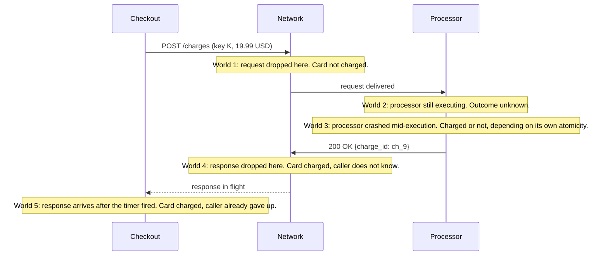
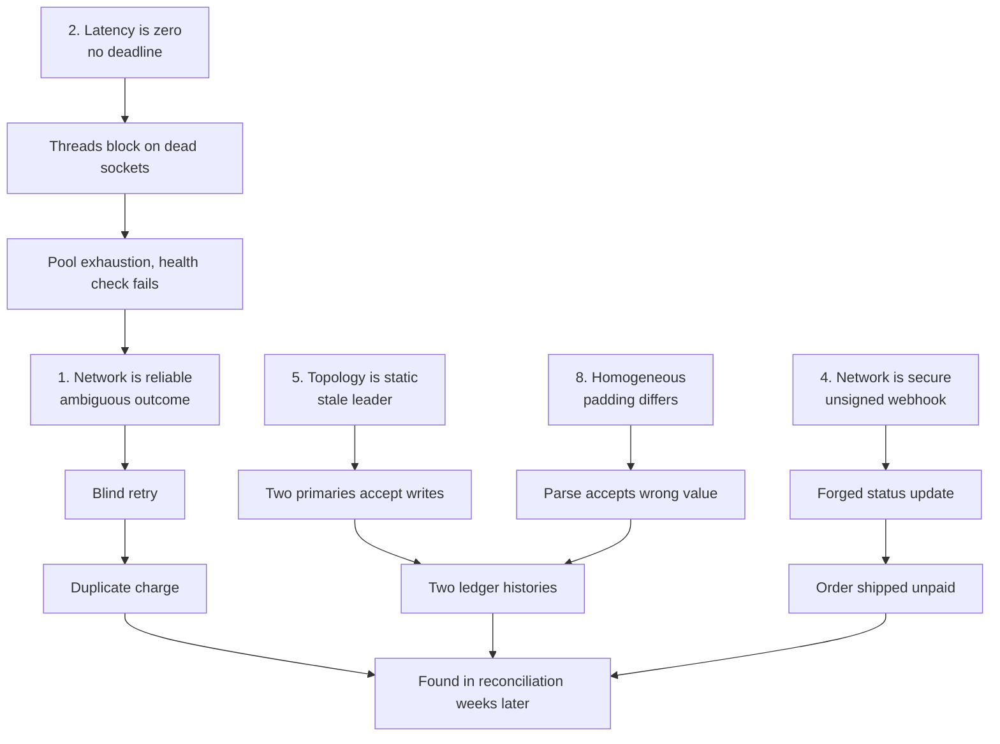

# The Fallacies of Distributed Computing

> Eight assumptions that have each caused a payments outage.

**Type:** Learn
**Languages:** —
**Prerequisites:** Phase 4, Lesson 01 (Threads and the Memory Model)
**Time:** ~45 minutes

## Learning Objectives

- Name the eight fallacies and, for each one, describe the specific payments incident shape it produces
- Distinguish a fallacy from a merely wrong assumption: a fallacy is something the code is *structurally* unable to detect from inside one process
- Map every fallacy to the mitigation pattern that neutralises it and to the lesson in this course that builds that pattern
- Read a design document or a pull request and identify which fallacy it silently relies on
- Run a pre-mortem on a service that calls a payment processor and produce a ranked list of the assumptions most likely to fail first

## The Problem

A checkout service calls a card processor over HTTPS. The code is three lines: build the request, `POST /charges`, parse the response. It has a unit test with a mocked processor and a 99.99% success rate in staging. On a Tuesday in November the processor's load balancer begins dropping about one connection in two hundred after the TLS handshake completes but before the response is written. From the checkout service's point of view each dropped call is a socket read that never returns. The HTTP client's default read timeout is infinite, so a request thread blocks forever. The service has 200 worker threads. Within eleven minutes every thread is parked on a dead socket, the health check (which runs on the same pool) stops answering, the orchestrator restarts the instance, the restarted instance repeats the pattern, and checkout is down worldwide for a 0.5% network fault at one vendor.

Meanwhile, a retry layer added two quarters earlier is doing exactly what it was told. The 0.5% of calls that did time out (the ones that happened to run before the pool was exhausted) were retried, and the processor, which had in fact received and executed most of them, charged those cards twice. The retry layer did not send an idempotency key because the processor's key header was documented as "optional" and nobody read far enough to see that it was the only thing that made a retry safe. Finance finds out from chargebacks six weeks later.

Nothing in that story is exotic. The processor never went down. No code had a bug in the sense of a wrong branch or an off-by-one. Every component did what it was designed to do. The outage came from assumptions that were never written anywhere because they were never consciously made: that a request either succeeds or fails, that a response arrives, that "the processor received it" and "we got a 200" are the same event. These are the fallacies of distributed computing, first listed by Peter Deutsch at Sun in 1994 and extended by James Gosling to eight in 1997. They are called fallacies rather than mistakes because a program running on one machine cannot detect any of them from the inside. Every one of them is true of a function call and false of a network call, and the code for the two looks identical.

This lesson walks through the eight. For each one you get the assumption, the specific way it breaks a payment system, the pattern that fixes it, and the lesson in this course that builds that pattern. The rest of Phase 5 is, in effect, the engineering response to this list.

## The Concept

### What makes an assumption a fallacy

A local function call has four properties that a programmer never thinks about: it completes (or the whole process dies with it), it completes in a time bounded by the CPU, its arguments arrive intact, and the caller learns the outcome. A remote call has none of these, and the caller has no way to tell which one failed. When `charge()` has not returned after five seconds, the possible worlds are: the request never left the host; it left and was dropped; it arrived and is being processed; it was processed and the response was dropped; it was processed and the response is in flight. From inside the calling process these are indistinguishable. That is the whole problem, and every fallacy below is a specific way of pretending otherwise.

The fallacies are not independent. The first (the network is reliable) and the eighth (the network is homogeneous) frame the other six. In a payment system the first fallacy alone accounts for most of the money-losing incidents, because its consequence, the ambiguous outcome, is exactly the condition under which a retry creates a duplicate charge.

### The ambiguous outcome, drawn

The five possible worlds behind one timeout deserve a picture, because every later lesson in this phase is a response to one of the branches. The caller sends `POST /charges` and starts a timer. At the moment the timer fires it is in exactly one of these worlds and cannot tell which.



Worlds 1 and 2 are the ones a retry is designed for. Worlds 4 and 5 are the ones a retry double-charges. World 3 depends on the processor's own transaction boundary, which you cannot see. A correct client does not try to figure out which world it is in; it makes the retry harmless in all five. That is the design pressure that produces idempotency keys (Lesson 09): with key `K` attached, worlds 1 and 2 execute the charge once and worlds 4 and 5 return the stored response for `K` without executing again. The client's retry loop becomes correct without knowing anything about the network.

Count how much of the incident in The Problem is explained by this one diagram: the duplicate charges (worlds 4 and 5, retried blindly), the under-recorded charges (world 4, not retried), and the exhausted thread pool (the caller never started the timer at all, so it was stuck in world 2 forever).

### The eight fallacies

| # | Fallacy | What a payments engineer assumes without noticing | Incident shape | Mitigation pattern | Lesson |
|---|---------|---------------------------------------------------|----------------|--------------------|--------|
| 1 | The network is reliable | A `POST /charges` either succeeds or throws | Duplicate charges after a retry; or a lost capture that was "sent" | Idempotency keys; at-least-once delivery plus deduplication; outbox | 5/09, 7/13, 8/03 |
| 2 | Latency is zero | A call to the ledger is as cheap as a method call, so make three of them per request | p99 checkout time triples when the ledger moves to another region; chained calls amplify tail latency | Deadlines and deadline propagation; batching; async with explicit state | 5/08, 8/09 |
| 3 | Bandwidth is infinite | Send the full cart and customer object on every call; replicate every ledger posting to every region | Settlement-file transfer saturates a link and delays the batch; replication lag grows under load | Pagination; compact serialization; backpressure; partitioning | 3/15, 8/09, 7/01 |
| 4 | The network is secure | Internal services trust each other; the webhook came from the processor because it hit our URL | Forged webhook marks an unpaid order as paid; replayed authorization | mTLS or signed requests; HMAC webhook signatures with timestamps; replay windows | 12/05, 11/05 |
| 5 | Topology does not change | The processor's IP, the database primary, and the number of partitions are fixed | Hard-coded IP breaks after a vendor migration; writes go to a demoted primary (split brain) | Service discovery; leases and fencing tokens; consistent hashing | 5/12, 3/06, 6/05 |
| 6 | There is one administrator | Someone can see the whole system and will notice when it is wrong | A certificate expires on a partner's side and nobody owns the alert; a scheme changes a mandatory field and the first notice is a rejected file | Contracts and versioned schemas; monitoring at every boundary; runbooks for partner-side failures | 8/11, 9/01, 9/12 |
| 7 | Transport cost is zero | Serialization and connection setup are free | A new TLS handshake per processor call adds 60 ms and burns CPU; JSON re-encoding of a 50 MB statement file doubles memory | Connection pooling and keep-alive; binary framing; streaming parsers | 5/07, 3/15 |
| 8 | The network is homogeneous | Every participant speaks the same protocol with the same semantics | An ISO 8583 field that one acquirer pads with spaces and another with zeros; a timestamp in local time from a bank in another zone | Explicit wire formats; canonicalization at the boundary; adapter per participant | 11/03, 11/09, 12/10 |

The lesson numbers are `phase/lesson` within this course. The next sections take each row in turn and give it the detail the table cannot.

### Fallacy 1: the network is reliable

This is the fallacy that costs money. Packets are dropped, connections are reset, load balancers time out idle streams, a deploy restarts the receiving process between reading your request and writing the response. The rate is low, typically well under one percent on a healthy network, which is exactly why it is dangerous: a 0.1% ambiguous-outcome rate on ten million charges a day is ten thousand charges a day whose state you do not know.

The incident shape has two halves. If you retry blindly, some fraction of the retried operations were already executed, and you double-charge. If you do not retry, some fraction of the operations you believe failed actually succeeded, and you under-record: the customer was charged, your ledger says they were not, and the order is never fulfilled. Both halves show up weeks later in reconciliation (Phase 10, Lesson 08) as unexplained differences between your records and the processor's.

The mitigation is to make the operation safe to repeat, so that the response to ambiguity is always "retry", never "guess". An idempotency key (Lesson 09) turns `charge(card, 19.99)` into `charge(key=K, card, 19.99)` where a second request with the same `K` returns the stored result of the first without executing again. The transactional outbox (Phase 7, Lesson 13) makes sure that the intent to call the processor is durably recorded in the same transaction as the business state, so a crash between the two cannot lose the call. Delivery guarantees (Phase 8, Lesson 03) are the same idea applied to messages: the network can only ever give you at-least-once, and exactly-once is something the receiver constructs with deduplication.

### Fallacy 2: latency is zero

A method call takes nanoseconds. A call to another process on the same host takes tens of microseconds. A call across a data centre takes about half a millisecond. A call across the continental United States takes about 40 ms round trip and across the Atlantic about 80 ms, because light in fibre travels about 200 km per millisecond and the fibre does not run in a straight line. Nothing you do in software changes this.

The incident shape is tail amplification. A checkout that makes one call to the ledger, one to the risk service, and one to the processor, each with a p99 of 50 ms, has a p99 well above 50 ms for the whole request, because the probability that at least one of three independent calls lands in its slow tail is about 3%, not 1%. Make the three calls sequential and the typical case adds their latencies too. Move one dependency to another region and the floor rises by 40 ms on every request.

The pattern is to make time a first-class argument. Every call carries a deadline, the deadline is propagated downstream so a callee never works past the point where the caller has given up (Lesson 08), and the latency budget is split explicitly across hops. Where latency cannot be hidden, the design changes shape: the response says "accepted, pending" and the result arrives through a webhook or an event (Phase 12, Lesson 05), which is why real payment APIs have `pending` states at all.

### Fallacy 3: bandwidth is infinite

Bandwidth has grown faster than latency has shrunk, which makes this the fallacy people most often argue is obsolete. It is not, for two reasons. First, bandwidth is shared: a nightly settlement file transfer, a log shipper, and a database replication stream all compete for the same link, and the one that matters most is rarely the one that wins. Second, the cost of bandwidth is paid again at every hop, in serialization CPU, memory, and garbage collection.

The payments incident shape is a batch that does not finish in its window. A settlement file (Phase 11, Lesson 15) that grew 30% over a year now takes longer to transfer than the cut-off allows, and a day's settlements slip to the next day. The replication variant is more dangerous: under a burst of writes, a replica falls behind, a read served from it returns a stale balance, and a payout is approved against funds that have already left (Phase 6, Lesson 02).

The patterns are to send less (compact encodings, Phase 3, Lesson 15), to send it in pieces the receiver can accept (pagination; backpressure, Phase 8, Lesson 09), and to split the data so no single link carries all of it (partitioning, Phase 7, Lesson 01).

### Fallacy 4: the network is secure

Code written for a trusted network trusts whatever arrives. Internal service-to-service calls carry no authentication because "the firewall handles it". A webhook endpoint accepts any JSON body that parses, because only the processor knows the URL.

The incident shape is a forged or replayed message that moves state. An attacker who learns the webhook URL (it is in the browser's network tab if the frontend calls it, or in a leaked log) posts `{"charge_id": "ch_123", "status": "succeeded"}` and the order ships without payment. A replayed authorization message re-executes a legitimate charge. An internal service that was compromised through an unrelated dependency can call the ledger directly.

The patterns are cryptographic and specific. Webhooks carry an HMAC signature over the body and a timestamp, and the receiver verifies the signature with a shared secret and rejects anything older than a short window (Phase 12, Lesson 05). Service calls use mutual TLS or signed tokens with a short lifetime. Card data never enters most of the system at all because it is tokenized at the edge (Phase 11, Lesson 05). The general rule: the network tells you where a message came from physically, not who sent it.

### Fallacy 5: topology does not change

Hosts move, IPs are reassigned, a database primary fails over to a replica, a cluster is resized, a vendor migrates to a new load balancer. Code that caches an address, or that was deployed with an address in its configuration, keeps using it.

There are two incident shapes. The benign one is a hard failure: the processor's old IP stops answering after their migration, and the service that resolved DNS once at startup cannot reach it until it restarts. The dangerous one is a stale leader. A database primary is partitioned from the cluster, a replica is promoted, and a client that still holds a connection to the old primary keeps writing to it. Both nodes accept writes; the ledger now has two histories. This is split brain, and it is the reason a lock or a lease with a timeout is unsafe without a fencing token (Lesson 12): the old holder must be unable to act after its lease has expired, which requires the resource to check a monotonically increasing token, not the holder to promise it will stop.

The patterns are service discovery with health checks, re-resolution on failure, leases with fencing (Lesson 12), consistent hashing so that a topology change moves a bounded fraction of keys (Phase 3, Lesson 06), and leader election with terms that make the old leader's writes rejectable (Phase 6, Lesson 05).

### Fallacy 6: there is one administrator

In a single-process program one person can read all the code and all the configuration. In a payment system the participants include your team, your cloud provider, the processor, the card scheme, the issuing bank, and the merchant's own IT department, and no one person has visibility into more than one of them.

The incident shape is a change nobody told you about. A partner rotates a TLS certificate and the new chain is not in your trust store. A scheme makes a previously optional ISO 20022 field mandatory with six months' notice sent to an address nobody monitors. A processor changes a response code's meaning. The first symptom is a rising rejection rate, and the first explanation anyone finds is in a PDF.

The patterns are organisational as much as technical: versioned, published contracts (Phase 8, Lesson 11 on schema evolution); monitoring that treats every external boundary as a thing that can fail independently (Phase 9, Lesson 01); and runbooks that assume the fault is on the other side of a boundary you cannot inspect (Phase 9, Lesson 12).

### Fallacy 7: transport cost is zero

Moving data costs CPU for serialization, memory for buffers, and time for connection setup. A TLS 1.3 handshake is one round trip plus asymmetric cryptography; at 40 ms round-trip that is 40 ms and some milliseconds of CPU on every new connection. JSON encoding of a large object allocates a string the size of the output and may allocate several intermediates.

The incident shape is a cost that was invisible at low volume. A service that opens a new HTTPS connection per processor call works in staging and spends 40% of its CPU on handshakes at peak. A statement importer that reads a 50 MB file into a string, parses it into objects, and re-serializes it to JSON for the next service uses 400 MB of heap and triggers a GC pause during the morning batch.

The patterns are connection pooling and keep-alive, binary or length-prefixed framing that can be parsed without copying (Lesson 07), and streaming parsers that never hold the whole payload (Phase 3, Lesson 15).

### Fallacy 8: the network is homogeneous

Every participant runs different software, different versions, and often different interpretations of the same specification. Payments is the extreme case: a card transaction passes through a merchant plugin, a gateway, an acquirer, a scheme network, and an issuer, written by five organisations over three decades in at least four languages.

The incident shape is a semantic mismatch that parses successfully. Two acquirers both send ISO 8583 (Phase 11, Lesson 03); one pads an amount field with leading zeros and the other with spaces, and an integer parser accepts one and rejects the other. A bank sends statement timestamps in local time without an offset (Phase 11, Lesson 14). One processor returns `amount` as an integer in minor units and another as a decimal string, and a client that calls both multiplies one by 100.

The pattern is to refuse to let the heterogeneity past the boundary. Every external format is parsed into one canonical internal representation by an adapter specific to that participant (Phase 12, Lesson 10), and the canonical form is strict: amounts are integer minor units with a currency (Phase 10, Lesson 01), timestamps are UTC with an offset, identifiers are typed. Anything that does not canonicalize is rejected at the edge with a message that names the participant.

### The fallacies as a dependency graph

The fallacies compound. The diagram shows how an incident typically chains from one assumption to the next; the first fallacy sits at the root because an unreliable network is what turns every other weakness into an ambiguous outcome.



### Decision table: from symptom to fallacy

In an incident you do not start from the fallacy; you start from a symptom. This table runs the other direction. Read the first column, find the row, and the last two columns give the first question to ask and the counter-measure that usually ends the incident class.

| Symptom you observe | Fallacy most likely behind it | First question to ask | Counter-measure |
|---------------------|-------------------------------|-----------------------|-----------------|
| Same customer charged twice; both charges have different `charge_id`s | 1, network is reliable | Did the client send the same idempotency key on the retry? | Idempotency key generated before the first attempt, stored with the request, reused on every retry (5/09) |
| Processor says a charge succeeded; our ledger has no record of it | 1, network is reliable | Did we treat a timeout as a failure and move on? | Reconcile ambiguous outcomes with a status query or the processor's report; never record "failed" on a timeout (10/08) |
| Request thread count climbs until the service stops answering health checks | 2, latency is zero | Is there a read timeout, and is it shorter than the caller's deadline? | Bounded timeout per hop; deadline propagated from the edge (5/08); separate pool for health checks |
| p99 checkout time doubles after a dependency moves region | 2, latency is zero | How many sequential network hops are on the critical path? | Parallelise independent calls; collapse chained calls; move to accepted-then-webhook (12/05) |
| Nightly batch misses its cut-off though the code did not change | 3, bandwidth is infinite | What else shares the link at that hour, and how fast did the file grow? | Compress and stream (3/15); schedule against the window; alert on transfer duration trend |
| Order marked paid with no matching charge at the processor | 4, network is secure | Was the webhook signature verified, and is the timestamp within the replay window? | HMAC over body plus timestamp, constant-time compare, short replay window (12/05) |
| Every call to a partner fails after their maintenance; a restart fixes it | 5, topology changes | Where is the address cached, and for how long? | Honour DNS TTL; re-resolve on connect failure; health-checked discovery |
| Two nodes both accepted writes for the same account during a failover | 5, topology changes | What did the old primary check before writing? | Fencing token checked by the resource on every write (5/12); leader terms (6/05) |
| Decline rate for one processor shifts with no deploy on our side | 6, one administrator | What changed on their side, and would we have been told? | Per-partner monitoring with change-rate alerts (9/01); contract versioning (8/11) |
| CPU is high but request count is flat; profile shows TLS and JSON | 7, transport cost is zero | How many connections per second are we opening, and how many bytes do we re-encode? | Connection pool with keep-alive; length-prefixed framing (5/07); streaming parsers |
| A field parses successfully from one partner and wrongly from another | 8, network is homogeneous | Which exact bytes did each partner send, and what did we assume about them? | One adapter per participant; canonical internal types; reject what does not canonicalize (12/10) |

Two rows share a fallacy more than once because a fallacy is an assumption and an assumption can fail in more than one way. The table is a diagnostic aid, not a proof: an incident with two symptoms usually has two fallacies behind it, and the dependency graph above shows which pairs travel together.

### Reading a pull request for fallacies

The fallacies hide in defaults, not in logic. This is the processor client from The Problem, reduced to its shape; the comments mark where each assumption lives.

```java
HttpClient client = HttpClient.newHttpClient();          // F2: no connect timeout; F7: pool defaults unexamined
String host = InetAddress.getByName("api.processor.example").getHostAddress(); // F5: resolved once, cached forever

ChargeResponse charge(ChargeRequest req) throws IOException, InterruptedException {
    HttpRequest http = HttpRequest.newBuilder(URI.create("https://" + host + "/charges"))
            .POST(BodyPublishers.ofString(toJson(req)))        // F1: no Idempotency-Key header
            .build();                                           // F2: no per-request timeout()
    for (int attempt = 0; attempt < 3; attempt++) {             // F1: retry without a key = duplicate
        try {
            HttpResponse<String> res = client.send(http, BodyHandlers.ofString());
            return fromJson(res.body());                        // F8: assumes amount is minor units
        } catch (IOException e) { /* retry */ }                 // F1: a timeout is treated as "did not happen"
    }
    throw new IOException("processor unavailable");
}
```

A reviewer who knows the list reads this in under a minute and asks five questions: where is the timeout, where is the key, what happens to the key on retry, when is the host re-resolved, and what does the response parser assume about `amount`. None of these is a bug in the sense of a wrong branch. All of them are decisions that were made by omission.

The corrected shape is in Lesson 09 (the key and its store) and Lesson 08 (the deadline), but the diff is small enough to show the direction here:

```java
HttpClient client = HttpClient.newBuilder().connectTimeout(Duration.ofSeconds(2)).build();

ChargeResponse charge(ChargeRequest req, String idempotencyKey, Deadline deadline) throws IOException, InterruptedException {
    HttpRequest http = HttpRequest.newBuilder(URI.create("https://api.processor.example/charges")) // F5: let DNS resolve per connection
            .timeout(deadline.remaining())                                                           // F2: bounded by the caller's budget
            .header("Idempotency-Key", idempotencyKey)                                               // F1: same key on every attempt
            .POST(BodyPublishers.ofString(toJson(req)))
            .build();
    // ... retry with the same `http` object; a timeout now means "unknown", and unknown is safe to repeat
}
```

The key is a parameter, not a local variable, because it must be created and persisted by the caller before the first attempt (otherwise a crash between attempts loses it, which is fallacy 1 applied to your own process). The deadline is a parameter for the same reason: the budget belongs to the request, not to the client.

### Where the rest of the phase comes from

Each fallacy, taken seriously, forces a question that the fallacy itself cannot answer, and each of those questions is a lesson.

| Fallacy | Question it forces | Lesson that answers it |
|---------|--------------------|------------------------|
| 1, network is reliable | If a message can be lost, what kinds of loss and corruption must I tolerate? | 5/02 Failure models |
| 1, network is reliable | If I cannot know whether a request executed, how do I make repeating it safe? | 5/09 Idempotency keys |
| 1 and 2 together | If retrying is safe, how often and with what spacing, so that I do not become my own outage? | 5/10 Retries, backoff, jitter; 5/11 Circuit breakers |
| 2, latency is zero | If every call takes real time, how does a callee know when the caller has given up? | 5/08 Timeouts and deadlines |
| 2 and 5 together | If messages arrive late and out of order, what does "before" even mean across two machines? | 5/03 Lamport and vector clocks; 5/04 Physical clocks and HLC |
| 1 and 5 together | If nodes can be partitioned, which guarantees can a correct system still make? | 5/05 Consistency models; 5/06 CAP and PACELC |
| 5, topology changes | If a lock holder can be partitioned away, how does the resource reject its stale writes? | 5/12 Leases and fencing tokens |
| 5 and 6 together | If no one can see the whole system, how do nodes learn which peers are alive? | 5/13 Gossip and failure detection |
| 7, transport cost is zero | If bytes on the wire cost CPU and time, how should a request be framed? | 5/07 RPC and serialization |

The point of the table is that Phase 5 is not a list of unrelated techniques. It is the set of answers you are forced into once you stop believing the eight things that are true of a function call.

### What this list does not do

The eight fallacies are a checklist of assumptions, not a theory. They do not tell you *how much* unreliability to expect (that is a failure model, Lesson 02), they do not tell you what guarantees a correct system can offer under partition (that is CAP and consistency models, Lessons 05 and 06), and they do not tell you what ordering of events is even meaningful across machines (Lesson 03). They are the reason those lessons exist. Treat the list as the questions to ask of every design; the rest of the phase supplies the answers.

They also do not rank themselves. Deutsch's list is alphabetical in no sense and chronological in none; the numbering is conventional. In a payment system the practical ranking is 1, 2, 4, 5 and then the rest, because those four are the ones whose failure modes are duplicate money movements, total outages, fraud, and divergent ledgers. A team with one afternoon should spend it on fallacy 1.

## Worked Example

### The pre-mortem procedure

A pre-mortem inverts the post-mortem. Instead of asking "what went wrong" after an outage, you assume the outage has already happened and ask "which assumption broke". Run it before a service that touches money ships, and again whenever a new network dependency is added. The procedure has five steps and takes about an hour for a service with one or two external calls.

1. **Draw the calls.** List every network hop the service makes on its critical path: HTTP calls, database queries, cache reads, message publishes, DNS lookups. Include the ones hidden in libraries (a client that resolves DNS, a connection pool that opens sockets). This list is the attack surface for all eight fallacies.
2. **Walk the eight rows.** For each hop and each fallacy, write one sentence stating what the code assumes. If you cannot find where the assumption is encoded (a timeout value, a retry policy, a DNS cache setting, a signature check), the assumption is a default, and defaults are where fallacies live.
3. **Name the failure.** For each assumption, describe the failure in terms of money or availability: "customer charged twice", "payout approved against stale balance", "service unresponsive for the duration of a partner fault". A failure you cannot describe in those terms is low severity by definition.
4. **Rank.** Severity times likelihood. In payments, anything that can duplicate or lose a money movement is top severity; anything that can take the service down is next; everything else is a note. Likelihood is high for anything a 0.1% network fault rate triggers, because that rate is routine.
5. **Ticket the top rows.** Each top-ranked row becomes a ticket with an acceptance test: "a retried request with the same key produces one charge", "a hung socket releases its thread within 5 s". The ticket is not "think about timeouts"; it is a test that fails today.

### Applying it to the checkout service

Take the checkout service from The Problem and run the procedure on it. The service calls a card processor over HTTPS with a default client, retries on timeout up to three times, and resolves the processor's hostname at startup. Walk the list and write down, for each fallacy, what the service assumes and what happens when the assumption fails.

| # | Assumption in the code | Failure | Severity | Fix |
|---|------------------------|---------|----------|-----|
| 1 | Timeout means the charge did not happen | Charge executed, retried, customer billed twice | Money lost, chargebacks | Send an idempotency key on every call; store it before the call |
| 2 | Read timeout is infinite (client default) | 0.5% of sockets hang; 200 threads exhausted in 11 minutes | Total outage | 5 s read timeout; deadline from the request budget |
| 3 | Request body includes the full cart | Fine today; 2 KB per call | Low | Leave, note for later |
| 4 | Webhook from processor is trusted by URL | Forged `succeeded` ships goods | Fraud | Verify HMAC signature and timestamp |
| 5 | Hostname resolved once at startup | Processor migrates; every call fails until restart | Outage on vendor's schedule | Respect DNS TTL; re-resolve on connect failure |
| 6 | Processor will tell us before changing anything | Response code `05` meaning changes | Silent decline rate change | Alert on decline-rate delta per processor |
| 7 | New connection per call | 40 ms and CPU per handshake | Latency, cost | Connection pool with keep-alive |
| 8 | Processor's `amount` is minor units | Second processor sends decimal string | Charges 100x too small or large | Adapter per processor; canonical `Money` at boundary |

Rank by severity times likelihood: rows 1 and 2 are both high-likelihood (a 0.5% fault rate is routine) and high-severity (money and availability). Row 4 is lower-likelihood but catastrophic. Rows 5 and 8 are certain to happen eventually. Row 3 is a note, not a task. The output of a pre-mortem is this ranked table, and the first two rows become tickets before the service ships.

Now the specific sequence from the incident, replayed against the fixed service. A call times out at 5 s. The service does not know whether the charge executed, so it retries with the same idempotency key. The processor either executes it now (first attempt never arrived) or returns the stored response (first attempt executed). Either way the customer is charged once. The thread that timed out is released at 5 s, so the pool survives a 0.5% hang rate indefinitely: at 200 threads and 5 s timeouts the pool can absorb 40 hung connections per second, far above the fault rate. The outage and the duplicate charges are both gone, and the processor's load balancer is still dropping one connection in two hundred.

Check the arithmetic on the pool, because it is the kind of number a pre-mortem should produce. The service handles about 50 charges per second. At a 0.5% hang rate that is 0.25 hung sockets per second. With an infinite read timeout, hung sockets accumulate: 200 threads are gone after 800 seconds, which is the eleven minutes in the story (the remaining time went to the health check failing and the orchestrator restarting). With a 5 s timeout, each hung socket occupies a thread for 5 s, so the steady-state number of hung threads is 0.25 per second times 5 s, or about 1.25 threads out of 200. The fix is not "more threads"; a pool of 2,000 threads with an infinite timeout fails in 110 minutes instead of 11. The fix is to bound the time.

### Ship It

`outputs/template-pre-mortem-fallacies.md` is the pre-mortem as a fill-in document: the five-step procedure, one row per fallacy with the question to ask and the place in the code to look, and a ranking rubric. Copy it into the design review for any service that makes a network call that moves money, and attach the filled-in version to the launch ticket. The two top-ranked rows should have tests before the service ships.

## Exercises

1. **Reinforce.** For each of the eight fallacies, write one sentence describing how a *single-process* program is structurally protected from it (for example: "a function call cannot be duplicated by the caller without the caller knowing"). The exercise is to notice that each protection is a property of shared memory and a shared failure domain, neither of which exists across a network.
2. **Apply.** Take a service you own or know well that calls at least one external HTTP API. Fill in the pre-mortem table from the Worked Example for it. For each row, find the line of code or configuration that encodes the assumption (the timeout value, the retry policy, the DNS cache setting, the signature check or its absence). Rank the rows and write the top two as tickets with acceptance criteria.
3. **Extend.** Fallacy 5 (topology changes) and the lock-free structures from Phase 4, Lesson 03 meet in the fencing token. Design, on paper, a `transfer(from, to, amount)` operation that is coordinated by a lease-based lock with a 10 s TTL, and describe the exact sequence of events in which the old lease holder's write lands *after* the new holder's and corrupts the balance. Then describe what the ledger must check on every write to make that sequence impossible. You will build this in Lesson 12; the point now is to see that a timeout alone cannot be made safe.

## Key Terms

| Term | What people say | What it actually means |
|------|-----------------|------------------------|
| Fallacy of distributed computing | "the network is flaky" | One of eight assumptions that hold for a local call and fail for a remote one, and that a process cannot detect from the inside; the list by Deutsch (1994) and Gosling (1997) |
| Ambiguous outcome | "the request timed out" | The caller cannot distinguish "never arrived", "arrived and executing", "executed, response lost"; the root condition behind duplicate charges |
| Idempotent operation | "safe to retry" | An operation whose effect after N executions equals its effect after one; the receiver, not the network, must construct this property |
| Tail latency | "p99" | The latency of the slowest 1% of requests; it compounds across sequential calls because the probability that at least one hop is slow grows with the number of hops |
| Split brain | "two primaries" | A topology change that leaves two nodes each believing it is the leader and accepting writes, producing divergent histories; prevented by fencing, not by timeouts |
| Fencing token | "the lock has an epoch" | A monotonically increasing number issued with each lease that the protected resource checks on every write, so a stale holder's writes are rejected |
| Canonicalization | "normalise the input" | Converting every external representation into one strict internal form at the boundary, so heterogeneity never reaches business logic |
| Pre-mortem | "what could go wrong" | A structured review before shipping that assumes the system has failed and asks which assumption broke; the fallacies are the checklist |

## Further Reading

- [Fallacies of Distributed Computing Explained](https://www.rgoarchitects.com/Files/fallacies.pdf) (Rotem-Gal-Oz) — the standard write-up of Deutsch and Gosling's list, one section per fallacy with the historical context of each.
- [A Note on Distributed Computing](https://scholar.harvard.edu/files/waldo/files/waldo-94.pdf) (Waldo, Wyant, Wollrath, Kendall, Sun Microsystems 1994) — the paper that argues local and remote calls must not be unified in a programming model, because latency, memory access, partial failure, and concurrency differ in kind, not degree.
- [RFC 9110: HTTP Semantics, Section 9.2.2 (Idempotent Methods)](https://www.rfc-editor.org/rfc/rfc9110.html#name-idempotent-methods) — the formal definition of idempotence for HTTP and why `POST` is not, which is why payment APIs add a key header.
- [Stripe API: Idempotent Requests](https://docs.stripe.com/api/idempotent_requests) — a production API's answer to fallacy 1, including the 24-hour key lifetime and the behaviour on a mismatched body.
- [Google SRE Book, Chapter 22: Addressing Cascading Failures](https://sre.google/sre-book/addressing-cascading-failures/) — the thread-pool exhaustion pattern from The Problem, with the deadline and load-shedding mitigations.
- [How Complex Systems Fail](https://how.complexsystems.fail/) (Cook, 1998) — eighteen short observations on why failures in systems with many participants are never caused by one component; the companion to fallacy 6.
