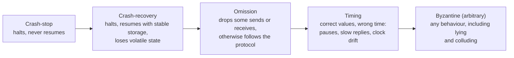
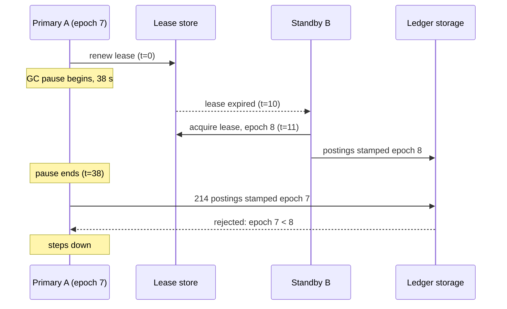

# Failure Models: Crash-Stop, Omission, Byzantine

> Which failures you tolerate determines which protocol you need.

**Type:** Learn
**Languages:** —
**Prerequisites:** Phase 5 Lesson 01 (The Fallacies of Distributed Computing)
**Time:** ~60 minutes

## Learning Objectives

- Define the five process failure models (crash-stop, crash-recovery, omission, timing, Byzantine) and place them in their inclusion hierarchy
- Distinguish the three synchrony models (synchronous, asynchronous, partially synchronous) and state what each one lets a protocol assume about delay
- State the resilience bound for consensus under crash failures (`n >= 2f + 1`) and under Byzantine failures (`n >= 3f + 1`) and explain where each extra replica goes
- Explain why a slow process is indistinguishable from a crashed one in an asynchronous system, and why that single fact shapes leases, failure detectors, and the FLP result
- Classify a real system or incident by the failure model it assumed and the one that actually occurred
- Map each protocol built later in this course to the failure model it tolerates and the one it does not

## The Problem

A payments company runs its ledger as a primary with two warm standbys. Failover is lease-based: the primary renews a 10-second lease in a coordination store, the standbys watch it, and whichever standby sees the lease expire promotes itself. The design document says the system "tolerates the failure of any one node". It was tested by killing the primary with `kill -9` a few hundred times in staging, and it failed over cleanly every time.

On a Tuesday afternoon the primary's JVM enters a 38-second stop-the-world garbage collection. It does not crash. It does not renew the lease either, because the thread that renews it is stopped along with every other thread. At second 10 the lease expires. At second 11 standby B promotes itself, replays the last committed postings, and starts accepting new ones from the payment orchestrator, which has re-resolved the primary address. At second 38 the old primary wakes up. It has no idea that any time passed. Its in-memory view says it holds the lease, it has 214 postings buffered in its write path, and it flushes them. For the next 90 seconds, until the old primary's next lease renewal fails and it steps down, two ledgers accept postings for the same accounts. Reconciliation the next morning finds 61 double-posted settlements and 9 accounts whose balance depends on which ledger you ask.

Nothing in the design was wrong for the failure it was designed for. The protocol tolerates **crash-stop**: a node halts and never speaks again. What happened was a **timing failure**: a node was silent for longer than the protocol's patience, then resumed as if nothing had happened. In an asynchronous system those two cases are indistinguishable from the outside; the only difference is what happens afterwards. The design did not state which model it assumed, so nobody noticed that the one it tested (`kill -9`) was the easy one. A fencing token (Lesson 12) would have made the late writes rejectable; a design review that asked "what is the failure model?" would have surfaced the gap before the incident did.

The second kind of gap is quieter. The same company's reconciliation job compares its ledger to a daily settlement file from a card network. The job assumes the file is correct and that discrepancies are the company's own bugs. One day the network's file contains 1,400 transactions with amounts off by a factor of 100, because an upstream system changed the amount field from minor units to a decimal string. The file is not malicious, but from the company's point of view it is **arbitrary**: a counterparty producing output that violates the protocol. No crash-tolerant mechanism addresses this. Only validation, signatures, and independent evidence do. Payments systems live permanently in a world where the most important peers are outside the trust boundary, which is why this lesson's last section is about which failures you tolerate by protocol and which you tolerate by detection.

## The Concept

### What a failure model is

A failure model is the set of assumptions a protocol makes about how its environment can misbehave. It has three parts: how **processes** can fail, how **communication links** can fail, and what can be assumed about **timing**. A protocol is correct only relative to its model. Raft is correct if nodes crash and recover with their disk intact, messages may be lost or delayed but are not forged, and delays are eventually bounded. Change any one of those assumptions and the correctness proof no longer applies. The proof does not become "mostly correct"; it becomes a proof about a different system.

This is the discipline the Tuesday incident lacked. "Tolerates one node failure" is not a specification. "Tolerates one crash-stop failure under partial synchrony, with no protection against a paused node resuming" is, and it tells the reviewer exactly where to look.

### Process failure models

The models form a strict hierarchy: each one includes every behaviour of the ones before it. A protocol that tolerates a stronger model automatically tolerates the weaker ones, at a price in replicas, messages, or latency.



Three consequences of the hierarchy are worth stating before the definitions:

- A protocol proven for a stronger model needs no new proof for a weaker one. PBFT tolerates crashes; Raft does not tolerate traitors.
- The cost rises with the model: more replicas, more rounds, more cryptography. Paying for Byzantine tolerance inside your own trust boundary is usually paying for a failure you do not have.
- The boundary between timing and crash is where most real incidents live, because it is the boundary a timeout cannot see.

**Crash-stop (fail-stop).** The process executes correctly until some point, then halts and does nothing further. Schneider's original *fail-stop* model (1984) adds a second property: other processes can reliably detect the halt. That detection is the expensive part. In a real network you cannot distinguish a halted process from a slow one, so fail-stop is an idealisation; what you can build is *crash-stop with an unreliable failure detector*, which is the subject of the synchrony section below. The `kill -9` test exercises exactly this model.

**Crash-recovery.** The process halts and later restarts. Volatile memory is gone; whatever was written to stable storage before the crash survives. This is the realistic model for a database node, and it introduces two problems crash-stop does not have. First, *amnesia*: the process may have promised something (voted for a leader, acknowledged a write) and no longer remember it, so every promise that matters must be on disk before it is sent. Raft's rule that `currentTerm` and `votedFor` are persisted before replying (Phase 6, Lesson 05) exists for this reason. Second, the recovered process may be stale: it must learn what it missed before it participates. The write-ahead log (Phase 7, Lesson 02) is the mechanism that makes recovery possible at all.

**Omission.** The process follows the protocol but some messages it should send are never sent (send omission) or some messages that arrive are never processed (receive omission). A full buffer, a dropped UDP datagram, a TCP connection reset mid-request, a load balancer that silently discards a request during a deploy: these are omission failures. Omission is strictly more general than crash, because a crashed process is one that omits every message after some point. Protocols tolerate omission by retransmitting and deduplicating, which is why idempotency keys (Lesson 09) and retries (Lesson 10) are the same topic seen from two sides: retries fix send omission, idempotency fixes the duplicates retries create.

**Timing (performance) failures.** The process produces correct values but outside the time bounds the protocol assumes. A 38-second GC pause, a disk that takes 20 seconds to fsync, a node whose clock runs 400 ms fast and timestamps a transaction into the future. In a purely asynchronous model there are no time bounds, so timing failures do not exist as a category; everything is just "slow". In practice every protocol with a timeout has implicitly adopted a timing model, and every timeout is a place where a timing failure becomes a false crash detection. The paused primary in The Problem is a timing failure that the lease protocol misclassified as a crash.

**Byzantine (arbitrary) failures.** The process may do anything: send different values to different peers, send messages that violate the protocol, replay old messages, collude with other faulty processes. The name comes from Lamport, Shostak, and Pease's 1982 paper, which framed consensus as generals who must agree on a plan while some of them are traitors. Byzantine failures include every other model. They also include *unintentional* arbitrary behaviour: a bit flip that corrupts a message, a software bug that sends the wrong amount, a misconfigured peer speaking an old version of the protocol. The card network's settlement file with amounts off by 100x is a Byzantine failure of the counterparty, even though nobody intended it. A useful sub-model is **authenticated Byzantine**: faulty processes can do anything except forge another process's digital signature. Signatures turn "the processor said X" from a claim into evidence, and much of payments security (webhook HMACs, signed settlement files, ISO 20022 message signing) is the engineering of that sub-model.

### Link failure models

Links have their own hierarchy, from Cachin, Guerraoui, and Rodrigues' formulation:

| Link model | Guarantee | How you get it |
|------------|-----------|----------------|
| Fair-loss | A message sent infinitely often is delivered infinitely often; no message is created from nothing | What a physical network gives you |
| Stubborn | A message sent once is delivered infinitely often | Retransmit forever on top of fair-loss |
| Perfect (reliable) | Delivered exactly once if sender and receiver are correct; no duplication; no creation | Stubborn link plus deduplication by message id |
| FIFO perfect | Perfect, and messages from one sender arrive in send order | Perfect link plus sequence numbers and reordering buffer |
| Authenticated perfect | Perfect, and a message delivered as from `p` was sent by `p` | Perfect link plus MAC or signature |

TCP gives you something close to FIFO perfect *within one connection*. Across connections (a reconnect after a timeout) you are back to fair-loss: the request you sent on the dead connection may or may not have arrived, and the retry on the new connection may duplicate it. This is why "we use TCP" is not an answer to the omission problem at the application level, and why Lesson 07 puts request ids inside the frame rather than relying on the transport.

### Synchrony models

The timing assumptions decide what is possible at all.

**Synchronous.** There is a known upper bound on message delay and on the time a process takes to execute a step. Under this model crash detection is trivial: if a reply has not arrived in `2 * bound + processing`, the process has crashed. Consensus is easy, Byzantine agreement is possible with `n >= 3f + 1` processes and `f + 1` rounds, and for the single-commander broadcast form with signed messages any number of traitors can be tolerated (Lamport, Shostak, Pease, Section 4; Dolev and Strong, 1983). Real networks are not synchronous. A protocol that assumes synchrony is one GC pause away from violating safety.

**Asynchronous.** There is no bound on delay. Messages arrive eventually; processes take arbitrarily long per step. This is the honest model for the internet. Its central result is the one from Fischer, Lynch, and Paterson (1985), usually called **FLP**: no deterministic protocol can solve consensus in an asynchronous system if even one process may crash. The intuition is the one from The Problem: a protocol waiting for a vote cannot tell whether the voter crashed (so it should proceed without it) or is slow (so proceeding risks deciding differently from what the voter will decide). Any rule it picks can be defeated by an adversarial schedule. FLP does not say consensus is impossible in practice; it says that *safety and liveness cannot both be guaranteed by timing alone*. Every practical protocol gives up guaranteed liveness: Paxos and Raft are always safe and make progress only when the network behaves.

**Partially synchronous.** Dwork, Lynch, and Stockmeyer (1988) proposed the model that practical systems actually use: bounds on delay exist but are unknown, or they hold only after some unknown *global stabilisation time* (GST). Before GST anything goes and the protocol must remain safe; after GST the bounds hold and the protocol must make progress. This is exactly the behaviour of Raft: during a partition or a storm of timeouts it elects nobody and commits nothing, but it never commits two different values at the same index; once the network settles it elects a leader within a few election timeouts.

Chandra and Toueg (1996) recast the same idea as **unreliable failure detectors**. A failure detector is an oracle each process consults that returns a list of suspects. It can be wrong. The weakest detector that still permits consensus with a majority of correct processes is called `<>W` (eventually weak): eventually every crashed process is permanently suspected by some correct process, and eventually some correct process is never suspected by anyone. Heartbeats with adaptive timeouts implement this in practice, and the "eventually" is the GST in disguise. SWIM-style membership (Lesson 13) is a failure detector; Raft's election timeout is a failure detector; the lease in The Problem was a failure detector with a fixed 10-second patience that the environment exceeded.

### Failure detection in practice

Every production failure detector is a heartbeat with a timeout, and every one of them is wrong in one of two directions. Too short, and a GC pause or a congested link produces a false suspicion, which under a lease protocol means a takeover and under Raft means a needless election. Too long, and a real crash goes undetected for the full timeout, during which every request to the dead node times out. There is no value that is right for both; there is only a trade-off that should be explicit and adaptive.

The simplest adaptive detector tracks the inter-arrival times of heartbeats and suspects a peer when the silence exceeds a multiple of what it has observed. A sketch:

```java
final class HeartbeatDetector {
    private final long[] recentGaps = new long[16];   // ring buffer of observed inter-arrival times
    private int filled = 0, next = 0;
    private long lastHeartbeat;
    private final double tolerance;                    // e.g. 4.0: suspect at 4x the mean gap

    HeartbeatDetector(long now, double tolerance) { this.lastHeartbeat = now; this.tolerance = tolerance; }

    void heartbeat(long now) {
        recentGaps[next] = now - lastHeartbeat;
        next = (next + 1) % recentGaps.length;
        filled = Math.min(filled + 1, recentGaps.length);
        lastHeartbeat = now;
    }

    boolean suspects(long now) {
        if (filled == 0) return false;
        long sum = 0;
        for (int i = 0; i < filled; i++) sum += recentGaps[i];
        double meanGap = (double) sum / filled;
        return (now - lastHeartbeat) > tolerance * meanGap;
    }
}
```

Three things to notice. The detector takes `now` as a parameter rather than reading a clock, so it can be tested deterministically (Lesson 04 shows why reading the wall clock inside a detector is its own failure mode). It is a `<>W`-style detector: a crashed peer is eventually suspected forever, and a live peer on a stable network is eventually never suspected, but during a burst of latency it will be wrong, and the protocol above it must be safe when it is. And it says nothing about *what to do* on suspicion. Hayashibara's phi-accrual detector, used by Cassandra and Akka, replaces the boolean with a continuous suspicion level so that different consumers (routing, membership, alerting) can pick their own thresholds against the same evidence.

The rule for the layer above: a failure detector may drive **liveness** decisions (stop sending to the suspect, start an election, promote a standby) but never **safety** decisions on its own. Safety needs a mechanism that remains correct when the detector is wrong, which is the fencing token in The Problem and the term number in Raft.

### Correlated failures and fault domains

The `f` in `2f + 1` counts *independent* failures. A failure model that assumes independence is violated by any shared cause: a rack power supply, an availability-zone network, a certificate that expires on all nodes at once, a release that ships the same bug to every replica, three JVMs with identical heap settings that pause within seconds of each other because they ingest the same traffic. In the Tuesday incident the two standbys ran the same JVM configuration as the primary; had the GC pause been triggered by the workload rather than by one node's heap fragmentation, all three could have paused together and the system would have been down with `f = 3`, which no `n = 3` design tolerates.

| Shared cause | What it correlates | Mitigation that restores independence |
|--------------|--------------------|---------------------------------------|
| Rack or zone | Power, network, cooling | Place each replica in a different fault domain; `n = 3` means three zones, not three racks |
| Software release | Bugs, crash loops | Staged rollout; never upgrade a majority at once |
| Runtime configuration | GC pauses, memory limits | Vary heap sizes or GC settings across replicas; monitor pause distributions |
| Credentials and certificates | Simultaneous auth failure | Staggered expiry; alert well before expiry |
| Shared dependency | DNS, coordination store, identity provider | Count it as a replica in the model: if etcd is down, how many of your `n` can act? |

The design-document sentence from the decision procedure should name the fault domains: "`f = 1` out of `n = 3`, one replica per availability zone" is a claim that can be checked; "`f = 1` out of `n = 3`" alone is not.

### What the protocols themselves say

Protocol papers state their model in one or two sentences, and reading that sentence is the fastest way to know what you are buying. The Raft paper (Ongaro and Ousterhout, 2014) opens its description of practical consensus with the properties it guarantees: safety "under all non-Byzantine conditions, including network delays, partitions, and packet loss, duplication, and reordering", availability "as long as any majority of the servers are operational and can communicate with each other and with clients", and the explicit statement that servers "are assumed to fail by stopping; they may later recover from state on stable storage and rejoin the cluster". That is crash-recovery, omission links, partial synchrony for liveness, and no Byzantine tolerance, in three clauses. PBFT's abstract makes the opposite commitment: it "works in asynchronous environments like the Internet" and tolerates `f` Byzantine replicas out of `3f + 1`. When a vendor's documentation does not contain a sentence like these, assume crash-stop and ask.

### Real systems and the models they assume

| System | Internal model | Replicas for `f` | Edge model |
|--------|----------------|------------------|------------|
| etcd, ZooKeeper, Consul | Crash-recovery, partial synchrony (Raft, Zab) | `2f + 1` | Clients are unreliable; sessions and leases fence them |
| Kafka (replicated partitions) | Crash-recovery; in-sync replica set tracks who may lead | `min.insync.replicas` out of the replica count | Producers are omission-prone; idempotent producer ids dedupe |
| Cassandra, DynamoDB-style stores | Crash and partition; eventual convergence | Tunable quorums; hinted handoff | Phi-accrual detector drives routing only |
| Spanner | Crash-recovery plus bounded clock uncertainty (TrueTime) | `2f + 1` per Paxos group | Commit-wait makes timing failures within the uncertainty bound safe |
| Bitcoin, Ethereum | Byzantine participants; safety is probabilistic under honest-majority resource assumptions | Not a count: a fraction of hash power or stake | Everything is an edge; every message is signed |
| Card networks, SWIFT, ACH | Each participant treats the others as authenticated Byzantine | n/a | Signed messages, schema validation, daily reconciliation, dispute processes |

The last row is the payments industry's answer to the Byzantine problem and it is instructive: no consensus protocol, no `3f + 1`, just signatures to establish who said what and a settlement cycle long enough for reconciliation to catch what validation missed. Phase 11 builds the rails that embody this.

### Resilience bounds: where the extra replicas go

How many processes do you need to tolerate `f` failures? The answer depends on the model and is the single most consequential number in a replication design.

| Failure model | Synchrony | Problem | Minimum `n` | Why |
|---------------|-----------|---------|-------------|-----|
| Crash | Synchronous | Consensus | `f + 1` | Wait for the bound, then proceed without the silent ones |
| Crash / crash-recovery | Partially synchronous | Consensus (Paxos, Raft) | `2f + 1` | Any two majorities intersect in at least one correct process, so a decision in one is visible to the next |
| Crash | Asynchronous | Consensus | impossible (FLP) | No timing to distinguish slow from dead |
| Byzantine, unauthenticated | Synchronous | Agreement | `3f + 1` | Lamport-Shostak-Pease: with `3f` or fewer, the traitors can split the loyal generals |
| Byzantine, authenticated | Synchronous | Broadcast from a commander | `f + 2` (any `f`) | Signatures stop a traitor relaying a forged value, so a chain of signatures is evidence; `f + 2` only to make the problem non-trivial |
| Byzantine | Partially synchronous | Consensus (PBFT) | `3f + 1` | Two quorums of `2f + 1` intersect in `f + 1` processes, at least one of which is honest |
| Byzantine | Asynchronous | Reliable broadcast | `3f + 1` | Bracha: same intersection argument without needing consensus |

Read the crash row carefully, because it is the one you will use most. With `n = 2f + 1` and a quorum of `f + 1`, any two quorums share at least one process. If that process is correct, it carries knowledge of the first decision into the second. Under crash failures a process is either correct or silent, never wrong, so one shared process is enough. Under Byzantine failures a shared process might be the liar. You need two quorums to share at least `f + 1` processes so that at least one is honest, which forces quorums of `2f + 1` out of `n = 3f + 1`. That one extra `f` is the entire cost of distrusting your own replicas. For a three-node Raft cluster, `f = 1`. For a PBFT cluster to tolerate one traitor you need four nodes, and seven to tolerate two.

### Which model to assume: a decision procedure

Picking a model is an engineering decision with a cost on each side. Too weak a model and you get Tuesday's incident. Too strong and you pay for replicas and message rounds that protect you from failures you do not have.

1. **Is the peer inside your trust boundary?** Your own replicas, running your code, in infrastructure you control: assume crash-recovery plus timing failures, and defend against the timing failures with fencing tokens and epochs rather than with Byzantine protocols. A counterparty, a customer's browser, a partner's webhook sender, a card network's file: assume Byzantine, and tolerate it with validation, signatures, and reconciliation, not with consensus. Payments systems almost never run BFT consensus internally; they run crash-tolerant consensus internally and treat every external edge as hostile.
2. **Does it have a disk that survives a restart?** If yes, crash-recovery; design for amnesia by persisting before promising. If no (a stateless worker, a cache), crash-stop is honest, and recovery means re-joining from scratch.
3. **Can it be paused longer than your timeout?** If it runs on a garbage-collected runtime, a VM that can be live-migrated, or a laptop that can be closed, yes. Then every timeout-based decision ("it is dead, take over") must be made safe against the paused node resuming. The tools are monotonic fencing tokens (Lesson 12), leader epochs and terms (Phase 6, Lesson 05), and store-side checks that reject stale writers.
4. **Can messages be lost, duplicated, or reordered between you?** Across any connection boundary, yes. Then every effect must be idempotent (Lesson 09) and every protocol must tolerate retransmission.
5. **What synchrony do you need for liveness?** Partial synchrony is the only defensible assumption. Write down the timeouts you depend on and treat them as tunables that trade false suspicion against detection latency, not as constants.

The output of this procedure is a sentence in the design document of the form: "This component tolerates `f = 1` crash-recovery failure out of `n = 3` under partial synchrony; timing failures are fenced by token `T`; external inputs are treated as Byzantine and validated by `V`." If you cannot write that sentence, the design is not finished.

### Mapping the course's protocols to failure models

Every protocol built later in this course was designed for a specific model. This table is the index to use when a later lesson's guarantees feel surprising: the surprise is almost always a model boundary.

| Lesson | Mechanism | Tolerates | Does not tolerate | Replicas for `f` |
|--------|-----------|-----------|-------------------|------------------|
| 5/09 Idempotency keys | Dedup store keyed by client token | Link omission and duplication; client crash-recovery | A client that reuses a key for a different request (Byzantine client) | 1 (a store) |
| 5/10 Retries and backoff | Retransmission with jitter | Send omission; transient timing failures | Permanent failure (needs a breaker); non-idempotent targets | n/a |
| 5/11 Circuit breakers | Fail fast on sustained error rate | Downstream crash or timing failure, from the caller's side | Nothing about the downstream's state; it is a failure detector, not a fix | n/a |
| 5/12 Leases and fencing | Time-bounded lock plus monotonic token | Holder crash-stop (lease expires); holder timing failure (token rejects late writes) | A store that does not check tokens; clock drift beyond the lease margin | 1 store, replicated by 6/05 |
| 5/13 Gossip and SWIM | Randomised probing with indirect pings | Crash-stop; link omission; some timing failures via suspicion | Byzantine members lying about others' liveness | any |
| 6/03 Quorums | Read and write sets that intersect | Crash-recovery of `f` replicas | Byzantine replicas returning wrong values | `2f + 1` |
| 6/04 Paxos | Two-phase ballot protocol | Crash-recovery; link omission; asynchrony for safety | Byzantine acceptors; needs partial synchrony for liveness | `2f + 1` |
| 6/05-07 Raft | Leader election, log replication | Crash-recovery with persisted term and vote; omission; timing failures via terms | Byzantine nodes; disk corruption; a majority of failures | `2f + 1` |
| 6/08 CRDTs | Commutative merge | Omission and partition for arbitrarily long | Byzantine replicas injecting invalid state | any |
| 6/11 BFT | PBFT-style three-phase commit with signatures | Up to `f` Byzantine replicas | More than `f` traitors; an adversary controlling all of the network forever | `3f + 1` |
| 7/02 Write-ahead log | Durable sequential log with fsync | Crash-recovery of one node | Disk corruption without checksums; a lying disk | 1 |
| 7/08 Two-phase commit | Coordinator plus participants with prepare | Participant crash-recovery | Coordinator crash between prepare and commit blocks forever (no liveness) | n/a |
| 7/12 Sagas | Compensating transactions | Crash-recovery of any step, given a durable saga log | Compensations that are not idempotent; counterparties that refuse to compensate | n/a |
| 12/05 Webhooks | HMAC-signed callbacks with timestamps | Byzantine sender impersonation; replay (with timestamp window) | A leaked signing key | n/a |
| 11/xx Reconciliation | Independent evidence compared after the fact | Byzantine counterparties, including honest bugs | Nothing in real time; it detects, it does not prevent | n/a |

Two patterns stand out. Inside the trust boundary the course never goes beyond crash-recovery plus timing, and it pays `2f + 1`. At the edges it assumes Byzantine behaviour and pays with signatures and reconciliation rather than replicas. That split is the shape of every real payments architecture.

### What a failure model does not do

A failure model does not tell you *how often* failures happen; it tells you *what kinds* are covered. A protocol that tolerates `f = 1` crash is correct against one crash at a time, and silent about what happens during the second one. It does not model correlated failures: three replicas in one rack, three JVMs with the same GC configuration pausing together, three nodes running the same buggy release. Tolerating `f` independent failures is worth little if a single cause can take out `f + 1`. It does not cover failures of the specification itself: a protocol that correctly replicates the wrong amount is correct by its own standard. And it does not tell you what to do when the model is violated; that is the job of detection (monitoring, reconciliation, invariant checks) and of designing so that violations are loud rather than silent.

## Worked Example

### Classifying the Tuesday incident

Take the lease-based failover from The Problem and run the decision procedure against it.

| Question | Answer for the ledger primary | Consequence |
|----------|-------------------------------|-------------|
| Inside the trust boundary? | Yes: own code, own infrastructure | Crash-tolerant protocol is appropriate; no BFT needed |
| Disk survives restart? | Yes | Crash-recovery, not crash-stop; promises must be persisted |
| Can it pause longer than the timeout? | Yes: JVM, 10 s lease, observed 38 s GC | Timing failures are in scope; every takeover decision must be fenced |
| Messages lost or duplicated? | Yes: orchestrator retries on timeout | Postings must carry idempotency keys |
| Synchrony needed? | Partial: liveness only after the pause ends | Lease length is a tunable, not a guarantee |

The design assumed crash-stop and tested crash-stop. The third row is where it broke. Now quantify what fencing would have done. Give the coordination store a monotonic epoch that increments on every promotion, and make the ledger's storage layer reject any write whose epoch is less than the highest it has seen.

```text
t = 0 s     primary A holds lease, epoch 7, writes stamped epoch 7
t = 0 s     A enters GC pause; lease renewals stop
t = 10 s    lease expires
t = 11 s    standby B acquires lease, epoch 8; storage records max epoch 8
t = 11-38 s B writes postings stamped epoch 8
t = 38 s    A resumes; still believes epoch 7; flushes 214 buffered postings stamped epoch 7
t = 38 s    storage compares 7 < 8 -> rejects all 214 writes; A observes rejection and steps down
result:     zero double postings; 214 postings are retried by the orchestrator against B,
            deduplicated by idempotency key where B already has them
```




The failure still happened. The pause was still 38 seconds. What changed is that the protocol's safety no longer depended on the timing assumption; the timeout only affects how fast failover happens (liveness), and the token protects correctness (safety). That separation, safety from the model you can guarantee and liveness from the one you hope for, is the lesson of FLP applied to a lease.

### Sizing a replicated ledger

A second decision, with numbers. The company wants the ledger to survive the loss of one availability zone and is debating three designs.

| Design | Model assumed | `n` | Writes survive | Cost |
|--------|---------------|-----|----------------|------|
| Primary plus async standby | Crash-stop with manual failover | 2 | Up to replication lag is lost; no automatic safety | 2 nodes |
| Raft, three zones | Crash-recovery, partial synchrony, `f = 1` | 3 | Nothing committed is lost; progress with any 2 of 3 | 3 nodes, one extra round trip per commit |
| PBFT, four zones | Byzantine, `f = 1` | 4 | Nothing committed is lost even if one replica lies | 4 nodes, three message rounds, signatures on every message |

The decision procedure says the replicas are inside the trust boundary, so the Byzantine row buys protection against a threat the company does not face (its own node lying) at the cost of 33% more hardware and roughly triple the commit latency. The first row is honest only if the business accepts losing the replication-lag window of postings on failover, which for a ledger it does not. The Raft row is the correct answer, and the sentence for the design document is: "Tolerates `f = 1` crash-recovery failure out of `n = 3` under partial synchrony; stale leaders are fenced by Raft terms; the orchestrator is treated as an unreliable client and every posting carries an idempotency key; the card network's settlement file is treated as Byzantine input and validated against the ledger by the reconciliation job." Each clause names a model and the mechanism that handles it.

### The settlement file

The 100x amount error is the Byzantine case. Run it through the same questions. The card network is outside the trust boundary, so consensus is not the tool. The file is signed, so forgery is excluded, but *honest* arbitrary behaviour (a bug) is not. The defences are the ones for authenticated Byzantine input: validate every field against its schema (amounts are integers in minor units, Phase 10, Lesson 01), check totals in the file trailer against the sum of the records, and compare the file against independent evidence (the ledger's own record of the day's authorisations). The reconciliation job catches the 1,400 bad rows because `sum(file) != sum(ledger)` by a factor that is obviously `100x` on inspection, and the job quarantines the file rather than posting adjustments. The protocol here is not consensus; it is "trust nothing you did not compute yourself, and keep enough evidence to prove it".

## Exercises

1. **Reinforce.** For each of the following, name the failure model (process and link) and the synchrony assumption violated: a Kubernetes node is live-migrated and its pods are frozen for 25 seconds; a load balancer drops 0.3% of requests during a rolling deploy; a replica's disk returns stale blocks after a firmware bug; a partner's webhook sender retries the same event 40 times with different timestamps; an NTP misconfiguration puts one replica 6 minutes ahead. Then state, for each, whether a Raft-based store would remain safe, remain live, both, or neither.
2. **Apply.** Write the failure-model sentence (the "tolerates `f` ... out of `n` ... under ... fenced by ... validates ... by ..." form) for a payment orchestrator you know or can imagine: one that calls a card processor, writes to a ledger, and emits webhooks to merchants. There should be at least three clauses, one per trust boundary. For each clause name the lesson in this course that builds the mechanism.
3. **Extend.** The resilience table says crash consensus needs `2f + 1` and Byzantine needs `3f + 1`. Prove the Byzantine bound for `f = 1`, `n = 3` by constructing the scenario: three generals, one traitor, and show two executions that a loyal general cannot distinguish but that require different decisions. Then explain why adding a fourth loyal general breaks the symmetry. This is the argument in Section 3 of Lamport, Shostak, and Pease; write it in your own words before reading theirs, then compare. Connect it to Lesson 01: which fallacy does the traitor exploit?

## Key Terms

| Term | What people say | What it actually means |
|------|-----------------|------------------------|
| Crash-stop | "the node died" | A process halts and never takes another step; the simplest model, and the only one `kill -9` tests |
| Crash-recovery | "it restarted" | A process halts and later resumes with its stable storage intact and its volatile state gone; every promise must be persisted before it is sent |
| Omission failure | "the message got lost" | A process or link fails to send or deliver some messages while otherwise following the protocol; the model that retries and idempotency keys address |
| Timing failure | "it was just slow" | A process produces correct values outside the protocol's time bounds; indistinguishable from a crash until it resumes, which is when it becomes dangerous |
| Byzantine failure | "it went rogue" | Arbitrary behaviour, malicious or buggy, including sending different values to different peers; requires `3f + 1` replicas for consensus, or signatures and reconciliation at the edges |
| Partial synchrony | "the network is usually fine" | Delay bounds exist but are unknown or hold only after an unknown stabilisation time; the model under which Paxos and Raft are safe always and live eventually |
| FLP impossibility | "consensus is impossible" | No deterministic protocol solves consensus in an asynchronous system with one possible crash; in practice, safety and liveness cannot both be guaranteed by timing alone |
| Failure detector | "the heartbeat" | An unreliable oracle that lists suspected processes; adaptive heartbeat timeouts implement the eventually-weak detector that makes majority consensus possible |

## Further Reading

- [The Byzantine Generals Problem](https://lamport.azurewebsites.net/pubs/byz.pdf) (Lamport, Shostak, Pease, 1982) — the paper that defined arbitrary failures and proved the `3f + 1` bound; Section 3's three-general argument is the one Exercise 3 asks you to reconstruct.
- [Impossibility of Distributed Consensus with One Faulty Process](https://groups.csail.mit.edu/tds/papers/Lynch/jacm85.pdf) (Fischer, Lynch, Paterson, 1985) — the FLP result; read the introduction and the bivalent-configuration argument to see why "slow or dead" is the whole problem.
- [Consensus in the Presence of Partial Synchrony](https://groups.csail.mit.edu/tds/papers/Lynch/jacm88.pdf) (Dwork, Lynch, Stockmeyer, 1988) — defines the model every practical consensus protocol actually runs under, including the global stabilisation time.
- [Unreliable Failure Detectors for Reliable Distributed Systems](https://www.cs.utexas.edu/~lorenzo/corsi/cs380d/papers/p225-chandra.pdf) (Chandra, Toueg, 1996) — the failure-detector hierarchy and the proof that eventually-weak detection suffices for consensus with a majority of correct processes.
- [Byzantine Generals and Transaction Commit Protocols](https://lamport.azurewebsites.net/pubs/trans.pdf) (Lamport, 1982) and [Practical Byzantine Fault Tolerance](https://pmg.csail.mit.edu/papers/osdi99.pdf) (Castro, Liskov, 1999) — the second shows what tolerating Byzantine replicas costs in rounds and signatures, which is the price the decision procedure weighs.
- [In Search of an Understandable Consensus Algorithm](https://raft.github.io/raft.pdf) (Ongaro, Ousterhout, 2014) — Section 2 states Raft's failure model in three sentences; use it as the template for the sentence your own design documents should contain.
- [The Phi Accrual Failure Detector](https://ieeexplore.ieee.org/document/1353004) (Hayashibara et al., 2004) — the adaptive detector behind Cassandra and Akka; shows how to turn heartbeat history into a suspicion level rather than a boolean.
- [Introduction to Reliable and Secure Distributed Programming](https://www.distributedprogramming.net/) (Cachin, Guerraoui, Rodrigues, 2nd ed.) — Chapter 2 is the cleanest formal treatment of the process, link, and timing models used in this lesson; the link hierarchy table is adapted from it.
