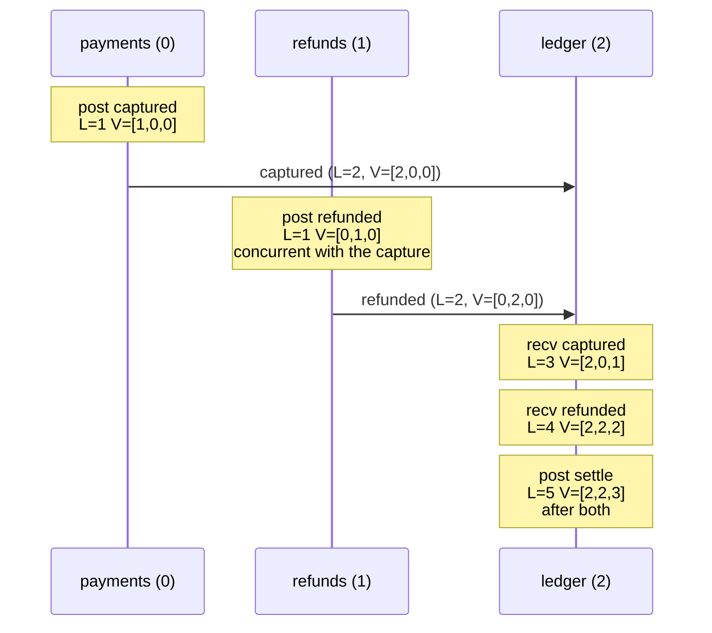

# Time, Order, and Clocks: Lamport and Vector Clocks

> Two events, two machines, no shared clock: who went first?

**Type:** Build
**Languages:** Java, Python, Go
**Prerequisites:** Phase 5 Lesson 02 (Failure Models), Phase 1 Lesson 09 (Heaps and Priority Queues)
**Time:** ~120 minutes

## Learning Objectives

- State Lamport's happens-before relation and explain why wall-clock timestamps cannot implement it
- Implement a Lamport clock with its three rules and prove the clock condition with a test
- Turn Lamport timestamps into a total order with a deterministic tie-break and explain what that order does and does not promise
- Implement a vector clock with increment, merge, and compare, and show that merge is commutative and idempotent
- Detect concurrent events between a capture service and a refund service on a deterministic simulated network
- Decide, for a given payments question, whether a scalar clock, a vector clock, or neither is the right tool

## The Problem

A payments platform runs two services that both write to the same payment record. The `payments` service captures funds when a merchant ships an order and posts `captured 49.99 USD pay_8f3`. The `refunds` service lets an operator issue a refund from a dashboard and posts `refunded -49.99 USD pay_8f3`. Both services send their postings to a `ledger` service that applies them in the order it receives them. Each posting carries a wall-clock timestamp from the host that produced it.

One Tuesday the ledger receives the refund first, at `14:03:07.412`, and the capture second, at `14:03:07.388`. The capture's timestamp is older, so the ledger's "apply in timestamp order" rule sorts the capture first and everything looks fine. On Wednesday the same thing happens, except the `payments` host's NTP daemon had stepped its clock back 600 milliseconds overnight. Now the refund is stamped `14:03:07.412` and the capture `14:03:07.950`. The ledger sorts the refund first, tries to refund a payment that has not been captured, rejects it, and the operator's refund silently disappears. The customer calls three weeks later.

The root cause is not the NTP step. It is the belief that a timestamp from one machine can be compared with a timestamp from another machine to decide which event came first. Two machines have two clocks; those clocks drift, step, and are read at different points in the code path. The question "did the capture happen before the refund?" has a real answer only in one case: when information about the capture had reached the refund service before the refund was issued. If the operator clicked "refund" after seeing the capture in the dashboard, the refund was *caused* by the capture and must sort after it. If the operator clicked "refund" before the capture notification arrived, the two events are *concurrent*: neither could have influenced the other, and no timestamp will tell you which was "really" first because there is no fact of the matter.

Leslie Lamport's 1978 paper made this precise. The *happens-before* relation is defined by what could have caused what: an event on one process precedes a later event on the same process; a send precedes its receive; and the relation is transitive. Everything else is concurrent. Lamport then showed how to build a counter, no physical clock involved, that is consistent with this relation. A decade later Fidge and Mattern extended the counter into a vector that can also *detect* concurrency rather than merely stay consistent with it. This lesson builds both, stamps every event in a three-service simulation with both, and shows exactly what each one can and cannot tell the ledger.

## The Concept

### Happens-before

Write `a -> b` for "a happens before b". Lamport defines it with three rules:

1. If `a` and `b` are events on the same process and `a` comes first in that process's execution, then `a -> b`.
2. If `a` is the sending of a message and `b` is the receipt of that same message, then `a -> b`.
3. If `a -> b` and `b -> c`, then `a -> c`.

If neither `a -> b` nor `b -> a`, the events are *concurrent*, written `a || b`. Concurrency is not "at the same instant"; it means no chain of local steps and messages connects one to the other. Two events a minute apart on machines that never communicated are concurrent.

This is a *partial order*. Some pairs are ordered and some are not. The relation is exactly the set of pairs where the first event could have influenced the second, which is why it is the right notion of order for anything about causality: a refund that was issued in response to a capture must come after it; a refund issued in ignorance of the capture is a conflict to be resolved, not an ordering to be guessed.

### Lamport clocks: a counter consistent with causality

A Lamport clock is one integer per process, `C_i`, with three rules:

| Rule | When | What happens |
|------|------|--------------|
| Tick | a local event occurs on process `i` | `C_i := C_i + 1`; the event is stamped `C_i` |
| Send | process `i` sends a message | tick first, then put `C_i` in the message |
| Receive | process `j` receives a message stamped `t` | `C_j := max(C_j, t) + 1`; the receive event is stamped `C_j` |

The rules guarantee the **clock condition**: if `a -> b` then `C(a) < C(b)`. Proof sketch: within one process the counter strictly increases, which covers rule 1 of happens-before; the receive rule forces the receive to be stamped strictly above the send, which covers rule 2; and strict inequality is transitive, which covers rule 3.

The converse does **not** hold. `C(a) < C(b)` does not imply `a -> b`. Two processes that never communicate both stamp their first event `1`, their second `2`, and so on; a Lamport time of `3` on one of them is smaller than `5` on the other without any causal connection. A Lamport timestamp is *necessary* evidence of happens-before, never *sufficient*.

### From partial to total: the tie-break

A ledger cannot work with a partial order. It needs one sequence to apply postings in, and every replica must compute the same sequence. Lamport's paper gives the construction: order events by `(C(e), process id)`. Two events on the same process never share a counter value, and two events on different processes with the same counter are separated by the process id. The result is a *total order that is consistent with happens-before*: whenever `a -> b`, `a` sorts first. Among concurrent events the order is arbitrary but deterministic, and that is the point: arbitrary is fine as long as every node picks the same arbitrary answer.

What the total order does not do is tell you that it was arbitrary. In the sequence `1@payments, 1@refunds, 2@payments, ...` nothing marks `1@payments` and `1@refunds` as concurrent. If the ledger needs to know whether the refund was issued with knowledge of the capture, a scalar clock cannot answer. That is the gap vector clocks fill.

### Vector clocks: a counter per process

A vector clock on a cluster of `n` processes is a vector `V` of `n` integers. `V[i]` is the number of events on process `i` that the holder of the vector has observed, directly or transitively. The rules mirror Lamport's:

| Rule | When | What happens |
|------|------|--------------|
| Increment | local event on process `i` | `V_i[i] := V_i[i] + 1` |
| Send | process `i` sends | increment, then attach the whole vector `V_i` |
| Merge + increment | process `j` receives a message carrying `V_m` | `V_j := max(V_j, V_m)` componentwise, then `V_j[j] := V_j[j] + 1` |

Comparison is componentwise:

- `V(a) < V(b)` (a happens-before b) when every component of `V(a)` is `<=` the matching component of `V(b)` and at least one is strictly `<`.
- `V(a) = V(b)` when all components match (only for the same event, or for two observations of the same state).
- `V(a) || V(b)` (concurrent) when some component is greater in `V(a)` and some other component is greater in `V(b)`.

Fidge and Mattern proved the strong clock condition: `a -> b` **if and only if** `V(a) < V(b)`. Vector clocks characterise causality exactly. The price is `O(n)` space per timestamp and `O(n)` time per comparison, where `n` is the number of processes that can originate events. For three services that is trivial. For a system where every client is a process, it is not, and that trade-off decides where vector clocks are used in practice (see Use It).

### The invariants the tests check

| Property | Statement | Why a ledger cares |
|----------|-----------|--------------------|
| Monotonicity | each Lamport clock's value strictly increases on every tick, send, and receive | a node's own log is in order |
| Clock condition | `a -> b` implies `C(a) < C(b)` | the total order never puts an effect before its cause |
| Total order | `(C, nodeId)` is a strict total order on distinct events | every replica computes the same sequence |
| Strong clock condition | `a -> b` iff `V(a) < V(b)` | concurrent postings can be found and flagged |
| Merge is commutative | `merge(a, b) = merge(b, a)` | the order in which replicas exchange state does not change what they know |
| Merge is idempotent | `merge(a, a) = a` | re-delivering a message (Lesson 09) does not corrupt the clock |
| Merge is associative | `merge(merge(a, b), c) = merge(a, merge(b, c))` | gossip in any grouping converges (Lesson 13) |

Commutative, associative, and idempotent together make componentwise-max a *join* operation, which is exactly the property CRDTs (Phase 6, Lesson 08) are built on. A vector clock is itself a small CRDT.

### Worked example: capture and refund on three services

Three services, `payments` (index 0), `refunds` (index 1), `ledger` (index 2). Each starts with Lamport time `0` and vector `[0,0,0]`. The operator issues the refund before the capture notice arrives.

```text
step  node      event                                  lamport  vector     why
1     payments  post captured 49.99 USD pay_8f3        1        [1,0,0]    tick
2     payments  send "captured" -> ledger              2        [2,0,0]    tick, attach (2, [2,0,0])
3     refunds   post refunded -49.99 USD pay_8f3       1        [0,1,0]    tick: refunds has heard nothing
4     refunds   send "refunded" -> ledger              2        [0,2,0]    tick, attach (2, [0,2,0])
5     ledger    recv "captured" <- payments            3        [2,0,1]    max(0,2)+1; merge([0,0,0],[2,0,0]) then +1 own
6     ledger    recv "refunded" <- refunds             4        [2,2,2]    max(3,2)+1; merge([2,0,1],[0,2,0]) then +1 own
7     ledger    post settle pay_8f3 net 0.00 USD       5        [2,2,3]    tick
```

Now compare the two postings that matter:

- Lamport: `1@payments` vs `1@refunds`. Equal counters, so the tie-break by node id puts `payments` first. The ledger's total order says capture, then refund. It would say the same thing if the operator had issued the refund an hour before the capture; the order is a convention, not a discovery.
- Vector: `[1,0,0]` vs `[0,1,0]`. Component 0 is greater on the left, component 1 is greater on the right. **Concurrent.** The refund was issued without knowledge of the capture. This is the signal the ledger needs: do not apply the refund as if it followed the capture; route `pay_8f3` to a conflict handler (Phase 6, Lesson 09).

Contrast the healthy flow, where `payments` also notifies `refunds` and the operator refunds after seeing the capture:

```text
payments  post captured                1  [1,0,0]
payments  send "captured" -> ledger    2  [2,0,0]
payments  send "captured" -> refunds   3  [3,0,0]
refunds   recv "captured" <- payments  4  [3,1,0]    merge([0,0,0],[3,0,0]) then +1
refunds   post refunded                5  [3,2,0]
```

`[1,0,0]` vs `[3,2,0]`: every component on the left is `<=`, and two are strictly `<`. The capture happens-before the refund. Both clocks agree, and the ledger can apply the refund with confidence.



### Complexity

| Operation | Lamport | Vector (n processes) |
|-----------|---------|----------------------|
| Tick / increment | O(1) | O(n) to copy an immutable vector; O(1) if mutated in place |
| Attach to message | 8 bytes | 8n bytes |
| Receive | O(1) | O(n) |
| Compare two stamps | O(1) | O(n) |
| Detect concurrency | impossible | O(n) |

### What these clocks do not do

- They say nothing about wall-clock time. A Lamport time of `5` is not "later" than `4` in any physical sense; it only guarantees that `5` was not a cause of `4`. Hybrid logical clocks (Lesson 04) add a physical component for systems that need both.
- A vector clock does not resolve conflicts. It finds them. Deciding whether a concurrent capture and refund should net to zero, be rejected, or page an operator is business logic.
- Neither clock protects against message loss or duplication. A lost message leaves the receiver's vector permanently behind on that component until some later message catches it up. A duplicated message is harmless to the clock only because merge is idempotent, which is why the test checks that property.
- A vector clock assumes a fixed, known set of processes. Adding and removing nodes requires either a growable map keyed by node id (dotted version vectors, interval tree clocks) or an out-of-band membership protocol (Phase 6, Lesson 07).

## Build It

The primary walkthrough is in Java. The Python and Go files implement the same design with the same names, and `main` in all three prints byte-identical output; the subsections at the end show only what differs.

### Step 1: The Lamport clock

```java
final class LamportClock {
    private long time = 0;

    long time() { return time; }

    long tick() { return ++time; }

    long send() { return tick(); }

    long receive(long remoteTime) {
        time = Math.max(time, remoteTime) + 1;
        return time;
    }
}
```

Three rules, three methods. `send` is `tick` under another name so that the call site reads as what it is doing; the value it returns is what goes in the message. `receive` takes the sender's time, jumps past it if necessary, and advances by one either way, so the receive event is stamped strictly after both the sender's send and the receiver's previous event.

**Predict:** a node at time 5 receives a message stamped 2. What is its new time, and why must it still advance even though the remote clock is behind?

### Step 2: The total order

```java
record LamportTimestamp(long time, String nodeId) implements Comparable<LamportTimestamp> {
    @Override public int compareTo(LamportTimestamp other) {
        int byTime = Long.compare(time, other.time);
        return byTime != 0 ? byTime : nodeId.compareTo(other.nodeId);
    }
}
```

The record pairs the counter with the node id so that every event in the system has a distinct, comparable stamp. `compareTo` is the total order: counter first, node id second. The test `lamport ties break by node id` checks that `3@payments < 3@refunds`, and `Main.totalOrder` is just a sort by this comparator.

**Predict:** could two different events on the same node ever share a `LamportTimestamp`?

### Step 3: The vector clock

```java
final class VectorClock {
    private final long[] counters;

    VectorClock increment(int node) {
        long[] next = counters.clone();
        next[node]++;
        return new VectorClock(next, true);
    }

    VectorClock merge(VectorClock other) {
        requireSameSize(other);
        long[] next = new long[counters.length];
        for (int i = 0; i < next.length; i++) next[i] = Math.max(counters[i], other.counters[i]);
        return new VectorClock(next, true);
    }
}
```

The clock is immutable: `increment` and `merge` return new instances. This matters because an `Event` holds a reference to the vector as it was when the event happened. If the node mutated its vector in place, every past event in the log would appear to have the node's current clock. Immutability costs an `O(n)` copy per operation, which for `n = 3` is nothing and for `n = 10,000` would be the reason to redesign.

`requireSameSize` rejects a vector from a different cluster size with an exception rather than silently comparing the overlapping prefix. A payments cluster that grew from three services to four and compared old and new stamps as if they were compatible would produce wrong `BEFORE` answers.

**Predict:** `VectorClock.of(2,0,1).merge(VectorClock.of(1,3,1))` — what is the result, and what is `merge` of the result with itself?

### Step 4: Comparison

```java
Relation compare(VectorClock other) {
    requireSameSize(other);
    boolean anyLess = false, anyGreater = false;
    for (int i = 0; i < counters.length; i++) {
        if (counters[i] < other.counters[i]) anyLess = true;
        if (counters[i] > other.counters[i]) anyGreater = true;
    }
    if (anyLess && anyGreater) return Relation.CONCURRENT;
    if (anyLess) return Relation.BEFORE;
    if (anyGreater) return Relation.AFTER;
    return Relation.EQUAL;
}
```

One pass, two flags. The four outcomes are exhaustive: either both flags are set (concurrent), one is set (before or after), or neither (equal). `happensBefore` and `concurrentWith` are one-line wrappers so the scenario code reads as English. Note that `happensBefore` is strict: a vector does not happen before itself, which the test `happensBefore is strict` pins down.

**Predict:** what does `compare` return for `[2,0,0]` vs `[2,2,0]`, and what does that say about who has seen whose events?

### Step 5: A node that stamps every event with both clocks

```java
final class Node {
    final LamportClock lamport = new LamportClock();
    VectorClock vector;
    final List<Event> log = new ArrayList<>();

    Event localEvent(String description) {
        long t = lamport.tick();
        vector = vector.increment(index);
        return record(description, t);
    }

    Message send(String to, String payload) {
        long t = lamport.send();
        vector = vector.increment(index);
        record("send " + payload + " -> " + to, t);
        return new Message(id, to, payload, t, vector);
    }

    Event receive(Message m) {
        long t = lamport.receive(m.lamportTime());
        vector = vector.merge(m.vector()).increment(index);
        return record("recv " + m.payload() + " <- " + m.from(), t);
    }
}
```

Each node runs both clocks side by side so that every `Event` in its log carries a Lamport stamp and a vector stamp, and the demo can show where they agree and where they diverge. `receive` is the line to read twice: merge the sender's vector first, then increment your own component. Doing it in the other order would stamp the receive event with a vector that does not reflect the sender's knowledge.

**Predict:** in `receive`, the message's vector has the sender's component already incremented for the send. Why does the receiver not need to increment the sender's component again?

### Step 6: A deterministic network

```java
int nextDelay() {
    state = state * 6364136223846793005L + 1442695040888963407L;
    return (int) ((state >>> 33) % (maxDelay + 1));
}

void send(Message m) {
    node(m.to());
    queue.add(new Pending(tick + 1 + nextDelay(), seq++, m));
}

Event deliverOne() {
    Pending p = queue.poll();
    if (p == null) return null;
    tick = p.deliverAt();
    delivered++;
    return node(p.message().to()).receive(p.message());
}
```

The network is a priority queue (Phase 3, Lesson 03) ordered by `(deliverAt, seq)`. Each send gets a delay from a 64-bit linear congruential generator with Knuth's MMIX constants, so the same seed yields the same delivery schedule in all three languages, and different seeds reorder deliveries. Seed 7 delivers the capture to the ledger first; seed 1 delivers the refund first. The test `clock condition holds across 30 seeds` runs both scenarios under thirty schedules and checks that no reordering ever puts an effect before its cause.

This is the first appearance of the simulated network that Phases 5 through 9 build on. There is no `Thread.sleep`, no real socket, and no `System.currentTimeMillis()`. Every bug it finds is replayable from a seed.

**Predict:** two messages are sent at tick 0 with delays 2 and 0. In which order are they delivered, and what does that do to the receiver's Lamport clock?

### Step 7: The two scenarios

```java
static SimulatedNetwork concurrentRefundScenario(long seed) {
    SimulatedNetwork net = cluster(seed);
    Node payments = net.node(PAYMENTS), refunds = net.node(REFUNDS), ledger = net.node(LEDGER);

    payments.localEvent("post captured " + CAPTURE + " pay_8f3");                 // A
    net.send(payments.send(LEDGER, "captured " + CAPTURE + " pay_8f3"));
    refunds.localEvent("post refunded " + REFUND + " pay_8f3");                   // B: concurrent with A
    net.send(refunds.send(LEDGER, "refunded " + REFUND + " pay_8f3"));
    net.deliverAll();
    ledger.localEvent("post settle pay_8f3 net " + CAPTURE.plus(REFUND));         // C: after A and B
    return net;
}
```

`causalRefundScenario` differs in two lines: `payments` also sends the capture notice to `refunds`, and `net.deliverAll()` runs before the refund is posted. Amounts are `Money` in integer minor units (Phase 10, Lesson 01); `CAPTURE.plus(REFUND)` is `0.00 USD`, which is the net the ledger settles.

### Step 8: Run it

```bash
cd phases/05-distributed-foundations/03-lamport-and-vector-clocks/code/java
javac -d .out *.java && java -cp .out Main
java -cp .out MainTest
```

Expected output, abbreviated:

```console
== Scenario 2: refund issued before the capture notice arrived (seed 7) ==
lamport     vector   node      event
1@payments  [1,0,0]  payments  post captured 49.99 USD pay_8f3
2@payments  [2,0,0]  payments  send captured 49.99 USD pay_8f3 -> ledger
1@refunds   [0,1,0]  refunds   post refunded -49.99 USD pay_8f3
2@refunds   [0,2,0]  refunds   send refunded -49.99 USD pay_8f3 -> ledger
3@ledger    [2,0,1]  ledger    recv captured 49.99 USD pay_8f3 <- payments
4@ledger    [2,2,2]  ledger    recv refunded -49.99 USD pay_8f3 <- refunds
5@ledger    [2,2,3]  ledger    post settle pay_8f3 net 0.00 USD

== Concurrent postings by vector clock: the conflicts to resolve ==
1@payments [1,0,0] 'post captured 49.99 USD pay_8f3'  ||  1@refunds [0,1,0] 'post refunded -49.99 USD pay_8f3'

== What Lamport order cannot tell you ==
lamport total order puts 1@payments before 1@refunds; vector clocks say [1,0,0] vs [0,1,0] is CONCURRENT
a smaller Lamport time is necessary for happens-before, never sufficient
```

The test run ends with `55 passed, 0 failed`.

### In Python

```python
@dataclass(frozen=True, order=True)
class LamportTimestamp:
    time: int
    node_id: str
```

Three differences, all in `code/python/main.py`:

- **`order=True` is the comparator.** A frozen dataclass with `order=True` compares fields in declaration order, so `(time, node_id)` is the total order without writing `__lt__`. `total_order` is then `sorted(events, key=lambda e: e.lamport)`.
- **The vector is a tuple.** `VectorClock` wraps a `tuple[int, ...]`, which is immutable and hashable for free, so a `VectorClock` can be a dict key or a set member without an `__eq__`/`__hash__` pair.
- **The LCG must be masked.** Python integers do not overflow, so `state * A + C` grows without bound and the shift would read the wrong bits. `next_delay` applies `& ((1 << 64) - 1)` after every step to reproduce Java's `long` wraparound exactly. Without the mask the Python schedule diverges from Java and Go on the second message.

### In Go

```go
func (s *SimulatedNetwork) NextDelay() int {
    s.state = s.state*6364136223846793005 + 1442695040888963407
    return int((s.state >> 33) % uint64(s.maxDelay+1))
}
```

Differences, all in `code/go/main.go`:

- **`uint64` wraps the way Java's `long` does for this arithmetic**, so no masking is needed, and the unsigned type makes `>>` a logical shift, matching Java's `>>>`.
- **Errors are values, except where they are bugs.** `NewSimulatedNetwork` and `Send` return `error` for bad input a caller might plausibly pass. `VectorClock.Compare` on mismatched sizes panics: comparing clocks from different clusters is a programming error, and `Compare` returning a `Relation` has no honest error slot. The test uses `recover` to assert the panic.
- **The priority queue is `container/heap`.** Go has no generic priority queue; `pendingQueue` implements `heap.Interface` with the same `(deliverAt, seq)` ordering. `TotalOrder` uses `sort.SliceStable` so equal keys (which cannot occur, since stamps are distinct) would still be deterministic.

## Use It

### Where Lamport clocks live in production

A Lamport clock is any monotonic counter that is bumped on every operation and carried on every message. Raft's log index and term (Phase 6, Lessons 05 to 07) are a Lamport clock with extra structure: a follower that sees a higher term adopts it, which is `receive`'s `max` rule. Kafka's offsets within a partition are a Lamport clock with one process. Google's Spanner commit timestamps are *not* Lamport clocks; they are TrueTime intervals, which is the physical-clock path Lesson 04 covers.

The pattern you will implement most often is the one in Step 2: a `(counter, nodeId)` pair used as a deterministic tie-break. Any time a system needs "every replica must agree on the same order and I do not care which order", that pair is the answer, and the mistake to avoid is sorting by wall-clock time instead.

### Where vector clocks live in production

Amazon's Dynamo paper (2007) used vector clocks to detect concurrent writes to the same key and return all concurrent versions to the client for reconciliation; Riak implemented the same design and later moved to *dotted version vectors* to fix a problem the basic design has when clients, not servers, originate writes: the vector grows with the number of clients. Dynamo pruned vectors beyond a threshold, which trades accuracy for size and can report a causal pair as concurrent. The lesson's `requireSameSize` exception is the from-scratch version of the question every production system has to answer: who are the processes, and what happens when the set changes?

Cassandra chose the other branch: no vector clocks, last-writer-wins by wall-clock timestamp, which is exactly the Tuesday-versus-Wednesday behaviour from The Problem. It is a defensible choice for a cache and an indefensible one for a ledger, and knowing which system you are building is the whole decision.

### What the from-scratch version made explicit

- **The receive rule's `max`.** Production code often buries it inside a "if remote term > my term, update my term" branch. It is the same rule.
- **Immutability of the stamp on an event.** Databases store the version vector with the row; application code that holds a mutable reference to the node's current clock and logs it later is a bug that this lesson's `Event` record makes impossible.
- **Where the tie-break comes from.** Many systems use the node id, some use a hash of the payload, and some use the wall clock as a *tie-break only*, which is acceptable because it never overrides causality. Using the wall clock as the *primary* key is the error.

## Ship It

`outputs/interview-card-logical-clocks.md` is a one-page card with the three Lamport rules, the four vector-clock outcomes, the worked capture/refund example, and the six questions an interviewer or a design reviewer will ask about ordering in a multi-service payments flow. Keep it next to your design-review template; the question "how do you know the refund came after the capture?" comes up in every payments architecture review.

## Exercises

1. **Reinforce.** Add a fourth node `notifications` to both scenarios that receives a copy of every posting from `ledger`. Extend the vector size to 4, run `MainTest`, and write down which existing assertions had to change and which did not. The ones that did not change are the invariants; the ones that did are the scenario's incidental facts.
2. **Apply.** Implement `Node.receiveWithCheck(Message m)` that returns `false` and refuses to apply a `refunded` posting whose vector is concurrent with every `captured` posting for the same payment id the node has seen. In `concurrentRefundScenario` the ledger should reject the refund; in `causalRefundScenario` it should accept. Add tests for both.
3. **Extend.** Replace the fixed-size `long[]` with a `Map<String, Long>` keyed by node id (a *version vector*), so that nodes can join the cluster without a redeploy. Define `compare` for maps where one side lacks a key (treat missing as zero). Then reproduce the problem Dynamo hit: generate stamps from 10,000 distinct client ids and measure the message size. Combine with Phase 3, Lesson 01 (Hash Maps) to explain the memory cost.

## Key Terms

| Term | What people say | What it actually means |
|------|-----------------|------------------------|
| Happens-before | "a came before b" | Lamport's partial order: `a` precedes `b` on the same process, `a` is a send and `b` its receive, or transitively through such steps. It is about possible causation, not wall-clock time |
| Concurrent | "at the same time" | Neither event happens-before the other. The events may be minutes apart; what matters is that no information flowed from one to the other |
| Lamport clock | "a logical timestamp" | A per-process counter: tick on local events, carry on sends, `max(local, remote) + 1` on receive. Guarantees `a -> b` implies `C(a) < C(b)`, not the converse |
| Clock condition | "timestamps respect causality" | The one-directional guarantee of Lamport clocks: causally related events have increasing stamps. Concurrent events have arbitrary relative stamps |
| Total order | "a global sequence" | A strict ordering of every pair of events, built from `(counter, nodeId)`. Consistent with happens-before; arbitrary but deterministic for concurrent pairs |
| Vector clock | "an array of counters" | One counter per process; `V[i]` is how many of process `i`'s events the holder has observed. `a -> b` iff `V(a) < V(b)` componentwise, so concurrency is detectable |
| Version vector | "vector clock on a row" | A vector clock stored per data item rather than per process, usually as a map keyed by replica id, so the set of replicas can change |
| Join | "merge the clocks" | Componentwise maximum. Commutative, associative, and idempotent, which is what makes it safe under reordering, regrouping, and redelivery |

## Further Reading

- [Lamport, "Time, Clocks, and the Ordering of Events in a Distributed System", CACM 21(7), 1978](https://lamport.azurewebsites.net/pubs/time-clocks.pdf) — the paper that defines happens-before, the clock condition, and the `(counter, process)` total order; twelve pages and still the clearest statement of the problem.
- [Fidge, "Timestamps in Message-Passing Systems That Preserve the Partial Ordering", 1988](https://zoo.cs.yale.edu/classes/cs426/2012/lab/bib/fidge88timestamps.pdf) — one of the two independent vector-clock papers; the proof that `a -> b` iff `V(a) < V(b)`.
- [Mattern, "Virtual Time and Global States of Distributed Systems", 1989](https://www.vs.inf.ethz.ch/publ/papers/VirtTimeGlobStates.pdf) — the other vector-clock paper, with the lattice view of consistent global states that Phase 6 builds on.
- [DeCandia et al., "Dynamo: Amazon's Highly Available Key-value Store", SOSP 2007](https://www.allthingsdistributed.com/files/amazon-dynamo-sosp2007.pdf) — section 4.4 on vector clocks for concurrent-version detection and the truncation trade-off.
- [Preguiça, Baquero et al., "Dotted Version Vectors: Logical Clocks for Optimistic Replication", 2010](https://arxiv.org/abs/1011.5808) — why per-client vector clocks grow without bound and the fix Riak adopted.
- [Schwarz and Mattern, "Detecting Causal Relationships in Distributed Computations: In Search of the Holy Grail", 1994](https://www.vs.inf.ethz.ch/publ/papers/holygrail.pdf) — the survey that proves no scalar clock can characterise causality, which is the formal version of "necessary, never sufficient".
