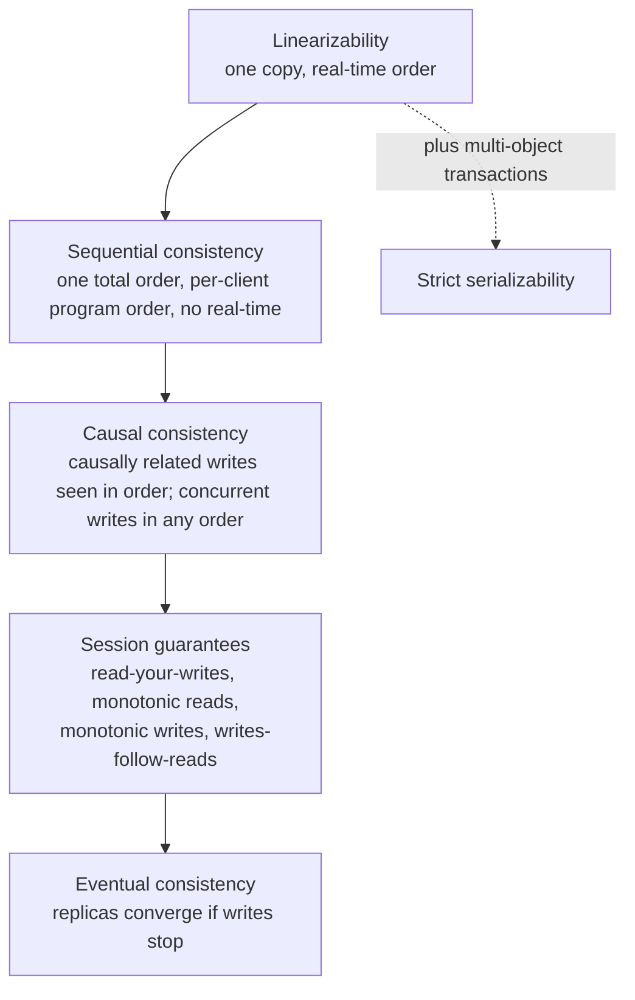

# Consistency Models: Linearizability to Eventual

> The hierarchy, with a history checker you can run.

**Type:** Learn
**Languages:** —
**Prerequisites:** Phase 5 Lesson 03 (Lamport and Vector Clocks), Phase 5 Lesson 04 (Physical Clocks, NTP, and Hybrid Logical Clocks), Phase 4 Lesson 01 (Threads and the Memory Model)
**Time:** ~90 minutes

## Learning Objectives

- Define linearizability, sequential consistency, causal consistency, the four session guarantees, and eventual consistency precisely enough to tell any two neighbours apart
- Draw the hierarchy and state, for each model, which histories it admits that the model above it rejects
- Check a concrete history of reads and writes against each model by hand, and explain each verdict in one sentence
- Name what each model costs in latency, availability under partition, and coordination
- Decide which model a payment balance read needs for each purpose it serves, and explain why the authorization path needs more than a consistent read

## The Problem

A wallet service stores each customer's balance in a database with one leader and two read replicas. Writes go to the leader; reads are load-balanced across the replicas because reads outnumber writes forty to one. Replication is asynchronous and usually lags by a few milliseconds. A customer with a balance of 50.00 USD opens the app and taps "add 100.00". The top-up is written to the leader. She immediately buys a 120.00 USD item. The purchase service reads her balance to check that it covers the price. The read goes to replica 2, which has not yet applied the top-up, and returns 50.00. The purchase is declined for insufficient funds. She refreshes the app; the balance read hits replica 1, which has caught up, and shows 150.00. She tries again and it goes through. One confused customer, one support ticket, no money lost.

Now change one detail. Two purchase requests for 120.00 USD arrive within the same millisecond, from two devices sharing the account. Both read the balance; both reads happen to hit replicas that show 150.00; both pass the check; both debits are sent to the leader. The leader applies both. The balance is now minus 90.00 USD. The wallet has extended credit it never agreed to, and the amount is bounded only by how many concurrent requests the customer can generate. This is not a replication bug. Every replica did exactly what asynchronous replication promises: it eventually showed the right value. The failure is that the purchase service needed a guarantee about *when* a read reflects a write, and nobody had written down which guarantee that was.

Consistency models are the vocabulary for writing it down. Each model is a contract between a storage system and its clients about which values a read may return, given the writes that have happened and the order they happened in. The models form a hierarchy from linearizability, where a read always returns the most recent completed write and the system behaves as if there were one copy, down to eventual consistency, where a read may return anything that was ever written as long as the replicas agree at some point in the future. The stronger the model, the more coordination it demands and the less available it is when the network partitions. The weaker the model, the more of the correctness burden moves into the application. The wallet failed because the purchase check assumed the top of the hierarchy and the database delivered the bottom.

This lesson defines each level precisely, walks one history of reads and writes through every level by hand, puts a price on each, and then returns to the wallet to say exactly what the authorization path needs and why a consistent read alone is still not enough.

## The Concept

### What a consistency model is

A **history** is a record of operations issued by clients against a shared object: each operation has an invocation time, a response time, and a value (the value written, or the value a read returned). A **consistency model** is a predicate on histories: it says which histories the system is allowed to produce. A system *provides* a model if every history it can produce satisfies the predicate.

Two things follow. First, a model says nothing about implementation. A single-node database and a five-node Raft cluster can both be linearizable; a leader with asynchronous replicas and a Dynamo-style leaderless store can both be eventually consistent. Second, a model is tested against a history, not against the system, which is why the model can be checked: record what clients saw, then ask whether any valid explanation exists. Jepsen and Lesson 12 of Phase 6 do exactly this, and the hand-check later in this lesson is the same procedure at human scale.

The models below are *single-object* models: they talk about reads and writes to one register (one balance). Transactions over several objects have their own hierarchy (serializability, snapshot isolation) in Phase 7; the two meet at *strict serializability*, which is serializability plus the real-time ordering of linearizability.

### The hierarchy



An arrow means "every history admitted by the lower model is also admitted by the upper one's superset": linearizable histories are sequentially consistent, sequentially consistent histories are causally consistent, and so on. Going down the diagram, each level admits more histories, which means it allows more behaviours the application must tolerate, and in exchange it costs less.

### Three words that get confused

Design reviews lose time to three terms that sound alike and are not:

| Term | Scope | Real-time clause? | What it guarantees |
|------|-------|-------------------|--------------------|
| Linearizability | One object, single operations | Yes | Every read sees the latest completed write; the object behaves as one copy |
| Serializability | Many objects, transactions | No | Transactions appear to run in *some* serial order, which may not match the order they committed in real time |
| Strict serializability | Many objects, transactions | Yes | Serializable, and the serial order respects real time; Spanner calls this external consistency |

A serializable database may legally run your 10:00 transfer after your 10:01 transfer, as long as the result equals some serial schedule. That is usually harmless and occasionally the whole bug: a balance check committed "before" a debit that in real time it followed. When someone says a database is "ACID, so it is consistent," the question to ask is which of the three rows they mean, and the answer is almost always the middle one.

### Linearizability

A history is **linearizable** if there is a single total order of all operations such that (1) each read returns the value of the most recent write before it in that order, and (2) if operation A completed before operation B was invoked, in real time, then A comes before B in the order. Herlihy and Wing (1990) defined it; the second clause is what makes it strong. Every operation appears to take effect instantaneously at some point between its invocation and its response, its *linearization point*, and the system behaves exactly as a single copy of the data would.

The practical consequence: once any client has received a response saying a write completed, every subsequent read by any client anywhere returns that write or a later one. There is no "stale" read. A linearizable balance read after the top-up is acknowledged returns 150.00, from any replica, on any device.

What distinguishes it from the next level down is the real-time clause. Linearizability is the only model in the hierarchy that lets a client reason about writes it learned of *outside* the system: "I saw the confirmation email, so my next read will reflect it." That is also why it is the most expensive, because the system must know, at the moment of the read, that no write it has not yet seen has already completed elsewhere.

### Sequential consistency

A history is **sequentially consistent** if there is a single total order of all operations such that each read returns the most recent write before it, and the order respects each client's *program order*: the operations of one client appear in the order that client issued them. Lamport defined it in 1979 for multiprocessors. The real-time clause is gone. Two different clients' operations may be reordered relative to real time as long as everybody agrees on the one resulting order.

The gap this opens: client A writes 70 and gets an acknowledgement; a second later, client B reads 100, the previous value. This is forbidden under linearizability (the write completed before the read began) but allowed under sequential consistency, provided a total order exists in which B's read is placed before A's write, which it can be, since A and B are different clients with no program-order constraint between them. The system is allowed to show B a world in which A's write has not happened yet, as long as it never later shows B a world in which it un-happens.

Sequential consistency is rarely offered as a product guarantee by a distributed database, because providing it costs about as much as linearizability (Attiya and Welch, 1994, showed that one of reads or writes must pay a network round trip under either model) while giving the client less. It matters because it is what most CPU memory models approximate and because it is the clearest way to see what the real-time clause of linearizability buys.

### Causal consistency

A history is **causally consistent** if writes that are *causally related* are seen by every client in the same causal order, while writes that are *concurrent* (neither could have influenced the other) may be seen in different orders by different clients. Causality here is Lamport's happens-before from Lesson 03: a write depends on every write the same client previously issued and on every write it previously read.

Example of what causal allows that sequential forbids: client P writes `x = a` and, independently, client Q writes `x = b` at about the same time. Client C observes `a` then `b`; client D observes `b` then `a`. Under sequential consistency this is impossible, since there is one total order and either `a` or `b` is last. Under causal consistency it is fine, because `a` and `b` are concurrent: neither writer knew of the other. Both C and D will eventually agree on a winner once a conflict rule (Phase 6, Lesson 09) is applied, but their intermediate views may differ.

Example of what causal forbids that eventual allows: a customer posts a top-up, then (having seen it) posts a payment. Another client sees the payment but not the top-up: a balance that went down before it went up. The payment causally depends on the top-up, so causal consistency requires anyone who sees the payment to see the top-up first.

Causal consistency is the strongest model that can remain available during a network partition (Mahajan, Alvisi, and Dahlin, 2011), which is why it is the usual target for geo-distributed systems that cannot pay for consensus on every operation. Its cost is metadata: each write carries enough information (vector clocks, dependency lists) for a replica to delay applying it until its causal predecessors have arrived.

### The session guarantees

Terry and colleagues (1994), working on the Bayou system, identified four properties that a single client's *session* can be given even when the system as a whole is only eventually consistent:

| Guarantee | Promise to one session | The incident it prevents |
|-----------|------------------------|--------------------------|
| Read-your-writes | A read returns your own earlier writes or later values | The customer tops up and the next screen shows the old balance |
| Monotonic reads | Once you have read a value, no later read returns an older one | The balance shows 150.00, then 50.00, then 150.00 as reads bounce between replicas |
| Monotonic writes | Your writes are applied everywhere in the order you issued them | A "set limit to 500" followed by "set limit to 200" ends with 500 on one replica |
| Writes-follow-reads | A write you issue after reading a value is ordered after that value everywhere | A reply to a comment arrives at a replica before the comment it answers |

All four together are weaker than causal consistency (they say nothing about ordering across sessions) and much stronger than plain eventual consistency for the one thing users notice, which is their own view of their own actions. They are cheap: route a session to the same replica (sticky sessions), or have the client carry a version token from its last write and have replicas refuse to answer from a state older than the token. Phase 6, Lesson 02 builds read-your-writes with exactly that token.

### Eventual consistency

A system is **eventually consistent** if, once writes stop, all replicas eventually hold the same value. That is the whole promise. It says nothing about what a read returns while writes are happening, nothing about order, and nothing about how long "eventually" is. Vogels' 2009 paper introduced the term to a wide audience as the model behind Amazon's shopping-cart storage. It is the weakest useful model and the cheapest: a write is acknowledged as soon as one replica has it, a read is answered by whichever replica is nearest, and the network partitioning does not stop either.

The price is paid by the application. Any read may be stale by an unbounded amount; two reads in a row may go backwards; a read after your own write may not show it. Code that does check-then-act on an eventually consistent read, as the wallet did, is wrong by construction.

### The models and their costs

| Model | Read may return | Needs coordination on every | Available under partition? | Typical mechanism |
|-------|-----------------|-----------------------------|----------------------------|-------------------|
| Linearizable | Only the latest completed write | Read and write (quorum or leader round trip) | No (CAP: must refuse or wait) | Single leader with synchronous majority; Raft/Paxos; `R + W > N` with read repair done carefully |
| Sequential | Latest write in some agreed total order, possibly behind real time | One of reads or writes | No | Rare as a product; CPU memory models |
| Causal | Any value whose causal predecessors you have already seen | Neither; dependency metadata instead | Yes | Vector clocks or dependency lists; COPS, Bayou |
| Session guarantees | Anything consistent with this session's own history | Neither; per-session token or sticky routing | Yes | Version token carried by the client |
| Eventual | Anything ever written | Nothing | Yes | Async replication; gossip; anti-entropy |

"Available under partition" is the CAP question (Lesson 06): a model above the causal line must sometimes answer "I cannot tell you" rather than risk a wrong answer. A model at or below it can always answer, at the risk of being stale.

### The price in milliseconds

The coordination column turns into latency you can measure. Take a wallet deployed across two regions 70 ms apart, with the leader in region 1 and a customer in region 2:

| Read served as | Where the answer comes from | Added latency for the region-2 customer | Can answer during a partition between regions? |
|----------------|-----------------------------|------------------------------------------|------------------------------------------------|
| Linearizable | The leader, or a majority quorum that includes it | One round trip, about 70 ms, on every read | No: region 2 cannot reach the leader |
| Session (read-your-writes) | The local replica, once it has reached the client's version token | 0 ms normally; a wait of up to the replication lag right after the client's own write | Yes, except in the lag window after an own write |
| Causal | The local replica, once the read's causal dependencies have arrived | 0 ms normally; buffering when a dependency is late | Yes |
| Eventual | The local replica, whatever it holds | 0 ms | Yes |

Forty reads per write and 70 ms per linearizable read is why nobody serves the balance screen from the leader. The number also explains the shape of every production system below: offer the cheap read by default and the expensive one on request, per operation, so the application pays only where it must.

### What production systems actually promise

The models are not academic labels; each major store documents where it sits, and the documentation is the contract you are relying on in a design review.

| System | Default read | Stronger option | Where it sits |
|--------|--------------|-----------------|---------------|
| PostgreSQL with streaming replicas | Replica reads are asynchronous: eventual | Read from the primary; or `synchronous_commit = remote_apply` so a commit waits until named replicas have applied it, which gives read-your-writes against those replicas | Linearizable on the primary, eventual on replicas unless you pay for `remote_apply` |
| Amazon DynamoDB | Eventually consistent read (documented as "might not reflect the results of a recently completed write") | `ConsistentRead = true`: strongly consistent, at double the read-capacity cost and unavailable if the leader replica is unreachable | Per-request choice between linearizable and eventual |
| Apache Cassandra | Tunable per query: `ONE`, `QUORUM`, `ALL` | `QUORUM` reads and writes give a read that overlaps every acknowledged write; lightweight transactions (Paxos) for compare-and-set | Eventual by default; linearizable per-register only with LWT |
| Azure Cosmos DB | Session consistency | Five named levels: strong, bounded staleness, session, consistent prefix, eventual | The only major product that names the whole hierarchy and lets you pick per account or per request |
| Apache ZooKeeper | Reads from any server: sequentially consistent, may lag | `sync()` before a read to catch up to the leader | Linearizable writes, sequential reads; the documentation says so in exactly those words |
| Google Spanner | External consistency for every transaction | None needed | Strict serializability, bought with TrueTime and a commit-wait of a few milliseconds |
| Redis replication | Replica reads are asynchronous: eventual | `WAIT n` blocks a write until `n` replicas acknowledge; does not make reads linearizable | Eventual; a replica can serve a value the primary has already overwritten |

Two lessons from the table. First, "strongly consistent" in vendor documentation almost always means linearizable for a single key and nothing more; DynamoDB's strongly consistent read of item A says nothing about item B. Second, the default is almost always the cheap one. The DynamoDB and PostgreSQL rows describe the wallet in The Problem exactly: fast reads from a replica, correctness only on request.

### A decision procedure for a read

For each read in a payment flow, answer four questions in order and stop at the first that applies.

1. **Will the result decide whether money moves?** (Authorization, limit check, duplicate detection.) The read must be linearizable, and the decision it feeds must be made atomic with the write it guards: a conditional write, compare-and-set, or a serializable transaction. A linearizable read alone is necessary and not sufficient.
2. **Will the customer who just wrote something see this read next?** (Balance after top-up, order status after payment.) Read-your-writes and monotonic reads: a version token or sticky routing to a replica. No leader round trip.
3. **Does the read combine several things that must be mutually consistent?** (A statement that lists a transfer and the balance it produced.) Causal consistency, or read everything from one snapshot (Phase 7); a mix of replicas with different lag will show the effect without the cause.
4. **Otherwise** (analytics, fraud features over history, dashboards): eventual, from the cheapest replica, with the lag measured and alerted on so "eventually" has a number.

Write the answer next to the read in the design document. The wallet's incident is a read that was never asked question 1. `outputs/interview-card-consistency-models.md` is this procedure, the hierarchy, and the four histories from the next section on one page, for a design review or an interview.

## Worked Example

One register `x`, the balance, initially 0. Four histories, each a list of operations with real-time invocation and response in brackets. `W(v)` writes `v`; `R=v` is a read returning `v`. Client names are capital letters. For each history, each model gives a verdict, and the verdict has a one-sentence reason.

### History 1: a stale read by a different client

```text
A: W(100)   [0, 2]
B: W(70)    [3, 5]
C: R=70     [6, 7]
D: R=100    [8, 9]
```

- **Linearizable: rejected.** `W(70)` completed at 5; `D`'s read began at 8 and must see 70 or later. It saw 100.
- **Sequential: accepted.** Total order `W(100), R=100 (D), W(70), R=70 (C)`. Each client has one operation, so program order is trivially respected, and each read sees the latest write before it in the order.
- **Causal: accepted.** Nothing is causally related across clients here; any sequentially consistent history is causally consistent.
- **Eventual: accepted.** Stale reads are permitted.

This is the wallet's first incident: the purchase service (D) read 100 after the leader had already acknowledged 70. The database was behaving sequentially, not linearizably, and the application assumed the difference away.

### History 2: one client's reads go backwards

```text
P: W(100)   [0, 2]
P: W(70)    [3, 5]
C: R=70     [6, 7]
C: R=100    [8, 9]
```

- **Linearizable: rejected.** `C`'s second read must see 70 or later.
- **Sequential: rejected.** Program order requires `W(100)` before `W(70)` (same client P) and `R=70` before `R=100` (same client C). `R=70` must come after `W(70)`, so `R=100` comes after `W(70)` too, but then it cannot return 100. No total order exists.
- **Causal: rejected.** `W(70)` causally follows `W(100)` (same writer). `C` has seen `W(70)`, so every later read by `C` must reflect it; returning 100 shows `C` a state before a write it already observed.
- **Monotonic reads: violated**, and this is the session guarantee that would have caught it.
- **Eventual: accepted.** The replicas will converge on 70.

This is the refreshing customer watching the balance flicker. Nobody lost money, but the history is not even causally consistent.

### History 3: a client cannot see its own write

```text
C: W(70)    [0, 2]
C: R=100    [3, 4]
```

- **Linearizable, sequential, causal: all rejected.** The read follows the write in C's program order and must return 70; causally, the read depends on the write.
- **Read-your-writes: violated.** This is the guarantee's defining case.
- **Eventual: accepted.**

### History 4: concurrent writes, seen in different orders

```text
P: W(a)     [0, 2]
Q: W(b)     [0, 2]
C: R=a      [3, 4]
C: R=b      [5, 6]
D: R=b      [3, 4]
D: R=a      [5, 6]
```

- **Linearizable: rejected.** Both writes completed by 2; either `a` or `b` is the later one in the linearization, and one of C or D reads the earlier value after reading the later one.
- **Sequential: rejected.** One total order has a last write; C's and D's second reads disagree about which it is.
- **Causal: accepted.** `W(a)` and `W(b)` are concurrent (P and Q did not read each other's writes), so clients may see them in different orders. Monotonic reads is not violated because neither read goes back to a value *older in causal order* than one already seen.
- **Eventual: accepted**, provided a conflict rule eventually picks one value on every replica.

### The verdicts in one table

| History | Linearizable | Sequential | Causal | Session guarantees | Eventual |
|---------|--------------|------------|--------|--------------------|----------|
| 1: stale read, other client | No | Yes | Yes | Yes | Yes |
| 2: own reads go backwards | No | No | No | No (monotonic reads) | Yes |
| 3: cannot see own write | No | No | No | No (read-your-writes) | Yes |
| 4: concurrent writes, different orders | No | No | Yes | Yes | Yes |

Read the table by column to see what each model costs the application: the eventual column is all Yes, so an application on an eventual store must tolerate every one of those histories. Read it by row to see what each model buys: only linearizability rejects History 1, so only linearizability makes the purchase service's read trustworthy.

### A checker you can run

The verdict for linearizability is a search: does any total order satisfying both clauses exist? For a history of a dozen operations the brute-force version fits in a few lines and is worth running once to see that the definition is mechanical.

```python
from itertools import permutations

def linearizable(history):
    """history: list of (client, kind, value, invoke, respond). kind is 'W' or 'R'."""
    def real_time_ok(order):
        return all(not (a[4] < b[3] and order.index(b) < order.index(a))
                   for a in history for b in history if a is not b)
    def reads_ok(order):
        value = None
        for op in order:
            if op[1] == 'W':
                value = op[2]
            elif op[2] != value:
                return False
        return True
    return any(real_time_ok(o) and reads_ok(o) for o in permutations(history))

h1 = [("A","W",100,0,2), ("B","W",70,3,5), ("C","R",70,6,7), ("D","R",100,8,9)]
print(linearizable(h1))   # False: D's read must see 70
```

Dropping `real_time_ok` and replacing it with a per-client program-order check turns this into a sequential-consistency checker; History 1 then passes. Phase 6, Lesson 12 replaces the factorial search with the Wing-Gong algorithm so the same check runs on histories of thousands of operations recorded from a real replicated register.

### Back to the wallet: what a balance read needs

The wallet reads its balance for three purposes, and they need three different models:

1. **Showing the balance in the app.** The customer needs to see her own top-up (read-your-writes) and never see the number go backwards (monotonic reads). Nothing else. A version token or sticky session delivers both from a replica, with no round trip to the leader.
2. **Statements, analytics, fraud scoring over history.** Eventual is fine. These read yesterday's data and tolerate seconds or minutes of lag; routing them to replicas is why the replicas exist.
3. **Deciding whether a purchase may proceed.** This needs linearizability of the read at minimum: the check must see every acknowledged top-up and every acknowledged debit, from any device, or the double-spend in The Problem is possible. Read from the leader, or from a quorum, and pay the round trip.

Then notice that a linearizable read is still not enough for purpose 3. The check and the debit are two operations. Two linearizable reads can both return 150.00 if both happen before either debit, and both purchases then proceed. The authorization path needs the check and the debit to be a single atomic operation: a conditional write (`debit 120 if balance >= 120`), a compare-and-set on the balance version, or a serializable transaction (Phase 7, Lessons 05 and 06). The consistency model tells you what a read means; it does not make check-then-act atomic. Phase 10's ledger lessons build the balance as an append-only sequence of postings with exactly this conditional-append rule, which is why double-entry bookkeeping and linearizability turn out to be the same discipline seen from two sides.

### What a consistency model does not tell you

- It does not tell you how stale "stale" is. Eventual consistency with 2 ms of lag and eventual consistency with 2 hours of lag satisfy the same predicate. Bounded staleness is a separate, quantitative promise some systems make (Azure Cosmos DB names it as a level).
- It does not tell you what happens to concurrent writes. Causal and eventual consistency permit divergence; which value wins is a conflict-resolution rule (Phase 6, Lesson 09), and last-writer-wins silently discards one of the two.
- It does not cover transactions over several objects. "Linearizable" is per object. Moving money between two balances needs the transaction hierarchy of Phase 7, and strict serializability is the point where the two hierarchies meet.

## Exercises

1. **Reinforce.** Write a fifth history in which read-your-writes and monotonic reads both hold for every client, yet the history is not causally consistent. Hint: it needs three clients, two registers, and a write to one register that depends on a read of the other. Give each model's verdict with a one-sentence reason.
2. **Apply.** Take the Python checker above and add a `sequentially_consistent(history)` function that replaces the real-time clause with a per-client program-order clause. Run both functions on all four histories and reproduce the first two columns of the verdict table. Then construct the smallest history you can find on which the two functions disagree.
3. **Extend.** Using the vector clocks from Lesson 03, annotate each operation in History 4 with a vector timestamp and show mechanically that `W(a)` and `W(b)` are concurrent, then do the same for History 2 and show that `W(70)` dominates `W(100)`. Explain, in terms of those timestamps, the rule a replica would enforce to provide causal consistency, and what it would have to buffer.

## Key Terms

| Term | What people say | What it actually means |
|------|-----------------|------------------------|
| Linearizability | "strong consistency" | A single total order of operations that respects real time: once a write is acknowledged, every later read anywhere returns it or a newer value; the system behaves as one copy |
| Sequential consistency | "everyone sees the same order" | A single total order that respects each client's program order but not real time; a client may read a value that another client has already overwritten |
| Causal consistency | "related things in order" | Writes that could have influenced each other are seen in that order everywhere; concurrent writes may be seen in different orders by different clients |
| Session guarantees | "read your own writes" | Four per-client promises (read-your-writes, monotonic reads, monotonic writes, writes-follow-reads) that make one client's view coherent on an otherwise eventual store |
| Eventual consistency | "it'll sort itself out" | If writes stop, replicas converge; no promise about what any read returns in the meantime, or how long "eventually" is |
| History | "the log" | The record of operations with invocation and response times and values; a consistency model is a predicate on histories, which is what makes it checkable |
| Linearization point | "when the write really happens" | The instant between invocation and response at which an operation appears to take effect atomically under linearizability |
| Strict serializability | "linearizable transactions" | Serializability over multi-object transactions plus the real-time ordering of linearizability; where the single-object and transaction hierarchies meet |

## Further Reading

- [Herlihy and Wing, "Linearizability: A Correctness Condition for Concurrent Objects" (1990)](https://cs.brown.edu/~mph/HerlihyW90/p463-herlihy.pdf) — the definition, the real-time clause, and the proof that linearizability is local (composable per object), which sequential consistency is not.
- [Lamport, "How to Make a Multiprocessor Computer That Correctly Executes Multiprocess Programs" (1979)](https://lamport.azurewebsites.net/pubs/multi.pdf) — the one-page definition of sequential consistency, worth reading to see how little it says about time.
- [Terry et al., "Session Guarantees for Weakly Consistent Replicated Data" (1994)](https://doi.org/10.1109/PDIS.1994.331722) — read-your-writes and its three siblings, with the version-vector mechanism that provides them.
- [Vogels, "Eventually Consistent" (2009)](https://dl.acm.org/doi/10.1145/1435417.1435432) — the paper that named the model for practitioners and lists the session variants as the useful middle ground.
- [Attiya and Welch, "Sequential Consistency versus Linearizability" (1994)](https://dl.acm.org/doi/10.1145/176575.176576) — the cost result: under either model one of reads or writes must pay a network round trip, so sequential consistency is not the cheap option it looks like.
- [Jepsen, "Consistency Models"](https://jepsen.io/consistency) — the hierarchy as a navigable map with every model's definition, availability, and the anomalies it permits; the reference to keep open during a design review.
- [Amazon DynamoDB Developer Guide, "Read consistency"](https://docs.aws.amazon.com/amazondynamodb/latest/developerguide/HowItWorks.ReadConsistency.html) — a vendor contract in two paragraphs: what an eventually consistent read may return and what `ConsistentRead` costs; read it as a specimen of how the models appear in documentation.
- [ZooKeeper Programmer's Guide, "Consistency Guarantees"](https://zookeeper.apache.org/doc/current/zookeeperProgrammers.html#ch_zkGuarantees) — sequential consistency for reads and linearizable writes stated as a product guarantee, with `sync()` as the escape hatch.
- [Bailis et al., "Highly Available Transactions: Virtues and Limitations" (2014)](https://www.vldb.org/pvldb/vol7/p181-bailis.pdf) — which models and isolation levels can be provided without coordination, and the proof that causal is the strongest available one.
