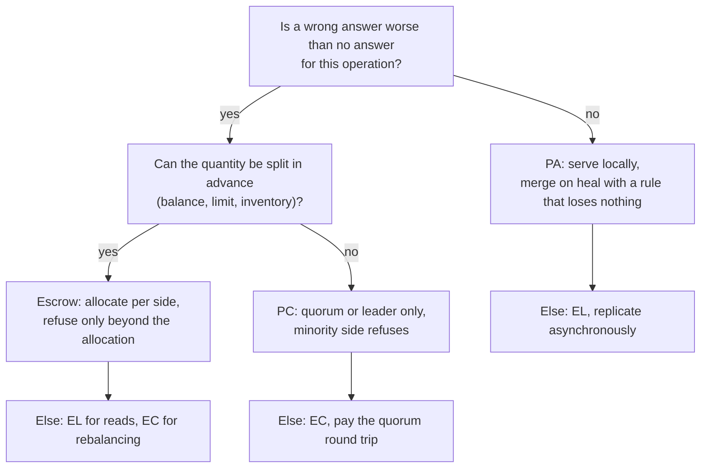

# CAP, PACELC, and What They Actually Constrain

> Partition tolerance is not optional, so the choice is simpler than the triangle.

**Type:** Learn
**Languages:** —
**Prerequisites:** Phase 5, Lesson 02 (Failure Models), Phase 5, Lesson 05 (Consistency Models)
**Time:** ~60 minutes

## Learning Objectives

- State the CAP theorem as Gilbert and Lynch proved it, with the precise meanings of consistency, availability, and partition in that proof
- Reproduce the two-node impossibility argument and explain why it does not depend on timing
- List what CAP does not constrain: latency, behaviour without partitions, weaker consistency models, per-operation choices, and anything beyond a read/write register
- Explain PACELC and classify a system by its partition-time and normal-time trade-offs
- Classify a ledger, a session store, an idempotency store, and a card network's stand-in processing, and defend each classification with the failure it prevents or accepts
- Design a bounded-inconsistency scheme (escrow) that keeps a balance available during a partition without permitting unbounded overdraft

## The Problem

A wallet product stores customer balances in a database replicated across two regions, `us-east` and `us-west`. Writes go to whichever region the customer's request lands in; replication between regions is asynchronous with a typical lag of 80 ms. The team chose this because the architecture review had a slide with a triangle on it, and someone said "we need availability, so we are AP". A customer with a 500.00 USD balance has two sessions open: a browser in Boston and a phone in San Francisco.

At 14:02 a fibre cut between the regions stops replication. Neither region notices for 40 seconds, because the replication client retries silently. For the next four minutes each region serves reads and writes from its own copy. The browser spends 450.00 USD on a flight. The phone spends 380.00 USD on a hotel. Both regions see a balance of 500.00, both approve, both post. When the link returns at 14:06 the replicas exchange their logs, and the merge policy, last-writer-wins by wall clock, picks the hotel's balance of 120.00 USD. The flight debit is gone from the balance but the flight ticket has been issued, and the customer's statement now shows one of two transactions. The ledger (Phase 10, Lesson 03) that recorded both postings disagrees with the balance by exactly 450.00. Across the four minutes, 2,311 customers were in the same position, and 190 of them spent more than they had.

The opposite mistake is just as common. A session store that holds nothing but "this cookie belongs to this user, logged in at this time" is deployed as a strongly consistent cluster across the same two regions, because "sessions are security-sensitive". During the same fibre cut the minority region cannot form a quorum, refuses every session read, and every customer routed there is logged out at checkout. Nothing was at risk in the data; the system simply applied the wrong trade-off to the wrong data and turned a network fault into a revenue outage.

Both teams believed they had made a choice from a triangle. The theorem they were half-remembering says something narrower and more useful: when the network is partitioned, a single piece of replicated data cannot be both linearizable and served by every node, so you must decide in advance which of the two you give up, for which data, and what you do about it when the partition heals. This lesson states the theorem precisely, lists what it does and does not constrain, adds the normal-operation trade-off (PACELC) that matters far more often than partitions do, and then classifies the systems a payments engineer actually builds.

## The Concept

### The theorem as proved

Brewer presented CAP as a conjecture in a 2000 keynote. Gilbert and Lynch proved a precise version in 2002. The precision is the point, so here are the three terms as the proof defines them.

**Consistency** means **linearizability** of a single read/write register (Lesson 05): every operation appears to take effect at one instant between its invocation and its response, and that instant order is consistent with real time. A read that starts after a write completes must return that write's value or a later one. This is not the C in ACID (integrity constraints), and it is not "the replicas eventually agree".

**Availability** means every request received by a **non-failing** node eventually receives a **non-error** response. Not "99.99% uptime", not "low latency", not "most requests succeed". The definition has no time bound at all; a node that takes an hour to answer is available. What it rules out is a node that is up, reachable by the client, and refuses to answer because it cannot reach its peers.

**Partition tolerance** means the system continues to satisfy its guarantees when the network **loses arbitrarily many messages** between nodes. This is the term the triangle misrepresents. Partition tolerance is not a property you choose to have; message loss is a property of the network (Lesson 01, fallacy one). Every system that spans more than one machine is subject to partitions. The only choice is what the system does when one happens.

The theorem: **in an asynchronous network in which messages can be lost, no read/write register can guarantee both linearizability and availability.**

### The two-node argument

The proof is short enough to carry in your head, and it is the argument you should reproduce whenever someone claims to have both.

```mermaid
sequenceDiagram
  participant C1 as Client 1
  participant G1 as Node G1 (value v0)
  participant G2 as Node G2 (value v0)
  participant C2 as Client 2
  Note over G1,G2: partition: no messages pass between G1 and G2
  C1->>G1: write(v1)
  G1-->>C1: ok (availability requires a response)
  Note over G1: G1 now holds v1; cannot tell G2
  C2->>G2: read()
  G2-->>C2: v0 (availability requires a response; G2 has heard nothing)
  Note over C1,C2: read began after write completed, returned the old value: not linearizable
```

Place the nodes in two groups, `G1` and `G2`, and cut every message between them. A client writes `v1` to `G1`. Availability says `G1` must respond, and since the write is acknowledged, a linearizable register now has value `v1`. A second client then reads from `G2`. Availability says `G2` must respond. `G2` has received no message from `G1` since the partition began, so its state is indistinguishable from an execution in which the write never happened, and it returns `v0`. The read started after the write finished and returned a stale value, which violates linearizability. If instead `G2` refused to answer or returned an error, it violated availability. There is no third option, and nothing in the argument depends on how long anything took: it holds even if `G2` waits a week before answering, because the partition may last a week.

Two corollaries fall out. First, the theorem is about **what a node does when it cannot reach its peers**. A CP system has `G2` refuse (or redirect to `G1`'s side); an AP system has `G2` answer with what it has. Second, the theorem is per register and per partition. A system may make one choice for balances and another for sessions, and it may make different choices for reads and writes.

### What CAP does not constrain

Most misuse of CAP comes from applying it outside its statement. The list of things it does not say is longer than the theorem.

| Claim | CAP's position | Why |
|-------|----------------|-----|
| "You must pick two of three" | False | Partitions are not optional; the choice is C or A during a partition, and only then |
| "A CA system exists" | Meaningless | A system that is unavailable or inconsistent during partitions has made a choice; one that claims neither has not been partitioned yet |
| "CP systems are slow" | Not addressed | The proof has no notion of latency; latency is PACELC's subject |
| "AP systems are eventually consistent" | Not addressed | AP says a node answers; it says nothing about what consistency it does provide, which can be causal, read-your-writes, or none |
| "CP systems are unavailable" | Only during partitions, only on the minority side | A quorum system serves every client that can reach the majority; unavailability is confined to the partitioned minority |
| "The database is CP" or "is AP" | Underspecified | The choice is per operation and per configuration; the same product can be configured either way, and often is |
| "CAP applies to transactions" | Not directly | The proof concerns a single register; multi-object transactions have their own, stronger impossibility results and their own protocols (Phase 7) |
| "Causal consistency is impossible under partition" | False | Mahajan, Alvisi, and Dahlin showed real-time causal consistency is the strongest model achievable with availability; only linearizability and stronger are excluded |

The practical reading is Brewer's own from 2012: partitions are rare, so design for the common case first, and when a partition does occur, **detect it, enter an explicit partition mode with limited operations, and run recovery when it heals.** The wallet team in The Problem had no partition mode; the system silently continued in a state its designers had not reasoned about.

### Partially synchronous networks

Gilbert and Lynch add a result for the partially synchronous model (Lesson 02): if every node has a local clock and message delay is bounded when the network is not partitioned, a system can provide **t-connected consistency**. During a partition, writes on each side are ordered locally; once the partition heals, the sides exchange logs and the register returns to linearizable behaviour within a bounded time. Reads during the partition may be stale, but the staleness is bounded by the partition's duration plus the delay bound. This is the formal home of "eventually consistent with a known convergence time", and it is what a well-run AP system actually offers. The wallet's problem was not that it was AP; it was that its reconciliation after healing (last-writer-wins) discarded a write instead of merging two.

### PACELC: the trade-off that applies every day

Partitions in a well-run network are rare, perhaps a few per year per region pair. The trade-off that applies on every request is between **latency** and **consistency** when there is no partition, and CAP has nothing to say about it. Abadi's PACELC (2012) makes it explicit: if there is a **P**artition, choose **A** or **C**; **E**lse, choose **L**atency or **C**onsistency.

The else clause has a physical basis. Linearizability across replicas requires that a write be acknowledged by enough replicas that any subsequent read, wherever it lands, sees it. That is at least one round trip to a quorum before the response. Within a single availability zone that round trip is under a millisecond; between US coasts it is around 60 to 70 ms; across the Atlantic around 80 ms; US to Singapore around 200 ms. A PC/EC system pays that on every write. A PA/EL system acknowledges locally and replicates in the background, so its write latency is local disk latency, and its reads may be stale by the replication lag.

The cost of the else clause is arithmetic you should do before choosing. A write that must be acknowledged by a quorum before responding pays one round trip to the farthest quorum member; a write that must be acknowledged by every replica pays the round trip to the slowest.

| Replica placement | Quorum round trip | Typical p50 write latency, EC | Typical p50 write latency, EL |
|-------------------|-------------------|-------------------------------|-------------------------------|
| Three nodes, one zone | under 1 ms | 2 to 3 ms (network plus fsync) | 1 to 2 ms |
| Three zones, one region | 1 to 2 ms | 3 to 5 ms | 1 to 2 ms |
| Three US regions (east, central, west) | about 35 ms to the nearer of the other two | 40 to 50 ms | 1 to 2 ms |
| US east, EU west, Singapore | about 80 ms to the nearer | 90 to 100 ms | 1 to 2 ms |

For a ledger posting, 45 ms is a price a payments company pays without noticing: the card authorisation it is part of already takes 300 to 800 ms end to end. For a session lookup on every page view, 45 ms is a visible slowdown for no benefit. The same number is cheap or expensive depending on what it buys, which is why the classification has to be per component.

Abadi's classification of systems in the original paper:

| System | Partition | Else | Reading |
|--------|-----------|------|---------|
| Dynamo, Cassandra, Riak (default settings) | PA | EL | Answer from any replica; replicate in the background; resolve conflicts later |
| VoltDB, H-Store | PC | EC | Synchronous replication; refuse when the quorum is lost |
| Megastore, Spanner | PC | EC | Paxos per write; cross-region latency on every commit |
| MongoDB (as classified in 2012) | PA | EC | Reads and writes go to the primary normally; a failover can lose acknowledged writes |
| PNUTS | PC | EL | Reads from any replica for speed, but during partition the non-master region refuses writes |

The useful cells are the mixed ones. PA/EC says: fast is not the goal, consistency is, but when the network breaks we would rather keep answering than stop. PC/EL says the opposite: we tolerate stale reads every day for speed, but we will not accept a write we cannot make durable in the master region. Both are coherent positions, and neither is visible in the CAP triangle.

### The letters are configuration, not identity

Most production stores let the operator choose the letters per request or per table, which is why "is X CP or AP" has no answer and "how is X configured here" does.

| Store | Knob | Setting that gives C | Setting that gives A or L |
|-------|------|----------------------|---------------------------|
| Cassandra, Scylla | consistency level per query | `QUORUM` or `LOCAL_QUORUM` for both reads and writes (`R + W > N`) | `ONE` or `LOCAL_ONE`; fast, may read stale |
| DynamoDB | `ConsistentRead` flag | `true`: read from the leader replica | `false` (default): read from any replica, up to a second stale |
| PostgreSQL streaming replication | `synchronous_commit`, `synchronous_standby_names` | `remote_apply` to a named standby: committed means visible on the standby | `off` or `local`: commit returns before the standby has it |
| Kafka | `acks`, `min.insync.replicas` | `acks=all` with `min.insync.replicas=2` of 3: a write is durable on a majority | `acks=1`: leader only; a failover can lose it |
| etcd, ZooKeeper | read mode | linearizable read (default in etcd) goes through the leader | `serializable` read in etcd, `sync()`-less read in ZooKeeper: local, possibly stale |
| MongoDB | `writeConcern`, `readConcern` | `majority` for both | `w: 1`, `readConcern: local` |

Reading a system's knobs this way turns a vague architecture argument into a line in a configuration file that a reviewer can check. The wallet in The Problem would have been one setting away from Design 2; it would still have needed Design 3 to be a good wallet.

### Partition mode: detect, limit, recover

Brewer's 2012 procedure is the operational half of the theorem, and it is what the wallet lacked.

1. **Detect.** A partition begins when a node decides it cannot reach a quorum, which is a failure-detector decision (Lesson 02) with a timeout. For a system that replicates across regions, replication lag above a threshold (say, 5 seconds when the normal is 80 ms) is the usual signal. The 40 seconds the wallet took to notice were 40 seconds of silent divergence; a lag alarm at 5 seconds would have cut the exposure by a factor of eight.
2. **Enter partition mode.** Each side switches to a pre-agreed reduced set of operations. The table of what is allowed is written in advance, per operation, and it is where the PACELC decisions live.
3. **Recover.** On heal, replay or merge each side's log of partition-mode operations, apply compensations for anything that is now known to be wrong, and exit partition mode. The merge rule must be chosen for the data: a counter merges by sum, a set by union, a balance by applying both sides' postings to the pre-partition value. Last-writer-wins is a merge rule for data where losing a write is acceptable, and a balance is not such data.

For the wallet, the partition-mode table might read:

| Operation | Allowed in partition mode | Rule |
|-----------|---------------------------|------|
| Read display balance | Yes | Serve the local value with a staleness banner |
| Spend within regional allocation | Yes | Decrement the local allocation; log the posting |
| Spend beyond regional allocation | No | Refuse with a retryable error; do not queue |
| Top up (credit) | Yes | Credit the local allocation; it only increases what is available |
| Change account limits or close account | No | Requires the authoritative copy |
| Rebalance allocations | No | Requires both sides |

Every row is a decision someone can review, and the "No" rows are where the yield is sacrificed on purpose.

### Bounded inconsistency: escrow and stand-in

The dichotomy between "refuse" and "accept anything" is false for most money. The technique that dissolves it is old: O'Neil's **escrow transactions** (1986). Split a quantity across partitions in advance. Each side may consume its share without coordinating; only when a side exhausts its share does it need to ask the other. During a partition each side continues to serve requests up to its allocation, and the worst case is that a customer is refused when funds exist on the other side, never that the total is overspent.

Card networks run exactly this under the name **stand-in processing**. When an issuer is unreachable, the network authorises on the issuer's behalf according to limits the issuer set in advance: a per-transaction ceiling, a daily cumulative ceiling, and a list of merchant categories that are allowed. Authorisations made in stand-in are forwarded to the issuer when it reconnects and settled normally; the issuer bears the risk within the limits it chose. It is AP for the cardholder (the transaction is approved), bounded for the issuer (the exposure is capped), and recovered by reconciliation. The Visa and Mastercard rulebooks specify this behaviour in detail, including which party is liable for a stand-in authorisation that the issuer would have declined. It is the most widely deployed partition-mode protocol in the world, and almost nobody describes it with the word CAP.

### Classifying the systems a payments engineer builds

| Component | Data | During partition | Normal operation | Why |
|-----------|------|------------------|------------------|-----|
| Ledger (Phase 10, Lesson 03) | Postings and balances | PC: refuse postings that cannot reach a quorum | EC: synchronous replication, single-region quorum | A lost or duplicated posting is a reconciliation break; a few seconds of refusal is not |
| Account balance for authorisation | Available balance | Escrow: each region authorises against its allocation | EL for reads of the display balance; EC for the authorisation path | Overdraft is bounded by allocation; availability is preserved for most spends |
| Idempotency key store (Lesson 09) | Key to response mapping | PC: a key that cannot be checked is treated as unknown-unsafe, and the request is refused or queued | EC | A PA idempotency store that misses a key produces exactly the duplicate it exists to prevent |
| Session store | Cookie to identity | PA: serve from the local replica | EL | A stale session is a minor inconvenience; a logged-out customer at checkout is a lost sale |
| Payment status for a merchant dashboard | Read model (Phase 8, Lesson 06) | PA | EL | Stale by a few seconds is acceptable and expected; the dashboard is not the source of truth |
| Velocity limits (Phase 12, Lesson 09) | Count of spends per window | Escrow or PA with a documented overshoot bound | EL | A limit of 10 per hour enforced as "at most 12 during a partition" is a risk decision, made in advance |
| Fraud feature store | Aggregates per card | PA | EL | A missing feature degrades a score; it does not corrupt money |
| Card network authorisation | Issuer approval | Stand-in: PA with issuer-set limits | EC to the issuer when reachable | The rulebook assigns liability; recovery is by settlement and reconciliation |

Three rows deserve attention. The ledger is PC because its invariant (debits equal credits, every posting exactly once) is the thing the whole business reconciles against; it is the one component where refusing is always cheaper than being wrong. The idempotency store is PC for a reason that surprises people: it is a safety mechanism, and a safety mechanism that fails open is not one. The balance row shows that the real answer for money is usually neither C nor A but a third design that bounds the damage, and that design has to be chosen before the partition, because it needs the allocations in place.

### A decision procedure per operation



Five questions to ask of any CAP claim you hear in a review:

- Which register, and which operation on it? A system has many; the claim is per operation.
- What does the minority side do during a partition: refuse, serve stale, or serve from an allocation?
- What is the merge rule on heal, and can it lose an acknowledged write?
- What is the detection threshold, and how much divergence can accumulate before it fires?
- What does consistency cost on every request when the network is healthy, in milliseconds, and who pays it?

A claim that answers all five is a design. A claim that answers none is a triangle.

### The word "eventually"

"Eventually consistent" without a bound is a hope, not a guarantee. The t-connected result gives the shape of a real guarantee: convergence within the partition duration plus a known delay. Production systems achieve it with anti-entropy (periodic replica comparison, usually by Merkle tree, Phase 3) and read repair, and they publish the lag as a metric. A system that cannot tell you its current replication lag cannot tell you how stale its AP reads are, which means its PA/EL classification is incomplete.

### Harvest and yield

Fox and Brewer's 1999 framing predates CAP and is often more useful for a service than for a register. **Yield** is the fraction of requests answered. **Harvest** is the fraction of the data reflected in an answer. A search engine with one shard down returns results from the other shards: 100% yield, 90% harvest. A payments dashboard during a partition can show every payment it knows about and a banner saying "updated as of 14:02": full yield, reduced harvest, honestly labelled. A balance check cannot reduce harvest, because a partial balance is a wrong balance; it has to reduce yield (refuse) or use escrow. Asking "which of harvest or yield can this operation degrade?" is a sharper design question than "is this CP or AP?".

### What CAP and PACELC do not do

They do not tell you how to detect a partition, how long to wait before declaring one, or how to recover. Those are the failure-detector problem (Lesson 02), the lease and fencing problem (Lesson 12), and the conflict-resolution problem (Phase 6, Lesson 09). They do not rank consistency models; Lesson 05 does. They do not tell you which choice is right; that is a question about the cost of a wrong answer versus the cost of no answer, which is a business decision that an engineer must extract from the business before the partition, not during it. And they say nothing about correlated failure or about the much more common case of a slow, flapping network that is not quite partitioned, in which both CP and AP systems behave worse than their designers expect.

## Worked Example

### The wallet, three ways

Return to the wallet from The Problem: one customer, 500.00 USD, two regions, a four-minute partition, a 450.00 spend in the east and a 380.00 spend in the west. Work through three designs with exact numbers.

**Design 1: AP with last-writer-wins (what shipped).** Both regions start at 500.00. East posts the flight: balance 50.00, posting recorded. West posts the hotel: balance 120.00, posting recorded. On heal, the balance register merges by wall-clock timestamp. The hotel's write at 14:04:31 beats the flight's at 14:03:12, so the balance is 120.00. The ledger has two postings totalling 830.00 against a 500.00 opening balance; the register says 120.00; the correct value is a 330.00 overdraft that nobody authorised. Harvest is wrong, yield was 100%.

**Design 2: PC with a majority quorum.** Place three replicas: two in the east, one in the west. During the partition the east holds a quorum and keeps serving; the west does not. The flight is approved: balance 50.00. The hotel is refused with an error, and the phone shows "temporarily unavailable, try again". On heal the west catches up to 50.00. Nothing is wrong, but every west-coast customer saw an outage for four minutes, including the ones who only wanted to look at a balance. Yield for west-routed requests was 0%.

**Design 3: Escrow.** Before the partition, allocate the balance: 250.00 to each region, with a rule that a region may only spend from its allocation without coordination and must request a transfer from the other region (a normal cross-region call) for anything larger. East receives the 450.00 flight: its allocation is 250.00, so it requests 200.00 from the west. The request fails (partition). East refuses the flight, or, if the product allows, approves 250.00 worth and asks the customer to split payment. West receives the 380.00 hotel: allocation 250.00, requests 130.00 from the east, fails, refuses. On heal, allocations are rebalanced to actual spend. Worst case across the partition: total spend is at most 500.00, exactly the balance, because the allocations sum to it. If allocations had been 300/200 and east had approved 300, the overspend bound is still zero; the cost is that a legitimate 450.00 spend was refused while 250.00 sat unreachable on the other coast.

The escrow logic is short enough to show. The point of the snippet is the shape of the decision, not the data structure: a region spends from its own allocation without talking to anyone, and only a shortfall becomes a cross-region call that may fail.

```java
/** One region's share of a customer's balance. Amounts are integer minor units (Phase 10, Lesson 01). */
final class RegionalAllocation {
    private long availableMinor;                   // this region's share, in minor units
    private final List<Long> partitionLog = new ArrayList<>();

    RegionalAllocation(long availableMinor) { this.availableMinor = availableMinor; }

    /** Returns true if approved locally. Never overspends the allocation. */
    boolean trySpend(long amountMinor) {
        if (amountMinor <= 0) throw new IllegalArgumentException("amount must be positive");
        if (amountMinor > availableMinor) return false;      // shortfall: caller may request a transfer
        availableMinor -= amountMinor;
        partitionLog.add(amountMinor);
        return true;
    }

    /** Called by the rebalancer when the peer region grants part of its share; fails during a partition. */
    void receiveTransfer(long amountMinor) { availableMinor = Math.addExact(availableMinor, amountMinor); }

    long available() { return availableMinor; }
    List<Long> log() { return List.copyOf(partitionLog); }   // replayed into the ledger on heal
}
```

With `new RegionalAllocation(25000)` in each region, `trySpend(45000)` in the east returns `false` without any network call; the east then attempts `requestTransfer(20000)` from the west, which fails under partition, and the spend is refused. The invariant that the sum of allocations never exceeds the true balance is what makes "refuse" the worst case rather than "overdraft".

```text
design           flight (east, 450)   hotel (west, 380)   worst-case overspend   west read availability
AP + LWW         approved             approved            330.00 (unbounded)     full
PC quorum        approved             refused             0.00                   none for 4 min
escrow 250/250   refused (or partial) refused             0.00                   full (reads of allocation)
escrow 300/200   refused              refused             0.00                   full
```

The escrow row is the one a payments architect usually wants, and it has a tunable: the allocation split is a prediction of where spend will happen. Give the region with more historical spend more allocation, rebalance continuously while the network is healthy, and the partition case becomes rare refusals rather than any overdraft. This is a design decision about money that a diagram with a triangle on it could never have produced.

### Recovery on heal

The merge step is where Design 1 failed and where Design 3 succeeds. On heal, each region has a partition log of the spends it approved. Design 1 merged the *balance register* (a single value) and had to pick one; Design 3 merges the *logs* (two sequences of postings) by replaying both into the ledger against the pre-partition balance:

```text
pre-partition balance        500.00
east partition log           [] (flight refused)
west partition log           [] (hotel refused)
replayed balance             500.00
new allocations              rebalance by recent spend share, e.g. 300.00 east / 200.00 west
```

Had the allocations been 450/50 and the flight approved in the east, the logs would read `[450.00]` and `[]`, the replayed balance `50.00`, and the ledger and the register would agree, because a log merge by replay is a sum, and sums commute. The register merge by timestamp is not a sum, and that is the whole difference between a wallet that reconciles and one that does not. Phase 6, Lesson 08 (CRDTs) generalises this: choose a representation whose merge is commutative, associative, and idempotent, and partitions become safe by construction.

### Classifying by PACELC

Now classify each of the three wallet designs, plus the session store, with the four-letter code and a one-line defence.

| Design | Code | Defence |
|--------|------|---------|
| Wallet, AP + LWW | PA/EL | Fast and available; wrong by an unbounded amount after any partition; unacceptable for a balance |
| Wallet, PC quorum | PC/EC | Correct always; a minority region is dark during partitions and every write pays a cross-region round trip |
| Wallet, escrow | PA for spends within allocation, PC beyond it / EL for reads, EC for allocation transfers | Correct always, available for most operations, cost is occasional refusal of a spend that would have succeeded with full information |
| Session store, as shipped | PC/EC | Nothing in the data justifies the cost; four minutes of forced logouts |
| Session store, corrected | PA/EL | A stale session is harmless; replicate asynchronously and serve locally |

The exercise of writing the code for each component, and the one-line defence, is the whole value of PACELC. The letters are shorthand for the defence; the defence is the decision.

## Exercises

1. **Reinforce.** Reproduce the Gilbert-Lynch argument with three nodes instead of two, where the partition isolates one node from the other two. Show which side can remain linearizable and available to its own clients and which cannot, and explain how this generalises to "a majority quorum is CP for the majority side". Then explain why no placement of three nodes across two regions can keep both regions fully available and linearizable during a partition between them.
2. **Apply.** Take a payments system you know (or Phase 12's payment orchestrator) and list its stateful components: at minimum the ledger, the idempotency store, the payment state machine's store, a webhook outbox, a merchant-facing read model, and a rate limiter. For each, write the PACELC code and the one-line defence. Mark every PA row with the maximum damage a partition can do in money or in duplicated effects, and every PC row with which clients lose service. At least one row should turn out to need escrow or a bounded-overshoot design rather than a pure C or A answer.
3. **Extend.** Design the escrow scheme for a velocity limit of "at most 10 card-not-present transactions per card per hour" across three regions, so that the limit is enforced without cross-region coordination during normal operation and the overshoot during a partition is bounded. Specify the allocation rule, the rebalancing trigger, and the bound. Then connect it to Lesson 03 (Lamport and Vector Clocks): when the regions reconnect and exchange their counts, which clock lets them merge without double-counting, and why does wall-clock last-writer-wins fail here for the same reason it failed the wallet?

## Key Terms

| Term | What people say | What it actually means |
|------|-----------------|------------------------|
| CAP theorem | "pick two of three" | In an asynchronous network with message loss, a single read/write register cannot be both linearizable and available; the choice exists only during a partition |
| Consistency (CAP) | "the data is correct" | Linearizability: every operation appears to occur at one instant consistent with real time; not ACID's integrity constraints and not eventual agreement |
| Availability (CAP) | "it is up" | Every request to a non-failing node eventually gets a non-error response, with no latency bound at all; a quorum system is available for everyone who can reach the majority |
| Partition | "the network is down" | Arbitrary message loss between groups of nodes; a property of the network that no system can opt out of, only respond to |
| PACELC | "CAP plus latency" | If partitioned, availability or consistency; else, latency or consistency; the else clause is the trade-off paid on every request |
| Escrow | "pre-allocated balance" | Splitting a quantity across partitions in advance so each side can consume its share without coordination; the standard technique for bounded inconsistency in money |
| Stand-in processing | "the network approves when the bank is down" | Card-network authorisation on the issuer's behalf within issuer-set limits, forwarded and settled on reconnection; escrow at planetary scale |
| Harvest and yield | "partial results" | Yield is the fraction of requests answered; harvest is the fraction of data reflected in an answer; the question is which one each operation may degrade |

## Further Reading

- [Brewer's Conjecture and the Feasibility of Consistent, Available, Partition-Tolerant Web Services](https://users.ece.cmu.edu/~adrian/731-sp04/readings/GL-cap.pdf) (Gilbert, Lynch, 2002) — the proof; four pages, including the partially synchronous t-connected result that formalises bounded staleness.
- [CAP Twelve Years Later: How the "Rules" Have Changed](https://www.infoq.com/articles/cap-twelve-years-later-how-the-rules-have-changed/) (Brewer, 2012) — the author's own correction of the triangle, with the detect / partition mode / recover procedure.
- [Consistency Tradeoffs in Modern Distributed Database System Design](https://www.cs.umd.edu/~abadi/papers/abadi-pacelc.pdf) (Abadi, 2012) — PACELC and the original classification table reproduced above.
- [Harvest, Yield, and Scalable Tolerant Systems](https://people.eecs.berkeley.edu/~fox/papers/hotos99.pdf) (Fox, Brewer, 1999) — the harvest/yield framing, which asks a better question than CAP for most services.
- [A Critique of the CAP Theorem](https://arxiv.org/abs/1509.05393) (Kleppmann, 2015) — a careful list of the theorem's ambiguities and a proposal to replace it with delay-sensitivity analysis; read it after you can reproduce the proof.
- [The Escrow Transactional Method](https://dl.acm.org/doi/10.1145/22952.22954) (O'Neil, 1986) — the original escrow paper; the technique behind the wallet's third design and behind stand-in processing.
- [Visa Core Rules and Visa Product and Service Rules](https://usa.visa.com/dam/VCOM/download/about-visa/visa-rules-public.pdf) — search for "stand-in processing" to see a partition-mode protocol specified as a rulebook, including liability assignment.
