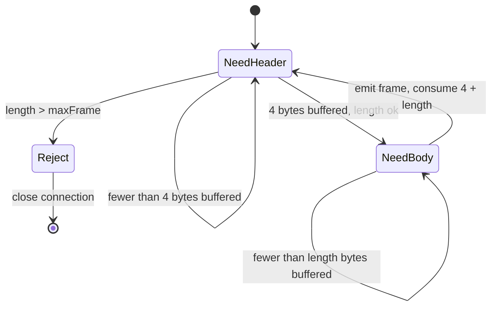

# RPC, Framing, and Serialization Over Raw Sockets

> Length-prefixed frames, request IDs, and a client that survives a half-open connection.

**Type:** Build
**Languages:** Java, Python
**Prerequisites:** Phase 5, Lesson 02 (Failure Models); Phase 5, Lesson 06 (CAP and PACELC); Phase 0, Lesson 07 (Decimal and Integer Arithmetic in Three Runtimes)
**Time:** ~120 minutes

## Learning Objectives

- Explain why a TCP connection delivers a byte stream and not messages, and show with a simulation how one write arrives as many reads
- Build a length-prefixed framer that reassembles complete messages from arbitrary chunks and rejects hostile length prefixes before allocating
- Design a fixed-width big-endian binary codec whose every read is bounds-checked, and encode a `Money` value with it without ever using a float
- Implement a request/response client that matches replies to requests by id, enforces a deadline, and discards late answers
- Demonstrate that a half-open connection produces silence rather than an error, and state precisely what a timeout tells you about the server's state

## The Problem

A balance service sits behind a hand-rolled TCP protocol: the client writes a JSON object, the server reads "the message" and replies. It works in every integration test because, on a loopback interface, each `write` arrives as exactly one `read`. In production, two things happen in the same week.

First, a batch job starts sending `Credit` requests back to back. The server's `read` returns 4,096 bytes containing one and a half requests. The JSON parser throws on the half, the server logs "malformed request" and drops the connection, and the batch job retries the whole batch. Every credit before the broken boundary was applied; every credit is now applied again. The ledger team spends a day reversing 11,000 duplicate postings. Nothing was malformed. TCP simply does not know where your messages begin and end, and the protocol never told it.

Second, a network device between a payment gateway and the balance service is replaced during a maintenance window. The gateway had 40 open connections to the service. From the service's side those connections are gone: the old device's state vanished and no FIN or RST was ever sent. From the gateway's side they are perfectly healthy: `write` succeeds (the kernel buffers the bytes and waits for an ACK that will never come), and `read` simply never returns. The gateway's `Credit` calls hang for the full 2-minute default timeout, the thread pool fills, and checkout fails for every customer for the length of time it takes someone to restart the gateway. The 40 connections were *half-open*: one end believes they exist and the other has never heard of them. RFC 9293 section 3.6.2 describes this state explicitly, and nothing in the socket API tells the live end about it.

Both failures live below the application and above the kernel, in the layer that gRPC, Thrift, HTTP/2, and every database driver implement so that you never have to. This lesson builds that layer: a framer that turns a byte stream back into messages, a codec that turns messages into bytes without ambiguity, and a client that attaches an id and a deadline to every request so that it can tell "the answer is late" from "the answer is never coming", and can say exactly what it does not know when the deadline fires.

## The Concept

### A socket is a pipe of bytes

TCP (RFC 9293) promises that the bytes you write arrive in order, without duplication, or the connection fails. It makes no promise about *grouping*. If the client writes 36 bytes and then 36 more, the server may read 72, or 7 then 65, or 36 then 36, or 1 byte seventy-two times. The segments on the wire are sized by the path MTU, the congestion window, and Nagle's algorithm, none of which knows what a "request" is. The simulation in this lesson reproduces that: a `Channel` splits each write into random-sized segments with random delays, and the demo shows three frames arriving in ten reads with boundaries that fall in the middle of a length field.

A **frame** is the unit the application cares about: one request or one response. **Framing** is the agreement about how to find frame boundaries in the stream. There are three families:

| Framing scheme | How boundaries are found | Cost | Used by |
|----------------|--------------------------|------|---------|
| Delimiter | scan for a terminator byte (newline, NUL) | must escape the delimiter inside payloads; O(n) scan | SMTP, Redis RESP (partly), line protocols |
| Length prefix | fixed-width length before the payload | 4 bytes per frame; must cap the length | gRPC/HTTP/2 frames, Kafka, Thrift framed transport, PostgreSQL wire protocol |
| Self-describing | the payload's own encoding says when it ends | parser must be incremental | ASN.1 BER, CBOR (RFC 8949) indefinite-length items |

Length prefixing wins for binary protocols because it is O(1) to find the boundary, payloads need no escaping, and the reader can allocate exactly once. It has one famous trap: the length is attacker-controlled. A single frame claiming to be `0xFFFFFFFF` bytes long will make a naive server allocate 4 GiB and die. The framer must check the length against a maximum *before* allocating, and the maximum should be small (a megabyte is generous for an RPC).

### The framer's invariant

The framer is a tiny state machine over a buffer of not-yet-consumed bytes:



Its invariant: **every byte written as part of frame k is emitted as part of frame k, exactly once, regardless of how the stream is segmented**. The test for it is brutal and simple: feed the same bytes one at a time and all at once, and demand identical frames. The framer never emits a partial frame and never looks inside the payload, which is what lets the codec above it assume complete input.

Why does `Reject` close the connection instead of skipping the bad frame? Because after a bad length the reader has lost synchronisation: it does not know where the next frame begins, and every subsequent "frame" would be garbage parsed from the middle of a payload. A stream protocol cannot resynchronise without a delimiter, so the honest response is to drop the connection and let the client reconnect.

### The codec: bytes with no ambiguity

Serialization turns a message into bytes and back. The requirements for an RPC codec are different from those for a document format:

1. **Canonical.** One value, one byte sequence. The reader never has to guess about whitespace, key order, or number formats.
2. **Bounds-checked.** Every read declares how many bytes it needs and fails cleanly if they are absent. A truncated message must become a `CodecException`, never an `ArrayIndexOutOfBoundsException` from deep inside a parser.
3. **Endianness fixed.** Network byte order is big-endian (RFC 9293 and its predecessors use it for every header field). The codec writes the most significant byte first and the reader reconstructs with shifts, so a Java `long` and a Go `int64` agree byte for byte.
4. **No floats for money.** An amount is `i64 minorUnits` plus a currency code and exponent, exactly as Phase 10, Lesson 01 defines it. JSON's `19.99` would arrive as a `double` and the balance service would be one cent wrong by the end of the day.

The codec in this lesson has six primitives: `u8`, `u16`, `u32`, `i64`, `string` (a `u16` byte length followed by UTF-8), and raw `bytes`. Every real binary protocol is built from the same six, plus varints when size matters (Protocol Buffers, CBOR) and tags when schema evolution matters. This lesson skips varints and tags on purpose: once you have written a bounds-checked fixed-width codec, both are a small addition, and the framing and connection logic are the part people get wrong.

### The RPC envelope

Every message on the wire has the same header, so the client and server can route before they understand the payload:

| Field | Type | Meaning |
|-------|------|---------|
| `kind` | `u8` | 1 = REQUEST, 2 = RESPONSE, 3 = ERROR |
| `requestId` | `i64` | chosen by the client; the response echoes it |
| `method` | `string` | `GetBalance`, `Credit`, ... |
| `payloadLength` | `u32` | bytes that follow |
| `payload` | bytes | method-specific; encoded by the service, opaque to the RPC layer |

The `requestId` does three jobs. It lets the client send several requests on one connection and match the responses (pipelining). It lets a late response be recognised and discarded rather than mistaken for the answer to a newer call. And because the counter lives in the client and survives reconnects, a reply that was in flight on a connection that died can never collide with a request on the connection that replaced it. The `ERROR` kind exists so that an application failure (`unknown account`, `currency mismatch`) travels back with the same id and the connection stays healthy; only a *protocol* failure (bad frame length, undecodable header) closes it.

### Worked example: a GetBalance request, byte by byte

The request `GetBalance("alice")` with id 1 encodes to 32 bytes, framed to 36:

```text
00 00 00 20                 u32 frame length = 32
01                          u8  kind = REQUEST
00 00 00 00 00 00 00 01     i64 requestId = 1
00 0a                       u16 method length = 10
47 65 74 42 61 6c 61 6e 63 65   "GetBalance"
00 00 00 07                 u32 payload length = 7
00 05                       u16 string length = 5      (start of payload)
61 6c 69 63 65              "alice"
```

The reply is `RESPONSE`, id 1, method `GetBalance`, and a payload of `i64 10000, string "USD", u8 2`, which decodes to `Money(10000, USD)` and prints as `100.00 USD`. Note that the payload has its own internal length-prefixed string: the RPC layer frames the envelope, and the service frames its own fields inside the payload. Two layers, two reasons, no confusion about who owns which bytes.

### Timeouts, deadlines, and what they tell you

A client that writes a request and then calls `read` with no timeout will wait forever on a half-open connection. The fix is a deadline on every call: `now + timeout`. When it fires, the client throws, and the caller learns exactly one fact: **no response arrived in time**. It does not learn whether the request arrived, whether it was processed, or whether the response is three milliseconds away. The demo shows all three cases with the same exception:

- The server was slow: the response arrives after the deadline and is discarded as late. The credit happened.
- The request was lost on a half-open link: the server never saw it. The credit did not happen.
- The response was lost on a half-open link: the server processed it. The credit happened.

For `GetBalance` this ambiguity is harmless; call again. For `Credit` it is the whole problem of Lesson 09 (idempotency keys): retrying a timed-out non-idempotent call is how one intended credit becomes two postings. This lesson's job is to make the ambiguity *visible*, with an exception message that says "outcome unknown", not "failed".

### Half-open connections

A connection is half-open when one end has lost all state about it and the other has not been told. Causes: a crash and reboot of the peer (RFC 9293, section 3.6.2 calls this exactly "half-open"), a NAT or load balancer whose table was flushed, a firewall that silently dropped the flow after an idle period. The live end sees:

| Operation | What the kernel does | What the application sees |
|-----------|----------------------|---------------------------|
| `write` | buffers and retransmits for minutes (Linux `tcp_retries2` ≈ 15 minutes) | success |
| `read` | waits for data that will never come | blocks, or returns 0 bytes in non-blocking mode |
| nothing | TCP keepalive (if enabled; off by default) probes after 2 hours | nothing for 2 hours |

The only reliable detector the application owns is its own deadline. The simulation models this faithfully: `Channel.cut()` makes writes succeed and vanish and reads return nothing, with no exception anywhere. The client detects it by timeout, reconnects (a *new* connection with a new id; the old one is not repaired), and continues with the same request-id counter.

### Complexity and cost

Framing is O(n) in bytes with a constant-size buffer per connection plus at most one frame of pending bytes. Encoding is O(message size) with one allocation per message. The dominant cost in a real RPC stack is not any of this; it is system calls and copies, which is why production stacks batch writes and use scatter/gather I/O. The from-scratch version is correct, not fast, and the lesson is about correctness.

### What this lesson does not do

- No schema evolution: adding a field to `Credit` breaks old clients. Protocol Buffers and Thrift solve this with field tags; the codec here deliberately has none so that you see what they buy.
- No encryption or authentication. TLS wraps the stream below this layer and does not change the framing problem.
- No flow control or backpressure: a client that pipelines a million requests will buffer a million frames. HTTP/2 and gRPC add per-stream windows.
- No real sockets. The simulation reproduces the two properties that matter (segmentation and half-open silence) deterministically; Exercise 3 asks you to run the same code over `java.net.Socket`.

## Build It

The full code is in `code/java/Main.java` and the tests in `code/java/MainTest.java`. The walkthrough follows the file top to bottom.

### Step 1: A bounds-checked byte codec

```java
final class ByteReader {
    private final byte[] buf;
    private int pos;

    private void need(int n) {
        if (pos + n > buf.length) throw new CodecException("truncated: need " + n + " bytes at offset " + pos
                + ", have " + (buf.length - pos));
    }

    long u32() {
        need(4);
        long v = 0;
        for (int i = 0; i < 4; i++) v = (v << 8) | (buf[pos++] & 0xFF);
        return v;
    }

    String string() {
        int n = u16();
        need(n);
        String s = new String(buf, pos, n, StandardCharsets.UTF_8);
        pos += n;
        return s;
    }
}
```

Every read starts with `need(n)`. The `& 0xFF` matters: Java bytes are signed, and without the mask `0x80` would sign-extend to `0xFFFFFF80` and corrupt the value. `u32` returns a `long` because Java has no unsigned 32-bit type and `0xFFFFFFFF` must not become `-1`. `string` reads the length first and checks it against the buffer *before* constructing the string, so a length of 9,000 on a 3-byte buffer is a `CodecException` and not an allocation followed by an array exception.

**Predict:** `new ByteReader(new byte[]{0, 9, 'a'}).string()` — which line throws, and what does the message say?

### Step 2: The framer

```java
List<byte[]> feed(byte[] chunk) {
    byte[] joined = Arrays.copyOf(pending, pending.length + chunk.length);
    System.arraycopy(chunk, 0, joined, pending.length, chunk.length);
    List<byte[]> out = new ArrayList<>();
    int pos = 0;
    while (joined.length - pos >= HEADER) {
        long length = new ByteReader(Arrays.copyOfRange(joined, pos, pos + HEADER)).u32();
        if (length > maxFrame) throw new CodecException("frame length " + length + " exceeds max " + maxFrame + "; closing connection");
        if (joined.length - pos - HEADER < length) break;            // header complete, body not yet
        out.add(Arrays.copyOfRange(joined, pos + HEADER, pos + HEADER + (int) length));
        pos += HEADER + (int) length;
    }
    pending = Arrays.copyOfRange(joined, pos, joined.length);
    framesOut += out.size();
    return out;
}
```

`feed` is called with whatever the stream produced. It prepends the leftover from last time, then loops: if there are at least four bytes, read the length; if the length is hostile, throw; if the body is incomplete, stop and keep everything from `pos` for next time; otherwise emit the frame and advance. The order of the two checks is the security property: the length is validated before `copyOfRange` is asked to allocate it. The test "byte-at-a-time yields three frames" feeds 37 single-byte chunks and demands the same three frames as feeding them all at once.

**Predict:** after `feed` is given exactly 4 bytes that say "length 2", what is `buffered()`, and what does the next `feed(new byte[]{1, 2})` return?

### Step 3: The envelope

```java
record RpcMessage(MessageKind kind, long requestId, String method, byte[] payload) {
    byte[] encode() {
        return new ByteWriter().u8(kind.tag).i64(requestId).string(method).u32(payload.length).bytes(payload).toBytes();
    }

    static RpcMessage decode(byte[] bytes) {
        ByteReader r = new ByteReader(bytes);
        MessageKind kind = MessageKind.fromTag(r.u8());
        long id = r.i64();
        String method = r.string();
        long n = r.u32();
        if (n > r.remaining()) throw new CodecException("payload length " + n + " exceeds remaining " + r.remaining());
        byte[] payload = new byte[(int) n];
        for (int i = 0; i < n; i++) payload[i] = (byte) r.u8();
        r.expectEnd();
        return new RpcMessage(kind, id, method, payload);
    }
}
```

`decode` is `encode` read backwards, with two extra checks: the payload length is compared with the bytes remaining (the framer already bounded the whole frame, so this is a consistency check between the two layers), and `expectEnd` rejects trailing bytes. Trailing bytes mean the sender and receiver disagree about the format, and silently ignoring them is how a version-skew bug hides for a year.

### Step 4: Money on the wire

```java
static byte[] encodeMoney(Money m) {
    return new ByteWriter().i64(m.minorUnits()).string(m.currency().code()).u8(m.currency().exponent()).toBytes();
}

static Money decodeMoney(ByteReader r) {
    long minor = r.i64();
    String code = r.string();
    int exponent = r.u8();
    return Money.ofMinor(minor, new Currency(code, exponent));
}
```

Fourteen bytes for `100.00 USD`: eight for the minor units, five for `"USD"` with its length, one for the exponent. The exponent travels with the amount so that a receiver that has never heard of a currency still knows where the decimal point goes; a production system would validate the code against its ISO 4217 table on receipt. There is no floating point anywhere between the client's `Money` and the server's `Money`, which is the entire point of carrying `minorUnits` rather than `"19.99"`.

**Predict:** what does `decodeMoney` do with a payload whose exponent byte is 7? (Look at the `Currency` constructor.)

### Step 5: The simulated socket

```java
void write(byte[] bytes, long now) {
    bytesWritten += bytes.length;
    if (cut) { bytesLost += bytes.length; return; }           // half-open: the peer is gone and nobody told us
    int pos = 0;
    long arrive = now;
    while (pos < bytes.length) {
        int n = Math.min(bytes.length - pos, 1 + rng.nextInt(maxSegment));
        arrive += 1 + rng.nextInt(maxDelay);                   // segments stay ordered: each arrives after the previous
        inFlight.addLast(new Segment(arrive, Arrays.copyOfRange(bytes, pos, pos + n)));
        pos += n;
    }
}

byte[] read(long now) {
    if (cut) return new byte[0];
    ByteWriter w = new ByteWriter();
    while (!inFlight.isEmpty() && inFlight.peekFirst().arriveAt() <= now) w.bytes(inFlight.pollFirst().bytes());
    bytesDelivered += w.size();
    return w.toBytes();
}
```

A `Channel` is one direction of a connection. `write` chops the bytes into segments of 1 to `maxSegment` bytes with increasing arrival times, which is TCP's segmentation and delay in miniature. `read` returns everything that has arrived, which may be part of one write or several writes glued together. `cut()` sets the flag that turns the channel half-open: no exception, no closed-flag the reader can see, just bytes that go nowhere and reads that return nothing. The seeded `Rng` means the same seed produces the same segmentation every run, so the demo's "3 frames in 10 reads" is reproducible.

### Step 6: The server loop

```java
void poll(long now) {
    for (Map.Entry<Link, Framer> e : new ArrayList<>(framers.entrySet())) {
        Link link = e.getKey();
        byte[] chunk = link.clientToServer.read(now);
        if (chunk.length == 0) continue;
        List<byte[]> frames;
        try {
            frames = e.getValue().feed(chunk);
        } catch (CodecException ex) {
            malformedFrames++;
            framers.remove(link);                              // a corrupt stream cannot be resynchronised: close it
            continue;
        }
        for (byte[] f : frames) {
            RpcMessage request;
            try { request = RpcMessage.decode(f); }
            catch (CodecException ex) { malformedFrames++; continue; }
            RpcMessage response = service.dispatch(request);
            requestsServed++;
            delayed.addLast(new Object[]{now + processingMillis, link, response});
        }
    }
    ...
}
```

One `Framer` per connection, because the pending bytes are per-stream state. The two `catch` blocks implement the two policies from the Concept section: a framing error closes the connection; a decode error inside a complete frame skips that frame (we still know where the next one starts). `service.dispatch` turns application exceptions into `ERROR` messages with the request's id, so the client gets a reply rather than a hang. `processingMillis` is a knob the demo turns to make the server slower than the client's deadline.

### Step 7: The client: ids, deadlines, late answers

```java
long send(String method, byte[] payload) {
    long id = nextRequestId++;
    link.clientToServer.write(framer.frame(new RpcMessage(MessageKind.REQUEST, id, method, payload).encode()), clock.now());
    return id;
}

RpcMessage await(long id, long timeoutMillis) {
    long deadline = clock.now() + timeoutMillis;
    while (true) {
        pump();
        RpcMessage r = received.remove(id);
        if (r != null) {
            if (r.kind() == MessageKind.ERROR) throw new RpcErrorException(r.method() + ": " + r.errorReason());
            return r;
        }
        if (clock.now() >= deadline) {
            timeouts++;
            throw new RpcTimeoutException("request " + id + " timed out after " + timeoutMillis + " ms on connection "
                    + link.connectionId + " (outcome unknown)");
        }
        clock.advance(1);
    }
}
```

`send` and `await` are separate so the demo can cut the link between them; `call` is the composition. `await` pumps the simulation one millisecond at a time, looks for its own id in the `received` map, and gives up at the deadline with a message that says what it knows. `pump` reads the server-to-client channel, frames and decodes, files each response under its id, and then discards any response whose id is older than the call in progress, counting it in `lateResponses`. That last step is what makes the sequence "timeout, then a correct answer to the next call" work: the stale reply to request 4 is dropped, and request 5 gets its own answer.

**Predict:** the client has `nextRequestId == 6`, reconnects, and the old connection delivers a response with id 5 just before dying. Can it be delivered to a caller? Why not?

### Step 8: Run it

```bash
cd phases/05-distributed-foundations/07-rpc-and-serialization/code/java
javac -d .out *.java && java -cp .out Main
java -cp .out MainTest
```

Expected output, abbreviated:

```console
== TCP does not respect your message boundaries: 3 frames, segmented into random chunks ==
t=3   read  6 bytes -> 0 complete frame(s),  6 bytes buffered
t=6   read  7 bytes -> 0 complete frame(s), 13 bytes buffered
...
t=15  read 29 bytes -> 1 complete frame(s), 28 bytes buffered
t=19  read  2 bytes -> 1 complete frame(s),  0 bytes buffered
3 frames reassembled from 10 reads; no frame was ever half-decoded

== A hostile length prefix is rejected before any allocation ==
rejected: frame length 4294967295 exceeds max 1048576; closing connection

== Timeout: the server is slow, the client gives up, the answer arrives later and is discarded ==
t=100: request 4 timed out after 100 ms on connection 1 (outcome unknown)
next call still gets the right answer: GetBalance(bob) = 25.00 USD; late responses discarded so far = 1

== Half-open: the server vanishes mid-Credit; the client's socket shows no error, only silence ==
server applied the credit (creditsApplied 1 -> 2), bob = 75.00 USD
a further write of request 7 'succeeds': 34 bytes accepted by the socket and lost; reads return 0 bytes forever
client: request 6 timed out after 200 ms on connection 1 (outcome unknown); only the deadline detects a half-open connection
reconnect -> new connection 2 (ids continue from 8, so no old reply can match)
naive retry of Credit(bob, 50.00 USD) = 125.00 USD  <- applied 2 times for one intended credit.
```

The last line is the hand-off to Lesson 09. Keep it: it is the one-screen demonstration that "retry on timeout" is not a complete policy for anything that moves money.

### In Python

`code/python/main.py` is the same codec, framer, envelope, simulated socket, server, and client, method for method, and the demo prints the same bytes, the same segment timings, and the same round-trip times as Java: `Rng` is SplitMix64 masked to 64 bits, so seed 42 cuts the stream into the same ten reads. Four things differ.

- **Integers have no width.** A Java `long` is 64 bits whether you want it or not; a Python `int` is whatever size the value needs, so the width lives in the codec. `u8`/`u16`/`u32` range-check on write exactly as in Java, `i64` writes `v & MASK64` (two's complement) and rejects values outside the `long` range, and `ByteReader.i64` decodes with `int.from_bytes(..., signed=True)`. `int.to_bytes(n, "big")` and `int.from_bytes` stand in for the shift loops; `struct.pack(">BqI")` would work too, but `struct.error` on a short buffer is the same class of leak as `ArrayIndexOutOfBoundsException`, so the explicit `_need()` check stays either way.
- **`bytes` are immutable and compare by value.** `Framer.feed` concatenates `self._pending + chunk` and slices, which is the same O(n) copy the Java `Arrays.copyOf` does; a production framer would keep a `bytearray` and `del buf[:consumed]`. Because `bytes` compare by value, `RpcMessage` can be a frozen dataclass whose equality includes the payload, which a Java record holding a `byte[]` cannot offer.
- **Two names change.** Python cannot overload one name as both a static and an instance method, so Java's static `Framer.frame(payload, maxFrame)` is `Framer.frame_with_max`, and `await` is a keyword, so the client's method is `await_`.
- **Exceptions.** `CodecException`, `RpcTimeoutException`, and `RpcErrorException` keep their names; `IllegalArgumentException` (unknown account, currency mismatch) is `ValueError`, and `dispatch` catches `(CodecException, ValueError)` to turn both into an `ERROR` response, as the Java `catch` does.

```python
def i64(self, v: int) -> "ByteWriter":
    if not INT64_MIN <= v <= INT64_MAX:
        raise CodecException(f"i64 out of range: {v}")
    self._buf += (v & MASK64).to_bytes(8, "big")
    return self
```

```bash
cd phases/05-distributed-foundations/07-rpc-and-serialization/code/python
python3 main.py
python3 -m unittest -v
```

### Porting notes

Go: `encoding/binary.BigEndian.PutUint32` and `binary.BigEndian.Uint64` are the codec; errors are returned, not thrown, so `feed` returns `([][]byte, error)` and the server closes the connection on a non-nil error. A real Go port would run the client's `await` on a `net.Conn` with `SetReadDeadline`, which is the kernel-level equivalent of the simulated clock, and a real Java port would use `SocketChannel` in non-blocking mode with a `Selector`.

## Use It

### gRPC and HTTP/2

gRPC runs over HTTP/2, whose frames are exactly this lesson's design at a larger scale: a 9-byte header with a 24-bit length, a type, flags, and a stream id, followed by the payload. The stream id is the `requestId`; HTTP/2 multiplexes many streams on one connection and matches responses to requests by it. gRPC adds a 5-byte message prefix inside the DATA frames (1 byte compressed flag, 4 bytes length) so that one message can span several HTTP/2 frames: two layers of length prefixing, for the same reason the balance service's payload has its own string length inside the RPC envelope. gRPC also enforces `grpc.max_receive_message_length` (default 4 MiB), which is this lesson's `maxFrame`.

### Protocol Buffers, Thrift, CBOR

All three are codecs that add what this lesson left out: varints (small numbers take one byte), field tags (so a receiver can skip fields it does not know, which is how schemas evolve), and a type system with a generated encoder per language. Protocol Buffers has no framing of its own; the official docs tell you to length-prefix each message yourself, which is Step 2. CBOR (RFC 8949) is self-describing and can be parsed incrementally, which removes the need for a frame length at the cost of a more complex reader.

### Database wire protocols

PostgreSQL's frontend/backend protocol is a one-byte message type followed by a 4-byte big-endian length that includes itself, followed by the body: the same shape with the type outside the length. Every driver you have used has a `Framer.feed` in it. Kafka's protocol is a 4-byte length followed by a request header containing a `correlation_id`, which is this lesson's `requestId` under its production name, and the Kafka client discards responses whose correlation id it does not recognise.

### TCP keepalive and application heartbeats

Operating systems can probe idle connections (`SO_KEEPALIVE`), but the default interval is two hours, which is why every serious RPC framework sends its own heartbeats: gRPC's `keepalive_time`, HTTP/2 PING frames, PostgreSQL's `tcp_keepalives_idle`. A heartbeat converts a half-open connection into a detected failure in seconds instead of hours. It does not remove the need for a per-call deadline, because a connection can be healthy and the server can still be slow.

### Payment systems

Card networks use ISO 8583 over TCP, framed with a 2- or 4-byte length prefix, and every message carries a Systems Trace Audit Number (field 11) that plays the `requestId` role: the acquirer matches authorization responses to requests by it, and a timed-out authorization is followed by a *reversal* message (not a retry) precisely because the outcome is unknown. That reversal is the industry's answer to the last line of the demo.

## Ship It

`outputs/checklist-wire-protocol.md` is a review checklist for any service that speaks a custom binary or framed protocol: framing, length caps, codec bounds checks, request ids, deadlines, half-open detection, and what the client is allowed to do after a timeout. Use it when reviewing a hand-rolled protocol or when configuring a framework's limits.

## Exercises

1. **Reinforce.** Add a `u64` varint (LEB128, as Protocol Buffers uses) to `ByteWriter` and `ByteReader`, with a bounds check that rejects a varint longer than 10 bytes. Re-encode `requestId` with it and measure how many bytes the `GetBalance` request shrinks by.
2. **Apply.** Add pipelining: a `callAll(List<Request>)` on the client that sends every request before awaiting any response, and returns the responses in request order even if the server replies out of order. Write a test in which the server processes requests in reverse order and show the client still returns them in the order they were sent.
3. **Extend.** Replace `Channel` with `java.net.Socket` on localhost, keeping `Framer`, `RpcMessage`, and `BalanceService` unchanged. Use `setSoTimeout` as the deadline. Then combine with Phase 5, Lesson 08 (Timeouts and Deadline Propagation): carry a remaining-budget field in the envelope and have the server refuse requests whose budget is already below its expected processing time.

## Key Terms

| Term | What people say | What it actually means |
|------|-----------------|------------------------|
| Framing | "message boundaries" | The agreement that lets a reader find where one message ends and the next begins in a byte stream that carries no boundaries of its own |
| Length prefix | "the size header" | A fixed-width count of payload bytes placed before the payload; must be validated against a maximum before any allocation |
| Serialization | "encoding" | Turning an in-memory value into a canonical byte sequence that any reader, in any language, reconstructs identically |
| Network byte order | "big-endian" | Most significant byte first; the convention of every IETF protocol header and of this codec |
| Request id | "correlation id" | A client-chosen number echoed in the response so replies can be matched, pipelined, and recognised as stale |
| Half-open connection | "the connection just hung" | One end has lost all state about the connection and the other has not been told; writes succeed, reads block, no error is raised |
| Deadline | "the timeout" | An instant after which the client stops waiting; when it fires the client knows only that no reply arrived, not what the server did |

## Further Reading

- [RFC 9293: Transmission Control Protocol](https://www.rfc-editor.org/rfc/rfc9293) — section 3.6.2 defines half-open connections and section 3.1 the byte-stream service; read these two before writing any socket code.
- [RFC 9113: HTTP/2](https://www.rfc-editor.org/rfc/rfc9113) — section 4 (frames) is a production-grade version of this lesson's framer, with stream ids as request ids.
- [gRPC over HTTP/2 protocol specification](https://github.com/grpc/grpc/blob/master/doc/PROTOCOL-HTTP2.md) — the 5-byte length-prefixed message inside HTTP/2 DATA frames, and why two layers of length are needed.
- [Protocol Buffers encoding](https://protobuf.dev/programming-guides/encoding/) — varints, field tags, and the official note that you must frame messages yourself.
- [RFC 8949: Concise Binary Object Representation (CBOR)](https://www.rfc-editor.org/rfc/rfc8949) — a self-describing binary codec; compare its length handling with the fixed-width codec here.
- [PostgreSQL Frontend/Backend Protocol: Message Formats](https://www.postgresql.org/docs/current/protocol-message-formats.html) — a widely deployed type-plus-length framing you can read with the `Framer` from this lesson after a one-line change.
