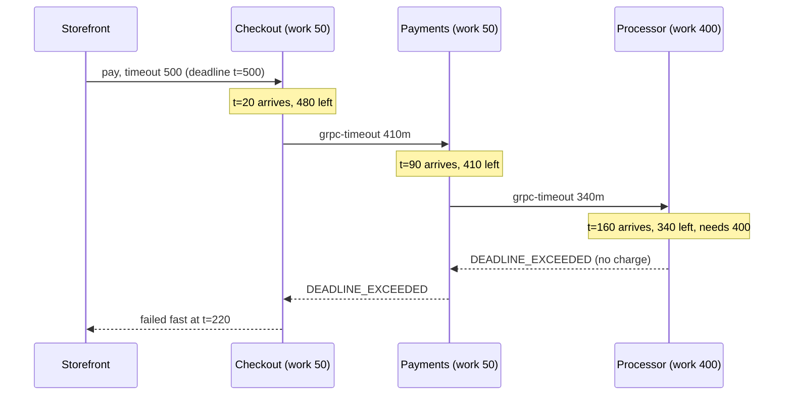

# Timeouts and Deadline Propagation

> The downstream call that outlives its caller.

**Type:** Build
**Languages:** Java
**Prerequisites:** Phase 5, Lesson 07 (RPC, Framing, and Serialization Over Raw Sockets); Phase 5, Lesson 04 (Physical Clocks, NTP, and Hybrid Logical Clocks)
**Time:** ~60 minutes

## Learning Objectives

- Distinguish a timeout (relative, per hop) from a deadline (absolute, per request) and explain why only the second composes across a call chain
- Build a `Context` that carries a deadline, tightens it on every hop, and encodes it on the wire as a remaining duration rather than a timestamp
- Reproduce the failure where a downstream service completes a card charge after the caller has already reported a timeout, and remove it with an admission check
- Fit retries inside a deadline so that no attempt starts that cannot finish
- Measure how a hedged request trades a few percent of extra load for an order-of-magnitude cut in tail latency

## The Problem

A checkout service calls a payments service, which calls a card processor. The checkout service has a 500 ms client timeout because the storefront's page budget says so. The payments service has its own 2 s timeout on the processor call, set by someone who read that the processor's p99 is 1.8 s. Nothing connects the two numbers.

A customer taps Pay. Checkout spends 50 ms validating the cart, payments spends 50 ms building the authorization request, and the processor takes 400 ms to approve the charge. Add 20 ms per network hop, six hops in a round trip, and the approval reaches checkout at 620 ms. Checkout stopped listening at 500 ms. It returned "payment failed, please try again" to the storefront at exactly the moment the processor was writing a successful authorization for 19.99 USD. The customer taps Pay again. The second attempt is faster and succeeds. The card is charged twice. The customer sees one order and two charges. Support refunds one, the chargeback ratio ticks up, and the postmortem contains the sentence "the downstream call outlived its caller."

The processor did nothing wrong: it was asked to charge a card and it charged a card. The payments service did nothing wrong: it waited 2 s as configured. The defect is that the processor never knew the request had 340 ms left when it arrived, so it had no basis to refuse. Every service in the chain made a local decision about time while the only number that mattered, the time left before the customer stops caring, was known only at the edge and died there.

The same shape appears without money. A search fan-out to forty shards with a 100 ms budget keeps forty shards busy for seconds after the aggregator has already returned partial results. A batch job that retries five times with a 30 s timeout each runs for 150 s inside a 60 s cron window and overlaps its next run. In every case the fix is the same: the caller's deadline travels with the request, every hop shortens it by the time it has used, and work that cannot finish inside what remains is refused before it starts.

## The Concept

### Timeout versus deadline

A **timeout** is a duration: "give up after 500 ms." It is a property of one hop and it starts counting when that hop begins. A **deadline** is an instant: "be done by t = 1500." It is a property of the whole request and it does not care how many hops are below it.

The difference is what happens at the second hop. Service A has a 500 ms timeout and spends 180 ms before calling B. If B also uses a 500 ms timeout, the chain can run for 680 ms, 180 ms past the point where A's caller has left. If instead A hands B the deadline t = 1500, B computes that it has 320 ms left and behaves accordingly. Deadlines compose by taking a minimum; timeouts compose by adding, which is the wrong direction.

| Property | Timeout | Deadline |
|----------|---------|----------|
| Unit | duration | instant |
| Scope | one call | one request, all hops |
| Combining a parent and a child | sum (wrong) | `min(parent, now + childTimeout)` |
| Can a child extend it? | yes, silently | no, by construction |
| Survives the wire? | yes, as a number | only as a remaining duration (clocks differ) |
| Who chooses it? | every service, independently | the edge, once |

### The invariant

A request's effective deadline is monotonically non-increasing along the call chain. Formally, if hop k receives deadline D_k and derives D_(k+1) for the next hop, then D_(k+1) <= D_k. Two things follow:

1. The remaining budget at any hop is `max(0, D - now)`, never negative, and never larger than the caller's.
2. No hop can do work the edge has already stopped waiting for, provided every hop checks the remaining budget before starting work and refuses when it is insufficient.

The second point is the one that prevents the double charge. It needs an estimate of how long the work will take: the processor knows its authorization path costs about 400 ms, so when 340 ms arrive it refuses immediately. Refusing is a `DeadlineExceeded` error returned in one hop, which reaches the customer as a clean failure at 220 ms with no side effect, instead of an ambiguous timeout at 500 ms with a hidden charge.



Without propagation the same diagram has the processor charging the card at t = 560 and an approval reaching checkout at t = 620, where nobody is listening.

### Worked example: the budget table

Trace the chain with a 500 ms edge budget, 20 ms per hop, and the work figures above. Each row is the moment a service receives the request.

| t (ms) | Where | Remaining | Needs for own work | Decision |
|--------|-------|-----------|--------------------|----------|
| 0 | storefront sets deadline | 500 | | deadline = t + 500 |
| 20 | checkout receives | 480 | 50 | proceed |
| 90 | payments receives (20 + 50 + 20) | 410 | 50 | proceed |
| 160 | processor receives | 340 | 400 | refuse: 340 < 400 |
| 220 | storefront receives error (three 20 ms hops back) | 280 | | report failure, no charge |

Now the same chain with a 700 ms edge budget:

| t (ms) | Where | Remaining | Needs | Decision |
|--------|-------|-----------|-------|----------|
| 160 | processor receives | 540 | 400 | proceed, charge at t = 560 |
| 620 | storefront receives approval | 80 | | success |

The budget table is a design tool. Sum the work and hops along the critical path, add the processor's tail rather than its median, and that is the smallest edge timeout that can ever succeed. If the storefront cannot afford it, the answer is to make the chain faster or asynchronous, not to shorten a hop's timeout and hope.

### Why the wire carries a duration, not a timestamp

Lesson 04 showed that two machines' clocks disagree by milliseconds in a good datacenter and seconds in a bad one. If payments sends "deadline = 1699999999560" and the processor's clock is 300 ms ahead, the processor believes it has 40 ms when it really has 340. If the processor's clock is behind, it believes it has budget that the caller has already spent. gRPC therefore sends `grpc-timeout: 340m`, a remaining duration, and the receiver recomputes an absolute deadline against its own clock. The error introduced is one network transit time, which is small and always in the safe direction (the receiver thinks it has slightly less time than it does, because the header was computed before the hop).

Inside a single process, use the absolute form. Across a process boundary, convert to a duration and back. The `Context` you build does both.

### Where the remaining budget goes

Three consumers compete for the budget at every hop, and the deadline is how they negotiate:

- **Admission.** Before doing anything irreversible or expensive, compare remaining with the expected cost. Refuse if it does not fit. This is where "the downstream call that outlives its caller" is prevented.
- **Retries.** A retry loop that counts attempts but ignores the deadline will happily make its third attempt at t = 900 inside a 500 ms budget. The correct loop gives each attempt `min(perAttemptTimeout, remaining)`, sleeps no longer than remaining, and does not start an attempt that has less than some floor of useful time. Lesson 10 covers backoff and jitter; this lesson fixes the envelope those live inside.
- **Hedging.** When a read is idempotent and its latency has a long tail, send a second copy to another replica once the first has been outstanding for longer than, say, the p95, and take whichever answers first. Dean and Barroso measured a p99.9 drop from 1,800 ms to 74 ms for a 2% increase in requests. Hedging is budget spent on purpose; it only makes sense when the budget exists.

### Choosing the numbers

The deadline mechanism is only as good as the two numbers fed into it: the edge budget and each hop's expected cost. Both are distributions, not constants, and the common mistakes are all about treating them as constants.

| Mistake | What it looks like | What goes wrong | Fix |
|---------|--------------------|-----------------|-----|
| Timeout copied from a neighbour | every service uses 2 s "because the processor does" | the chain runs 6 s for a 500 ms page budget | derive each hop from the edge budget, by propagation |
| Cost estimated at the median | processor refuses only when remaining < 350 ms | half of admitted calls still miss the deadline | use p95 or p99 as the cost in `requireBudget` |
| Budget without margin | forward `remaining` exactly | serialization and queueing eat the last 20 ms and the response is late | subtract a per-hop margin before forwarding (Exercise 1) |
| Retries count attempts, not time | `for (i < 3) call()` | third attempt starts after the caller left | Step 6: clip each attempt and each sleep to `remaining` |
| Hedge at the median | hedge after 40 ms when p50 is 41 ms | load doubles; tail barely moves | hedge at p95 or higher; measure the extra load |
| Zero means unlimited | pass `remaining = 0` to a socket timeout | the call blocks forever | clamp and check: zero remaining is an error, not a configuration |

The last row is the quiet one. Many socket and HTTP client APIs treat a timeout of zero as "no timeout." A deadline that has just expired produces exactly zero remaining, which is why `remainingMs` clamps at zero and `checkpoint` throws before the value can reach such an API.

A useful habit is to write the budget table from the worked example for every new synchronous path and attach it to the design review. If the edge budget minus the hops is smaller than the slowest dependency's p99, the path cannot be made reliable by tuning; it has to become asynchronous (accept the request, charge later, notify) or faster.

### What this mechanism does not do

A deadline does not cancel work that has already started on another machine; it lets the other machine decide not to start. Once the processor has sent the authorization to the card network, no header will take it back. The gap between "started" and "caller gave up" is exactly the ambiguity that idempotency keys (Lesson 09) exist to resolve, and the two lessons are halves of one answer: deadlines shrink the window, idempotency keys make what falls in the window safe to retry.

A deadline also does not tell you how long work will take. The admission check uses an estimate, and an estimate can be wrong. Services measure their own latency distribution and use a high percentile, not the median, as the cost.

Finally, propagation is only as good as the weakest hop. One service that constructs a fresh context without a deadline, or an HTTP client that drops the header, resets the chain to the unbounded case. The test suite in this lesson has a `propagate = false` flag for exactly that reason: you should know what the bug looks like.

## Build It

All code is in `code/java/Main.java`. The clock is injected; the demo and the tests run in simulated time and finish instantly.

### Step 1: Absolute deadlines that never go negative

```java
record Deadline(long atMs) {
    static final Deadline NONE = new Deadline(Long.MAX_VALUE);

    static Deadline after(Clock clock, long timeoutMs) {
        if (timeoutMs < 0) throw new IllegalArgumentException("timeout must be >= 0: " + timeoutMs);
        return new Deadline(saturatingAdd(clock.nowMs(), timeoutMs));
    }

    long remainingMs(Clock clock) {
        if (isNone()) return Long.MAX_VALUE;
        return Math.max(0, atMs - clock.nowMs());
    }

    boolean isExpired(Clock clock) { return !isNone() && clock.nowMs() >= atMs; }

    Deadline earliest(Deadline other) { return atMs <= other.atMs ? this : other; }
}
```

`after` is the only place a relative timeout becomes an absolute instant. `remainingMs` clamps at zero so callers can subtract margins without producing negative budgets that an unsuspecting `Thread.sleep` or socket timeout would reject or, worse, interpret as "no limit." `earliest` is the composition rule: a child combines its own wish with the parent's deadline by taking the minimum. `saturatingAdd` exists because `Deadline.NONE` is `Long.MAX_VALUE` and `after(clock, Long.MAX_VALUE)` must not wrap into the past.

**Predict:** with `now = 1000`, what does `Deadline.after(clock, 500).remainingMs(clock)` return after the clock advances by 700?

### Step 2: The context that travels with the request

```java
record Context(String requestId, Deadline deadline) {
    static Context root(String requestId) { return new Context(requestId, Deadline.NONE); }

    Context withTimeout(Clock clock, long timeoutMs) {
        return new Context(requestId, deadline.earliest(Deadline.after(clock, timeoutMs)));
    }

    Context withoutDeadline() { return new Context(requestId, Deadline.NONE); }

    void requireBudget(Clock clock, long neededMs, String where) {
        long remaining = remainingMs(clock);
        if (remaining < neededMs) {
            throw new DeadlineExceededException(
                    where + " needs " + neededMs + " ms but only " + remaining + " ms remain", remaining);
        }
    }
}
```

`withTimeout` is the whole propagation rule in one line: the child's deadline is the earlier of the parent's and `now + timeout`. A service that wants 2 s for its processor call but was handed 410 ms gets 410 ms. `requireBudget` is the admission check that the processor runs before touching the card network. `withoutDeadline` is deliberately present: it is what a service does, usually by accident, when it builds a new client call without forwarding the context, and the demo uses it to reproduce the bug.

**Predict:** parent deadline is t = 500; the child calls `withTimeout(clock, 2000)` at t = 90. What is the child's `atMs`?

### Step 3: Crossing the wire as a duration

```java
String toWireTimeout(Clock clock) {
    if (deadline.isNone()) return null;
    return remainingMs(clock) + "m";
}

static Context fromWire(String requestId, String header, Clock clock) {
    if (header == null) return root(requestId);
    char unit = header.charAt(header.length() - 1);
    long value = Long.parseLong(header.substring(0, header.length() - 1));
    long ms = switch (unit) {
        case 'H' -> value * 3_600_000L;
        case 'M' -> value * 60_000L;
        case 'S' -> value * 1_000L;
        case 'm' -> value;
        case 'u' -> value / 1_000L;
        case 'n' -> value / 1_000_000L;
        default -> throw new IllegalArgumentException("bad timeout unit: " + unit);
    };
    return root(requestId).withTimeout(clock, ms);
}
```

This is the `grpc-timeout` header format: up to eight ASCII digits and a one-letter unit. The sender writes what is left on its clock; the receiver turns that into an absolute deadline on its own clock. The test for this step gives the sender a clock reading 1,000,000 and the receiver a clock reading 7, and checks that the receiver still ends up with the right 200 ms. Nothing about either clock's absolute value matters, which is the point.

**Predict:** the sender computes `"200m"` and the network hop takes 20 ms. Does the receiver over- or under-estimate its real budget, and by how much?

### Step 4: A simulated service that may or may not forward the deadline

```java
@Override public String call(Context incoming) {
    clock.advance(HOP_MS);                                     // request on the wire
    Context ctx = Context.fromWire(incoming.requestId(), incoming.toWireTimeout(clock), clock);
    try {
        ctx.requireBudget(clock, workMs, name);                 // admission: refuse what cannot finish
        clock.advance(workMs);
        if (downstream != null) {
            Context forwarded = propagate ? ctx : ctx.withoutDeadline();
            downstream.call(forwarded);
        }
        if (sideEffect != null) log.record(clock.nowMs(), name + ": " + sideEffect);
        return name + " ok";
    } finally {
        clock.advance(HOP_MS);                                 // response (or error) on the wire
    }
}
```

Each `RemoteService` charges one hop to receive, its own work, and one hop to answer, whether the answer is a result or an exception. The `propagate` flag is the bug switch. With it on, the context the service rebuilt from the header is forwarded. With it off, the downstream receives a context with no deadline, which is what a hand-written HTTP client with its own hard-coded timeout gives it. The processor's `sideEffect` is the card charge, recorded in an `EffectLog` with the simulated time, so the tests can assert not only that it happened but that it happened after the caller had left.

**Predict:** in the no-propagation run with a 500 ms edge budget, at what simulated time is `CHARGE 19.99 USD` recorded?

### Step 5: The edge decides what a late answer means

```java
CallOutcome invoke(Service service, String requestId, long timeoutMs) {
    long start = clock.nowMs();
    Context ctx = Context.root(requestId).withTimeout(clock, timeoutMs);
    try {
        String result = service.call(ctx);
        long elapsed = clock.nowMs() - start;
        return elapsed > timeoutMs
                ? new CallOutcome(Status.TIMED_OUT, elapsed, "response discarded: arrived " + (elapsed - timeoutMs) + " ms late")
                : new CallOutcome(Status.OK, elapsed, result);
    } catch (DeadlineExceededException e) {
        long elapsed = clock.nowMs() - start;
        return elapsed > timeoutMs
                ? new CallOutcome(Status.TIMED_OUT, elapsed, e.getMessage())
                : new CallOutcome(Status.FAILED_FAST, elapsed, e.getMessage());
    } catch (UnavailableException e) {
        return new CallOutcome(Status.UNAVAILABLE, clock.nowMs() - start, e.getMessage());
    }
}
```

The simulation is synchronous, so the client always receives a response eventually; what makes it a timeout is that the response arrived after `timeoutMs`. A real client would have closed the socket, which is why the outcome is `TIMED_OUT` with the result discarded even though the result says `checkout ok`. The distinction between `TIMED_OUT` and `FAILED_FAST` matters operationally: the first is ambiguous (did the charge happen?), the second is not (the processor said it never started). Meter them as two different series. A rising `FAILED_FAST` rate means the budget is too small for the chain and the fix is architectural; a rising `TIMED_OUT` rate with propagation enabled means some hop is not checking its budget, and the fix is a code review.

**Predict:** with propagation on and a 500 ms budget, which exception class reaches `invoke`, and does the `finally` block in each of the three services run before it arrives?

### Step 6: Retries that respect the envelope

```java
while (true) {
    long remaining = ctx.remainingMs(clock);
    if (remaining < minUsefulAttemptMs) {
        return new RetryOutcome(Status.FAILED_FAST, attempts, clock.nowMs() - start, budgets);
    }
    long attemptBudget = Math.min(perAttemptTimeoutMs, remaining);
    budgets.add(attemptBudget);
    attempts++;
    Context attempt = ctx.withTimeout(clock, attemptBudget);
    try {
        service.call(attempt);
        return new RetryOutcome(Status.OK, attempts, clock.nowMs() - start, budgets);
    } catch (UnavailableException e) {
        long sleep = Math.min(backoffMs, ctx.remainingMs(clock));   // never sleep past the deadline
        clock.advance(sleep);
    } catch (DeadlineExceededException e) {
        return new RetryOutcome(Status.FAILED_FAST, attempts, clock.nowMs() - start, budgets);
    }
}
```

Three guards, each one a production incident somebody has had: no attempt starts with less than `minUsefulAttemptMs` left; each attempt's own timeout is clipped to what remains; the backoff sleep is clipped too. Against a dependency that fails twice and then succeeds in 150 ms, a 1,000 ms deadline gives `OK` after three attempts at 550 ms. A 400 ms deadline gives two attempts, the second with a budget clipped from 300 to 200, and then stops at exactly t = 400 rather than starting a third attempt that would have finished at 550 for a caller who left at 400.

**Predict:** with a 100 ms deadline and a dependency that needs 150 ms, how many attempts run and how much simulated time passes?

### Step 7: Hedging the tail

```java
static Result call(long primaryLatencyMs, long backupLatencyMs, long hedgeAfterMs) {
    if (primaryLatencyMs <= hedgeAfterMs) {
        return new Result(primaryLatencyMs, 1, "primary");
    }
    long hedgedArrival = hedgeAfterMs + backupLatencyMs;
    return primaryLatencyMs <= hedgedArrival
            ? new Result(primaryLatencyMs, 2, "primary")
            : new Result(hedgedArrival, 2, "backup");
}
```

A hedged call is a race: the primary starts at 0, the backup starts at `hedgeAfterMs`, the first to finish wins. The closed form above is exact for deterministic latencies, and `Hedger.study` runs it ten thousand times against a seeded latency distribution where 95% of calls take 20 to 60 ms and 5% stall for 600 to 1,000 ms. With the hedge fired at 60 ms (roughly the p95), p99 drops from 919 ms to 113 ms and the extra request load is 5.1%. That ratio, a 95% stall is converted into one extra request, is why the hedge delay should be set at a high percentile: fire it earlier and you double your load for little gain; fire it later and the tail comes back.

### Step 8: Run it

```bash
cd phases/05-distributed-foundations/08-timeouts-and-deadlines/code/java
javac -d .out *.java && java -cp .out Main
java -cp .out MainTest
```

Expected output, abbreviated:

```console
== The downstream call that outlives its caller ==
no propagation : TIMED_OUT after 620 ms; response discarded: arrived 120 ms late
  side effect: t=560ms processor: CHARGE 19.99 USD card 4242
  customer saw a timeout and will retry; the card was charged anyway.
propagation    : FAILED_FAST after 220 ms; processor needs 400 ms but only 340 ms remain
  side effects recorded: 0
budget 700 ms  : OK after 620 ms; checkout ok

== Retries live inside the deadline, not beside it ==
deadline 1000 ms: OK after 3 attempts, 550 ms, per-attempt budgets [300, 300, 300]
deadline  400 ms: FAILED_FAST after 2 attempts, 400 ms, per-attempt budgets [300, 200] (third attempt never started)

== Hedged requests cut the tail for a few percent more load ==
10000 calls, seed 42: p50=41 ms p99=919 ms; hedged p99=113 ms; extra load=5.1%
```

The test file has 39 assertions. The ones to read first are the three about the `CHARGE` effect: that it exists without propagation, that it is recorded after t = 500, and that it does not exist with propagation.

### Porting notes

Go has this mechanism in the standard library: `context.WithDeadline` and `context.WithTimeout` implement `withTimeout` with the same min rule, `ctx.Deadline()` returns the absolute instant, and `ctx.Done()` is a channel the work can select on, which gives in-process cancellation this Java version lacks. A Go port would make `Service.Call` take a `context.Context` and return `(string, error)`, with `context.DeadlineExceeded` as the sentinel. Python has no standard context type; a port would pass a `Deadline` dataclass explicitly, use `asyncio.timeout()` for the in-process case, and keep the integer-millisecond model since Python `float` seconds would reintroduce rounding into the budget arithmetic. In both languages the wire format and the `requireBudget` admission check port unchanged.

## Use It

### gRPC

gRPC is the production version of this lesson. A client sets `withDeadline` or `withDeadlineAfter` on a stub; the library writes `grpc-timeout` on the wire in exactly the unit format from Step 3; the server-side `Context` exposes `getDeadline()` and `isCancelled()`; and a server that makes further gRPC calls with the incoming context propagates automatically. What it does for you: the header, the clock conversion, the status code `DEADLINE_EXCEEDED`, and cancellation of the HTTP/2 stream when the deadline passes so the server can observe `isCancelled()` mid-work. What it does not do: the admission check. A server that does not consult the deadline before starting expensive work will still charge the card at t = 560. Google's internal RPC system has done this since the mid-2000s, and the "deadline propagation" chapter of the SRE book describes the same failure mode this lesson reproduces.

### Go `context`

`context.WithTimeout(parent, d)` returns a child whose deadline is `min(parent deadline, now + d)`, and `ctx.Done()` closes when either the deadline passes or an ancestor is cancelled. `net/http`, `database/sql`, and every gRPC-Go method take a context as the first argument, which is why the pattern is ubiquitous in Go services and why forgetting to pass `ctx` through a function is a lint error in most codebases. The trap: `context.Background()` in the middle of a call chain is `withoutDeadline()` from Step 2.

### Java: `CompletableFuture.orTimeout`, `HttpClient`, and what is missing

`java.net.http.HttpClient` takes a per-request `timeout(Duration)` and `CompletableFuture.orTimeout` fails a future after a duration. Both are timeouts, not deadlines; nothing in the JDK propagates a budget across a call chain. Teams either adopt gRPC's `Context`, pass a `Deadline` object explicitly as this lesson does, or use a framework (Micronaut, Spring with Resilience4j) that threads it through. The `ScopedValue` API introduced in recent JDKs is the natural home for an implicit per-request deadline once it is final.

Resilience4j's `TimeLimiter` and Hystrix before it wrap a call in a future and cancel it after a duration. They are per-call timeouts with cancellation of the local thread, which is useful, but they do not know the request's deadline and they do not forward anything downstream. Wrapping every hop in a `TimeLimiter` with the same value reproduces the additive-timeout chain from The Problem; the values must be derived from the propagated deadline to be safe.

### Envoy and service meshes

Envoy's HTTP router honours `x-envoy-expected-rq-timeout-ms` and will shorten a route timeout to a per-request header, and gRPC-aware proxies read `grpc-timeout`. A mesh can enforce the deadline at every hop without application code, which protects against one service forgetting. It still cannot do the admission check, because only the application knows what its work costs.

### Payments APIs

Stripe documents that a request which times out client-side may still have succeeded and that the client should retry with the same idempotency key; Adyen's documentation says the same. Both are acknowledging that the window between "started" and "caller gave up" is real at their boundary. Deadline propagation inside your own services shrinks that window; the idempotency key in Lesson 09 makes what remains safe.

## Ship It

`outputs/checklist-deadline-propagation.md` is a review checklist for any service-to-service call: where the edge timeout comes from, how the deadline crosses each hop, whether expensive work checks the budget first, whether retries live inside the envelope, and what the client does with an ambiguous timeout. Use it in design reviews for new RPC paths and in postmortems that contain the word "timeout."

## Exercises

1. **Reinforce.** Add a `marginMs` to `RemoteService` that subtracts a safety margin for serialization and queueing before forwarding the deadline, so the downstream sees `remaining - margin`. Re-run the 700 ms scenario with a 30 ms margin at each hop and find the smallest edge budget that still succeeds. Explain why the answer is not simply the old answer plus 90.
2. **Apply.** Replace the processor's fixed 400 ms with a seeded latency distribution (p50 350 ms, p99 900 ms) and run 10,000 requests through the propagating chain with a 700 ms edge budget. Report the fraction that fail fast at the processor, the fraction that succeed, and, if you set `propagate = false`, the fraction that charge the card after the caller has left. That last number is your double-charge exposure.
3. **Extend.** Combine this lesson with Lesson 07: carry the deadline as a header field in the length-prefixed frame from the RPC lesson, so a real client and server on two threads exchange `grpc-timeout`-style values. Give the two threads different `FakeClock` offsets and prove with a test that the server's computed budget is independent of the offset.

## Key Terms

| Term | What people say | What it actually means |
|------|-----------------|------------------------|
| Timeout | "the call times out after 500 ms" | A relative duration attached to one hop; it starts when that hop starts and knows nothing about the hops above it |
| Deadline | "the deadline is 500 ms" | An absolute instant by which the whole request must finish; the remaining budget at any hop is `max(0, deadline - now)` |
| Deadline propagation | "pass the timeout down" | Every hop derives its deadline as `min(parent, now + own timeout)` and sends the remaining duration, not the instant, across the wire |
| Admission check | "fail fast" | Comparing the remaining budget with the expected cost of the work before starting it, and refusing when it does not fit; the step that prevents side effects nobody will read |
| `grpc-timeout` | "gRPC deadlines" | The HTTP/2 header (digits plus unit `H M S m u n`) that carries the remaining budget; recomputed against the receiver's own clock |
| Hedged request | "send it twice" | Issuing a second copy of an idempotent request to another replica once the first has been outstanding longer than a high percentile, and taking the first response |
| Ambiguous timeout | "it timed out, so it failed" | A client-side timeout after which the server may or may not have completed the side effect; resolvable only by an idempotent retry or a status query |

## Further Reading

- [gRPC over HTTP/2 protocol specification](https://github.com/grpc/grpc/blob/master/doc/PROTOCOL-HTTP2.md) — the exact `grpc-timeout` header grammar implemented in Step 3 and the rule that it is a relative value.
- [gRPC: Deadlines](https://grpc.io/docs/guides/deadlines/) — the official guide to setting and propagating deadlines in each language, including the server-side `isCancelled` check.
- [Dean and Barroso, "The Tail at Scale," CACM 2013](https://research.google/pubs/the-tail-at-scale/) — the paper that introduced hedged and tied requests, with the measured 2% extra load for a 1,800 ms to 74 ms p99.9 improvement.
- [Go `context` package documentation](https://pkg.go.dev/context) — the standard-library reference implementation of `withTimeout`, including the rule that a child deadline can only be earlier than its parent's.
- [Site Reliability Engineering, Chapter 22: Addressing Cascading Failures](https://sre.google/sre-book/addressing-cascading-failures/) — the "deadline propagation" and "bimodal latency" sections describe the wasted-work failure this lesson simulates.
- [Stripe API: Idempotent requests](https://docs.stripe.com/api/idempotent_requests) — a production API stating that a timed-out request may have succeeded, which is the ambiguity the next lesson resolves.
