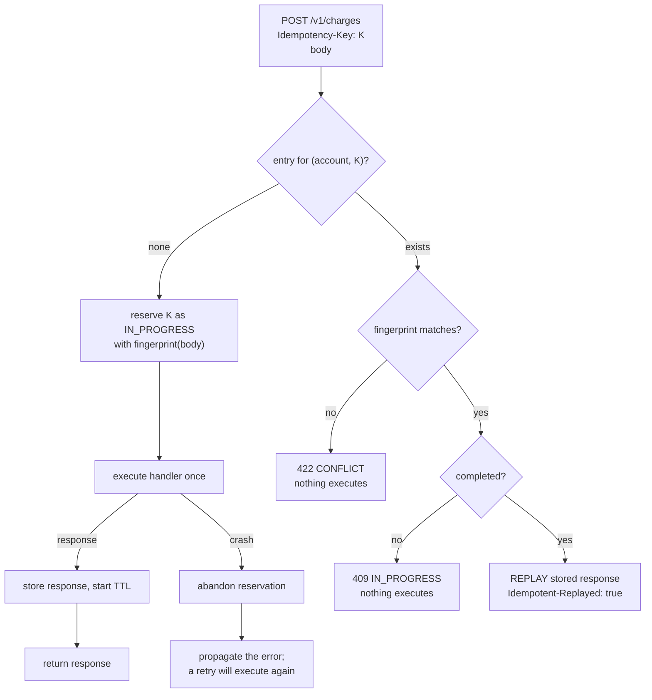

# Idempotency Keys: Exactly-Once Effects on At-Least-Once Networks

> The single most important pattern in payments, with a store that handles concurrent duplicates.

**Type:** Build
**Languages:** Java, Python, Go
**Prerequisites:** Phase 5 Lesson 01 (The Fallacies of Distributed Computing), Phase 5 Lesson 08 (Timeouts and Deadline Propagation), Phase 1 Lesson 06 (Hash Maps), Phase 0 Lesson 07 (Decimal and Integer Arithmetic)
**Time:** ~120 minutes

## Learning Objectives

- Explain why a network can deliver a request at least once or at most once but never exactly once, and why that makes every retry of a charge a potential duplicate
- Build an idempotency store keyed by (account, idempotency key) that remembers a request fingerprint and a stored response, and returns one of exactly four outcomes for every arriving request
- Handle concurrent duplicates with an atomic check-and-reserve so that one attempt executes and the others are told to wait, and prove it with a multi-threaded test
- Reject a key reused with a different request body with a 422-style conflict, and state why the fingerprint must exclude the key itself
- Reason about the two time limits in the store, the TTL and the in-progress lease, and about the one hazard the store alone cannot close: a crash between the side effect and the stored response

## The Problem

A checkout service sends `POST /v1/charges` for 19.99 USD to a card processor. The processor receives it, authorizes the card, writes the charge to its ledger, and sends back `200 OK {"id": "ch_3"}`. The response is lost: a load balancer in between recycles the connection a few milliseconds before the bytes arrive. The checkout's HTTP client throws a timeout after two seconds. The retry layer, which is doing exactly what it was configured to do, sends the request again. The processor receives a second `POST /v1/charges` for 19.99 USD. It has no way to know this is the same purchase. It authorizes the card again, writes `ch_4`, and returns `200 OK`. The customer has been charged twice, the checkout's database says once, and the first anyone hears of it is a chargeback six weeks later.

Lesson 01 drew the five worlds behind a timeout. The checkout cannot tell which it is in: the request was dropped before arrival (retry is safe), the processor is still working (retry is a duplicate), the processor crashed mid-way (depends), the response was dropped (retry is a duplicate), or the response is still in flight (retry is a duplicate). Three of the five worlds make a blind retry a second charge. The honest options are to retry and sometimes double-charge, or to not retry and sometimes lose a sale that the customer was in fact charged for. Neither is acceptable, and no amount of cleverness on the client's side can resolve it, because the information needed to decide is on the server.

The fix moves the decision to the server. The client attaches a token it made up, an *idempotency key*, to the first attempt and to every retry of it. The server remembers, per key, what it did and what it answered. A retry arrives with a key the server has seen; the server returns the stored answer and does not execute again. In the worlds where the first attempt never arrived, the server has no record of the key and executes once. In every world, the card is charged exactly once, and the client never had to work out which world it was in. Stripe has shipped this as the `Idempotency-Key` header since 2014; Adyen, Square, PayPal, and every bank API worth integrating with has an equivalent, and the IETF is standardising the header.

The pattern looks simple, and a first implementation is twenty lines around a hash map. The twenty lines are not the lesson. The lesson is what happens when two retries arrive at the same moment, when a key is reused with a different amount, when the first attempt crashes after charging the card but before recording the answer, and when the store has to forget keys so it does not grow forever. Every one of those is a real incident at a real payments company, and each one has a specific answer that this lesson builds and tests.

## The Concept

### At-least-once is the only delivery you can buy

A sender that gives up after one attempt delivers *at most once*: some requests are lost. A sender that retries until it gets an acknowledgement delivers *at least once*: some requests are executed twice. There is no protocol that delivers *exactly once* over a link that can lose messages, because the acknowledgement itself can be lost, and the sender cannot distinguish "my request was lost" from "your acknowledgement was lost" (the Two Generals problem, in its practical form). So the network gives you at-least-once, and if you want each charge to happen once, the *receiver* has to make the second delivery of the same request have no effect. That is what idempotent means: `f(f(x)) = f(x)`.

HTTP already knows this. RFC 9110 defines `PUT` and `DELETE` as idempotent by construction (setting a resource to a value twice is the same as once) and `POST` as not. A charge is a `POST`: "create a new charge" is inherently non-idempotent, because the second call creates a second charge. An idempotency key is how you make a `POST` behave like a `PUT`: the key names the operation, so a second `POST` with the same key is "the same operation" rather than "another one."

### The four outcomes

Every request that carries a key gets exactly one of four answers from the store, and the server's behaviour is fully determined by which:

| Outcome | What the store found | What the server does | HTTP shape |
|---------|----------------------|----------------------|------------|
| `NEW` | No live entry for this (account, key) | Reserves the key, executes the handler once, stores the response | Whatever the handler returned (200, 402, 502) |
| `REPLAY` | A completed entry with the same fingerprint | Returns the stored response without executing | Same status and body as the original, plus `Idempotent-Replayed: true` |
| `IN_PROGRESS` | An entry that is reserved but not yet completed | Refuses without executing; the client should retry shortly | `409 Conflict` |
| `CONFLICT` | An entry (live or in progress) with a different fingerprint | Refuses without executing; this is a client bug | `422 Unprocessable Content` (Stripe uses `400` with `idempotency_error`) |

Two of the four never touch the handler, and that is the point: the store's job is to decide who executes, and the answer is always "the first one, once."



### The fingerprint, and why it excludes the key

The key says "this is the same operation." The fingerprint checks whether the client is telling the truth. It is a hash of the parts of the request that have an effect: the amount in minor units, the currency, the card token, the description, and the route. It is computed by the server from a *canonical* form (fixed field order, one field per line) so that `{"amount": 1999, "currency": "USD"}` and `{"currency": "USD", "amount": 1999}` hash the same. In this lesson it is SHA-256 of that canonical string; the three implementations produce the same 64 hex characters for the same request, and the tests pin the value.

The fingerprint deliberately excludes the idempotency key and the account. If the key were in the hash, every key would have a unique fingerprint and a conflict could never be detected. The account is excluded because it is already part of the store's lookup key: keys are scoped per account, so two merchants can both use `order-1` without colliding, which Stripe's documentation states explicitly.

Why does the conflict case matter enough to be an error rather than a warning? Because the most common cause is a client that derives the key from something that is not unique to the operation, such as the order ID, and then uses it for both the authorization and the later capture, or for the original charge and a retry with a corrected amount. If the server silently replayed the first response, the client would believe the corrected charge went through. A loud 422 turns a silent money error into a visible bug on the first test.

### Worked example: the retry, by hand

Request: account `acct_1`, key `order-8812-attempt`, 19.99 USD on `tok_visa_4242`, description "Order 8812".

```text
canonical = "POST /v1/charges\n1999\nUSD\ntok_visa_4242\nOrder 8812"
fingerprint = sha256(canonical) = 795fe63bfb540da3cf414455d7494e879034c285ddc8d254e3b0ec2c396cb96f

attempt 1  begin(acct_1, order-8812-attempt, 795f...) -> NEW   (entry reserved, in progress)
           processor.charge -> 200 {"id":"ch_3",...}
           complete(...) -> entry now holds the response, expires in 24 h
           client never sees the 200 (response lost)

attempt 2  begin(acct_1, order-8812-attempt, 795f...) -> REPLAY (same fingerprint, completed)
           return 200 {"id":"ch_3",...} with replayed=true
           processor NOT called

attempt 3  same key, amount 2999
           canonical differs -> fingerprint differs
           begin(...) -> CONFLICT -> 422, processor NOT called
```

The processor executed once. The client got the same `ch_3` on attempt 2 that attempt 1 produced, which means its reconciliation (Phase 10) will find one charge on each side. Attempt 3 is a client bug and is reported as one.

### Concurrent duplicates: the check and the reserve must be one step

The retry does not always arrive after the original finishes. A client with a 2-second timeout retries while the processor is still working on attempt 1, and now two requests with the same key are inside the server at once. If the store's logic is "look up the key; if absent, execute; then store," both requests look up, both see nothing, both execute, and the card is charged twice with an idempotency key attached. This is a textbook check-then-act race, and it is the bug in most first implementations.

The fix is that the lookup and the reservation are one atomic operation. `begin` holds the store's lock while it checks for an entry and, finding none, inserts an `IN_PROGRESS` entry before releasing. The second request's `begin` runs after the first's and sees the reservation. It gets `IN_PROGRESS` and the server returns `409` without executing. The client's retry loop treats `409` as "wait and ask again," and on the next attempt the store returns `REPLAY`. In this lesson the lock is a Java monitor, a Python `threading.Lock`, and a Go `sync.Mutex`; in production it is a `INSERT ... ON CONFLICT DO NOTHING` returning the row count, a Redis `SET key value NX`, or a DynamoDB conditional put. The mechanism changes; the shape, one atomic check-and-reserve, does not.

The test for this is real: eight threads with the same key hit the API while the processor is deliberately blocked. Exactly one thread's `begin` returns `NEW`; the other seven get `409`; the processor's execution counter reads 1.

### What gets stored, and the Stripe rule

The store saves whatever the handler returned, including declines (`402`) and processor errors (`502`). Stripe documents this precisely: results are saved if the endpoint began executing, and subsequent requests with the same key return the same result, "including 500 errors." The reasoning is that once the handler has started, you do not know what side effects it had, so the safe replay is the honest one: tell the client what happened the first time. If the client wants a fresh attempt, it uses a fresh key, and that choice is visible in its code.

What is *not* saved is a validation failure before execution began (a bad card token format, a missing field) or a `409` / `422` from the store itself. No side effect was possible, so there is nothing to protect, and the client is free to retry the same key after fixing the request.

### Two clocks: TTL and the in-progress lease

The store cannot keep keys forever. A busy processor sees hundreds of millions of keyed requests a day; the store is a hash map or a table, and it needs to forget. The **TTL** is how long a completed entry replays. Stripe's is 24 hours; the IETF draft leaves it to the server. The number is a trade-off: longer than the longest plausible retry window (a client that retries a day later is making a new purchase, not retrying), shorter than the storage you want to pay for. After the TTL the key is unknown, and a request with it is `NEW`: it executes. The demo shows this at the end, and it is the one place where the store does what the client least expects, so the TTL must be in the API documentation.

The **in-progress lease** is subtler. Suppose attempt 1 reserves the key and then the server process dies before `complete` or `abandon` runs. The entry is `IN_PROGRESS` forever, every retry gets `409`, and the customer can never complete the purchase with that key. The lease bounds this: an `IN_PROGRESS` entry older than `inProgressLeaseMs` (30 seconds in the demo) is treated as dead and the next `begin` takes it over as `NEW`. The lease must be longer than the longest honest execution time, or a slow but live attempt will be duplicated by its own retry.

### The hazard the store cannot close

Look at the crash branch in the diagram. Attempt 1 reserves the key, calls the processor, and the processor charges the card. Then the connection drops before the response arrives, so from the server's point of view the handler "crashed." The server abandons the reservation; the retry executes; the card is charged twice, with a key attached and the store working exactly as designed. The demo reproduces this and labels it: "the hazard: did the first attempt move money?"

The store cannot fix this because the side effect and the record of it live in two different systems. The real fix is to make them one: write the charge and the idempotency row in the same database transaction (Phase 7), or make the downstream call itself idempotent with its *own* key derived from yours (so the retry to the processor replays rather than re-executes), or record the intent before calling out and reconcile afterwards (the outbox pattern, Phase 8). In a payments stack all three are used at different layers. The idempotency store is the first line, not the last.

### What this store does not do

- It does not make the handler idempotent. It prevents the handler from running twice for the same key. If the handler calls two downstreams, the store does not help with partial completion; that is a saga (Phase 7).
- It does not deduplicate requests with different keys and the same body. Two customers buying the same item for the same price are two charges. Only the client knows which requests are "the same," which is why the client chooses the key.
- It does not survive the server losing its memory. The demo's store is a hash map; a production store is durable, replicated, and read by every instance of the API, otherwise a retry routed to a different instance executes again.

## Build It

The primary walkthrough is in Java. Python and Go implement the same design with the same names and the same test cases; the subsections at the end show only what differs.

### Step 1: The request and its fingerprint

```java
record ChargeRequest(String accountId, String idempotencyKey, Money amount, String cardToken, String description) {
    ChargeRequest {
        if (idempotencyKey != null && (idempotencyKey.isBlank() || idempotencyKey.length() > 255)) {
            throw new IllegalArgumentException("Idempotency-Key must be 1..255 characters");
        }
        if (amount.minorUnits() <= 0) throw new IllegalArgumentException("amount must be positive");
    }

    String canonical() {
        return "POST /v1/charges\n" + amount.minorUnits() + "\n" + amount.currency().code() + "\n"
                + cardToken + "\n" + (description == null ? "" : description);
    }

    String fingerprint() {
        return Fingerprint.sha256Hex(canonical());
    }
}
```

`idempotencyKey` is nullable because the header is optional; a request without one is executed every time, which the demo shows first so the failure is concrete. The 255-character bound matches Stripe's. `Money` is the Phase 10 Lesson 01 type (integer minor units plus a currency), copied in rather than imported, so `1999` and `USD` are what gets hashed, never `19.99`. The canonical form puts one field per line in a fixed order; a newline cannot appear inside a card token or a currency code, so the form is unambiguous.

**Predict:** two requests differ only in `accountId`. Do they have the same fingerprint? Can they ever collide in the store?

### Step 2: The outcomes and the entry

```java
enum Outcome { NEW, REPLAY, IN_PROGRESS, CONFLICT }

record Begin(Outcome outcome, Response response) {
    static Begin of(Outcome outcome) { return new Begin(outcome, null); }
}

final class Entry {
    final String fingerprint;
    final long startedAtMs;
    Response response;       // null while in progress
    long expiresAtMs;        // meaningful once completed

    boolean inProgress() { return response == null; }
}
```

`Begin` carries a response only for `REPLAY`; the other three outcomes have nothing to return. `Entry` is mutable on purpose: it is created in `IN_PROGRESS` by `begin` and completed in place by `complete`, under the same lock, so there is never a moment where a key has two entries. `response == null` is the in-progress marker; a stored response, whatever its status, means the handler finished.

### Step 3: The atomic check-and-reserve

```java
synchronized Begin begin(String accountId, String key, String fingerprint) {
    long now = clock.nowMs();
    String k = scoped(accountId, key);
    Entry e = entries.get(k);
    if (e != null) {
        if (!e.inProgress() && now >= e.expiresAtMs) {
            entries.remove(k);                                    // TTL passed: forget it
            e = null;
        } else if (e.inProgress() && now - e.startedAtMs >= inProgressLeaseMs) {
            entries.remove(k);                                    // the first attempt died: let a retry take over
            e = null;
        }
    }
    if (e != null) {
        if (!e.fingerprint.equals(fingerprint)) return Begin.of(Outcome.CONFLICT);
        if (e.inProgress()) return Begin.of(Outcome.IN_PROGRESS);
        return new Begin(Outcome.REPLAY, e.response.asReplay());
    }
    entries.put(k, new Entry(fingerprint, now));
    return Begin.of(Outcome.NEW);
}
```

This is the whole algorithm. Read the order of the checks. Expiry comes first, because an expired entry must behave exactly like no entry. Then the fingerprint, before the in-progress check, because a key reused with a different body is a client bug whether or not the first attempt has finished, and the client should hear about it now rather than after waiting out a `409`. Then in-progress, then replay. If none of those returned, the key is free and this caller takes it: the `put` happens inside the same `synchronized` block as the `get`, so a second thread's `get` cannot interleave between them.

`scoped` joins the account and key with a `\u0000` separator, a character that cannot appear in either, so `("a", "b\u0000c")` and `("a\u0000b", "c")` cannot collide.

**Predict:** `begin` is called for a key whose entry is `IN_PROGRESS`, started 31 seconds ago, with a *different* fingerprint. The lease is 30 seconds. What is the outcome?

### Step 4: Completing and abandoning

```java
synchronized void complete(String accountId, String key, Response response) {
    Entry e = entries.get(scoped(accountId, key));
    if (e == null || !e.inProgress()) throw new IllegalStateException("complete without a live reservation: " + key);
    e.response = response;
    e.expiresAtMs = clock.nowMs() + ttlMs;
}

synchronized void abandon(String accountId, String key) {
    Entry e = entries.get(scoped(accountId, key));
    if (e != null && e.inProgress()) entries.remove(scoped(accountId, key));
}
```

`complete` refuses to run without a live reservation. Completing a key that was never begun, or completing it twice, is a logic error in the API layer, and an exception finds it in the first test rather than letting a stale response overwrite a fresh one. `abandon` is deliberately forgiving: it is called from an exception handler, and throwing from there would mask the original crash. The TTL starts at completion, not at reservation, so a slow handler does not eat into the replay window.

### Step 5: The endpoint

```java
Response charge(ChargeRequest request) {
    if (request.idempotencyKey() == null) return processor.charge(request);
    String key = request.idempotencyKey();
    Begin b = store.begin(request.accountId(), key, request.fingerprint());
    switch (b.outcome()) {
        case REPLAY -> { return b.response(); }
        case IN_PROGRESS -> { return Response.of(409, "{\"error\":\"idempotency_key_in_progress\"}"); }
        case CONFLICT -> { return Response.of(422, "{\"error\":\"idempotency_key_reused_with_different_request\"}"); }
        case NEW -> { /* fall through to execute */ }
    }
    Response response;
    try {
        response = processor.charge(request);
    } catch (RuntimeException crash) {
        store.abandon(request.accountId(), key);
        throw crash;
    }
    store.complete(request.accountId(), key, response);
    return response;
}
```

Three of the four outcomes return before the processor is touched. The `NEW` path is the only one that executes, and it executes exactly once per reservation. The `try`/`catch` is the crash branch from the diagram: the reservation is released and the exception propagates, so the client sees a real error (not a `200`) and its retry will execute. Note what is *not* here: no `if (response.status() >= 500) abandon(...)`. A `502` from the processor is a response, it is stored, and it replays. Change that only if you have decided, in writing, that your retry semantics differ from Stripe's.

**Predict:** the processor returns a `402` decline. The client retries with the same key. What status does it get, and how many times did the processor run?

### Step 6: Run it

```bash
cd phases/05-distributed-foundations/09-idempotency-keys/code/java
javac -d .out *.java && java -cp .out Main
java -cp .out MainTest
```

Expected output, abbreviated:

```console
== Without a key: a retry is a second charge ==
two sends of the same request executed 2 charges

== With a key: the retry replays the stored response ==
fingerprint = 795fe63bfb540da3...
first:  200 {"id":"ch_3","amount":"19.99 USD","status":"succeeded"} replayed=false
retry:  200 {"id":"ch_3","amount":"19.99 USD","status":"succeeded"} replayed=true
processor executions so far: 3 (the keyed pair added exactly one)

== Same key, different amount: 422, nothing executes ==
conflict: 422 {"error":"idempotency_key_reused_with_different_request"}

== Concurrent duplicates: one wins, the other sees 409 until it is done ==
request A begin -> NEW ; request B begin -> IN_PROGRESS
A completes; B retries -> REPLAY with body {"id":"ch_9001"}

== A crash mid-execution releases the reservation; the retry executes ==
first attempt: processor connection reset
retry: 200, executions for this key: 2 (the hazard: did the first attempt move money?)

== TTL: after 24 h the key is forgotten and a retry executes again ==
purged 4 expired entries; entries now: 0
same request after TTL: 200 replayed=false -> a new charge {"id":"ch_7",...}
```

The test file ends with the eight-thread test. Run it several times; the outcome is the same every time because the lock makes it so, and that is the property you are buying.

### In Python

```python
def begin(self, account_id: str, key: str, fingerprint: str) -> Begin:
    with self._lock:
        now = self.clock.now_ms()
        k = (account_id, key)
        e = self._entries.get(k)
        ...
        self._entries[k] = Entry(fingerprint, now)
        return Begin(Outcome.NEW)
```

Differences, all in `code/python/main.py`:

- **A tuple is the scoped key.** Python dictionaries hash tuples, so `(account_id, key)` replaces the `\u0000`-joined string and the collision argument becomes trivial.
- **`threading.Lock` is held for the whole of `begin`.** The GIL does not make `get` followed by `__setitem__` atomic; another thread can run between them. The lock is required for the same reason as in Java, and the eight-thread test proves it.
- **Exceptions are the crash signal.** The processor raises `ConnectionError`; the API catches `Exception`, abandons, and re-raises with a bare `raise` so the traceback is preserved.
- **`Money` rejects floats at construction** (`TypeError`), copied from Phase 10 Lesson 01, so `Money(19.99, USD)` cannot reach the fingerprint.

### In Go

```go
func (a *PaymentsApi) Charge(request ChargeRequest) (Response, error) {
    ...
    response, err := a.Processor.Charge(request)
    if err != nil {
        a.Store.Abandon(request.AccountID, key)
        return Response{}, err
    }
    if err := a.Store.Complete(request.AccountID, key, response); err != nil {
        return Response{}, err
    }
    return response, nil
}
```

Differences, all in `code/go/main.go`:

- **The crash is an error value, not a panic.** `Processor.Charge` returns `(Response, error)`; a non-nil error means no response was produced and the reservation is abandoned. The sentinel errors `ErrProcessorCrash`, `ErrNoReservation`, and `ErrInvalidRequest` support `errors.Is`.
- **An optional key is a `*string`.** Go has no `null` for strings; `nil` means the header was absent and `""` is rejected by validation like any blank key.
- **A struct is the scoped key.** `scopedKey{account, key}` is comparable and so usable as a map key, like the Python tuple.
- **The concurrency test uses channels.** The eight goroutines report on a buffered channel; the test drains seven results before closing the `release` channel that unblocks the winner, then checks the eighth. `go test -race ./...` passes because every shared counter is behind a mutex.

## Use It

### Stripe's `Idempotency-Key`

Stripe's API accepts an `Idempotency-Key` header on every `POST`. Keys are up to 255 characters, chosen by the client (Stripe recommends a V4 UUID), scoped to the account, and remembered for at least 24 hours. A replayed response carries the header `Idempotent-Replayed: true`. Reusing a key with different parameters returns a `400` with `"type": "idempotency_error"`. A key whose first request is still in flight returns a `409`. Results are stored once the endpoint begins executing, including `500`s, and are not stored for validation failures or for the `409`/`400` cases above. Every one of those sentences is a line in this lesson's tests.

```bash
curl https://api.stripe.com/v1/charges \
  -u sk_test_...: \
  -H "Idempotency-Key: 8b1b4a4e-6a7f-4a0d-9f6a-2d7f0e1c3b55" \
  -d amount=1999 -d currency=usd -d source=tok_visa
```

The trap: the key must be generated *before* the first attempt and stored with the order, so that a retry after a client crash uses the same key. A key generated inside the retry loop is a fresh key per attempt and protects nothing.

### The IETF draft and other processors

`draft-ietf-httpapi-idempotency-key-header` standardises the header name, the per-resource scoping, the fingerprint-mismatch error (`422 Unprocessable Content`, which this lesson follows), and the recommendation to document the retention period. Adyen uses the same header; Square uses an `idempotency_key` field in the request body; PayPal uses `PayPal-Request-Id`. The field names differ; the four outcomes do not.

### Building the store on a database

In production the hash map is a table:

```sql
CREATE TABLE idempotency_keys (
  account_id      TEXT        NOT NULL,
  idempotency_key TEXT        NOT NULL,
  fingerprint     TEXT        NOT NULL,
  response_status INTEGER,                 -- NULL while in progress
  response_body   TEXT,
  started_at      TIMESTAMPTZ NOT NULL,
  expires_at      TIMESTAMPTZ,
  PRIMARY KEY (account_id, idempotency_key)
);
```

`begin` becomes `INSERT ... ON CONFLICT DO NOTHING` followed by a `SELECT` when zero rows were inserted; the primary key is the lock. In Redis the equivalent is `SET key fingerprint NX PX <lease>` for the reservation and a second write for the response. The database version has an advantage the hash map does not: the charge row and the idempotency row can be written in one transaction, which closes the crash hazard from The Concept. Brandur Leach's "Implementing Stripe-like Idempotency Keys in Postgres" walks through exactly that design, with recovery points for multi-step handlers.

### What the store does for you that a retry library does not

Client-side retry libraries (Lesson 10) decide *when* to send again. They cannot decide whether sending again is safe; only the server has the information. Every retry policy for a non-idempotent endpoint should be paired with a key, and the review question is simple: "If this retry fires in world 4, what stops the duplicate?"

## Ship It

`outputs/checklist-idempotent-endpoint.md` is a review checklist for any endpoint that moves money or creates a resource: key handling, fingerprint contents, the four outcomes and their status codes, the two time limits, the concurrency test, and the crash hazard. Attach it to the pull request that adds or changes a `POST` handler.

## Exercises

1. **Reinforce.** The fingerprint currently includes `description`. A product manager argues a retry that fixes a typo in the description should replay rather than conflict. Make the change, update the pinned fingerprint in all three test files, and write one paragraph on what a client could now do with a key that it could not before. Decide whether you would ship it.
2. **Apply.** Add a `GET /v1/idempotency_keys/{key}` endpoint that returns the entry's state (`in_progress`, `completed` with status, or `unknown`) without executing anything. Then write a client retry loop (reuse Lesson 10's backoff) that on `409` polls this endpoint instead of re-sending the charge, and show with the `FakeClock` that it never sends the charge body more than once.
3. **Extend.** Close the crash hazard. Add a `FakeProcessor` mode that charges the card and then throws, so the money moved but no response was returned. Then implement a *recovery point*: before calling the processor, record a `processor_request_id` (derive it from the key) in the entry, and have the processor expose `lookupByRequestId`. On a `NEW` begin that finds an abandoned entry with a request id, query the processor before executing. Test that the card is charged once. This connects to Phase 7 (transactions) and Phase 8 (the outbox).

## Key Terms

| Term | What people say | What it actually means |
|------|-----------------|------------------------|
| Idempotency key | "a unique request ID" | A client-chosen token that names one operation across all of its retries; the server remembers what it did under that key and replays it |
| At-least-once delivery | "retries" | A sender that retries until acknowledged; some requests are executed more than once because an acknowledgement, not the request, was lost |
| Request fingerprint | "a hash of the body" | A server-computed hash of the effectful fields in canonical form, excluding the key, used to detect a key reused for a different operation |
| Replay | "cached response" | Returning the stored response of a completed entry without executing, marked so the client can tell (`Idempotent-Replayed: true`) |
| Check-and-reserve | "lock the key" | The atomic step that looks for an entry and, finding none, inserts an in-progress one, so two concurrent duplicates cannot both execute |
| In-progress lease | "a lock timeout" | How long a reservation with no response is trusted before a retry may take it over; must exceed the longest honest execution |
| TTL | "key expiry" | How long a completed entry replays; after it the key is unknown and the same request executes again |
| Recovery point | "resume where it crashed" | A record, written before a side effect, that lets a retry discover whether the effect happened instead of blindly redoing it |

## Further Reading

- [Stripe API reference: Idempotent requests](https://docs.stripe.com/api/idempotent_requests) — the production specification this lesson follows: key length, scoping, 24-hour retention, replay of errors, and the `409` / `idempotency_error` cases.
- [draft-ietf-httpapi-idempotency-key-header](https://datatracker.ietf.org/doc/draft-ietf-httpapi-idempotency-key-header/) — the IETF standardisation of the header, including the fingerprint-mismatch `422` and the retention-period requirement.
- [RFC 9110, HTTP Semantics, section 9.2.2 "Idempotent Methods"](https://www.rfc-editor.org/rfc/rfc9110#section-9.2.2) — the formal definition of idempotence for HTTP methods and why `POST` is excluded.
- [Brandur Leach, "Implementing Stripe-like Idempotency Keys in Postgres"](https://brandur.org/idempotency-keys) — the database-backed design with recovery points, by a former Stripe engineer; the reference for Exercise 3.
- [Brandur Leach, "Designing robust and predictable APIs with idempotency"](https://stripe.com/blog/idempotency) (Stripe blog, 2017) — the client-side half: when to generate the key, how to retry, and what to do on each status.
- [Gray, "Notes on Data Base Operating Systems" (1978), section on the Two Generals problem](https://www.microsoft.com/en-us/research/publication/notes-on-data-base-operating-systems/) — the original argument that exactly-once delivery over a lossy channel is impossible, which is why the receiver must deduplicate.
