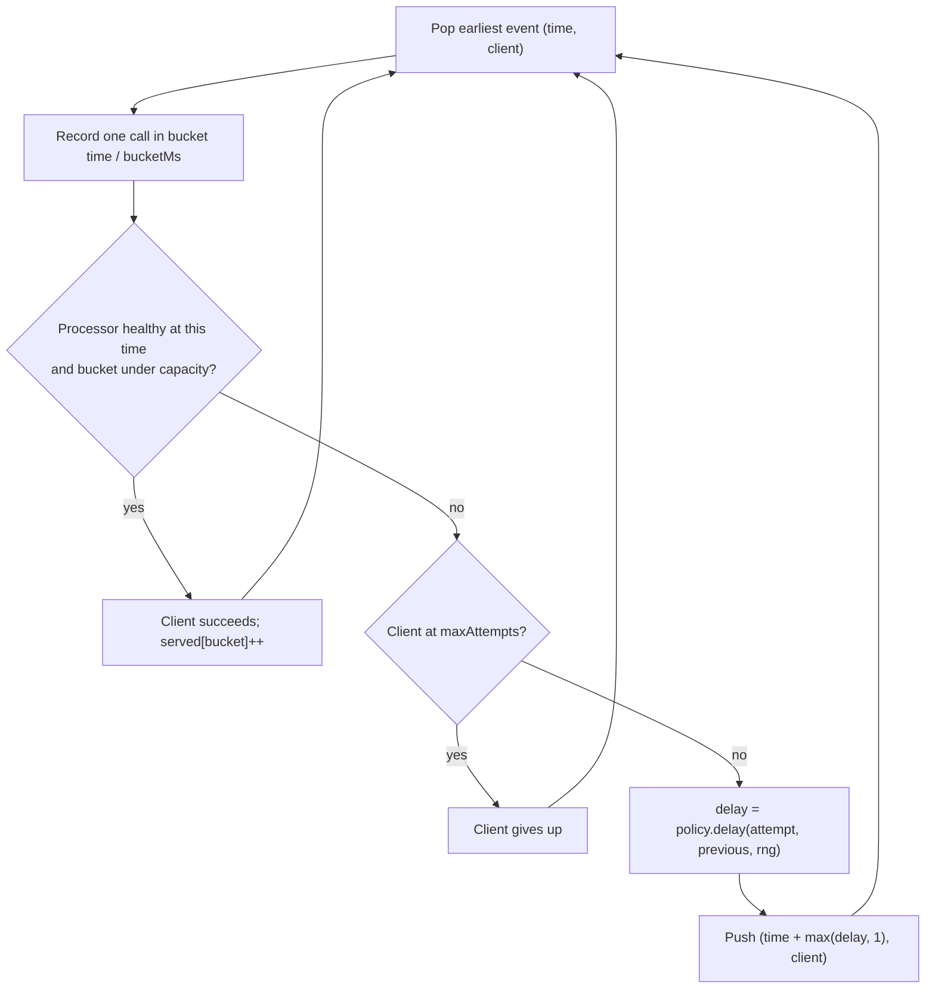

# Retries, Exponential Backoff, and Jitter

> Retry storms are self-inflicted outages; simulate one and then prevent it.

**Type:** Build
**Languages:** Java, Python, Go
**Prerequisites:** Phase 5 Lesson 09 (Idempotency Keys), Phase 1 Lesson 09 (Heaps and Priority Queues)
**Time:** ~90 minutes

## Learning Objectives

- Classify a failed call to a payment processor as retryable or not, and state why a retry without an idempotency key can double-charge
- Compute an exponential backoff schedule with a base, a cap, and a maximum attempt count, and show where doubling stops
- Implement the four jitter strategies from the AWS "Exponential Backoff and Jitter" analysis (none, full, equal, decorrelated) and state the bounds each one guarantees
- Build a retry budget that limits retries to a fixed fraction of organic traffic so a dependency outage cannot amplify load
- Run a deterministic discrete-event simulation of 1000 clients retrying against a failing dependency and read the load histogram it produces

## The Problem

A card-processing gateway sits between 1000 merchant checkout servers and one card processor. At 14:02:00 the processor's load balancer drops every connection for a little over a second. Every one of the 1000 in-flight authorizations times out at the same instant. Every checkout server runs the same retry code: wait 100 ms, try again. At 14:02:00.100 the processor, now healthy, receives 1000 requests inside a 100 ms window. Its capacity is 200 per 100 ms. It serves 200 and times out the rest, which wait 200 ms and arrive together again at 14:02:00.300. Then 400 ms later. Then 800 ms later. Each wave is a wall of identical traffic separated by silence, and every wall exceeds capacity, so most clients exhaust their attempts without ever succeeding. The processor was down for one second; the gateway reported a five-second outage, and 60% of the checkouts failed.

Nothing in that story required the processor to be broken for more than a second. The second four seconds of outage were manufactured by the clients. This is a retry storm: a short failure that synchronizes a population of callers, who then retry in lockstep and keep the dependency over capacity. It is the most common way a minor incident becomes a major one, and it is entirely under the caller's control.

Two more failures ride along. First, a checkout server that retries a `TIMEOUT` on an authorization without an idempotency key (Lesson 09) may authorize the card twice: the processor might have done the work before the response was lost. Second, a server that retries an HTTP 400 or a card decline is wasting capacity on a request that will fail identically every time, and a server that retries a 401 is brute-forcing its own credentials. The retry policy must know which outcomes are worth another attempt.

This lesson builds the three mechanisms that make retries safe: a backoff schedule with jitter, so that a synchronized population desynchronizes itself; a retry budget, so that total retry load is bounded no matter how long the outage lasts; and a retryability classification, so that only outcomes that might change are retried. Then it runs the storm in simulated time, with a seeded random generator and a fake clock, so you can see the walls of traffic and watch jitter dissolve them.

## The Concept

### Why retries amplify load

Let a dependency have capacity `C` requests per unit time and let `N > C` clients fail together at `t = 0`. If each client retries after a fixed delay `d`, all `N` arrive at `t = d`, `C` succeed, and `N - C` fail together again. The load on the dependency is a sequence of spikes of height `N`, then `N - C`, then `N - 2C`, each one over capacity until enough clients have been served. The number of waves needed is roughly `N / C`, and if the client's maximum attempt count is smaller than that, the tail of the population never succeeds.

Exponential backoff spaces the waves out (`d, 2d, 4d, ...`) so the dependency has time to recover between them, but it does not change the height of a wave. The clients are still synchronized, because they all computed the same delay from the same attempt number. The fix is to add randomness so that the arrival times of the `N` clients are spread over an interval rather than concentrated at a point. The question is how much randomness and from which distribution. Marc Brooker's analysis for the AWS Architecture Blog ran this simulation for several choices and measured two things: how many total calls the clients made (work) and how long it took for all of them to complete (time). Full jitter and decorrelated jitter won on both axes.

### The schedule

For retry number `attempt` (0 for the first retry), the deterministic part of the delay is

```text
exp(attempt) = min(cap, base * 2^attempt)
```

The cap matters for two reasons. A client on its tenth retry with a 100 ms base would otherwise wait 100 * 2^10 = 102 seconds, which is longer than any checkout session, and `2^attempt` overflows a 64-bit integer at attempt 63. The implementation therefore doubles in a loop and stops as soon as the cap is reached rather than computing a power and then clamping it.

Worked schedule, base 100 ms, cap 1000 ms, 8 attempts (7 retries):

| attempt | base * 2^attempt | min(cap, ...) |
|---------|------------------|---------------|
| 0 | 100 | 100 |
| 1 | 200 | 200 |
| 2 | 400 | 400 |
| 3 | 800 | 800 |
| 4 | 1600 | 1000 |
| 5 | 3200 | 1000 |
| 6 | 6400 | 1000 |

Total worst-case wait before giving up: 4500 ms. A policy is only honest if that total is shorter than the deadline of the operation it protects; a 5-second checkout timeout with a 4.5-second retry schedule leaves 500 ms for eight round trips, which is not enough. Deadlines and retries are designed together.

### The four jitter strategies

Brooker's post names the strategies as follows. `exp` is `exp(attempt)` above, `previous` is the delay actually used for the preceding retry (or `base` before the first), and `uniform[a, b]` is a random integer in the closed interval.

| Strategy | Delay | Bounds | Property |
|----------|-------|--------|----------|
| None | `exp` | exactly `exp` | Every client that failed together retries together |
| Full | `uniform[0, exp]` | `[0, exp]` | Widest spread, lowest peak; some retries happen almost immediately |
| Equal | `exp / 2 + uniform[0, exp / 2]` | `[exp / 2, exp]` | Never retries sooner than half the backoff; narrower spread than Full |
| Decorrelated | `min(cap, uniform[base, 3 * previous])` | `[base, min(cap, 3 * previous)]` | The spread grows with the previous delay rather than with the attempt count, so clients that happened to wait longer spread further |

The names describe where the randomness is applied. Full jitter randomizes the whole interval; equal jitter keeps half of it deterministic; decorrelated jitter forgets the attempt counter entirely and builds each delay from the last one.

Worked example for seed 42 with the generator in this lesson, base 100 ms, cap 10 s, 6 attempts:

```text
NONE          [100, 200, 400, 800, 1600]
FULL          [46, 26, 131, 226, 241]
EQUAL         [68, 179, 379, 654, 994]
DECORRELATED  [190, 474, 675, 569, 810]
```

Check the bounds by hand. FULL retry 2 is 131, inside `[0, 400]`. EQUAL retry 2 is 379, inside `[200, 400]`. DECORRELATED retry 3 is 569, inside `[100, min(10000, 3 * 675)] = [100, 2025]`, and it is smaller than the retry before it, which NONE and EQUAL can never produce. Every language in this lesson uses the same generator and the same seed, so these five lists are identical in Java, Python, and Go. That is deliberate: a retry schedule is a contract between services, and being able to say "with seed 42 the third delay is 131 ms" in every language is how you test the contract.

### The invariants

A retry policy promises three things, and the tests check each one:

1. **Bounded delay.** Every delay is in `[0, cap]`, and the jitter strategy's tighter bounds above hold for every attempt and every seed.
2. **Bounded attempts.** No operation is tried more than `maxAttempts` times, and there is no sleep after the final failed attempt. Sleeping after the last attempt is a common bug; it adds a full backoff interval to the latency of every exhausted request for no benefit.
3. **Non-retryable outcomes stop immediately.** A `BAD_REQUEST`, `UNAUTHORIZED`, or `CARD_DECLINED` returns after exactly one attempt with zero delay.

### Which outcomes are retryable

| Outcome | Retry? | Why |
|---------|--------|-----|
| `OK` | no | Done |
| `TIMEOUT` | yes, with an idempotency key | The processor may or may not have done the work; only an idempotency key makes the retry safe |
| `CONNECTION_RESET` | yes, with an idempotency key | Same ambiguity as a timeout |
| `RATE_LIMITED` (429) | yes, with backoff | The dependency asked you to slow down; retrying immediately is the one thing it asked you not to do |
| `SERVER_ERROR` (502, 503) | yes | Transient on the far side |
| `BAD_REQUEST` (400) | no | The same bytes produce the same answer |
| `UNAUTHORIZED` (401) | no | Retrying with the same credentials is a brute-force attempt and will get the key revoked |
| `CARD_DECLINED` | no | A valid business answer from the issuer; a retry is a second authorization request against the cardholder, which networks penalize |

Retryability is a property of the outcome, decided once in the `Outcome` type, not re-decided by every call site. Card networks publish rules on reattempts of declined authorizations (Visa's reattempt limits and the Mastercard "Transaction Processing Excellence" fees) precisely because merchants used to retry declines in a loop. A decline is data, not an error.

### Retry budgets

Backoff and jitter shape the retry load in time but do not bound its total. If the processor is down for ten minutes, a population of clients with eight attempts each still makes eight times its organic request rate in retries, spread out but relentless. A retry budget bounds the ratio directly. The design used here follows Finagle's `RetryBudget`:

- Every first attempt deposits a fraction of a token, `percentCanRetry / 100`.
- Every retry withdraws one whole token. If the balance is below one token, the retry is refused and the operation fails with `BUDGET_EXHAUSTED`.
- The balance is capped at `maxTokens`, so a long healthy period cannot bank an unlimited number of retries.

With `percentCanRetry = 20`, five successful first attempts earn one retry. Under a total outage, retries consume the banked tokens, then continue at exactly 20% of the incoming request rate, and no higher, for as long as the outage lasts. The budget is kept in integer millitokens (1000 per token) so that 20% of a token is exactly 200 and there is no floating-point drift after a million requests. The same discipline as integer minor units for money.

Worked trace, budget 20%, max 10 tokens, 3-attempt policy, after 50 healthy requests have banked the maximum 10 tokens:

```text
outage request 1: attempt 1 fails, withdraw -> 9, attempt 2 fails, withdraw -> 8, attempt 3 fails: ATTEMPTS_EXHAUSTED
outage request 2: ... tokens 6
outage request 3: ... tokens 4
outage request 4: ... tokens 2
outage request 5: ... tokens 0
outage request 6: deposit 0.2 -> 0.2; attempt 1 fails; withdraw refused: BUDGET_EXHAUSTED after 1 attempt
```

Request 6 deposits 200 millitokens, which is less than a token, so it gets no retry. Request 11 will have accumulated 1000 millitokens and will get exactly one.

### The storm as a discrete-event simulation

The simulation is the part of this lesson you will reuse most often, because it is how you evaluate any retry policy before shipping it. It is a priority queue of `(time, client)` events, which is the heap from Phase 1, Lesson 09 doing the job it was built for:



Events are ordered by time and then by client id, so the random generator is drawn in a fixed order and the entire run is a pure function of its seed. The processor model is simple on purpose: unreachable until `outageMs`, then able to serve `capacityPerBucket` calls per `bucketMs` bucket, with calls over capacity timing out. Each bucket's load is counted, and the report exposes the peak load after recovery (the number that decides whether the recovered processor falls over again), the number of busy buckets (how spread out the load was), and the outcome counts.

With 1000 clients, 200 per bucket of capacity, a one-second outage, and 8 attempts, the demo prints:

```text
-- NONE: peak after recovery=1000/bucket busy buckets=6 succeeded=400 gave up=0 waiting=600
    0 ms | 1000 | ########################################
  100 ms | 1000 | ########################################
  300 ms | 1000 | ########################################
  700 ms | 1000 | ########################################
 1500 ms | 1000 | ########################################
 3100 ms |  800 | ################################

-- FULL: peak after recovery=146/bucket busy buckets=43 succeeded=998 gave up=2 waiting=0
    0 ms | 2264 | ###########################################################################################
  100 ms |  648 | ##########################
  ...
 1000 ms |  146 | ######
 1100 ms |  113 | #####
```

Without jitter the processor sees six walls of 800 to 1000 calls, each five times its capacity, and 600 clients are still waiting when the horizon ends. With full jitter the load after recovery never exceeds 146 per bucket, which is under capacity, and 998 of 1000 clients succeed. The two that gave up burned their eight attempts in the first second because full jitter sometimes produces very short delays; that is the known cost of full jitter and the reason equal jitter exists. Note also that full jitter made 5996 total calls versus 5800 without, because more clients used more attempts before the processor recovered. Jitter does not reduce work during the outage. It reduces the peak afterward, and the peak is what causes the second outage.

### What this mechanism does not do

- It does not make a non-idempotent operation safe to retry. The `Outcome` table assumes every retried request carries the idempotency key from Lesson 09; without one, a `TIMEOUT` retry is a possible double charge.
- It does not stop calling a dependency that is known to be down. Every client in the storm keeps probing. Lesson 11 adds the circuit breaker, which trips after a failure threshold and refuses calls without sending them.
- It does not coordinate across clients. Each client randomizes independently, and the desynchronization is statistical. A shared rate limiter or a server-side `Retry-After` header is a coordination mechanism, and the policy here honours neither; Exercise 2 adds one.
- It does not model the dependency's recovery behaviour. A real processor under a wall of 1000 connections may not recover at `outageMs` at all. The simulation assumes it does, which makes the no-jitter result optimistic.

## Build It

The walkthrough is in Java. The Python and Go files implement the same design with the same names; the subsections at the end show only what differs.

### Step 1: A generator the three languages agree on

```java
final class Rng {
    private long state;

    Rng(long seed) { this.state = seed == 0 ? 0x9E3779B97F4A7C15L : seed; }

    long nextLong() {
        long x = state;
        x ^= x >>> 12;
        x ^= x << 25;
        x ^= x >>> 27;
        state = x;
        return x * 0x2545F4914F6CDD1DL;
    }

    long nextBelow(long bound) {
        if (bound <= 0) throw new IllegalArgumentException("bound must be positive: " + bound);
        return Long.remainderUnsigned(nextLong(), bound);
    }
}
```

This is xorshift64*, a 64-bit generator with a three-shift state update and a multiplicative output scrambler. It is chosen over `java.util.Random` because `Random`, Python's `random`, and Go's `math/rand` are three different algorithms, and the lesson needs the storm histogram to be identical in all three languages. The `>>>` operators are unsigned shifts; a signed `>>` would smear the sign bit and break the agreement with Python and Go. `remainderUnsigned` treats the output as a 64-bit unsigned value so the result is never negative. A zero seed is replaced because xorshift of zero is zero forever.

**Predict:** `new Rng(42).nextLong()` is `6255019084209693600`. What will `new Rng(42).nextBelow(100)` return, and does the answer depend on whether you compute the modulus on the signed or unsigned value?

### Step 2: A clock that does not tick on its own

```java
interface Clock {
    long nowMs();
    void sleep(long ms);
}

final class FakeClock implements Clock {
    private long now;
    FakeClock(long startMs) { this.now = startMs; }
    @Override public long nowMs() { return now; }
    @Override public void sleep(long ms) {
        if (ms < 0) throw new IllegalArgumentException("cannot sleep a negative duration");
        now += ms;
    }
}
```

The retrier sleeps against the interface, never against `Thread.sleep`. `FakeClock.sleep` advances the clock instantly, so a test that retries five times with a 10-second cap finishes in microseconds and can assert the exact total wait. A production `SystemClock` would call `Thread.sleep` and `System.currentTimeMillis`; it is omitted here because nothing in the lesson needs wall time.

### Step 3: Jitter and retryability as types

```java
enum Jitter { NONE, FULL, EQUAL, DECORRELATED }

enum Outcome {
    OK(false), TIMEOUT(true), CONNECTION_RESET(true), RATE_LIMITED(true), SERVER_ERROR(true),
    BAD_REQUEST(false), UNAUTHORIZED(false), CARD_DECLINED(false);

    private final boolean retryable;
    Outcome(boolean retryable) { this.retryable = retryable; }
    boolean retryable() { return retryable; }
}
```

Retryability is a field on the enum constant. The alternative, an `isRetryable(Outcome)` helper near each call site, means every team that integrates the processor gets to decide for itself whether a decline is worth retrying, and one of them will decide wrong.

**Predict:** `Outcome.OK.retryable()` is `false`. Why is that the correct value even though `OK` is not an error?

### Step 4: The policy and its schedule

```java
record RetryPolicy(long baseMs, long capMs, int maxAttempts, Jitter jitter) {
    RetryPolicy {
        if (baseMs <= 0) throw new IllegalArgumentException("baseMs must be positive");
        if (capMs < baseMs) throw new IllegalArgumentException("capMs must be >= baseMs");
        if (maxAttempts < 1) throw new IllegalArgumentException("maxAttempts must be >= 1");
    }

    long exponential(int attempt) {
        long delay = baseMs;
        for (int i = 0; i < attempt && delay < capMs; i++) delay = Math.min(capMs, delay * 2);
        return Math.min(capMs, delay);
    }
```

The loop stops doubling the moment `delay` reaches the cap, so `exponential(99)` with a 10-second cap returns 10 000 after seven iterations instead of overflowing `long` at `2^63`. The compact constructor rejects a cap below the base, which would make `exponential(0)` return a value the policy's own bounds forbid.

```java
    long delay(int attempt, long previousMs, Rng rng) {
        long exp = exponential(attempt);
        return switch (jitter) {
            case NONE -> exp;
            case FULL -> rng.nextBelow(exp + 1);
            case EQUAL -> exp / 2 + rng.nextBelow(exp / 2 + 1);
            case DECORRELATED -> {
                long upper = Math.min(capMs, Math.max(baseMs, previousMs) * 3);
                yield baseMs + rng.nextBelow(upper - baseMs + 1);
            }
        };
    }
```

Each arm is the formula from the table. `nextBelow(exp + 1)` produces `[0, exp]` inclusive, matching `uniform[0, exp]`. Decorrelated jitter reads `previousMs`, the delay actually used last time, and ignores `attempt`; the `Math.max(baseMs, previousMs)` guard handles the first retry, where there is no previous delay and the caller passes `baseMs`.

```java
    List<Long> schedule(Rng rng) {
        List<Long> delays = new ArrayList<>();
        long previous = baseMs;
        for (int attempt = 0; attempt < maxAttempts - 1; attempt++) {
            long d = delay(attempt, previous, rng);
            delays.add(d);
            previous = d;
        }
        return delays;
    }
}
```

`schedule` is what the policy would do if every attempt failed, and it has `maxAttempts - 1` entries: there is no delay after the last attempt. It exists so the schedule can be printed, reviewed, and asserted against the known seed-42 values.

**Predict:** with `Jitter.DECORRELATED`, base 100, cap 500, what is the largest value `delay(3, 400, rng)` can return?

### Step 5: The retry budget

```java
final class RetryBudget {
    private static final long TOKEN = 1000;
    private final long depositMillis;
    private final long maxBalance;
    private long balance;

    RetryBudget(int percentCanRetry, int maxTokens) {
        if (percentCanRetry < 0 || percentCanRetry > 100) throw new IllegalArgumentException("percent must be 0..100");
        if (maxTokens < 1) throw new IllegalArgumentException("maxTokens must be >= 1");
        this.depositMillis = TOKEN * percentCanRetry / 100;
        this.maxBalance = TOKEN * maxTokens;
    }

    void deposit() { balance = Math.min(maxBalance, balance + depositMillis); }

    boolean tryWithdraw() {
        if (balance < TOKEN) return false;
        balance -= TOKEN;
        return true;
    }

    long tokens() { return balance / TOKEN; }
}
```

Integer millitokens, for the same reason money is integer minor units: `0.2 + 0.2 + 0.2 + 0.2 + 0.2` in floating point is not `1.0`, and a budget that fails to grant the fifth retry because of a rounding error is a budget nobody can reason about.

### Step 6: The retrier

```java
RetryResult execute(Operation op) {
    if (budget != null) budget.deposit();
    List<Long> delays = new ArrayList<>();
    long totalDelay = 0;
    long previous = policy.baseMs();
    Outcome outcome = Outcome.TIMEOUT;
    for (int attempt = 0; attempt < policy.maxAttempts(); attempt++) {
        outcome = op.call(attempt);
        if (outcome == Outcome.OK) return new RetryResult(outcome, attempt + 1, totalDelay, StopReason.SUCCEEDED, delays);
        if (!outcome.retryable()) return new RetryResult(outcome, attempt + 1, totalDelay, StopReason.NON_RETRYABLE, delays);
        if (attempt == policy.maxAttempts() - 1) break;
        if (budget != null && !budget.tryWithdraw()) return new RetryResult(outcome, attempt + 1, totalDelay, StopReason.BUDGET_EXHAUSTED, delays);
        long d = policy.delay(attempt, previous, rng);
        clock.sleep(d);
        delays.add(d);
        totalDelay += d;
        previous = d;
    }
    return new RetryResult(outcome, policy.maxAttempts(), totalDelay, StopReason.ATTEMPTS_EXHAUSTED, delays);
}
```

The order of the checks inside the loop is the whole design. Success and non-retryable outcomes return before anything else. The `attempt == maxAttempts - 1` break comes before the budget withdrawal and the sleep, so an exhausted operation neither sleeps one extra interval nor spends a token it cannot use. The budget is consulted only when a retry is actually about to happen. The `RetryResult` records every delay so a test can assert the exact schedule the fake clock saw.

**Predict:** a 4-attempt policy with base 100 and no jitter exhausts against a permanent `TIMEOUT`. What is `totalDelayMs`, and what would it be if the break were placed after the sleep?

### Step 7: The storm

```java
static StormReport run(int clients, long capacityPerBucket, long bucketMs, long outageMs,
                       int horizonBuckets, RetryPolicy policy, long seed) {
    Rng rng = new Rng(seed);
    PriorityQueue<Event> queue = new PriorityQueue<>(
            Comparator.comparingLong(Event::at).thenComparingInt(Event::client));
    for (int c = 0; c < clients; c++) queue.add(new Event(0, c));
    long[] load = new long[horizonBuckets], served = new long[horizonBuckets];
    long[] previousDelay = new long[clients];
    int[] attemptsMade = new int[clients];
    Arrays.fill(previousDelay, policy.baseMs());
```

One RNG for the whole simulation, a min-heap ordered by `(time, client)`, and per-client state for the attempt count and the previous delay that decorrelated jitter needs.

```java
    while (!queue.isEmpty() && queue.peek().at() < horizonMs) {
        Event e = queue.poll();
        int c = e.client();
        int bucket = (int) (e.at() / bucketMs);
        load[bucket]++;
        attemptsMade[c]++;
        boolean healthy = e.at() >= outageMs;
        if (healthy && served[bucket] < capacityPerBucket) { served[bucket]++; succeeded++; continue; }
        if (attemptsMade[c] >= policy.maxAttempts()) { gaveUp++; continue; }
        long d = policy.delay(attemptsMade[c] - 1, previousDelay[c], rng);
        previousDelay[c] = d;
        queue.add(new Event(e.at() + Math.max(d, 1), c));
    }
```

The `Math.max(d, 1)` matters: full jitter can produce a delay of zero, and an event re-queued at the same timestamp would land in the same bucket and could loop forever if capacity were zero. One millisecond later is the smallest honest "after". Everything that remains in the queue when the horizon is reached is counted as `stillWaiting`, so `succeeded + gaveUp + stillWaiting == clients` always holds, and the test checks it.

### Step 8: Run it

```bash
cd phases/05-distributed-foundations/10-retries-backoff-and-jitter/code/java
javac -d .out *.java && java -cp .out Main
java -cp .out MainTest
```

Expected output, abbreviated:

```console
== The schedule: base 100 ms, cap 10 s, 6 attempts, seed 42 ==
NONE          [100, 200, 400, 800, 1600]
FULL          [46, 26, 131, 226, 241]
EQUAL         [68, 179, 379, 654, 994]
DECORRELATED  [190, 474, 675, 569, 810]
NONE, cap 1 s [100, 200, 400, 800, 1000, 1000, 1000]  (cap reached at attempt 4)

== One payment, processor flapping: TIMEOUT, TIMEOUT, OK ==
result=SUCCEEDED attempts=3 waited=300 ms delays=[100, 200] clock=300 ms

== Non-retryable: the issuer declined; a retry would be a second authorization ==
result=NON_RETRYABLE attempts=1 waited=0 ms

== Retry budget: 20% of organic traffic may be retries, max 10 tokens banked ==
after 50 healthy requests: 10 tokens banked
outage request 5: attempts=3 stop=ATTEMPTS_EXHAUSTED tokens left=0
outage request 6: attempts=2 stop=BUDGET_EXHAUSTED   tokens left=0

== Retry storm: 1000 clients, processor down 1 s, then 200 calls per 100 ms bucket, 8 attempts ==
-- NONE: peak after recovery=1000/bucket busy buckets=6 succeeded=400 gave up=0 waiting=600 attempts=5800
-- FULL: peak after recovery=146/bucket busy buckets=43 succeeded=998 gave up=2 waiting=0 attempts=5996
-- EQUAL: peak after recovery=231/bucket busy buckets=27 succeeded=1000 gave up=0 waiting=0 attempts=5298
-- DECORRELATED: peak after recovery=192/bucket busy buckets=30 succeeded=999 gave up=1 waiting=0 attempts=4708
```

Run the Python and Go versions and diff the output; the three must be identical line for line.

### In Python

The Python port (`code/python/main.py`) is the same design with three differences. **Unbounded integers need manual masking.** Python's `int` never overflows, so the left shift and the multiply in xorshift64* must be masked to 64 bits by hand (`& MASK64`) or the state grows without bound and the sequence diverges from Java and Go after the first step. `next_long` then converts to a signed value so its output matches Java's `long` exactly; `next_below` masks back to unsigned before the modulus. **Enum members with equal values alias.** `Outcome` stores `(code, retryable)` tuples because an `Enum` whose members have identical values (`OK = False`, `BAD_REQUEST = False`) silently makes the later ones aliases of the first. The test `assertIsNot(Outcome.CARD_DECLINED, Outcome.OK)` exists because this bug happened while writing the lesson. **`heapq` on tuples.** The event queue is a list of `(time, client)` tuples under `heapq`; tuple comparison gives the `(time, client)` ordering for free, which is what keeps the RNG draw order identical to the Java `Comparator`.

Run it from `code/python/` with `python3 main.py`; test with `python3 -m unittest -v`.

#### Step 1: A generator the three languages agree on

Two of the three xorshift steps are right shifts on a value that is already masked, so they need nothing; the left shift and the output multiply each get `& MASK64`. The final line folds the unsigned product to a signed 64-bit value so `next_long()` prints the same number as Java's `long`. `next_below` undoes that fold with another mask before the modulus, which is `Long.remainderUnsigned`.

```python
class Rng:
    def __init__(self, seed: int) -> None:
        self.state = (seed & MASK64) or 0x9E3779B97F4A7C15

    def next_long(self) -> int:
        """Returns the next value as a signed 64-bit integer, matching Java's long."""
        x = self.state
        x ^= x >> 12
        x ^= (x << 25) & MASK64
        x ^= x >> 27
        self.state = x
        out = (x * 0x2545F4914F6CDD1D) & MASK64
        return out - (1 << 64) if out >= (1 << 63) else out

    def next_below(self, bound: int) -> int:
        """Uniform integer in [0, bound), using the unsigned value like Long.remainderUnsigned."""
        if bound <= 0:
            raise ValueError(f"bound must be positive: {bound}")
        return (self.next_long() & MASK64) % bound
```

#### Step 2: A clock that does not tick on its own

`Clock` is a `Protocol`; `FakeClock.sleep` adds to a counter and rejects a negative duration with `ValueError`. Nothing calls `time.sleep`.

```python
class FakeClock:
    """A clock that only advances when someone sleeps against it. No wall time passes."""

    def __init__(self, start_ms: int = 0) -> None:
        self._now = start_ms

    def now_ms(self) -> int:
        return self._now

    def sleep(self, ms: int) -> None:
        if ms < 0:
            raise ValueError("cannot sleep a negative duration")
        self._now += ms
```

#### Step 3: Jitter and retryability as types

`Jitter` is a plain `Enum`. `Outcome` carries a `(code, retryable)` tuple per member because members with equal values would alias; `retryable()` reads the second element.

```python
class Jitter(Enum):
    NONE = "none"                  # delay = exp(attempt): everyone who failed together retries together
    FULL = "full"                  # delay = uniform[0, exp]: widest spread, lowest peak
    EQUAL = "equal"                # delay = exp/2 + uniform[0, exp/2]: never sooner than half the backoff
    DECORRELATED = "decorrelated"  # delay = min(cap, uniform[base, 3 * previous]): spread grows with history


class Outcome(Enum):
    # (code, retryable). Enum members with equal values become aliases, so each needs a distinct code.
    OK = ("ok", False)
    TIMEOUT = ("timeout", True)                    # no response: the processor may or may not have done the work
    CONNECTION_RESET = ("connection_reset", True)  # transport failed before or after the request was read
    RATE_LIMITED = ("rate_limited", True)          # HTTP 429: slow down, so retry only with backoff
    SERVER_ERROR = ("server_error", True)          # HTTP 503/502: transient on the processor side
    BAD_REQUEST = ("bad_request", False)           # HTTP 400: our payload is wrong; the same bytes fail the same way
    UNAUTHORIZED = ("unauthorized", False)         # HTTP 401: our credentials are wrong; retrying is brute force
    CARD_DECLINED = ("card_declined", False)       # a valid business answer, not an error

    def retryable(self) -> bool:
        return self.value[1]
```

#### Step 4: The policy and its schedule

`RetryPolicy` is a frozen dataclass whose `__post_init__` is the compact constructor. `exponential` uses a `while` loop with the same stop-at-cap condition; `delay` is an `if` chain over the jitter kind with `//` for the halving (all values are non-negative, so floor and truncation agree); `schedule` threads `previous` through `max_attempts - 1` draws.

```python
    def exponential(self, attempt: int) -> int:
        """Pure exponential backoff with the cap applied; doubling stops once the cap is reached."""
        delay = self.base_ms
        i = 0
        while i < attempt and delay < self.cap_ms:
            delay = min(self.cap_ms, delay * 2)
            i += 1
        return min(self.cap_ms, delay)

    def delay(self, attempt: int, previous_ms: int, rng: Rng) -> int:
        """Delay before retry number `attempt` (0 = first retry). Only DECORRELATED reads previous_ms."""
        exp = self.exponential(attempt)
        if self.jitter is Jitter.NONE:
            return exp
        if self.jitter is Jitter.FULL:
            return rng.next_below(exp + 1)
        if self.jitter is Jitter.EQUAL:
            return exp // 2 + rng.next_below(exp // 2 + 1)
        upper = min(self.cap_ms, max(self.base_ms, previous_ms) * 3)
        return self.base_ms + rng.next_below(upper - self.base_ms + 1)

    def schedule(self, rng: Rng) -> list[int]:
        """Every delay this policy would produce if every attempt failed: max_attempts - 1 entries."""
        delays: list[int] = []
        previous = self.base_ms
        for attempt in range(self.max_attempts - 1):
            d = self.delay(attempt, previous, rng)
            delays.append(d)
            previous = d
        return delays
```

#### Step 5: The retry budget

Integer millitokens with `//` for the percentage, so five deposits of 20% make exactly one token.

```python
class RetryBudget:
    TOKEN = 1000

    def __init__(self, percent_can_retry: int, max_tokens: int) -> None:
        if not 0 <= percent_can_retry <= 100:
            raise ValueError("percent must be 0..100")
        if max_tokens < 1:
            raise ValueError("max_tokens must be >= 1")
        self._deposit = self.TOKEN * percent_can_retry // 100
        self._max_balance = self.TOKEN * max_tokens
        self._balance = 0

    def deposit(self) -> None:
        self._balance = min(self._max_balance, self._balance + self._deposit)

    def try_withdraw(self) -> bool:
        if self._balance < self.TOKEN:
            return False
        self._balance -= self.TOKEN
        return True

    def tokens(self) -> int:
        return self._balance // self.TOKEN
```

#### Step 6: The retrier

`Operation` is any callable taking the attempt number. The loop body keeps the Java order exactly: success, non-retryable, last-attempt break, budget, then sleep and record.

```python
    def execute(self, op: Operation) -> RetryResult:
        if self.budget is not None:
            self.budget.deposit()
        delays: list[int] = []
        total = 0
        previous = self.policy.base_ms
        outcome = Outcome.TIMEOUT
        for attempt in range(self.policy.max_attempts):
            outcome = op(attempt)
            if outcome is Outcome.OK:
                return RetryResult(outcome, attempt + 1, total, StopReason.SUCCEEDED, delays)
            if not outcome.retryable():
                return RetryResult(outcome, attempt + 1, total, StopReason.NON_RETRYABLE, delays)
            if attempt == self.policy.max_attempts - 1:
                break
            if self.budget is not None and not self.budget.try_withdraw():
                return RetryResult(outcome, attempt + 1, total, StopReason.BUDGET_EXHAUSTED, delays)
            d = self.policy.delay(attempt, previous, self.rng)
            self.clock.sleep(d)
            delays.append(d)
            total += d
            previous = d
        return RetryResult(outcome, self.policy.max_attempts, total, StopReason.ATTEMPTS_EXHAUSTED, delays)
```

#### Step 7: The storm

`heapq` over `(at, client)` tuples gives the `(time, client)` order without a comparator, which is what keeps the RNG consumed in the same sequence as the Java `PriorityQueue`. The loop is the Java loop; `max(d, 1)` keeps a zero jitter delay from landing in the same bucket.

```python
        rng = Rng(seed)
        queue: list[tuple[int, int]] = [(0, c) for c in range(clients)]
        heapq.heapify(queue)
        load = [0] * horizon_buckets
        retries = [0] * horizon_buckets
        served = [0] * horizon_buckets
        previous_delay = [policy.base_ms] * clients
        attempts_made = [0] * clients
        horizon_ms = horizon_buckets * bucket_ms
        succeeded = gave_up = total_attempts = 0

        while queue and queue[0][0] < horizon_ms:
            at, c = heapq.heappop(queue)
            bucket = at // bucket_ms
            load[bucket] += 1
            if attempts_made[c] > 0:
                retries[bucket] += 1
            attempts_made[c] += 1
            total_attempts += 1
            healthy = at >= outage_ms
            if healthy and served[bucket] < capacity_per_bucket:
                served[bucket] += 1
                succeeded += 1
                continue
            if attempts_made[c] >= policy.max_attempts:
                gave_up += 1
                continue
            d = policy.delay(attempts_made[c] - 1, previous_delay[c], rng)
            previous_delay[c] = d
            heapq.heappush(queue, (at + max(d, 1), c))  # a zero delay still lands strictly later
```

#### Step 8: Run it

```bash
cd phases/05-distributed-foundations/10-retries-backoff-and-jitter/code/python
python3 main.py
python3 -m unittest -v
```

Every number matches the Java run; that is the whole reason for the hand-masked generator:

```console
== The schedule: base 100 ms, cap 10 s, 6 attempts, seed 42 ==
NONE          [100, 200, 400, 800, 1600]
FULL          [46, 26, 131, 226, 241]
EQUAL         [68, 179, 379, 654, 994]
DECORRELATED  [190, 474, 675, 569, 810]

== One payment, processor flapping: TIMEOUT, TIMEOUT, OK ==
result=SUCCEEDED attempts=3 waited=300 ms delays=[100, 200] clock=300 ms

== Retry budget: 20% of organic traffic may be retries, max 10 tokens banked ==
after 50 healthy requests: 10 tokens banked
outage request 5: attempts=3 stop=ATTEMPTS_EXHAUSTED tokens left=0
outage request 6: attempts=2 stop=BUDGET_EXHAUSTED   tokens left=0

== Retry storm: 1000 clients, processor down 1 s, then 200 calls per 100 ms bucket, 8 attempts ==
-- NONE: peak after recovery=1000/bucket busy buckets=6 succeeded=400 gave up=0 waiting=600 attempts=5800
-- FULL: peak after recovery=146/bucket busy buckets=43 succeeded=998 gave up=2 waiting=0 attempts=5996
-- EQUAL: peak after recovery=231/bucket busy buckets=27 succeeded=1000 gave up=0 waiting=0 attempts=5298
-- DECORRELATED: peak after recovery=192/bucket busy buckets=30 succeeded=999 gave up=1 waiting=0 attempts=4708
```

### In Go

The Go port (`code/go/main.go`) is the same design with three differences. **`uint64` state, `int64` output.** Go has unsigned integers, so the state is a `uint64` and the shifts are naturally logical; the final conversion to `int64` reinterprets the bits exactly as Java's signed multiply does. No masking is needed because `uint64` arithmetic wraps by definition. **Errors as values.** `NewRetryPolicy` and `NewRetryBudget` return `(T, error)` for the validation failures that Java expresses as exceptions; `mustPolicy` panics for the demo's known-good constants. `Rng.NextBelow` panics on a non-positive bound, because a bad bound is a programming error with no caller who could sensibly handle it. **`container/heap` needs the five methods.** The event heap implements `Len`, `Less`, `Swap`, `Push`, and `Pop` on a slice type; `Less` compares time and then client id, the same tiebreak as the other two languages.

Run it from `code/go/` with `go run .`; test with `go test ./...`.

#### Step 1: A generator the three languages agree on

With `uint64` state the three shifts and the multiply are the algorithm with no decoration; `int64(...)` at the end reinterprets the bits as Java's signed `long`. `NextBelow` converts back to `uint64` for the modulus.

```go
type Rng struct{ state uint64 }

func NewRng(seed int64) *Rng {
	s := uint64(seed)
	if s == 0 {
		s = 0x9E3779B97F4A7C15
	}
	return &Rng{state: s}
}

// NextLong returns the next value as a signed 64-bit integer, matching Java's long.
func (r *Rng) NextLong() int64 {
	x := r.state
	x ^= x >> 12
	x ^= x << 25
	x ^= x >> 27
	r.state = x
	return int64(x * 0x2545F4914F6CDD1D)
}

// NextBelow returns a uniform integer in [0, bound), using the unsigned value like Long.remainderUnsigned.
func (r *Rng) NextBelow(bound int64) int64 {
	if bound <= 0 {
		panic(fmt.Sprintf("bound must be positive: %d", bound))
	}
	return int64(uint64(r.NextLong()) % uint64(bound))
}
```

#### Step 2: A clock that does not tick on its own

`Clock` is a two-method interface; `FakeClock.Sleep` adds and panics on a negative duration, since that is a caller bug.

```go
type FakeClock struct{ now int64 }

func NewFakeClock(startMs int64) *FakeClock { return &FakeClock{now: startMs} }
func (c *FakeClock) NowMs() int64          { return c.now }
func (c *FakeClock) Sleep(ms int64) {
	if ms < 0 {
		panic("cannot sleep a negative duration")
	}
	c.now += ms
}
```

#### Step 3: Jitter and retryability as types

Go has no enum fields, so `Outcome` is an `int` with `iota` constants and `Retryable` is a `switch` listing the four transient outcomes; everything else, including `OK`, is `false`. The decision is still made in one place.

```go
type Outcome int

const (
	OK              Outcome = iota
	Timeout                 // no response: the processor may or may not have done the work
	ConnectionReset         // transport failed before or after the request was read
	RateLimited             // HTTP 429: slow down, so retry only with backoff
	ServerError             // HTTP 503/502: transient on the processor side
	BadRequest              // HTTP 400: our payload is wrong; the same bytes fail the same way
	Unauthorized            // HTTP 401: our credentials are wrong; retrying is brute force
	CardDeclined            // a valid business answer, not an error
)

func (o Outcome) Retryable() bool {
	switch o {
	case Timeout, ConnectionReset, RateLimited, ServerError:
		return true
	}
	return false
}
```

#### Step 4: The policy and its schedule

`NewRetryPolicy` validates and returns `ErrInvalidPolicy`; the three methods use the builtin `min`/`max` and Go's truncating `/`, which equals Java's for these non-negative values. The `default` arm of the `switch` is decorrelated jitter.

```go
func (p RetryPolicy) Exponential(attempt int) int64 {
	delay := p.BaseMs
	for i := 0; i < attempt && delay < p.CapMs; i++ {
		delay = min(p.CapMs, delay*2)
	}
	return min(p.CapMs, delay)
}

// Delay before retry number attempt (0 = first retry). Only Decorrelated reads previousMs.
func (p RetryPolicy) Delay(attempt int, previousMs int64, rng *Rng) int64 {
	exp := p.Exponential(attempt)
	switch p.Jitter {
	case None:
		return exp
	case Full:
		return rng.NextBelow(exp + 1)
	case Equal:
		return exp/2 + rng.NextBelow(exp/2+1)
	default:
		upper := min(p.CapMs, max(p.BaseMs, previousMs)*3)
		return p.BaseMs + rng.NextBelow(upper-p.BaseMs+1)
	}
}

// Schedule is every delay this policy would produce if every attempt failed: MaxAttempts - 1 entries.
func (p RetryPolicy) Schedule(rng *Rng) []int64 {
	delays := make([]int64, 0, p.MaxAttempts-1)
	previous := p.BaseMs
	for attempt := 0; attempt < p.MaxAttempts-1; attempt++ {
		d := p.Delay(attempt, previous, rng)
		delays = append(delays, d)
		previous = d
	}
	return delays
}
```

#### Step 5: The retry budget

Same integer millitokens; the constructor returns an error for bad percentages and `token` is a package constant.

```go
type RetryBudget struct {
	depositMillis int64
	maxBalance    int64
	balance       int64
}

const token = 1000

func NewRetryBudget(percentCanRetry, maxTokens int) (*RetryBudget, error) {
	if percentCanRetry < 0 || percentCanRetry > 100 {
		return nil, errors.New("percent must be 0..100")
	}
	if maxTokens < 1 {
		return nil, errors.New("maxTokens must be >= 1")
	}
	return &RetryBudget{depositMillis: int64(token * percentCanRetry / 100), maxBalance: int64(token * maxTokens)}, nil
}

func (b *RetryBudget) Deposit() { b.balance = min(b.maxBalance, b.balance+b.depositMillis) }

func (b *RetryBudget) TryWithdraw() bool {
	if b.balance < token {
		return false
	}
	b.balance -= token
	return true
}

func (b *RetryBudget) Tokens() int64 { return b.balance / token }
```

#### Step 6: The retrier

`Operation` is a function type; a `nil` budget means unlimited. The check order inside the loop is unchanged from Java.

```go
func (r *Retrier) Execute(op Operation) RetryResult {
	if r.Budget != nil {
		r.Budget.Deposit()
	}
	delays := []int64{}
	var total int64
	previous := r.Policy.BaseMs
	outcome := Timeout
	for attempt := 0; attempt < r.Policy.MaxAttempts; attempt++ {
		outcome = op(attempt)
		if outcome == OK {
			return RetryResult{outcome, attempt + 1, total, Succeeded, delays}
		}
		if !outcome.Retryable() {
			return RetryResult{outcome, attempt + 1, total, NonRetryable, delays}
		}
		if attempt == r.Policy.MaxAttempts-1 {
			break
		}
		if r.Budget != nil && !r.Budget.TryWithdraw() {
			return RetryResult{outcome, attempt + 1, total, BudgetExhausted, delays}
		}
		d := r.Policy.Delay(attempt, previous, r.Rng)
		r.Clock.Sleep(d)
		delays = append(delays, d)
		total += d
		previous = d
	}
	return RetryResult{outcome, r.Policy.MaxAttempts, total, AttemptsExhausted, delays}
}
```

#### Step 7: The storm

`eventHeap` implements `heap.Interface` with `(at, client)` ordering. The simulation loop pops with `heap.Pop`, pushes with `heap.Push`, and otherwise follows the Java line for line.

```go
type eventHeap []event

func (h eventHeap) Len() int { return len(h) }
func (h eventHeap) Less(i, j int) bool {
	if h[i].at != h[j].at {
		return h[i].at < h[j].at
	}
	return h[i].client < h[j].client
}
func (h eventHeap) Swap(i, j int)       { h[i], h[j] = h[j], h[i] }
func (h *eventHeap) Push(x any)         { *h = append(*h, x.(event)) }
func (h *eventHeap) Pop() any           { old := *h; e := old[len(old)-1]; *h = old[:len(old)-1]; return e }
```

```go
	for queue.Len() > 0 && queue[0].at < horizonMs {
		e := heap.Pop(&queue).(event)
		c := e.client
		bucket := int(e.at / bucketMs)
		load[bucket]++
		if attemptsMade[c] > 0 {
			retries[bucket]++
		}
		attemptsMade[c]++
		totalAttempts++
		healthy := e.at >= outageMs
		if healthy && served[bucket] < capacityPerBucket {
			served[bucket]++
			succeeded++
			continue
		}
		if attemptsMade[c] >= policy.MaxAttempts {
			gaveUp++
			continue
		}
		d := policy.Delay(attemptsMade[c]-1, previousDelay[c], rng)
		previousDelay[c] = d
		heap.Push(&queue, event{e.at + max(d, 1), c}) // a zero delay still lands strictly later
	}
```

#### Step 8: Run it

```bash
cd phases/05-distributed-foundations/10-retries-backoff-and-jitter/code/go
go run .
go test ./...
```

The numbers are the same as Java and Python; the only textual difference is that Go's `%v` prints a slice without commas:

```console
== The schedule: base 100 ms, cap 10 s, 6 attempts, seed 42 ==
NONE          [100 200 400 800 1600]
FULL          [46 26 131 226 241]
EQUAL         [68 179 379 654 994]
DECORRELATED  [190 474 675 569 810]

== One payment, processor flapping: TIMEOUT, TIMEOUT, OK ==
result=SUCCEEDED attempts=3 waited=300 ms delays=[100 200] clock=300 ms

== Retry storm: 1000 clients, processor down 1 s, then 200 calls per 100 ms bucket, 8 attempts ==
-- NONE: peak after recovery=1000/bucket busy buckets=6 succeeded=400 gave up=0 waiting=600 attempts=5800
-- FULL: peak after recovery=146/bucket busy buckets=43 succeeded=998 gave up=2 waiting=0 attempts=5996
-- EQUAL: peak after recovery=231/bucket busy buckets=27 succeeded=1000 gave up=0 waiting=0 attempts=5298
-- DECORRELATED: peak after recovery=192/bucket busy buckets=30 succeeded=999 gave up=1 waiting=0 attempts=4708
```

## Use It

### Resilience libraries

Every production retry library implements this lesson's `RetryPolicy` with more knobs. Resilience4j's `RetryConfig` (Java) has `maxAttempts`, `waitDuration`, an `IntervalFunction` with `ofExponentialRandomBackoff(initial, multiplier, randomizationFactor, cap)`, and a `retryOnException` predicate that is the `Outcome.retryable()` classification. Python's `tenacity` composes `stop_after_attempt`, `wait_exponential_jitter(initial, max, jitter)`, and `retry_if_exception_type`. Go's `cenkalti/backoff` and `hashicorp/go-retryablehttp` ship exponential backoff with a `RandomizationFactor`, which is equal jitter under another name; `go-retryablehttp` also classifies HTTP status codes (retrying 429 and 5xx, not 4xx) exactly as the `Outcome` table does.

What they do that the scratch version made explicit: they integrate with the language's exception or error model so you do not have to map every failure into an `Outcome`; they expose metrics (attempts, retries, exhausted); and they usually read `Retry-After`. What they hide: the choice of jitter strategy is often a boolean or a factor rather than a named strategy, and the default is frequently none.

### The dependency's own instructions

HTTP has two mechanisms the policy should honour. `Retry-After` (RFC 9110, section 10.2.3) on a 429 or 503 tells the client exactly when to come back, and a client that backs off for 200 ms when the server said 30 seconds is still a storm participant. The `Idempotency-Key` header (IETF draft `draft-ietf-httpapi-idempotency-key-header`, used by Stripe and Adyen) is what makes retrying a `TIMEOUT` on a POST safe. Stripe's documentation recommends exactly this lesson's design: retry on network errors and 5xx, do not retry 4xx, use exponential backoff with jitter, and always send an idempotency key.

### gRPC and service meshes

gRPC's retry policy is declared in the service config as `maxAttempts`, `initialBackoff`, `maxBackoff`, `backoffMultiplier`, and `retryableStatusCodes`, and the implementation applies full jitter: the actual delay is `random(0, min(initialBackoff * multiplier^(n-1), maxBackoff))`. gRPC also implements a retry throttle, `maxTokens` and `tokenRatio`, that is the Finagle budget by another name. Envoy and Istio expose the same two knobs as `retry_budget` and `retriable_status_codes` per route, which means a mesh can enforce the budget even when the application code does not.

### Finagle's RetryBudget

Twitter's Finagle introduced the retry budget this lesson copies: `RetryBudget(ttl, minRetriesPerSec, percentCanRetry)`. The `ttl` is a sliding window over which deposits are remembered, which replaces this lesson's `maxTokens` cap with a time-based one; the `minRetriesPerSec` floor guarantees a trickle of retries even when organic traffic is near zero, so a service that has gone quiet can still discover that its dependency has recovered. Both refinements are Exercise 3.

## Ship It

`outputs/checklist-retry-policy.md` is a review checklist for any code that retries a call to another service: classification, schedule, jitter, budget, deadline alignment, idempotency, and the questions to ask about the dependency. Use it when reviewing a client library or a new integration with a processor, bank, or internal service.

## Exercises

1. **Reinforce.** Add a `Jitter.EXPONENTIAL_EQUAL_CAPPED` variant that behaves like `EQUAL` but never returns less than `baseMs`, in all three languages, and extend the seed-sweep bound test to cover it. Then run the storm with it and record whether the floor changes the peak after recovery compared with `EQUAL`.
2. **Apply.** Add a `retryAfterMs` field to the retryable outcomes (0 when the dependency did not send one) and make `Retrier.execute` use `max(policyDelay, retryAfterMs)` as the delay. Write a test where the processor returns `RATE_LIMITED` with `retryAfterMs = 5000` and assert that the fake clock advances at least 5000 ms before the second attempt regardless of the jitter strategy.
3. **Extend.** Replace `RetryBudget`'s `maxTokens` cap with Finagle's time-based window: deposits expire after `ttlMs` on the injected `Clock`, and a `minRetriesPerSec` floor grants at least that many retries per second even when no deposits have arrived. Then rerun the storm with a budget attached to every client and compare total attempts against the unbudgeted run. This combines the sliding window from Phase 3, Lesson 11 (Rate Limiter Algorithms) with this lesson's budget.

## Key Terms

| Term | What people say | What it actually means |
|------|-----------------|------------------------|
| Retry storm | "thundering herd" | A population of clients synchronized by a shared failure, retrying in lockstep so each wave exceeds the dependency's capacity and prolongs the outage |
| Exponential backoff | "wait longer each time" | `min(cap, base * 2^attempt)`: the deterministic part of the delay; spaces waves apart but does not desynchronize clients |
| Jitter | "add some randomness" | A named distribution over the backoff interval; full, equal, and decorrelated differ in their bounds and in how much of the interval is random |
| Full jitter | "random backoff" | `uniform[0, exp]`: the widest spread and lowest peak, at the cost of some near-immediate retries that can exhaust attempts early |
| Decorrelated jitter | "the AWS one" | `min(cap, uniform[base, 3 * previous])`: each delay is drawn from a range set by the last delay, not the attempt count |
| Retry budget | "retry ratio" | A token bucket where first attempts deposit a fraction of a token and retries withdraw one; bounds retry load to a fixed percentage of organic traffic for the whole outage |
| Retryable outcome | "transient error" | A failure whose next attempt might succeed: timeouts, resets, 429, 5xx. A 400, 401, or decline will fail identically and must not be retried |
| Discrete-event simulation | "a sim" | A priority queue of timestamped events processed in order on a virtual clock; the standard way to evaluate a policy without waiting for real time |

## Further Reading

- [Exponential Backoff and Jitter](https://aws.amazon.com/blogs/architecture/exponential-backoff-and-jitter/) (Brooker, AWS Architecture Blog, 2015) — the source of the four strategies and the simulation that compares them; read the "work" and "time" plots and reproduce them with `RetryStorm`.
- [RFC 9110, HTTP Semantics, section 10.2.3: Retry-After](https://www.rfc-editor.org/rfc/rfc9110#section-10.2.3) — the dependency's own instruction on when to come back; a policy that ignores it is incomplete.
- [The Idempotency-Key HTTP Header Field](https://datatracker.ietf.org/doc/draft-ietf-httpapi-idempotency-key-header/) (IETF httpapi draft) — the standardization of the header that makes retrying a POST safe; compare with Lesson 09.
- [gRPC Retry Design](https://github.com/grpc/proposal/blob/master/A6-client-retries.md) (gRPC proposal A6) — a complete specification of a retry policy including full jitter, retryable status codes, and a token-based retry throttle; a good second implementation to compare against this lesson's.
- [Finagle: Retries and RetryBudget](https://twitter.github.io/finagle/guide/Clients.html#retries) — the origin of the deposit/withdraw retry budget, with the `ttl` window and `minRetriesPerSec` floor from Exercise 3.
- [Site Reliability Engineering, chapter 22: Addressing Cascading Failures](https://sre.google/sre-book/addressing-cascading-failures/) (Google) — the operational view: per-request retry budgets, per-client retry budgets, and why retries at multiple layers multiply.
