# Circuit Breakers and Bulkheads

> Fail fast when the processor is down instead of queueing a million timeouts.

**Type:** Build
**Languages:** Java, Python, Go
**Prerequisites:** Phase 5, Lesson 08 (Timeouts and Deadline Propagation), Phase 5, Lesson 10 (Retries, Exponential Backoff, and Jitter), Phase 4, Lesson 01 (Threads and the Memory Model)
**Time:** ~75 minutes

## Learning Objectives

- Explain why a dependency that is slow is more dangerous to the caller than a dependency that is down, and name the resource that a slow dependency exhausts
- Build the Closed, Open, Half-Open state machine with a time-based sliding window, an injected clock, and a bounded number of half-open trial permits
- Build a bulkhead as a non-blocking bounded semaphore and state precisely why a bulkhead rejection must not count as a dependency failure
- Compose the two guards in the correct order and trace a ten-second processor outage tick by tick, predicting every state transition from the configuration
- Choose a failure-rate threshold, minimum call count, window length, and open duration for a real downstream and defend each number in a design review

## The Problem

A checkout service authorizes cards through one card processor. The call is an HTTPS `POST /authorizations` with a 2-second timeout, made from a pool of 200 request-handling threads, at a steady 20 authorizations per second. At 14:05 the processor's load balancer begins accepting TCP connections and then returning nothing: the backend behind it has stopped. From the checkout's point of view every call now takes exactly 2 seconds and then fails with a timeout.

Do the arithmetic. Twenty calls per second, each holding a thread for 2 seconds, is 40 threads permanently occupied by the processor. That is fine. But the checkout also serves cart reads, address validation, and the health check the orchestrator polls, all from the same pool, and the retry layer from Lesson 10 retries each timeout twice with backoff. Twenty calls per second times three attempts times 2 seconds is 120 threads. Add the ordinary traffic and the pool is empty within ninety seconds. Cart reads, which do not touch the processor at all, start queueing behind authorizations that are waiting for a dead host. The health check times out. The orchestrator restarts the instance, which comes up with an empty pool and fills it again in ninety seconds. Checkout is down worldwide, and the thing that is actually broken, one vendor's backend, was never going to answer any of those 2-second waits.

Two separate mistakes are stacked in that story. The first is that every call waited the full timeout even after the hundredth consecutive failure had made the outcome of the hundred-and-first a certainty; the caller kept paying 2 seconds per call for information it already had. The second is that the processor's failure was allowed to consume a resource, the thread pool, that other features depended on. A failing dependency should cost the caller a fast rejection, not a slow timeout, and it should be able to consume at most a fixed share of the caller's capacity. Those two sentences are the two mechanisms in this lesson: the circuit breaker, which converts a predictable timeout into an immediate rejection, and the bulkhead, which caps how much of the caller a single dependency can occupy. Both are named for things on ships, and both come from Michael Nygard's *Release It!* (2007), which collected them from production postmortems.

Both mechanisms are about the caller protecting itself. Neither makes the processor come back faster. What they do is keep the checkout answering cart reads, keep the health check green, and, when the processor does recover, let the first few real requests through to discover it instead of waiting for an operator to notice.

## The Concept

### Slow is worse than down

A dependency that is down and refuses connections costs the caller about one round trip: the connection is refused, the call fails in a millisecond, the thread is free again. A dependency that is slow costs the caller the full timeout per call, and during that time the caller's thread, connection-pool slot, and memory are held. The caller's capacity is `threads / latency` calls per second. At 10 ms per call, 200 threads serve 20,000 calls per second; at 2,000 ms per call they serve 100. A dependency that slows down by 200x reduces the caller's capacity by 200x, and if demand does not fall by the same factor, the caller saturates. This is the cascading failure of Google's SRE book chapter 22: the dependency's latency becomes the caller's outage.

The circuit breaker's job is to turn "slow" back into "down" from the caller's point of view. Once it has evidence that calls are failing, it fails the next ones itself, instantly, without making them. The bulkhead's job is to bound the damage during the window before the breaker has that evidence, and for failure modes the breaker cannot see.

### The state machine

```mermaid
stateDiagram-v2
  [*] --> CLOSED
  CLOSED --> OPEN: window has >= minimumCalls and failure rate >= threshold
  OPEN --> HALF_OPEN: openDuration elapsed and a caller asks for a permit
  HALF_OPEN --> OPEN: any probe fails (timer restarts)
  HALF_OPEN --> CLOSED: all halfOpenPermits probes succeed (window reset)
  note right of CLOSED: calls pass through; every result is recorded in the sliding window
  note right of OPEN: every call is rejected at once; nothing is recorded
  note right of HALF_OPEN: exactly halfOpenPermits calls pass; the rest are rejected
```



Three states, four transitions, and every transition has a precise trigger:

- **CLOSED** is normal operation. Every call is admitted; every result is recorded in a sliding window of recent outcomes. On each failure the breaker asks: does the window hold at least `minimumCalls` results, and is the failure rate at or above `failureRateThresholdPercent`? If both, it trips to OPEN and records the time.
- **OPEN** is fail-fast. Every `tryAcquire` returns false immediately. No call is made, no thread waits, and the dependency gets a rest. Results that arrive late from calls that began before the trip are ignored: they say nothing about the dependency now.
- **HALF_OPEN** is the probe. After `openDurationMs` the next caller to ask is admitted and the state becomes HALF_OPEN. Up to `halfOpenPermits` callers are admitted as probes; everyone else is still rejected. If any probe fails, the breaker goes back to OPEN and the timer restarts from the failure. If all the probes succeed, the breaker closes and the window is cleared so the failures that caused the trip cannot trip it again.

The `minimumCalls` guard matters more than it looks. Without it, the first call after a deploy fails, the window holds 1 call with a 100% failure rate, and the breaker opens on a single error. With `minimumCalls = 10` and a threshold of 50%, the breaker needs five real failures among ten real calls before it will act. The number is a statement about how much evidence you need before you refuse to serve customers.

### The sliding window

Resilience4j, Hystrix, and Envoy all count outcomes in a time-based window, and they all implement it the same way: a ring of fixed-width buckets. With a 5-second window and 1-second buckets there are five buckets. A result at time `t` goes into bucket `(t / 1000) mod 5`, and the bucket remembers which second it currently represents. When a result arrives for a second the bucket does not represent, the bucket is zeroed and relabelled. When counting, a bucket whose label is more than `windowMs` old is skipped. There is no timer, no eviction thread, and no allocation on the hot path; expiry is arithmetic.

Worked example: 8 successes at `t = 0`, then 12 failures at `t = 1500`.

```text
bucket index = (t - t mod 1000) / 1000 mod 5
t = 0     -> bucket 0 labelled 0,    successes = 8
t = 1500  -> bucket 1 labelled 1000, failures = 12

count at t = 1500: buckets with label > 1500 - 5000 = -3500 are live -> both
  total = 20, failures = 12, rate = 100 * 12 / 20 = 60%
count at t = 5000: live means label > 0, so bucket 0 (label 0) is out, bucket 1 (label 1000) is in
  total = 12, failures = 12, rate = 100%
count at t = 6500: label > 1500 required; bucket 1 is out
  total = 0 -> rate defined as 0, not a division by zero
```

The rate is computed in integer arithmetic (`100 * failures / total`, truncated) so the three languages agree bit for bit on whether 5 failures out of 9 (`55%`) crosses a `50%` threshold. A floating-point rate would agree on that case too, but the discipline of never comparing a float against a threshold in a correctness decision is worth keeping.

A count-based window (the last N calls) is the alternative. It is simpler and does not need a clock, but under a traffic drop it can hold results from an hour ago, and a breaker that trips on hour-old failures is a breaker nobody trusts. Time-based windows are the right default for a dependency with steady traffic; count-based windows suit a batch job that makes a burst of calls and then stops.

### Why the breaker has no timer thread

Notice that OPEN becomes HALF_OPEN inside `tryAcquire`, not in a background task. The first caller who asks after the open duration has elapsed performs the transition and becomes the first probe. This has three consequences. There is no thread to leak, nothing to shut down, and nothing to go wrong if the process is suspended. A breaker with no traffic stays OPEN forever, which is correct: it has no evidence either way, and the moment someone needs the dependency they will probe it. And the whole breaker can be driven by an injected clock in a test, with `advance(2_999)` and `advance(1)` on either side of the boundary.

### The bulkhead

A bulkhead is a bounded semaphore around one dependency: at most `maxConcurrent` calls to the processor may be in flight at once. The name is the ship's compartment wall; a breach floods one compartment, not the hull. Here, the compartment is the share of the caller's threads that one dependency may hold.

The bulkhead in this lesson does not block. A full bulkhead rejects the call immediately with `REJECTED_BULKHEAD`. Blocking would reintroduce the exact problem being solved: a thread waiting for a permit is a thread not serving cart reads. Production bulkheads often allow a short wait (Resilience4j's `maxWaitDuration`), which trades a little latency for fewer rejections under brief spikes; the default here is zero wait because it is the honest baseline.

The arithmetic from The Problem, redone with a bulkhead of 10: at most 10 authorizations can be waiting on the processor at any moment, so at most 10 threads of the 200 can be lost to it, whatever the processor does. The other 190 keep serving everything else. During the ninety seconds before any breaker could gather evidence, the bulkhead has already contained the damage.

### Composing them: bulkhead first

The two guards wrap one dependency, and the order matters. The bulkhead is checked first. If it rejects, the call never reaches the breaker, and that is deliberate: a full bulkhead means *we* are saturated, not that the processor is failing. If bulkhead rejections were recorded as failures, a traffic spike with a perfectly healthy processor would trip the breaker, and the breaker would then reject traffic for `openDurationMs` to punish a dependency that did nothing wrong. Likewise a bulkhead rejection must not consume a half-open probe, because a probe is a question about the dependency, and the rejection answered nothing about it.

If the bulkhead admits the call and the breaker then rejects it, the bulkhead permit is released at once. A rejected call holds nothing.

| Guard | Protects against | Evidence it uses | Rejects with | Recovers when |
|-------|------------------|------------------|--------------|---------------|
| Bulkhead | A dependency consuming more than its share of *our* capacity, even while it is healthy | Current in-flight count | `REJECTED_BULKHEAD`, instantly | Any in-flight call completes |
| Circuit breaker | Paying the full timeout for a call whose failure is already predictable | Recent outcome history in the sliding window | `REJECTED_OPEN`, instantly | Probes succeed after the open duration |
| Timeout (Lesson 08) | A single call hanging forever | Elapsed time of one call | A failure after the deadline | Immediately; it is per call |
| Retry with backoff (Lesson 10) | A transient failure of one call | One call's result | Nothing; it adds load | Not applicable |

The last row is there because retries and breakers interact. A retry policy that retries three times against an OPEN breaker gets three instant rejections, which is cheap and correct. A retry policy that retries three times against a CLOSED breaker and a slow processor triples the load on the dying dependency and fills the bulkhead three times faster. Retries should respect the breaker (do not retry a `REJECTED_OPEN`) and the bulkhead rejection should usually not be retried either, since the next attempt will find the same saturated pool.

### The outage, traced

The demo in `main` runs the scenario from The Problem in virtual time: 20 authorizations per second (one every 50 ms), bulkhead of 10, a 2-second timeout, processor dead from `t = 5 s` to `t = 15 s`, breaker configured at 50% of at least 10 calls in a 5-second window, 3 seconds open, 3 probes. The output table, by second:

```text
 sec |   ok | fail | rej_open | rej_bulk | state
   4 |   20 |    0 |        0 |        0 | CLOSED
   5 |    0 |    0 |        0 |       10 | CLOSED
   6 |    0 |    0 |        0 |       20 | CLOSED
   7 |    0 |   10 |        0 |       10 | CLOSED
   8 |    0 |    0 |        0 |       20 | CLOSED
   9 |    0 |   10 |       20 |        0 | OPEN
  10 |    0 |    0 |       20 |        0 | OPEN
  11 |    0 |    0 |       20 |        0 | OPEN
  12 |    0 |    0 |       17 |        0 | HALF_OPEN
  13 |    0 |    0 |       20 |        0 | HALF_OPEN
  14 |    0 |    3 |       20 |        0 | OPEN
  15 |    0 |    0 |       20 |        0 | OPEN
  16 |    0 |    0 |       20 |        0 | OPEN
  17 |   20 |    0 |        0 |        0 | CLOSED
```

Read it second by second, because every number is predictable from the configuration:

- **Second 5.** The processor dies. The first 10 calls are admitted and hang; the bulkhead is full; the remaining 10 calls in that second are rejected by the bulkhead. Nothing has failed yet, so the breaker is CLOSED and its window is untouched.
- **Second 7.** The 10 hung calls hit their 2-second timeout and complete as failures. The breaker now has 10 failures in a window that also holds 40 successes from seconds 3 and 4 (seconds 0 to 2 have aged out of the 5-second window), so the rate is 20% and it stays CLOSED. Ten more calls are admitted and hang.
- **Second 9.** Those 10 time out. The window now holds 20 failures and zero successes (second 4 has aged out), so the rate is 100% with 20 calls, above both thresholds. The breaker trips to OPEN at `t = 9000`. The bulkhead has emptied, and every remaining call this second is rejected by the breaker instead.
- **Seconds 12 to 14.** At `t = 12000` the open duration has elapsed; the first caller flips the breaker to HALF_OPEN and becomes probe 1, two more calls become probes 2 and 3, and the other 17 calls that second are rejected. The processor is still dead, so the probes hang and time out at `t = 14000` as 3 failures. The first failure re-opens the breaker.
- **Second 17.** The processor recovered at `t = 15000`, but the breaker was re-opened at 14000 and does not probe again until 17000. The three probes succeed at once, the breaker closes at `t = 17100`, and the second finishes with 20 successes.

Totals for the run: 260 successes, 23 failures, 157 rejected by the breaker, 60 rejected by the bulkhead. During the 10-second outage, 200 calls were attempted and only 23 of them ever waited on the dead processor. Without the breaker (the test runs the same scenario with `minimumCalls` set to a million) the figure is 50: the bulkhead alone caps the waste at 10 calls per 2-second timeout, and the breaker then cuts that in half again. Without either, all 200 would have waited 2 seconds each.

The two-second gap at seconds 15 and 16, where the processor is healthy and the breaker is still rejecting, is the price of the breaker. `openDurationMs` is a bet about how long an outage lasts; too short and you probe a dead dependency every few hundred milliseconds, too long and you reject good traffic after recovery. Three seconds is short for a payments processor; 10 to 30 seconds is typical. The parameter is tuned from the processor's observed recovery times, not from taste.

### What these mechanisms do not do

- A breaker cannot distinguish "the processor is down" from "the processor is rejecting *our* requests because our credentials expired." Both look like failures. A breaker that opens on 4xx responses punishes the processor for our bug; most production breakers count only timeouts, connection errors, and 5xx as failures, and this lesson's `GuardedCall` leaves that classification to the caller's `BooleanSupplier`.
- A breaker protects one caller. If 50 checkout instances each have their own breaker, the processor still receives 50 sets of probes, and each instance discovers recovery independently. Sharing breaker state across instances is possible but reintroduces a coordination dependency into the path that was supposed to fail fast.
- Neither guard makes a failed authorization succeed. The call that was rejected needs a fallback: queue the order for later authorization, route to a secondary processor, or tell the customer. The fallback is the business decision; the guards only make the failure cheap and fast enough that a fallback is possible.

## Build It

The primary walkthrough is in Java. The Python and Go files implement the same design with the same names and the same simulation; the subsections at the end show only what differs.

### Step 1: The clock and the vocabulary

```java
interface Clock { long nowMs(); }

final class FakeClock implements Clock {
    private long now;
    FakeClock(long startMs) { this.now = startMs; }
    @Override public long nowMs() { return now; }
    void advance(long ms) {
        if (ms < 0) throw new IllegalArgumentException("cannot advance a negative duration");
        now += ms;
    }
}

enum State { CLOSED, OPEN, HALF_OPEN }
enum Admission { ADMITTED, REJECTED_OPEN, REJECTED_BULKHEAD }
enum CallOutcome { SUCCESS, FAILURE, REJECTED_OPEN, REJECTED_BULKHEAD }
record Transition(State from, State to, long atMs) {}
```

The breaker reads time through `Clock` and never calls `System.currentTimeMillis()`. Every test in this lesson advances a `FakeClock` by exact amounts, which is how a test can assert that a rejection at 2,999 ms becomes an admission at 3,000 ms. `Admission` is what the guard says before the call; `CallOutcome` is what the caller sees after. They are separate types because a call that was `ADMITTED` can still end in `FAILURE`, and a `REJECTED_*` outcome never ran at all. `Transition` is the audit log: every state change is recorded with the clock's time, and the tests assert on the list.

**Predict:** if the FakeClock starts at 0 and the breaker trips, what is the `atMs` of the first `Transition`?

### Step 2: The configuration, validated once

```java
record BreakerConfig(int failureRateThresholdPercent, int minimumCalls, long windowMs, long bucketMs,
                     long openDurationMs, int halfOpenPermits) {
    BreakerConfig {
        if (failureRateThresholdPercent < 1 || failureRateThresholdPercent > 100) throw new IllegalArgumentException("threshold must be 1..100");
        if (minimumCalls < 1) throw new IllegalArgumentException("minimumCalls must be >= 1");
        if (bucketMs <= 0 || windowMs < bucketMs || windowMs % bucketMs != 0) throw new IllegalArgumentException("windowMs must be a positive multiple of bucketMs");
        if (openDurationMs <= 0) throw new IllegalArgumentException("openDurationMs must be positive");
        if (halfOpenPermits < 1) throw new IllegalArgumentException("halfOpenPermits must be >= 1");
    }
}
```

Every field is in the operator's vocabulary: "open when at least 10 calls in the last 5 seconds failed at 50% or worse; stay open 3 seconds; then let 3 probes through." The window must be a whole number of buckets because the ring arithmetic in the next step depends on it. A threshold of 0 would open the breaker on a window with no failures, and a `halfOpenPermits` of 0 would make HALF_OPEN a state that admits nothing and can never close, so both are rejected at construction.

### Step 3: The sliding window as a ring of buckets

```java
final class SlidingWindow {
    private final long windowMs, bucketMs;
    private final long[] bucketStart;
    private final int[] successes, failures;

    void record(long nowMs, boolean success) {
        long start = nowMs - Math.floorMod(nowMs, bucketMs);
        int i = (int) Math.floorMod(start / bucketMs, bucketStart.length);
        if (bucketStart[i] != start) {           // the slot belongs to an older period: reuse it
            bucketStart[i] = start;
            successes[i] = 0;
            failures[i] = 0;
        }
        if (success) successes[i]++; else failures[i]++;
    }

    private boolean live(int i, long nowMs) {
        return bucketStart[i] != Long.MIN_VALUE && nowMs - bucketStart[i] < windowMs;
    }

    int failureRatePercent(long nowMs) {
        int t = total(nowMs);
        return t == 0 ? 0 : (int) (100L * failures(nowMs) / t);
    }
}
```

`start` is the beginning of the bucket period that contains `nowMs`; `i` is its slot in the ring. A slot whose stored label is not `start` belongs to a period that has passed, so it is zeroed and relabelled before use. `live` is the only place expiry happens: a bucket counts if its label is within `windowMs` of now. `Long.MIN_VALUE` marks a slot that has never been used. The rate is `0` for an empty window, which means a breaker that has made no calls is never considered failing.

**Predict:** with a 5-second window and 1-second buckets, 8 successes recorded at `t = 0` and 12 failures at `t = 1500`, what does `failureRatePercent(5000)` return, and why is it not 60?

### Step 4: The state machine, with the transition inside tryAcquire

```java
synchronized boolean tryAcquire() {
    long now = clock.nowMs();
    switch (state) {
        case CLOSED -> { return true; }
        case OPEN -> {
            if (now - openedAtMs < config.openDurationMs()) { rejected++; return false; }
            transitionTo(State.HALF_OPEN);
            probesIssued = 0;
            probeSuccesses = 0;
            return tryAcquire();         // re-dispatch under the HALF_OPEN rule
        }
        case HALF_OPEN -> {
            if (probesIssued >= config.halfOpenPermits()) { rejected++; return false; }
            probesIssued++;
            return true;
        }
    }
    throw new IllegalStateException("unreachable");
}
```

`tryAcquire` is the caller's question: may I make this call? In CLOSED the answer is always yes. In OPEN the answer is no until `openDurationMs` has passed since `openedAtMs`; the first caller after that performs the transition to HALF_OPEN and falls through to the HALF_OPEN rule, which hands out exactly `halfOpenPermits` permits. The recursion is one level deep by construction (HALF_OPEN never recurses) and keeps the HALF_OPEN rule in one place. The method is `synchronized` because `state`, `probesIssued`, and `rejected` must change together; it does no I/O and holds the monitor for a few dozen instructions.

```java
synchronized void onFailure() {
    long now = clock.nowMs();
    switch (state) {
        case CLOSED -> {
            window.record(now, false);
            if (window.total(now) >= config.minimumCalls()
                    && window.failureRatePercent(now) >= config.failureRateThresholdPercent()) {
                openedAtMs = now;
                transitionTo(State.OPEN);
            }
        }
        case HALF_OPEN -> { openedAtMs = now; transitionTo(State.OPEN); }
        case OPEN -> { /* late result from before the trip; already open */ }
    }
}

synchronized void onSuccess() {
    long now = clock.nowMs();
    switch (state) {
        case CLOSED -> window.record(now, true);
        case HALF_OPEN -> {
            probeSuccesses++;
            if (probeSuccesses >= config.halfOpenPermits()) {
                window.reset();
                transitionTo(State.CLOSED);
            }
        }
        case OPEN -> { /* late result; it says nothing about the dependency now */ }
    }
}
```

The trip condition checks `minimumCalls` first and the rate second, both against the same `now`. A failure in HALF_OPEN re-opens immediately and restarts the timer from the failure, not from the original trip, so a dependency that keeps failing its probes is probed at most once per `openDurationMs`. Closing from HALF_OPEN resets the window; without that, the 20 failures that caused the trip would still be in the window when the breaker closed, and the first new failure would trip it again. Results that arrive in OPEN are dropped on purpose: they belong to calls that started before the trip.

**Predict:** the breaker is HALF_OPEN with 3 permits, two probes have succeeded, and the third fails. What is the state, and how many successes does the window hold?

### Step 5: The bulkhead

```java
final class Bulkhead {
    private final int maxConcurrent;
    private int inFlight = 0;
    private long rejected = 0;

    synchronized boolean tryAcquire() {
        if (inFlight >= maxConcurrent) { rejected++; return false; }
        inFlight++;
        return true;
    }

    synchronized void release() {
        if (inFlight == 0) throw new IllegalStateException("release without acquire");
        inFlight--;
    }
}
```

A counting semaphore in twelve lines, hand-rolled so the three languages share one design; `java.util.concurrent.Semaphore.tryAcquire()` is the production equivalent and does the same thing with a lock-free counter. `release` without a matching `acquire` throws rather than letting `inFlight` go negative, because a negative count would let `maxConcurrent + 1` calls through forever and the bug would be invisible until the next outage.

### Step 6: Composition, bulkhead first

```java
final class GuardedCall {
    Admission begin() {
        if (!bulkhead.tryAcquire()) return Admission.REJECTED_BULKHEAD;
        if (!breaker.tryAcquire()) {
            bulkhead.release();
            return Admission.REJECTED_OPEN;
        }
        return Admission.ADMITTED;
    }

    void complete(boolean success) {
        bulkhead.release();
        if (success) breaker.onSuccess(); else breaker.onFailure();
    }

    CallOutcome call(BooleanSupplier op) {
        Admission a = begin();
        if (a == Admission.REJECTED_BULKHEAD) return CallOutcome.REJECTED_BULKHEAD;
        if (a == Admission.REJECTED_OPEN) return CallOutcome.REJECTED_OPEN;
        boolean ok;
        try { ok = op.getAsBoolean(); } catch (RuntimeException e) { ok = false; }
        complete(ok);
        return ok ? CallOutcome.SUCCESS : CallOutcome.FAILURE;
    }
}
```

`begin` and `complete` are split so that the simulation can model a call that stays in flight for 2 seconds; `call` is the synchronous convenience that most code uses. The bulkhead is asked first and a bulkhead rejection never reaches the breaker: it is a fact about our saturation, not the dependency's health. An `ADMITTED` call that then fails the breaker check gives its permit straight back. An exception thrown by the operation is a failure, recorded like any other; the caller decides what counts as a failure by what it returns from the supplier, which is where "5xx and timeouts yes, 4xx no" belongs.

**Predict:** a bulkhead of 2, two calls in flight, and a third `begin()`. What is the breaker's `failureRatePercent()` afterwards?

### Step 7: Run it

```bash
cd phases/05-distributed-foundations/11-circuit-breakers-and-bulkheads/code/java
javac -d .out *.java && java -cp .out Main
java -cp .out MainTest
```

Expected output, abbreviated:

```console
== Breaker by hand: 50% of at least 10 calls, open 3 s, 3 probes ==
5 ok + 4 fail: rate=44% state=CLOSED (9 calls, below minimumCalls=10)
5 ok + 5 fail: rate=50% state=OPEN
t=0 tryAcquire=false (fail fast, no call made)
t=2999 tryAcquire=false state=OPEN
t=3000 tryAcquire=true state=HALF_OPEN (first caller after the open duration performs the transition)
probe failed: state=OPEN, open timer restarted at t=3000
t=6000 three probes succeeded: state=CLOSED

== Card processor outage: 20 auth/s, bulkhead 10, 2 s timeout, processor dead from t=5 s to t=15 s ==
transitions:
  t=  9000 ms  CLOSED -> OPEN
  t= 12000 ms  OPEN -> HALF_OPEN
  t= 14000 ms  HALF_OPEN -> OPEN
  t= 17000 ms  OPEN -> HALF_OPEN
  t= 17100 ms  HALF_OPEN -> CLOSED
totals: ok=260 fail=23 rejected_open=157 rejected_bulkhead=60
calls that waited 2 s for a dead processor: 23 of 200 calls during the outage
```

The test files assert those exact totals in all three languages. If you change the window, bucket, or open duration, work out the new table by hand before you run it; the exercise of predicting the transitions is most of the value of the lesson.

### In Python

```python
def _try_acquire_locked(self) -> bool:
    now = self.clock.now_ms()
    if self._state is State.CLOSED:
        return True
    if self._state is State.OPEN:
        if now - self._opened_at_ms < self.config.open_duration_ms:
            self._rejected += 1
            return False
        self._transition_to(State.HALF_OPEN)
        self._probes_issued = 0
        self._probe_successes = 0
        return self._try_acquire_locked()
    ...
```

Differences, all in `code/python/main.py`:

- **A `threading.Lock` instead of `synchronized`, and it is not reentrant.** Java's monitor lets `tryAcquire` call itself while holding the lock; a Python `Lock` would deadlock. The public `try_acquire` takes the lock once and delegates to `_try_acquire_locked`, which recurses without touching the lock. Go has the same split for the same reason.
- **`%` already floors.** Java needs `Math.floorMod` because `%` on a negative `long` is negative; Python's `%` always returns a non-negative result for a positive divisor, so `now_ms % self.bucket_ms` is the floor-mod directly.
- **The empty bucket is `None`, not `Long.MIN_VALUE`.** Python has no sentinel integer that is cheaper than `None`, and `None` reads as "never used" without a comment.
- **The GIL does not make this correct for free.** `self._in_flight += 1` is a read, an add, and a write, and a thread switch can land between them. The lock is still required, and `threading.BoundedSemaphore` is the standard-library equivalent of the hand-rolled bulkhead.

### In Go

```go
func (g *GuardedCall) Call(op func() bool) CallOutcome {
    switch g.Begin() {
    case RejectedBulkhead:
        return OutcomeRejectedBulkhead
    case RejectedOpen:
        return OutcomeRejectedOpen
    }
    ok := runSafely(op)      // recover() turns a panic in op into a failure
    g.Complete(ok)
    ...
}
```

Differences, all in `code/go/main.go`:

- **Errors are values; invalid configuration is an error, not a panic.** `NewBreakerConfig`, `NewSlidingWindow`, and `NewBulkhead` return `(T, error)` wrapping the sentinel `ErrConfig`, and `Bulkhead.Release` returns `ErrReleaseWithoutAcquire` instead of throwing. The tests use `errors.Is`.
- **A `sync.Mutex` with `defer Unlock`.** Every public method locks on entry and unlocks on return; `tryAcquireLocked` carries the recursion as in Python. `go test -race ./...` must pass, and the test file includes 64 goroutines hammering one bulkhead to prove the counter never exceeds its limit.
- **A panic inside the operation is recovered and counted as a failure.** Go has no checked exceptions; `runSafely` uses `defer`/`recover` so that a panicking dependency client cannot take the caller down and still releases the bulkhead permit.
- **The production bulkhead is a buffered channel.** `make(chan struct{}, n)` with a non-blocking `select` send is the idiomatic Go semaphore; `golang.org/x/sync/semaphore` is the weighted version. The hand-rolled counter here exists so the design matches Java and Python.

## Use It

### Resilience4j (Java)

Resilience4j's `CircuitBreaker` is this lesson's design with more knobs: `slidingWindowType` (`TIME_BASED` or `COUNT_BASED`), `failureRateThreshold`, `minimumNumberOfCalls`, `waitDurationInOpenState`, `permittedNumberOfCallsInHalfOpenState`, plus two things this lesson left out. A `slowCallRateThreshold` treats calls slower than `slowCallDurationThreshold` as failures, which catches the "slow is worse than down" case before any timeout fires. And `recordExceptions` / `ignoreExceptions` do the classification this lesson pushed into the `BooleanSupplier`. Its `Bulkhead` is a semaphore with a `maxWaitDuration`; its `ThreadPoolBulkhead` isolates a dependency on its own executor, which is the stronger form of the pattern when the caller's threads are the scarce resource.

```java
CircuitBreakerConfig cfg = CircuitBreakerConfig.custom()
    .slidingWindowType(SlidingWindowType.TIME_BASED).slidingWindowSize(5)
    .failureRateThreshold(50).minimumNumberOfCalls(10)
    .waitDurationInOpenState(Duration.ofSeconds(3))
    .permittedNumberOfCallsInHalfOpenState(3)
    .build();
```

The trap is the default `slidingWindowType`, which is `COUNT_BASED` with a size of 100: under low traffic the window can span an hour and the breaker trips on stale evidence.

### Envoy and service meshes

Envoy's *outlier detection* ejects an upstream host from the load-balancing pool after `consecutive_5xx` errors or a success rate below the cluster average, for `base_ejection_time` multiplied by the number of times it has been ejected. That is a circuit breaker per *host* rather than per *dependency*, which is the right granularity when a dependency has many instances and one is unhealthy. Envoy's *circuit breakers* setting, confusingly, is actually a bulkhead: `max_connections`, `max_pending_requests`, and `max_requests` per upstream cluster. Running the pattern in the mesh means every language in the fleet gets the same behaviour without each team building it, at the cost that the breaker cannot see application-level semantics such as a decline code.

### Hystrix, and why it was retired

Netflix's Hystrix (2012) popularised the pattern in the JVM world and ran every guarded call on a separate thread pool so it could enforce timeouts by interruption. The thread-pool-per-dependency design is a bulkhead by construction, but the extra thread hop added latency and the pools needed sizing. Netflix put Hystrix into maintenance in 2018 in favour of adaptive concurrency limits, which adjust the bulkhead size from observed latency instead of a fixed number. The lesson for a design review: a fixed `maxConcurrent` is a guess, and the next step up is to derive it from measured latency and throughput (Little's law: `concurrency = throughput * latency`).

### Payment processors publish their own guidance

Stripe's and Adyen's integration guides both describe the client-side pattern: time out, do not retry a timeout without an idempotency key (Lesson 09), back off (Lesson 10), and stop calling when the error rate is sustained. A processor that is overloaded recovers faster when its clients stop hammering it, and the processors' own status pages define the "sustained" that should open your breaker.

## Ship It

`outputs/runbook-circuit-breaker-tuning.md` is a one-page runbook for choosing and reviewing breaker and bulkhead parameters for a downstream: the four numbers, the questions that decide each one, the alerts to attach to state transitions, and the post-incident questions that tell you whether the parameters were right. Fill it in for the processor you call most and attach it to that dependency's design document.

## Exercises

1. **Reinforce.** Add a `slowCallDurationMs` to `BreakerConfig` and a `complete(boolean success, long durationMs)` overload that records a call slower than the threshold as a failure even when it returned success. Reproduce the outage simulation with a processor that answers in 1,900 ms instead of timing out at 2,000, and show that the breaker now trips where before it stayed closed.
2. **Apply.** The simulation shows two seconds (15 and 16) of rejected traffic after the processor recovered. Add a half-open probe schedule where a probe is also issued every `probeIntervalMs` while OPEN, without transitioning, so recovery is detected sooner without flooding. Measure how many good calls are rejected for `openDurationMs` of 3, 10, and 30 seconds under outages of 2, 10, and 60 seconds, and present the 3x3 table.
3. **Extend.** Combine this lesson with Lesson 10. Wrap `GuardedCall.call` in the retry policy from that lesson and make the policy skip retries on `REJECTED_OPEN` and `REJECTED_BULKHEAD`. Then run the outage simulation with and without that rule and count calls that reached the dead processor. Explain in a paragraph why a retry on a bulkhead rejection is almost always wrong, and name the one case where it is reasonable.

## Key Terms

| Term | What people say | What it actually means |
|------|-----------------|------------------------|
| Circuit breaker | "it stops calling the service when it's down" | A per-caller state machine that converts a predictable failure into an instant rejection once a sliding window of outcomes crosses a failure-rate threshold with enough samples |
| Open / Half-Open / Closed | "tripped / testing / normal" | OPEN rejects everything and records nothing; HALF_OPEN admits a fixed number of probes; CLOSED admits everything and records every outcome |
| Sliding window | "the last few seconds of errors" | A ring of fixed-width time buckets where expiry is arithmetic on bucket labels; the failure rate is computed only over buckets within the window |
| Minimum calls | "don't trip on one error" | The sample-size guard: the window must hold at least this many outcomes before the rate is compared with the threshold |
| Bulkhead | "a limit on concurrent calls" | A bounded, non-blocking semaphore per dependency that caps how much of the caller's capacity one dependency can hold, independent of whether that dependency is healthy |
| Cascading failure | "one service took everything down" | A dependency's latency consuming the caller's capacity (threads, connections) so that unrelated features of the caller fail too |
| Fail fast | "return an error quickly" | Rejecting in microseconds, without making the call, when the outcome is already known from recent evidence; the opposite of waiting out a timeout |
| Probe | "a test request" | One of the `halfOpenPermits` real requests admitted in HALF_OPEN whose outcome decides whether the breaker closes or re-opens |

## Further Reading

- [Michael Nygard, *Release It!* (2nd ed., 2018), Chapter 5 "Stability Patterns"](https://pragprog.com/titles/mnee2/release-it-second-edition/) — the original description of Circuit Breaker, Bulkhead, and Fail Fast, each with the production incident that motivated it.
- [Google SRE Book, Chapter 22 "Addressing Cascading Failures"](https://sre.google/sre-book/addressing-cascading-failures/) — how latency becomes an outage, and why load shedding and fail-fast matter more than retries during overload.
- [Resilience4j CircuitBreaker documentation](https://resilience4j.readme.io/docs/circuitbreaker) — the time-based and count-based sliding windows, the slow-call threshold, and the state diagram; compare its configuration names with `BreakerConfig`.
- [Envoy: Outlier detection](https://www.envoyproxy.io/docs/envoy/latest/intro/arch_overview/upstream/outlier) and [Circuit breaking](https://www.envoyproxy.io/docs/envoy/latest/intro/arch_overview/upstream/circuit_breaking) — the same two mechanisms implemented in a proxy, per host and per cluster.
- [Netflix Tech Blog, "Performance Under Load" (2018)](https://netflixtechblog.medium.com/performance-under-load-3e6fa9a60581) — adaptive concurrency limits, the successor to fixed bulkheads and the reason Hystrix was retired.
- [`java.util.concurrent.Semaphore` Javadoc](https://docs.oracle.com/en/java/javase/21/docs/api/java.base/java/util/concurrent/Semaphore.html) — the production bulkhead; note `tryAcquire()` versus `acquire()` and the fairness parameter.
