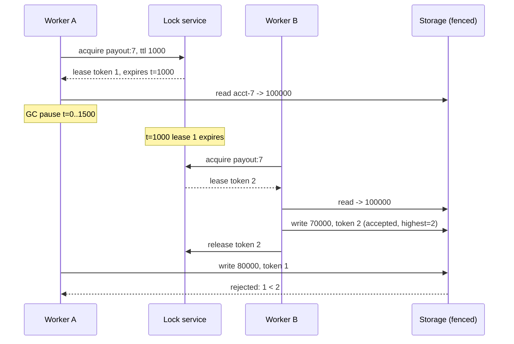

# Leases, Fencing Tokens, and Distributed Locks

> Why a lock with a timeout needs a monotonic token to be safe.

**Type:** Build
**Languages:** Java, Python, Go
**Prerequisites:** Phase 5 Lesson 11 (Circuit Breakers and Bulkheads), Phase 5 Lesson 04 (Physical Clocks, NTP, and Hybrid Logical Clocks), Phase 4 Lesson 01 (Threads and the Memory Model)
**Time:** ~90 minutes

## Learning Objectives

- Explain why a distributed lock must expire, and why expiry alone turns mutual exclusion into a probabilistic guarantee
- Build a lease-based lock on an injected clock with acquire, renew, release, and a fencing token that never goes backwards
- Reproduce the lost update where a paused lease holder writes after its lease has expired, and show why a client-side expiry check cannot prevent it
- Move the check to the storage layer so that a stale writer is rejected atomically with its write
- Evaluate Redlock against the fencing argument and state which timing assumptions it depends on

## The Problem

A payout service runs a nightly job that pays merchants their settled balances. The job is sharded by merchant and runs on several workers; to stop two workers paying the same merchant, each worker takes a lock on `payout:<merchant>` in Redis with a one-second expiry before it reads the pending balance, computes the transfer, writes the new balance, and releases the lock. The expiry is there for a good reason: a worker that crashes while holding the lock must not block the merchant's payouts forever.

One night worker A takes the lock for merchant 7, reads a pending balance of 1,000.00 USD, and then stops. Not crashes: stops. A full garbage collection pauses the JVM for 1.5 s. Nothing A does can run during that pause, including the code that would have renewed the lock. At 1.0 s the lease expires and Redis deletes the key. Worker B, retrying, acquires the lock, reads 1,000.00, applies a payout of 300.00, writes 700.00, releases. At 1.5 s worker A resumes exactly where it stopped, with a local variable saying the balance is 1,000.00 and a plan to pay out 200.00. It writes 800.00. It tries to release a lock it no longer holds and ignores the error. The ledger now says the merchant has 800.00 pending; the bank has sent 500.00. The merchant has been over-credited 300.00 and the reconciliation job will find it in a week.

The lock did everything it was configured to do. The mistake is in the model: a lock with an expiry is a promise from the lock service to the holder that nobody else will be granted the lock *until time T*. It is not a promise that the holder will have stopped acting by T, because the lock service cannot see inside the holder. Process pauses (GC, VM live migration, page faults, a laptop lid closing in a test environment), network delays, and clock skew between the holder and the service all open a window in which the holder believes it owns the lock and the service has already given it to someone else.

Shortening the window does not close it. Checking `isExpired()` right before the write does not close it either, because the pause can happen between the check and the write; the test suite in this lesson does exactly that. What closes it is a second mechanism at the resource being protected: every lease comes with a number that is strictly larger than every number issued before, the writer presents that number with each write, and the storage rejects any write whose number is smaller than one it has already accepted. That number is a fencing token, and this lesson builds the lock, the bug, and the fence.

## The Concept

### Leases: locks that give themselves back

Gray and Cheriton introduced leases in 1989 as time-limited grants of authority. A lease says "you hold this until T." The holder can renew before T to extend it. If the holder disappears, the grant evaporates at T without anyone having to detect the disappearance, which is the whole point: in an asynchronous network you cannot distinguish a crashed node from a slow one, so a lock that waits for the holder to release it can wait forever. Chubby, Google's lock service, is built on leases; ZooKeeper's ephemeral nodes are leases tied to a session; Redis `SET NX PX` is a lease.

The cost is that mutual exclusion becomes conditional on timing. The lease is exclusive *if* the holder stops acting by T as measured on the service's clock. Three things make that condition fail:

| Hazard | What happens | Who notices |
|--------|--------------|-------------|
| Process pause | holder is frozen past T; its code runs later as if no time had passed | nobody, until the stale write lands |
| Network delay | a write sent before T arrives after T | the storage, if it checks tokens; nobody otherwise |
| Clock skew | holder's clock runs slow, so its own view of "before T" is later than the service's | nobody; both sides are consistent with themselves |

The holder cannot defend against the first row from the inside: no code runs during the pause, so no check can be scheduled "just in time." A client-side safety margin (stop trusting the lease some milliseconds before T, as Chubby clients do) reduces the window for the third row and for short pauses, and is worth doing. It does not help when the pause is longer than the margin.

### Fencing tokens

The lock service mints a token with every grant: 1, 2, 3, never reused, never decreasing. The token travels with the holder's writes to the protected resource. The resource remembers the largest token it has accepted for each key and rejects any write with a smaller one.

Replay the payout incident with tokens. A is granted token 1. A pauses; the lease expires; B is granted token 2. B writes 700.00 with token 2; storage records "highest seen for acct-7 is 2." A wakes and writes 800.00 with token 1. Storage compares 1 with 2, rejects, and A gets a `StaleTokenException`. A must re-acquire (getting token 3), re-read the balance (700.00), recompute, and write 500.00. Both payouts are reflected; nothing is lost.

The property that makes this work is that the check and the write are a single step at the resource. The lock service could not do it because it does not see writes. The client could not do it because it can be paused between checking and writing. Only the storage sees both the token and the write at the same instant.



### The invariant

For every key, the sequence of accepted writes has non-decreasing fencing tokens. Since the lock service issues tokens in strictly increasing order and only one lease is live at a time, a write with token k being accepted implies that no holder of a lease older than k can ever write that key again. Mutual exclusion is restored *at the resource*, which is the only place it was ever needed. The lock becomes an optimization that keeps most writers from colliding, and the token is the correctness mechanism that makes the rare collision harmless.

Note the comparison is `token < highestSeen` rejects, so a writer re-presenting its own current token is accepted. This matters because the legitimate holder may retry a write after a network error and must not fence itself.

### Worked example with numbers

Start: `acct-7 = 100000` minor units (1,000.00 USD). Lease ttl 1,000 ms. A's payout is 20,000, B's is 30,000.

```text
t=0     A acquires: token 1, expires 1000. A reads 100000.
t=0     A pauses for 1500 ms.
t=1000  A's lease expires on the service clock. Nothing happens yet; nobody has asked.
t=1500  B acquires: token 2, expires 2500. B reads 100000, writes 70000 (token 2), releases.
t=1500  A resumes. Local variable balance=100000. A writes 80000 (token 1).

Unfenced storage:  accepts 80000.  Final 80000.  Correct would be 50000.  Lost update of 30000.
Fenced storage:    highest seen is 2; 1 < 2; rejects.  Final 70000.  A retries with token 3 and writes 50000.
```

The randomized study in the code runs this race 2,000 times with A's pause drawn uniformly from 0 to 1,999 ms. About half the pauses outlive the 1,000 ms lease. Unfenced storage loses an update in every one of those runs (995 of 2,000 with seed 7); fenced storage rejects exactly those 995 writes and loses nothing.

### Choosing a lock service and a token source

| System | Expiry mechanism | Monotonic token available | Who can check the token | Notes |
|--------|------------------|---------------------------|-------------------------|-------|
| This lesson's `LeaseLock` | service clock, lazy on next request | `nextToken++` counter | `FencedStorage` | single node; the counter must be persisted to survive restarts |
| Redis `SET NX PX` | key ttl on the Redis clock | not built in; use a separate `INCR` key | your resource | random value gives identity for safe release, not order |
| Redlock (N Redis nodes) | per-node ttl minus elapsed minus drift | not built in | your resource | majority quorum improves availability; safety still rests on timing assumptions |
| ZooKeeper ephemeral sequential node | session expiry (heartbeats) | sequence number, `czxid`, `zxid` | your resource | the recipe in the ZooKeeper docs; Curator wraps it |
| etcd lease + key | lease ttl with keep-alive | key `mod_revision`, header revision | your resource or an etcd transaction | the documentation recommends the revision as a fence |
| Chubby | session lease with KeepAlive RPCs | lock sequencer | servers, by checking with Chubby or comparing | the 2006 design that named the pattern |
| Database row lock in a transaction | released on commit or connection loss | the row's `version` column (optimistic) | the database itself | no fence needed when the lock and the data are in the same database |

Read the third and fourth columns together. Every row except the last has "your resource" as the checker, because the lock service and the data live in different systems and only the data's system sees the write. The lock service's job is to hand out ordered tokens; everything else is at the resource.

### A lock service trace

`LeaseLock` keeps a history so you can see what the service believed at each step. The demo's first section produces:

```text
t=0    A acquired token 1 until t=500
t=300  B denied (held by A token 1)
t=300  A renewed token 1 until t=800
t=1200 lease of A (token 1) expired at t=800
t=1200 B acquired token 2 until t=1700
```

Two details to notice. The expiry line is logged at t = 1200, not t = 800: the service did nothing at 800 because nobody asked. Expiry is a property evaluated on demand, not an event, in this design and in Redis. And B's denial at t = 300 carries A's token, which is what an operator needs to see when a job is stuck: who holds it, since when, and whether that holder is still alive.

### Heartbeats, ttl, and the pause budget

A holder whose work outlasts the ttl renews on a heartbeat. The numbers that matter:

```text
ttl                     = 1000 ms
heartbeat interval      = ttl / 3 = 333 ms       (two missed heartbeats before expiry)
worst-case pause budget = ttl - heartbeat interval = 667 ms
```

The pause budget is the longest the holder can be frozen immediately after a heartbeat and still renew before expiry. A JVM with a 2 GB heap and a parallel collector can pause for longer than that under memory pressure; a VM live migration routinely does. So the heartbeat does two jobs and fails at a third:

| Scenario | Heartbeat helps? | Fence needed? |
|----------|------------------|---------------|
| Work takes 5 s, no pauses | yes: renewals keep the lease alive | no, for this scenario |
| Holder crashes | n/a: lease expires, next worker proceeds | no |
| Pause of 400 ms right after a heartbeat | yes: 400 < 667, renewal happens in time | no |
| Pause of 1,500 ms anywhere | no: lease expires during the pause, holder resumes stale | yes |
| Holder's clock 500 ms slow | partly: heartbeats still land by the service's clock, but the client's own `isSafeToUse` view is optimistic | yes, or a margin larger than the skew |

Lengthening the ttl shrinks the fourth row's probability and lengthens the time a crashed holder blocks everyone (the second row's cost). There is no ttl that makes the fourth row impossible, which is why the fence is not optional for a correctness lock.

### Where the token comes from

Any source that is monotonic across the lifetime of the lock works:

- A counter in the lock service, persisted so it survives restarts (this lesson).
- ZooKeeper's `zxid` or the `czxid` of the ephemeral node that represents the lock; both are monotonic transaction ids.
- A Raft log index (Phase 6) if the lock is a Raft-backed key.
- etcd's lease ids combined with the key's `mod_revision`.

What does not work is a random value. Redlock's design uses a random string per acquisition to make sure a client only deletes its own lock. That value proves identity, not order: storage receiving random value `x7f3` and random value `q9a2` cannot tell which lease is newer, so it cannot reject the stale one. Order is the property the fence needs.

### Redlock, and what the argument is actually about

Redlock acquires the same key on a majority of N independent Redis nodes within a bounded time and treats the lease as valid for `ttl - elapsed - drift`. Kleppmann's 2016 critique makes two points. First, for correctness (two clients must never both believe they hold the lock while acting on a shared resource), Redlock is only safe if process pauses, network delays, and clock drift are all bounded, and a GC pause or an NTP step can violate those bounds; the lesson's payout scenario is a Redlock failure as much as a single-node one, because a majority of nodes expiring the key does not stop a paused client from writing. Second, for efficiency (a lock to avoid redundant work, where an occasional double execution is tolerable), a single Redis instance is enough and the majority protocol adds cost without adding safety. The conclusion is not "never use Redis for locks"; it is "if the resource must be protected, the resource must check a fencing token, and once it does, the sophistication of the lock service matters much less."

The Redis documentation's reply is that the algorithm assumes bounded clock drift and that a client should check the lease validity before each operation. Both are true, and neither addresses a pause that starts after the check and ends after the expiry. The argument is settled by Step 5 of this lesson: there is no client-side check that defends against a pause between the check and the write, so the check has to live where the write lands.

### What leases and tokens do not do

A fencing token protects writes to a resource that checks it. It does not protect side effects on systems that do not: an outgoing bank transfer initiated by the stale holder has already left when the token is rejected. For those, the pattern is to make the irreversible action the fenced write itself (write "transfer 200.00 to merchant 7 initiated, token 1" to the fenced store, then act on the store's accepted record) or to carry an idempotency key (Lesson 09) so that the duplicate action is detected downstream.

A lease does not tell you how long the holder's work will take. If the work routinely exceeds the ttl, the holder must renew in a heartbeat, and the heartbeat must be in a thread that cannot be blocked by the work. If the work can be paused longer than the ttl, renewal does not help; only fencing does.

## Build It

All code is in `code/java/Main.java`. One `FakeClock` is shared by the lock service and both workers; a process pause is `clock.advance(ms)` at the point in the worker's code where the pause occurs.

### Step 1: The lease

```java
record Lease(String resource, String owner, long token, long grantedAtMs, long expiresAtMs) {
    boolean isExpired(Clock clock) { return clock.nowMs() >= expiresAtMs; }
    boolean isSafeToUse(Clock clock, long marginMs) { return clock.nowMs() + marginMs < expiresAtMs; }
    long ttlMs() { return expiresAtMs - grantedAtMs; }
}
```

A lease is a value: who holds what until when, plus the token. `isExpired` is the service's question, answered against the service's clock. `isSafeToUse` is the client's question and takes a margin, because the client's clock may run slow relative to the service's and because the write it is about to send takes time to arrive. Chubby clients stop trusting a lease when they cannot confirm it well before nominal expiry; the margin is that idea in one argument.

**Predict:** a lease granted at t = 0 with ttl 1,000. At t = 850, what does `isSafeToUse(clock, 200)` return, and why is that the right answer even though the lease is still live?

### Step 2: The lock service

```java
Optional<Lease> tryAcquire(String owner, long ttlMs) {
    if (ttlMs <= 0) throw new IllegalArgumentException("ttl must be positive: " + ttlMs);
    if (current != null && !current.isExpired(clock)) {
        return Optional.empty();
    }
    current = new Lease(resource, owner, nextToken++, clock.nowMs(), clock.nowMs() + ttlMs);
    return Optional.of(current);
}
```

The lock is free if nobody holds it or the holder's lease has expired. Expiry is evaluated lazily, at the moment someone asks, which is also how Redis handles `PX`: the key is gone from the point of view of any command that runs after the expiry time. `nextToken++` is the entire fencing-token generator. It never resets and never reuses, so every lease the service has ever issued has a distinct token and later leases have larger ones.

Why `Optional` rather than blocking? A distributed lock client that blocks until the lock is free hides the denial from the caller and from the metrics. Returning empty forces the caller to decide: retry with backoff (Lesson 10), give up, or check who holds it and since when. Each of those is a policy that belongs to the caller, not to the lock.

**Predict:** A acquires (token 1), the lease expires, nobody acquires for an hour, then C acquires. What token does C get, and would it matter if the answer were 2 or 100?

### Step 3: Renew and release only what you still hold

```java
Lease renew(Lease lease, long ttlMs) {
    requireHeld(lease, "renew");
    current = new Lease(resource, lease.owner(), lease.token(), lease.grantedAtMs(), clock.nowMs() + ttlMs);
    return current;
}

private void requireHeld(Lease lease, String action) {
    if (current == null || current.token() != lease.token() || current.isExpired(clock)) {
        throw new LeaseExpiredException(lease.owner() + " cannot " + action + ": token " + lease.token()
                + " is no longer the live lease at t=" + clock.nowMs());
    }
}
```

Renewal keeps the token: it is the same lease, extended. Renewing an expired lease is an error, not a silent re-acquire, because a re-acquire would need a new token and the client's in-flight writes still carry the old one. Release checks the token too, which is the correct version of Redlock's "only delete your own lock" rule: comparing tokens rather than random strings gives the same identity check and also gives order.

### Step 4: Storage that trusts, and storage that checks

```java
@Override public void write(String key, long value, long token) {
    long seen = highestToken.getOrDefault(key, 0L);
    if (token < seen) {
        log.add("REJECTED " + key + "=" + value + " (token " + token + " < " + seen + ")");
        throw new StaleTokenException(key, token, seen);
    }
    highestToken.put(key, token);
    data.put(key, value);
    log.add(key + "=" + value + " (token " + token + ")");
}
```

`UnfencedStorage.write` is the same method without the first four lines. The difference between a lost update and a rejected write is a comparison and a map. In a real system the map is a column (`fence_token BIGINT`) and the write is `UPDATE accounts SET balance = ?, fence_token = ? WHERE id = ? AND fence_token <= ?` with a check that one row was affected, or a ZooKeeper `setData` with a version, or an etcd transaction conditioned on `mod_revision`. The comparison is `<`, not `<=`, so the current holder can retry its own write.

**Predict:** storage has seen token 7 for key `k`. Three writes arrive: token 7, token 6, token 9. Which are accepted and what is `highestTokenSeen("k")` afterwards?

### Step 5: The worker, with the pause in two possible places

```java
Result payout(String account, long amountMinor, long ttlMs, long pauseAfterReadMs, long pauseAfterCheckMs) {
    Optional<Lease> granted = lock.tryAcquire(name, ttlMs);
    if (granted.isEmpty()) return Result.LOCK_BUSY;
    Lease lease = granted.get();
    long balance = storage.read(account);
    clock.advance(pauseAfterReadMs);
    if (!lease.isSafeToUse(clock, 0)) {
        return Result.FENCED_OFF;                   // client-side check: necessary, not sufficient
    }
    clock.advance(pauseAfterCheckMs);
    try {
        storage.write(account, balance - amountMinor, lease.token());
    } catch (StaleTokenException e) {
        return Result.FENCED_OFF;
    }
    ...
}
```

Two pause parameters, because the argument of the lesson hinges on where the pause falls. A pause after the read but before the check is caught by `isSafeToUse`. A pause after the check is not: the check passed, the pause happened, and the write lands stale. Against `UnfencedStorage` the second case is a lost update that the worker reports as `APPLIED`. Against `FencedStorage` it is a `StaleTokenException` and the worker reports `FENCED_OFF`. The tests run both pause placements against both storages.

**Predict:** `pauseAfterReadMs = 0`, `pauseAfterCheckMs = 1500`, ttl 1,000, unfenced storage, no competing worker. What does `payout` return, and is the resulting balance correct?

### Step 6: The race, replayed with random pauses

```java
FakeClock clock = new FakeClock(0);
LeaseLock lock = new LeaseLock(clock, "payout:acct-7");
Storage storage = fenced ? new FencedStorage() : new UnfencedStorage();
storage.write("acct-7", 100_000, 0);
long pauseA = rng.nextInt(2_000);
Optional<Lease> leaseA = lock.tryAcquire("A", ttl);
long balanceA = storage.read("acct-7");
clock.advance(pauseA);
PayoutWorker.Result rb = b.payout("acct-7", 30_000, ttl, 0, 0);
try {
    storage.write("acct-7", balanceA - 20_000, leaseA.get().token());
    ra = PayoutWorker.Result.APPLIED;
} catch (StaleTokenException e) {
    ra = PayoutWorker.Result.FENCED_OFF;
}
long expected = 100_000 - (ra == APPLIED ? 20_000 : 0) - (rb == APPLIED ? 30_000 : 0);
if (storage.read("acct-7") != expected) lost++;
```

The check is an oracle: given which payouts were applied, the balance has exactly one correct value. Any other value is a lost update. With `fenced = false` the count of lost updates equals the count of runs where A's pause exceeded the ttl; with `fenced = true` it is zero and the rejected-write count equals the former. The two numbers matching is the test's way of saying the fence rejected exactly the dangerous writes and nothing else.

### Step 7: What the service can tell an operator

```java
Optional<Lease> holder() {
    return current == null || current.isExpired(clock) ? Optional.empty() : Optional.of(current);
}

long highestTokenIssued() { return nextToken - 1; }

List<String> history() { return List.copyOf(history); }
```

`holder()` applies the same expiry rule as `tryAcquire`, so an operator query and a competing acquirer always agree about whether the lock is free. `highestTokenIssued()` is the number a resource's `highestTokenSeen` should never exceed; if it does, the lock service has lost state (restored from an old backup, for instance) and will mint tokens the resource considers stale. The checklist in Ship It has a line for that recovery. `history()` is what the demo prints and what a real service would emit as structured log events.

**Predict:** after `A` acquires token 1 and the lease expires with nobody else asking, what do `holder()` and `highestTokenIssued()` return?

### Step 8: Run it

```bash
cd phases/05-distributed-foundations/12-leases-and-fencing-tokens/code/java
javac -d .out *.java && java -cp .out Main
java -cp .out MainTest
```

Expected output, abbreviated:

```console
== The bug: lock with a timeout, storage that trusts the lock ==
t=0 A holds token 1, reads 100000, plans payout of 20000
t=1500 A has been paused 1500 ms; lease expired at t=1000
t=1500 B: APPLIED, balance now 70000 (B held token 2)
t=1500 A writes 80000 with token 1: ACCEPTED
LOST UPDATE: B's payout of 30000 vanished from the balance but the money left the building.

== The fix: the same lock, storage that checks the fencing token ==
t=1500 A writes with token 1: stale fencing token 1 for acct-7; storage has already seen 2
A's stale write was fenced off. A must re-acquire, re-read, and recompute.

== 2000 randomized races, seed 7 ==
unfenced: lost updates=995 fencedOff=0 bothApplied=995
fenced  : lost updates=0 fencedOff=995 bothApplied=0
```

Three things to take from the output. The write log in the unfenced run ends with `acct-7=80000 (token 1)` after `acct-7=70000 (token 2)`: a smaller token after a larger one is the signature of a lost update, and a log that records tokens lets you find these after the fact. The fenced run's log records the rejection, which is the audit trail an operator wants. And the two study lines agree on 995: the fence rejected exactly the dangerous writes and no others.

The test file has 32 assertions. The pair to read first is "pause after the check: the stale write lands anyway on unfenced storage" and "pause after the check: fenced storage still rejects."

### In Python

`code/python/main.py` keeps the lesson's types and method names (`Lease`, `LeaseLock.try_acquire`, `FencedStorage`, `PayoutWorker.payout`, `RaceStudy.run`) and prints the same demo as Java, including `lost updates=995` for the seed-7 study. Three things differ.

- **`Optional<Lease>` is `Lease | None`.** `try_acquire` returns `None` when the lock is held, and the demo's `orElseThrow()` becomes a small `or_else_throw` helper. Forgetting the check is the same bug in both languages, but Python only reports it when `None.token` is read, which is exactly the moment the lease mattered; the type hint `Optional[Lease]` is the only warning.
- **Same exceptions, Python base classes.** `LeaseExpiredException` and `StaleTokenException` keep their names and subclass `RuntimeError`; `StaleTokenException` still carries `presented` and `highest_seen`, and a test reads them. `IllegalArgumentException` for a non-positive ttl is `ValueError`. The worker's `Result` enum stays nested as `PayoutWorker.Result`, and `Lease` is a frozen dataclass, so a renewal returns a new `Lease` rather than mutating the one a paused client is still holding.
- **The race study uses `java.util.Random`, ported.** `random.Random(7)` would also reproduce, but it would draw different pauses from Java's generator, so `JavaRandom` ports the JDK's 48-bit LCG and `nextInt(bound)`. The 2,000 pauses, and therefore the 995 lost updates, match the Java run exactly.

```python
def write(self, key: str, value: int, token: int) -> None:
    seen = self._highest_token.get(key, 0)
    if token < seen:
        self._log.append(f"REJECTED {key}={value} (token {token} < {seen})")
        raise StaleTokenException(key, token, seen)
    self._highest_token[key] = token
    self._data[key] = value
    self._log.append(f"{key}={value} (token {token})")
```

Tokens and balances are plain `int`s: tokens because the comparison must be exact, balances because they are minor units (Phase 10, Lesson 01).

```bash
cd phases/05-distributed-foundations/12-leases-and-fencing-tokens/code/python
python3 main.py
python3 -m unittest -v
```

### In Go

`code/go/main.go` keeps the lesson's types and method names (`Lease`, `LeaseLock.TryAcquire`, `FencedStorage`, `PayoutWorker.Payout`, `RunRaceStudy`) and prints the same demo as Java, including `lost updates=995` for the seed-7 study from the ported `java.util.Random` (`javarandom.go`). Three things differ.

- **`Optional<Lease>` is `(Lease, bool)`, and failures are errors.** `TryAcquire` returns `ok == false` when the lock is held, which is an expected outcome, not a fault. `Renew` and `Release` return a `*LeaseExpiredError` (matching `ErrLeaseExpired`), and `Storage.Write` returns a `*StaleTokenError` carrying `Presented` and `HighestSeen` (matching `ErrStaleToken`). The worker's `errors.Is(err, ErrStaleToken)` is the `catch` block; the release after a successful write discards its error on purpose, because a lease that already expired has nothing left to release.
- **The lock service is guarded by a `sync.Mutex`.** Even in a simulation the lock service is shared state, so every method on `LeaseLock` takes the mutex, and a test lets 50 goroutines race for one lease under `go test -race` to prove exactly one wins and exactly one token is minted. `Lease` is a value type, so a renewal returns a new `Lease` rather than mutating the one a paused client is still holding.
- **Two programming errors panic.** A non-positive ttl and a clock moved backwards are caller bugs, so `TryAcquire` and `FakeClock.Advance` panic where every other failure is a returned error.

```go
func (s *FencedStorage) Write(key string, value, token int64) error {
    seen := s.highestToken[key]
    if token < seen {
        s.log = append(s.log, fmt.Sprintf("REJECTED %s=%d (token %d < %d)", key, value, token, seen))
        return &StaleTokenError{key, token, seen}
    }
    s.highestToken[key] = token
    s.data[key] = value
    s.log = append(s.log, fmt.Sprintf("%s=%d (token %d)", key, value, token))
    return nil
}
```

Tokens and balances are `int64`: tokens because the comparison must be exact, balances because they are minor units (Phase 10, Lesson 01). A float timestamp as a token would reintroduce the ordering ambiguity the lesson removes.

```bash
cd phases/05-distributed-foundations/12-leases-and-fencing-tokens/code/go
go run .
go test -race ./...
```

## Use It

### ZooKeeper and Apache Curator

ZooKeeper's recipe for a lock is an ephemeral sequential node under a lock path; the client with the lowest sequence number holds the lock, and the node vanishes when the client's session expires. The sequence number and the node's `czxid` are monotonic and serve as fencing tokens; the ZooKeeper programmer's guide warns that a client whose session has expired may still believe it holds the lock until it hears from the server, which is exactly the pause window. Curator's `InterProcessMutex` implements the recipe; the token is up to you to carry to the resource.

### etcd

etcd's `concurrency.Mutex` is built on leases (`clientv3.Lease` with a ttl and keep-alive) and keys with revisions. `Mutex.Header().Revision` is a monotonic value that the etcd documentation suggests using as a fencing token for exactly the reason in this lesson. Kubernetes' controller leader election uses the same lease API, and controllers that write to external systems are expected to check they still hold the lease and to tolerate a competitor's writes.

### Redis `SET NX PX` and Redlock

A single-instance Redis lock is `SET key random NX PX ttl`, released by a Lua script that deletes only if the value matches. It gives you a lease and an identity check. It does not give you order; if you need a fence, keep a separate monotonic counter (`INCR` on a token key, which is itself atomic) and store it in the resource. Redlock adds a majority quorum across independent instances for availability; read the Redis page and Kleppmann's critique together and decide which category, efficiency or correctness, your lock falls into before choosing.

### Relational databases

A row-level lock inside a transaction (`SELECT ... FOR UPDATE`) is not a lease: it is released on commit or on connection loss, and the database sees both the lock and the write, so no fence is needed within one database. The fence is needed when the lock lives in one system and the writes go to another, or when the protected action is a call to an external API. Optimistic concurrency with a `version` column (Phase 7) is a fencing token where the token is the row's own version rather than a lease's.

### Kubernetes leader election

`client-go`'s `leaderelection` package stores a `Lease` object in the API server with `holderIdentity`, `leaseDurationSeconds`, and `renewTime`, and the elected controller renews it in a loop. The package documentation says plainly that it does not guarantee only one client is acting as leader at a time, because of exactly the pause and skew hazards above, and that callers must tolerate a split. Controllers that write to the API server are protected by the object's `resourceVersion` on conditional updates, which is a fencing token; controllers that call external systems are not, unless they add one.

### Chubby

Burrows' Chubby paper describes lock sequencers: a byte string the lock holder obtains and passes to the servers it talks to, which check it with the lock service or compare it to the last one they saw. It is a fencing token by another name, and the paper's observation that "a lock without a sequencer is only safe if the holder's operations are idempotent or the servers check with Chubby" is the thesis of this lesson from 2006.

## Ship It

`outputs/checklist-distributed-lock.md` is a review checklist for any design that uses a lock with an expiry across processes: where the lease lives, how it is renewed, what the fencing token is, which resource checks it, and what the holder does when fenced off. Use it for payout jobs, schedulers, leader-elected controllers, and any "exactly one worker" requirement.

## Exercises

1. **Reinforce.** Add a heartbeat to `PayoutWorker`: renew the lease every `ttl / 3` of simulated work time during a long computation. Then show with a test that a single pause longer than the ttl still produces a stale write against `UnfencedStorage`, heartbeat or not.
2. **Apply.** Give the client and the lock service different clocks: a `SkewedClock` that reads the shared `FakeClock` plus an offset. With the client's clock 300 ms behind the service's, find the smallest `marginMs` for `isSafeToUse` that prevents the client from writing after the service has expired the lease, assuming no pauses. Then explain why no margin is sufficient once pauses are allowed.
3. **Extend.** Combine this lesson with Lesson 09: make the payout write idempotent with a key derived from `(merchant, settlement date)` and keep the fencing token. Construct a run where the fence rejects A's write and A retries correctly, and a second run where the fence is absent and only the idempotency key prevents the double payout. State which of the two mechanisms protects the balance and which protects the bank transfer.

## Key Terms

| Term | What people say | What it actually means |
|------|-----------------|------------------------|
| Lease | "a lock with a TTL" | A time-limited grant that expires on the grantor's clock without any action by the holder; the holder renews to keep it |
| Fencing token | "the lock version" | A number issued with each grant, strictly increasing across all grants, presented with every write and checked by the resource so older holders are rejected |
| Lost update | "a race condition" | Two writers each read, compute, and write; the second write overwrites the first without having seen it, so one update disappears |
| Process pause | "the GC stalled" | A period during which a process executes nothing; stop-the-world collection, VM migration, swapping, or a debugger; invisible to the process itself |
| Safety margin | "expire the lease early on the client" | Treating a lease as unusable some time before its nominal expiry to absorb clock skew and transit time; reduces the window, does not close it |
| Efficiency lock vs correctness lock | "it's just to avoid duplicate work" | Kleppmann's distinction: a lock whose occasional failure wastes work needs no fence; a lock whose failure corrupts data needs one |
| Lock sequencer | "Chubby's token" | Chubby's name for a fencing token: an opaque value the holder passes to servers, which verify it against the lock service or the last one seen |

## Further Reading

- [Gray and Cheriton, "Leases: An Efficient Fault-Tolerant Mechanism for Distributed File Cache Consistency," SOSP 1989](https://dl.acm.org/doi/10.1145/74850.74870) — the original definition of a lease and the argument for time-limited grants in the presence of failures.
- [Burrows, "The Chubby lock service for loosely-coupled distributed systems," OSDI 2006](https://research.google/pubs/the-chubby-lock-service-for-loosely-coupled-distributed-systems/) — section 2.4 on lock sequencers is this lesson's fencing token in production at Google.
- [Kleppmann, "How to do distributed locking," 2016](https://martin.kleppmann.com/2016/02/08/how-to-do-distributed-locking.html) — the fencing argument, the efficiency/correctness distinction, and the critique of Redlock's timing assumptions.
- [Redis documentation: Distributed Locks with Redis](https://redis.io/docs/latest/develop/use/patterns/distributed-locks/) — the Redlock algorithm as its authors describe it, including the clock-drift assumption and the reply to the critique.
- [ZooKeeper Recipes and Solutions: Locks](https://zookeeper.apache.org/doc/current/recipes.html#sc_recipes_Locks) — the ephemeral-sequential lock recipe and the warning about clients that have not yet learned their session expired.
- [Kubernetes client-go `leaderelection` package](https://pkg.go.dev/k8s.io/client-go/tools/leaderelection) — the package comment states that the election does not guarantee a single leader and explains why; read it as a production system agreeing with this lesson.
- [etcd: Why etcd (lease and revision semantics)](https://etcd.io/docs/latest/learning/why/) — the comparison table that explains why etcd exposes monotonic revisions alongside leases.
