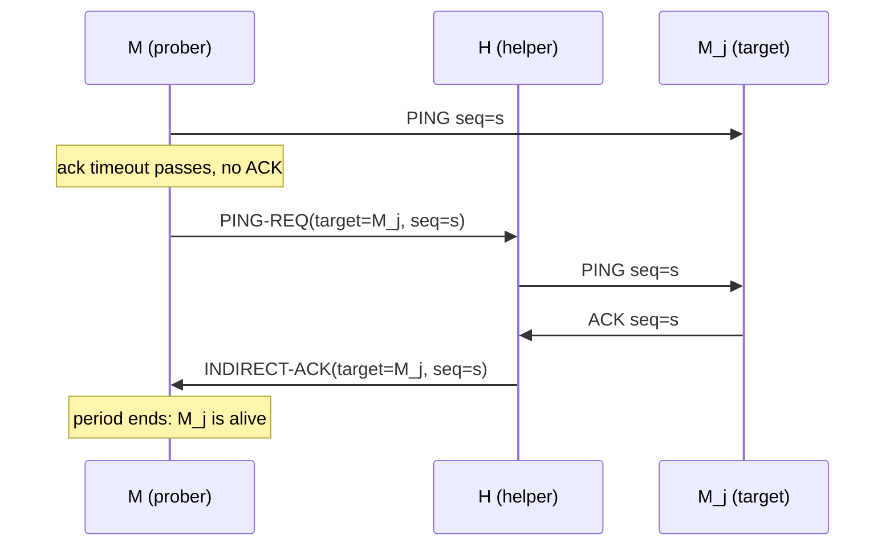

# Gossip Protocols and Failure Detection

> SWIM-style membership without a coordinator.

**Type:** Build
**Languages:** Java, Python, Go
**Prerequisites:** Phase 5 Lesson 02 (Failure Models), Phase 5 Lesson 08 (Timeouts and Deadline Propagation), Phase 5 Lesson 12 (Leases, Fencing Tokens, and Distributed Locks)
**Time:** ~75 minutes

## Learning Objectives

- Explain why all-to-all heartbeating costs O(N) messages per node per period and why that is the wrong shape for a group that grows
- Build a SWIM failure detector: one randomised direct probe per period, k indirect probes through other members, and a bounded worst-case detection time
- Implement the suspicion mechanism with incarnation numbers so that a slow or partially unreachable node can refute a false accusation
- Disseminate membership updates by piggybacking them on probe traffic and retire each update after a logarithmic number of transmissions
- Measure detection time, dissemination time, false positives, and per-node message load across seeds on a deterministic simulated network

## The Problem

A payment-routing tier has 40 stateless workers behind a load balancer, and each worker keeps a list of the others so it can forward a card authorization to the worker that currently holds the merchant's rate-limit bucket. The list is maintained by heartbeats: every worker pings every other worker every second and marks a peer dead after three missed pings. At 40 workers that is 1,560 pings per second across the fleet, which nobody notices. Then Black Friday capacity planning scales the tier to 400 workers. Heartbeat traffic is now 159,600 pings per second, the heartbeat threads start missing their one-second schedule under load, and workers begin marking healthy peers dead because the *pinger* was late, not the pingee. Each false death triggers a bucket migration, each migration causes a burst of duplicate rate-limit checks, and the authorization p99 doubles during the busiest hour of the year. The failure detector became the load.

The second failure is quieter. One worker sits behind a switch with a flaky uplink to one rack but not the others. Its peers in that rack miss its pings and declare it dead; its peers in other racks hear from it fine and keep it alive. The membership views diverge, two workers now believe they own the same merchant's bucket, and the merchant is rate-limited at twice the agreed rate. Nobody is down, but the group cannot agree about who is in it, and there is no coordinator to ask because the coordinator would be the single point of failure the design was avoiding.

Both failures have the same root: the detector conflates "I cannot reach you" with "you are dead", and it asks every node to form that opinion independently, at a cost that grows with the group. SWIM (Das, Gupta, and Motivala, 2002) separates the two questions. Failure *detection* is done by each node probing one random peer per period and, on silence, asking a few others to probe on its behalf, so load per node is constant and a single bad link does not condemn anyone. Membership *dissemination* rides on the probe messages, so the group converges on one view without a broadcast or a coordinator. A suspicion period with incarnation numbers gives an accused node time to say "I am alive, and this is newer than your accusation." The result is the protocol inside HashiCorp Serf and Consul, and the mechanism this lesson builds and measures.

## The Concept

### Two problems, two mechanisms

Group membership answers "who is in the group right now?" without a central registry. SWIM splits it into:

1. **Failure detection**: each member decides, locally and with bounded delay, that another member is unreachable.
2. **Dissemination**: that decision, and joins and leaves, reach every other member.

Heartbeat designs couple the two: every node tells every node "I am alive", so detection and dissemination are the same message and the cost is N-1 messages per node per period. SWIM decouples them: detection costs a constant number of messages per node per period regardless of N, and dissemination is piggybacked on those messages, so the total load per node is O(1) while the time for news to reach everyone is O(log N) periods.

| Property | All-to-all heartbeats | SWIM |
|----------|-----------------------|------|
| Messages per node per period | N - 1 | about 2 (1 ping + 1 ack) plus k ping-reqs on silence |
| Detection time for a crash | 1 to 3 periods | about 1 period to suspect, plus the suspicion timeout to confirm |
| False positive on a single bad link | yes: the peer behind the link is marked dead | no: k indirect probes route around it |
| False positive on a slow node | yes, and permanent until it recovers | suspicion first; the node refutes with a higher incarnation |
| Dissemination of a change | immediate, by the next heartbeat round | O(log N) periods via piggyback |
| Needs a coordinator | no | no |

### The failure detector (SWIM section 3)

Every **protocol period** T, node M picks one other member M_j and sends it a PING. If an ACK arrives within the **ack timeout** (a small multiple of the round-trip time), M_j is alive and the period is over. If not, M picks k other members at random and sends each a PING-REQ(M_j). Each of those pings M_j directly; if M_j answers, the helper relays the ACK back to M. If neither the direct nor any indirect ACK arrives by the end of the period, M marks M_j as **suspect**.



Why indirect probes? Because the single most common cause of a missed ACK is not a dead target but a bad path: a congested link, a dropped packet, a GC pause on the prober's own thread. Routing the second probe through k different nodes makes the detector's false-positive probability depend on k independent paths failing, not one. The paper's analysis: with message loss probability p_ml and k indirect probes, a live node is falsely suspected with probability about p_ml^(k+1) per period, which is why even k = 3 is enough.

### Round-robin target selection (section 4.3)

Picking a uniformly random target each period gives an expected detection time of one period but no bound: an unlucky node might not be probed for a long time. SWIM instead keeps a random permutation of the member list and probes it in order, reshuffling when the list is exhausted. Every member is then probed at least once every N periods by every other member, and a crashed node's first detection is at most one period plus the time until *someone's* permutation reaches it. In practice, with N nodes each probing in their own order, one of them hits the crashed node almost immediately.

### Suspicion and incarnation numbers (section 4.2)

A probe failure makes a node **suspect**, not dead. A suspicion is disseminated like any other update. If the suspected node M_j hears that it is suspected, it increments its own **incarnation number** and disseminates "M_j alive, incarnation i+1". If nobody refutes within the **suspicion timeout**, the suspecter marks M_j **dead** and disseminates that.

Incarnation numbers exist because updates arrive out of order and from many sources. Without them, a stale "alive" could clear a fresh suspicion, or a stale suspicion could re-accuse a node that already refuted. The rules are strict and total:

| Received | Current | Accept when |
|----------|---------|-------------|
| alive, incarnation i | alive or suspect, incarnation j | i > j |
| suspect, incarnation i | alive, incarnation j | i >= j |
| suspect, incarnation i | suspect, incarnation j | i > j |
| dead, any incarnation | anything but dead | always |
| anything | dead | never |

Two details carry the design. First, a node may increment *only its own* incarnation; that is what makes "alive, i+1" an unforgeable refutation. Second, at equal incarnations suspicion beats alive, so a node cannot clear an accusation by re-sending the "alive, i" it already sent; it must produce something newer. The demo's second scenario shows this: n1 cannot reach n2 and, with indirect probes disabled, suspects it at incarnation 0; n2 hears the accusation through n0's piggyback, bumps to incarnation 1, and n1's view flips back to alive when the refutation arrives.

Trace of the refutation path in the demo's k = 0 scenario (seed 11), where n1 cannot reach n2 but n0, n3, n4 can:

```text
t=79   n1 probes n2, no ack, no indirect probes configured -> n1 marks n2 SUSPECT@0, queues the update
t=80+  n1 piggybacks "n2 SUSPECT@0" on its next pings and acks; n0, n3, n4 learn it and re-piggyback
t=111  n2 receives a ping carrying "n2 SUSPECT@0" -> incarnation 0 -> 1, queues "n2 ALIVE@1"
t=112+ "n2 ALIVE@1" rides on n2's acks and pings; n0, n3, n4 adopt it (alive@1 overrides suspect@0)
t<127  one of them pings n1 or acks n1's ping carrying "n2 ALIVE@1" -> n1's view flips to ALIVE@1, suspicion clock cleared
t=127  n1's suspicion timeout would have fired (79 + 48); the demo's final line confirms n1 believes n2 is ALIVE
```

Thirty-two ticks for the accusation to reach the accused, and under sixteen for the refutation to come back, inside a 48-tick timeout in a 5-node group. With 12 nodes each leg takes about a period longer, which is why `suspicionPeriods` should scale with log N and why Lifeguard makes it adaptive. (The same demo also shows n2 suspecting n1 at t=106 for the same cut link, and n1 refuting at t=118: a cut link makes both ends accuse each other.)

Dead is terminal in SWIM: a node declared dead must rejoin as a new member. Production implementations relax this (memberlist lets a sufficiently new "alive" resurrect a dead entry) because a long GC pause is more common than a real crash, but the lesson keeps the paper's rule so the cost of a false positive is visible in the measurements.

### Infection-style dissemination (section 4.1)

There is no broadcast. Every PING, ACK, PING-REQ, and INDIRECT-ACK carries up to `maxPiggyback` membership updates. Each node keeps a queue of updates it has learned, with a count of how many times it has sent each one; it piggybacks the least-sent updates first and retires an update after `lambda * log2(N)` transmissions. The paper shows that with lambda around 3, an update reaches every member with high probability in O(log N) periods, and the per-message overhead is bounded by `maxPiggyback`.

This is an **epidemic** or gossip process: each transmission "infects" one more node, the infected re-transmit, and the number of informed nodes roughly doubles each round until saturation. The retirement count is what stops old news from circulating forever. The lesson's test "update retired after lambda*log2(n) piggybacks" checks the arithmetic: 3 * log2(8) = 9 transmissions for an 8-node group.

### Worked example: n5 crashes in an 8-node group

Parameters: period 12 ticks, ack timeout 4, k = 3, suspicion timeout 4 periods (48 ticks), delay 1 to 2 ticks per message, no loss. n5 crashes at t = 100. From the demo (seed 3):

```text
t=100  n5 crashes
t=122  n2 got no ack from n5 (direct + 3 indirect) -> SUSPECT      n2's period began at ~110: ping, no ack by 114,
                                                                   three ping-reqs, no indirect ack by 122
t=123  n0 got no ack from n5 (direct + 3 indirect) -> SUSPECT      n0 reached the same conclusion independently
t=136  (every live node now holds SUSPECT for n5, via piggyback)   14 ticks to disseminate across 7 nodes
t=170  n2 suspicion of n5 expired -> DEAD                          122 + 48: nobody refuted
t=171  n0 suspicion of n5 expired -> DEAD
t=188  (every live node now holds DEAD for n5)
```

Detection took one period after the crash was first probed; confirmation took the full suspicion timeout; dissemination added about a period each time. The 88 ticks from crash to universal agreement are the price of never falsely evicting a slow node. Total message load during the run: 2.0 messages per node per period, the same at N = 8 and N = 64, which the demo prints side by side.

### The invariants and what is measured

A membership protocol is judged on four quantities, and the tests measure each:

- **Completeness**: a crashed node is eventually marked dead by every live node. Test: 10 seeds, 12 nodes, 10% loss, 10/10 converge.
- **Accuracy**: a live node is not marked dead. Test: zero false positives across those seeds, and zero in the cut-link scenario with k = 3.
- **Detection time**: bounded, in periods. Test: dead within 12 periods of the crash and not before the suspicion timeout.
- **Load**: constant per node. Test: messages per node per period within 0.5 of each other at N = 8 and N = 32.

Completeness and accuracy pull against each other through one knob: the suspicion timeout. Shorter means faster eviction of real crashes and more false evictions of slow nodes. SWIM's successors (Lifeguard, in Consul) make the timeout adaptive: it shrinks as independent confirmations of the suspicion arrive and grows when the local node suspects itself of being slow.

### Choosing the parameters

The four numbers in `Config` are not independent, and the paper's analysis gives each one a reason.

| Parameter | Constraint | Why |
|-----------|------------|-----|
| `ackTimeout` | at least the p99 round trip | below that, healthy targets trigger indirect probes every period and the load bound degrades to 2 + 2k |
| `protocolPeriod` | at least `ackTimeout` plus one indirect round trip (four hops) | the indirect ack must be able to arrive before the period ends, or indirect probing is useless |
| `indirectProbes` (k) | 3 is the paper's choice | false suspicion needs k+1 independent paths to fail; with 10% loss per message and k = 3 that is about 0.1^4 per probe; k = 0 makes a single bad link a false positive |
| `suspicionPeriods` | at least the dissemination time, about log2(N) periods | the accused must hear the accusation and its refutation must travel back; shorter means false evictions of slow nodes, longer means slow confirmation of real crashes |
| `maxPiggyback` | a handful | bounds message size; too small and dissemination slows, too large and every ack carries stale updates |
| `retransmitFactor` (lambda) | 3 to 4 | each update is sent lambda * log2(N) times; the paper shows that with lambda = 3 the probability a member misses an update falls as N^(-(2 lambda - 2)) |

Worked numbers for the lesson's defaults, N = 12, delay 1 to 2 ticks: round trip 2 to 4, so `ackTimeout = 4`; indirect round trip at most 8, so `protocolPeriod >= 12`; log2(12) is about 3.6, so `suspicionPeriods = 4` gives 48 ticks for a refutation to travel; `limit = ceil(3 * 3.58) = 11` transmissions per update. The demo's measured mean from crash to universal DEAD was 79 ticks, which is one period to be probed (about 12), one period to suspect (12), 48 to expire, and a few ticks to disseminate. The worst seed was 104 ticks: the crashed node was late in every live node's probe permutation.

Expected detection time for a crash is one of the protocol's cleanest results. Each live node probes one member per period, chosen from a permutation, so in a group of N the probability that a given node probes the crashed one in a given period is 1/(N-1); with N-1 live probers the expected number of periods until the first probe is about (N-1)/(N-1) = 1. Detection time is therefore about one period regardless of N, while dissemination to everyone takes O(log N) periods and load stays constant. That is the asymmetry the paper is named for: scalable because load is O(1), weakly consistent because views converge in O(log N) rather than instantly.

### What this protocol does not do

- It does not provide consensus on membership. Views converge eventually; at any instant two nodes may disagree. If you need every node to agree on the exact set before acting (leader election, sharding), run Raft (Phase 6) over the membership list or use the view only as a hint.
- It does not authenticate members. A malicious node can accuse anyone. Serf and Consul add a shared key and encryption on the gossip channel.
- It does not detect a process that is alive but wrong (returning errors, serving stale data). That is a health check, which is an application concern layered on top.
- It does not resurrect dead members. Rejoining is a new join with a new identity in the paper's model.

### Common implementation mistakes

Each of these appeared in a first draft of this lesson's code or is a well-known production bug, and each is caught by one of the tests:

- **Sequence numbers that collide across nodes.** A per-node counter starting at 1 means every node's probe k has seq k; a helper relaying an ack cannot tell whose probe it answers and may swallow it as its own. Use `(id << 32) + counter` or a random 64-bit seq.
- **Treating a missed direct ack as a failure.** That is heartbeating with extra steps; the cut-link test shows the false positive.
- **Letting a node clear its own suspicion with the same incarnation.** `alive@i` must not override `suspect@i`; otherwise a stale alive update circulating in the gossip queue silently cancels a fresh accusation.
- **Letting anyone bump another node's incarnation.** Only the node itself may, in `applyUpdate`'s self branch; a malicious or buggy peer must not be able to "refute" on someone's behalf.
- **Never retiring gossip.** Without the `lambda * log2(N)` limit the queue grows forever and every message carries ancient news; with `maxPiggyback` the fresh updates then starve behind the old ones.
- **Probing dead members.** Removing them from the permutation keeps the "every live member probed once per pass" bound; probing them wastes the period and inflates detection time for everyone else.

## Build It

The code is in `code/java/Main.java`; tests in `code/java/MainTest.java`. The deterministic `Network` is the same design as Phase 6's Raft lessons, with one addition: `cutLink(a, b)` drops traffic between exactly two nodes, which is the scenario indirect probing exists for.

### Step 1: Updates and their precedence

```java
record Update(int member, MemberState state, long incarnation) {
    boolean overrides(Update current) {
        if (current == null) return true;
        if (current.state == MemberState.DEAD) return false;
        if (state == MemberState.DEAD) return true;
        if (state == MemberState.ALIVE) return incarnation > current.incarnation;
        // SUSPECT
        if (current.state == MemberState.ALIVE) return incarnation >= current.incarnation;
        return incarnation > current.incarnation;
    }
}
```

This is the precedence table as one method, and it is the only place the table lives. Every view change goes through `overrides`, so the tests can pin each row of the table with one assertion (`alive(i) does not override suspect(i)`, and so on). Notice the asymmetry: suspect wins at equal incarnation, alive needs strictly greater.

**Predict:** a node holds `suspect@2` for n4 and receives `alive@2` from an old message. Does the view change? What would n4 have to send for it to change?

### Step 2: The probe cycle

```java
public List<Message> tick(int now) {
    List<Message> out = new ArrayList<>();
    if (current != null && !current.acked && !current.indirectSent && now >= current.startedAt + config.ackTimeout()) {
        out.addAll(sendIndirectProbes(now));
    }
    if (now >= nextPeriodAt) {
        nextPeriodAt = now + config.protocolPeriod();
        finishProbe(now);
        expireSuspicions(now);
        Integer target = nextProbeTarget();
        if (target != null) {
            current = new Probe(target, nextSeq++, now);
            out.add(Message.ping(id, target, current.seq, takeGossip()));
        }
    }
    messagesSent += out.size();
    return out;
}
```

One `Probe` is outstanding at a time. The ack-timeout check runs every tick; the period check runs once per period and does three things in order: judge the previous probe, expire old suspicions, start the next probe. The sequence number is `(id << 32) + counter`, unique across the group, so a helper relaying acks for several probers can never confuse them. (The first version of this code used a per-node counter starting at 1; since every node's counter advances once per period, collisions were constant and indirect acks were silently swallowed as someone else's direct ack. The deterministic network made that bug reproducible in one run.)

**Predict:** with `ackTimeout = 4`, `maxDelay = 2`, and four hops for an indirect ack, what is the latest tick, relative to the probe's start, at which an indirect ack can arrive? Does it fit inside a 12-tick period?

### Step 3: Round-robin over a shuffled permutation

```java
Integer nextProbeTarget() {
    List<Integer> candidates = new ArrayList<>();
    for (Update u : view.values()) if (u.member() != id && u.state() != MemberState.DEAD) candidates.add(u.member());
    if (candidates.isEmpty()) return null;
    if (probeCursor >= probeOrder.size() || !new HashSet<>(candidates).containsAll(probeOrder)) {
        probeOrder = candidates;
        rng.shuffle(probeOrder);
        probeCursor = 0;
    }
    return probeOrder.get(probeCursor++);
}
```

Suspects are still probed (they might answer), dead members are not. The permutation is rebuilt when it is exhausted or when a member in it has been declared dead, which keeps the bound "every live member probed once per pass". `rng.shuffle` is Fisher-Yates driven by the node's seeded `Rng`, so a seed replays the exact probe order.

### Step 4: Indirect probes and relaying

```java
case PING_REQ -> {
    relaying.put(m.seq(), m.from());
    out.add(Message.ping(id, m.target(), m.seq(), takeGossip()));
}
...
if (m.kind() == MessageKind.ACK && relaying.containsKey(m.seq()) && (current == null || m.seq() != current.seq)) {
    int origin = relaying.remove(m.seq());
    out.add(Message.indirectAck(id, origin, m.from(), m.seq(), takeGossip()));
}
```

A helper that receives PING-REQ remembers who asked, pings the target with the *original* sequence number, and when the ACK comes back forwards it to the origin as INDIRECT-ACK. The origin accepts an INDIRECT-ACK only if its `seq` and `target` match the outstanding probe. The helper never changes its own view based on the result; it is a relay, not a judge. This is what keeps the "alive" decision with the node that asked.

### Step 5: Suspicion, expiry, and refutation

```java
void applyUpdate(Update u, int now) {
    if (u.member() == id) {
        if (u.state() != MemberState.ALIVE && u.incarnation() >= incarnation) {
            incarnation = u.incarnation() + 1;                       // refutation (section 4.2): I am alive, and newer
            refutations++;
            Update alive = new Update(id, MemberState.ALIVE, incarnation);
            view.put(id, alive);
            enqueue(alive);
        }
        return;
    }
    Update known = view.get(u.member());
    if (!u.overrides(known)) return;
    view.put(u.member(), u);
    if (u.state() == MemberState.SUSPECT) suspectedAt.putIfAbsent(u.member(), now);
    else suspectedAt.remove(u.member());
    enqueue(u);
}
```

Updates about *me* never enter my view as suspect or dead; they trigger a refutation if they are at least as new as my current incarnation. Updates about others pass through `overrides`, and an accepted suspicion starts the local suspicion clock (`putIfAbsent`: the clock starts at first suspicion, not at each re-accusation). `expireSuspicions`, called once per period, turns a suspicion older than `suspicionPeriods * protocolPeriod` into DEAD and enqueues that.

**Predict:** n1 suspects n2 at t = 79 (incarnation 0). n2 hears about it at t = 111 and refutes with incarnation 1. The refutation reaches n1 at t = 118. With a 48-tick suspicion timeout, does n1 ever mark n2 dead? What if the timeout were 36?

### Step 6: Piggyback with bounded retransmission

```java
List<Update> takeGossip() {
    int n = Math.max(2, view.size());
    int limit = (int) Math.ceil(config.retransmitFactor() * (Math.log(n) / Math.log(2)));
    List<Map.Entry<Update, Integer>> entries = new ArrayList<>(gossipQueue.entrySet());
    entries.sort(Comparator.comparingInt(Map.Entry::getValue));
    List<Update> out = new ArrayList<>();
    for (Map.Entry<Update, Integer> e : entries) {
        if (out.size() >= config.maxPiggyback()) break;
        out.add(e.getKey());
        int sent = e.getValue() + 1;
        if (sent >= limit) gossipQueue.remove(e.getKey()); else gossipQueue.put(e.getKey(), sent);
    }
    return out;
}
```

Every outgoing message calls `takeGossip()`. Least-sent updates go first so that fresh news spreads before old news is retired. `enqueue` keeps one entry per member (the newest wins), so a refutation replaces the suspicion it refutes in the queue rather than racing it. The `limit` is `lambda * log2(N)`: 9 for 8 nodes, 11 for 12, 18 for 64.

### Step 7: Run it

```bash
cd phases/05-distributed-foundations/13-gossip-and-failure-detection/code/java
javac -d .out *.java && java -cp .out Main
java -cp .out MainTest
```

Expected output, abbreviated:

```console
== 8 nodes, seed 3, delay 1-2, no drops: n5 crashes at t=100 ==
t=100  n5 crashes
t=122  n2 got no ack from n5 (direct + 3 indirect) -> SUSPECT
t=170  n2 suspicion of n5 expired -> DEAD
first suspicion reached everyone by t=136, DEAD everywhere by t=188 (protocol period 12, suspicion timeout 48)
false positives: 0

== Load per node is constant in N (the reason gossip beats all-to-all heartbeats) ==
N=8   messages per node per period = 2.00   (all-to-all heartbeats would need 7)
N=64  messages per node per period = 2.00   (all-to-all heartbeats would need 63)

== A slow link is not a dead node: n1 cannot reach n2, but n0, n3, n4 can; indirect probes save n2 ==
after 600 ticks with the n1<->n2 link cut: n1 believes n2 is ALIVE; false positives = 0; indirect acks received by n1 = 36

== Without indirect probes the same cut becomes a false suspicion, and n2 refutes it by bumping its incarnation ==
t=79   n1 got no ack from n2 (direct + 0 indirect) -> SUSPECT
t=111  n2 hears it is SUSPECT@0 -> refutes with incarnation 1

== Convergence over 20 seeds: 12 nodes, 10% message loss, delay 1-2, one crash at t=200 ==
seeds where every live node declared n7 DEAD: 20/20; mean detection+dissemination 79 ticks, worst 104 ticks; false positives across all seeds: 0
```

### In Python

The Python port (`code/python/main.py`) ports the simulation class for class (`Update`, `SwimNode`, `Network`, `Cluster`) and reproduces the Java run exactly: the same event trace, `DEAD everywhere by t=188`, `36` indirect acks, and `79`/`104` ticks over the 20 lossy seeds. That only works because every source of ordering was made explicit. **The generator and the shuffle are ported, not borrowed.** `Rng` is SplitMix64 masked to 64 bits, and `Rng.shuffle` is the same Fisher-Yates loop as the Java one. `random.Random(seed).shuffle` draws from a different generator, so the probe order, and with it every detection time in the demo, would differ. **Java's sorted and linked maps become explicit orders.** `view` is a `TreeMap` in Java, so iteration is by member id; the Python `dict` would iterate in insertion order (`[1, 2, 0]` for the three-node test node), so `SwimNode` iterates `sorted(self.view)` wherever the order can matter (choosing probe targets and helpers). The gossip queue relies on the opposite property: `LinkedHashMap` keeps insertion order and `put` on an existing key keeps its position, and a Python `dict` does exactly the same, so `_gossip_queue[update] = sent` is a faithful port. `take_gossip` sorts with `sorted`, which is stable like `List.sort`, so ties keep queue order. `Network.tick` visits nodes in id order, as Java's `TreeMap` does, and the in-flight queue is a `heapq` keyed by `(deliver_at, seq)`. **`Update` is a frozen dataclass.** It is hashable, so it keys the gossip queue just as the Java record does; `Message.piggyback` is a tuple so a message cannot be mutated after it is sent. `Message.from_` has a trailing underscore because `from` is a keyword, and `alive_members()`/`dead_members()` return sorted lists in place of `TreeSet`. The simulation is single-threaded in both languages, so the GIL plays no part.

Run it from `code/python/` with `python3 main.py`; test with `python3 -m unittest -v`.

#### Step 1: Updates and their precedence

A frozen dataclass, hashable so it can key the gossip queue, with `overrides` as the one home of the precedence table. `current` is `Optional`, and `None` plays Java's `null` for "no entry yet". The asymmetry is unchanged: suspect wins at equal incarnation, alive needs strictly greater.

```python
@dataclass(frozen=True)
class Update:
    member: int
    state: MemberState
    incarnation: int

    def overrides(self, current: Optional["Update"]) -> bool:
        if current is None:
            return True
        if current.state is MemberState.DEAD:
            return False
        if self.state is MemberState.DEAD:
            return True
        if self.state is MemberState.ALIVE:
            return self.incarnation > current.incarnation
        # SUSPECT
        if current.state is MemberState.ALIVE:
            return self.incarnation >= current.incarnation
        return self.incarnation > current.incarnation
```

#### Step 2: The probe cycle

One `Probe` at a time in `_current`. The ack-timeout branch fires on any tick; the period branch judges the last probe, expires suspicions, and starts the next one. `_next_seq` carries the `(id << 32) + counter` sequence that keeps relayed acks unambiguous.

```python
    def tick(self, now: int) -> list[Message]:
        out: list[Message] = []
        cur = self._current
        if cur is not None and not cur.acked and not cur.indirect_sent and now >= cur.started_at + self._config.ack_timeout:
            out.extend(self.send_indirect_probes(now))
        if now >= self._next_period_at:
            self._next_period_at = now + self._config.protocol_period
            self.finish_probe(now)
            self.expire_suspicions(now)
            target = self.next_probe_target()
            if target is not None:
                self._current = Probe(target, self._next_seq, now)
                self._next_seq += 1
                out.append(Message.ping(self._id, target, self._current.seq, self.take_gossip()))
        self.messages_sent += len(out)
        return out
```

#### Step 3: Round-robin over a shuffled permutation

`_view_values()` yields the view in sorted member order (the `TreeMap` order), so the candidate list is built identically to Java before `Rng.shuffle` permutes it. The permutation is rebuilt when exhausted or when it is no longer a subset of the live candidates, which the set comparison `set(self._probe_order) <= set(candidates)` expresses directly.

```python
    def next_probe_target(self) -> Optional[int]:
        """Round-robin over a random permutation of members, reshuffled each pass: bounded worst-case detection."""
        candidates = [u.member for u in self._view_values() if u.member != self._id and u.state is not MemberState.DEAD]
        if not candidates:
            return None
        if self._probe_cursor >= len(self._probe_order) or not set(self._probe_order) <= set(candidates):
            self._probe_order = candidates
            self._rng.shuffle(self._probe_order)
            self._probe_cursor = 0
        target = self._probe_order[self._probe_cursor]
        self._probe_cursor += 1
        return target
```

```python
    def shuffle(self, items: list) -> None:
        """Fisher-Yates with this generator (not random.shuffle), so permutations replay with the seed."""
        for i in range(len(items) - 1, 0, -1):
            j = self.next_int(i + 1)
            items[i], items[j] = items[j], items[i]
```

#### Step 4: Indirect probes and relaying

`send_indirect_probes` picks helpers from the sorted view, shuffles with the node's `Rng`, and sends up to `indirect_probes` PING-REQs carrying the original `seq`. In `handle`, a PING-REQ is remembered in `_relaying` and forwarded as a PING; an ACK whose `seq` is being relayed (and is not our own probe's) becomes an INDIRECT-ACK back to the origin. The helper's own view is never changed by the result.

```python
    def send_indirect_probes(self, now: int) -> list[Message]:
        """No direct ack in time: ask k other members to ping the target for us (section 3, step 2)."""
        cur = self._current
        cur.indirect_sent = True
        helpers = [u.member for u in self._view_values()
                   if u.member != self._id and u.member != cur.target and u.state is MemberState.ALIVE]
        self._rng.shuffle(helpers)
        return [Message.ping_req(self._id, helpers[i], cur.target, cur.seq, self.take_gossip())
                for i in range(min(self._config.indirect_probes, len(helpers)))]
```

```python
        elif m.kind is MessageKind.PING_REQ:
            self._relaying[m.seq] = m.from_
            out.append(Message.ping(self._id, m.target, m.seq, self.take_gossip()))
        elif m.kind is MessageKind.INDIRECT_ACK:
            if cur is not None and m.seq == cur.seq and m.target == cur.target:
                cur.acked = True
                self.indirect_acks += 1
        # An ACK for a seq we are relaying belongs to someone else's probe: forward it as INDIRECT_ACK.
        if m.kind is MessageKind.ACK and m.seq in self._relaying and (cur is None or m.seq != cur.seq):
            origin = self._relaying.pop(m.seq)
            out.append(Message.indirect_ack(self._id, origin, m.from_, m.seq, self.take_gossip()))
```

#### Step 5: Suspicion, expiry, and refutation

Updates about myself trigger a refutation when they are at least as new as my incarnation and never enter my view as suspect or dead. Others pass through `overrides`; `setdefault` is `putIfAbsent`, so the suspicion clock starts at the first accusation only.

```python
    def apply_update(self, u: Update, now: int) -> None:
        """Merge one update using the precedence rules; refute suspicions about myself; queue what changed."""
        if u.member == self._id:
            if u.state is not MemberState.ALIVE and u.incarnation >= self.incarnation:
                self.incarnation = u.incarnation + 1          # refutation (section 4.2): I am alive, and newer
                self.refutations += 1
                self._tracer(now, f"n{self._id} hears it is {u.state.name}@{u.incarnation} -> refutes with "
                                  f"incarnation {self.incarnation}")
                alive = Update(self._id, MemberState.ALIVE, self.incarnation)
                self.view[self._id] = alive
                self._enqueue(alive)
            return
        known = self.view.get(u.member)
        if not u.overrides(known):
            return
        self.view[u.member] = u
        if u.state is MemberState.SUSPECT:
            self.suspected_at.setdefault(u.member, now)
        else:
            self.suspected_at.pop(u.member, None)
        self._enqueue(u)
```

#### Step 6: Piggyback with bounded retransmission

The gossip queue is a `dict` from `Update` to send count; Python dicts preserve insertion order and keep a key's position on reassignment, exactly the two `LinkedHashMap` properties the Java relies on. `sorted(..., key=count)` is stable, so ties keep queue order, and `_enqueue` evicts any older entry for the same member first.

```python
    def _enqueue(self, u: Update) -> None:
        for old in [k for k in self._gossip_queue if k.member == u.member]:   # one entry per member: newest wins
            del self._gossip_queue[old]
        self._gossip_queue[u] = 0

    def take_gossip(self) -> list[Update]:
        """Up to max_piggyback updates, fewest-transmissions first (stable); retire after lambda*log2(n) sends."""
        n = max(2, len(self.view))
        limit = math.ceil(self._config.retransmit_factor * (math.log(n) / math.log(2)))
        entries = sorted(self._gossip_queue.items(), key=lambda e: e[1])
        out: list[Update] = []
        for update, count in entries:
            if len(out) >= self._config.max_piggyback:
                break
            out.append(update)
            sent = count + 1
            if sent >= limit:
                del self._gossip_queue[update]
            else:
                self._gossip_queue[update] = sent       # re-assigning keeps the key's position, like LinkedHashMap.put
        return out
```

#### Step 7: Run it

```bash
cd phases/05-distributed-foundations/13-gossip-and-failure-detection/code/python
python3 main.py
python3 -m unittest -v
```

Identical to the Java trace:

```console
== 8 nodes, seed 3, delay 1-2, no drops: n5 crashes at t=100 ==
t=100  n5 crashes
t=122  n2 got no ack from n5 (direct + 3 indirect) -> SUSPECT
t=170  n2 suspicion of n5 expired -> DEAD
first suspicion reached everyone by t=136, DEAD everywhere by t=188 (protocol period 12, suspicion timeout 48)
false positives: 0

== A slow link is not a dead node: n1 cannot reach n2, but n0, n3, n4 can; indirect probes save n2 ==
after 600 ticks with the n1<->n2 link cut: n1 believes n2 is ALIVE; false positives = 0; indirect acks received by n1 = 36

== Without indirect probes the same cut becomes a false suspicion, and n2 refutes it by bumping its incarnation ==
t=79   n1 got no ack from n2 (direct + 0 indirect) -> SUSPECT
t=111  n2 hears it is SUSPECT@0 -> refutes with incarnation 1

== Convergence over 20 seeds: 12 nodes, 10% message loss, delay 1-2, one crash at t=200 ==
seeds where every live node declared n7 DEAD: 20/20; mean detection+dissemination 79 ticks, worst 104 ticks; false positives across all seeds: 0
```

### In Go

The Go port (`code/go/main.go`) ports the simulation type for type (`Update`, `SwimNode`, `Network`, `Cluster`) and reproduces the Java run exactly: the same event trace, `DEAD everywhere by t=188`, `36` indirect acks, and `79`/`104` ticks over the 20 lossy seeds. As in Python, that only works because every source of ordering was made explicit, and Go adds one more. **Go maps iterate in random order.** `view` is a `TreeMap` in Java, so every iteration that can change behaviour (probe candidates, indirect-probe helpers, expiring suspicions, the network visiting nodes) goes through a sorted key slice. The gossip queue is the opposite case: `LinkedHashMap` order matters, so it is a slice of `(update, sent)` entries in insertion order, `takeGossip` copies it and uses `sort.SliceStable` (ties keep queue order, like `List.sort`), and the in-flight queue is a `container/heap` keyed by `(deliverAt, seq)`. Skip any one of these and the piggyback order, and with it every detection time in the demo, differs run to run. **The generator and the shuffle are ported, not borrowed.** `Rng` is SplitMix64 on a `uint64` (so `>>>` is a plain `>>`), and `Shuffle` is the same Fisher-Yates loop as a generic function. `math/rand` would draw a different probe order. **`null` becomes a `bool`.** `Overrides(current, ok)` takes the "is there an entry" flag that Java encodes as `null`; `StateOf` returns an extra `Unknown` state for a member not in the view; `AliveMembers` and `DeadMembers` return sorted slices in place of `TreeSet`. `NewConfig` returns `ErrBadConfig` where the compact constructor throws. `Update` is a comparable struct, so it can key the `retired` and `bumped` maps in `takeGossip` just as the record keys the Java map. The port needs no goroutines: the simulation is single-threaded by design, and a production port would run `Tick` from a `time.Ticker` and `Handle` from a UDP read loop with one mutex around the view.

Run it from `code/go/` with `go run .`; test with `go test ./...`.

#### Step 1: Updates and their precedence

A comparable three-field struct. `Overrides` takes the map's `(value, ok)` pair directly, so the "no entry" case is `!ok` rather than a nil check; the rest is the table verbatim.

```go
type Update struct {
	Member      int
	State       MemberState
	Incarnation int64
}

// Overrides reports whether u should replace current; ok is false when there is no current entry.
func (u Update) Overrides(current Update, ok bool) bool {
	if !ok {
		return true
	}
	if current.State == Dead {
		return false
	}
	if u.State == Dead {
		return true
	}
	if u.State == Alive {
		return u.Incarnation > current.Incarnation
	}
	// SUSPECT
	if current.State == Alive {
		return u.Incarnation >= current.Incarnation
	}
	return u.Incarnation > current.Incarnation
}
```

#### Step 2: The probe cycle

`current` is a `*Probe`, nil between probes. The two branches are the Java ones; `nextProbeTarget` returns `(int, bool)` in place of a nullable `Integer`.

```go
func (n *SwimNode) Tick(now int) []Message {
	var out []Message
	if n.current != nil && !n.current.Acked && !n.current.IndirectSent && now >= n.current.StartedAt+n.config.AckTimeout {
		out = append(out, n.sendIndirectProbes()...)
	}
	if now >= n.nextPeriodAt {
		n.nextPeriodAt = now + n.config.ProtocolPeriod
		n.finishProbe(now)
		n.expireSuspicions(now)
		if target, ok := n.nextProbeTarget(); ok {
			n.current = &Probe{Target: target, Seq: n.nextSeq, StartedAt: now}
			n.nextSeq++
			out = append(out, PingMessage(n.id, target, n.current.Seq, n.takeGossip()))
		}
	}
	n.MessagesSent += len(out)
	return out
}
```

#### Step 3: Round-robin over a shuffled permutation

`sortedMembers()` is the sorted key slice that stands in for `TreeMap` iteration; without it the candidate order, and therefore the shuffle result, would change between runs. `Shuffle` is a generic Fisher-Yates over the node's `Rng`.

```go
func Shuffle[T any](r *Rng, list []T) {
	for i := len(list) - 1; i > 0; i-- {
		j := r.NextInt(i + 1)
		list[i], list[j] = list[j], list[i]
	}
}

// nextProbeTarget: round-robin over a random permutation of members, reshuffled each pass (section 4.3).
func (n *SwimNode) nextProbeTarget() (int, bool) {
	var candidates []int
	for _, m := range n.sortedMembers() {
		if m != n.id && n.View[m].State != Dead {
			candidates = append(candidates, m)
		}
	}
	if len(candidates) == 0 {
		return 0, false
	}
	if n.probeCursor >= len(n.probeOrder) || !containsAll(candidates, n.probeOrder) {
		n.probeOrder = candidates
		Shuffle(n.rng, n.probeOrder)
		n.probeCursor = 0
	}
	target := n.probeOrder[n.probeCursor]
	n.probeCursor++
	return target, true
}
```

#### Step 4: Indirect probes and relaying

Helpers come from the sorted view and are shuffled with the node's generator; `min(IndirectProbes, len(helpers))` bounds the fan-out. In `Handle`, `PingReq` records the origin in `relaying` and pings the target with the same `Seq`; the trailing `if` forwards an `Ack` for a relayed `Seq` as an `IndirectAck`, using the comma-ok map lookup inside the condition.

```go
func (n *SwimNode) sendIndirectProbes() []Message {
	n.current.IndirectSent = true
	var helpers []int
	for _, m := range n.sortedMembers() {
		if m != n.id && m != n.current.Target && n.View[m].State == Alive {
			helpers = append(helpers, m)
		}
	}
	Shuffle(n.rng, helpers)
	var out []Message
	for i := 0; i < min(n.config.IndirectProbes, len(helpers)); i++ {
		out = append(out, PingReqMessage(n.id, helpers[i], n.current.Target, n.current.Seq, n.takeGossip()))
	}
	return out
}
```

```go
	case PingReq:
		n.relaying[m.Seq] = m.From
		out = append(out, PingMessage(n.id, m.Target, m.Seq, n.takeGossip()))
	case IndirectAck:
		if n.current != nil && m.Seq == n.current.Seq && m.Target == n.current.Target {
			n.current.Acked = true
			n.IndirectAcks++
		}
	}
	// An ACK for a seq we are relaying belongs to someone else's probe: forward it as INDIRECT_ACK.
	if origin, relayed := n.relaying[m.Seq]; m.Kind == Ack && relayed && (n.current == nil || m.Seq != n.current.Seq) {
		delete(n.relaying, m.Seq)
		out = append(out, IndirectAckMessage(n.id, origin, m.From, m.Seq, n.takeGossip()))
	}
```

#### Step 5: Suspicion, expiry, and refutation

The self-refutation branch is unchanged. For others, `known, ok := n.View[u.Member]` feeds `Overrides`, and `putIfAbsent` is spelled out as a comma-ok check before writing `SuspectedAt`.

```go
func (n *SwimNode) ApplyUpdate(u Update, now int) {
	if u.Member == n.id {
		if u.State != Alive && u.Incarnation >= n.Incarnation {
			n.Incarnation = u.Incarnation + 1 // refutation (section 4.2): I am alive, and newer
			n.Refutations++
			n.tracer(now, fmt.Sprintf("n%d hears it is %s@%d -> refutes with incarnation %d", n.id, u.State, u.Incarnation, n.Incarnation))
			alive := Update{n.id, Alive, n.Incarnation}
			n.View[n.id] = alive
			n.enqueue(alive)
		}
		return
	}
	known, ok := n.View[u.Member]
	if !u.Overrides(known, ok) {
		return
	}
	n.View[u.Member] = u
	if u.State == Suspect {
		if _, already := n.SuspectedAt[u.Member]; !already {
			n.SuspectedAt[u.Member] = now
		}
	} else {
		delete(n.SuspectedAt, u.Member)
	}
	n.enqueue(u)
}
```

#### Step 6: Piggyback with bounded retransmission

The queue is a slice of `gossipEntry` in insertion order, because a Go map would lose the `LinkedHashMap` ordering. `enqueue` filters out any entry for the same member in place and appends the new one. `takeGossip` sorts a copy with `sort.SliceStable`, decides which entries are retired or bumped, and then rebuilds the queue in its original order with those changes applied.

```go
func (n *SwimNode) enqueue(u Update) {
	kept := n.gossipQueue[:0]
	for _, e := range n.gossipQueue { // one entry per member: the newest wins
		if e.update.Member != u.Member {
			kept = append(kept, e)
		}
	}
	n.gossipQueue = append(kept, gossipEntry{u, 0})
}

func (n *SwimNode) takeGossip() []Update {
	size := max(2, len(n.View))
	limit := int(math.Ceil(float64(n.config.RetransmitFactor) * (math.Log(float64(size)) / math.Log(2))))
	entries := append([]gossipEntry(nil), n.gossipQueue...)
	sort.SliceStable(entries, func(i, j int) bool { return entries[i].sent < entries[j].sent })
	var out []Update
	retired := map[Update]bool{}
	bumped := map[Update]int{}
	for _, e := range entries {
		if len(out) >= n.config.MaxPiggyback {
			break
		}
		out = append(out, e.update)
		if e.sent+1 >= limit {
			retired[e.update] = true
		} else {
			bumped[e.update] = e.sent + 1
		}
	}
	kept := n.gossipQueue[:0]
	for _, e := range n.gossipQueue {
		if retired[e.update] {
			continue
		}
		if s, ok := bumped[e.update]; ok {
			e.sent = s
		}
		kept = append(kept, e)
	}
	n.gossipQueue = kept
	return out
}
```

#### Step 7: Run it

```bash
cd phases/05-distributed-foundations/13-gossip-and-failure-detection/code/go
go run .
go test ./...
```

`diff <(go run .) <(python3 ../python/main.py)` is empty; every tick in the Go trace matches Java and Python:

```console
== 8 nodes, seed 3, delay 1-2, no drops: n5 crashes at t=100 ==
t=100  n5 crashes
t=122  n2 got no ack from n5 (direct + 3 indirect) -> SUSPECT
t=170  n2 suspicion of n5 expired -> DEAD
first suspicion reached everyone by t=136, DEAD everywhere by t=188 (protocol period 12, suspicion timeout 48)

== Load per node is constant in N (the reason gossip beats all-to-all heartbeats) ==
N=8   messages per node per period = 2.00   (all-to-all heartbeats would need 7)
N=64  messages per node per period = 2.00   (all-to-all heartbeats would need 63)

== A slow link is not a dead node: n1 cannot reach n2, but n0, n3, n4 can; indirect probes save n2 ==
after 600 ticks with the n1<->n2 link cut: n1 believes n2 is ALIVE; false positives = 0; indirect acks received by n1 = 36

== Convergence over 20 seeds: 12 nodes, 10% message loss, delay 1-2, one crash at t=200 ==
seeds where every live node declared n7 DEAD: 20/20; mean detection+dissemination 79 ticks, worst 104 ticks; false positives across all seeds: 0
```

## Use It

### HashiCorp memberlist, Serf, and Consul

`memberlist` is a direct implementation of SWIM with the Lifeguard extensions, and it is the membership layer under Serf and Consul. Its configuration names map onto this lesson: `ProbeInterval` (protocol period), `ProbeTimeout` (ack timeout), `IndirectChecks` (k), `SuspicionMult` (suspicion timeout as a multiple of the period scaled by log N), `RetransmitMult` (lambda), and `GossipNodes` with `GossipInterval` for an additional, separate gossip push that the paper does not have. Consul uses the resulting membership list to know which agents exist; it does **not** use it to decide who the Raft leader is. The membership view is a hint; Raft is the truth.

### Lifeguard

Lifeguard (Dadgar, Phillips, Currey, 2018) fixes the main source of SWIM false positives: a *slow prober*, not a slow target. Three changes: a node that misses its own probe schedule assumes it is the problem and lengthens its timeouts ("self-awareness"); the suspicion timeout starts long and shrinks as independent suspicions arrive ("dogpile"); and a node that receives a PING-REQ asking about itself treats it as a hint that others find it slow. Exercise 2 adds the first of these.

### Cassandra and Riak

Cassandra's gossiper is a different lineage (Scuttlebutt anti-entropy): every second each node exchanges full version vectors of its state with one to three peers. It carries much more than membership (schema versions, load, tokens) and uses a phi-accrual failure detector that outputs a suspicion *level* rather than a binary verdict. Riak uses the same idea for ring membership. The contrast is useful: SWIM minimises bytes per period; Scuttlebutt minimises rounds to full convergence.

### Kubernetes and load balancers

Kubernetes does not gossip: the kubelet reports to the API server, which is a central registry backed by etcd (Raft). That is the coordinator design SWIM avoids, and it is correct for Kubernetes because the API server is already the source of truth for everything. A load balancer's health check is all-to-few heartbeating: a handful of checkers probe N targets. It scales because the checkers are not members. Use SWIM when the members themselves need the view and there is no natural coordinator.

### Payment systems

Gossip membership belongs in the stateless tiers: routing workers, rate limiters, fraud-scoring fleets, anywhere a node needs to know its peers to forward or shard work. It does not belong under the ledger, where "two nodes briefly disagree about who is alive" becomes "two nodes both believe they are the primary". That is Lesson 12's fencing token problem, and Phase 6's consensus problem.

## Ship It

`outputs/runbook-membership-flapping.md` is a runbook for the on-call engineer when a gossip-based cluster starts marking healthy nodes dead: how to read the flap, which knob to turn (and which not to), and how to distinguish a slow prober from a slow target. It is written against memberlist's parameter names with this lesson's names alongside.

## Exercises

1. **Reinforce.** Add a `JOIN` path: a new node starts with a view containing only one seed member, pings it, and learns the rest from piggyback. Measure how many periods it takes for the newcomer's view to contain every member, and for every member to contain the newcomer, at N = 16.
2. **Apply.** Implement Lifeguard's self-awareness: if a node's `tick` observes that it was called more than `protocolPeriod / 2` ticks late (simulate a GC pause by skipping its ticks for 20 ticks), it multiplies its own ack timeout and suspicion timeout by 2 for the next few periods and decays back. Show with a seed that the paused node stops accusing healthy peers during its own pause.
3. **Extend.** Combine with Phase 5, Lesson 12 (Leases, Fencing Tokens, and Distributed Locks). Give each node a "bucket owner" role for a merchant id derived from the membership view by consistent hashing. Show with a partition that two nodes can briefly both believe they own the bucket, then add a fencing token issued by a simulated lease service and show the duplicate owner's writes are rejected. Write one paragraph on why gossip membership is a hint and a lease is a guarantee.

## Key Terms

| Term | What people say | What it actually means |
|------|-----------------|------------------------|
| Failure detector | "the heartbeat" | A local component that outputs, for each peer, a verdict (alive, suspect, dead) with a bounded delay and a measurable false-positive rate |
| Protocol period | "the ping interval" | The fixed time in which each member probes exactly one other member directly and, on silence, k others indirectly |
| Indirect probe | "ping-req" | Asking k other members to ping the target on your behalf so that one bad path cannot condemn a live node |
| Suspicion | "half dead" | An intermediate state, disseminated like any other, that gives the accused a timeout window to refute before being declared dead |
| Incarnation number | "the node's version" | A counter only the node itself may increment; a higher incarnation makes an "alive" message a refutation that beats any older suspicion |
| Piggybacking | "gossip" | Attaching a bounded list of membership updates to every protocol message instead of broadcasting them; each update is sent lambda * log2(N) times, then retired |
| Infection-style dissemination | "epidemic broadcast" | Each informed node re-transmits to a few others per round so the informed set roughly doubles each round: O(log N) rounds to reach everyone |
| Eventual convergence | "the cluster agrees" | All live members hold the same view after updates stop; at any instant two views may differ, so the view is a hint, not consensus |

## Further Reading

- [SWIM: Scalable Weakly-consistent Infection-style Process Group Membership Protocol](https://www.cs.cornell.edu/projects/Quicksilver/public_pdfs/SWIM.pdf) (Das, Gupta, Motivala, DSN 2002) — the paper this lesson implements section by section; read sections 3 and 4 with the code open.
- [Lifeguard: Local Health Awareness for More Accurate Failure Detection](https://arxiv.org/abs/1707.00788) (Dadgar, Phillips, Currey, 2018) — the three extensions HashiCorp added after running SWIM at scale; Exercise 2 implements the first.
- [hashicorp/memberlist configuration](https://pkg.go.dev/github.com/hashicorp/memberlist#Config) — production parameter names and defaults (`ProbeInterval`, `SuspicionMult`, `RetransmitMult`) to compare with `Config` here.
- [Consul architecture: gossip and consensus](https://developer.hashicorp.com/consul/docs/architecture) — how one production system layers Raft (truth) above SWIM (membership hint).
- [Epidemic Algorithms for Replicated Database Maintenance](https://dl.acm.org/doi/10.1145/41840.41841) (Demers et al., PODC 1987) — the origin of anti-entropy and rumour mongering; the analysis behind lambda * log N.
- [The Phi Accrual Failure Detector](https://ieeexplore.ieee.org/document/1353004) (Hayashibara et al., SRDS 2004) — the alternative design Cassandra uses, which outputs a suspicion level instead of a binary verdict.
