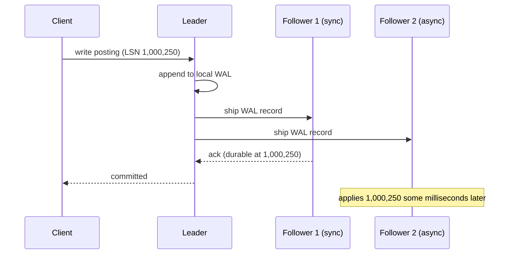
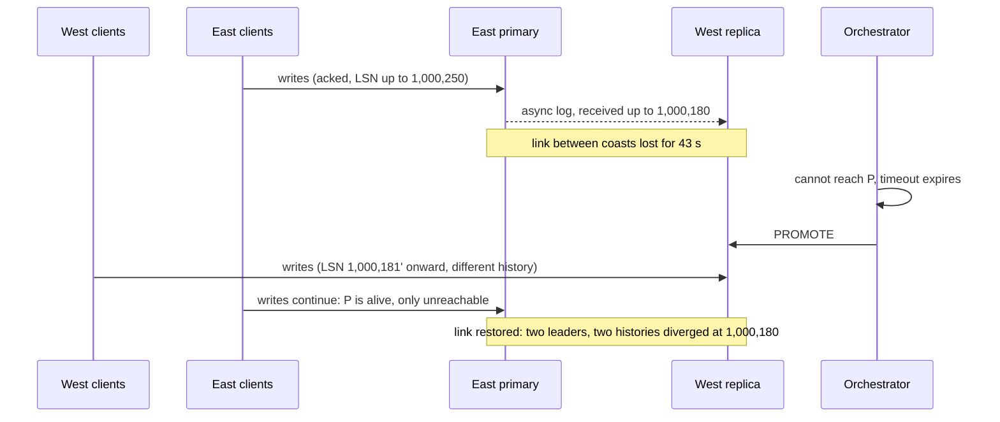

# Replication: Leader-Based, Multi-Leader, Leaderless

> Who accepts writes decides how conflicts happen.

**Type:** Learn
**Languages:** —
**Prerequisites:** Phase 5 Lesson 02 (Failure Models), Phase 5 Lesson 05 (Consistency Models), Phase 5 Lesson 06 (CAP and PACELC)
**Time:** ~75 minutes

## Learning Objectives

- Describe the write path, the replication stream, and the read path of leader-based, multi-leader, and leaderless replication, and name a production system that uses each
- Distinguish synchronous, asynchronous, and semi-synchronous replication by what has happened on which machines when the client receives an acknowledgement
- Walk through a leader failover by hand with log positions and show exactly which acknowledged writes are lost and how a split brain arises
- Enumerate the sources of write conflicts and say which replication strategies make each one possible
- Apply a decision procedure that picks a strategy for a ledger and a different one for a product catalogue, and defend each choice in a design review

## The Problem

On 21 October 2018, routine maintenance on GitHub's network replaced a failing optical link between its US East Coast data centre and its US East Coast network hub. The link was down for 43 seconds. GitHub's MySQL topology had a primary on the East Coast with replicas on the East Coast and the West Coast, managed by an orchestration tool that promotes a replica when it decides the primary is unreachable. During the 43 seconds, the orchestration layer lost contact with the East Coast primary, concluded it had failed, and promoted a West Coast replica. Write traffic began flowing to the West Coast. The replica it promoted had not yet received the last few seconds of writes from the old primary, because replication between the coasts was asynchronous over a 60 ms link.

When the link came back 43 seconds later, there were two MySQL clusters that had each accepted writes the other did not have: a few seconds of East Coast writes that never reached the West Coast, and 43 seconds of West Coast writes that the East Coast had never seen. Neither history was a prefix of the other. The automatic failover had turned a 43-second network blip into a divergent database, and the East Coast's applications were now talking to a primary 60 ms away, which made every write-heavy page time out. Restoring a consistent state took more than 24 hours of degraded service, hours of careful replay, and a manual reconciliation of the writes from the orphaned side. GitHub's own post-incident analysis is the primary source for all of this, and it is the best single document to read on what replication actually promises.

Translate it to a ledger. A payment service writes a posting to its primary: "debit customer 19.99, credit merchant 19.99." The primary commits, acknowledges, and the service tells the customer the payment succeeded and tells the card processor to capture the funds. Two seconds later the primary's rack loses power. The replica that is promoted is 1.8 seconds behind. The posting is gone from the ledger, the processor has captured the money, and the customer has a confirmation. Nobody will find out until reconciliation (Phase 10, Lesson 08), when the processor's settlement file lists a capture the ledger has no record of. Every piece of software did what it was configured to do. The configuration was "asynchronous replication, promote on timeout," and nobody had asked what that meant for an acknowledged posting.

Replication is how a system survives the loss of a machine, serves reads close to users, and scales beyond one node's capacity. Every strategy for doing it answers one question first: *which nodes may accept a write?* One node, several nodes, or any node. The answer determines what an acknowledgement means, how a failover behaves, whether two writes can conflict, and therefore what the application has to be prepared to repair. This lesson lays out the three answers, the hazards each one carries, and a procedure for choosing between them for data as different as a ledger and a product catalogue.

## The Concept

### What replication is for, and what it costs

A replica is a copy of the same data on a different machine. Keeping copies buys three things: **availability** (the service survives a machine, a rack, or a region), **read scale** (reads are spread across copies), and **locality** (a user in Frankfurt reads from Frankfurt). The cost is the problem every strategy in this lesson is a different way of paying: the copies must be kept the same while the data changes, over a network that loses messages and reorders them, on machines that fail at inconvenient moments.

The data itself does not know it is replicated. What differs between strategies is the *write path*: who a client sends a write to, who that node tells, and when the client is told the write is done.

### Leader-based replication

One node is the **leader** (also primary, master); the rest are **followers** (replicas, secondaries, standbys). Every write goes to the leader. The leader applies it to its local storage and appends it to a **replication log**, an ordered stream of changes with a position (PostgreSQL's LSN, MySQL's GTID, MongoDB's oplog timestamp). Followers consume the log in order and apply each change, so every follower holds a *prefix* of the leader's history. Reads may go to the leader (fresh) or to followers (possibly stale, Phase 5 Lesson 05).



The log carries changes in one of three shapes. **Statement-based** replication ships the SQL text; it is compact but breaks on non-deterministic statements (`NOW()`, `RANDOM()`, auto-increment), and MySQL moved away from it. **Write-ahead-log shipping** ships the storage engine's physical log, byte for byte; it is exact and fast, but ties the replicas to the same engine version and page layout (PostgreSQL streaming replication). **Logical (row-based)** replication ships "row with key K changed from A to B"; it is engine-independent and what change-data-capture tools consume (Phase 8).

### Synchronous, asynchronous, semi-synchronous

The word that matters most in a replication configuration is the one that says *when the client is told the write is done*.

| Mode | Acknowledgement means | Write latency | If the leader dies right after acking | Production knob |
|------|-----------------------|---------------|---------------------------------------|-----------------|
| Synchronous | The leader and *every* synchronous follower have the write durably | Slowest follower's round trip, every write; one slow follower stalls all writes | Nothing acknowledged is lost | PostgreSQL `synchronous_standby_names` with all standbys listed |
| Semi-synchronous | The leader and *at least one* (or a quorum of) follower(s) have it | Fastest-of-k follower round trip | Nothing acknowledged is lost if the promoted follower is one that acked | PostgreSQL `synchronous_commit = on` with `ANY 1 (...)`; MySQL semi-sync; MongoDB `w: majority`; Kafka `acks=all` with `min.insync.replicas` |
| Asynchronous | The leader has it; followers will get it later | Leader's local disk only | Every write the followers had not yet received is lost | PostgreSQL `synchronous_commit = local`; MySQL default; Redis replication |

Fully synchronous replication to every follower is rarely used because one slow or dead follower blocks all writes. Fully asynchronous replication is the default almost everywhere because it is fastest and the loss window is "usually" small. Semi-synchronous is the compromise that payment systems should treat as the floor: an acknowledged write exists on at least two machines, and the failover procedure promotes one of those machines.

Note what even synchronous replication does *not* promise: that followers serve fresh reads. A follower has the write durably on disk before the ack, but may not have *applied* it to its visible state. PostgreSQL's `synchronous_commit` setting names every stage, and reading its levels is the fastest way to learn what "replicated" can mean:

| `synchronous_commit` | The commit returns when | Survives | Fresh reads on the standby? |
|----------------------|-------------------------|----------|-----------------------------|
| `off` | The record is in the primary's memory | Nothing; even a primary crash can lose it | No |
| `local` | The record is flushed to the primary's disk | Primary crash; not primary loss | No |
| `remote_write` | The standby's operating system has received it (not yet fsynced) | Primary loss, unless the standby also crashes at that moment | No |
| `on` | The standby has flushed it to disk | Primary loss | No: durable but possibly not yet applied |
| `remote_apply` | The standby has applied it and it is visible to queries there | Primary loss | Yes: read-your-writes against that standby |

Each row down costs one more step of latency on every commit. Only the last row makes a follower read trustworthy right after the writer's own commit, which is the read-your-writes guarantee from Phase 5, Lesson 05.

### Where replication lag comes from

Asynchronous followers are behind by an amount that is small on average and large exactly when it matters. The sources, roughly in order of how often they cause an incident:

| Source | Typical size | Why it spikes under load |
|--------|--------------|--------------------------|
| Network transit | Sub-millisecond in a zone; 60 to 150 ms across regions | Saturated links during a bulk load or a settlement-file import |
| Single-threaded apply on the follower | Zero until the follower's one apply thread falls behind the primary's many writers | A write burst the primary absorbs in parallel is replayed serially |
| Long-running transactions on the follower | Seconds to minutes | Apply must wait for (or cancel) a read that conflicts with a vacuum or a schema change |
| Follower disk slower than the primary's | Grows without bound | The follower was sized for reads, not for the primary's write rate |
| Follower restart or rebuild | The entire downtime | A kernel patch at the wrong moment |

The practical consequence for failover: the follower you would promote is most behind at the moment the primary is most likely to die, because the same load that is killing the primary is what the follower cannot keep up with. Measure lag as a distribution, not an average, and use the tail when answering "how many writes would a failover lose."

### Adding a follower without stopping the leader

A new follower cannot simply copy the leader's files, because the files are changing underneath it. The procedure every leader-based system uses: take a consistent snapshot of the leader's storage at a known log position (PostgreSQL `pg_basebackup` records the LSN; MySQL a binlog coordinate); copy the snapshot to the new node; have the new node connect to the leader and request the log from that position; let it replay until it catches up. The leader must retain its log at least back to the snapshot position for as long as the copy takes, which is why a follower that falls too far behind must be rebuilt rather than resumed: the log it needs has been recycled. Replication slots (PostgreSQL) and binlog retention (MySQL) are the knobs, and setting them too small is a common cause of a follower that silently stops being one.

### Failover, and its two hazards

When the leader dies, a follower must become the leader. Automatic failover has three steps, and each one is a place to lose data:

1. **Detect.** Nobody can tell a dead leader from a slow one or a partitioned one (Phase 5, Lesson 02). Detection is a timeout, and the timeout is a bet: too short and a GC pause or a 43-second link failure triggers a needless failover; too long and the outage is longer than it had to be.
2. **Choose.** Promote the follower with the most of the leader's log. With asynchronous replication, even the best follower may be behind; everything past its position is lost. With semi-synchronous replication, choose among the followers that acknowledged, and nothing acknowledged is lost.
3. **Reconfigure.** Clients and remaining followers must start sending to the new leader. The old leader, if it comes back, must *not* accept writes.

**Hazard 1: lost writes.** Asynchronous replication plus failover means acknowledged writes disappear. The amount is the replication lag at the moment of failure, which is small on a quiet Tuesday and large under the load that is most likely to kill a leader. For a ledger this is not "data loss" in the abstract: it is postings the processor has already settled.



The diagram is GitHub's incident with the lesson's log positions. Both hazards are visible in it: the records between 1,000,180 and 1,000,250 that the West replica never received (lost writes from the East's point of view once the West is the leader), and the two streams of writes after promotion (split brain). The orchestrator had no way to know the East primary was alive, and nothing stopped it accepting writes.

**Hazard 2: split brain.** Step 3 fails. The old leader was not dead, only unreachable; it keeps accepting writes from the clients that can still reach it while the new leader accepts writes from everyone else. Two leaders, two divergent histories, as in GitHub's incident. The prevention is **fencing**: before promoting, make sure the old leader *cannot* write, by revoking its storage access, killing it (the STONITH pattern: "shoot the other node in the head"), or, more cleanly, giving every leader a monotonically increasing term and having storage reject writes from an old term. Phase 5, Lesson 12 built that token; Phase 6, Lessons 05 to 07 build the consensus protocol (Raft) that makes election itself safe, so that two nodes cannot both believe they are leader for the same term.

### Multi-leader replication

Several nodes accept writes, typically one leader per data centre or one per region. Each leader replicates to its own followers synchronously or asynchronously as above, and the leaders replicate to each other, almost always asynchronously, because the whole point is that a write in Frankfurt does not wait on a round trip to Virginia. The leaders are connected in a topology, and each topology has a failure mode of its own:

| Topology | How a write spreads | Fails when | Ordering hazard |
|----------|---------------------|------------|-----------------|
| All-to-all | Every leader sends directly to every other | Tolerates any single link loss | Two paths with different latency can deliver a dependent write before the write it depends on |
| Circular | Each leader forwards to the next, tagging writes with the nodes they have passed to stop loops | One dead node breaks the ring until it is reconfigured | Delivery order is the ring order, which may not be causal order |
| Star | A hub forwards between leaves | The hub is a single point of failure | The hub's order becomes everyone's order, which hides but does not remove concurrency |

The all-to-all hazard is worth a sentence because it looks like a bug and is not: a client in Frankfurt inserts an order and then updates it; the update travels to Virginia over a faster path than the insert; Virginia receives an update for a row it does not have. The system must track causality (Phase 5, Lesson 03) and hold the update until the insert arrives, or it will drop it.

The defining property, and the defining problem: **two leaders can accept conflicting writes to the same record at the same time**, and neither finds out until the writes meet. A product's price set to 19.99 in Frankfurt and 18.99 in Virginia within the same second is two valid committed writes with no total order. Something has to decide. The options, each built in Lesson 09 of this phase: **last-writer-wins** by timestamp (simple, deterministic, and silently discards one write; and the timestamps come from clocks that disagree, Phase 5 Lesson 04), **merge** (keep both values and let the application or the user pick, which is what Git and CouchDB do), **application-defined resolution** on write or on read, or **data structures that cannot conflict** (CRDTs, Lesson 08: a counter that only merges by addition, a set that only merges by union).

Multi-leader replication is the right tool when writes must be accepted locally in several regions, when clients work offline and sync later (calendar applications, mobile point-of-sale devices that queue sales during an outage), or for collaborative editing. It is the wrong tool for anything with an invariant across records, because an invariant such as "the balance is never negative" cannot be checked by a leader that does not know what the other leader just did.

### Leaderless replication

No node is special. A client (or a coordinator node acting on its behalf) sends a write to all `N` replicas that hold the key and waits for `W` acknowledgements; it sends a read to all `N` and waits for `R` responses, taking the newest by version. If `R + W > N`, every read quorum overlaps every write quorum in at least one node, so a read sees at least one copy of the latest acknowledged write. Amazon's Dynamo paper (2007) is the design; Cassandra, Riak, and Voldemort implemented it; DynamoDB inherited the name and some of the ideas.

Three mechanisms keep leaderless replicas from drifting apart permanently: **read repair** (when a read sees a stale replica, it writes the newer value back), **anti-entropy** (a background process compares replicas, typically with Merkle trees, and copies missing writes), and **hinted handoff** (a write that could not reach its home replica is parked on a neighbour and delivered later). **Sloppy quorums** let a write succeed on `W` *reachable* nodes that are not necessarily the key's home nodes, which keeps the system available during a partition at the price of breaking the `R + W > N` overlap guarantee until handoff completes. Lesson 03 of this phase builds the quorum arithmetic and shows where it stops working.

Conflicts in a leaderless system are not a failure mode; they are the normal case. Two clients can write the same key to disjoint quorums, both succeed, and the next read receives both versions. The system needs **version vectors** (one counter per replica) to tell "newer" from "concurrent," and a resolution rule for the concurrent case, exactly as in multi-leader. Dynamo's shopping cart merged by union, which is why a deleted item could reappear.

### Where conflicts come from

| Source | Leader-based | Multi-leader | Leaderless | Prevention or repair |
|--------|--------------|--------------|------------|----------------------|
| Two writers update the same record concurrently | Impossible: the leader serialises | The defining hazard | The normal case | Version vectors; LWW, merge, or CRDT |
| Writes delivered out of causal order | Impossible: one log | All-to-all topology with unequal latency | Different replicas receive in different orders | Causal metadata; apply in dependency order |
| Clock skew with last-writer-wins | Not applicable | A write with a fast clock beats a later one | Same | Hybrid logical clocks; avoid LWW for data that matters |
| Failover promotes a lagging follower | Lost writes; old leader's extra writes conflict on return | Same, per leader | Not applicable (no leader) | Semi-synchronous replication; fencing; consensus-based election |
| Retried write without an idempotency key | Duplicate rows, not conflicts | Duplicates on two leaders | Duplicate versions | Idempotency keys (Phase 5, Lesson 09) |
| Auto-increment keys allocated on two nodes | Impossible | Two leaders assign the same id | Not used (keys are client-chosen) | Per-node id ranges; UUIDs; ULIDs |

The first row is the one to remember. A single leader makes write conflicts impossible by construction, and that is the entire reason to accept the leader's cost: one node's write throughput, one node's latency for everyone, and a failover procedure that has to be right.

### The comparison

| Property | Leader-based | Multi-leader | Leaderless |
|----------|--------------|--------------|------------|
| Who accepts writes | One node | One node per region or device | Any `W` of `N` replicas |
| Write latency | One leader round trip (plus sync followers) | Local leader; cross-region later | `W` replica round trips in parallel |
| Write availability under partition | Only the leader's side; the other side cannot write | Every side keeps writing | Any side with `W` reachable replicas |
| Consistency achievable | Linearizable (sync or via consensus) | Eventual, causal with effort | Eventual; linearizable per key only with care |
| Write conflicts | None | Yes, resolved later | Yes, resolved on read or repair |
| Failover | Required, hazardous | Per leader, less critical | None |
| Operational complexity | Moderate; failover tooling is the hard part | High; conflict handling leaks into the application | High; tuning `N`, `R`, `W`, repair, handoff |
| Examples | PostgreSQL, MySQL, MongoDB, Kafka partitions, Raft/ZooKeeper/etcd | PostgreSQL BDR, MySQL Group Replication multi-primary, CouchDB, Yugabyte xCluster | Dynamo, Cassandra, Riak, ScyllaDB |

### Placing replicas across failure domains

A replica only protects against failures that do not take it down too. Replication topology has to be drawn on top of the failure domains it is meant to survive, and the semi-synchronous quorum has to be reachable from the surviving domain:

| Placement of 3 replicas | Survives | Does not survive | Semi-sync `ANY 1` cost |
|-------------------------|----------|------------------|------------------------|
| Same rack | One machine | The rack's switch or power circuit | Microseconds |
| Three zones in one region | A zone outage | A region-wide event or a regional network partition | About 1 ms |
| Two regions, two replicas local and one remote | A zone outage, and a region loss if the remote replica was in the acknowledging set | A region loss where the remote replica was behind (it was never guaranteed to be the one that acked) | About 1 ms normally; the remote replica rarely wins the race, so it rarely holds the latest commit |
| Two regions with `ANY 2 (local, remote)` | A region loss with zero lost acknowledged writes | Nothing short of both regions | One cross-region round trip, 60 to 150 ms, on every commit |

The last two rows are the trade a payments company actually makes: either accept that a whole-region loss can lose acknowledged postings and plan the reconciliation for it, or pay a cross-region round trip on every write. Neither is wrong; writing down which one you chose is the point.

## Worked Example

### An asynchronous failover, by log position

A ledger runs PostgreSQL with one primary and two streaming replicas, `synchronous_commit = local` (asynchronous). The primary's write-ahead log is at LSN 1,000,250 when its rack loses power at 12:00:00.000. The replicas were at:

```text
primary    LSN 1,000,250   dead
replica A  LSN 1,000,180   lag 70 records,  ~0.9 s behind
replica B  LSN 1,000,120   lag 130 records, ~1.8 s behind
```

The failover tool waits a 10-second detection timeout, chooses replica A (the most advanced), promotes it at 12:00:10, and repoints the application. The consequences, counted:

- **Records 1,000,181 to 1,000,250 are gone.** That is 70 WAL records. Each posting is two rows (a debit and a credit) in one transaction, so roughly 35 postings that the application acknowledged to callers no longer exist. The callers have already told customers "paid" and told the processor to capture.
- **Replica B is now behind the new leader by 60 records and catches up normally.** Nothing is wrong with B.
- **The old primary comes back at 12:04** when power returns. Its log contains 1,000,181 to 1,000,250, which the new leader does not have, and its history diverges from the new leader's at 1,000,180. It cannot rejoin as a follower without being rebuilt from the new leader (`pg_rewind` or a fresh base backup), and its 70 orphaned records have to be extracted and reconciled by hand. If the old primary was *not* fenced and the application's connection pool still had connections to it, some clients wrote to it between 12:04 and whenever someone noticed: split brain.

Now re-run with `synchronous_commit = on` and `synchronous_standby_names = 'ANY 1 (A, B)'` (semi-synchronous, quorum of one):

```text
every commit waits until A or B has the WAL record on disk
primary    LSN 1,000,250   dead
replica A  LSN 1,000,250   (acked the last commit)
replica B  LSN 1,000,190
```

The failover tool must now choose *the replica that acknowledged*, which is A. Zero acknowledged postings are lost. The price was paid on every write: each commit took one extra round trip to the nearer of A and B, about 1 ms in the same data centre. The unacknowledged writes in flight at 12:00:00.000 were never acknowledged, so their callers correctly treat them as failed and retry with their idempotency keys (Phase 5, Lesson 09).

The lesson of the example is not "use synchronous replication." It is that the replication mode and the promotion rule are one decision, and the decision is "how many acknowledged postings am I willing to lose per failover," which for a ledger has one acceptable answer.

### The same failure with Raft

A consensus-replicated ledger (Lessons 05 to 07) commits a posting only when a majority of nodes have it, and elects a leader only with a majority's votes for a term number higher than any previous. The 43-second partition from The Problem cannot produce two leaders: the minority side cannot win an election, and its old leader's writes cannot commit because they cannot reach a majority. Consensus is leader-based replication with the failover procedure made provably safe, bought with one majority round trip per write and unavailability for the minority side of a partition. That is the trade from Phase 5, Lesson 06, and for a ledger it is the right one.

### A leaderless write and read, by quorum

The product catalogue runs on a leaderless store with `N = 3`, `W = 2`, `R = 2`. Product `sku-77` has price 1999 at version 4 on all three replicas. A merchandiser in Frankfurt changes the price to 1899 while replica 3 is unreachable from the coordinator:

```text
write {price: 1899, version: 5} -> replicas 1, 2 ack; replica 3 unreachable
W = 2 reached: write acknowledged

state:  replica 1: v5 1899   replica 2: v5 1899   replica 3: v4 1999

read sku-77 -> coordinator asks all three, waits for R = 2
  responses from replica 2 (v5 1899) and replica 3 (v4 1999)
  returns v5 1899 (highest version); issues read repair: replica 3 <- v5 1899
```

`R + W = 4 > N = 3`, so any two replicas include at least one that holds version 5, and the read could not have returned only version 4. Now the conflict case: at the same moment a feed in Virginia writes `{price: 1949}` and reaches replicas 2 and 3 while Frankfurt's write reached 1 and 2. Replica 2 has seen both. With plain version numbers both writes are "version 5" and one is silently overwritten, which is last-writer-wins by arrival order. With version vectors (`[r1:1, r2:0, r3:0]` versus `[r1:0, r2:0, r3:1]`) replica 2 can see that neither dominates the other, keeps both as siblings, and hands the pair to the next reader to resolve. For a price, the merchandising team's rule is "latest edit by wall clock wins and show the loser in the audit log"; for a ledger there is no acceptable rule, which is the whole reason the ledger is not on this store.

### The same modes in other systems

The vocabulary differs by product; the semantics are the three modes above.

| System | Asynchronous | Semi-synchronous (quorum) | Fully synchronous |
|--------|--------------|---------------------------|-------------------|
| PostgreSQL | `synchronous_commit = local` | `on` with `synchronous_standby_names = 'ANY 1 (...)'` | `on` with every standby listed as `FIRST n` of `n` |
| MySQL | Default replication | Semi-synchronous plugin, `rpl_semi_sync_source_wait_for_replica_count` | Group Replication (Paxos-based) |
| MongoDB | `writeConcern: {w: 1}` | `{w: "majority"}` | `{w: <number of members>}` |
| Kafka | `acks=1` | `acks=all` with `min.insync.replicas = 2` | `acks=all` with `min.insync.replicas` = replication factor |
| Cassandra | `ONE` | `QUORUM` / `LOCAL_QUORUM` | `ALL` |

Every column to the right costs latency on each write and buys the survival of acknowledged writes through one more kind of failure. The middle column is where a ledger belongs; the left column is where the GitHub incident and the lost-posting scenario both lived.

### A decision procedure: ledger versus product catalogue

Five questions, asked in order, decide the strategy. Two data sets from the same company give opposite answers.

| Question | Ledger (postings, balances) | Product catalogue (descriptions, images, prices) |
|----------|-----------------------------|--------------------------------------------------|
| 1. Is there an invariant across records that every write must respect? | Yes: debits equal credits; a balance never goes below its limit | No: each product is independent; a stale description harms nobody |
| 2. Can two concurrent writes to the same record be merged without losing meaning? | No: two debits are two debits, and "last writer wins" loses money | Mostly yes: last edit wins per field is what the merchandising team expects |
| 3. What does one lost acknowledged write cost? | A reconciliation break, a customer dispute, possibly a regulatory report | A product edit someone has to redo |
| 4. What does write unavailability for one region during a partition cost? | Payments in that region fail closed, which is acceptable and expected | Merchandisers in that region cannot edit for a while; tolerable, annoying |
| 5. Who writes, from where, how often? | Services, from one region per currency ledger, thousands of writes per second | Humans and feeds, from every region, a few writes per second per product |
| **Strategy** | Single leader with semi-synchronous or consensus replication; leader election via consensus; fencing; followers for reads only with read-your-writes tokens | Multi-leader (one per region) or leaderless with per-field last-writer-wins and a merge for free-text fields; eventual consistency accepted; conflicts surfaced in the editing tool |

The procedure generalises: a "yes" to question 1 or a "no" to question 2 rules out multi-leader and leaderless for that data, whatever the latency argument. Everything else is a cost comparison. `outputs/design-doc-replication-strategy.md` is the five questions plus the failover and conflict sections a reviewer will ask about, as a template to fill in once per data set. Most payment companies run both strategies side by side: the ledger, the idempotency store, and the account state on a single leader with consensus; the catalogue, the sessions, and the analytics on something that keeps accepting writes when a region is cut off.

### What replication does not do

- It does not make a write durable against *correlated* failure. Three replicas on the same power circuit, or in the same availability zone, fail together. Replication topology must map onto failure domains.
- It does not replace backups. A `DELETE` without a `WHERE` replicates perfectly to every follower in milliseconds. Point-in-time recovery from the WAL archive is a separate mechanism, and the delay on a delayed replica is a deliberate feature.
- It does not provide transactions across leaders. A transfer between a EUR ledger on one leader and a USD ledger on another is a distributed transaction (Phase 7), not a replication question.

## Exercises

1. **Reinforce.** Redo the LSN worked example with three replicas and `synchronous_standby_names = 'ANY 2 (A, B, C)'`. Give replicas positions such that the primary dies with one commit acknowledged and one not. State which replicas are eligible for promotion, how many acknowledged records are lost, and what happens to the unacknowledged commit's caller.
2. **Apply.** Take a system you operate or know well and classify its replication: who accepts writes, which mode, how failover is triggered, whether the old leader is fenced. Then write the loss window as a number: at the 99th-percentile replication lag you have observed, how many acknowledged writes would a failover lose, and what are they?
3. **Extend.** Using the vector clocks from Phase 5, Lesson 03, show how two multi-leader data centres could each accept a price change for the same product within the same second and detect, on exchange, that the writes are concurrent rather than ordered. Then specify a per-field merge rule for a product record with `price` (minor units, Phase 10 Lesson 01), `title`, and `tags`, and say for each field whether last-writer-wins, union, or human review is appropriate and why.

## Key Terms

| Term | What people say | What it actually means |
|------|-----------------|------------------------|
| Leader-based replication | "primary/replica" | One node accepts all writes and ships an ordered log to followers, so followers always hold a prefix of the leader's history and write conflicts are impossible |
| Replication log | "the binlog / the WAL stream" | The ordered sequence of changes with positions (LSN, GTID, oplog timestamp) that followers consume; its position on each node is what a failover compares |
| Synchronous / asynchronous | "sync replication is slow" | Whether the client's acknowledgement waits for followers; asynchronous means every acknowledged write the followers lacked is lost on failover |
| Semi-synchronous | "wait for one replica" | Acknowledge once at least one (or a quorum of) followers have the write durably; the floor for data whose loss has to be explained to an auditor |
| Failover | "promote a replica" | Detect (a timeout), choose (the most advanced eligible follower), reconfigure (clients and old leader); each step can lose writes or create two leaders |
| Split brain | "two primaries" | Two nodes accepting writes for the same data at once because the old leader was partitioned, not dead, and was not fenced; the histories diverge and must be reconciled by hand |
| Fencing | "STONITH" | Guaranteeing the old leader cannot write after promotion, by killing it, revoking storage, or rejecting writes carrying an old term |
| Quorum (R + W > N) | "read from two, write to two" | In leaderless replication, choosing read and write set sizes so every read overlaps every write at one node; broken by sloppy quorums until handoff completes |

## Further Reading

- [GitHub, "October 21 post-incident analysis" (2018)](https://github.blog/2018-10-30-oct21-post-incident-analysis/) — a 43-second network partition, an automatic cross-region MySQL failover, divergent writes, and 24 hours of recovery; the clearest public account of lost writes and split brain.
- [PostgreSQL documentation, Chapter 26 "High Availability, Load Balancing, and Replication"](https://www.postgresql.org/docs/current/high-availability.html) — `synchronous_commit` levels, `synchronous_standby_names` with `ANY k`, and the warnings about what each mode does and does not guarantee.
- [DeCandia et al., "Dynamo: Amazon's Highly Available Key-value Store" (SOSP 2007)](https://www.allthingsdistributed.com/files/amazon-dynamo-sosp2007.pdf) — leaderless replication as a complete design: sloppy quorums, hinted handoff, vector clocks, Merkle-tree anti-entropy, and the shopping cart that merged by union.
- [Oki and Liskov, "Viewstamped Replication" (PODC 1988)](https://pmg.csail.mit.edu/papers/vr.pdf) — the first leader-based replication protocol with a safe view change, the ancestor of Raft's election and the answer to "how do you fail over without losing committed writes."
- [MySQL Reference Manual, "Semisynchronous Replication"](https://dev.mysql.com/doc/refman/8.0/en/replication-semisync.html) — the semi-synchronous mode, its `AFTER_SYNC` versus `AFTER_COMMIT` variants, and the exact window in which a write can be acknowledged and lost.
- [Kleppmann, *Designing Data-Intensive Applications* (2017), Chapter 5 "Replication"](https://dataintensive.net/) — the chapter this lesson's three-way taxonomy follows, with the multi-leader topology diagrams and the write-conflict catalogue in more depth.
- [Bailis et al., "Probabilistically Bounded Staleness for Practical Partial Quorums" (VLDB 2012)](https://www.vldb.org/pvldb/vol5/p776_peterbailis_vldb2012.pdf) — how stale a non-overlapping quorum read is likely to be in practice, which turns "eventually" into a distribution you can measure.
