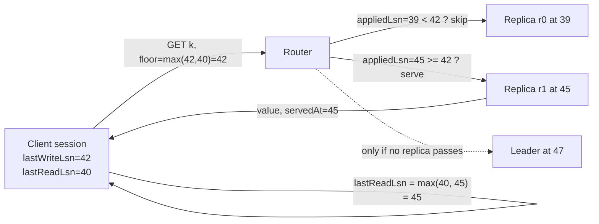

# Replication Lag and Read-Your-Writes

> A customer pays, refreshes, and sees no payment.

**Type:** Build
**Languages:** Java, Python, Go
**Prerequisites:** Phase 6 Lesson 01 (Replication Strategies), Phase 5 Lesson 05 (Consistency Models), Phase 5 Lesson 03 (Lamport and Vector Clocks)
**Time:** ~75 minutes

## Learning Objectives

- Explain where replication lag comes from in a leader-based system and why "eventually" has no upper bound you can promise a customer
- Build a leader with a log sequence number (LSN) and asynchronous replicas that apply the log after a seeded delay, on a deterministic tick clock
- Reproduce the pays-then-sees-nothing bug and state exactly which read served it and why
- Implement read-your-writes and monotonic reads as one mechanism: a per-session LSN floor that routes a read to a replica that has caught up, or to the leader
- Show by test that a replica which applies records on arrival violates consistent prefix, and that applying in LSN order restores it
- Decide for a given endpoint which session guarantee it needs and what each one costs in leader load

## The Problem

A checkout service writes payments to a PostgreSQL primary and reads them from two streaming replicas behind a load balancer, because reads outnumber writes forty to one and the replicas are where the capacity is. A customer completes a 49.99 USD purchase. The `POST /payments` call commits on the primary, returns `201 Created`, and the browser redirects to the order page, which calls `GET /payments/p-1001`. The load balancer sends that read to replica B, which is 800 milliseconds behind the primary because it is also running a nightly reporting query. Replica B has no row for `p-1001`. The order page shows "no payment found", the customer presses the pay button again, and the second payment succeeds. Finance sees the duplicate on Monday; the customer saw it on Friday evening and called their bank.

Nothing in this story is broken. The primary committed. Replication delivered the row to B 800 milliseconds later. The load balancer did what load balancers do. The system is eventually consistent and every component honoured its contract; the contract was just the wrong one for this read. The customer did not need the latest state of the world. They needed to see *their own write*, which is a far weaker and far cheaper thing to promise than strong consistency, but it still has to be promised somewhere, and in this system nobody promised it.

Two cousins of the same bug show up once you start looking. A customer refreshes the order page twice and the payment appears, then disappears, then appears again, because the two refreshes landed on replicas with different lag; support calls this "the flickering payment". And a dashboard that reads `payment:captured` from one shard's replica and `payment:authorized` from another occasionally renders a capture with no authorization, which is a state the payment never passed through, because the two records were applied in the opposite order from the one in which they were written. The three bugs are the three *session guarantees* that Terry and colleagues named in 1994: read-your-writes, monotonic reads, and consistent prefix. This lesson builds the leader, the lag, all three bugs, and the one mechanism that fixes them: an LSN carried by the client.

## The Concept

### Where lag comes from

In leader-based replication the leader appends every write to a log and ships the log to replicas. The replica is behind by the sum of four delays: the time for the record to leave the leader, the network transit, the time the record waits in the replica's queue behind earlier records, and the time to apply it. In steady state this is milliseconds. Under a reporting query, a vacuum, a GC pause, a network blip, or a replica restart, it is seconds to hours, and the long tail is what the customer hits. The leader does not wait for replicas (that is what *asynchronous* means), so the leader cannot know how far behind any replica is at the moment it acknowledges a write. The only honest number it can give the client is *where the write landed in the log*.

### The log sequence number

Every write gets a strictly increasing position in the leader's log: the LSN. PostgreSQL's WAL positions, MySQL's GTID sets, Kafka's offsets, and Raft's log index (Lesson 06) are all the same idea. A replica that has applied records 1 through 17 is "at LSN 17" and its state is exactly the leader's state as of record 17, provided it applied them in order. That one sentence is the whole foundation:

**Invariant.** A replica at LSN `k` has applied every record with LSN at most `k` and no record with LSN greater than `k`. Its state is a prefix of the leader's history.

With that invariant, a client that holds LSN `w` from its write and asks "has this replica applied through `w`?" gets a reliable yes or no from a single integer comparison. There is no need to compare values, timestamps, or vector clocks. The LSN is a total order over writes, imposed by the one place that saw all of them.

### The three session guarantees as one rule

Terry et al. defined session guarantees for a client's sequence of operations against replicas that may differ from each other:

| Guarantee | What the client must never observe | Floor the read needs | Who needs it |
|-----------|-----------------------------------|----------------------|--------------|
| Read-your-writes | A state missing a write this session made | the LSN of the session's last write | the customer who just paid |
| Monotonic reads | A state older than one this session already saw | the LSN at which the session's last read was served | the customer refreshing a page |
| Consistent prefix | A later write without an earlier one it depends on | not a floor: a property of the replica (apply in order) | anyone reading two related keys |
| Writes-follow-reads | A write ordered before a read it was based on | the leader orders writes, so trivially satisfied here | multi-leader systems (Lesson 01) |

The first two collapse into one mechanism. A session carries two numbers, `lastWriteLsn` and `lastReadLsn`. A read computes a floor from them, picks a replica, and checks `replica.appliedLsn >= floor`. If the replica passes, it serves the read. If not, the router tries the other replicas and finally the leader, which is at the highest LSN by definition. The leader is the fallback, not the default, which is what keeps the read traffic off it.



Monotonic reads need one more ingredient in practice: a *sticky* replica. If a session is routed to the same replica every time, its reads cannot go backwards unless that replica is replaced, and the floor only has to intervene on failover. Without stickiness the floor still works, but it redirects far more often, because each random pick has a fair chance of landing on a slower replica than the last one.

### Consistent prefix is about the replica, not the client

A replica that applies records the moment they arrive, in whatever order the network delivers them, can have record 18 applied and record 17 not. Its state is then not a prefix of the leader's history; it is a state the leader never had. For independent keys nobody notices. For dependent keys it is a visible impossibility: `payment:p-7:capture = CAPTURED` with `payment:p-7:auth` absent, when the capture was written strictly after the authorization because the code path requires it.

The fix is a reorder buffer: hold arrived records in a map keyed by LSN and apply only while the next expected LSN is present. The replica's `appliedLsn` then is the contiguous watermark and the invariant above holds exactly. The cost is that one slow record delays everything after it, which is the trade the whole design makes: a replica is a *replay* of the leader, not a cache of its rows.

### Worked example, by hand

Leader at LSN 0, two replicas: `r0` with delay 1 to 4 ticks, `r1` with delay 1 to 30. Alice pays at tick 0.

| Tick | Event | leader | r0 applied | r1 applied | Alice's read |
|------|-------|--------|------------|------------|--------------|
| 0 | `POST /payments` appends `#1 payment:p-1001=CAPTURED 49.99 USD`; Alice receives token `lsn=1` | 1 | 0 | 0 | |
| 2 | `GET` lands on r1 (ANY_REPLICA, floor 0): r1 at 0, serves | 1 | 0 | 0 | nothing: the bug |
| 2 | `GET` with floor 1 lands on r1: `0 >= 1` fails; r0 `0 >= 1` fails; leader serves | 1 | 0 | 0 | CAPTURED (leader) |
| 3 | `#1` arrives at r0 and is applied | 1 | 1 | 0 | |
| 4 | `GET` with floor 1 lands on r1: fails; r0 `1 >= 1` passes | 1 | 1 | 0 | CAPTURED (r0, redirected) |
| 4 | Alice's `lastReadLsn` becomes 1 | | | | |
| 8 | `GET` (ANY_REPLICA) lands on r1 at 0 | 1 | 1 | 0 | nothing: time travel |
| 8 | `GET` with floor `max(1,1)=1` sticky to r1: fails; r0 passes | 1 | 1 | 0 | CAPTURED, no anomaly |
| 29 | `#1` arrives at r1 | 1 | 1 | 1 | both modes now serve from either |

Count what the floor cost: two redirects and one leader read in nine ticks for one session. Bob, who never wrote, has floor 0 and is served by r1 at tick 2 with "nothing", and that is correct: he has no write of his own to see, and the system never promised him Alice's.

### Complexity and cost

| Operation | Cost | Note |
|-----------|------|------|
| write | O(1) append plus one message per replica | the LSN is the list size |
| replica apply, in order | O(log n) per record for the heap, O(1) for the buffer map | the buffer is bounded by the number of in-flight records |
| read with floor | O(1) expected, O(replicas) worst case when the first pick fails | the leader fallback is O(1) but consumes leader capacity |
| session state | two longs | fits in a cookie, a header, or a JWT claim |

The quantity to watch in production is the leader-read fraction: the share of floored reads that fell through to the leader. In the seeded run at the end of `main`, 30% of read-your-writes reads hit the leader because the reads were issued one to seven ticks after the write and the fastest replica had a five-tick maximum delay. With real-world ratios (write at `t`, next page load at `t + 300ms`, replica lag `p99 = 50ms`) it is under 1%, and it is exactly the reads where the alternative was showing the customer a lie.

### Choosing the guarantee per endpoint

The guarantee is a property of the endpoint, not of the database. A decision procedure that fits on a card:

| Question about the read | Yes | No |
|-------------------------|-----|----|
| Does the caller's previous request in this session write the thing being read? | needs read-your-writes (floor = last write) | continue |
| Will the caller see this page again and compare? (status pages, balances, lists) | needs monotonic reads (sticky replica + floor = last read) | continue |
| Does the page combine two keys where one is written after the other? | needs consistent prefix (in-order replicas, and read both keys from the same replica) | continue |
| Is the result the input to a money movement? (authorize, capture, payout) | read from the leader, or use Lesson 06's committed index | continue |
| None of the above (search, analytics, recommendations, risk features) | ANY_REPLICA is correct and the cheapest option | |

Two rows deserve a note. Consistent prefix cannot be bought with a token because the anomaly is inside one replica's state, not between the client and the replica; the only fix is how the replica applies. And "read from the leader" for money movement is not about freshness at all: an authorization decision made on a replica can be *correct and stale*, and the stale part is what a double-spend exploits.

Most endpoints in a payments platform land in the last row. The handful that do not are the ones customers see within a second of acting, and those are the ones this lesson is about.

### Failure modes of the fix

The token itself introduces three ways to be wrong, and each has a cheap defence:

- **A forged or stale-high token.** A client that sends `lsn = 2^62` forces every read to the leader. Sign the token (an HMAC over the LSN, Phase 7) or let the router clamp any floor above the leader's current LSN to the leader's LSN, since no legitimate token can exceed it.
- **A token across a failover.** If the leader fails and a lagging replica is promoted, the new leader's LSN may be lower than tokens already issued. A floor above the new leader's LSN is unsatisfiable; the router must say so (`UNSATISFIABLE`) rather than quietly serve a value below the floor. Exercise 3 builds this, and Lesson 06 removes the cause by only acknowledging writes that a majority has.
- **A token across shards.** Each leader has its own LSN space. A session that writes to two shards needs one token per shard, or a global ordering such as the hybrid logical clock from Phase 5 Lesson 04. MongoDB's `clusterTime` is exactly that: one HLC across all shards, so one token suffices.

### Measuring lag

Lag has two natural units and you want both on a dashboard. In *records* (`leader.lsn() - replica.appliedLsn`) it tells you how much work the replica has queued; in *time* (now minus the leader's commit timestamp of the last applied record) it tells you how old the data a customer sees is. A replica that is 10,000 records and 40 milliseconds behind is healthy; one that is 3 records and 20 minutes behind has a stuck apply loop. The seeded simulation reports records; a real system should carry the leader's commit time inside each record so a replica can compute the time version without a clock comparison across machines, which Phase 5 Lesson 04 explains is unreliable anyway.

### What this mechanism does not do

- It does not make the replicas consistent with each other or with the leader; it makes a *session's view* consistent. Two different sessions still see different states at the same wall-clock instant.
- It does not survive the leader losing the log. If a failover promotes a replica that is behind, LSNs above its watermark are gone and tokens pointing past it are unsatisfiable. Lesson 06 (Raft) is where a committed LSN stays committed.
- It does not bound lag. It detects lag at read time and routes around it. If every replica is behind and the leader is saturated, the honest responses are "serve from the leader anyway" or "fail the read", and that choice belongs to the endpoint, not the library.

## Build It

### Step 1: The log and the leader

```java
record LogRecord(long lsn, String key, String value) {}

final class Leader {
    final List<LogRecord> log = new ArrayList<>();
    final Map<String, String> data = new TreeMap<>();

    long lsn() { return log.size(); }

    long write(String key, String value) {
        LogRecord r = new LogRecord(log.size() + 1, key, value);
        log.add(r);
        data.put(key, value);
        return r.lsn();
    }

    List<LogRecord> since(long afterLsn) {
        if (afterLsn < 0 || afterLsn > log.size()) throw new IllegalArgumentException("lsn out of range: " + afterLsn);
        return List.copyOf(log.subList((int) afterLsn, log.size()));
    }
}
```

The leader is a log and a materialised view of it. `write` returns the LSN, and that return value is the whole reason the rest of the lesson works: it is the token the client carries. `since(k)` is the catch-up API: "give me everything after `k`". A replica that restarts asks for `since(appliedLsn)` and the same integer that served reads now drives resynchronisation.

**Predict:** after `write("a","1")` and `write("b","2")`, what does `since(2)` return, and what does `since(3)` do?

### Step 2: A replica with seeded lag and a reorder buffer

```java
final class Replica {
    record Pending(int arriveAt, long lsn, LogRecord record) {}

    final boolean applyInOrder;
    private final PriorityQueue<Pending> inbox = new PriorityQueue<>(Comparator.comparingInt(Pending::arriveAt).thenComparingLong(Pending::lsn));
    private final TreeMap<Long, LogRecord> arrived = new TreeMap<>();
    private final Set<Long> appliedSet = new HashSet<>();
    long appliedLsn = 0;
    int outOfOrderApplies = 0;

    void receive(LogRecord r, int now) {
        int delay = minDelay + rng.nextInt(maxDelay - minDelay + 1);
        inbox.add(new Pending(now + delay, r.lsn(), r));
    }

    void tick(int now) {
        while (!inbox.isEmpty() && inbox.peek().arriveAt() <= now) {
            Pending p = inbox.poll();
            arrived.put(p.lsn(), p.record());
        }
        if (applyInOrder) {
            while (arrived.containsKey(appliedLsn + 1)) apply(arrived.remove(appliedLsn + 1));
        } else {
            while (!arrived.isEmpty()) apply(arrived.pollFirstEntry().getValue());
        }
    }
}
```

Two queues, two different jobs. The `inbox` is the network: records sit there until their seeded arrival tick. The `arrived` map is the reorder buffer: records that have landed but may not be applicable yet. In `applyInOrder` mode the replica applies only while `appliedLsn + 1` is present, so its state is always a prefix of the leader's history. In on-arrival mode it applies everything that has landed, and `apply` counts each record that arrives ahead of its predecessor in `outOfOrderApplies`.

The delay is drawn from a per-replica SplitMix64 stream seeded from the cluster seed and the replica id, so the same seed produces the same lag pattern every run, and a stale read you saw once can be replayed forever.

**Predict:** records `#5` and `#4` are in the inbox with arrival ticks 10 and 12. In in-order mode, what is `appliedLsn` at tick 10, at tick 11, and at tick 12?

### Step 3: The watermark

```java
private void apply(LogRecord r) {
    if (r.lsn() != appliedLsn + 1) outOfOrderApplies++;
    data.put(r.key(), r.value());
    appliedSet.add(r.lsn());
    applied++;
    while (appliedSet.contains(appliedLsn + 1)) appliedLsn++;
}
```

`appliedLsn` is the highest LSN such that every record up to it has been applied, computed the same way in both modes. In on-arrival mode a replica can have applied `#18` while `appliedLsn` is still 16, and that is correct: it is *not* at 18 in any sense a session token can rely on, because 17 is missing. This is the number the router compares against the floor, so it must never overstate.

### Step 4: Sessions and floors

```java
enum ReadMode { ANY_REPLICA, READ_YOUR_WRITES, MONOTONIC, SESSION, LEADER }

final class Session {
    final long id;
    long lastWriteLsn = 0;
    long lastReadLsn = 0;

    long floor(ReadMode mode) {
        return switch (mode) {
            case ANY_REPLICA, LEADER -> 0;
            case READ_YOUR_WRITES -> lastWriteLsn;
            case MONOTONIC -> lastReadLsn;
            case SESSION -> Math.max(lastWriteLsn, lastReadLsn);
        };
    }
}
```

The session is two longs. `floor` turns a named guarantee into a number, which is the design insight of the lesson: read-your-writes and monotonic reads are not two mechanisms, they are two ways of choosing the floor. `SESSION` takes the maximum of both, which is what a web session should use by default. `ANY_REPLICA` has floor 0 and is the bug, kept as a mode so the tests can reproduce it.

**Predict:** a session wrote at LSN 42 and its last read was served at LSN 45. What floor does `MONOTONIC` give, and why is it higher than `READ_YOUR_WRITES`?

### Step 5: The router

```java
ReadResult read(Session s, String key, ReadMode mode) {
    reads++;
    if (mode == ReadMode.LEADER) { leaderReads++; return finish(s, new ReadResult(leader.read(key), "leader", leader.lsn(), false)); }
    long floor = s.floor(mode);
    Replica chosen = pickReplica(mode, s);
    if (chosen.appliedLsn >= floor) return finish(s, new ReadResult(chosen.read(key), chosen.name, chosen.appliedLsn, false));
    for (Replica r : replicas) {
        if (r.appliedLsn >= floor) { redirects++; return finish(s, new ReadResult(r.read(key), r.name, r.appliedLsn, true)); }
    }
    redirects++;
    leaderReads++;
    return finish(s, new ReadResult(leader.read(key), "leader", leader.lsn(), true));
}

private ReadResult finish(Session s, ReadResult result) {
    if (result.atLsn() < leader.lsn()) staleReads++;
    s.lastReadLsn = Math.max(s.lastReadLsn, result.atLsn());
    return result;
}
```

Pick, check, redirect, fall back. `pickReplica` is a seeded random choice for the non-sticky modes (a load balancer) and `session.id % replicas.size()` for `MONOTONIC` and `SESSION` (a sticky one). `finish` advances `lastReadLsn` to the LSN the read was served at, never backwards, which is what makes the next `MONOTONIC` floor correct. `ReadResult` records who served the read so the demo output, and your logs at work, show the routing decision rather than just the value.

Note what `staleReads` counts: any read served below the leader's current LSN. That is a measure of lag, not of correctness. A stale read is only a bug when it violates a guarantee the session was promised, and the tests separate the two.

**Predict:** with floor 1 and replicas at LSN 0 and 0, who serves the read, and what does `redirects` become?

### Step 6: The anomaly detector

```java
final class AnomalyDetector {
    int monotonicViolations = 0;
    int prefixViolations = 0;
    private long highWater = 0;

    void observe(ReadResult r) {
        if (r.atLsn() < highWater) monotonicViolations++;
        highWater = Math.max(highWater, r.atLsn());
    }

    void observePair(String earlier, String later) {
        if (later != null && earlier == null) prefixViolations++;
    }
}
```

The detector is the test oracle. `observe` sees a sequence of reads by one session and counts every step backwards in LSN. `observePair` is handed the value of a key written first (`auth`) and a key written second (`capture`) from the same replica at the same tick; seeing the later one without the earlier one is impossible on any prefix of the log. Lesson 12 generalises this into a full linearizability checker; here two counters are enough to make each guarantee a pass-or-fail number.

### Step 7: Run it

```bash
cd phases/06-replication-and-consensus/02-replication-lag-and-read-your-writes/code/java
javac -d .out *.java && java -cp .out Main
java -cp .out MainTest
```

Expected output, abbreviated:

```console
== The bug: a customer pays, refreshes, and sees no payment (seed 3, replicas with max delay 4, 12, 40) ==
t=0  POST /payments -> leader appends #1, returns 201 with lsn token 1
t=2  leader lsn=1, r0 applied=0 (lag 1), r1 applied=0 (lag 1), r2 applied=0 (lag 1)
t=2  GET /payments/p-1001 (any replica)       -> <nothing>  (served by r0 at lsn 0)
t=3  GET /payments/p-1001 (any replica)       -> CAPTURED 49.99 USD  (served by r0 at lsn 1)

== Read-your-writes: the session carries the LSN of its last write and reads only from replicas at or past it ==
t=5  GET /payments/p-1001 (floor lsn 1) -> CAPTURED 49.99 USD  (served by r0 at lsn 1, redirected)
t=8  bob (never wrote, floor 0) reads p-1001         -> <nothing>  (served by r2 at lsn 0)   <- allowed: he has no write to see

== Monotonic reads: without a sticky replica, a refresh can travel back in time ==
t=6  refresh (any replica) -> CAPTURED 12.50 USD  (served by r0 at lsn 1)
t=8  refresh (any replica) -> <nothing>  (served by r1 at lsn 0)
time-travel anomalies seen by the naive reader: 2
time-travel anomalies seen by the session reader: 0

== Consistent prefix: 'captured' must never be visible without 'authorized' (200 payments, seed 11) ==
replica applies on arrival    -> out-of-order applies=136, 'captured before authorized' observed 354 times, final appliedLsn=400 of 400
replica applies in LSN order  -> out-of-order applies=0, 'captured before authorized' observed 0 times, final appliedLsn=400 of 400

== 20 seeds x 300 write-then-read pairs, 3 replicas (max delay 5, 15, 45): stale-read rate by read mode ==
ANY_REPLICA       stale own-write reads 4316/6000  redirects    0  leader reads    0  time-travel 2241
READ_YOUR_WRITES  stale own-write reads    0/6000  redirects 4316  leader reads 1780  time-travel 0
SESSION           stale own-write reads    0/6000  redirects 4503  leader reads 1780  time-travel 0
LEADER            stale own-write reads    0/6000  redirects    0  leader reads 6000  time-travel 0
```

Read the last block as a cost table. `ANY_REPLICA` is free and wrong 72% of the time in this deliberately laggy setup. `LEADER` is right and puts all 6,000 reads on the one machine you were trying to protect. `READ_YOUR_WRITES` is right and sends 30% of reads to the leader, every one of them a read that would otherwise have lied; the other 70% stayed on replicas. Both consistent-prefix runs reach `appliedLsn=400`: eventual consistency was never in doubt, the question was what was visible on the way.

### In Python

```python
def tick(self, now: int) -> None:
    while self._inbox and self._inbox[0][0] <= now:
        _, lsn, record = heapq.heappop(self._inbox)
        self._arrived[lsn] = record
    if self.apply_in_order:
        while self.applied_lsn + 1 in self._arrived:
            self._apply(self._arrived.pop(self.applied_lsn + 1))
    else:
        for lsn in sorted(self._arrived):
            self._apply(self._arrived.pop(lsn))
```

Differences, all in `code/python/main.py`:

- **The in-flight queue is `heapq` on `(arrive_at, lsn, record)` tuples.** LSNs are unique, so ties on arrival time never fall through to comparing `LogRecord`s. The reorder buffer is a plain `dict`; in-order mode only asks "is `applied_lsn + 1` here?", and on-arrival mode sorts the keys, which is what Java's `TreeMap.pollFirstEntry` loop does.
- **SplitMix64 is masked by hand.** Python integers do not wrap, so `Rng` applies `& MASK64` after every addition and multiplication, and the per-replica seed `seed * 7919 + 1000003 * (i + 1)` is masked too. With the masks in place the demo prints exactly the same lines as the Java version; drop one and every delay changes.
- **No overloads.** Java has `write(key, value)` and `write(Session, key, value)`; Python names the second one `write_session`. LSNs are unbounded `int`s, so there is no overflow to guard, and `Money` uses `divmod` on the absolute value so negative amounts format like Java.
- **Absent values are `None`.** `Replica.read` returns `Optional[str]`, and `AnomalyDetector.observe_pair` checks `is None` exactly where the Java checks `== null`.

Run it from `code/python/`:

```bash
python3 main.py
python3 -m unittest -v
```

### In Go

```go
func (r *Replica) Tick(now int) {
    for len(r.inbox) > 0 && r.inbox[0].arriveAt <= now {
        p := heap.Pop(&r.inbox).(pending)
        r.arrived[p.lsn] = p.record
    }
    if r.ApplyInOrder {
        for {
            rec, ok := r.arrived[r.AppliedLsn+1]
            if !ok {
                break
            }
            delete(r.arrived, rec.Lsn)
            r.apply(rec)
        }
    } else { /* sort the keys, then apply in LSN order */ }
}
```

Differences, all in `code/go/main.go`:

- **The in-flight queue is `container/heap`.** `pendingHeap` implements `Len/Less/Swap/Push/Pop`; `Less` orders by `(arriveAt, lsn)`, the Java comparator. The reorder buffer is a `map[int64]LogRecord`; in-order mode only asks "is `AppliedLsn + 1` here?", and on-arrival mode sorts the keys because Go maps have no order and `TreeMap.pollFirstEntry` does.
- **Absent values are `(string, bool)`.** `Leader.Read` and `Replica.Read` return a found flag instead of a nullable string, `ReadResult` carries `Found`, and `AnomalyDetector.ObservePair` takes the two flags. The demo prints `<nothing>` exactly where Java prints it.
- **Errors are values.** `Leader.Since`, `NewReplica`, `NewReplicatedStore`, and `Money.Plus` return errors (`ErrLsnOutOfRange`, `ErrBadDelay`, `ErrDelayRanges`, `ErrCurrencyMismatch`) that tests check with `errors.Is`. `Of(...)` panics on a bad delay because it is a demo helper whose inputs are literals.
- **SplitMix64 on `uint64`.** The multiplications wrap for free; `int64(seed)*7919 + 1000003*int64(i+1)` wraps exactly like Java's `long`, so every replica gets the same delay stream and the demo output matches line for line. `write(Session, ...)` is `WriteSession` because Go has no overloads.

Run it from `code/go/`:

```bash
go run .
go test ./...
```

## Use It

### PostgreSQL: WAL positions and `pg_last_wal_replay_lsn`

A PostgreSQL primary exposes `pg_current_wal_lsn()`; a streaming replica exposes `pg_last_wal_replay_lsn()`. A write transaction can capture its commit LSN, hand it to the client, and the client (or a proxy such as PgBouncer-aware application code) can check the replica's replay LSN before reading. PostgreSQL 14 added `synchronous_commit = remote_apply` to make the *leader* wait until replicas have applied, which is the same guarantee paid for on the write path instead of the read path, and is the right choice when every reader must see every write and the extra commit latency is acceptable.

### MySQL: GTIDs and `WAIT_FOR_EXECUTED_GTID_SET`

MySQL's global transaction identifiers are the LSN with a server UUID prefix. A client that has the GTID of its write can run `SELECT WAIT_FOR_EXECUTED_GTID_SET('uuid:42', timeout)` on a replica, which blocks until that replica has applied the transaction. ProxySQL and Vitess use exactly this to implement read-your-writes routing without touching application code.

### MongoDB: causally consistent sessions

MongoDB's driver sessions carry an `operationTime` (a cluster time, which is an LSN-shaped hybrid logical clock from Phase 5) on every response and send it on every request; with `causalConsistency: true` a secondary blocks a read until it has applied past that time. The driver is doing Step 4 and Step 5 of this lesson for you, and the documentation names the four session guarantees by Terry's names.

### DynamoDB and Cassandra

DynamoDB offers `ConsistentRead=true` per request, which routes the read to the leader replica for the partition, and charges double for it: the `LEADER` mode of this lesson with a price tag attached. Cassandra has no leader and solves the same problem with quorum reads (Lesson 03); its `LOCAL_SERIAL` and lightweight transactions are the leader-fallback equivalent.

### Where the token travels

| Carrier | How | Trade-off |
|---------|-----|-----------|
| Response header + request header | `X-Consistency-Token: 42` returned on writes, echoed by the client on reads | explicit, works for API clients, requires every client to cooperate |
| Cookie | the router sets it on writes and reads it on reads | zero client changes for browsers; invisible to mobile and server-to-server callers |
| Sticky routing by user id | the load balancer hashes the user to one replica | gives monotonic reads for free; does nothing for read-your-writes until that replica catches up |
| Server-side session store | the API gateway keeps `lastWriteLsn` per session id | no client cooperation needed; the store is one more thing to replicate |
| Leader for a time window | route all reads for a user to the leader for `T` seconds after any write | simplest to build; wrong if lag exceeds `T`, wasteful if lag is far below it |

The last row is what most teams build first. It is bounded staleness wearing a read-your-writes costume: it works until the night the replica is 30 seconds behind and `T` is 5. The token version costs one extra header and is correct at any lag.

### Payment systems

Stripe's API is strongly consistent for a resource you just created from the same API key, which is read-your-writes implemented by routing reads for recently written objects to the primary. The pattern to copy for a payments platform: the write path returns a token (LSN, GTID, or opaque cursor); the client sends it back on reads; the read router honours it. Receipts, order-status pages, and "your payment was received" emails all need read-your-writes. Reporting dashboards, risk feature stores, and search indexes usually do not, and forcing them through the leader is the most common way a replication tier fails to deliver the capacity it was built for.

## Ship It

`outputs/checklist-read-path-consistency.md` is a review checklist for any read endpoint that is served from replicas: which session guarantee it needs, how the token travels, what the leader fallback costs, and the three anomalies to put alerts on. Use it when a service adds its first read replica, which is when this class of bug is born.

## Exercises

1. **Reinforce.** Add a `bounded staleness` mode: a read may be served by any replica whose lag behind the leader is at most `maxLag` records, regardless of the session. Measure, over the 20-seed run, how `maxLag = 0, 5, 50` trades leader reads against stale own-write reads. State in one sentence why bounded staleness does not imply read-your-writes.
2. **Apply.** Replace the integer LSN in `Session` with an opaque base64 token produced and parsed by `ReplicatedStore`, so that a client cannot forge a floor of `Long.MAX_VALUE` and force every read to the leader. Then write the test that proves a forged token is rejected rather than honoured.
3. **Extend.** Simulate a failover: at tick `t`, drop the leader and promote the replica with the highest `appliedLsn`. Records above its watermark are lost. Make `read` detect a session floor above the new leader's LSN and return an explicit `UNSATISFIABLE` result instead of serving a stale value, and connect the loss to Lesson 06: what does Raft's commit rule change about which LSNs a token may point to?

## Key Terms

| Term | What people say | What it actually means |
|------|-----------------|------------------------|
| Replication lag | "the replica is a bit behind" | The difference between the leader's LSN and a replica's applied watermark; unbounded in the tail, and the leader cannot know it when it acknowledges a write |
| LSN | "the WAL position" | A strictly increasing position in the leader's log that totally orders writes; the token a client carries to ask "have you applied through here?" |
| Read-your-writes | "the user sees their own update" | A session guarantee: no read in a session may observe a state missing a write that session made; implemented as a floor equal to the last write's LSN |
| Monotonic reads | "no time travel" | A session guarantee: no read may observe a state older than one the session already saw; a floor equal to the LSN of the last read, usually plus a sticky replica |
| Consistent prefix | "causal order" | The replica's state is always some prefix of the leader's history; requires applying records in LSN order, not on arrival |
| Session token | "the consistency cookie" | The one or two LSNs a client carries between requests; cheap enough to live in a header, powerful enough to replace leader reads |
| Leader fallback | "read from primary" | The route of last resort when no replica satisfies the floor; correct, and the capacity you must budget for |

## Further Reading

- [Terry, Demers, Petersen, Spreitzer, Theimer, Welch, "Session Guarantees for Weakly Consistent Replicated Data" (PDIS 1994)](https://www.cs.cornell.edu/courses/cs734/2000FA/cached%20papers/SessionGuaranteesPDIS_1.html) — the paper that named read-your-writes, monotonic reads, writes-follow-reads, and consistent prefix (as "monotonic writes") and showed they compose.
- [PostgreSQL documentation: Log-Shipping Standby Servers](https://www.postgresql.org/docs/current/warm-standby.html) — streaming replication, `pg_current_wal_lsn`, `pg_last_wal_replay_lsn`, and `synchronous_commit = remote_apply`.
- [MySQL Reference Manual: `WAIT_FOR_EXECUTED_GTID_SET`](https://dev.mysql.com/doc/refman/8.0/en/gtid-functions.html) — the production form of "block until this replica has applied my write".
- [MongoDB documentation: Causal Consistency and Read and Write Concerns](https://www.mongodb.com/docs/manual/core/causal-consistency-read-write-concerns/) — a driver-level implementation of the four session guarantees, with the table of which read/write concern combination gives which guarantee.
- [Vogels, "Eventually Consistent" (CACM 2009)](https://dl.acm.org/doi/10.1145/1435417.1435432) — the vocabulary of eventual, causal, read-your-writes, session, and monotonic consistency from the engineer who ran Amazon's storage.
- [Amazon DynamoDB: Read Consistency](https://docs.aws.amazon.com/amazondynamodb/latest/developerguide/HowItWorks.ReadConsistency.html) — eventually consistent versus strongly consistent reads and the price difference between them.
