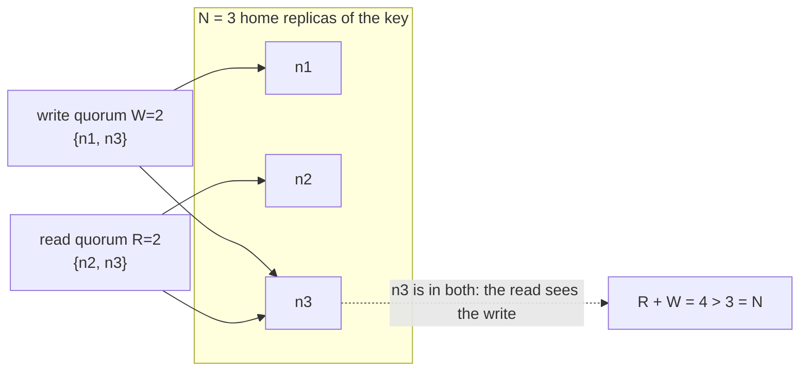

# Quorums: R + W > N and Its Limits

> Sloppy quorums, hinted handoff, and read repair.

**Type:** Build
**Languages:** Java, Python, Go
**Prerequisites:** Phase 6 Lesson 01 (Replication Strategies), Phase 6 Lesson 02 (Replication Lag and Read-Your-Writes), Phase 5 Lesson 05 (Consistency Models)
**Time:** ~75 minutes

## Learning Objectives

- State the quorum intersection argument (`R + W > N`) and prove in two lines why a strict read quorum always contains at least one replica from the last successful write quorum
- Build a leaderless key-value store with N home replicas per key, a configurable R and W, and a deterministic simulated network with crashes, partitions, and seeded drops
- Implement sloppy quorums with hinted handoff and show by test that they restore availability while breaking the intersection guarantee
- Implement read repair and anti-entropy and explain which replicas each one fixes and when
- Show that last-writer-wins resolves concurrent writes by discarding one of them with no error, and name the data (balances) for which that is unacceptable
- Choose R, W, and the sloppy/strict setting for a given workload and state what each choice costs in latency, availability, and staleness

## The Problem

A payments platform keeps merchant configuration (settlement currency, payout schedule, statement descriptor) in a Dynamo-style store with three replicas per key and a leaderless design, because it must stay writable when a data centre is unreachable and a leader election would take seconds the onboarding flow does not have. The store is configured `N=3, W=1, R=1`: writes return after one replica acknowledges, reads consult one replica. It is fast and it is available. A merchant changes their settlement currency from GBP to EUR at 14:02. The write lands on replica 1 and is forwarded asynchronously to replicas 2 and 3; replica 3 is unreachable for twelve seconds during a deploy and misses it. At 14:03 the settlement job reads the merchant's currency through a coordinator that happens to consult replica 3, gets GBP, and settles 48,000 EUR of sales in GBP at the day's rate. The merchant's bank account receives the wrong currency, the FX desk eats the spread twice, and the operations team spends two days on a reversal that the merchant's bank charges for.

Every replica was healthy at 14:03. There was no partition, no crash, no lost message at the moment of the read. The write had simply not reached the replica the read happened to ask. `W=1, R=1` on three replicas means the write set and the read set are each one node and can be any node, so they overlap only by luck. The fix that everyone knows is `W=2, R=2`: any two nodes out of three share at least one, so a read must see the write. That rule, `R + W > N`, is the heart of this lesson, and it is correct exactly as stated.

The second half of the lesson is about the words "exactly as stated". The same store in production runs *sloppy* quorums, because a strict `W=2` write fails when two of the three home replicas are unreachable, and failing writes during a partition is the thing the leaderless design was bought to avoid. A sloppy quorum lets the write land on any two reachable nodes, including nodes that are not the key's home replicas, with a *hint* to deliver the value later. The write returns success with `W=2` acks. `R + W > N` is satisfied on paper. And a strict read of the two home replicas that just came back can miss it entirely. The guarantee was never about the numbers; it was about the two sets being drawn from the same fixed set of N nodes. This lesson builds the store, the proof, the hole, and the three repair mechanisms (hinted handoff, read repair, anti-entropy) that production systems use to close it.

## The Concept

### The intersection argument

Fix a key with N home replicas. A write succeeds when W of them acknowledge; a read succeeds when R of them respond, and returns the newest version among the responses. Claim: if `R + W > N` and both quorums are drawn from the same N nodes, every successful read sees every successful earlier write.

Proof. The write quorum is a set of size W out of N. The read quorum is a set of size R out of the same N. Two subsets of an N-element set with sizes R and W have an intersection of at least `R + W - N` elements. If `R + W > N`, that is at least 1. So at least one node in the read quorum holds the write, and because the read returns the newest version among its responses, the write (or something newer) is what the read returns.

The proof uses two facts beyond the arithmetic. First, "the same N nodes": the sets overlap because they are drawn from one fixed population. Second, "newest version": the replicas must agree on which of two versions is newer, which is why every value carries a version. Break either and the arithmetic proves nothing.



### The configuration space

| N / R / W | R+W>N | Write latency and availability | Read latency and availability | Staleness | Used for |
|-----------|-------|-------------------------------|-------------------------------|-----------|----------|
| 3 / 1 / 1 | no | one ack: fastest, survives two failures | one response: fastest | reads miss recent writes whenever the asked replica lagged | caches, counters that tolerate loss |
| 3 / 1 / 3 | yes | all three must ack: fails if any replica is down | one response | none while writes succeed | read-heavy, rarely written, tolerates write unavailability |
| 3 / 2 / 2 | yes | majority; survives one failure | majority; survives one failure | none under strict quorums | the default for data that must not go backwards |
| 3 / 3 / 1 | yes | one ack: available | all three must respond: fails if any replica is down | none while reads succeed | write-heavy with rare, careful reads |
| 5 / 3 / 3 | yes | survives two failures per operation | survives two failures | none | configuration stores, metadata |

The `main` program runs each of the first four under crashes and 5% message drops and prints the stale-read count: zero for every row with `R + W > N` under strict quorums, over a thousand for `1/1`. It also prints the price: `1/3` fails 65% of writes under the same failures and `3/1` fails 65% of reads. Availability and overlap are what you trade against each other; there is no row with both.

### Choosing N, and what a "node" is

N is the number of copies, and it is bounded below by the failures you must survive and above by write cost. With `N=3` and majority quorums you survive one replica being down per operation; with `N=5`, two. Going from 3 to 5 costs two more writes per update and buys the ability to lose a node *while another is being replaced*, which is the case that takes down `N=3` clusters: a disk fails, the replacement is streaming data for an hour, and a second node reboots.

The replicas must also be in different failure domains, or N is a lie. Three replicas in one rack share a switch; three in one availability zone share a power feed; three in one region share a regulator. Cassandra's `NetworkTopologyStrategy` places replicas across racks and data centres for exactly this reason, and `LOCAL_QUORUM` exists because a quorum that spans regions pays a cross-region round trip on every operation. The simulation treats nodes as independent, which is the assumption every quorum argument makes and the one a reviewer should question first.

A last point about counting: `R + W > N` counts *replicas of this key*, not nodes in the cluster. The experiment runs on five nodes with `N=3`; the two nodes outside a key's home set contribute nothing to that key's quorums unless the quorum is sloppy, which is where the trouble starts.

### Versions without version vectors

Each stored value carries a version `(timestamp, writerId)`. Comparison is lexicographic: later timestamp wins; equal timestamps are broken by writer id, so two writes at the same tick still have exactly one winner on every replica. This is last-writer-wins (LWW), and it is the model Cassandra and Riak's default use.

Its property is convergence: given the same set of versions, every replica picks the same winner, so anti-entropy and read repair cannot fight. Its defect is that it does not know what "concurrent" means. Two coordinators that both read balance `100.00 USD`, one applying a `30.00 USD` debit and the other a `50.00 USD` credit, write `70.00` and `150.00` with timestamps one tick apart. Both writes reach `W=2` replicas. Both clients receive success. The store converges to `150.00 USD` on every replica and the debit never happened, and nothing anywhere recorded an error. Version vectors (Lesson 09) detect the concurrency and keep both siblings for the application to merge; CRDTs (Lesson 08) make the merge automatic for counters; a ledger (Phase 10) makes the balance a derived value of an append-only history so there is nothing to overwrite. LWW is correct only for data where the latest value is the whole truth: a settlement currency, a feature flag, a session's last-seen time.

### Sloppy quorums and hinted handoff

In a strict quorum the W acks must come from the key's N home replicas. In a sloppy quorum (Dynamo, section 4.6) the coordinator walks the ring past the home replicas and accepts acks from the next healthy nodes, each of which stores the value together with a *hint*: "this belongs to node 2; deliver it when node 2 is back." The write succeeds with W acks. The hole is immediate: the acks are from nodes outside the fixed population the intersection proof assumed. A strict-looking read of R home replicas, after the absent nodes return, can find zero of them holding the value.

Hinted handoff closes the hole eventually: when the absent node is reachable again, every node holding a hint for it delivers the value. Until that moment (seconds normally, hours if the holder of the hint itself fails) the read can be stale. Dynamo's designers accepted this because they were storing shopping carts, where an "always writeable" store that occasionally surfaces an older cart beats a store that rejects "add to cart" during a failure. For a settlement currency the trade is the other way, and the lesson's point is that `R + W > N` is not the knob that decides; the sloppy flag is.

### Read repair and anti-entropy

Replicas diverge whenever a write misses one of them. Three mechanisms converge them again:

| Mechanism | Trigger | Fixes | Cost | Misses |
|-----------|---------|-------|------|--------|
| Hinted handoff | an absent node becomes reachable | the specific values it missed while away | one write per hint | values whose hint holder died |
| Read repair | a quorum read observes responders with different versions | the stale responders of a key that is being read | one write per stale responder | keys nobody reads; replicas not in the read set |
| Anti-entropy | a background schedule | every key on every replica | full comparison, cut down by Merkle trees so agreeing ranges cost one hash exchange | nothing, eventually |

One subtlety ties the three together: all of them rely on `put` being "store if newer". A hint delivered after a fresher write has already landed must lose; a read repair that races a concurrent write must not resurrect the older value; anti-entropy run twice must do nothing the second time. The version comparison is what makes every repair idempotent and safe to retry, which is why the version is stored with the value and not computed at read time.

Read repair is the cheap, opportunistic one and it makes a hot key converge within one read of a divergence. Anti-entropy is the complete one and it is what makes "eventually" true for cold keys. Cassandra runs both; `nodetool repair` is anti-entropy and `read_repair_chance` was the per-read probability of repairing replicas outside the read set until it was removed in favour of always repairing the responders.

### Worked example, by hand

Five nodes, key `merchant:m-77:settlement-currency` with home replicas `[1, 2, 3]` and fallback ring `[4, 0]`. `N=3, R=2, W=2`, sloppy, no drops.

| Step | Action | n1 | n2 | n3 | n4 | n0 | Acks | Result |
|------|--------|----|----|----|----|----|------|--------|
| 1 | n2 and n3 crash | EUR? no: nothing yet | down | down | | | | |
| 2 | `PUT EUR` via n1 | EUR@1 | down | down | EUR@1 + hint for n2 | EUR@1 + hint for n3 | 3 | success, W=2 met |
| 3 | n2, n3 recover; n1 crashes | down | none | none | EUR@1 (hint) | EUR@1 (hint) | | |
| 4 | `GET` via n2, R=2: asks n2, n3 | | none | none | | | 2 | returns `<none>`: stale |
| 5 | hinted handoff runs | down | EUR@1 | EUR@1 | hint cleared | hint cleared | | 2 values delivered |
| 6 | same `GET` | | EUR@1 | EUR@1 | | | 2 | returns EUR |

Step 4 is the limit the title promises: `R + W = 4 > 3` and the read is wrong, because the write's acks in step 2 came from `{n1, n4, n0}` and the read's responses came from `{n2, n3}`, two sets that are both of size at least 2 but are not drawn from the same three nodes. Under a strict quorum, step 2 would have thrown `QuorumNotReached` with one ack, the client would have retried or failed, and step 4 could not have happened.

### Complexity and cost

A write costs one round trip to up to N (sloppy: more) replicas, in parallel in a real system, sequential in this simulation; it succeeds after W acks and the coordinator keeps sending the remaining replicas their copy in the background. A read costs one round trip to R replicas (Dynamo and Cassandra send to all N and wait for R, which is faster at the tail and more expensive in bandwidth). Latency is therefore the W-th or R-th fastest replica, not the slowest, which is why `R=2` on three replicas is such a popular default: one slow or dead node never shows up in the latency.

The storage overhead is one version per value (16 bytes here). Hints add storage on the fallback nodes proportional to how long the absent node is away. Read repair adds one write per stale responder on the read path. Anti-entropy is linear in the number of keys per replica pair without Merkle trees and logarithmic in the differences with them.

### What quorums do not do

- They do not give you a consensus. Two concurrent writes both succeed and LWW picks one; nobody agreed on anything. Lessons 04 to 07 are what agreement costs.
- They do not give read-your-writes across clients. The intersection argument is between one write and one later read of the same key with strict quorums; it says nothing about two keys or about a write whose quorum failed but still landed on some replicas (the simulation shows such a value being returned by a later read as "newer").
- They do not make LWW safe for money. A balance in a quorum store is a lost-update bug waiting for a slow network. Store the postings, not the balance (Phase 10).
- They do not survive a node answering with a *wrong* version rather than a stale one. Byzantine faults need `3f + 1` and a different protocol (Lesson 11).

## Build It

### Step 1: Versions and the LWW rule

```java
record Versioned(String value, long timestamp, int writerId) {
    static final Versioned NONE = new Versioned(null, -1, -1);

    boolean newerThan(Versioned other) {
        return timestamp > other.timestamp || (timestamp == other.timestamp && writerId > other.writerId);
    }
}
```

The version is the whole conflict-resolution policy in one method. `NONE` is older than everything, so a replica that has never seen the key loses to any replica that has. The tie-break on `writerId` is what makes the rule total: without it, two replicas holding versions with equal timestamps could each consider their own the winner, and anti-entropy would ping-pong forever.

**Predict:** `new Versioned("b", 2, 3).newerThan(new Versioned("a", 2, 1))` is true. What does that say about which coordinator's write survives when two coordinators write at the same tick?

### Step 2: A storage node with hints

```java
final class StorageNode {
    final int id;
    final Map<String, Versioned> data = new TreeMap<>();
    final Map<Integer, Map<String, Versioned>> hints = new TreeMap<>();

    boolean put(String key, Versioned v) {
        writesAccepted++;
        Versioned current = data.getOrDefault(key, Versioned.NONE);
        if (v.newerThan(current)) { data.put(key, v); return true; }
        return false;
    }

    Versioned get(String key) { readsServed++; return data.getOrDefault(key, Versioned.NONE); }

    void storeHint(int forNode, String key, Versioned v) {
        Map<String, Versioned> forTarget = hints.computeIfAbsent(forNode, k -> new TreeMap<>());
        Versioned existing = forTarget.getOrDefault(key, Versioned.NONE);
        if (v.newerThan(existing)) forTarget.put(key, v);
    }
}
```

`put` is "store if newer" and returns whether anything changed. That one property makes every repair mechanism safe to run repeatedly: a hint delivered twice, a read repair racing a fresh write, or anti-entropy over an already-converged key are all no-ops. Hints are keyed by the node they are meant for, which is how `handoff` finds them when that node returns.

### Step 3: The network as a predicate

```java
final class Network {
    boolean reachable(int from, int to) {
        attempts++;
        if (down.contains(to) || (partitioned && sideA.contains(from) != sideA.contains(to))) { dropped++; return false; }
        if (dropRate > 0 && rng.nextDouble() < dropRate) { dropped++; return false; }
        return true;
    }
}
```

Lesson 05's network queues messages with delays because Raft's correctness depends on message ordering. Quorum protocols are request-response, so the network here is a predicate: can this coordinator reach that node right now? Crashes, a partition, and a seeded drop rate are the three failure sources. Because the only randomness comes from `rng`, and `rng` is consumed in a fixed order, a seed reproduces every miss.

**Predict:** with `dropRate = 0.05` and `N = 3`, roughly what fraction of strict `W=3` writes fail with no nodes down?

### Step 4: Placement

```java
List<Integer> homeNodes(String key) {
    int start = Math.floorMod(key.hashCode(), nodes.size());
    List<Integer> home = new ArrayList<>();
    for (int i = 0; i < config.n(); i++) home.add((start + i) % nodes.size());
    return home;
}

List<Integer> contactOrder(int coordinator, String key) {
    List<Integer> order = new ArrayList<>(homeNodes(key));
    int at = order.indexOf(coordinator);
    if (at > 0) Collections.rotate(order, -at);
    if (config.sloppy()) order.addAll(fallbackNodes(key));
    return order;
}
```

Each key's N home replicas are N consecutive positions on a ring starting at the key's hash, which is the consistent-hashing layout from Phase 3 reduced to its essentials. `contactOrder` puts the coordinator's own copy first when it is a home node (a real coordinator reads its local disk before the network) and, under sloppy quorums, appends the rest of the ring so a read can find a hinted copy. Placement is a pure function of the key, which is what lets any node coordinate any request without a directory lookup.

### Step 5: The write path

```java
int put(int coordinator, String key, String value) {
    clock++;
    Versioned v = new Versioned(value, clock, coordinator);
    int acks = 0;
    List<Integer> missed = new ArrayList<>();
    for (int node : homeNodes(key)) {
        if (node == coordinator || network.reachable(coordinator, node)) { nodes.get(node).put(key, v); acks++; }
        else missed.add(node);
    }
    if (config.sloppy() && !missed.isEmpty()) {
        List<Integer> spare = fallbackNodes(key);
        int si = 0;
        for (int absent : missed) {
            while (si < spare.size()) {
                int candidate = spare.get(si++);
                if (candidate == coordinator || network.reachable(coordinator, candidate)) {
                    nodes.get(candidate).put(key, v);
                    nodes.get(candidate).storeHint(absent, key, v);
                    acks++;
                    break;
                }
            }
        }
    }
    if (acks < config.w()) throw new QuorumNotReached("write " + key + " got " + acks + " acks, needs W=" + config.w());
    return acks;
}
```

Every reachable home replica gets the value, not just W of them: W is the success threshold, not a limit. The sloppy branch replaces each missed home replica with the next reachable ring node and stores a hint there. The failure path is the one to look at: if fewer than W acks arrive the write throws, but the replicas that did accept it keep the value. There is no rollback in a leaderless store, and a later read may return that "failed" value because it is newer. This is the behaviour Dynamo documents and the one most clients forget: a timeout is not a "no", it is a "maybe".

**Predict:** with `N=3`, `W=2`, strict, and two home nodes down, how many acks does the write get and what happens?

### Step 6: The read path and read repair

```java
ReadResult get(int coordinator, String key) {
    Versioned winner = Versioned.NONE;
    List<Integer> respondents = new ArrayList<>();
    Map<Integer, Versioned> seen = new HashMap<>();
    for (int node : contactOrder(coordinator, key)) {
        if (respondents.size() >= config.r()) break;
        if (node == coordinator || network.reachable(coordinator, node)) {
            Versioned v = nodes.get(node).get(key);
            respondents.add(node);
            seen.put(node, v);
            if (v.newerThan(winner)) winner = v;
        }
    }
    if (respondents.size() < config.r()) throw new QuorumNotReached("read " + key + " got " + respondents.size() + " responses, needs R=" + config.r());
    int repaired = 0;
    if (config.readRepair() && winner.value() != null) {
        for (int node : respondents) {
            if (winner.newerThan(seen.get(node)) && nodes.get(node).put(key, winner)) repaired++;
        }
    }
    return new ReadResult(winner, respondents.size(), respondents, repaired);
}
```

The read stops at R responses and takes the newest. Read repair then pushes the winner to every responder that returned something older. Only responders are repaired; a replica that did not answer is left for handoff or anti-entropy. `ReadResult` carries the respondents so the tests can assert *which* nodes formed the quorum, which is what the intersection argument is about.

**Predict:** in the sloppy example, step 4 reads `{n2, n3}` and gets `<none>`. Does read repair do anything, and why not?

### Step 7: Handoff and anti-entropy

```java
int handoff() {
    int delivered = 0;
    for (StorageNode holder : nodes) {
        for (Map.Entry<Integer, Map<String, Versioned>> e : new ArrayList<>(holder.hints.entrySet())) {
            int target = e.getKey();
            if (!network.reachable(holder.id, target)) continue;
            for (Map.Entry<String, Versioned> kv : e.getValue().entrySet()) { nodes.get(target).put(kv.getKey(), kv.getValue()); delivered++; }
            holder.hints.remove(target);
        }
    }
    return delivered;
}

int antiEntropy() {
    int updates = 0;
    Set<String> keys = new HashSet<>();
    for (StorageNode n : nodes) keys.addAll(n.data.keySet());
    for (String key : keys) {
        Versioned newest = Versioned.NONE;
        for (int node : homeNodes(key)) if (!network.isDown(node)) { Versioned v = nodes.get(node).data.getOrDefault(key, Versioned.NONE); if (v.newerThan(newest)) newest = v; }
        if (newest.value() == null) continue;
        for (int node : homeNodes(key)) if (!network.isDown(node) && nodes.get(node).put(key, newest)) updates++;
    }
    return updates;
}
```

Handoff delivers each hint to its target once the target is reachable and then forgets the hint. Anti-entropy visits every key and converges the live home replicas to the newest version; because `put` is store-if-newer, running it twice updates nothing the second time, and the test asserts that. Production systems replace the "visit every key" loop with a Merkle-tree exchange per key range so that two replicas that already agree on a range confirm it with one hash.

### Step 8: Run it

```bash
cd phases/06-replication-and-consensus/03-quorums/code/java
javac -d .out *.java && java -cp .out Main
java -cp .out MainTest
```

Expected output, abbreviated:

```console
== R + W > N: a strict quorum read always overlaps the last quorum write (N=3, R=2, W=2, node 1 crashed) ==
home replicas of merchant:m-77:settlement-currency: [1, 2, 3]; fallback ring: [4, 0]
t=1 PUT merchant:m-77:settlement-currency=EUR via n1 acked by [1, 3] (missed [2])
read from a different coordinator with R=2 saw EUR@1/w1 from [3, 1]  (replicas: n1=EUR@1/w1 n2=<none>(down) n3=EUR@1/w1)

== R + W <= N: the quorums can miss each other (N=3, R=1, W=1), one node briefly unreachable ==
R=1 reads via n1, n2, n3 return: GBP, GBP, EUR  <- every node is healthy and one of them is wrong

== Sloppy quorum: the write reaches W nodes, but not the home set, so a later strict-looking read can miss it ==
t=1 PUT merchant:m-77:settlement-currency=EUR via n1 acked by [1, 4, 0] (missed [2, 3])
home nodes 2,3 recover, node 1 crashes; R=2 read sees <none> from [2, 3]  <- R + W > N held and the read is still stale
hinted handoff delivers 2 value(s); the same read now sees EUR@1/w1

== Last-writer-wins: two concurrent writers, one of them silently loses, and why a balance must never be a register ==
coordinator A reads 100.00 USD, coordinator B reads 100.00 USD; A applies a 30.00 USD debit, B applies a 50.00 USD credit
A's write lands with 3 acks: n2=70.00 USD@2/w1 n3=70.00 USD@2/w1 n4=70.00 USD@2/w1
B's write lands with 3 acks one tick later and both clients receive success: n2=150.00 USD@3/w3 ...
the 30.00 USD debit vanished with no error anywhere: LWW chose by timestamp, not by meaning.

== 20 seeds x 400 write-then-read pairs, 5 nodes, 5% drops, a crash or recovery every 25 ops: stale reads by configuration ==
config                                stale  writeFail   readFail  hinted  repair
N=3 R=1 W=1 strict                     1404         32         34       0       0
N=3 R=1 W=3 strict                        0       5324          2       0       0
N=3 R=2 W=2 strict                        0       1096        557       0       0
N=3 R=2 W=2 strict read-repair            0       1096        557       0     984
N=3 R=2 W=2 sloppy                       55          8          9    6107       0
N=3 R=3 W=1 strict                        0         26       5206       0       0
```

Read the table as the three-way trade. `1/1` fails almost nothing and is wrong 1,404 times. `2/2` strict is never wrong and fails 1,096 writes and 557 reads out of 8,000 each. `2/2` sloppy fails 8 writes and is wrong 55 times. The `hinted` column, 6,107, is how much of the sloppy store's availability came from writing to the wrong nodes. Nothing in the table changes if you add read repair except that the stale replicas are fixed faster; read repair cannot make a read see a value that no responder holds.

### In Python

The Python port (`code/python/main.py`) is the same design with four differences. **Placement needs Java's `String.hashCode`:** Python's `hash()` is salted per process, so it cannot place keys at all; `java_string_hash` reproduces the 32-bit wrapping `31*h + c` over UTF-16 code units and returns it signed, and `home_nodes` then uses `%`, which with a positive divisor is exactly `Math.floorMod`. The test suite pins three known Java hash values, including one that lands on `Integer.MIN_VALUE`. **`Versioned` is a frozen dataclass** whose `newer_than` compares the tuples `(timestamp, writer_id)`, the same lexicographic rule; being frozen it is hashable, so `replicas_agree` can put versions in a `set` like the Java `HashSet`. **Map order is made explicit:** Java's `TreeMap` iterates hints and keys in sorted order while Python dicts iterate in insertion order, so `handoff` and `anti_entropy` call `sorted(...)` where the Java relies on the tree. SplitMix64 is masked to 64 bits after every step, and with that the experiment table matches the Java numbers exactly. **Errors** are `QuorumNotReached(Exception)` and `ValueError` for bad configs. A real coordinator would issue the N requests concurrently with `asyncio` and wait for the first W or R by hand; that changes latency, not the intersection argument.

Run it from `code/python/` with `python3 main.py`; test with `python3 -m unittest -v`.

#### Step 1: Versions and the LWW rule

`Versioned` is a frozen dataclass with an `Optional[str]` value, and the module-level `NONE` plays the role of `Versioned.NONE`. `newer_than` is a single tuple comparison: Python compares `(timestamp, writer_id)` lexicographically, which is the same `timestamp > ... or (equal and writer_id > ...)` rule written in one line, and the `writer_id` tie-break still makes it total.

```python
@dataclass(frozen=True)
class Versioned:
    value: Optional[str]
    timestamp: int
    writer_id: int

    def newer_than(self, other: "Versioned") -> bool:
        return (self.timestamp, self.writer_id) > (other.timestamp, other.writer_id)

    def __str__(self) -> str:
        return "<none>" if self.value is None else f"{self.value}@{self.timestamp}/w{self.writer_id}"


NONE = Versioned(None, -1, -1)
```

#### Step 2: A storage node with hints

`put` is store-if-newer with `dict.get(key, NONE)` standing in for `getOrDefault`, and returns whether the stored version changed. `store_hint` uses `setdefault` where the Java uses `computeIfAbsent`, so the per-target hint map is created on first use; the hint is also kept only if newer, which makes delivering it twice harmless.

```python
    def put(self, key: str, v: Versioned) -> bool:
        self.writes_accepted += 1
        current = self.data.get(key, NONE)
        if v.newer_than(current):
            self.data[key] = v
            return True
        return False

    def get(self, key: str) -> Versioned:
        self.reads_served += 1
        return self.data.get(key, NONE)

    def store_hint(self, for_node: int, key: str, v: Versioned) -> None:
        self.hints_stored += 1
        for_target = self.hints.setdefault(for_node, {})
        if v.newer_than(for_target.get(key, NONE)):
            for_target[key] = v
```

#### Step 3: The network as a predicate

`reachable` is the same three checks in the same order: crashed target or cut partition first (no RNG consumed), then the seeded drop. The parameter is `from_` because `from` is a Python keyword. `next_double` builds the `[0, 1)` value from the top 53 bits the way `java.util.Random`-style generators do, so the drop decisions line up with the Java run.

```python
    def reachable(self, from_: int, to: int) -> bool:
        self.attempts += 1
        if to in self._down or (self._partitioned and ((from_ in self._side_a) != (to in self._side_a))):
            self.dropped += 1
            return False
        if self._drop_rate > 0 and self._rng.next_double() < self._drop_rate:
            self.dropped += 1
            return False
        return True
```

#### Step 4: Placement

`home_nodes` is a list comprehension over N ring positions starting at `java_string_hash(key) % len(self.nodes)`. `contact_order` rotates with slicing (`order[at:] + order[:at]` is `Collections.rotate(order, -at)`) and, under sloppy quorums, extends with `fallback_nodes`, which continues the same ring from position N to the end.

```python
    def home_nodes(self, key: str) -> list[int]:
        start = java_string_hash(key) % len(self.nodes)   # Python % with a positive divisor is Math.floorMod
        return [(start + i) % len(self.nodes) for i in range(self.config.n)]

    def contact_order(self, coordinator: int, key: str) -> list[int]:
        order = self.home_nodes(key)
        if coordinator in order:
            at = order.index(coordinator)
            order = order[at:] + order[:at]   # Collections.rotate(order, -at)
        if self.config.sloppy:
            order.extend(self.fallback_nodes(key))
        return order

    def fallback_nodes(self, key: str) -> list[int]:
        start = java_string_hash(key) % len(self.nodes)
        return [(start + i) % len(self.nodes) for i in range(self.config.n, len(self.nodes))]
```

#### Step 5: The write path

The write path is the Java loop with one addition: the port keeps an `acked` list alongside the count so the event log can print who accepted the value. The sloppy branch walks the spare ring with an index that is never reset, so each missed home node takes the next untried fallback. Fewer than W acks raises `QuorumNotReached`, and nothing already stored is undone. (The `self.events.append` lines that feed the demo's event log are omitted here.)

```python
    def put(self, coordinator: int, key: str, value: str) -> int:
        self.writes += 1
        self._clock += 1
        v = Versioned(value, self._clock, coordinator)
        acks = 0
        acked: list[int] = []
        missed: list[int] = []
        for node in self.home_nodes(key):
            if node == coordinator or self.network.reachable(coordinator, node):
                self.nodes[node].put(key, v)
                acks += 1
                acked.append(node)
            else:
                missed.append(node)
        if self.config.sloppy and missed:
            spare = self.fallback_nodes(key)
            si = 0
            for absent in missed:
                while si < len(spare):
                    candidate = spare[si]
                    si += 1
                    if candidate == coordinator or self.network.reachable(coordinator, candidate):
                        self.nodes[candidate].put(key, v)
                        self.nodes[candidate].store_hint(absent, key, v)
                        self.hinted_writes += 1
                        acks += 1
                        acked.append(candidate)
                        break
        if acks < self.config.w:
            self.write_failures += 1
            raise QuorumNotReached(f"write {key} got {acks} acks, needs W={self.config.w}")
        return acks
```

#### Step 6: The read path and read repair

`get` stops at R responders and keeps the newest version in `winner`. Read repair is gated on `winner.value is not None`, the Python spelling of the Java null check, and pushes the winner only to responders whose `seen` version is older; `put` returning `False` means the replica already had it, so nothing is counted.

```python
    def get(self, coordinator: int, key: str) -> ReadResult:
        self.reads += 1
        winner = NONE
        respondents: list[int] = []
        seen: dict[int, Versioned] = {}
        for node in self.contact_order(coordinator, key):
            if len(respondents) >= self.config.r:
                break
            if node == coordinator or self.network.reachable(coordinator, node):
                v = self.nodes[node].get(key)
                respondents.append(node)
                seen[node] = v
                if v.newer_than(winner):
                    winner = v
        if len(respondents) < self.config.r:
            self.read_failures += 1
            raise QuorumNotReached(f"read {key} got {len(respondents)} responses, needs R={self.config.r}")
        repaired = 0
        if self.config.read_repair and winner.value is not None:
            for node in respondents:
                if winner.newer_than(seen[node]) and self.nodes[node].put(key, winner):
                    self.nodes[node].repairs_applied += 1
                    repaired += 1
            self.repairs += repaired
        return ReadResult(winner, len(respondents), respondents, repaired)
```

#### Step 7: Handoff and anti-entropy

Both loops iterate `sorted(...)` views of their dicts so they consume the network RNG in the order the Java `TreeMap` would. `handoff` deletes the whole per-target hint map after delivery; `anti_entropy` builds the union of every node's keys with `set.update`, finds the newest live version per key, skips keys nobody holds, and relies on store-if-newer to make a second pass a no-op. The event-log appends are omitted from both chunks.

```python
    def handoff(self) -> int:
        delivered = 0
        for holder in self.nodes:
            for target in sorted(holder.hints):   # TreeMap order
                if not self.network.reachable(holder.id, target):
                    continue
                values = holder.hints[target]
                for k in sorted(values):
                    self.nodes[target].put(k, values[k])
                    delivered += 1
                holder.hints_delivered += len(values)
                del holder.hints[target]
        return delivered

    def anti_entropy(self) -> int:
        updates = 0
        keys: set[str] = set()
        for n in self.nodes:
            keys.update(n.data)
        for key in sorted(keys):
            home = self.home_nodes(key)
            newest = NONE
            for node in home:
                if not self.network.is_down(node):
                    v = self.nodes[node].data.get(key, NONE)
                    if v.newer_than(newest):
                        newest = v
            if newest.value is None:
                continue
            for node in home:
                if not self.network.is_down(node) and self.nodes[node].put(key, newest):
                    updates += 1
        return updates
```

#### Step 8: Run it

```bash
cd phases/06-replication-and-consensus/03-quorums/code/python
python3 main.py
python3 -m unittest -v
```

With the Java hash and the masked RNG in place, the output matches the Java run line for line, including the experiment table:

```console
== R + W > N: a strict quorum read always overlaps the last quorum write (N=3, R=2, W=2, node 1 crashed) ==
home replicas of merchant:m-77:settlement-currency: [1, 2, 3]; fallback ring: [4, 0]
t=1 PUT merchant:m-77:settlement-currency=EUR via n1 acked by [1, 3] (missed [2])
read from a different coordinator with R=2 saw EUR@1/w1 from [3, 1]  (replicas: n1=EUR@1/w1 n2=<none>(down) n3=EUR@1/w1)
```

### In Go

The Go port (`code/go/main.go`) keeps the design and changes four things. **Placement needs Java's `String.hashCode`:** Go has no object hash, so `JavaStringHash` runs `31*h + c` over UTF-16 code units on an `int32`, which wraps exactly like Java's `int`, and `floorMod` does what `Math.floorMod` does because Go's `%` keeps the sign of the dividend; the test pins the same three known values as the Python port, including the one that lands on `math.MinInt32`. **Errors are values:** `Put` returns `(acks, error)` and `Get` returns `(ReadResult, error)`, both wrapping the sentinel `ErrQuorumNotReached` that tests check with `errors.Is`; `NewQuorumConfig` and `NewQuorumStore` return `ErrBadConfig`, and `MustConfig`/`MustStore` panic on it and exist only so the demo can pass literals. `Experiment.run` is `RunExperiment`, and a failed write is `if _, err := store.Put(...); err != nil { continue }`. **Absence is a flag, not `null`:** `None` is a `Versioned` with timestamp -1 and `IsNone()`, and `ReadResult.Value()` returns `(string, bool)`; `Versioned` is a comparable struct, so `ReplicasAgree` can use it as a `map` key the way the Java uses a `HashSet`. **Map order is made explicit:** `Handoff` sorts hint targets and keys before delivering, because the Java `TreeMap` iterates in order and `Network.Reachable` consumes the RNG in that order; `AntiEntropy` sorts the key set so the event log is stable. With that, the experiment table matches the Java numbers exactly.

Run it from `code/go/` with `go run .`; test with `go test ./...`.

#### Step 1: Versions and the LWW rule

`Versioned` is a comparable struct. There is no nullable string, so the absent version `None` is marked by a negative timestamp and `IsNone()` is the Go spelling of `value == null`. `NewerThan` is the Java expression unchanged, and `String()` prints `<none>` for the absent case.

```go
type Versioned struct {
	Value     string
	Timestamp int64
	WriterID  int
}

var None = Versioned{"", -1, -1}

func (v Versioned) IsNone() bool { return v.Timestamp < 0 }

func (v Versioned) NewerThan(other Versioned) bool {
	return v.Timestamp > other.Timestamp || (v.Timestamp == other.Timestamp && v.WriterID > other.WriterID)
}
```

#### Step 2: A storage node with hints

Go maps return the zero value for a missing key, and the zero `Versioned` has timestamp 0, which would wrongly beat `None`; the unexported `current` helper does the `getOrDefault(key, NONE)` lookup correctly, and `Put` and `Get` go through it. `StoreHint` creates the per-target map on first use (the `computeIfAbsent` idiom spelled out) and keeps a hint only if newer.

```go
func (n *StorageNode) current(key string) Versioned {
	if v, ok := n.Data[key]; ok {
		return v
	}
	return None
}

func (n *StorageNode) Put(key string, v Versioned) bool {
	n.WritesAccepted++
	if v.NewerThan(n.current(key)) {
		n.Data[key] = v
		return true
	}
	return false
}

func (n *StorageNode) Get(key string) Versioned {
	n.ReadsServed++
	return n.current(key)
}

func (n *StorageNode) StoreHint(forNode int, key string, v Versioned) {
	n.HintsStored++
	forTarget, ok := n.Hints[forNode]
	if !ok {
		forTarget = map[string]Versioned{}
		n.Hints[forNode] = forTarget
	}
	existing, ok := forTarget[key]
	if !ok {
		existing = None
	}
	if v.NewerThan(existing) {
		forTarget[key] = v
	}
}
```

#### Step 3: The network as a predicate

`down` and `sideA` are `map[int]bool`, so a missing entry reads as `false` and the partition test is a direct comparison of two lookups. The drop decision consumes `NextDouble`, which scales the top 53 bits of the SplitMix64 output, only after the deterministic checks, so the RNG stream stays aligned with the Java run.

```go
func (n *Network) Reachable(from, to int) bool {
	n.Attempts++
	if n.down[to] || (n.partitioned && n.sideA[from] != n.sideA[to]) {
		n.Dropped++
		return false
	}
	if n.dropRate > 0 && n.rng.NextDouble() < n.dropRate {
		n.Dropped++
		return false
	}
	return true
}
```

#### Step 4: Placement

`HomeNodes` starts at `floorMod(JavaStringHash(key), len(s.Nodes))` and appends N consecutive ring positions. `ContactOrder` has to find the coordinator's index with a loop because slices have no `indexOf`, then rotates by re-slicing (`append(order[at:], order[:at]...)`) and appends the fallback ring under sloppy quorums.

```go
func (s *QuorumStore) HomeNodes(key string) []int {
	start := floorMod(JavaStringHash(key), len(s.Nodes))
	home := make([]int, 0, s.Config.N)
	for i := 0; i < s.Config.N; i++ {
		home = append(home, (start+i)%len(s.Nodes))
	}
	return home
}

func (s *QuorumStore) ContactOrder(coordinator int, key string) []int {
	order := s.HomeNodes(key)
	at := -1
	for i, n := range order {
		if n == coordinator {
			at = i
			break
		}
	}
	if at > 0 {
		order = append(order[at:], order[:at]...)
	}
	if s.Config.Sloppy {
		order = append(order, s.FallbackNodes(key)...)
	}
	return order
}
```

#### Step 5: The write path

The same loop as Java with the error returned instead of thrown: a write below W returns `acks` together with a wrapped `ErrQuorumNotReached`, so a caller can still see how close it got. The sloppy branch shares a single `si` cursor across all missed nodes, and every acceptance is recorded in `acked` for the event log (the `s.Events = append(...)` lines are omitted here).

```go
func (s *QuorumStore) Put(coordinator int, key, value string) (int, error) {
	s.Writes++
	s.clock++
	v := Versioned{value, s.clock, coordinator}
	acks := 0
	acked, missed := []int{}, []int{}
	for _, node := range s.HomeNodes(key) {
		if node == coordinator || s.Network.Reachable(coordinator, node) {
			s.Nodes[node].Put(key, v)
			acks++
			acked = append(acked, node)
		} else {
			missed = append(missed, node)
		}
	}
	if s.Config.Sloppy && len(missed) > 0 {
		spare := s.FallbackNodes(key)
		si := 0
		for _, absent := range missed {
			for si < len(spare) {
				candidate := spare[si]
				si++
				if candidate == coordinator || s.Network.Reachable(coordinator, candidate) {
					s.Nodes[candidate].Put(key, v)
					s.Nodes[candidate].StoreHint(absent, key, v)
					s.HintedWrites++
					acks++
					acked = append(acked, candidate)
					break
				}
			}
		}
	}
	if acks < s.Config.W {
		s.WriteFailures++
		return acks, fmt.Errorf("%w: write %s got %d acks, needs W=%d", ErrQuorumNotReached, key, acks, s.Config.W)
	}
	return acks, nil
}
```

#### Step 6: The read path and read repair

`Get` returns the zero `ReadResult` and a wrapped `ErrQuorumNotReached` when fewer than R nodes answer. Read repair is gated on `!winner.IsNone()` rather than a null check, and otherwise follows the Java exactly: only responders holding something older are written, and only a `Put` that changed something is counted.

```go
func (s *QuorumStore) Get(coordinator int, key string) (ReadResult, error) {
	s.Reads++
	winner := None
	respondents := []int{}
	seen := map[int]Versioned{}
	for _, node := range s.ContactOrder(coordinator, key) {
		if len(respondents) >= s.Config.R {
			break
		}
		if node == coordinator || s.Network.Reachable(coordinator, node) {
			v := s.Nodes[node].Get(key)
			respondents = append(respondents, node)
			seen[node] = v
			if v.NewerThan(winner) {
				winner = v
			}
		}
	}
	if len(respondents) < s.Config.R {
		s.ReadFailures++
		return ReadResult{}, fmt.Errorf("%w: read %s got %d responses, needs R=%d", ErrQuorumNotReached, key, len(respondents), s.Config.R)
	}
	repaired := 0
	if s.Config.ReadRepair && !winner.IsNone() {
		for _, node := range respondents {
			if winner.NewerThan(seen[node]) && s.Nodes[node].Put(key, winner) {
				s.Nodes[node].RepairsApplied++
				repaired++
			}
		}
		s.Repairs += repaired
	}
	return ReadResult{winner, len(respondents), respondents, repaired}, nil
}
```

#### Step 7: Handoff and anti-entropy

Go map iteration is randomised, so `Handoff` copies the hint targets into a slice and `sort.Ints` them, and sorts each target's keys with `sort.Strings`, before touching the network; that is what keeps the RNG consumption identical to the Java `TreeMap` walk. `AntiEntropy` collects the key union into a `map[string]bool`, sorts it, and converges the live home replicas through `current` and store-if-newer `Put`; the second chunk is its per-key loop, with the key-collection prologue and the event-log line left out.

```go
func (s *QuorumStore) Handoff() int {
	delivered := 0
	for _, holder := range s.Nodes {
		targets := make([]int, 0, len(holder.Hints))
		for target := range holder.Hints {
			targets = append(targets, target)
		}
		sort.Ints(targets) // Java iterates the TreeMap in key order; the RNG is consumed in that order
		for _, target := range targets {
			if !s.Network.Reachable(holder.ID, target) {
				continue
			}
			pending := holder.Hints[target]
			keys := make([]string, 0, len(pending))
			for k := range pending {
				keys = append(keys, k)
			}
			sort.Strings(keys)
			for _, k := range keys {
				s.Nodes[target].Put(k, pending[k])
				delivered++
			}
			holder.HintsDelivered += len(pending)
			delete(holder.Hints, target)
		}
	}
	return delivered
}
```

```go
	for _, key := range keys {
		home := s.HomeNodes(key)
		newest := None
		for _, node := range home {
			if !s.Network.IsDown(node) {
				if v := s.Nodes[node].current(key); v.NewerThan(newest) {
					newest = v
				}
			}
		}
		if newest.IsNone() {
			continue
		}
		for _, node := range home {
			if !s.Network.IsDown(node) && s.Nodes[node].Put(key, newest) {
				updates++
			}
		}
	}
```

#### Step 8: Run it

```bash
cd phases/06-replication-and-consensus/03-quorums/code/go
go run .
go test ./...
```

The `int32` hash and the `uint64` RNG reproduce the Java placement and drops, so the output is identical:

```console
== R + W > N: a strict quorum read always overlaps the last quorum write (N=3, R=2, W=2, node 1 crashed) ==
home replicas of merchant:m-77:settlement-currency: [1, 2, 3]; fallback ring: [4, 0]
t=1 PUT merchant:m-77:settlement-currency=EUR via n1 acked by [1, 3] (missed [2])
read from a different coordinator with R=2 saw EUR@1/w1 from [3, 1]  (replicas: n1=EUR@1/w1 n2=<none>(down) n3=EUR@1/w1)
```

## Use It

### Cassandra: tunable consistency per request

Cassandra exposes R and W as per-query consistency levels: `ONE`, `TWO`, `QUORUM` (`floor(N/2) + 1`), `LOCAL_QUORUM` (a quorum within the local data centre), `EACH_QUORUM`, `ALL`. `QUORUM` writes with `QUORUM` reads is this lesson's `2/2` on `N=3`. Cassandra always uses sloppy quorums with hinted handoff (`hinted_handoff_enabled`, `max_hint_window`), runs read repair on the responders of every digest mismatch, and relies on `nodetool repair` for anti-entropy, with the documentation warning that replicas unrepaired for longer than `gc_grace_seconds` can resurrect deleted data. The `LOCAL_QUORUM` level is the production answer to "I want `R + W > N` without a cross-region round trip": the quorum is per data centre and cross-region convergence is left to anti-entropy.

### Riak and Dynamo

Riak exposed `n_val`, `r`, `w`, plus `pr` and `pw` ("primary read/write"): the number of acks that must come from *home* replicas, which is the strict quorum of this lesson added back on top of the sloppy default. That knob exists because the sloppy hole is real and Riak's users hit it. Amazon's Dynamo paper is the primary source for sloppy quorums, hinted handoff, and Merkle-tree anti-entropy, and it is explicit that the design targets shopping carts where "always writeable" beats "always current".

### DynamoDB and the leaderless lie

DynamoDB (the service) is not Dynamo (the paper). It uses leader-based replication per partition with Paxos-style leader election; `ConsistentRead` reads from the leader and eventually-consistent reads are served from followers, which is Lesson 02's model, not this one. The name causes more wrong architecture diagrams than any other in the field.

### Payment systems

Leaderless quorum stores are a good fit in a payments platform for merchant and customer *configuration*, risk feature values, and session state: data where the latest value is the truth and a stale read costs a retry, not money. They are a poor fit for anything that is a sum: balances, limits, daily volume counters, and idempotency keys (Phase 5 Lesson 09), which need either a consensus log (Lesson 06), a ledger (Phase 10), or a CRDT counter (Lesson 08). The settlement-currency incident in The Problem is a configuration read that fed a money movement; the fix teams adopt is a strict `QUORUM` read (or a leader read) for the handful of configuration keys that are inputs to money, and `ONE` for everything else.

## Ship It

`outputs/design-doc-quorum-configuration.md` is a design-review template for choosing N, R, W, strict versus sloppy, and the repair schedule for a replicated store, with the questions a reviewer should ask about each data class. Fill it in per table or key family, not per cluster.

## Exercises

1. **Reinforce.** Add `pr` and `pw` (primary read and write counts, as in Riak) to `QuorumConfig`: a sloppy write must still get at least `pw` acks from home replicas, and a sloppy read at least `pr` responses from home replicas. Re-run the experiment with `N=3, R=2, W=2, pw=1, pr=2` and explain why the stale count is zero again while write availability is still better than strict.
2. **Apply.** Replace the full-scan `antiEntropy` with a Merkle-tree exchange: each node builds a hash tree over its keys for each of 8 fixed key ranges, two nodes compare root hashes, descend only into differing subtrees, and transfer only differing keys. Count the number of hash comparisons and key transfers for the "node 2 missed its share of 8 writes" scenario versus the full scan.
3. **Extend.** Make the balance in the LWW section safe without changing the store: model the wallet as a Phase 10 ledger whose postings are written under keys `wallet:w-9:posting:<id>` with LWW (each posting is written once, so LWW is harmless) and whose balance is computed by reading all postings with a strict quorum. Show that the concurrent debit and credit both survive, and then measure how many reads the balance costs after 1,000 postings and connect that to the PN-counter in Lesson 08.

## Key Terms

| Term | What people say | What it actually means |
|------|-----------------|------------------------|
| Quorum | "a majority" | Any set of replicas large enough that two such sets must intersect; a majority is the symmetric case `R = W = floor(N/2) + 1` |
| `R + W > N` | "quorum consistency" | A read quorum and a write quorum drawn from the same N nodes share at least one node, so the read sees the write; false as soon as either quorum is drawn from a wider set |
| Sloppy quorum | "write anywhere during a failure" | Accepting acks from nodes outside the key's home set so writes succeed during partitions; restores availability and breaks the intersection guarantee until handoff |
| Hinted handoff | "catch-up writes" | A non-home node stores a value plus the id of the home node that missed it and delivers it when that node is reachable again |
| Read repair | "fix on read" | After a quorum read, write the newest version back to the responders that returned older ones; fixes hot keys quickly, never touches non-responders |
| Anti-entropy | "repair job" | A background process that converges every replica of every key, usually by comparing Merkle trees so that agreeing ranges cost one hash |
| Last-writer-wins | "newest timestamp wins" | Resolving concurrent versions by discarding all but the one with the highest `(timestamp, writerId)`; converges, and silently loses one of every pair of concurrent updates |

## Further Reading

- [DeCandia et al., "Dynamo: Amazon's Highly Available Key-value Store" (SOSP 2007)](https://www.allthingsdistributed.com/files/amazon-dynamo-sosp2007.pdf) — sections 4.5 to 4.7 are the primary source for sloppy quorums, hinted handoff, and Merkle-tree anti-entropy, with the shopping-cart rationale stated plainly.
- [Gifford, "Weighted Voting for Replicated Data" (SOSP 1979)](https://dl.acm.org/doi/10.1145/800215.806583) — the original quorum intersection argument, with weights, from which `R + W > N` is the equal-weight special case.
- [Apache Cassandra documentation: Consistency levels](https://cassandra.apache.org/doc/latest/cassandra/architecture/dynamo.html) — the production vocabulary (`ONE`, `QUORUM`, `LOCAL_QUORUM`, `ALL`), hinted handoff settings, and the read-repair behaviour.
- [Apache Cassandra documentation: Repair](https://cassandra.apache.org/doc/latest/cassandra/operating/repair.html) — anti-entropy in production, Merkle trees, and why unrepaired replicas resurrect deletes after `gc_grace_seconds`.
- [Bailis, Venkataraman, Franklin, Hellerstein, Stoica, "Probabilistically Bounded Staleness for Practical Partial Quorums" (VLDB 2012)](https://www.vldb.org/pvldb/vol5/p776_peterbailis_vldb2012.pdf) — what `R + W <= N` actually buys you: a quantitative model of how stale partial quorums are in practice.
- [Kingsbury, Jepsen analyses of Cassandra and Riak](https://jepsen.io/analyses) — recorded histories showing lost updates under LWW and the conditions under which sloppy quorums return stale data.
