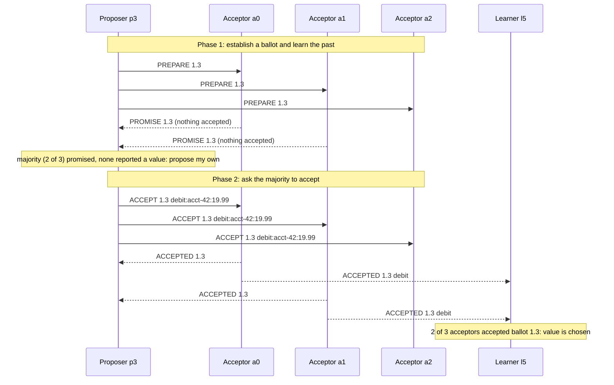

# Single-Decree Paxos from Scratch

> Proposers, acceptors, and the two promises that make it safe.

**Type:** Build
**Languages:** Java, Python, Go
**Prerequisites:** Phase 6, Lesson 03 (Quorums: R + W > N and Its Limits); Phase 5, Lesson 03 (Lamport and Vector Clocks)
**Time:** ~120 minutes

## Learning Objectives

- State the single-decree consensus problem as three properties (only a proposed value is chosen, only one value is chosen, a chosen value is eventually learned) and say which of them Paxos guarantees unconditionally
- Build proposers, acceptors, and learners as pure message-driven state machines on a deterministic simulated network with seeded loss and delay
- Explain the two acceptor promises and show, with a hand trace, why a proposer that sees an accepted value must adopt it
- Construct the dueling-proposer livelock, observe that it never violates safety, and name the two standard fixes
- Check the safety invariant after every delivered message across hundreds of seeded lossy runs, in all three languages, from the same random stream

## The Problem

A payments platform runs its ledger sequencer as three replicas in three availability zones. Every ledger posting must be assigned exactly one sequence number, and every replica must agree on which posting holds sequence number 48,117,203. Two posting services, one handling card captures and one handling refunds, both believe it is their turn to claim that number. Card capture `debit:acct-42:19.99` reaches replicas 1 and 2; refund `credit:acct-42:5.00` reaches replicas 2 and 3. Replica 2 saw both and took whichever arrived first. Now replicas 1 and 2 say the slot holds the debit; replica 3 says it holds the credit. Each replica believes a majority agrees with it, because each counted its own vote plus the one message it happened to receive.

The quorum arithmetic from Lesson 03 does not save you here. `R + W > N` guarantees that a reader overlaps with the latest writer, but it says nothing about two writers who both believe they succeeded. Last-writer-wins would pick one arbitrarily, which means one of the two services has already told its caller "sequence 48,117,203 is yours" and was wrong. If the debit service then retries with a new number, the account is debited twice. If it does not, the capture is lost. Either outcome is a reconciliation break that a human has to explain to a bank.

The property you need is **agreement**: once any replica decides that the slot holds a value, no replica may ever decide a different value, no matter which messages are lost, delayed, or reordered, and no matter how many proposers are racing. That property cannot be achieved by any protocol in which a single message exchange is enough to decide, because the message might not arrive and the proposer cannot distinguish "lost" from "slow". Paxos achieves it with two round trips and two rules enforced by the replicas (which Paxos calls acceptors). The rest of this lesson builds those rules and then tries, with an adversarial scheduler and 25% message loss, to break them.

Single-decree Paxos decides one value for one slot. A ledger needs a sequence of slots; that is multi-Paxos, and Raft (Lessons 05 to 07) is the version of it you will actually build. But every multi-decree protocol contains this one-decree core, and every bug report that says "two nodes committed different values" is a violation of exactly the invariant this lesson tests.

## The Concept

### Three roles, two phases

Paxos separates three roles, which in practice are usually co-located on every node but are easier to reason about apart:

| Role | Holds | Sends | Receives |
|------|-------|-------|----------|
| Proposer | the value it wants, its current ballot, the promises and accepts collected so far | PREPARE, ACCEPT | PROMISE, ACCEPTED, NACK |
| Acceptor | `promised` (highest ballot it has promised to), `acceptedBallot`, `acceptedValue` | PROMISE, ACCEPTED, NACK | PREPARE, ACCEPT |
| Learner | votes per ballot, the learned value | nothing | ACCEPTED |

A **ballot** is a proposal number. It must be totally ordered and unique: no two proposers may ever use the same ballot. The usual construction is a pair `(round, proposerId)` compared lexicographically, so proposer 3's ballots are `1.3, 2.3, 3.3, ...`, proposer 4's are `1.4, 2.4, ...`, and `1.4 > 1.3` because the id breaks the tie.

The protocol has two phases, each a broadcast and a majority of replies:



**Phase 1 (prepare/promise).** The proposer picks a ballot `b` higher than any it has used and sends `PREPARE(b)` to every acceptor. An acceptor that has not promised anything higher replies `PROMISE(b, acceptedBallot, acceptedValue)`: it promises never to accept a ballot below `b`, and it reports the highest-ballot value it has already accepted, if any.

**Phase 2 (accept/accepted).** Once a majority has promised, the proposer chooses what to propose. If any promise carried an accepted value, the proposer **must** propose the value with the highest reported ballot. Only if no promise carried a value may it propose its own. It sends `ACCEPT(b, value)` to every acceptor. An acceptor that has not promised anything higher than `b` accepts: it records `(b, value)` and sends `ACCEPTED(b, value)` to the proposer and to every learner.

A value is **chosen** when a majority of acceptors have accepted the same ballot. Nobody necessarily knows this at the moment it happens; learners find out when enough `ACCEPTED` messages arrive, and the proposer finds out the same way.

### The two promises that make it safe

Everything about safety lives in the acceptor, in two rules:

- **P1. Never accept below a promise.** Once an acceptor has replied `PROMISE(b)`, it rejects every `PREPARE` and `ACCEPT` with a ballot lower than `b`. This is what makes a majority of promises meaningful: a proposer that holds promises for ballot `b` from a majority knows that no ballot below `b` can gain a majority of accepts in the future, because every majority overlaps its own in at least one acceptor, and that acceptor will refuse.
- **P2. Report what you accepted.** Every `PROMISE` carries the acceptor's highest accepted `(ballot, value)`. Combined with the proposer's rule to adopt the highest reported value, this is what protects a value that may already have been chosen. If value `v` was chosen at ballot `b0`, a majority accepted it. Any later proposer at ballot `b1 > b0` collects promises from a majority, which overlaps that one in at least one acceptor, which reports `(b0, v)` or something with an even higher ballot. By induction on ballots, the highest reported value is always `v` or a value that itself was forced to be `v`. The proposer therefore proposes `v`. It cannot propose anything else.

The invariant these two rules protect is: **if a value is chosen at ballot b, then every proposal with a ballot higher than b proposes that same value.** From this, "at most one value is ever chosen" follows immediately, and that is what `PaxosCluster.checkSafety` asserts after every single message delivery.

Note what is *not* required: acceptors never talk to each other, there is no leader, and nothing depends on timing. A message may be delayed a year and still be handled correctly, because every message carries a ballot and every rule compares ballots.

### Hand trace: two proposers, lossless network

This is the exact trace that `Main` prints for seed 7, with three acceptors `a0 a1 a2`, two proposers `p3 p4`, and one learner `l5`. Both proposers start at `t=0`; delivery takes one tick.

```text
t=1  p3 -> a0,a1,a2  PREPARE 1.3
t=1  p4 -> a0,a1,a2  PREPARE 1.4
t=2  a0,a1,a2 -> p3  PROMISE 1.3 (nothing accepted)   acceptors: promised=1.3
t=2  a0,a1,a2 -> p4  PROMISE 1.4 (nothing accepted)   acceptors: promised=1.4 (1.4 > 1.3, so a0..a2 move up)
t=3  p3 -> a0,a1,a2  ACCEPT 1.3 debit:acct-42:19.99
t=3  p4 -> a0,a1,a2  ACCEPT 1.4 credit:acct-42:5.00
t=4  a0,a1,a2 -> p3  NACK 1.3 (promised 1.4)          P1: 1.3 < 1.4, refused
t=4  a0,a1,a2 -> p4  ACCEPTED 1.4 credit               majority accepted 1.4: CHOSEN = credit at t=4
t=4  a0,a1,a2 -> l5  ACCEPTED 1.4 credit               learner learns credit
t=5  p3 -> a0,a1,a2  PREPARE 2.3                       p3 retries: NACK said "promised 1.4", so round jumps to 2
t=6  a0,a1,a2 -> p3  PROMISE 2.3 (accepted credit at 1.4)   P2: every promise reports the accepted value
t=7  p3 -> a0,a1,a2  ACCEPT 2.3 credit                 p3 wanted debit but MUST propose credit
t=8  a0,a1,a2 -> p3  ACCEPTED 2.3 credit               p3.decided = credit
```

Three things to notice. At `t=2` the acceptors promised `1.3` and then, one message later, `1.4`: a promise is "I will not go lower", not "I will accept you", so a higher prepare can always supersede. At `t=4` `credit` is chosen the moment the second `ACCEPTED 1.4` lands on an acceptor's log, before anyone has learned it. At `t=7` proposer 3 proposes a value it never wanted, because P2 forced it to; the debit posting is not lost, it simply has to be proposed for the *next* slot. That is the correct outcome: the slot was already taken.

### Hand trace: the dueling-proposer livelock

Paxos guarantees safety unconditionally but guarantees liveness only if, eventually, one proposer gets a full round trip without interruption. Here is the schedule that `demoDuel` scripts with `Network.drain`, holding each proposer's `ACCEPT` in flight until the other's `PREPARE` has landed:

```text
p3 PREPARE 1.3 -> promises (promised=1.3) -> ACCEPT 1.3 held in flight
p4 PREPARE 1.4 -> promises (promised=1.4) -> ACCEPT 1.4 held in flight
deliver ACCEPT 1.3  -> NACK (promised 1.4) -> p3 PREPARE 2.3 -> promises (promised=2.3)
deliver ACCEPT 1.4  -> NACK (promised 2.3) -> p4 PREPARE 3.4 -> promises (promised=3.4)
deliver ACCEPT 2.3  -> NACK (promised 3.4) -> p3 PREPARE 4.3 -> promises (promised=4.3)
deliver ACCEPT 3.4  -> NACK (promised 4.3) -> p4 PREPARE 5.4 -> ...
after 3 exchanges: p3 at 6.3, p4 at 7.4, chosen = (none), no acceptor has accepted anything
```

The rounds climb forever and nothing is ever accepted, let alone chosen. Safety is intact: there is nothing to be unsafe about. The two production fixes are (1) a **distinguished proposer**, a leader that is the only one allowed to propose while it is believed alive, which is what multi-Paxos and Raft do, and (2) **randomized backoff** before a retry, so that one proposer gets a clear run with high probability. The seeded-network demo gets its liveness from a third source: random delays make the two proposers desynchronize naturally. In 200 runs with 20% loss and three competing proposers, every run decides, in a mean of 16 ticks.

### Complexity and cost

| Quantity | Single-decree Paxos, N acceptors | Note |
|----------|----------------------------------|------|
| Messages per uncontended decision | 2N (prepare) + 2N (promise/accept/accepted to proposer) + N·L to learners | two round trips; multi-Paxos amortizes phase 1 across slots |
| Latency, uncontended | 2 round trips | Raft and multi-Paxos with a stable leader: 1 round trip |
| Acceptor state | three fields: `promised`, `acceptedBallot`, `acceptedValue` | must be durable (fsync) before replying, or a crash-restart breaks P1 |
| Fault tolerance | tolerates `f` failures with `N = 2f + 1` acceptors | 3 acceptors survive 1 failure; 5 survive 2 |
| Progress under contention | unbounded | the duel above; needs a leader or backoff |

### What this lesson does not do

It decides one value, once. It does not keep a log, elect a leader, replicate a sequence of commands, apply them to a state machine, or compact anything; Lessons 05 and 06 build all of those on the same simulated network. It does not persist acceptor state to disk, which a real acceptor must do before every reply because P1 is a promise about the future and amnesia breaks it. It does not handle Byzantine acceptors that lie about their promises (Lesson 11). And it does not make proposers back off: the simulation gets liveness from randomized delivery delays, which is a property of the network, not of the protocol.

## Build It

The primary walkthrough is in Java (`code/java/Main.java`). Python and Go implement the same types with the same names; the subsections at the end show only what differs. Every demo and test in all three languages consumes the same random stream, so a seed that misbehaves in one language misbehaves identically in the other two.

### Step 1: A random stream you can replay in any language

```java
final class Rng {
    private long state;
    Rng(long seed) { this.state = seed; }

    long nextLong() {
        state += 0x9E3779B97F4A7C15L;
        long z = state;
        z = (z ^ (z >>> 30)) * 0xBF58476D1CE4E5B9L;
        z = (z ^ (z >>> 27)) * 0x94D049BB133111EBL;
        return z ^ (z >>> 31);
    }
    int nextInt(int bound) { return (int) ((nextLong() >>> 33) % bound); }
    double nextDouble() { return (nextLong() >>> 11) * 0x1.0p-53; }
}
```

`java.util.Random`, Python's `random`, and Go's `math/rand` all produce different streams from the same seed, which would make "seed 42 breaks" untranslatable. SplitMix64 is fifteen lines, has published reference outputs (seed 0 produces `0xE220A8397B1DCDAF` first; the tests check this), and uses only 64-bit wrapping arithmetic. `nextInt` uses the top 31 bits so that the result is the same whether the language's `long` is signed or not.

**Predict:** why does `nextDouble` shift by 11 and multiply by 2^-53 rather than dividing by 2^64?

### Step 2: Ballots and messages

```java
record Ballot(int round, int proposerId) implements Comparable<Ballot> {
    static final Ballot NONE = new Ballot(0, 0);
    boolean isNone() { return round == 0; }
    @Override public int compareTo(Ballot other) {
        int c = Integer.compare(round, other.round);
        return c != 0 ? c : Integer.compare(proposerId, other.proposerId);
    }
}

enum MessageKind { PREPARE, PROMISE, ACCEPT, ACCEPTED, NACK }

record Message(MessageKind kind, int from, int to, Ballot ballot, Ballot priorBallot, String value) {
    static Message prepare(int from, int to, Ballot b) { ... }
    static Message promise(int from, int to, Ballot b, Ballot prior, String v) { ... }
    static Message accept(int from, int to, Ballot b, String v) { ... }
    static Message accepted(int from, int to, Ballot b, String v) { ... }
    static Message nack(int from, int to, Ballot rejected, Ballot promised) { ... }
}
```

One record for all five kinds, with fields that are meaningful or ignored depending on `kind`. `priorBallot` is the accepted ballot in a `PROMISE` and the promised ballot in a `NACK`; both are "the ballot you need to know about". `NACK` is not in Lamport's paper (acceptors there simply stay silent) but it is in every real implementation, because it turns a timeout into an immediate, informed retry.

**Predict:** two proposers with ids 3 and 4 both start at round 1. Which ballot is higher, and does that mean proposer 4 wins?

### Step 3: The acceptor, where safety lives

```java
final class Acceptor implements Node {
    Ballot promised = Ballot.NONE;
    Ballot acceptedBallot = Ballot.NONE;
    String acceptedValue = null;

    List<Message> onPrepare(Message m) {
        if (m.ballot().compareTo(promised) >= 0) {
            promised = m.ballot();
            return List.of(Message.promise(id, m.from(), m.ballot(), acceptedBallot, acceptedValue));
        }
        return List.of(Message.nack(id, m.from(), m.ballot(), promised));
    }

    List<Message> onAccept(Message m) {
        if (m.ballot().compareTo(promised) >= 0) {
            promised = m.ballot();
            acceptedBallot = m.ballot();
            acceptedValue = m.value();
            List<Message> out = new ArrayList<>();
            out.add(Message.accepted(id, m.from(), m.ballot(), m.value()));
            for (int learner : learnerIds) out.add(Message.accepted(id, learner, m.ballot(), m.value()));
            return out;
        }
        return List.of(Message.nack(id, m.from(), m.ballot(), promised));
    }
}
```

Twenty lines, three fields, two comparisons. `onPrepare` is P1 plus P2: refuse anything below `promised`, and when you do promise, report `(acceptedBallot, acceptedValue)`. `onAccept` is P1 again: refuse anything below `promised`. The `>=` matters: an acceptor that promised `1.3` must accept `ACCEPT 1.3`, because the proposer is only sending it after collecting that promise.

Note that `onAccept` also raises `promised`. An acceptor can receive `ACCEPT(b)` for a `b` higher than anything it promised if its own `PROMISE` was lost and the proposer reached a majority without it. Accepting is still safe (the proposer did get a majority of promises) and raising `promised` keeps the state monotonic.

**Predict:** an acceptor has `promised = 2.4`, `acceptedBallot = 1.3`, `acceptedValue = "X"`. It receives `PREPARE 3.3`. What does it reply, field by field?

### Step 4: The proposer, which must adopt what it learns

```java
private List<Message> onPromise(Message m, int now) {
    if (phase != Phase.PREPARING) return List.of();
    promises.add(m.from());
    if (!m.priorBallot().isNone() && m.priorBallot().compareTo(highestPrior) > 0) {
        highestPrior = m.priorBallot();
        highestPriorValue = m.value();
    }
    if (promises.size() < quorum) return List.of();
    proposing = highestPriorValue != null ? highestPriorValue : wanted;
    phase = Phase.ACCEPTING;
    deadline = now + timeout;
    List<Message> out = new ArrayList<>();
    for (int a : acceptorIds) out.add(Message.accept(id, a, ballot, proposing));
    return out;
}
```

The line `proposing = highestPriorValue != null ? highestPriorValue : wanted` is the proposer's half of P2 and the single most important line in the file. `wanted` is what this proposer's client asked for; `proposing` is what it is allowed to propose. They differ exactly when some earlier ballot may already have been chosen. The test `proposer adopts the value of the highest prior ballot` feeds a proposer two promises reporting `("old", 1.9)` and `("newer", 2.9)` and asserts it proposes `newer`.

```java
@Override
public List<Message> handle(Message m, int now) {
    if (phase == Phase.DONE || !m.ballot().equals(ballot)) return List.of(); // stale reply from an earlier round
    ...
}

private List<Message> onNack(Message m, int now) {
    round = Math.max(round, m.priorBallot().round());
    restarts++;
    return startRound(now);
}
```

Every reply is checked against the proposer's *current* ballot; a `PROMISE 1.3` arriving after the proposer has moved to `2.3` is discarded. Without this, a late promise from round 1 could be counted toward round 2's majority, which would let a proposer proceed to phase 2 with promises that do not all cover its ballot, breaking P1's overlap argument. The `NACK` handler jumps `round` to the promised round rather than incrementing by one, so a proposer that has been asleep for a hundred rounds catches up in one hop.

**Predict:** a proposer at ballot `3.4` receives `NACK 3.4 (promised 7.3)`. What is its next ballot?

### Step 5: The learner and the definition of "chosen"

```java
final class Learner implements Node {
    private final Map<Ballot, Set<Integer>> votes = new HashMap<>();
    String learned = null;

    public List<Message> handle(Message m, int now) {
        if (m.kind() != MessageKind.ACCEPTED) return List.of();
        Set<Integer> voters = votes.computeIfAbsent(m.ballot(), b -> new HashSet<>());
        voters.add(m.from());
        if (voters.size() >= quorum) {
            if (learned != null && !learned.equals(m.value())) {
                throw new IllegalStateException("SAFETY VIOLATION: learner " + id + " learned " + learned + " then " + m.value());
            }
            learned = m.value();
        }
        return List.of();
    }
}
```

Votes are counted **per ballot**. Two acceptors accepting value `X` at different ballots do not make `X` chosen; two acceptors accepting ballot `1.4` do. (In single-decree Paxos the value is a function of the ballot once chosen, so counting per value would also be safe, but per-ballot is the definition and it is what generalizes.) The learner also acts as a tripwire: if it ever learns a second distinct value it throws, and the test `learner refuses to learn two values` feeds it exactly that.

`PaxosCluster.chosenValue()` computes the same thing from acceptor state directly, with no messages involved, and `checkSafety` runs it after every delivery:

```java
String chosenValue() {
    Map<Ballot, Integer> counts = new HashMap<>();
    for (Acceptor a : acceptors) {
        if (a.acceptedBallot.isNone()) continue;
        int n = counts.merge(a.acceptedBallot, 1, Integer::sum);
        if (n >= acceptorCount / 2 + 1) return a.acceptedValue;
    }
    return null;
}
```

This is the oracle. The learner can only know what messages told it; the cluster can see every acceptor's state at once, which no real node can. When testing a consensus protocol, always build this god's-eye check.

**Predict:** three acceptors hold `(1.3, "A")`, `(2.4, "B")`, `(2.4, "B")`. What does `chosenValue()` return, and was `"A"` ever chosen?

### Step 6: The simulated network

```java
void send(Message m) {
    sent++;
    if (isolated.contains(m.from()) || isolated.contains(m.to())) { dropped++; return; }
    double roll = rng.nextDouble();
    int delay = 1 + rng.nextInt(maxDelay);
    if (roll < dropRate) { dropped++; return; }
    inFlight.add(new Envelope(now + delay, seq++, m));
}

void tick() {
    now++;
    for (Node n : nodes.values()) sendAll(n.tick(now));
    while (!inFlight.isEmpty() && inFlight.peek().deliverAt() <= now) deliver(inFlight.poll());
}
```

The network is a priority queue of envelopes ordered by `(deliverAt, seq)`. Every send draws exactly two random numbers in a fixed order (a drop roll, then a delay), even when the message is dropped, so the random stream stays aligned across runs that differ only in a node's behaviour. `tick` advances logical time by one, lets every node act on timeouts in id order, then delivers everything due. There are no threads and no wall clock anywhere; `Thread.sleep` does not appear in this course.

`drain(filter)` delivers matching in-flight messages immediately, regardless of their delay, and repeats until none match. It is how the duel test scripts an exact adversarial interleaving without having to find a seed that happens to produce it.

**Predict:** `isolate(0); isolate(1); isolate(2)` on a 5-acceptor cluster. Can anything be chosen? What happens after `heal()`?

### Step 7: Run it

```bash
cd phases/06-replication-and-consensus/04-paxos/code/java
javac -d .out *.java && java -cp .out Main
java -cp .out MainTest
```

Expected output, abbreviated:

```console
== 1. Three acceptors, two proposers, one learner, lossless network, delay 1 ==
t=1   p3 -> a0 PREPARE 1.3
...
t=4   a0 -> p3 NACK 1.3 (promised 1.4)
t=4   a0 -> p4 ACCEPTED 1.4 credit:acct-42:5.00
...
t=6   a0 -> p3 PROMISE 2.3 (accepted credit:acct-42:5.00 at 1.4)
t=7   p3 -> a0 ACCEPT 2.3 credit:acct-42:5.00
chosen = credit:acct-42:5.00 at t=4; learner learned credit:acct-42:5.00 at ballot 2.3; p3.decided=credit:acct-42:5.00 p4.decided=credit:acct-42:5.00

== 2. 200 seeded runs: 5 acceptors, 3 proposers, 20% message loss, delays 1..3 ==
decided in 200/200 runs, distinct chosen values per run: never more than 1 (checked after every delivery)
winners: {A=35, B=62, C=103}; mean ticks to choose: 16.0; highest round seen: 18

== 3. Constructed duel: two proposers whose prepares keep landing between each other's promise and accept ==
after exchange 1: p3 at ballot 2.3, p4 at ballot 3.4, chosen=(none)
after exchange 2: p3 at ballot 4.3, p4 at ballot 5.4, chosen=(none)
after exchange 3: p3 at ballot 6.3, p4 at ballot 7.4, chosen=(none)
schedule released: chosen=B, rounds used=8
```

Run `python3 main.py` and `go run .` in the sibling folders and diff the output: it is identical, line for line, including `{A=35, B=62, C=103}`. That is the point of the hand-rolled generator.

### In Python

```python
@dataclass(frozen=True, order=True)
class Ballot:
    round: int
    proposer_id: int
```

Differences, all in `code/python/main.py`:

- **Ordering for free.** `order=True` on a frozen dataclass gives tuple comparison on `(round, proposer_id)`, which is exactly the ballot order, so `m.ballot >= self.promised` reads like the paper.
- **64-bit wrapping by hand.** Python integers do not overflow, so every SplitMix64 step is masked with `& 0xFFFFFFFFFFFFFFFF`. `next_long` returns the unsigned reinterpretation of Java's signed `long`; the reference-vector test compares against the same hex constants.
- **`from` is a keyword.** The message field is `from_`. Everything else keeps its name in snake case.
- **The heap is a list of tuples.** `heapq` on `(deliver_at, seq, message)` gives the same `(deliverAt, seq)` ordering as Java's `PriorityQueue` comparator; `seq` guarantees the tuple comparison never reaches the `Message` itself.
- **Invariant violations raise `RuntimeError`.** Same semantics as Java's `IllegalStateException`: this is a bug, not a condition.

### In Go

```go
func (a *Acceptor) onPrepare(m Message) []Message {
    if m.Ballot.Compare(a.Promised) >= 0 {
        a.Promised = m.Ballot
        return []Message{PromiseMsg(a.id, m.From, m.Ballot, a.AcceptedBallot, a.AcceptedValue)}
    }
    return []Message{NackMsg(a.id, m.From, m.Ballot, a.Promised)}
}
```

Differences, all in `code/go/main.go`:

- **No null strings.** `""` stands for "no value" in `AcceptedValue`, `Learned`, `Decided`, and `ChosenValue()`. Proposers never propose the empty string, and the demo prints `(none)` for it, the same text the other two languages print.
- **`container/heap`** needs the five-method boilerplate (`Len`, `Less`, `Swap`, `Push`, `Pop`); `Less` compares `(DeliverAt, Seq)` to match the Java comparator.
- **Node order is explicit.** Java's `TreeMap` and Python's `sorted(self.nodes)` visit nodes by id on every tick; Go's map iteration is randomized, so `Network` keeps a sorted `order` slice. Forget this and the three languages diverge on the first timeout.
- **Safety violations panic.** A learner that learns two values or a cluster that chooses two values has no useful error to return, so it panics; the test recovers. `go test -race ./...` passes because nothing here is concurrent, which is the whole point of simulating the network.

## Use It

### Where single-decree Paxos runs today

Google's **Chubby** lock service and the **Spanner** and **Megastore** databases run Paxos for every replicated log, with the phase-1 round amortized across many slots by a stable leader (multi-Paxos). Chandra, Griesemer, and Redstone's "Paxos Made Live" (2007) is the engineering report: it documents disk corruption breaking P1, the need for a `NACK`-style fast retry, and the god's-eye consistency checker they ran in production, which is exactly `checkSafety` with a database behind it. **Apache ZooKeeper's Zab**, **Apache Cassandra's lightweight transactions** (`INSERT ... IF NOT EXISTS`, which runs a full four-round Paxos per operation and is why they are slow), and **Neo4j's causal clustering** are all Paxos-family.

What the production versions do that this lesson made explicit: they persist `promised`, `acceptedBallot`, and `acceptedValue` with an `fsync` before replying (an acceptor that forgets a promise after a crash can accept a lower ballot and choose a second value); they elect a distinguished proposer so phase 1 happens once per leadership term instead of once per value; they batch many client commands into one value; and they implement **reconfiguration**, changing the acceptor set, which single-decree Paxos handles by making the new configuration itself a chosen value.

### Why you will build Raft instead

Raft (Lesson 05 onward) is Paxos with the design decisions made for you: a leader is mandatory, the log is the primary structure, ballots are called terms, and `PREPARE` is `RequestVote`. Every Raft safety argument is a Paxos safety argument in different clothes: the election restriction is P2 (a candidate must have the latest committed entry), and "a follower rejects a term lower than its own" is P1. **etcd**, **CockroachDB**, **TiKV**, and **Consul** run Raft. If you understand why `proposing = highestPriorValue != null ? highestPriorValue : wanted` is mandatory, you already understand why Raft's log-comparison rule in `RequestVote` is mandatory.

### The trap

The standard way to misuse Paxos is to assume a *proposer's* decision is the moment of choice. It is not: the value is chosen when a majority of acceptors have accepted it, which may happen before any proposer or learner knows. A proposer whose `ACCEPTED` replies were all lost will time out and retry, and if its retry proposes a different value because a client reconnected with a new request, it will correctly be forced back onto the already-chosen one by P2. A system that lets the client re-submit with "the old one failed, here is the new one" and does not route it through the same slot is the one that double-posts.

## Ship It

`outputs/checklist-consensus-safety-review.md` is a review checklist for any pull request that touches a consensus implementation or a system built on one: ballot uniqueness, durability before reply, the adopt-reported-value rule, stale-reply filtering, and the god's-eye invariant test. The second half is a list of the ways the tests in this lesson would catch each violation, so a reviewer can ask "which test proves this?".

## Exercises

1. **Reinforce.** Remove the `>=` in `Acceptor.onAccept` and replace it with `>`, so an acceptor refuses the very ballot it promised. Run the tests. Which fail, and what does the trace of demo 1 look like? Then restore it and instead delete the `!m.ballot().equals(ballot)` guard in `Proposer.handle`. Find a seed in `1..200` under 25% loss where a stale promise lets a proposer reach phase 2 early, and explain why `checkSafety` still does not fire (hint: P1 is enforced by the acceptor, not the proposer).
2. **Apply.** Add a `crash(acceptorId)` and `restart(acceptorId)` pair to `PaxosCluster` where restart wipes the acceptor's three fields (simulating an acceptor that did not fsync). Write a scripted test with `drain` in which this produces two chosen values, and watch `checkSafety` throw. Then make restart preserve the fields and show the same schedule is safe. This is the bug described in section 5.1 of "Paxos Made Live".
3. **Extend.** Combine this lesson with Phase 5, Lesson 10 (Retries, Backoff, and Jitter): give `Proposer` a randomized backoff before `startRound` after a `NACK`, drawn from its own seeded `Rng`. Measure the mean ticks-to-decision and the maximum round across 200 seeds with and without backoff, at 0%, 20%, and 40% loss, and present the table. Then reproduce the constructed duel and show whether backoff alone can break it under an adversarial scheduler, or only under a random one.

## Key Terms

| Term | What people say | What it actually means |
|------|-----------------|------------------------|
| Ballot (proposal number) | "the round" | A totally ordered, globally unique identifier for one proposal attempt; here `(round, proposerId)` so two proposers can never collide |
| Promise | "the acceptor said yes" | The acceptor's commitment never to accept a ballot lower than the one it just promised (P1), together with a report of what it has already accepted (P2) |
| Chosen | "committed" | A majority of acceptors have accepted the same ballot. A fact about acceptor state, not about any message; it can be true before anyone knows it |
| Learned | "committed" (again) | A learner has seen `ACCEPTED` for one ballot from a majority. Learning is knowing that something was chosen; it lags choosing |
| Quorum (majority) | "most of the nodes" | Any set of `floor(N/2) + 1` acceptors; the property used is that any two quorums share at least one acceptor |
| NACK | "rejection" | An acceptor telling a proposer which ballot it has promised, so the proposer can jump above it instead of waiting for a timeout; not in Lamport's paper, in every implementation |
| Livelock (dueling proposers) | "Paxos got stuck" | Two or more proposers repeatedly invalidating each other's ballots; safety holds, liveness does not, fixed by a leader or randomized backoff |
| Single-decree | "one Paxos" | Agreement on one value for one slot; a replicated log runs one instance per slot (multi-Paxos) with phase 1 amortized by a leader |

## Further Reading

- [Paxos Made Simple](https://lamport.azurewebsites.net/pubs/paxos-simple.pdf) (Lamport, 2001) — the fourteen-page derivation of P1 and P2 from the requirements; read section 2.2 twice and the proof of P2c once with the hand trace above beside it.
- [The Part-Time Parliament](https://lamport.azurewebsites.net/pubs/lamport-paxos.pdf) (Lamport, ACM TOCS 1998) — the original paper, in its archaeological framing; the appendix has the formal invariants.
- [Paxos Made Live: An Engineering Perspective](https://research.google/pubs/paxos-made-live-an-engineering-perspective/) (Chandra, Griesemer, Redstone, PODC 2007) — what broke when Google built Chubby on Paxos: disk corruption, master leases, the runtime consistency checker, and the gap between the paper and a working system.
- [In Search of an Understandable Consensus Algorithm](https://raft.github.io/raft.pdf) (Ongaro and Ousterhout, USENIX ATC 2014) — section 2 states the problem; sections 5.2 and 5.4 are the next two lessons; section 9 compares with Paxos.
- [Fast Splittable Pseudorandom Number Generators](https://doi.org/10.1145/2660193.2660195) (Steele, Lea, Flood, OOPSLA 2014) — SplitMix64, the generator this course uses so that a seed means the same thing in every language.
- [Impossibility of Distributed Consensus with One Faulty Process](https://groups.csail.mit.edu/tds/papers/Lynch/jacm85.pdf) (Fischer, Lynch, Paterson, JACM 1985) — why no asynchronous consensus protocol can guarantee liveness; the dueling-proposer livelock is this theorem made concrete.
