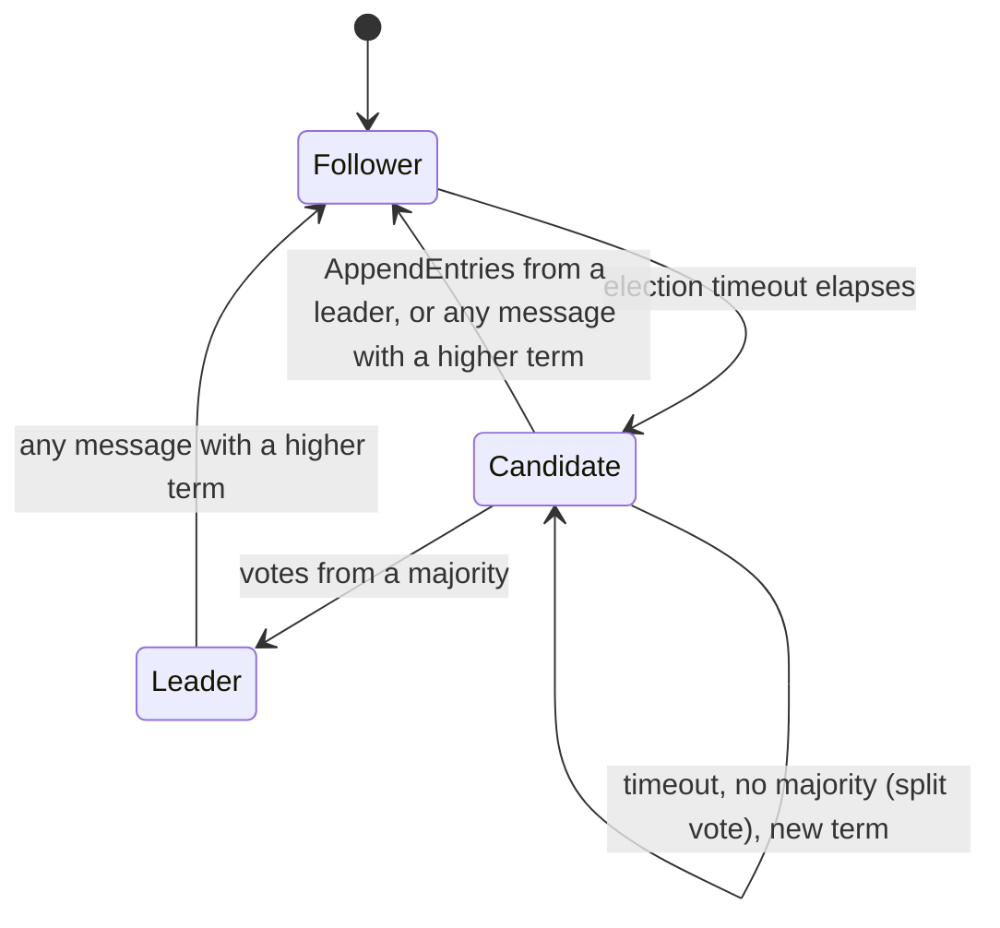

# Raft I: Terms, Leader Election, and a Simulated Network

> Build the election with a deterministic network so you can replay every bug.

**Type:** Build
**Languages:** Java, Python, Go
**Prerequisites:** Phase 5 Lesson 03 (Lamport and Vector Clocks), Phase 5 Lesson 13 (Gossip Protocols and Failure Detection), Phase 6 Lesson 04 (Single-Decree Paxos)
**Time:** ~150 minutes

## Learning Objectives

- Explain why Raft divides time into terms and how a term number turns "who is leader?" into a comparison of integers
- Implement the RequestVote RPC receiver exactly as Figure 2 of the Raft paper specifies it, including the at-least-as-up-to-date log check
- Build a deterministic simulated network with injected clock, seeded randomness, message delay, drops, partitions, and crashes, and replay any run from its seed
- Show with a test why `votedFor` must be written to stable storage before a vote reply leaves the node
- Demonstrate split votes and their resolution by randomized election timeouts, and state the timing inequality that makes elections converge
- Verify the Election Safety property (at most one leader per term) across hundreds of seeded runs with message loss and partitions

## The Problem

A payments company runs its idempotency-key store, the one every `POST /charges` consults before moving money (Phase 5, Lesson 09 and Phase 12, Lesson 01), as a three-node replicated service with one primary that accepts writes. Failover is handled by a sidecar: if the primary misses three heartbeats, the sidecar on the oldest standby promotes itself. On a Tuesday afternoon a network switch firmware update introduces 800 ms of jitter between two racks for about forty seconds. Node A, the primary, is alive and serving. Node B's sidecar misses three heartbeats and promotes B. Nobody tells A. For forty seconds there are two primaries, each accepting idempotency keys, each believing it is the only writer. A customer's mobile app retries a $240.00 charge; the first attempt landed on A, the retry on B. Neither node has seen the other's key. The customer is charged twice, and the reconciliation job finds 1,106 similar pairs.

The sidecar did nothing wrong by its own rules. The bug is that the rules did not make "primary" a property the cluster agrees on; they made it a property each node computes locally from timeouts. A timeout tells you that you have not heard from someone. It does not tell you that they are dead, and it certainly does not tell you that everyone else has also stopped hearing from them. Any system that promotes on a local timeout alone will eventually run two primaries, because a partition looks exactly like a crash from inside the minority.

Lesson 04 built single-decree Paxos, which solves agreement on one value but says nothing about who should propose, so a cluster of Paxos acceptors can livelock while two proposers trade ballots. Raft (Ongaro and Ousterhout, 2014) makes the leader the central concept and spends most of its design on electing exactly one per term and making every other node able to recognise a stale one. The elected leader is what turns "two primaries" from an operational accident into a provable impossibility: in any given term there is at most one leader, and a leader from an older term is rejected by every node that has seen the newer one. The cost is that the cluster is unavailable for writes during an election, which the paper measures in hundreds of milliseconds and this lesson measures in ticks.

This lesson builds the election half of Raft on a simulated network whose every delay, drop, and timeout comes from a seeded generator. That decision is as important as the algorithm. A consensus bug seen once in production at 03:00 is a story; the same bug reproduced from `seed=204` is a test case. Lesson 06 adds the log on top of this code; Lesson 07 adds membership changes and the safety argument.

## The Concept

### Terms: logical time for leadership

Raft divides time into *terms*, numbered consecutively. Each term begins with an election; if the election succeeds, one leader serves for the rest of the term. If it fails (a split vote), the term ends with no leader and a new term begins. Terms are not synchronised clocks: each node has its own `currentTerm` and learns of newer terms only from messages. The paper states the rule that does all the work (Figure 2, "Rules for Servers, All Servers"):

> If RPC request or response contains term T > currentTerm: set currentTerm = T, convert to follower.

Every message carries the sender's term, so terms propagate like a Lamport clock (Phase 5, Lesson 03). A node that has been partitioned for a minute and still believes it is the leader of term 3 will send a heartbeat with `term = 3`; the first reply it gets back will carry `term = 7`, and the rule above demotes it before it can do any harm. There is no separate "are you still the leader?" protocol, and no special case for stale leaders. Comparing two integers is the whole mechanism.

### Three roles and the transitions between them



- A **follower** is passive. It replies to RequestVote and AppendEntries and resets its election timer each time it hears from the current leader or grants a vote. If the timer expires, it becomes a candidate.
- A **candidate** increments `currentTerm`, votes for itself, resets its timer, and sends RequestVote to every peer. It wins when it holds votes from a majority (itself included). It steps down if it hears a leader for its term or any higher term.
- A **leader** sends AppendEntries to every follower at a fixed interval, with no entries in this lesson, which is what the paper calls a heartbeat. It keeps no election timer. It steps down only on a higher term.

### The RequestVote receiver, verbatim

Figure 2 of the paper gives the receiver rules in two numbered lines, and the implementation follows them in order:

1. Reply false if `term < currentTerm`.
2. If `votedFor` is null or `candidateId`, and the candidate's log is at least as up-to-date as the receiver's log, grant the vote.

"At least as up-to-date" (section 5.4.1) compares the last entries: the candidate wins if its last log term is higher, or if the terms are equal and its log is at least as long. This lesson has no log yet, so each node carries `lastLogIndex` and `lastLogTerm` as stand-ins that tests can set directly; Lesson 06 replaces them with the real log. The check matters for the log lessons, not for election safety; it is here now so that the vote rule is complete from the first day.

Three details that are easy to get wrong:

- **Rule 2 allows a repeat grant to the same candidate.** If the candidate's first request was lost and it retransmits, `votedFor == candidateId` is true and the vote is granted again. That is one vote, delivered twice, not two votes.
- **Granting a vote resets the election timer; rejecting does not.** A follower that keeps rejecting a hopeless candidate should still time out and run its own election.
- **The "All Servers" rule runs before the receiver rules.** A follower in term 3 that receives RequestVote for term 5 first moves to term 5 (which sets `votedFor` to null), then evaluates rule 2 with a clean slate. A node in term 5 that receives RequestVote for term 3 never reaches rule 2.

### The invariant: Election Safety

The property this lesson proves by test is the first row of the paper's Figure 3:

> **Election Safety:** at most one leader can be elected in a given term.

The argument is two lines. A candidate needs votes from a majority of the cluster. Each node grants at most one vote per term, because it persists `votedFor` and checks it on every request. Two majorities of the same set always overlap in at least one node, and that node voted for only one of them. Therefore two candidates cannot both reach a majority in the same term.

Both premises are load-bearing. "At most one vote per term" fails if a node forgets its vote, which is exactly what a crash does to in-memory state. Figure 2 marks `currentTerm` and `votedFor` as *persistent state*, "updated on stable storage before responding to RPCs". The ordering is the point: write first, reply second. A node that replies and then crashes before the write has told the candidate "you have my vote" and, on restart, will tell a second candidate the same thing. The simulation's `Storage` object survives a `crash()`; everything else on the node is lost. The test `votedFor persists across crash` and its counterfactual twin show both sides.

"Two majorities overlap" fails if the two candidates are counting majorities of different sets, which is why Lesson 07 (membership changes) is a lesson of its own.

Note what the invariant does not say. It does not say there is at most one leader at a time. A partitioned old leader can coexist with a new one for as long as the partition lasts; it is a leader of an older term, every node in the majority will reject its messages, and the first message it receives from the majority demotes it. The trace in the demo shows exactly this: `n4` leads term 1 inside a minority partition while `n2` leads term 2 outside it, and the moment the partition heals `n4` "sees term 2 > its own -> follower (was LEADER)".

### Split votes and randomized timeouts

If two followers time out in the same tick, both become candidates for the same term, and the remaining votes can split so that neither reaches a majority. With four nodes the split is 2-2 and the term is wasted. Both candidates then wait for their election timers again and the one that fires first starts the next term, usually alone.

Raft's answer is deliberately simple: each node draws its election timeout uniformly from an interval, by default 150-300 ms in the paper and 150-300 ticks here, and redraws every time the timer is reset. Two candidates that collided in term 1 draw fresh, independent timeouts for term 2; the probability that they collide again within one message delay is about `delay / interval`, a few percent, and it compounds per round. The paper's measurement: with a 150-300 ms range and a 15 ms broadcast time, the median election took under 300 ms and the slowest of thousands of trials under a second. Our run of thirty lossy seeds reports the slowest election at tick 422.

The timing requirement that makes this work is the paper's section 5.6 inequality:

```text
broadcastTime  <<  electionTimeout  <<  MTBF
```

The first inequality says a leader can heartbeat all followers well within one timeout, otherwise followers time out spuriously and the cluster elects for no reason. `Config` enforces `heartbeatInterval < electionTimeoutMin` and the defaults keep a ratio of three. The second says nodes do not crash as often as they elect, otherwise there is no stable period in which to do useful work.

Compare the alternatives the paper rejected. A fixed priority order (lowest id wins) needs a second timeout to detect that the highest-priority candidate is itself dead, and in experiments was slower, not faster. Paxos's approach of letting any proposer propose at any time needs a separate leader-lease mechanism to avoid livelock, which Raft gets for free from the election.

### Worked example: a split vote, by hand

Four nodes, election timeouts drawn from [150, 300], message delay 1-3 ticks, no drops. This is `seed 204` in the demo; the numbers below are copied from its trace.

```text
t=242  n1 and n2 both time out, both become candidates for term 1, both vote for themselves
       n1 sends RequestVote(term 1) to n0, n2, n3;  n2 sends RequestVote(term 1) to n0, n1, n3
t=243  n3 receives n1's request first -> term 1, votedFor = n1, grants
       n0 receives n2's request first -> term 1, votedFor = n2, grants
       n1 now holds {n1, n3} = 2 votes; n2 holds {n2, n0} = 2 votes; majority of 4 is 3
       n1's request reaches n2: n2 is a candidate with votedFor = n2 -> rejects. Symmetric for n2's request to n1.
       n3 receives n2's request: votedFor = n1 -> rejects. n0 receives n1's: votedFor = n2 -> rejects.
       Term 1 has two candidates at 2 votes each and no leader. Nothing more will arrive.
t=406  n1's timer (redrawn at t=242) fires first -> candidate for term 2, votes for itself
t=407  n0 sees term 2 > 1 -> follower, votedFor = null; grants to n1
t=409  n2 (still candidate for term 1) sees term 2 -> follower (was candidate); grants to n1
       n3 sees term 2 -> follower; grants to n1
t=410  n1 holds {n1, n0, n2, n3} after the third grant arrives -> LEADER of term 2; heartbeats go out
```

Term 1 produced no leader and nothing bad happened: the cluster was unavailable for 168 ticks and then recovered on its own. Count the votes per node per term and you will find each node granted exactly one vote in term 1 and one in term 2. That is Election Safety doing its job even in the failure case.

### Complexity and cost

| Quantity | Value | Why it matters |
|----------|-------|----------------|
| Messages per election attempt | `2(N-1)` requests and replies, plus `N-1` initial heartbeats | Linear in cluster size; elections are cheap compared with the log traffic of Lesson 06 |
| Steady-state traffic | `N-1` heartbeats per interval | A 5-node cluster heartbeating every 50 ms sends 80 messages per second with no client load |
| Election latency, no collision | one timeout draw plus one round trip, 151-303 ticks here | The dominant term is the timeout, not the network |
| Election latency, split vote | adds one more timeout draw per collision | Collisions are independent per term, so expected extra rounds are a small constant |
| Persistent writes per node per term | one for the term change and at most one for the vote | Each is a synchronous disk write before a reply; this bounds how fast elections can go on real hardware |
| State per node | `O(1)` plus the peer list | Nothing grows with time; the log in Lesson 06 is where space goes |

### What the deterministic network gives you

The `Network` in this lesson is the same design as Lesson 04's with three additions: partitions, crashes, and restarts. Delivery order is by `(deliverAt, sequence)`, delays and drops come from one seeded SplitMix64 stream, and each node's election timeouts come from its own stream derived from the same seed. The result is that a run is a pure function of `(seed, program)`:

- Same seed, same trace, in all three languages. The demo output of `Main.java`, `main.py`, and `main.go` is byte-identical, which the authors checked with `diff`.
- A failing seed is a test case. The split-vote demo was not scripted; it is "the first seed under 500 whose first leader needed two terms", and it will be seed 204 forever.
- Safety is checked after every delivery, not at the end. `Cluster.checkElectionSafety` records `(term -> leaderId)` the moment any node becomes leader and throws on a conflict, so a violation is caught at the tick it happens, with the full event trace up to that point.

### What this lesson does not do

- **No log, no commits, no client commands.** A leader here does nothing but heartbeat. The `lastLogIndex`/`lastLogTerm` fields exist only so the vote rule is complete; Lesson 06 gives them meaning.
- **No Pre-Vote.** When the minority partition heals, `n0` has been incrementing its term for 700 ticks and its next RequestVote forces the healthy leader to step down for one election. Ongaro's thesis (section 9.6) adds a Pre-Vote phase that asks "would you vote for me?" without incrementing the term, which removes this disruption. Exercise 3 adds it.
- **No membership changes, no snapshots, no safety proof.** Those are Lesson 07. The `majority()` method assumes a fixed cluster.
- **No real clock, threads, or sockets.** That is the point of the simulation, and also its limit: the simulation cannot find bugs in your serialization, your disk fsync, or your thread scheduler. Use It covers what production systems add.

## Build It

The primary walkthrough is in Java. The Python and Go files implement the same design with the same names; the subsections at the end show only what differs.

### Step 1: Terms, roles, and messages

```java
enum Role { FOLLOWER, CANDIDATE, LEADER }

enum MessageKind { REQUEST_VOTE, REQUEST_VOTE_REPLY, APPEND_ENTRIES, APPEND_ENTRIES_REPLY }

record Message(MessageKind kind, int from, int to, long term, int lastLogIndex, int lastLogTerm, boolean granted) {
    static Message requestVote(int from, int to, long term, int lastLogIndex, int lastLogTerm) {
        return new Message(MessageKind.REQUEST_VOTE, from, to, term, lastLogIndex, lastLogTerm, false);
    }
    static Message voteReply(int from, int to, long term, boolean granted) {
        return new Message(MessageKind.REQUEST_VOTE_REPLY, from, to, term, 0, 0, granted);
    }
    static Message heartbeat(int from, int to, long term) {
        return new Message(MessageKind.APPEND_ENTRIES, from, to, term, 0, 0, false);
    }
}
```

Raft is specified as two RPCs, but on a message-passing network every RPC is two one-way messages, and the reply can be delayed, dropped, or arrive after the sender has moved to a new term. Making the reply a first-class message is what lets the tests exercise "a stale vote reply arrives" directly. Every message carries `term`, including replies: the "All Servers" rule applies to responses too, which is how a candidate learns it is behind from a rejection.

**Predict:** a candidate in term 4 receives a `REQUEST_VOTE_REPLY` with `term = 4, granted = false`. What, if anything, changes on the candidate?

### Step 2: Stable storage, separated from the node

```java
final class Storage {
    long currentTerm = 0;
    int votedFor = -1;   // -1 is null
    int writes = 0;

    void save(long term, int votedFor) {
        this.currentTerm = term;
        this.votedFor = votedFor;
        writes++;
    }
}
```

The node never holds `currentTerm` or `votedFor` in its own fields; it reads them through `storage` and changes them only through `save`. That makes the persistence contract visible in the code: every path that changes either value is a `save` call that happens before the method returns the reply. A crash in the simulation is "throw away the `RaftNode`, keep the `Storage`", so anything the node forgot to persist is lost, exactly as it would be on a real machine. The `writes` counter lets a test assert that a vote caused a write.

**Predict:** how many `save` calls does a node make when it goes from follower in term 2 to candidate in term 3 and then receives a heartbeat from a leader in term 5?

### Step 3: Timing and the election timer

```java
record Config(int electionTimeoutMin, int electionTimeoutMax, int heartbeatInterval) {
    static final Config DEFAULT = new Config(150, 300, 50);
    Config {
        if (heartbeatInterval >= electionTimeoutMin)
            throw new IllegalArgumentException("heartbeat interval must be well below the election timeout");
    }
}

void resetElectionTimer(int now) {
    int span = config.electionTimeoutMax() - config.electionTimeoutMin() + 1;
    electionDeadline = now + config.electionTimeoutMin() + rng.nextInt(span);
}
```

The timer is a deadline, not a countdown: `tick(now)` compares `now >= electionDeadline`. Redrawing on every reset is what de-correlates two nodes that collided once. The `rng` is the node's own SplitMix64 stream, seeded from `(clusterSeed, nodeId, restartCount)`, so adding a node or restarting one does not perturb the others' draws.

**Predict:** if `heartbeatInterval` were 140 with a timeout range of [150, 300] and message delays of up to 10 ticks, what would happen to a healthy cluster, and how often?

### Step 4: Starting an election

```java
List<Message> startElection(int now) {
    role = Role.CANDIDATE;
    storage.save(storage.currentTerm + 1, id);   // increment term, vote for self, persist
    leaderId = -1;
    votesGranted.clear();
    votesGranted.add(id);
    electionsStarted++;
    resetElectionTimer(now);
    List<Message> out = new ArrayList<>();
    for (int p : peers) out.add(Message.requestVote(id, p, storage.currentTerm, lastLogIndex, lastLogTerm));
    return out;
}
```

This is Figure 2's "On conversion to candidate" list in order: increment `currentTerm`, vote for self, reset the election timer, send RequestVote to all other servers. The self-vote goes through `save`, so a candidate that crashes mid-election comes back knowing it already voted in that term and cannot vote for a rival. Returning the messages instead of sending them keeps the node free of any network reference, which is what makes the standalone unit tests possible.

### Step 5: Handling a message

```java
public List<Message> handle(Message m, int now) {
    if (m.term() > storage.currentTerm) becomeFollower(m.term(), now);   // All Servers rule
    return switch (m.kind()) {
        case REQUEST_VOTE -> onRequestVote(m, now);
        case REQUEST_VOTE_REPLY -> onVoteReply(m, now);
        case APPEND_ENTRIES -> onAppendEntries(m, now);
        case APPEND_ENTRIES_REPLY -> List.of();
    };
}

void becomeFollower(long term, int now) {
    Role before = role;
    role = Role.FOLLOWER;
    leaderId = -1;
    votesGranted.clear();
    if (term > storage.currentTerm) storage.save(term, -1);   // new term: votedFor is null again
    if (before == Role.LEADER) resetElectionTimer(now);       // a leader had no timer running
}
```

The term rule runs first, for every message kind, before any role-specific logic. `becomeFollower` resets `votedFor` to null only when the term actually advances; a candidate stepping down inside its own term (because it heard a leader) keeps its self-vote, which is correct because it did vote in that term. The one timing subtlety: a leader keeps no election timer, so when it is demoted it needs a fresh deadline or it would time out on the next tick and immediately start a new election.

**Predict:** `becomeFollower` deliberately does not reset the election timer when a follower learns of a higher term from a RequestVote it then rejects. What liveness problem would resetting it cause?

### Step 6: The RequestVote receiver

```java
List<Message> onRequestVote(Message m, int now) {
    if (m.term() < storage.currentTerm)                         // rule 1
        return List.of(Message.voteReply(id, m.from(), storage.currentTerm, false));
    boolean canVote = storage.votedFor == -1 || storage.votedFor == m.from();
    boolean logUpToDate = m.lastLogTerm() > lastLogTerm
            || (m.lastLogTerm() == lastLogTerm && m.lastLogIndex() >= lastLogIndex);
    if (canVote && logUpToDate) {                                // rule 2
        storage.save(storage.currentTerm, m.from());             // persist before replying
        resetElectionTimer(now);
        return List.of(Message.voteReply(id, m.from(), storage.currentTerm, true));
    }
    return List.of(Message.voteReply(id, m.from(), storage.currentTerm, false));
}
```

Two lines of the paper, two `if` statements. The reply always carries the receiver's `currentTerm`, which after the All Servers rule equals the request's term in the granted case and exceeds it in the rejected-as-stale case; the candidate uses that to learn it is behind. The `save` precedes the `return`: in a real implementation this is where the fsync goes, and it is the single slowest line in the election path.

### Step 7: Counting votes and becoming leader

```java
List<Message> onVoteReply(Message m, int now) {
    if (role != Role.CANDIDATE || m.term() != storage.currentTerm) return List.of();   // stale reply
    if (m.granted()) {
        votesGranted.add(m.from());
        if (votesGranted.size() >= majority()) return becomeLeader(now);
    }
    return List.of();
}

List<Message> becomeLeader(int now) {
    role = Role.LEADER;
    leaderId = id;
    return sendHeartbeats(now);   // initial empty AppendEntries to each server
}
```

A reply is useful only if we are still a candidate and it is for the current term. Replies from a previous election (we timed out and started term 5; a grant for term 4 trickles in) are ignored, otherwise a node could reach a "majority" built from two different terms. `votesGranted` is a set, so a duplicated reply from one peer counts once. The majority is `N/2 + 1` of the full cluster, not of the nodes currently reachable, which is the whole reason a minority partition can never elect.

**Predict:** in a 5-node cluster, can a candidate ever hold 4 entries in `votesGranted` at the moment it becomes leader? What about 5?

### Step 8: Heartbeats and stepping down

```java
List<Message> onAppendEntries(Message m, int now) {
    if (m.term() < storage.currentTerm)
        return List.of(Message.heartbeatReply(id, m.from(), storage.currentTerm, false));
    if (role == Role.LEADER)
        throw new IllegalStateException("two leaders in term " + storage.currentTerm);
    if (role == Role.CANDIDATE) { role = Role.FOLLOWER; votesGranted.clear(); }
    leaderId = m.from();
    resetElectionTimer(now);
    return List.of(Message.heartbeatReply(id, m.from(), storage.currentTerm, true));
}
```

After the term rule, an AppendEntries that is not stale is from the leader of our current term. A candidate that receives one has lost the election and becomes a follower (Figure 2, Candidates: "If AppendEntries RPC received from new leader: convert to follower"). A leader that receives one for its own term has found a second leader in the same term; that is a safety violation and the code refuses to continue rather than pick one. Hearing from the leader resets the election timer, which is how a healthy leader suppresses elections indefinitely.

### Step 9: The network

```java
void send(Message m) {
    sent++;
    if (down.contains(m.from()) || down.contains(m.to()) || crossesPartition(m.from(), m.to())) { dropped++; return; }
    double roll = rng.nextDouble();            // always draw both so the stream is identical across languages
    int delay = 1 + rng.nextInt(maxDelay);
    if (roll < dropRate) { dropped++; return; }
    inFlight.add(new Envelope(now + delay, seq++, m));
}

void tick() {
    now++;
    for (Node n : nodes.values()) if (!down.contains(n.id())) sendAll(n.tick(now));
    while (!inFlight.isEmpty() && inFlight.peek().deliverAt() <= now) deliver(inFlight.poll());
}
```

Three design rules make this replayable. First, the only source of nondeterminism is `rng`, and every call site draws the same number of values in the same order regardless of outcome (the drop roll and the delay are both drawn before the drop decision). Second, delivery order is total: `(deliverAt, seq)`, with `seq` breaking ties in send order. Third, nodes tick in id order. Change any of these and two languages, or two runs, will diverge. Partition and crash are state on the network, checked at send time and again at delivery time, so a message in flight when the partition starts is lost at the cut, as it would be in reality.

### Step 10: The cluster and the safety check

```java
void checkElectionSafety() {
    for (RaftNode n : nodes) {
        if (n.role != Role.LEADER) continue;
        Integer existing = leadersByTerm.putIfAbsent(n.currentTerm(), n.id);
        if (existing != null && existing != n.id)
            throw new IllegalStateException("ELECTION SAFETY VIOLATED: term " + n.currentTerm()
                    + " has leaders " + existing + " and " + n.id);
    }
}
```

`Cluster` registers this as the network's observer, so it runs after every single delivery. The map is append-only: once term 3 has leader `n2`, any node that ever claims to lead term 3 while being someone else is a violation, even if `n2` has since stepped down. This is the checker that the "40 seeds with 20% drops" test relies on; the test itself only asserts that a leader was eventually elected, because the invariant is enforced by construction.

### Step 11: Run it

```bash
cd phases/06-replication-and-consensus/05-raft-leader-election/code/java
javac -d .out *.java && java -cp .out Main
java -cp .out MainTest
```

Expected output, abbreviated:

```console
== Election on a 5-node cluster (seed 7, no drops, delay 1-5 ticks) ==
t=178  n4 election timeout -> candidate for term 1, votes for itself
t=179  n1 election timeout -> candidate for term 1, votes for itself
t=179  n2 grants vote to n4 for term 1
t=180  n0 grants vote to n1 for term 1
t=181  n3 grants vote to n4 for term 1
t=183  n4 wins 3/5 votes -> LEADER of term 1
t=186  n1 hears leader n4 for term 1 -> candidate steps down
leader n4, term 1, stable at tick 186; messages sent=24 delivered=20 dropped=0
after 1000 more ticks of heartbeats: term still 1, 0 new events, leader unchanged = true

== Partition: isolate the leader with one follower ==
t=1186 network partition: [0, 4] | rest
t=1288 n2 election timeout -> candidate for term 2, votes for itself
t=1293 n2 wins 3/5 votes -> LEADER of term 2
minority side: n4 still believes it leads term 1; majority side elected n2 for term 2 (2 leaders alive, different terms)
t=1886 network heals
t=1898 n4 sees term 2 > its own -> follower (was LEADER)
after heal: single leader n2 in term 2 at tick 1898; old leader n4 is now FOLLOWER

== votedFor must be persisted ==
n1 receives RequestVote(term 1) from n0 -> granted=true, votedFor=n0
n1 crashes and restarts from Storage (term 1, votedFor n0); RequestVote(term 1) from n2 -> granted=false
counterfactual, votedFor lost on restart: RequestVote(term 1) from n2 -> granted=true  (two votes in one term)

== 30 seeds, 5 nodes, 20% drops, delay 1-10, 3000 ticks each: Election Safety holds ==
seeds with a stable leader: 30/30, slowest election at tick 422, 48 (term, leader) pairs recorded
```

Notice in the first election that two candidates, `n4` and `n1`, started one tick apart and the votes split 3-1 rather than 2-2. Five is odd; that is one reason production clusters are sized 3 or 5.

### In Python

The Python port (`code/python/main.py`) is the same design with four differences. **The priority queue is `heapq` on tuples** `(deliver_at, seq, message)`; because `seq` is unique, the comparison never reaches the `Message` dataclass, which is deliberately not orderable. **64-bit arithmetic is emulated:** Python integers do not wrap, so `Rng` masks with `& MASK64` after every addition and multiplication to reproduce SplitMix64 bit-for-bit, and forgetting one mask produces a different stream and the traces stop matching Java and Go. **Nodes tick in `sorted(self.nodes)` order:** dict iteration order is insertion order in modern Python, which happens to be id order here, but sorting makes the determinism contract explicit rather than incidental. **`current_term` and `voted_for` are read-only properties** delegating to `storage`, so the only way to change them is `storage.save`.

Run it from `code/python/` with `python3 main.py`; test with `python3 -m unittest -v`.

#### Step 1: Terms, roles, and messages

`Role` and `MessageKind` are `Enum`s and `Message` is a frozen dataclass with the three log-related fields defaulted, so the static constructors only fill in what each kind needs. The sender is `from_` because `from` is a keyword. Every constructor, replies included, takes a `term`.

```python
class Role(Enum):
    FOLLOWER = "FOLLOWER"
    CANDIDATE = "CANDIDATE"
    LEADER = "LEADER"


@dataclass(frozen=True)
class Message:
    kind: MessageKind
    from_: int
    to: int
    term: int
    last_log_index: int = 0
    last_log_term: int = 0
    granted: bool = False

    @staticmethod
    def request_vote(from_: int, to: int, term: int, last_log_index: int, last_log_term: int) -> "Message":
        return Message(MessageKind.REQUEST_VOTE, from_, to, term, last_log_index, last_log_term, False)

    @staticmethod
    def vote_reply(from_: int, to: int, term: int, granted: bool) -> "Message":
        return Message(MessageKind.REQUEST_VOTE_REPLY, from_, to, term, 0, 0, granted)

    @staticmethod
    def heartbeat(from_: int, to: int, term: int) -> "Message":
        return Message(MessageKind.APPEND_ENTRIES, from_, to, term, 0, 0, False)
```

#### Step 2: Stable storage, separated from the node

`Storage` is a plain class with three attributes and one mutator. The node exposes `current_term` and `voted_for` as `@property` accessors over its storage, which is how Python enforces "read through storage, write only through `save`" without a getter convention.

```python
class Storage:
    def __init__(self) -> None:
        self.current_term = 0
        self.voted_for = -1
        self.writes = 0

    def save(self, term: int, voted_for: int) -> None:
        self.current_term = term
        self.voted_for = voted_for
        self.writes += 1
```

```python
    @property
    def current_term(self) -> int:
        return self.storage.current_term

    @property
    def voted_for(self) -> int:
        return self.storage.voted_for
```

#### Step 3: Timing and the election timer

`Config` is a frozen dataclass with the paper's defaults as field defaults, and the compact-constructor validation lives in `__post_init__`, raising `ValueError`. `reset_election_timer` draws a fresh deadline from the node's own `Rng`; `tick` is the two-way branch on role that either sends heartbeats or starts an election when its deadline has passed.

```python
@dataclass(frozen=True)
class Config:
    election_timeout_min: int = 150
    election_timeout_max: int = 300
    heartbeat_interval: int = 50

    def __post_init__(self) -> None:
        if self.election_timeout_min <= 0 or self.election_timeout_max < self.election_timeout_min or self.heartbeat_interval <= 0:
            raise ValueError("bad timing config")
        if self.heartbeat_interval >= self.election_timeout_min:
            raise ValueError("heartbeat interval must be well below the election timeout")
```

```python
    def reset_election_timer(self, now: int) -> None:
        span = self.config.election_timeout_max - self.config.election_timeout_min + 1
        self.election_deadline = now + self.config.election_timeout_min + self.rng.next_int(span)

    def tick(self, now: int) -> list[Message]:
        if self.role == Role.LEADER:
            return self.send_heartbeats(now) if now >= self.next_heartbeat else []
        return self.start_election(now) if now >= self.election_deadline else []
```

#### Step 4: Starting an election

Figure 2's conversion list in order. The self-vote is `storage.save(current_term + 1, self.id)`, and `votes_granted` is reset to a set containing only our own id. The `RequestVote` fan-out is a list comprehension over `peers`, returned rather than sent; the `tracer` call is what produces the demo's event lines.

```python
    def start_election(self, now: int) -> list[Message]:
        self.role = Role.CANDIDATE
        self.storage.save(self.storage.current_term + 1, self.id)  # increment currentTerm, vote for self, persist before sending
        self.leader_id = -1
        self.votes_granted = {self.id}
        self.elections_started += 1
        self.reset_election_timer(now)
        self.tracer(now, f"{name(self.id)} election timeout -> candidate for term {self.current_term}, votes for itself")
        return [Message.request_vote(self.id, p, self.current_term, self.last_log_index, self.last_log_term) for p in self.peers]
```

#### Step 5: Handling a message

The All Servers rule runs first, then an `if` ladder replaces the Java `switch` expression; `APPEND_ENTRIES_REPLY` falls through to an empty list. `become_follower` saves `(term, -1)` only when the term actually advances and gives a demoted leader a fresh election deadline.

```python
    def handle(self, m: Message, now: int) -> list[Message]:
        if m.term > self.current_term:
            self.become_follower(m.term, now)
        if m.kind == MessageKind.REQUEST_VOTE:
            return self.on_request_vote(m, now)
        if m.kind == MessageKind.REQUEST_VOTE_REPLY:
            return self.on_vote_reply(m, now)
        if m.kind == MessageKind.APPEND_ENTRIES:
            return self.on_append_entries(m, now)
        return []  # APPEND_ENTRIES_REPLY: Lesson 06 uses replies to drive nextIndex/matchIndex

    def become_follower(self, term: int, now: int) -> None:
        before = self.role
        self.role = Role.FOLLOWER
        self.leader_id = -1
        self.votes_granted = set()
        if term > self.current_term:
            self.storage.save(term, -1)  # a new term means votedFor is null again
        if before == Role.LEADER:
            self.reset_election_timer(now)
```

#### Step 6: The RequestVote receiver

Rule 1 and rule 2, with the up-to-date check split across two lines for readability. `save` is called before the granting reply is built, so the vote is durable before it leaves, and the election timer is reset only on a grant.

```python
    def on_request_vote(self, m: Message, now: int) -> list[Message]:
        if m.term < self.current_term:  # 1. Reply false if term < currentTerm
            return [Message.vote_reply(self.id, m.from_, self.current_term, False)]
        can_vote = self.voted_for == -1 or self.voted_for == m.from_
        log_up_to_date = m.last_log_term > self.last_log_term or (
            m.last_log_term == self.last_log_term and m.last_log_index >= self.last_log_index)
        if can_vote and log_up_to_date:
            self.storage.save(self.current_term, m.from_)  # persist the vote before the reply leaves
            self.reset_election_timer(now)  # granting a vote resets the election timer
            return [Message.vote_reply(self.id, m.from_, self.current_term, True)]
        return [Message.vote_reply(self.id, m.from_, self.current_term, False)]
```

#### Step 7: Counting votes and becoming leader

A reply counts only while we are still a candidate in the reply's term. `votes_granted` is a `set`, so a duplicate reply from one peer is counted once, and `majority()` is `cluster_size() // 2 + 1`. `become_leader` immediately sends the first heartbeats.

```python
    def on_vote_reply(self, m: Message, now: int) -> list[Message]:
        if self.role != Role.CANDIDATE or m.term != self.current_term:
            return []
        if m.granted:
            self.votes_granted.add(m.from_)
            if len(self.votes_granted) >= self.majority():
                return self.become_leader(now)
        return []

    def become_leader(self, now: int) -> list[Message]:
        self.role = Role.LEADER
        self.leader_id = self.id
        return self.send_heartbeats(now)  # Leaders: upon election send initial empty AppendEntries to each server

    def send_heartbeats(self, now: int) -> list[Message]:
        self.next_heartbeat = now + self.config.heartbeat_interval
        return [Message.heartbeat(self.id, p, self.current_term) for p in self.peers]
```

#### Step 8: Heartbeats and stepping down

A stale heartbeat is rejected with our term; a heartbeat for our term while we are leader raises `RuntimeError` (the port's `IllegalStateException`); a candidate hearing it steps down. Either way the follower records `leader_id` and resets its timer.

```python
    def on_append_entries(self, m: Message, now: int) -> list[Message]:
        if m.term < self.current_term:
            return [Message.heartbeat_reply(self.id, m.from_, self.current_term, False)]
        if self.role == Role.LEADER:
            raise RuntimeError(f"two leaders in term {self.current_term}: {self.id} and {m.from_}")
        if self.role == Role.CANDIDATE:
            self.role = Role.FOLLOWER
            self.votes_granted = set()
        self.leader_id = m.from_
        self.reset_election_timer(now)
        return [Message.heartbeat_reply(self.id, m.from_, self.current_term, True)]
```

#### Step 9: The network

`send` checks crash and partition state first, then draws the roll and the delay in that fixed order before deciding whether to drop, and pushes a `(deliver_at, seq, message)` tuple onto the heap. `tick` iterates `sorted(self.nodes)`, skips crashed nodes, then pops everything due; `deliver` re-checks partition and crash state at delivery time, so a message in flight when the cut happens is lost.

```python
    def send(self, m: Message) -> None:
        self.sent += 1
        if m.from_ in self.down or m.to in self.down or self.crosses_partition(m.from_, m.to):
            self.dropped += 1
            return
        roll = self.rng.next_double()  # always draw both numbers so the rng stream is identical across languages
        delay = 1 + self.rng.next_int(self.max_delay)
        if roll < self.drop_rate:
            self.dropped += 1
            return
        heapq.heappush(self.in_flight, (self.now + delay, self.seq, m))
        self.seq += 1

    def tick(self) -> None:
        self.now += 1
        for node_id in sorted(self.nodes):
            if node_id not in self.down:
                self.send_all(self.nodes[node_id].tick(self.now))
        while self.in_flight and self.in_flight[0][0] <= self.now:
            self.deliver(heapq.heappop(self.in_flight))

    def deliver(self, envelope: tuple[int, int, Message]) -> None:
        m = envelope[2]
        if m.to in self.down or self.crosses_partition(m.from_, m.to):
            self.dropped += 1
            return
        self.delivered += 1
        self.send_all(self.nodes[m.to].handle(m, self.now))
        self.observer()
```

#### Step 10: The cluster and the safety check

`leaders_by_term` is a dict and `setdefault` plays the role of `putIfAbsent`: it returns the existing leader for the term or records this one. A different id for an already-recorded term raises `RuntimeError`. The cluster registers this method as the network observer so it runs after every delivery.

```python
    def check_election_safety(self) -> None:
        for n in self.nodes:
            if n.role != Role.LEADER:
                continue
            existing = self.leaders_by_term.setdefault(n.current_term, n.id)
            if existing != n.id:
                raise RuntimeError(f"ELECTION SAFETY VIOLATED: term {n.current_term} has leaders {existing} and {n.id}")
```

#### Step 11: Run it

```bash
cd phases/06-replication-and-consensus/05-raft-leader-election/code/python
python3 main.py
python3 -m unittest -v
```

The trace is the Java trace, tick for tick:

```console
== Election on a 5-node cluster (seed 7, no drops, delay 1-5 ticks) ==
t=0    all nodes are followers in term 0; election timeouts drawn from [150, 300] ticks, heartbeat every 50
t=178  n4 election timeout -> candidate for term 1, votes for itself
t=179  n1 election timeout -> candidate for term 1, votes for itself
t=179  n2 sees term 1 > its own -> follower
t=179  n2 grants vote to n4 for term 1
t=183  n4 wins 3/5 votes -> LEADER of term 1
t=186  n1 hears leader n4 for term 1 -> candidate steps down
```

### In Go

The Go port (`code/go/main.go`) keeps the design and changes four things. **`container/heap` needs a type with five methods:** `envelopeHeap` implements `Len`, `Less`, `Swap`, `Push`, and `Pop`, and `Less` orders by `(deliverAt, seq)`. **Invariant violations panic; bad inputs return errors:** `NewConfig` returns `(Config, error)` because a bad timing configuration is a caller mistake, while two leaders in one term is a broken invariant and the code panics because there is no correct value to return; the test recovers the panic to assert it happened. **Maps are unordered,** so `Network.Tick` collects node ids and sorts them before ticking; iterating the map directly would make the trace differ run to run and break the determinism test. **No goroutines:** the whole simulation is single-threaded by design, `go test -race` passes trivially, and the lesson on Go concurrency primitives was Phase 4.

Run it from `code/go/` with `go run .`; test with `go test ./...`.

#### Step 1: Terms, roles, and messages

`Role` and `MessageKind` are `iota` enums, and `Message` is one struct with keyed-field constructors so unused fields stay at their zero values. The constructors are unexported because only the node builds messages. `Term` is `int64` to match Java's `long`.

```go
type Role int

const (
	Follower Role = iota
	Candidate
	Leader
)

type Message struct {
	Kind         MessageKind
	From, To     int
	Term         int64
	LastLogIndex int
	LastLogTerm  int
	Granted      bool
}

func requestVote(from, to int, term int64, lastLogIndex, lastLogTerm int) Message {
	return Message{Kind: RequestVote, From: from, To: to, Term: term, LastLogIndex: lastLogIndex, LastLogTerm: lastLogTerm}
}
func voteReply(from, to int, term int64, granted bool) Message {
	return Message{Kind: RequestVoteReply, From: from, To: to, Term: term, Granted: granted}
}

func heartbeat(from, to int, term int64) Message {
	return Message{Kind: AppendEntries, From: from, To: to, Term: term}
}
```

#### Step 2: Stable storage, separated from the node

`Storage` is a pointer type shared between a node and its successor after a restart. `NewStorage` sets `VotedFor` to -1 because the zero value 0 would be a real node id. The node reads the two persistent fields through `CurrentTerm()` and `VotedFor()` and writes them only through `Save`.

```go
type Storage struct {
	CurrentTerm int64
	VotedFor    int
	Writes      int
}

func NewStorage() *Storage { return &Storage{VotedFor: -1} }

func (s *Storage) Save(term int64, votedFor int) {
	s.CurrentTerm = term
	s.VotedFor = votedFor
	s.Writes++
}
```

```go
func (n *RaftNode) CurrentTerm() int64 { return n.Storage.CurrentTerm }
func (n *RaftNode) VotedFor() int      { return n.Storage.VotedFor }
```

#### Step 3: Timing and the election timer

A struct literal cannot validate itself, so `DefaultConfig` is a known-good value and `NewConfig` is the validating constructor that returns an error. `ResetElectionTimer` and `Tick` mirror the Java; the `nil` slice returned when nothing happens is what `SendAll` iterates harmlessly.

```go
type Config struct {
	ElectionTimeoutMin, ElectionTimeoutMax, HeartbeatInterval int
}

var DefaultConfig = Config{150, 300, 50}

func NewConfig(min, max, heartbeat int) (Config, error) {
	if min <= 0 || max < min || heartbeat <= 0 {
		return Config{}, fmt.Errorf("bad timing config")
	}
	if heartbeat >= min {
		return Config{}, fmt.Errorf("heartbeat interval must be well below the election timeout")
	}
	return Config{min, max, heartbeat}, nil
}

func (n *RaftNode) ResetElectionTimer(now int) {
	span := n.config.ElectionTimeoutMax - n.config.ElectionTimeoutMin + 1
	n.ElectionDeadline = now + n.config.ElectionTimeoutMin + n.rng.NextInt(span)
}
```

#### Step 4: Starting an election

The same ordered list. `votesGranted` is a `map[int]bool` reset to hold only our own id; `len` of the map is the vote count. The `RequestVote` slice is preallocated with `make(..., 0, len(n.Peers))` and returned to the caller.

```go
func (n *RaftNode) StartElection(now int) []Message {
	n.Role = Candidate
	n.Storage.Save(n.Storage.CurrentTerm+1, n.ID) // increment currentTerm, vote for self, persist before sending
	n.LeaderID = -1
	n.votesGranted = map[int]bool{n.ID: true}
	n.ElectionsStarted++
	n.ResetElectionTimer(now)
	n.tracer(now, fmt.Sprintf("%s election timeout -> candidate for term %d, votes for itself", name(n.ID), n.CurrentTerm()))
	out := make([]Message, 0, len(n.Peers))
	for _, p := range n.Peers {
		out = append(out, requestVote(n.ID, p, n.CurrentTerm(), n.LastLogIndex, n.LastLogTerm))
	}
	return out
}
```

#### Step 5: Handling a message

Term rule first, then a `switch` on `Kind` with no `AppendEntriesReply` arm, so it returns `nil`. `becomeFollower` replaces `votesGranted` with a fresh map, saves `(term, -1)` only on a term advance, and restarts the timer for a demoted leader.

```go
func (n *RaftNode) Handle(m Message, now int) []Message {
	if m.Term > n.CurrentTerm() {
		n.becomeFollower(m.Term, now)
	}
	switch m.Kind {
	case RequestVote:
		return n.onRequestVote(m, now)
	case RequestVoteReply:
		return n.onVoteReply(m, now)
	case AppendEntries:
		return n.onAppendEntries(m, now)
	}
	return nil // AppendEntriesReply: Lesson 06 uses replies to drive nextIndex/matchIndex
}

func (n *RaftNode) becomeFollower(term int64, now int) {
	before := n.Role
	n.Role = Follower
	n.LeaderID = -1
	n.votesGranted = map[int]bool{}
	if term > n.CurrentTerm() {
		n.Storage.Save(term, -1) // a new term means votedFor is null again
	}
	// A leader keeps no election timer running, so give it a fresh one when it steps down.
	if before == Leader {
		n.ResetElectionTimer(now)
	}
}
```

#### Step 6: The RequestVote receiver

Rule 1, then rule 2 as two booleans. `Save` runs before the granting reply is constructed, and every reply carries `n.CurrentTerm()`, which after the All Servers rule is at least the request's term.

```go
func (n *RaftNode) onRequestVote(m Message, now int) []Message {
	if m.Term < n.CurrentTerm() { // 1. Reply false if term < currentTerm
		return []Message{voteReply(n.ID, m.From, n.CurrentTerm(), false)}
	}
	canVote := n.VotedFor() == -1 || n.VotedFor() == m.From
	logUpToDate := m.LastLogTerm > n.LastLogTerm || (m.LastLogTerm == n.LastLogTerm && m.LastLogIndex >= n.LastLogIndex)
	if canVote && logUpToDate {
		n.Storage.Save(n.CurrentTerm(), m.From) // persist the vote before the reply leaves
		n.ResetElectionTimer(now)               // granting a vote resets the election timer
		return []Message{voteReply(n.ID, m.From, n.CurrentTerm(), true)}
	}
	return []Message{voteReply(n.ID, m.From, n.CurrentTerm(), false)}
}
```

#### Step 7: Counting votes and becoming leader

The stale-reply guard, then a set insert via `map[int]bool`, then the majority check against the full cluster size. `becomeLeader` sends the first heartbeats, and `sendHeartbeats` also schedules the next one.

```go
func (n *RaftNode) onVoteReply(m Message, now int) []Message {
	if n.Role != Candidate || m.Term != n.CurrentTerm() {
		return nil
	}
	if m.Granted {
		n.votesGranted[m.From] = true
		if len(n.votesGranted) >= n.Majority() {
			return n.becomeLeader(now)
		}
	}
	return nil
}

func (n *RaftNode) becomeLeader(now int) []Message {
	n.Role = Leader
	n.LeaderID = n.ID
	return n.sendHeartbeats(now) // Leaders: upon election send initial empty AppendEntries to each server
}

func (n *RaftNode) sendHeartbeats(now int) []Message {
	n.NextHeartbeat = now + n.config.HeartbeatInterval
	out := make([]Message, 0, len(n.Peers))
	for _, p := range n.Peers {
		out = append(out, heartbeat(n.ID, p, n.CurrentTerm()))
	}
	return out
}
```

#### Step 8: Heartbeats and stepping down

Identical logic; the two-leaders case panics because there is no sensible return value. A candidate that hears a current-term leader becomes a follower and clears its votes, and every non-stale heartbeat resets the election timer.

```go
func (n *RaftNode) onAppendEntries(m Message, now int) []Message {
	if m.Term < n.CurrentTerm() {
		return []Message{heartbeatReply(n.ID, m.From, n.CurrentTerm(), false)}
	}
	if n.Role == Leader {
		panic(fmt.Sprintf("two leaders in term %d: %d and %d", n.CurrentTerm(), n.ID, m.From))
	}
	if n.Role == Candidate {
		n.Role = Follower
		n.votesGranted = map[int]bool{}
	}
	n.LeaderID = m.From
	n.ResetElectionTimer(now)
	return []Message{heartbeatReply(n.ID, m.From, n.CurrentTerm(), true)}
}
```

#### Step 9: The network

`Send` draws both random numbers before the drop decision and pushes an `envelope` onto the `container/heap`. `Tick` copies the node ids out of the map, sorts them, ticks the live ones in that order, and pops due envelopes with a type assertion; `deliver` re-checks crash and partition state at delivery time.

```go
func (w *Network) Send(m Message) {
	w.Sent++
	if w.down[m.From] || w.down[m.To] || w.crosses(m.From, m.To) {
		w.Dropped++
		return
	}
	roll := w.rng.NextDouble() // always draw both numbers so the rng stream is identical across languages
	delay := 1 + w.rng.NextInt(w.maxDelay)
	if roll < w.dropRate {
		w.Dropped++
		return
	}
	heap.Push(&w.inFlight, envelope{w.now + delay, w.seq, m})
	w.seq++
}

func (w *Network) Tick() {
	w.now++
	ids := make([]int, 0, len(w.nodes))
	for id := range w.nodes {
		ids = append(ids, id)
	}
	sort.Ints(ids)
	for _, id := range ids {
		if !w.down[id] {
			w.SendAll(w.nodes[id].Tick(w.now))
		}
	}
	for len(w.inFlight) > 0 && w.inFlight[0].deliverAt <= w.now {
		w.deliver(heap.Pop(&w.inFlight).(envelope))
	}
}
```

#### Step 10: The cluster and the safety check

`LeadersByTerm` is a `map[int64]int`; the two-value lookup distinguishes "no leader recorded" from "leader 0", which a plain read could not. A second id for a recorded term panics, and the cluster installs this method as the network observer.

```go
func (c *Cluster) CheckElectionSafety() {
	for _, n := range c.Nodes {
		if n.Role != Leader {
			continue
		}
		existing, ok := c.LeadersByTerm[n.CurrentTerm()]
		if !ok {
			c.LeadersByTerm[n.CurrentTerm()] = n.ID
		} else if existing != n.ID {
			panic(fmt.Sprintf("ELECTION SAFETY VIOLATED: term %d has leaders %d and %d", n.CurrentTerm(), existing, n.ID))
		}
	}
}
```

#### Step 11: Run it

```bash
cd phases/06-replication-and-consensus/05-raft-leader-election/code/go
go run .
go test ./...
```

Same trace, same summary:

```console
== Election on a 5-node cluster (seed 7, no drops, delay 1-5 ticks) ==
t=0    all nodes are followers in term 0; election timeouts drawn from [150, 300] ticks, heartbeat every 50
t=178  n4 election timeout -> candidate for term 1, votes for itself

== 30 seeds, 5 nodes, 20% drops, delay 1-10, 3000 ticks each: Election Safety holds ==
seeds with a stable leader: 30/30, slowest election at tick 422, 48 (term, leader) pairs recorded, never two leaders in one term
```

## Use It

### etcd/raft

The most widely deployed Raft implementation is the `go.etcd.io/raft` library that powers etcd and therefore every Kubernetes control plane, as well as CockroachDB and TiKV. It is structured almost exactly like this lesson's `RaftNode`: a pure state machine driven by `Step(message)` and `Tick()` calls, which returns a `Ready` struct of messages to send and state to persist, and leaves the network, the disk, and the clock to the caller. That separation exists for the same reason this lesson's node returns messages instead of sending them: so the algorithm can be tested deterministically. The library adds Pre-Vote (`PreVote: true`), leader leases via `CheckQuorum`, and learner nodes, each a fix for a liveness problem that this lesson's simulation can reproduce.

### Consul, Nomad, and HashiCorp's raft

`hashicorp/raft` takes the opposite structural choice: it owns goroutines, transport, and a `LogStore`/`StableStore` pair, and the caller supplies a finite state machine. The `StableStore` interface is this lesson's `Storage`: `SetUint64("CurrentTerm")` and `Set("LastVoteCand")`, written before the vote reply goes out. Reading its `requestVote` handler against Figure 2 is a worthwhile exercise; every rule in this lesson is there, plus a check that the candidate is a known member of the configuration.

### Payment systems

Kafka's KRaft controller quorum (KIP-500) replaced ZooKeeper with a Raft-elected controller and is the metadata backbone under most payment event streams. Databases that payment ledgers run on, including CockroachDB, YugabyteDB, and TiDB, use Raft per shard, which means a 50-shard ledger is running fifty independent elections and a partition can leave some shards with a leader and others without. The symptom at the application layer is partial write unavailability, and the idempotency-key store in The Problem would, on Raft, have refused writes on the minority side for the forty seconds instead of accepting them. Unavailability is the price; it is much cheaper than 1,106 duplicate charges.

### What production adds that the simulation hides

Real implementations spend most of their code on the parts this lesson injected away: an fsync for every `save` (which makes a vote cost a disk round trip and is why leaders are not re-elected every few milliseconds); TCP connection management and retries; wall-clock timers that are not monotonic across sleeps and VM migrations; and batching heartbeats with log entries. They also add two liveness fixes to the protocol as written here: Pre-Vote, so a rejoining node does not disrupt a healthy leader, and CheckQuorum, so a leader that cannot reach a majority steps down on its own rather than serving stale reads. Both are specified in Ongaro's thesis and both can be built on this lesson's simulator (Exercise 3).

## Ship It

`outputs/checklist-leader-election-review.md` is a review checklist for any service that elects, promotes, or fails over a primary, whether it uses Raft, a lease in a database, or a homegrown sidecar. Each item names the failure it prevents, in the vocabulary of this lesson: term comparison, one vote per term, persistence before reply, majority of the configured set, timeout inequality. Use it when reviewing a failover design document or an incident where two nodes believed they were primary.

## Exercises

1. **Reinforce.** Add a `votedForLostOnCrash` flag to `Storage` in all three languages that makes `save` drop `votedFor` (keep `currentTerm`). Write a cluster-level test with a seed and a scripted crash that produces two leaders in one term, and confirm `checkElectionSafety` catches it. Then remove the flag and keep the test as a regression against the correct implementation (it should now assert that no violation occurs).
2. **Apply.** Measure election latency. For seeds 1 to 200 on a 5-node cluster with 10% drops and delay 1-10, record the tick at which a stable leader first exists. Report the median, 99th percentile, and the count of seeds that needed more than one term. Repeat with a timeout range of [150, 155] and explain the difference with the `delay / interval` argument from The Concept.
3. **Extend.** Implement Pre-Vote (Ongaro's thesis, section 9.6): before incrementing its term, a would-be candidate sends `PRE_VOTE` requests at `currentTerm + 1` and only starts a real election if a majority replies that they would grant it. A node grants a pre-vote only if it has not heard from a leader within its minimum election timeout. Then rerun the partition demo and show that the healing minority node no longer forces the healthy leader to step down. This combines the failure-detector reasoning from Phase 5, Lesson 13 with this lesson's election.

## Key Terms

| Term | What people say | What it actually means |
|------|-----------------|------------------------|
| Term | "the epoch" | A monotonically increasing integer that labels at most one leader; nodes adopt any higher term they see and treat any lower term as stale |
| Election Safety | "only one leader" | At most one leader per term; two leaders in different terms can coexist during a partition, and the newer term wins on contact |
| Split vote | "the election failed" | Two or more candidates in the same term each hold fewer than a majority of votes; resolved by randomized timeouts starting a new term |
| Randomized election timeout | "jittered heartbeat timeout" | A per-node deadline drawn uniformly from an interval and redrawn on every reset, so colliding candidates desynchronise in the next round |
| votedFor | "who I voted for" | Persistent state recording the one candidate this node granted a vote to in `currentTerm`; cleared when the term advances; written to disk before the reply |
| Heartbeat | "the keepalive" | An AppendEntries with no entries, sent by the leader every `heartbeatInterval` to reset follower election timers |
| Majority | "quorum" | Strictly more than half of the configured cluster, not of the reachable nodes; the overlap of any two majorities is what makes Election Safety hold |
| Deterministic simulation | "a test harness" | A network where every delay, drop, and timeout is a function of a seed, so any run can be replayed exactly and a failing seed is a permanent test case |

## Further Reading

- [In Search of an Understandable Consensus Algorithm (Extended Version)](https://raft.github.io/raft.pdf) (Ongaro and Ousterhout, 2014) — the paper; Figure 2 is the specification this code follows line by line, and section 5.2 is the election.
- [Consensus: Bridging Theory and Practice](https://web.stanford.edu/~ouster/cgi-bin/papers/OngaroPhD.pdf) (Ongaro, PhD thesis, 2014) — chapter 9 covers Pre-Vote, CheckQuorum, and leader-election performance measurements; chapter 3 has the full safety proof.
- [The Raft Consensus Algorithm site](https://raft.github.io/) — the interactive visualisation shows split votes and partitions with the same timing model as this lesson, and lists implementations.
- [etcd raft library documentation](https://pkg.go.dev/go.etcd.io/raft/v3) — read the `Node` and `Ready` types to see the same "state machine returns messages" structure used in production.
- [Fast Splittable Pseudorandom Number Generators](https://doi.org/10.1145/2660193.2660195) (Steele, Lea, Flood, OOPSLA 2014) — SplitMix64, the generator that makes the three implementations' traces identical.
- [Paxos vs Raft: Have we reached consensus on distributed consensus?](https://arxiv.org/abs/2004.05074) (Howard and Mortier, 2020) — a precise comparison of the two leader-election rules, useful after Lesson 04.
