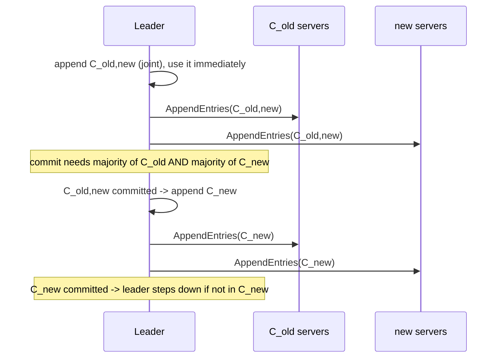

# Raft III: Safety Proofs, Membership Changes, Snapshots

> Joint consensus and why you cannot just swap the config.

**Type:** Build
**Languages:** Java, Python, Go
**Prerequisites:** Phase 6 Lesson 06 (Raft II: Log Replication), Phase 6 Lesson 05 (Raft I: Leader Election), Phase 6 Lesson 03 (Quorums)
**Time:** ~120 minutes

## Learning Objectives

- Reproduce the Raft safety argument: why the election restriction plus the commit rule gives Leader Completeness, and why Leader Completeness gives State Machine Safety
- Show with a brute-force quorum checker why switching a cluster directly from one configuration to another admits two leaders in one term, and why a one-server change does not
- Implement joint consensus: a C_old,new entry that takes effect when written, a C_new entry appended when C_old,new commits, and a leader that steps down after committing a configuration it is not in
- Implement log compaction and the InstallSnapshot RPC, including the follower rules that decide whether to keep or discard the existing log
- Run an explicit checker for Election Safety, Leader Completeness, Log Matching, and State Machine Safety across seeds while membership changes, crashes, and snapshots happen at once

## The Problem

A ledger's configuration store runs Raft on three servers. Traffic grows, and the team decides to move to five. The migration plan is one line: push the new five-server member list to every server and restart them. Server 0 picks up the new list first and, when its election timer fires, asks the five-server cluster for votes. Servers 3 and 4 are brand new and vote for it. Server 0 now has three of five votes and declares itself leader of term 9. Meanwhile servers 1 and 2 still hold the old three-server list. Server 1's timer fires, server 2 votes for it, and server 1 has two of three votes: also a leader of term 9. Both leaders accept writes. Both commit, each with a majority of *its* configuration. The two majorities, {0, 3, 4} and {1, 2}, share no server, so neither leader ever learns about the other until the logs are compared during the incident review. Two ledger postings at the same index, both "committed".

The second problem is slower. The same cluster has been running for a year. Every server's log is 400 million entries. A server is replaced after a disk failure; it comes up empty and the leader starts sending it the log from index 1, at the heartbeat interval, one AppendEntries at a time. It will catch up in nine days. Meanwhile the operators cannot complete the membership change that would retire the old server, because the new one is not yet a useful replica, and the cluster runs with two of three healthy servers for a week.

Lesson 06 gave you a Raft that replicates a log and commits with a fixed majority. This lesson finishes it. First the safety argument, in enough detail to see exactly which rules each property depends on, because the membership change breaks one of those rules and the fix has to restore it. Then joint consensus, the two-phase configuration change that makes a membership transition safe without stopping the cluster. Then snapshots, so that a server that has fallen behind, or a new one, can be brought up to date in one transfer instead of a replay of history. And throughout, a checker that watches every delivery for a violation, so that the proofs are tested, not just read.

## The Concept

### The five properties and what each one rests on

Figure 3 of the Raft paper states five properties. The lesson's checker tests four directly and the fifth follows from the code's structure.

| Property | Statement | Mechanism it rests on |
|----------|-----------|-----------------------|
| Election Safety | at most one leader per term | each server votes at most once per term (persisted); a quorum of votes is a majority; two majorities of the same set intersect |
| Leader Append-Only | a leader never overwrites or deletes its own entries | leaders only call `append`; `truncate` exists only on the AppendEntries receiver path |
| Log Matching | same index and term implies identical logs up to that index | leaders create at most one entry per index per term; the `prevLogIndex`/`prevLogTerm` consistency check |
| Leader Completeness | an entry committed in term T is in the log of every leader of every term greater than T | the election restriction (voters refuse candidates with a less up-to-date log) plus the commit rule (count replicas only for current-term entries) |
| State Machine Safety | if a server applied index i, no other server applies a different entry at i | Leader Completeness plus Log Matching |

The property that does the heavy lifting is Leader Completeness, and its proof is the one worth being able to reproduce on a whiteboard.

### Proof sketch: Leader Completeness (section 5.4.3)

Suppose, for contradiction, that leader L_T commits entry e at index i in term T, and some later leader L_U (U > T) does not have e in its log. Take U to be the smallest such term, so every leader between T and U does have e.

1. L_T committed e, so e is on a majority of the cluster (the commit rule).
2. L_U won term U, so a majority voted for it (the election rule).
3. Two majorities intersect: some server S both stored e and voted for L_U.
4. S stored e before voting for L_U. (S received e from L_T in term T; S's `currentTerm` was at most T when it accepted e, because accepting it from L_T means S's term was T. S voted for L_U in term U > T, which is later in S's history. And S never deleted e: the only way to delete an entry is a conflicting AppendEntries from a leader, and every leader between T and U had e, by minimality of U.)
5. S granted its vote only if L_U's log was at least as up to date as S's: `(lastTerm, lastIndex)` of L_U at least `(lastTerm, lastIndex)` of S.
6. Case A: L_U's last term equals S's last term. Then L_U's log is at least as long as S's, and by Log Matching it contains everything S has, including e. Contradiction.
7. Case B: L_U's last term is greater than S's last term. The leader that created L_U's last entry had term greater than T and less than U, so by minimality it had e. By Log Matching, since L_U has that leader's entry, L_U has everything before it, including e. Contradiction.

Both cases contradict the assumption, so no such L_U exists. Notice which rules were used: the election restriction (step 5), the commit rule's "majority" (step 1), the voting majority (step 2), majority intersection (step 3), and Log Matching (steps 6 and 7). The commit rule's *second* half, "only count replicas of current-term entries", is what makes step 4 safe against the Figure 8 scenario from Lesson 06, where an old-term entry on a majority is overwritten anyway.

State Machine Safety follows in two lines: a server applies index i only when i is committed; the entry at i was committed by some leader in some term T, so every later leader has it (Leader Completeness), and no leader ever has a different entry at i (Log Matching with the leader that committed it). Therefore every log that ever has index i committed has the same entry there.

### Why you cannot just swap the configuration (section 6)

Step 3 of the proof, and the whole of Election Safety, rest on **two majorities of the same set intersect**. A configuration change replaces the set. If server 0 counts majorities of C_new while server 1 counts majorities of C_old, their majorities can be disjoint, and the proof's step 3 fails. The lesson's `Configuration.disjointQuorumsPossible` checks this by brute force over subsets:

```text
C_old = {0,1,2}   majority 2
C_new = {0,1,2,3,4}   majority 3
{0,1} is a majority of C_old; {2,3,4} is a majority of C_new; they are disjoint.
Two leaders in one term are possible during the switch.
```

and shows a case where a direct switch is safe:

```text
C_old = {0,1,2}   majority 2
C_new = {0,1,2,3}   majority 3
Any 2 of {0,1,2} and any 3 of {0,1,2,3} share at least one server: 2 + 3 > 4.
```

The second case is the basis of **single-server changes** (Ongaro's thesis, section 4.1): adding or removing exactly one server never creates disjoint majorities, so it needs no joint phase. etcd uses that approach. Joint consensus is the general method that handles arbitrary changes, and it is what this lesson builds, because it makes the invariant explicit rather than relying on an arithmetic coincidence.

### Joint consensus

The configuration is stored in the log as an ordinary entry, so it replicates and persists like everything else. A change from C_old to C_new goes through an intermediate **joint configuration** C_old,new:



Three rules make it safe:

1. **Under C_old,new, every decision needs a majority of C_old and a majority of C_new.** Votes and commits alike. Any two quorums of C_old,new each contain a quorum of C_old, so they intersect in C_old; the proof's step 3 holds again.
2. **A server uses the latest configuration in its log, committed or not.** The leader starts counting with C_old,new the moment it appends it. If the entry is later lost (the leader crashes before committing), the servers that had it revert to C_old, and no decision was made under C_old,new that C_old alone would not also have authorised, because every C_old,new quorum contains a C_old quorum.
3. **Only one change at a time.** The leader refuses a new `changeMembership` while the latest configuration in its log is joint or uncommitted.

The transition is "C_old alone" to "both" to "C_new alone", and at no instant can one server be deciding with C_old alone while another decides with C_new alone. That is the whole argument, and it is why the cluster keeps serving clients throughout: there is no moment where it has to stop.

Two consequences the code has to handle. A leader that is being removed keeps leading until C_new is committed, counting quorums without itself (the quorum rule simply does not count a non-member), then steps down. And a new leader that inherits a committed C_old,new from a crashed predecessor must finish the job by appending C_new; the lesson's first version did not do this and a seed left the cluster in the joint configuration forever, refusing all further changes.

### Worked example: 3 servers to 5

From the demo, seed 7, no drops:

```text
t=242  n1 appends C_old,new [0,1,2]->[0,1,2,3,4] at index 4     n1 now needs majority of both sets
t=244  n3, n4 see term 1 -> follower                             new servers learn the term from AppendEntries
t=248  n1 commits through index 5 (acks [0,1,2] satisfy joint)   {0,1,2} is 3 of C_old and 3 of C_new
t=248  n1 C_old,new committed at 4 -> appends C_new [0,1,2,3,4]
t=255  n1 commits through index 6 (acks [0,1,2] satisfy [0,1,2,3,4])
t=258  n1 commits through index 7 (acks [0,1,4] satisfy [0,1,2,3,4])   n4 is now a voting replica
```

A `SET carol 7` proposed at t=242, during the change, lands at index 5 between the two configuration entries and commits normally. Note that {0, 1, 2} satisfied the joint quorum because those three happen to be a majority of both sets; had C_new been {3, 4, 5, 6, 7}, the leader would have had to wait for three of the new servers to catch up.

### Snapshots and InstallSnapshot (section 7)

A log grows without bound; the state machine does not. A **snapshot** is the state machine's state after applying through index i, together with i, the term of entry i, and the latest configuration at or before i. Once a server has a snapshot through i it discards entries 1..i. Each server snapshots independently: compaction is a local decision, taken here every `snapshotThreshold` applied entries.

The leader needs the snapshot for one reason: a follower whose `nextIndex` points below the leader's snapshot index can no longer be served by AppendEntries, because the leader has thrown those entries away. It sends InstallSnapshot instead. Figure 13's receiver rules, as implemented:

| Rule | Condition | Action |
|------|-----------|--------|
| 1 | snapshot's term is stale | reply with current term, ignore |
| 5 | snapshot index at or below my own snapshot | reply with my snapshot index, nothing to do |
| 6 | I have the entry at `lastIncludedIndex` with `lastIncludedTerm` | compact through it, **keep** later entries |
| 7 | otherwise | discard the entire log, the snapshot becomes my log's base |
| 8 | my `lastApplied` is below the snapshot | reset the state machine to the snapshot's data |

Rule 6 exists because a snapshot can arrive at a follower that is only slightly behind (the leader compacted aggressively); throwing away entries it already has would waste work and, more importantly, those entries may be committed. Rule 7 is the common case for a server that has been down for a long time or is brand new.

Why is this safe? The snapshot contains only *committed* entries (a server snapshots at `lastApplied`, which is at most `commitIndex`), so it never deletes anything that Leader Completeness might need to recover. The `(lastIncludedIndex, lastIncludedTerm)` pair plays the role of the sentinel entry in the consistency check: an AppendEntries with `prevLogIndex` equal to the snapshot index matches when the terms agree, exactly as a real entry would. And the configuration travels with the snapshot, because a server whose log has been replaced must still know whom to ask for votes.

### The checker

The `Cluster` observes every delivery and checks:

- **Election Safety**: a map from term to leader id; a second leader in a known term throws.
- **Leader Completeness**: the first time a server is seen leading term T, every entry recorded as committed so far must be in its log (or below its snapshot index, since snapshots contain only committed entries).
- **State Machine Safety**: the command applied at each index, recorded per server, must agree with every other server's command at that index; and the committed entry at each index must never change.
- **Log Matching**: on the uncompacted overlap of every pair of logs.

The checker is run over twelve seeds with 20% message loss, delays up to ten ticks, a 3 to 5 to 4 membership sequence, a leader crash and restart, and snapshots every eight entries. Each violation would throw; the demo prints the fact that none did. Two tests also forge violations (two leaders in one term; a leader missing a committed entry) to prove the checker is alive.

### What this lesson does not do

- No pre-vote or leader stickiness: a removed server that never received C_new could still disrupt the cluster with elections; the code avoids that by continuing to replicate to departing servers until they have C_new, and by never letting a non-member campaign. Section 4.2.3 of the thesis describes the production fix.
- No non-voting catch-up phase for new servers (thesis 4.2.1). New servers here become voting members as soon as C_old,new is written, so a slow new server can delay commits. Exercise 2 adds the catch-up phase.
- No incremental snapshot transfer. The whole snapshot is one message. Real systems chunk it (`offset`/`done` in Figure 13) and throttle resends; the demo's leader resends on every heartbeat until the reply arrives.
- No client-visible linearizability (read-index, lease reads). That is Lesson 12.

## Build It

The code is `code/java/Main.java`, which starts from Lesson 06's file and keeps every name. Tests are in `code/java/MainTest.java`. Read Lesson 06's Steps 1 to 8 first if the AppendEntries path is not fresh.

### Step 1: Configurations and the quorum rule

```java
record Configuration(Set<Integer> oldMembers, Set<Integer> newMembers) {
    boolean isJoint() { return newMembers != null; }

    static boolean majorityOf(Set<Integer> members, Set<Integer> acks) {
        int count = 0;
        for (int m : members) if (acks.contains(m)) count++;
        return count >= members.size() / 2 + 1;
    }

    boolean hasQuorum(Set<Integer> acks) {
        if (!majorityOf(oldMembers, acks)) return false;
        return newMembers == null || majorityOf(newMembers, acks);
    }
}
```

Every quorum decision in the node goes through `hasQuorum` with a set of server ids: the votes a candidate has collected, or the servers whose `matchIndex` reaches a given index. `majorityOf` counts only members, so a departing leader or a joining server contributes nothing to a configuration it is not in. That one property is what lets the removed leader keep leading honestly until C_new commits.

**Predict:** `Configuration.joint(Set.of(0,1,2), Set.of(3,4,5)).hasQuorum(Set.of(0,1,3,4))` — true or false, and which half decides?

### Step 2: The disjoint-majority checker

```java
static boolean disjointQuorumsPossible(Set<Integer> a, Set<Integer> b) {
    List<Integer> union = new ArrayList<>(new TreeSet<>(unionOf(a, b)));
    int n = union.size();
    for (int maskA = 0; maskA < (1 << n); maskA++) {
        Set<Integer> qa = subset(union, maskA);
        if (!majorityOf(a, qa)) continue;
        for (int maskB = 0; maskB < (1 << n); maskB++) {
            if ((maskA & maskB) != 0) continue;
            if (majorityOf(b, subset(union, maskB))) return true;
        }
    }
    return false;
}
```

Brute force over all pairs of disjoint subsets of the union: 2^n times 2^n for n up to about ten, which is instant. It is a teaching tool, not a protocol component: it turns "you cannot just swap the config" from a slogan into a function you can call on your own cluster sizes. The tests pin three cases: 3 to 5 is unsafe, 3 to 4 is safe, and a configuration can never have two disjoint majorities of itself.

### Step 3: Storage that can forget its prefix

```java
long termAt(int index) {
    if (index == snapshotIndex) return snapshotTerm;
    if (index < snapshotIndex) throw new IllegalStateException("index " + index + " is compacted (snapshot at " + snapshotIndex + ")");
    return entries.get(index - snapshotIndex).term();
}

void compact(Snapshot s) {
    List<LogEntry> keep = new ArrayList<>();
    for (int i = s.lastIncludedIndex() + 1; i <= lastIndex(); i++) keep.add(get(i));
    entries.clear();
    entries.add(new LogEntry(s.lastIncludedTerm(), "<sentinel>"));
    entries.addAll(keep);
    snapshotIndex = s.lastIncludedIndex();
    snapshotTerm = s.lastIncludedTerm();
    snapshot = s;
    writes++;
}
```

Lesson 06's log had a sentinel at index 0 so that `prevLogIndex = 0` always matched. Now the sentinel sits at `snapshotIndex` and carries `snapshotTerm`, so the consistency check for a `prevLogIndex` equal to the snapshot boundary works unchanged. Every index is translated by `index - snapshotIndex`; asking for a term below the snapshot is a bug and throws. `configAt(index)` searches the log backwards and falls back to the snapshot's configuration, so a server whose entire log was replaced still knows its membership.

**Predict:** after `compact` through index 16 on a log that ended at 17, what do `firstIndex()`, `lastIndex()`, and `entries.size()` return?

### Step 4: The node uses the latest configuration it has

```java
Configuration configuration() { return storage.configAt(storage.lastIndex(), bootstrap); }

boolean isMember() { Configuration c = configuration(); return c != null && c.all().contains(id); }

@Override
public List<Message> tick(int now) {
    if (role == Role.LEADER) return now >= nextHeartbeat ? replicateAll(now) : List.of();
    if (now < electionDeadline) return List.of();
    if (!isMember()) { resetElectionTimer(now); return List.of(); }       // joining or removed servers never campaign
    return startElection(now);
}
```

`bootstrap` is the configuration a server is created with; a server that joins later is created with `null` and learns its membership from the first configuration entry it receives. A server that is not in its own latest configuration (either because it has not learned one yet, or because C_new left it out) never starts an election. In `onVoteReply` and `advanceCommitIndex`, `majority()` from Lesson 06 is replaced by `configuration().hasQuorum(acks)`.

### Step 5: Starting a change, and finishing one

```java
int changeMembership(Set<Integer> newMembers) {
    if (role != Role.LEADER) return -1;
    Configuration current = configuration();
    if (current.isJoint() || storage.latestConfigIndex() > commitIndex) return -1;
    return propose(Configuration.joint(current.oldMembers(), newMembers).encode());
}

List<Message> afterCommit(int now) {
    Configuration c = configuration();
    int cfgIdx = storage.latestConfigIndex();
    boolean latestConfigCommitted = cfgIdx == -1 || cfgIdx <= commitIndex;
    if (c.isJoint() && latestConfigCommitted) {
        propose(Configuration.simple(c.newMembers()).encode());
        return replicateAll(now);
    }
    if (!c.isJoint() && latestConfigCommitted && !c.all().contains(id)) {
        steppedDownAfterRemoval = true;
        List<Message> finalBeat = replicateAll(now);
        role = Role.FOLLOWER;
        leaderId = -1;
        return finalBeat;
    }
    return List.of();
}
```

`changeMembership` is the only entry point and it enforces "one change at a time". `afterCommit` runs every time `commitIndex` advances and does the two automatic steps: append C_new once C_old,new is committed, and step down once a C_new that excludes this leader is committed. `cfgIdx == -1` means the latest configuration lives in the snapshot, which is committed by construction; that case is what lets a new leader finish a change its predecessor started. The final heartbeat before stepping down carries the new commit index to the departing followers.

**Predict:** the leader appends C_old,new at index 9 while `commitIndex` is 8, then crashes before anything else. Servers that received index 9 use the joint configuration; servers that did not use C_old. Can a decision made under C_old,new conflict with one made under C_old? Use rule 1 from the Concept.

### Step 6: Replication targets include the departing

```java
Set<Integer> replicationTargets() {
    Configuration c = configuration();
    if (c == null) return Set.of();
    Set<Integer> targets = new TreeSet<>(c.all());
    int cfgIdx = storage.latestConfigIndex();
    if (!c.isJoint() && cfgIdx > 0) {
        Configuration before = storage.configAt(cfgIdx - 1, bootstrap);
        if (before != null) for (int m : before.all()) if (matchIndex.getOrDefault(m, 0) < cfgIdx) targets.add(m);
    }
    targets.remove(id);
    return targets;
}
```

Once C_new is the latest configuration, servers that were in C_old but not C_new are no longer members. If the leader stopped talking to them immediately, a departing server that never received C_new would keep believing it is a member, time out, and start elections with ever-higher terms, forcing the real leader to step down each time. The leader therefore keeps sending AppendEntries to departing servers until each one's `matchIndex` reaches the C_new entry; after that they know they are out and stay quiet.

### Step 7: Taking and sending snapshots

```java
void takeSnapshot(int now) {
    Snapshot s = new Snapshot(lastApplied, storage.termAt(lastApplied), stateMachine.data, storage.configAt(lastApplied, bootstrap));
    storage.compact(s);
    snapshotsTaken++;
}

Message appendEntriesFor(int peer) {
    int next = nextIndex.computeIfAbsent(peer, p -> lastLogIndex() + 1);
    matchIndex.putIfAbsent(peer, 0);
    if (next <= storage.snapshotIndex) {
        snapshotsSent++;
        return Message.installSnapshot(id, peer, storage.currentTerm, storage.snapshot);
    }
    ...
}
```

`applyCommitted` calls `takeSnapshot` when `lastApplied - snapshotIndex` reaches the threshold. The snapshot records the configuration *at* `lastApplied`, not the latest in the log, because entries after `lastApplied` are not yet committed and might be truncated. On the leader side, the only change to Lesson 06 is the first branch of `appendEntriesFor`: when the follower's `nextIndex` is at or below the snapshot boundary, there is nothing to send but the snapshot.

### Step 8: Installing a snapshot

```java
List<Message> onInstallSnapshot(Message m, int now) {
    if (m.term() < storage.currentTerm) return List.of(Message.snapshotReply(id, m.from(), storage.currentTerm, 0));
    ...
    Snapshot s = m.snapshot();
    if (s.lastIncludedIndex() <= storage.snapshotIndex) {
        return List.of(Message.snapshotReply(id, m.from(), storage.currentTerm, storage.snapshotIndex));
    }
    if (storage.has(s.lastIncludedIndex()) && storage.termAt(s.lastIncludedIndex()) == s.lastIncludedTerm()) {
        storage.compact(s);                                                                                   // 6
    } else {
        storage.replaceWithSnapshot(s);                                                                       // 7
    }
    if (lastApplied < s.lastIncludedIndex()) {                                                                // 8
        stateMachine.reset(s.data());
        lastApplied = s.lastIncludedIndex();
    }
    commitIndex = Math.max(commitIndex, s.lastIncludedIndex());
    return List.of(Message.snapshotReply(id, m.from(), storage.currentTerm, s.lastIncludedIndex()));
}
```

The rule numbers follow Figure 13. The reply carries the snapshot index as `matchIndex`, so the leader's `onSnapshotReply` advances `nextIndex` past the snapshot and resumes ordinary AppendEntries for the tail. The test "rule 6: matching snapshot keeps the following entries" installs a snapshot through index 3 on a server holding indexes 1 to 5 and checks that 4 and 5 survive.

### Step 9: The checker

```java
if (completenessChecked.add(n.currentTerm())) {
    for (Map.Entry<Integer, LogEntry> e : committedByIndex.entrySet()) {
        int k = e.getKey();
        if (k <= n.storage.snapshotIndex) continue;
        if (!n.storage.has(k) || !n.storage.get(k).equals(e.getValue())) {
            throw new IllegalStateException("LEADER COMPLETENESS: leader " + n.id + " of term " + n.currentTerm() + " lacks committed entry " + k + "=" + e.getValue());
        }
    }
}
```

This is the Leader Completeness property as a runtime assertion: the first time a server is observed leading a term, every entry the cluster has ever committed must be in its log. The `committedByIndex` map is filled from every server's committed prefix, and the same map is checked for immutability, which is State Machine Safety from the log's side. A separate `appliedByIndex` map checks it from the state machine's side. Both forged-violation tests prove the checker throws when it should.

### Step 10: Run it

```bash
cd phases/06-replication-and-consensus/07-raft-safety-and-membership/code/java
javac -d .out *.java && java -cp .out Main
java -cp .out MainTest
```

Expected output, abbreviated:

```console
== Why you cannot just swap the configuration (Figure 10) ==
disjoint majorities possible with a direct switch? true   e.g. {0,1} is a majority of C_old and {2,3,4} is a majority of C_new
adding exactly one server, 3 -> 4: disjoint majorities possible? false
joint C_old,new = [0, 1, 2]->[0, 1, 2, 3, 4]: {0,1} has quorum? false; {2,3,4}? false; {0,1,3,4}? true  (needs a majority of BOTH)

== Remove the leader: it commits C_new without counting itself, then steps down ==
t=315   n1 commits through index 7 (acks [1, 2, 3, 4] satisfy [0, 1, 2, 3, 4]->[0, 2, 3, 4])
t=322   n1 C_new [0, 2, 3, 4] committed and I am not in it -> step down
t=532   n4 wins -> LEADER of term 2 with 3 votes in [0, 2, 3, 4], log ends at 8

== Snapshots: compaction every 8 applied entries; a follower that falls behind gets InstallSnapshot ==
t=203   n0 snapshots through index 8 (log now 9..8, config [0, 1, 2])
t=635   n1 installs snapshot through 16 (term 1), log discarded, config [0, 1, 2]
after restart: n1 log=[snap<=16][t1:SET k16 v16] kv size=16; state machines converged=true

== Safety checker over 12 seeds: 20% drops, delay 1-10, membership 3->5->4, crash+restart, snapshots every 8 entries ==
seeds converged on all writes in the final configuration: 12/12; membership changes completed: 24/24; InstallSnapshot handled: 54
no Election Safety, Leader Completeness, Log Matching, or State Machine Safety check fired (each would have thrown)
```

### In Python

```python
@dataclass(frozen=True)
class Configuration:
    old_members: frozenset
    new_members: Optional[frozenset] = None

    def all(self) -> list[int]:
        s = set(self.old_members)
        if self.new_members is not None:
            s |= self.new_members
        return sorted(s)
```

`code/python/main.py` is Lesson 06's Python port with the same additions as the Java, and the demo prints the same trace line for line. What differs:

- **Sets are `frozenset`, iteration is `sorted`.** `Configuration` is a frozen dataclass, so `==` compares members exactly like the Java record and `decode(encode(c)) == c` holds. Java iterates `TreeSet`s; Python sets have no order, so `all()` and `replication_targets()` return sorted lists. The order matters: it decides which RequestVote and AppendEntries hit the network first, and therefore which seeded delay each one draws.
- **`Snapshot` copies its data.** `__post_init__` replaces `data` with a fresh `dict` (the Java `new TreeMap<>(data)`), so the leader's live `KVStore.data` keeps changing without corrupting a snapshot it already sent. `Snapshot` and `Message` are `eq=False`: the checker compares `LogEntry`s and `Configuration`s, never snapshots.
- **No constructor overloads.** Java has `Cluster(size, initialMembers, seed, drop, delay, config)` and `Cluster(size, seed, drop, delay)`; Python has one `Cluster(size, seed, drop_rate, max_delay, config=DEFAULT_CONFIG, initial_members=None)`, where `None` means every server starts in the configuration.
- **Errors.** `IllegalStateException` (a compacted `term_at`, two leaders, every Figure 3 violation) is `RuntimeError`; bad timing configs are `ValueError`. Booleans are printed through `fmt_bool` so the demo says `true`, as the Java does.

Run it from `code/python/`:

```bash
python3 main.py
python3 -m unittest -v
```

### In Go

```go
type Configuration struct {
    OldMembers []int // sorted
    NewMembers []int // nil for a simple configuration
}

func (c Configuration) HasQuorum(acks map[int]bool) bool {
    if !MajorityOf(c.OldMembers, acks) {
        return false
    }
    return c.NewMembers == nil || MajorityOf(c.NewMembers, acks)
}
```

`code/go/main.go` is Lesson 06's Go port with the same additions as the Java, and the demo prints the same trace line for line. What differs:

- **Sets are sorted slices or `map[int]bool`.** Member sets are kept sorted (what Java's `TreeSet` iterates as), so `All()` and `ReplicationTargets()` return the same order the Java does; that order decides which RequestVote and AppendEntries hit the network first and therefore which seeded delay each one draws. Vote and ack sets are `map[int]bool`, and the trace sorts them before printing. Slices have no `==`, so `Configuration.Equal` is written by hand and the checker compares `LogEntry` structs, which do.
- **`nil` is the missing configuration.** A spare server is created with a `*Configuration` bootstrap of `nil`, `Storage.ConfigAt` returns `nil` when neither the log nor the snapshot knows one, and `cfgString` prints `null` where the Java would. `Snapshot` is a pointer that `NewSnapshot` fills with a copy of the state machine's map; `Message.Snapshot` is `nil` on every other kind.
- **Programming errors panic; the checker panics too.** `TermAt` below the snapshot, `Get` of a missing index, two leaders in one term, and each Figure 3 violation are `panic`s, as in Lesson 06, because there is no correct value to return; the test recovers them with `checkPanics`. Bad timing configs are the one runtime error: `NewConfig` returns `(Config, error)`.
- **No constructor overloads.** `NewClusterWithMembers(size, initialMembers, seed, drop, delay, config)` is the full constructor; `NewCluster(size, seed, drop, delay)` starts every server in the configuration with `DefaultConfig`. `KVStore.Get` returns `(string, bool)`.

Run it from `code/go/`:

```bash
go run .
go test ./...
```

## Use It

### etcd and raft-go

etcd's Raft library implements single-server changes by default (`ConfChangeAddNode`, `ConfChangeRemoveNode`) and added joint consensus (`ConfChangeV2` with `EnterJoint`/`LeaveJoint`) in 2019 for arbitrary changes. It also implements the learner role: a new server is first added as a non-voting learner that receives entries but is not counted in quorums, and promoted to a voter only once it has caught up. That is the thesis's section 4.2.1 and Exercise 2. Snapshots in etcd are taken every `--snapshot-count` applied entries (default 10,000) and the leader sends them in chunks with a rate limit.

### HashiCorp Raft, Consul, Nomad

HashiCorp's library persists snapshots through a `SnapshotStore` and streams them over a separate connection rather than inside the RPC, since a snapshot can be gigabytes. Its membership changes are single-server, and it adds "non-voter" servers for exactly the catch-up reason. Consul's autopilot feature automates the add-then-remove sequence for rolling replacements, which is the 3 to 5 to 4 pattern in this lesson's seed loop.

### TiKV and CockroachDB

Both run thousands of Raft groups (one per data range) and change membership constantly as ranges split and rebalance. CockroachDB used single-server changes until 2019 and then adopted joint consensus because a rebalance (replace server A with server B) is a two-server change; done as two single-server steps it passes through a four-server configuration whose quorum of three is fragile. Joint consensus goes {A,B,C} to {A,B,C}->{B,C,D} to {B,C,D} with a quorum requirement of two-of-three at every instant.

### Payment systems

The configuration store under a ledger, the lock service that fences account updates (Phase 5, Lesson 12), and the sequencer that assigns posting ids are all Raft-shaped services whose membership changes during every deployment and every incident. The property to insist on in a design review is the one from this lesson's first paragraph: at no instant may two servers be using configurations whose majorities can be disjoint. Ask how the system changes membership, and if the answer is "we push the new list and restart", you have found the two-leaders bug.

## Ship It

`outputs/runbook-raft-membership-change.md` is a step-by-step runbook for changing the membership of a Raft cluster in production: preconditions, the add-then-remove order, what to watch at each step, and how to recover a cluster stuck in a joint configuration or one that has lost its quorum. It is written against etcd's and HashiCorp Raft's command names, with the lesson's vocabulary alongside.

## Exercises

1. **Reinforce.** Add a `ConfigurationTest` that enumerates every pair of configurations with members drawn from {0..5} and sizes 1 to 5, and counts how many pairs admit disjoint majorities under a direct switch. Then verify that for every pair, `Configuration.joint(a, b)` has no two disjoint quorums. Report the counts in a comment.
2. **Apply.** Implement non-voting learners (thesis 4.2.1): `addLearner(id)` makes the leader replicate to a server without adding it to any configuration; `changeMembership` is refused unless every new member's `matchIndex` is within one heartbeat's worth of entries of the leader's log. Show with a seed that a slow new server no longer delays commits during the joint phase.
3. **Extend.** Combine with Phase 6, Lesson 12 (Linearizability Checking). Record every client `propose` and every state-machine `apply` with the simulated clock, run a membership change and a snapshot during the workload, and feed the history to the linearizability checker. Then introduce a deliberate bug (count `matchIndex` of non-members in `hasQuorum`) and show the checker, or this lesson's safety checker, catches it on some seed.

## Key Terms

| Term | What people say | What it actually means |
|------|-----------------|------------------------|
| Leader Completeness | "the leader has everything" | If an entry is committed in term T, every leader of every later term has it; proved from the election restriction plus the commit rule plus majority intersection |
| Election restriction | "the most up-to-date log wins" | A voter refuses a candidate whose last entry's (term, index) is behind its own; the step of the safety proof that connects votes to log contents |
| Joint consensus | "the two-phase membership change" | A transitional configuration C_old,new in which every decision needs a majority of C_old and a majority of C_new, so no two quorums can be disjoint during the change |
| Configuration entry | "the member list in the log" | A log entry carrying a configuration; a server uses the latest one it has, committed or not, and it replicates and persists like any other entry |
| Single-server change | "add one, remove one" | A membership change by exactly one server, which never admits disjoint majorities and so needs no joint phase; what etcd and HashiCorp Raft do by default |
| Snapshot | "compaction" | The state machine's state through index i plus (i, term of i, configuration at i); lets a server discard log entries 1..i and lets the leader bring a lagging follower up to date in one transfer |
| InstallSnapshot | "the snapshot RPC" | The RPC a leader sends when a follower's nextIndex is below the leader's snapshot index; the receiver keeps or discards its log depending on whether it already has the snapshot's last entry |
| Learner | "non-voting member" | A server that receives entries but is not counted in any quorum, used to catch up a new server before it becomes a voter |

## Further Reading

- [In Search of an Understandable Consensus Algorithm (Extended Version)](https://raft.github.io/raft.pdf) (Ongaro and Ousterhout, 2014) — sections 5.4 (safety argument), 6 (membership changes, Figures 10 and 11), and 7 (log compaction, Figure 13); the proof sketch above follows 5.4.3 step by step.
- [Consensus: Bridging Theory and Practice](https://web.stanford.edu/~ouster/cgi-bin/papers/OngaroPhD.pdf) (Ongaro, PhD thesis, 2014) — chapter 4 covers single-server changes, the catch-up phase, the disruptive-server problem, and the bug found in the original single-server algorithm; chapter 5 covers snapshots in depth.
- [etcd raft: joint consensus design](https://github.com/etcd-io/raft/blob/main/design.md) — how a production library exposes `ConfChangeV2`, learners, and automatic `LeaveJoint`.
- [Raft TLA+ specification](https://github.com/ongardie/raft.tla) — the formal model whose invariants this lesson's checker approximates at runtime; compare `LeaderCompleteness` there with `checkInvariants` here.
- [CockroachDB: Availability and Region Failure: Joint Consensus in CockroachDB](https://www.cockroachlabs.com/blog/joint-consensus-raft/) — why a two-server rebalance done as two single-server steps is fragile, and what joint consensus fixes in a system with thousands of Raft groups.
- [HashiCorp Raft: `raft.Config` and snapshot stores](https://pkg.go.dev/github.com/hashicorp/raft) — `SnapshotInterval`, `SnapshotThreshold`, `TrailingLogs`, and the non-voter API, to compare with `Config.snapshotThreshold` and Exercise 2.
