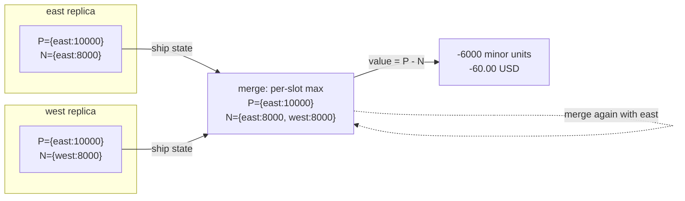

# CRDTs: Counters, Sets, and Convergence

> A PN-counter for balances that can be reconciled without coordination.

**Type:** Build
**Languages:** Java, Python, Go
**Prerequisites:** Phase 5 Lesson 03 (Lamport and Vector Clocks), Phase 6 Lesson 01 (Replication Strategies), Phase 6 Lesson 03 (Quorums), Phase 0 Lesson 07 (Decimal and Integer Arithmetic)
**Time:** ~90 minutes

## Learning Objectives

- State the three algebraic laws a merge function must satisfy (commutative, associative, idempotent) and explain why each one maps to a specific network failure
- Build five state-based CRDTs from scratch: G-Counter, PN-Counter, G-Set, OR-Set with unique tags, and LWW-Register
- Test the merge laws property-style with a seeded random generator, and show a plausible-looking merge that violates them
- Model a wallet balance as a PN-Counter of integer minor units and reconcile it across regions with no coordination
- Demonstrate with a two-replica trace why no CRDT can enforce a non-negative balance, and name the mechanism that can

## The Problem

A prepaid wallet product runs in two regions, `east` and `west`, each with its own database, because the product team wants a top-up or a tap-to-pay to succeed even when the inter-region link is down. The balance for wallet `w-4471` is `100.00 USD` and both regions have it. At 09:14:02 the link fails. At 09:14:05 the customer taps a transit gate served by `east` for `80.00 USD`; `east` checks `100.00 >= 80.00`, approves, and writes `20.00`. At 09:14:06 the same customer's partner, holding a linked card, pays `80.00 USD` at a store served by `west`; `west` checks `100.00 >= 80.00`, approves, and writes `20.00`. At 09:16 the link recovers and the replication job finds two versions of the balance: `20.00` from east and `20.00` from west.

The naive resolution is to notice they are equal and keep `20.00`. The wallet is now `60.00 USD` richer than it should be, and the company has given away sixty dollars of transit and groceries. A slightly less naive resolution is last-writer-wins by wall-clock timestamp: still `20.00`, same loss. A reconciliation analyst who understands the business notices that both regions started from `100.00` and each subtracted `80.00`, so the true balance is `-60.00`. That answer is unpleasant, because the customer has overspent, but it is correct, and a correct negative balance can be collected on the next top-up. A silently wrong positive balance cannot.

The analyst's reasoning is a merge function: keep both deltas, do not keep either absolute value. This lesson builds the family of data types whose state is designed so that merging is always possible, always deterministic, and never loses an operation: Conflict-free Replicated Data Types. The headline example is exactly the analyst's rule, a counter of increments and decrements. The lesson also makes the limit precise: the merge recovers the `-60.00`, but no merge function can make the second `80.00` debit fail, because at the moment each region approved its debit, the other debit did not exist in its universe. A CRDT gives you convergence. It does not give you an invariant that spans replicas. Knowing which of your invariants are which is the design skill this lesson teaches.

## The Concept

### Two ways to replicate without a leader

Lesson 01 of this phase laid out the choice: leader-based replication serializes writes at one node; leaderless replication accepts writes anywhere and must reconcile. Reconciliation needs a rule, and most rules are either lossy (pick a winner) or require a human (keep siblings and ask). CRDTs are the third option: design the data type so that any two replica states can be combined by a function that is mathematically guaranteed to produce the same result regardless of order, grouping, or repetition.

There are two styles, and they are equivalent in power:

| Style | What is shipped between replicas | What must hold | Example in this lesson |
|-------|----------------------------------|----------------|------------------------|
| State-based (CvRDT, "convergent") | The whole local state, periodically | `merge` is a join on a semilattice: commutative, associative, idempotent | Everything in `Main.java` |
| Operation-based (CmRDT, "commutative") | Each operation, exactly once, in causal order | Concurrent operations commute | Not built here; see Further Reading |

State-based types are simpler to reason about and tolerate an unreliable network with no extra machinery, because sending the state twice or out of order is harmless by construction. Their cost is bandwidth: shipping the whole state. Operation-based types are cheaper on the wire but push the hard problem into the delivery layer (exactly-once, causal order), which is a lot to ask of a network that just partitioned. Production systems often use "delta-state" CRDTs that ship only the part of the state that changed, but still merge with the state-based laws. This lesson builds state-based types because the laws are the lesson.

### The three laws and the three failures they absorb

A merge function `m(a, b)` is a valid CRDT merge if, for all states `a`, `b`, `c`:

| Law | Statement | Network failure it absorbs |
|-----|-----------|----------------------------|
| Commutative | `m(a, b) = m(b, a)` | Messages from two peers arrive in either order |
| Associative | `m(m(a, b), c) = m(a, m(b, c))` | Peers gossip in any topology; a relayed state merges the same as a direct one |
| Idempotent | `m(a, a) = a` | A message is retried, duplicated, or replayed from a log |

Together these make `m` the join (least upper bound) of a join-semilattice, and the state of every replica is a point in that lattice that only moves upward. Convergence follows: if every replica eventually receives every other replica's state, directly or through relays, in any order, with any duplication, all replicas end at the same point, which is the join of everything anyone ever wrote. Nothing in that argument mentions a leader, a quorum, a clock, or a timeout.

The idempotence law is the one that most plausible merge functions violate. "Add the two counters" is commutative and associative, but `m(a, a) = 2a`, so a retried message doubles the count. The lesson ships a `NaiveSumCounter` that does exactly this so the property test can catch it.

### G-Counter: one slot per writer

A grow-only counter that can be incremented at any replica. The trick is to never store the total. Store a map from replica id to the count of increments that replica performed:

```text
replica A: {A: 3}            replica B: {B: 5}            replica C: {C: 2}
B increments again:          {B: 6}
merge(A, B)  = {A: 3, B: 6}                 value = 9
merge(C, B)  = {B: 6, C: 2}                 value = 8
merge(merge(A, B), C) = {A: 3, B: 6, C: 2}  value = 11
merge(merge(C, B), A) = {A: 3, B: 6, C: 2}  value = 11
merge(merge(A, B), B) = {A: 3, B: 6}        value = 9   (B's state arriving again changes nothing)
```

Merge is the per-slot maximum. Each slot only grows, so the maximum of two versions of the same slot is the newer one. The value is the sum of the slots, computed on read. Two constraints follow and both bite in production:

- **Replica ids must be globally unique and stable.** If two nodes both think they are `A`, their slots collide, merge takes the max, and one node's increments are silently discarded. The test suite has a case for this.
- **Only the owning replica increments its slot.** A node that increments another node's slot breaks the monotonicity that makes `max` correct.

### PN-Counter: two G-Counters

A counter that can go down is two G-Counters: `P` for increments and `N` for decrements, `value = P.value() - N.value()`, merge each half independently. Because each half is a valid CRDT and the pair is merged componentwise, the pair is a valid CRDT. This product construction generalizes: any tuple of CRDTs merged componentwise is a CRDT.

Now the wallet from The Problem, in minor units, with each region as its own replica:

```text
deposit 100.00 at east:       east.P = {east: 10000}   east.N = {}             value 10000
west syncs:                   west.P = {east: 10000}   west.N = {}             value 10000
-- link fails --
east debits 80.00:            east.N = {east: 8000}                            east value 2000
west debits 80.00:            west.N = {west: 8000}                            west value 2000
-- link recovers --
merge: P = {east: 10000}  N = {east: 8000, west: 8000}                         value -6000
```

Both debits survive the merge. The `-60.00 USD` is the true consequence of what both regions did. Compare with LWW, which keeps `2000` and loses `8000` minor units of history. The PN-Counter is the right type for anything that is a sum of independently generated deltas: balances, inventory counts, like counts, rate-limit buckets.

### Why the PN-Counter cannot enforce a non-negative balance

The trace above also shows the limit. Each region ran `if balance >= 80.00 then debit`. Each check was true locally. The invariant "balance never goes negative" is a predicate over the global state, and during the partition no node has the global state. A CRDT's guarantee is about the result of merging: it says nothing about what was permitted before the merge. There are exactly two ways to keep the invariant:

1. **Coordinate the debit.** Route all debits for a wallet to one leader (Lesson 01), or require a quorum (Lesson 03), or run them through consensus (Lessons 04-07). The debit is now unavailable during the partition. This is the CAP trade made explicit: the invariant costs availability.
2. **Change the invariant.** Partition the balance itself. Give each region an escrow of, say, `50.00`, so each can independently approve up to its share. This is how airlines sell seats across regions and how some wallets implement spending limits. It is a CRDT-friendly design because each region's spendable amount is a local fact. The research literature calls this "bounded counters": a PN-Counter plus a transfer-of-rights protocol.

What you must not do is believe that the local check protects the global invariant. The lesson's `ReplicatedBalance.debit` deliberately performs no check at all, so that the caller cannot mistake a local test for a guarantee.

### G-Set and OR-Set: removal is the hard part

A grow-only set with merge as union is trivially a CRDT. Removal breaks it: if `A` removes `x` and `B` still has `x`, `merge` by union puts `x` back. The 2P-Set fixes this with a tombstone set, but then an element can never be re-added. The Observed-Remove Set (OR-Set) fixes both problems by tagging every add with a unique identifier:

```text
A adds "book":   A.added = {book: {A#1}}          A.tombstones = {}
B syncs:         B.added = {book: {A#1}}          B.tombstones = {}
-- concurrently --
A removes book:  A.tombstones = {A#1}             (A tombstones only the tags it has OBSERVED)
B adds book:     B.added = {book: {A#1, B#1}}
-- merge --
added = {book: {A#1, B#1}}   tombstones = {A#1}
contains(book)?  B#1 is live  ->  true
```

The merge is union on both maps. An element is present if any of its tags is not tombstoned. The semantics that fall out are **add-wins**: a concurrent add and remove of the same element resolve to present, because the remove could not have observed the tag of an add it did not know about. That is usually what a shopping cart wants and often what a set of "active sessions" wants. The alternative, remove-wins, is also constructible (tombstone by element and have adds mint tags that must beat the tombstone), but you must choose, and the choice is a product decision, not an implementation detail.

Two costs:

- **Tombstones grow forever** unless garbage-collected, and garbage collection requires knowing that every replica has observed the tombstone, which is a coordination problem (a stability condition over vector clocks, Phase 5 Lesson 03). Riak and Redis Enterprise both have this complexity.
- **Tags need a source of uniqueness.** This lesson uses `(replicaId, sequence)` with a per-replica counter. A UUID works too; a wall-clock timestamp does not, because two adds in the same millisecond collide.

### LWW-Register: deterministic by design, lossy by design

A register holds one value. Merge keeps the version with the higher `(timestamp, replicaId)` pair. It satisfies all three laws (the max of a totally ordered set is a join), so it converges. It also discards every losing write without trace. `A` writes `Oak St` at `t=10`, `B` writes `Elm St` at `t=10`, the tie breaks on replica id, `Elm St` wins everywhere, and nobody ever learns `Oak St` was written. If the two writes were "shipping address" and "billing address" typed into two tabs, one of them is gone. Lesson 09 is about when this is acceptable and what to use when it is not.

### Complexity

| Type | State size | Merge cost | Read cost |
|------|-----------|-----------|-----------|
| G-Counter / PN-Counter | `O(replicas)` | `O(replicas)` | `O(replicas)` (sum on read; cache if hot) |
| G-Set | `O(elements)` | `O(elements)` | `O(log n)` with a tree set |
| OR-Set | `O(adds + removes)` without GC | `O(adds + removes)` | `O(tags of element)` |
| LWW-Register | `O(1)` | `O(1)` | `O(1)` |

The `O(replicas)` in the counters is the reason the replica id must mean a durable replica (a region, a shard owner), not a client or a request. A G-Counter with a slot per mobile device never stops growing.



### What a CRDT does not do

- It does not enforce cross-replica invariants (non-negative balance, unique username, at most one winner). Those need coordination.
- It does not tell you what the business meant. Add-wins versus remove-wins, and whether a counter should be a PN-Counter or an LWW-Register, are decisions about the domain.
- It does not bound metadata. Counters carry a slot per replica; OR-Sets carry tombstones; both need an operational story for growth.
- It does not give you a point-in-time snapshot across replicas. Each replica's value is correct for the history it has seen, which may lag.

## Build It

The implementation is in `code/java/Main.java`. Every type returns a new value from `merge` and leaves both inputs untouched, so the laws can be checked on values with `equals`.

### Step 1: The interface

```java
interface Crdt<T extends Crdt<T>> {
    T merge(T other);
}
```

The self-referential type parameter lets `CrdtLaws.check` be written once for every type. Note what is not here: no `apply(op)`, no clock, no network. State-based CRDTs need only a merge.

**Predict:** if `merge` mutated `this` instead of returning a new value, which of the three laws would become harder to test, and why?

### Step 2: G-Counter

```java
final class GCounter implements Crdt<GCounter> {
    private final TreeMap<String, Long> slots = new TreeMap<>();

    void increment(String replica, long by) {
        if (by < 0) throw new IllegalArgumentException("a G-Counter only grows; got " + by);
        slots.merge(replica, by, Math::addExact);
    }

    long value() {
        long total = 0;
        for (long v : slots.values()) total = Math.addExact(total, v);
        return total;
    }

    @Override public GCounter merge(GCounter other) {
        GCounter out = new GCounter(slots);
        for (var e : other.slots.entrySet()) out.slots.merge(e.getKey(), e.getValue(), Math::max);
        return out;
    }
}
```

`TreeMap` rather than `HashMap` so `toString` and iteration are deterministic, which matters when a test compares printed output. `Math::max` is the join; `Math::addExact` on the local increment path makes overflow an exception rather than a wrapped negative, the same discipline as `Money`. The `increment` guard enforces monotonicity: a negative increment would make `max` pick the wrong version.

**Predict:** two nodes are misconfigured with the same replica id `"same"` and each performs `decrement("same", 5)` on its own PN-Counter. What does the merged value show?

### Step 3: PN-Counter as a product

```java
final class PNCounter implements Crdt<PNCounter> {
    final GCounter positive;
    final GCounter negative;

    void increment(String replica, long by) { positive.increment(replica, by); }
    void decrement(String replica, long by) { negative.increment(replica, by); }
    long value() { return Math.subtractExact(positive.value(), negative.value()); }

    @Override public PNCounter merge(PNCounter other) {
        return new PNCounter(positive.merge(other.positive), negative.merge(other.negative));
    }
}
```

Nothing new is proven here; the laws hold componentwise. This is the pattern to reach for whenever you need a richer type: compose from types whose laws you already trust.

### Step 4: OR-Set with unique tags

```java
record Tag(String replica, long seq) implements Comparable<Tag> { /* ordered by replica, then seq */ }

final class ORSet<E extends Comparable<E>> implements Crdt<ORSet<E>> {
    private final TreeMap<E, TreeSet<Tag>> added = new TreeMap<>();
    private final TreeSet<Tag> tombstones = new TreeSet<>();

    Tag add(E e, TagSource tags) {
        Tag t = tags.next();
        added.computeIfAbsent(e, k -> new TreeSet<>()).add(t);
        return t;
    }

    void remove(E e) {
        TreeSet<Tag> tags = added.get(e);
        if (tags != null) tombstones.addAll(tags);      // only the tags THIS replica has observed
    }

    boolean contains(E e) {
        TreeSet<Tag> tags = added.get(e);
        if (tags == null) return false;
        for (Tag t : tags) if (!tombstones.contains(t)) return true;
        return false;
    }

    @Override public ORSet<E> merge(ORSet<E> other) {
        ORSet<E> out = new ORSet<>();
        /* union of added (per element), union of tombstones */
        return out;
    }
}
```

The line that implements add-wins is `tombstones.addAll(tags)` in `remove`: it can only tombstone tags present in the local `added` map. A concurrent add on another replica minted a tag this replica has never seen, so the tag survives the merge and the element stays present. `remove` of an element never seen is a no-op that creates no tombstone, which the tests check, because a remove-by-element-name design would create one and later block a legitimate add.

**Predict:** after the merge in the worked example, replica `C` (which has seen both tags) removes `book`. How many tombstones does `C` hold, and can a later re-merge with `B`'s old state bring `book` back?

### Step 5: LWW-Register and the replicated balance

```java
record LWWRegister<V>(V value, long timestamp, String replica) implements Crdt<LWWRegister<V>> {
    boolean dominates(LWWRegister<V> other) {
        if (timestamp != other.timestamp) return timestamp > other.timestamp;
        return replica.compareTo(other.replica) > 0;
    }
    @Override public LWWRegister<V> merge(LWWRegister<V> other) { return dominates(other) ? this : other; }
}

final class ReplicatedBalance implements Crdt<ReplicatedBalance> {
    final Currency currency;
    final PNCounter counter;

    void credit(String replica, Money amount) { requireCurrency(amount); counter.increment(replica, amount.minorUnits()); }
    void debit(String replica, Money amount)  { requireCurrency(amount); counter.decrement(replica, amount.minorUnits()); }
    Money balance() { return Money.ofMinor(counter.value(), currency); }

    @Override public ReplicatedBalance merge(ReplicatedBalance other) {
        if (!other.currency.equals(currency)) throw new CurrencyMismatchException(currency, other.currency);
        return new ReplicatedBalance(currency, counter.merge(other.counter));
    }
}
```

The register's tie-break on replica id is what makes merge a total order and therefore a join; without it, two writes at the same timestamp would make `merge(a, b) != merge(b, a)` and the type would not converge. `ReplicatedBalance` wraps the PN-Counter in the `Money` discipline from Phase 10: amounts are minor units, currency mismatch is an exception, and `debit` performs no balance check on purpose.

**Predict:** `ReplicatedBalance.debit` accepts a debit that the local balance cannot cover. If you added `if (balance().minorUnits() < amount.minorUnits()) throw`, would the two-region trace in The Problem end differently?

### Step 6: Property-style law checking

```java
static <T extends Crdt<T>> Result check(Supplier<T> gen, int trials) {
    int comm = 0, assoc = 0, idem = 0;
    for (int i = 0; i < trials; i++) {
        T a = gen.get(), b = gen.get(), c = gen.get();
        if (!a.merge(b).equals(b.merge(a))) comm++;
        if (!a.merge(b).merge(c).equals(a.merge(b.merge(c)))) assoc++;
        if (!a.merge(a).equals(a)) idem++;
    }
    return new Result(trials, comm, assoc, idem);
}
```

The generator is a lambda over a `java.util.Random` seeded in `main` and in the test, so a failure can be replayed by seed. Three random states per trial, three laws, counts rather than booleans so the output tells you which law broke and how often. `NaiveSumCounter` (merge by addition) passes commutativity and associativity and fails idempotence on every trial where the state is non-zero: the test asserts exactly that. `CrdtLaws.converges` goes one step further and merges five replicas all-to-all in shuffled orders, asserting they end equal; that is the convergence theorem checked empirically.

### Step 7: Run it

```bash
cd phases/06-replication-and-consensus/08-crdts/code/java
javac -d .out *.java && java -cp .out Main
java -cp .out MainTest
```

Expected output, abbreviated:

```console
== G-Counter: page views on three replicas, merged in any order ==
merge(A,B,C) = GCounter{A=3, B=6, C=2}=11   merge(C,B,A) = GCounter{A=3, B=6, C=2}=11   equal: true

== PN-Counter as a wallet balance: the merge is safe, the invariant is not ==
both regions see 100.00 USD
east after local debit: 20.00 USD   west after local debit: 20.00 USD
after the partition heals: -60.00 USD   negative=true  (both debits survive; nothing was lost, and nothing was prevented)

== G-Set and OR-Set: removing something a peer re-added ==
A removed book, B concurrently added book -> merged: [book]  (add wins: B's tag was never observed by A's remove)

== Merge laws, property-style (seed 20261013) ==
G-Counter  500 trials: commutative ok, associative ok, idempotent ok
NaiveSum   500 trials: commutative ok, associative ok, idempotent 493 failures  <- merge by addition is not a join
5 PN-Counter replicas, all-to-all merge in shuffled orders, converge: true
```

The test prints `37 passed, 0 failed`.

### In Python

```python
def add_exact(a: int, b: int) -> int:
    r = a + b
    if r < LONG_MIN or r > LONG_MAX:
        raise OverflowError("long overflow")
    return r
```

`code/python/main.py` has the same types and method names; what differs:

- **Overflow is checked by hand.** Python integers are unbounded, so a G-Counter slot could silently grow past `Long.MAX_VALUE` where the Java one throws. `add_exact` and `subtract_exact` keep the 64-bit contract, and the test "gcounter overflow is an error" expects `ArithmeticError` exactly as the Java test expects `ArithmeticException`.
- **`java.util.Random` is ported bit for bit.** The property checks draw their random states from `JavaRandom` (the 48-bit LCG with `next(bits)`, `next_int(bound)` and `next_boolean`), and `java_shuffle` is `Collections.shuffle`. With the same seed the Python version draws the same 500 states, so the demo prints the same `493 failures` for the naive sum counter.
- **Structural equality is explicit.** The CRDTs are mutable (`increment`, `add`), so they define `__eq__` over their internal `dict`s and `set`s rather than being frozen dataclasses; `Tag` and `LWWRegister` are frozen dataclasses, so tags are hashable set members. The `Crdt` interface is a `Protocol` with one method, `merge`.
- **Sorted printing.** `fmt_map` reproduces `TreeMap.toString()` (`{A=3, B=6}`), and `ORSet.elements()` returns a sorted list, so the demo output matches the Java line for line.

Run it from `code/python/`:

```bash
python3 main.py
python3 -m unittest -v
```

### In Go

```go
type Crdt[T any] interface {
    Merge(other T) T
    Equal(other T) bool
}

func Check[T Crdt[T]](gen func() T, trials int) Result {
    for i := 0; i < trials; i++ {
        a, b, c := gen(), gen(), gen()
        if !a.Merge(b).Equal(b.Merge(a)) { comm++ }
        ...
```

`code/go/main.go` has the same types and method names; what differs:

- **The self-referential interface is a generic constraint.** Java's `Crdt<T extends Crdt<T>>` becomes `Crdt[T any]` with `Merge(T) T` and `Equal(T) bool`, and `Check[T Crdt[T]]` and `Converges[T Crdt[T]]` take any type whose methods close over itself. `GSet[E cmp.Ordered]` and `ORSet[E cmp.Ordered]` are generic in the element so `Elements()` can be sorted; `LWWRegister[V comparable]` gets `Equal` from `==`.
- **Overflow and bad input are errors.** `Increment`, `Credit`, and `Debit` return `error`; the sentinels `ErrOverflow`, `ErrNegativeIncrement`, `ErrCurrencyMismatch`, and `ErrNegativeAmount` are checked with `errors.Is`. `addExact` and `subtractExact` are the Phase 10 helpers. `Merge` has no error slot, so a currency mismatch there is a programming error and panics.
- **`java.util.Random` is ported bit for bit.** `JavaRandom` is the 48-bit LCG with `next(bits)`, `NextInt(bound)` (power-of-two shortcut plus the rejection loop) and `NextBoolean`; `Shuffle` is `Collections.shuffle`. With the same seed the Go demo draws the same 500 states and prints the same `493 failures` for the naive sum counter.
- **Maps have no order and no structural equality.** Every CRDT defines `Equal` over its maps by hand, `fmtMap` reproduces `TreeMap.toString()` (`{A=3, B=6}`) by sorting keys, and `GCounter.Merge` keeps a slot that is present at 0, exactly as `TreeMap.merge` would, or the commutativity check fails on states that differ only by an empty slot.

Run it from `code/go/`:

```bash
go run .
go test ./...
```

## Use It

### Riak

Riak KV ships data types built on these constructions: counters (PN), sets (OR-Set with per-add dots), maps (composite), flags and registers (LWW). Riak solved the tombstone-growth problem with "dotted version vectors" and causal context: a remove carries the context the client observed, which is exactly the observed-tags idea with vector-clock compression. The documentation is explicit that a counter is not a "balance with a floor".

### Redis Enterprise active-active (CRDB)

Redis Enterprise's geo-distributed databases implement Redis commands over CRDTs: `INCRBY` on a counter is a PN-Counter, `SADD`/`SREM` is an OR-Set (add-wins), strings are LWW with a vector-clock tie-break. The semantic surprise for teams migrating is exactly the one in this lesson: `DECRBY` on two regions during a partition can leave a negative value that neither region ever observed, so a `DECRBY`-based inventory reservation needs a bounded-counter design or a single-region writer.

### Automerge, Yjs, and collaborative editing

Text editors (Google Docs' successor designs, Figma, Linear's sync) use sequence CRDTs (RGA, YATA) where each character is an OR-Set element with a position tag. The same tombstone problem appears: deleted characters remain as tombstones until compaction, which is why document sizes grow with edit history and why those systems periodically snapshot.

### What production systems add that the from-scratch version made explicit

- **Delta shipping**: send only the changed slots or tags, with the same merge semantics.
- **Causal context**: compress observed tags into a vector clock so removes carry `O(replicas)` metadata instead of `O(tags)`.
- **Garbage collection**: a stability protocol to drop tombstones every replica has seen.
- **Bounded counters**: a transfer-of-rights protocol layered on the PN-Counter so a replica can only decrement what it has been granted.

### What they still do not do

None of them enforce a cross-replica invariant without coordination. If your product requires that a wallet never go negative, you need a leader, a quorum, or a redesign of the invariant into per-replica escrows.

## Ship It

`outputs/checklist-crdt-fitness.md` is a decision checklist for proposing a CRDT in a design review: which type fits, whether the invariant is local or global, how replica ids are assigned, what bounds the metadata, and what the business-visible semantics of concurrent updates will be. It ends with the three laws as a test-plan template.

Use it in two situations. First, when someone proposes "just use a CRDT counter for the balance": walk the invariant section and make them say out loud whether a negative balance is acceptable, and if not, which of the two remedies (coordinate or escrow) they are choosing. Second, when adopting a product that advertises CRDT-backed multi-region writes (Riak, Redis Enterprise, a sync engine): the semantics section forces the question of add-wins versus remove-wins and of what `DECRBY` means during a partition before the first incident, not after.

## Exercises

1. **Reinforce.** Implement a 2P-Set (two G-Sets: added and removed, removed wins, no re-add) implementing `Crdt<TwoPSet<E>>`. Run it through `CrdtLaws.check` and write a test showing the behaviour that makes it unsuitable for a shopping cart: add, remove, add again, and the element is absent.
2. **Apply.** Build a bounded counter: a `PNCounter` plus a `TreeMap<String, Long> rights` recording how many minor units each replica may still decrement. `transfer(from, to, amount)` moves rights; `debit` throws if the local replica lacks rights. Show with two replicas and total rights equal to the balance that the merged balance can never be negative. Then show the price: a replica with no rights cannot debit even when the global balance is positive.
3. **Extend.** Combine with Phase 5, Lesson 03 (vector clocks). Replace the OR-Set's `TreeSet<Tag> tombstones` with a vector clock recording, per replica, the highest sequence number observed. `contains` becomes "some tag `(r, s)` of this element has `s > clock[r]`". Measure the metadata size against the tag-set version after 10,000 random adds and removes across three replicas, and explain what you gave up (hint: a remove now hides every earlier tag from that replica, not just the tags of this element).

## Key Terms

| Term | What people say | What it actually means |
|------|-----------------|------------------------|
| CRDT | "eventually consistent data type" | A replicated type whose merge is a semilattice join (commutative, associative, idempotent) so all replicas that exchange state converge without coordination |
| Join-semilattice | "the merge math" | A partial order in which every pair has a least upper bound; `merge` computes it and replica state only moves upward |
| Idempotent | "safe to retry" | `merge(a, a) = a`; the law that lets duplicated or replayed messages do no harm, and the one that naive sum-merges violate |
| G-Counter | "a distributed counter" | One monotonically increasing slot per replica, merged by per-slot max, valued by sum; replica ids must be unique and stable |
| PN-Counter | "a counter that can decrement" | Two G-Counters (increments, decrements) merged componentwise; the correct type for sums of independent deltas such as balances |
| OR-Set | "a set you can remove from" | Observed-Remove set: each add has a unique tag; a remove tombstones only observed tags, so concurrent add beats remove (add-wins) |
| LWW-Register | "last write wins" | Keep the value with the greatest `(timestamp, replicaId)`; converges, and discards every losing write without trace |
| Bounded counter | "a PN-Counter with a floor" | A PN-Counter plus per-replica decrement rights transferred by protocol; the only way to keep a non-negative invariant without a leader |

## Further Reading

- [A comprehensive study of Convergent and Commutative Replicated Data Types](https://inria.hal.science/inria-00555588) (Shapiro, Preguica, Baquero, Zawirski, INRIA RR-7506, 2011) — the catalogue this lesson is drawn from: G-Counter, PN-Counter, G-Set, 2P-Set, OR-Set, LWW-Register, with proofs.
- [Conflict-free Replicated Data Types](https://inria.hal.science/hal-00932836) (Shapiro et al., SSS 2011) — the shorter paper that defines CvRDT and CmRDT and proves the convergence theorem from the three laws.
- [Extending Eventually Consistent Cloud Databases for Enforcing Numeric Invariants](https://arxiv.org/abs/1503.09052) (Balegas et al., 2015) — bounded counters: how to keep a balance non-negative without a leader by making decrement rights a replicated resource.
- [Delta State Replicated Data Types](https://arxiv.org/abs/1603.01529) (Almeida, Shoker, Baquero, 2018) — how production systems ship only the changed part of a state-based CRDT while keeping the state-based laws.
- [Riak KV data types documentation](https://docs.riak.com/riak/kv/latest/developing/data-types/index.html) — a production implementation of counters, sets, and maps, with the causal-context mechanism that bounds OR-Set metadata.
- [Redis Enterprise active-active: CRDT consistency](https://redis.io/docs/latest/operate/rs/databases/active-active/develop/) — the documented semantics of `INCRBY`, `SADD`, and string writes under concurrent regional updates, including the negative-counter case.
