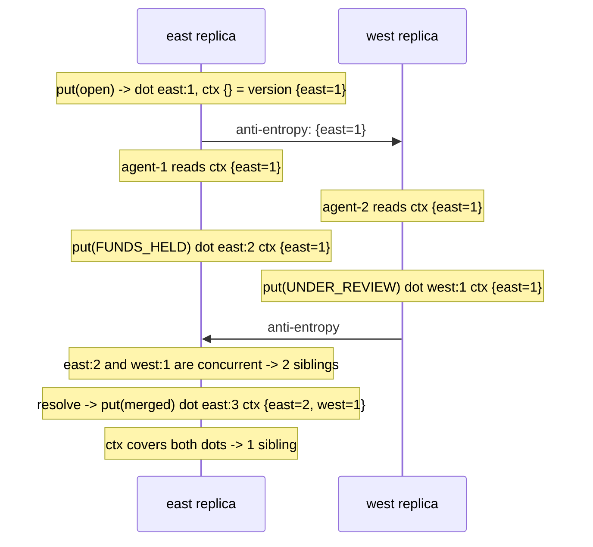

# Conflict Resolution: LWW, Version Vectors, Merge Functions

> Last-writer-wins loses data by design.

**Type:** Build
**Languages:** Java, Python, Go
**Prerequisites:** Phase 5, Lesson 03 (Lamport and Vector Clocks), Phase 5, Lesson 04 (Physical Clocks, NTP, and Hybrid Logical Clocks), Phase 6, Lesson 01 (Replication Strategies), Phase 6, Lesson 08 (CRDTs)
**Time:** ~75 minutes

## Learning Objectives

- Show, with a two-replica trace, exactly which write last-writer-wins discards and why clock skew can make the discarded write the newer one
- Build a version vector and classify two versions as before, after, equal, or concurrent
- Build a Dynamo-style sibling store with dotted version vectors in which concurrent writes coexist and causally later writes replace their ancestors
- Write application-level merge functions for two domains (a shopping cart and a dispute case file) and state the business rule each one encodes
- Explain the Dynamo shopping-cart anomaly and name the data type from Lesson 08 that fixes it

## The Problem

A card-dispute platform stores each case as one document: a status (`OPEN`, `UNDER_REVIEW`, `FUNDS_HELD`, `CLOSED_REFUNDED`) and a list of agent notes. The document is replicated to two regions for availability, with last-writer-wins by wall-clock timestamp, because that is the default in the key-value store the team chose. At 14:02:11.000 an agent in the east region reads case `9021`, adds the note "customer reports card stolen on 3 Oct" and moves the status to `FUNDS_HELD`, which prevents the merchant from being paid out. At 14:02:11.002 an agent in the west region, who read the case a few seconds earlier, adds the note "merchant supplied a signed delivery receipt" and moves the status to `UNDER_REVIEW`. The inter-region link is slow that afternoon, so the two writes meet only when anti-entropy runs.

Last-writer-wins compares timestamps, finds west's `.002` is later than east's `.000`, and keeps the west document in both regions. The case is now `UNDER_REVIEW`, the merchant is paid out at the next settlement run, and the note about the stolen card does not exist anywhere. Nobody deleted it. No log records that it was overwritten. Three weeks later the cardholder's bank issues a chargeback, the platform has already paid the merchant, and the dispute team cannot explain why the case history has a two-second gap in which an agent swears she wrote a note.

The failure is not that the two agents disagreed; disagreement is normal. The failure is that the store silently decided which agent's work to keep, using a criterion (a wall clock) that has nothing to do with the business, and left no evidence. This lesson builds the alternatives in order of how much data they keep: last-writer-wins (none of the loser), version vectors that detect that a conflict exists, a sibling store that keeps every concurrent version until someone resolves it, and application merge functions that encode the actual business rule, which for a dispute case is "keep every note; the more restrictive status wins".

## The Concept

### Three questions every replicated write must answer

When two replicas each accept a write to the same key during a partition, reconciliation has to answer three questions, and the strategies in this lesson differ in which ones they answer honestly:

| Question | LWW | Version vectors + siblings | Application merge |
|----------|-----|----------------------------|-------------------|
| Did these writes conflict, or did one causally follow the other? | Never asked | Answered exactly | Answered exactly (uses the vectors) |
| Which data survives? | One write, chosen by clock | Both, as siblings | A value computed from both |
| Who decided? | The clock | Nobody yet; the reader will | The application, with a rule written in code |

LWW is not wrong because it picks a winner; sometimes a single winner is right (a session's "last seen" timestamp, a cache entry). It is wrong when it is applied to data where losing a write has a cost and nobody checked. The point of this lesson is to make the choice deliberate.

### Last-writer-wins and its two failure modes

LWW tags each write with `(timestamp, writerId)` and keeps the greater. Lesson 08 showed this is a valid CRDT merge: it is commutative, associative, and idempotent because the maximum of a total order is a join. That is its appeal: it converges with no coordination and the state is one value.

Failure mode one is the one in The Problem: **concurrent writes are both legitimate, and one is discarded with no trace**. The `LWWStore` in this lesson counts discards so the demo can show the number, but a production store does not; the write is gone.

Failure mode two is **clock skew**. Wall clocks on two machines differ by milliseconds under good NTP discipline and by seconds or minutes when NTP is misconfigured (Phase 5, Lesson 04). A write that happened second in real time, on a node whose clock is five seconds behind, carries a smaller timestamp and loses to a write that happened first. The store is now not even "last writer wins" but "writer with the fastest clock wins". Hybrid logical clocks reduce but do not remove this: two causally unrelated writes still have no meaningful order, and HLC just picks one consistently.

```text
t_real = 100.000  node slow (clock -5s)  writes X  stamped 95.000
t_real = 100.001  node fast (clock +0s)  writes Y  stamped 100.001
t_real = 100.002  node slow              writes Z  stamped 95.002
LWW keeps Y. Z, the genuinely last write, is discarded.
```

### Version vectors: detecting concurrency

A version vector is a map from replica id to a counter. Each write at replica `R` increments `R`'s entry. Comparison is pointwise:

| Relation of `v1` to `v2` | Condition | Meaning |
|--------------------------|-----------|---------|
| `BEFORE` | every `v1[r] <= v2[r]` and some `<` | `v2` saw `v1`; `v1` is an ancestor and can be discarded |
| `AFTER` | every `v1[r] >= v2[r]` and some `>` | `v1` saw `v2` |
| `EQUAL` | all entries equal | the same version |
| `CONCURRENT` | some `v1[r] < v2[r]` and some `v1[s] > v2[s]` | neither saw the other: a real conflict |

Worked example, three writes:

```text
A writes:                      vA = {A=1}
B reads vA, then writes:       vB = {A=1, B=1}      vA BEFORE vB   (B saw A's write)
A writes again, not seeing B:  vA' = {A=2}
compare vB vs vA':             A: 1 < 2  B: 1 > 0   -> CONCURRENT
merge(vB, vA') = {A=2, B=1}                           the context a resolver writes back with
```

The vector detects the conflict that LWW could not even express. What it does not do is resolve it. A version vector is a question-answering device, not a decision-making one. Its size is `O(replicas that have ever written the key)`, so, as with the G-Counter, the replica id must be a durable node, not a client.

### Dotted version vectors: identifying a write

Dynamo's original design incremented the coordinating node's counter on every write and compared whole vectors. That has a known hole when the same node coordinates two concurrent writes from two clients that read the same version: both new versions are `{A=2}` and the store cannot tell them apart. Riak's fix, the dotted version vector, splits each stored version into two parts:

- the **context**: the vector the client read, meaning everything the writer had observed;
- the **dot**: `(replica, sequence)` identifying this specific write, taken from the coordinating replica's monotonic counter.

The rule for obsolescence becomes precise: **version `s` is obsolete if some other version's context covers `s`'s dot**, meaning that writer had seen `s`. Two writes with the same context and different dots are concurrent, which is correct. A write whose context covers nothing stored is concurrent with everything stored (a blind write), which is also correct and is the reason clients must send back the context they read.



### Siblings: keep everything until someone decides

A sibling store answers the first two questions and defers the third. Each key holds a list of concurrent versions. A read returns all of them plus their merged vector as the **context**. A write sends that context back; the store drops every sibling the context covers and keeps the rest alongside the new write. Resolution is a read-merge-write cycle: read the siblings, compute one value, write it back with the context, and the siblings collapse to one.

Two costs:

- **Sibling explosion.** If clients write without context (or with stale context) faster than anyone resolves, siblings accumulate. Riak documents cases of thousands of siblings on a hot key making every read slow. The fix is discipline (always write with the context you read), a cap with an alarm, or a CRDT type that merges automatically.
- **Resolution is now the application's problem.** That is the point, but it means every reader must be prepared to see more than one value. Most Dynamo-style stores offer a per-bucket choice between "siblings" and "LWW" precisely because many teams do not want this responsibility.

### Application merge functions: the business rule in code

A merge function takes the list of concurrent values and returns one. It is where the domain knowledge lives, and it is a product decision disguised as an engineering one. Two examples from this lesson:

| Domain | Merge rule | What it preserves | What it gets wrong |
|--------|-----------|-------------------|--------------------|
| Shopping cart (Dynamo paper, section 4.4) | union of items, max quantity | every added item | a deleted item comes back if the other side touched the cart |
| Dispute case file | union of notes; most restrictive status wins | every agent's note; never silently releases held funds | an agent who deliberately released funds is overruled by a concurrent hold |

The cart rule is the one Amazon described in the Dynamo paper, and the paper itself notes the anomaly: "deleted items can resurface". A union of two states cannot tell the difference between "B never had the pen" and "B removed the pen", because a state has no memory of removals. Lesson 08's OR-Set fixes this by making removal an observed fact (a tombstoned tag), and that is why production carts moved to CRDT sets.

The case-file rule is payments-flavoured and deliberately asymmetric. Of the two possible errors, paying out funds that should have been held is irreversible (the merchant has the money) while holding funds that should have been released is reversible (release them after review). The merge therefore biases toward the restrictive status. Writing the rule down as a `MergeFunction` makes it reviewable; leaving it to LWW made it a coin flip against a clock.

### Worked example: the case file, traced by hand

The full trace of the dispute case through the sibling store, with dots and contexts written out. `ctx` is what the writer had read; `dot` is the write's identity; `version` is `ctx` plus the dot.

```text
step  replica  action                               dot      ctx               version            siblings at east
1     east     put(OPEN)                            east:1   {}                {east=1}           [east:1]
2     west     mergeFrom(east)                                                                    (west now holds east:1)
3     east     agent-1 reads                                 {east=1}
4     west     agent-2 reads                                 {east=1}
5     east     put(FUNDS_HELD, note-1)              east:2   {east=1}          {east=2}           [east:2]    (east:1 obsolete: ctx covers it)
6     west     put(UNDER_REVIEW, note-2)            west:1   {east=1}          {east=1, west=1}   (west: [west:1])
7     east     mergeFrom(west)                                                                    [east:2, west:1]
        is east:2 obsolete?  west:1's ctx {east=1} covers east:2?  1 >= 2  no
        is west:1 obsolete?  east:2's ctx {east=1} covers west:1?  0 >= 1  no      -> both kept
8     east     resolve: read ctx = {east=2} merged {east=1, west=1} = {east=2, west=1}
               put(merged)                          east:3   {east=2, west=1}  {east=3, west=1}   [east:3]
        east:2 obsolete?  ctx east=2 >= 2  yes.   west:1 obsolete?  ctx west=1 >= 1  yes.
```

Compare step 7 with what LWW did in The Problem: LWW compared `14:02:11.000` with `14:02:11.002` and threw east's document away. The sibling store compared `{east=1}` with `east:2` and `west:1`, found that neither writer had seen the other, and kept both. The decision about what the case should say was made in step 8 by a five-line rule that the dispute team can read.

### Choosing a strategy

A decision procedure for a replicated entity, applied field by field rather than to the whole document:

1. **Can two writers legitimately change this field concurrently?** If no (a server-assigned id, an immutable creation timestamp), any strategy works; use the cheapest, which is LWW.
2. **If both concurrent values must survive, is there a CRDT for the field?** Notes are a set (G-Set or OR-Set); counts are a PN-Counter; a flag that only ever turns on is a boolean join. Use Lesson 08.
3. **If exactly one value must survive and the business can state a rule for which**, write a merge function and keep siblings until it runs. The rule must be commutative and associative or two replicas resolving independently will diverge; "max by severity" qualifies, "the one the senior agent wrote" does not unless seniority is a total order carried with the value.
4. **If no rule can be stated**, the field needs a single writer: route writes through a leader or a quorum, and accept the unavailability during partitions. A balance is the standard example (Lesson 08).
5. **Only if losing a concurrent write is genuinely harmless**, choose LWW, and write down which write is lost so the choice is on record.

The `outputs/` template for this lesson walks these five questions.

### Complexity and what each layer promises

| Mechanism | State per key | Merge cost | Promise | Does not promise |
|-----------|--------------|-----------|---------|------------------|
| LWW | one value + timestamp | `O(1)` | convergence | that the kept value is the one you wanted |
| Version vector | `O(replicas)` | `O(replicas)` | exact detection of concurrency | any resolution |
| Sibling store | `O(siblings * value)` | `O(siblings^2)` to prune | no write is lost before a human or program sees it | bounded siblings |
| Application merge | depends on the value | depends on the value | the business rule is applied | that the rule is right for every case |

None of these mechanisms enforce a cross-replica invariant (Lesson 08); all of them are about what happens after both writes were accepted. If the case status must never regress from `FUNDS_HELD` to `UNDER_REVIEW` regardless of what any agent does, that is a leader or quorum decision made at write time, not a merge decision made afterward.

### What this lesson's store does not do

- It does not order writes in real time. Dots and vectors capture what each writer had seen, not when it acted; two writes seconds apart are concurrent if the second writer had not seen the first.
- It does not bound siblings. A client that keeps writing blind will grow the key without limit; the cap and alarm are Exercise 2.
- It does not resolve automatically. `resolve` runs when something calls it; a production store runs it on read, on a schedule, or hands the siblings to the client.
- It does not compress or prune vectors. Entries for decommissioned replicas live forever; production stores prune them with a stability protocol.
- It does not move money. The case file is metadata about a payment; the hold on the merchant payout it describes must be enforced by the ledger (Phase 10) with a single writer, or the merge rule is advisory.

## Build It

All code is in `code/java/Main.java`. The store is generic over the value type so the same mechanism serves the cart and the case file.

### Step 1: Version vector comparison

```java
Ordering compare(VersionVector other) {
    boolean less = false, greater = false;
    TreeSet<String> keys = new TreeSet<>(clocks.keySet());
    keys.addAll(other.clocks.keySet());
    for (String k : keys) {
        long a = get(k), b = other.get(k);
        if (a < b) less = true;
        if (a > b) greater = true;
    }
    if (less && greater) return Ordering.CONCURRENT;
    if (less) return Ordering.BEFORE;
    if (greater) return Ordering.AFTER;
    return Ordering.EQUAL;
}
```

The union of both key sets matters: a replica missing from one vector has an implicit entry of `0`, so `{A=1}` compared with `{A=1, B=1}` sees `B: 0 < 1` and returns `BEFORE`. `increment` and `merge` both return new vectors, so a context handed to a client cannot be mutated behind the store's back.

**Predict:** `{A=2, B=1}.compare({A=1, B=2})` returns what, and what does that say about the two writes?

### Step 2: LWW, with the loss counted

```java
void put(String key, V value, long timestamp, String writer) {
    Entry<V> incoming = new Entry<>(value, timestamp, writer);
    Entry<V> current = entries.get(key);
    if (incoming.beats(current)) {
        if (current != null) discarded++;
        entries.put(key, incoming);
    } else {
        discarded++;
    }
}
```

`beats` compares timestamp, then writer id, so merge is a total order and the store converges. `discarded` exists only so the lesson can print how many writes disappeared; a real LWW store has no such counter, which is the problem.

**Predict:** three writes arrive for one key. How many does `discarded` report, regardless of their order?

### Step 3: Dots and versioned values

```java
record Dot(String replica, long seq) implements Comparable<Dot> { /* ordered by replica, then seq */ }

record Versioned<V>(V value, Dot dot, VersionVector context) {
    VersionVector version() {
        VersionVector v = context.copy();
        return v.get(dot.replica()) >= dot.seq() ? v : v.merge(new VersionVector(Map.of(dot.replica(), dot.seq())));
    }
    boolean obsoletedBy(Versioned<V> other) { return other.context().get(dot.replica()) >= dot.seq(); }
}
```

`obsoletedBy` is the whole theory of dotted version vectors in one line: I am obsolete if your context says you have seen my dot. `version()` is the full vector (context plus own dot) used for display and for computing the context handed to readers.

### Step 4: The sibling store's write path

```java
VersionVector put(String key, V value, VersionVector context) {
    Versioned<V> write = new Versioned<>(value, new Dot(replica, ++counter), context.copy());
    List<Versioned<V>> kept = new ArrayList<>();
    for (Versioned<V> s : data.getOrDefault(key, List.of())) if (!s.obsoletedBy(write)) kept.add(s);
    kept.add(write);
    data.put(key, kept);
    return write.version();
}
```

The counter is per store and monotonic, so two writes coordinated by the same replica always get different dots even with identical contexts. A sibling survives only if the incoming context did not cover it. `putBlind` passes an empty context and therefore never obsoletes anything: it always adds a sibling, which is the correct punishment for a client that did not read before writing.

**Predict:** a client reads version `{A=1}`, a second client on the same replica also reads `{A=1}`, and both write. How many siblings exist, and what are their dots?

### Step 5: Anti-entropy and pruning

```java
void mergeFrom(SiblingStore<V> other) {
    for (var e : other.data.entrySet()) {
        List<Versioned<V>> all = new ArrayList<>(data.getOrDefault(e.getKey(), List.of()));
        for (Versioned<V> s : e.getValue()) if (!all.contains(s)) all.add(s);
        data.put(e.getKey(), maximal(all));
    }
}

static <V> List<Versioned<V>> maximal(List<Versioned<V>> all) {
    List<Versioned<V>> out = new ArrayList<>();
    for (Versioned<V> candidate : all) {
        boolean obsolete = false;
        for (Versioned<V> other : all) {
            if (other != candidate && candidate.obsoletedBy(other)) { obsolete = true; break; }
        }
        if (!obsolete && !out.contains(candidate)) out.add(candidate);
    }
    return out;
}
```

`mergeFrom` is the replication step: take the union of siblings from both replicas, then drop every one that some other sibling's writer had already seen. Because `Versioned` is a record, `contains` deduplicates identical versions, so merging twice is idempotent (the tests check this). `maximal` is `O(n^2)` in the sibling count, which is acceptable because the whole design assumes siblings are few; if they are not, that is the alarm.

### Step 6: Resolution with an application merge

```java
V resolve(String key, MergeFunction<V> fn) {
    ReadResult<V> read = get(key);
    if (read.siblings().isEmpty()) return null;
    V merged = read.siblings().size() == 1 ? read.siblings().get(0).value() : fn.merge(read.values());
    if (read.siblings().size() > 1) put(key, merged, read.context());
    return merged;
}

static final MergeFunction<CaseFile> UNION_NOTES_STRICTEST_STATUS = siblings -> {
    TreeSet<String> notes = new TreeSet<>();
    String status = "OPEN";
    for (CaseFile c : siblings) {
        notes.addAll(c.notes());
        if (SEVERITY.indexOf(c.status()) > SEVERITY.indexOf(status)) status = c.status();
    }
    return new CaseFile(status, notes);
};
```

`resolve` is the read-merge-write cycle. The write-back uses the read context, which covers every sibling's dot, so the result is one sibling whose version dominates all of them. A single sibling is returned without writing, so resolution is idempotent and does not inflate the version. The case-file rule is five lines, and those five lines are where the dispute team's policy lives.

**Predict:** if `resolve` wrote back with an empty context instead of `read.context()`, how many siblings would the key have afterward?

### Step 7: Run it

```bash
cd phases/06-replication-and-consensus/09-conflict-resolution/code/java
javac -d .out *.java && java -cp .out Main
java -cp .out MainTest
```

Expected output, abbreviated:

```console
== LWW: deterministic, and it throws one write away ==
east wrote at t=1000, west wrote at t=1002 -> merged value: "agent-2: merchant provided signed delivery receipt"
agent-1's note is gone; nothing in the store records that it existed
clock skew: "older write from a node with a fast clock" wins although it happened first

== Siblings: keep both, make the application decide ==
after anti-entropy east holds 2 siblings:
  FUNDS_HELD notes=[agent-1: card reported stolen 3 Oct]@{east=2}
  UNDER_REVIEW notes=[agent-2: merchant has signed receipt]@{east=1, west=1}
application merge (union notes, strictest status): FUNDS_HELD notes=[agent-1: ..., agent-2: ...]
siblings after resolve: 1, version {east=3, west=1}

== The shopping-cart anomaly from the Dynamo paper ==
A removed pen, B concurrently added a book -> union/max merge: {book=2, pen=2}
```

The test prints `38 passed, 0 failed`.

### In Python

```python
@staticmethod
def maximal(all_: list) -> list:
    out: list = []
    for candidate in all_:
        obsolete = any(other is not candidate and candidate.obsoleted_by(other) for other in all_)
        if not obsolete and candidate not in out:
            out.append(candidate)
    return out
```

`code/python/main.py` keeps every type and method name (in snake_case); the demo prints the same lines as the Java. What differs:

- **Identity versus equality.** Java's `maximal` uses `other != candidate`, a reference comparison, and `out.contains(candidate)`, an `equals` comparison. Python spells those `is not` and `not in`. Swapping them would be a silent bug: two equal siblings arriving from two replicas would obsolete each other.
- **Values are frozen dataclasses.** `Dot`, `Versioned`, `CaseFile` (with a `frozenset` of notes) and `Cart` (a `dict` of quantities) get structural `==` for free, which is what `merge_from` uses to skip siblings it already holds. `VersionVector` wraps a `dict` and returns new vectors from `increment` and `merge`, so it is immutable in practice.
- **`MergeFunction` is a tiny class around a callable** so the call site still reads `fn.merge(siblings)`; `Cart.UNION_MAX` and `CaseFile.UNION_NOTES_STRICTEST_STATUS` are attached after the class bodies because they build instances of the class.
- **Printing.** Java's `TreeMap` and `TreeSet` print sorted; `fmt_map` and `fmt_set` reproduce `{A=1, B=1}` and `[a, b]`. A missing key is `None` where the Java returns `null`.

Run it from `code/python/`:

```bash
python3 main.py
python3 -m unittest -v
```

### In Go

```go
type MergeFunction[V any] func(siblings []V) V

func Maximal[V any](all []Versioned[V]) []Versioned[V] {
    out := []Versioned[V]{}
    for i, candidate := range all {
        obsolete := false
        for j, other := range all {
            if j != i && candidate.ObsoletedBy(other) { obsolete = true; break }
        }
        if !obsolete && !containsVersioned(out, candidate) { out = append(out, candidate) }
    }
    return out
}
```

`code/go/main.go` keeps every type and method name; the demo prints the same lines as the Java. What differs:

- **Identity versus equality.** Java's `maximal` compares `other != candidate` by reference and `out.contains(candidate)` by `equals`. Go has no reference identity for struct values, so the slice index plays the first role and a hand-written `Equal` the second. `Versioned.Equal` compares the dot and the context: a dot is minted once and always carries the same value, so this is the record equality without demanding `V comparable`, which `CaseFile` (a map of notes) could not satisfy.
- **Generics carry the value type.** `Versioned[V]`, `LWWStore[V]`, `SiblingStore[V]`, `ReadResult[V]` and `MergeFunction[V]` are generic; `UnionMax` and `UnionNotesStrictestStatus` are package-level `MergeFunction` values, called as plain functions.
- **Absence and errors are values.** `LWWStore.Get` and `SiblingStore.Resolve` return `(V, bool)` where the Java returns `null`; `Entry.Beats` takes a found flag instead of a nullable argument; `CaseFile.WithStatus` returns `ErrUnknownStatus` and `MustStatus` panics on it for literals in the demo.
- **Maps have no order and no `==`.** `VersionVector`, `Cart` and `CaseFile` wrap maps and define `Equal`; `fmtMap` and `fmtSet` sort keys to reproduce `{A=1, B=1}` and `[a, b]`, and `MergeFrom` walks the other replica's keys in sorted order so the result is the same every run.

Run it from `code/go/`:

```bash
go run .
go test ./...
```

## Use It

### Riak KV

Riak is the production descendant of Dynamo and exposes every mechanism in this lesson as a bucket property. `allow_mult=true` returns siblings; the client library carries the `vclock` (now a dotted version vector) as an opaque context that must be sent back on write; `last_write_wins=true` opts into LWW with the documented warning that it is only safe for immutable or idempotent data. Riak's `sibling explosion` documentation describes the failure of clients writing without context and the `max_siblings` threshold that logs a warning. Riak data types (Lesson 08) are the recommended replacement for hand-written merge functions where a CRDT fits.

### Amazon DynamoDB and Cassandra

Both ended up with LWW as the default. DynamoDB's global tables resolve concurrent cross-region writes by last-writer-wins on a timestamp; the documentation says so and recommends designing so that concurrent updates to the same item in two regions do not happen. Cassandra uses LWW per cell with client- or coordinator-supplied timestamps, and its documentation on clock synchronization exists because of the skew failure mode: a node with a fast clock can make its writes win for as long as its clock is ahead. Lightweight transactions (Paxos, Lesson 04) are the escape hatch when a column needs a real decision.

### CouchDB and PouchDB

CouchDB keeps a revision tree per document, so concurrent writes become conflicting revisions that are all preserved; `_conflicts` lists them and the application resolves by writing a new revision and deleting the losers. It is the sibling store with a different vocabulary, and the same operational advice applies: resolve promptly or the tree grows.

### What production systems add

- An opaque, compressed context token so clients cannot forge or mis-handle vectors.
- Pruning of vector entries for replicas that no longer exist.
- Per-bucket or per-table choice of LWW versus siblings versus CRDT.
- Metrics on sibling counts and object sizes, because the only thing worse than losing a write is an unbounded key.

### What they still do not do

They do not know your business rule. A store can tell you two agents disagreed about a dispute status; only you can say that `FUNDS_HELD` beats `UNDER_REVIEW`.

## Ship It

`outputs/design-doc-conflict-policy.md` is a one-page template for the conflict-resolution section of a design review. It forces four answers for every replicated entity: which writes can legitimately be concurrent, what LWW would lose if chosen, the merge rule in plain language and as a function signature, and which error (keeping too much or too little) is reversible. Fill it in before choosing a store's default, and attach it to the design so the next person can see the rule was chosen rather than inherited.

## Exercises

1. **Reinforce.** Add a `MergeFunction<Cart>` called `REMOVE_WINS` that takes, alongside each sibling cart, the set of items each sibling explicitly removed, and never resurrects a removed item. You will find you cannot do it with the `Cart` record as written, because a cart state has no memory of removals. Explain in a comment what field you had to add and how it relates to the OR-Set tombstones in Lesson 08.
2. **Apply.** Implement `SiblingStore.pruneTo(int maxSiblings, MergeFunction<V> fallback)` that, when a key exceeds `maxSiblings`, resolves it with `fallback` and logs the collapse. Write a test that drives twenty blind writes into one key, asserts the count is capped, and asserts that the fallback was invoked with all pending siblings exactly once. Then argue in the test's comment whether an automatic fallback is safer than a growing key for the dispute case file.
3. **Extend.** Combine with Phase 5, Lesson 04. Replace `LWWStore`'s caller-supplied `long timestamp` with a hybrid logical clock: `(physical, logical, replica)`. Reproduce the clock-skew demo from `main` and show that HLC makes the causally later write win when the writes are causally related (the second writer saw the first), and that it still picks arbitrarily when they are truly concurrent. State in one sentence why that second behaviour is unavoidable for any single-value register.

## Key Terms

| Term | What people say | What it actually means |
|------|-----------------|------------------------|
| Last-writer-wins | "the newest value wins" | Keep the write with the greatest `(timestamp, writer)`; converges, discards every losing concurrent write, and under clock skew the kept write may be older in real time |
| Version vector | "a vector clock for data" | Per-replica counters attached to a stored version; pointwise comparison classifies two versions as before, after, equal, or concurrent |
| Concurrent | "written at the same time" | Neither version's writer had observed the other, regardless of wall-clock time; the only situation that is a genuine conflict |
| Dotted version vector | "Riak's vclock" | A version split into the context the writer saw and a dot identifying the write; a version is obsolete exactly when another writer's context covers its dot |
| Sibling | "a conflict" | One of several concurrent versions a key holds until a write whose context covers them all collapses them |
| Context | "the vclock you pass back" | The merged vector of every sibling a client read; sending it with a write is what lets the store know which siblings the write supersedes |
| Merge function | "the resolver" | Application code that maps a list of concurrent values to one; it encodes a business rule and should be reviewed as one |
| Sibling explosion | "the key got huge" | Unbounded sibling growth from writes without context or without timely resolution; the operational failure of sibling stores |

## Further Reading

- [Dynamo: Amazon's Highly Available Key-value Store](https://www.allthingsdistributed.com/files/amazon-dynamo-sosp2007.pdf) (DeCandia et al., SOSP 2007) — section 4.4 is the source of the vector-clock sibling design and of the shopping-cart "deleted items resurface" anomaly.
- [Detection of Mutual Inconsistency in Distributed Systems](https://doi.org/10.1109/TSE.1983.236733) (Parker et al., IEEE TSE 1983) — the original version-vector paper; the before/after/concurrent classification comes from here.
- [Dotted Version Vectors: Logical Clocks for Optimistic Replication](https://arxiv.org/abs/1011.5808) (Preguica, Baquero, Almeida, Fonte, Goncalves, 2010) — why plain version vectors mis-handle two clients on one coordinator and how the dot fixes it.
- [Riak KV: Conflict Resolution](https://docs.riak.com/riak/kv/latest/developing/usage/conflict-resolution/index.html) — production documentation for siblings, causal context, `allow_mult`, `last_write_wins`, and sibling explosion.
- [Apache Cassandra: Why is clock synchronization important](https://cassandra.apache.org/doc/latest/cassandra/operating/hardware.html) — the operational consequence of LWW with physical timestamps.
- [Time, Clocks, and the Ordering of Events in a Distributed System](https://lamport.azurewebsites.net/pubs/time-clocks.pdf) (Lamport, 1978) — the definition of happens-before that "concurrent" is the negation of.
