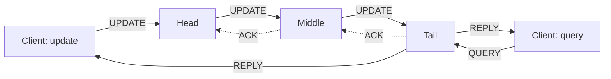

# Chain Replication and Primary-Backup

> Strong consistency with high read throughput.

**Type:** Build
**Languages:** Java, Python, Go
**Prerequisites:** Phase 6 Lesson 01 (Replication Strategies), Phase 6 Lesson 02 (Replication Lag and Read-Your-Writes), Phase 5 Lesson 13 (Gossip Protocols and Failure Detection), Phase 0 Lesson 07 (Decimal and Integer Arithmetic)
**Time:** ~75 minutes

## Learning Objectives

- Explain how a chain of replicas gives linearizable reads and writes with every replica doing useful work, and why that beats primary-backup on read throughput
- Build the chain protocol: updates enter at the head and flow forward, acknowledgements flow backward, queries are served only by the tail
- State the two invariants (Update Propagation and Inprocess Requests) and check them after every message delivery on a simulated network
- Implement the three failure repairs (head, middle, tail) and chain extension through a simulated master, and show that no committed update is ever lost
- Compare chain replication with synchronous primary-backup on load distribution, write latency, and failover behaviour, with numbers from the simulation

## The Problem

A merchant dashboard shows account balances. The balance service is replicated primary-backup: one primary takes every write and every read, two backups receive the writes synchronously and sit idle otherwise. On a normal day the primary serves 200 updates and 20,000 balance reads per second and runs at 70% CPU. The marketing team launches a promotion, dashboard traffic triples, and the primary saturates. Reads queue behind writes, write latency climbs past the payment gateway's timeout, authorizations start failing, and the on-call engineer's first instinct is to point reads at the backups. That is a consistency bug waiting to happen: a backup is a replica that may not yet have the last committed write, so a merchant who just received a payout would see the old balance, call support, and the support agent, reading from a different backup, would see a third number. Lesson 02 was about exactly this. The backups have two-thirds of the fleet's CPU and cannot safely serve a single read.

The alternative that most teams reach for is Raft (Lessons 05 to 07), which has the same shape: a leader does all the work, followers are idle except for storing the log. Raft buys leader election without a master; it does not buy read throughput. Reading from a Raft follower is Lesson 02's problem again.

Chain replication (van Renesse and Schneider, 2004) arranges the same three replicas differently. Updates enter at one end of a chain and flow to the other; reads are served by the far end only. Every write is on every replica before any client sees it, so reads from the tail are linearizable, and the head and the tail are different machines, so update processing and read processing are spread over the fleet instead of stacked on one node. The cost is a longer write path and a dependency on an external master for membership. This lesson builds both designs on the same simulated network and the same account-balance workload, measures them, and makes the trade-off concrete.

## The Concept

### The arrangement

Replicas are ordered in a chain. The first is the **head**, the last is the **tail**.



- An **update** is sent to the head. The head applies it to its state, assigns it a sequence number, and forwards it to its successor. Each replica applies and forwards. The tail applies it, replies to the client, and sends an acknowledgement backwards. Each replica that receives the ack removes the update from its "sent but not acked" set.
- A **query** is sent to the tail, which answers from its own state. Nobody else answers queries.

The reply to an update comes from the tail, which is the last replica to apply it. So when a client sees the reply, every replica has the update. And a query is answered by the tail, which has exactly the updates that have been replied to (plus, possibly, some that are about to be). That is the whole consistency argument: **the tail's state is the committed state**, and both kinds of client interaction go through it.

### The invariants

The paper proves two invariants about the histories of the replicas. Write Hist_i for the sequence of updates replica i has applied, and Sent_i for the updates i has forwarded to its successor and not yet seen acknowledged.

1. **Update Propagation Invariant.** For replicas i before j in the chain, Hist_j is a prefix of Hist_i. Earlier replicas know at least as much as later ones, and in the same order. This follows from FIFO links and from the rule that an update is applied before it is forwarded.
2. **Inprocess Requests Invariant.** Hist_i minus Hist_(i+1) is contained in Sent_i. Whatever the predecessor has and the successor lacks is still tracked by the predecessor, so it can be resent. This is what makes failure repair possible without a log scan.

The `ChainCluster` in this lesson checks both after every delivery. They are cheap to check and they are the properties every failure repair relies on.

### Worked example: a credit and a concurrent read

Three replicas n0 (head), n1, n2 (tail). Client A credits alice 100.00 USD; client B reads alice's balance at the same instant. Message delay 1 to 3 ticks.

```text
t=0   A -> n0: UPDATE credit alice 100.00         B -> n2: QUERY alice
t=2   n0 applies (alice=100.00), seq=1, Sent_0={1}, forwards to n1
t=2   n2 answers B: alice = 0.00                  <- n2 has not seen seq 1; the read is correct: nothing has been committed
t=4   n1 applies, Sent_1={1}, forwards to n2
t=6   n2 applies (alice=100.00), replies to A: 100.00, ACK -> n1
t=8   n1 removes 1 from Sent_1, ACK -> n0
t=9   n0 removes 1 from Sent_0
```

B's read returned 0.00 even though n0 had already applied the credit. That is not a stale read; it is the only consistent answer, because A had not yet been told the credit happened. A read issued after A's reply at t=6 returns 100.00. The demo's second scenario drives exactly this: it waits until the head has applied an update the tail has not, issues a query, and shows the query sees the old value while the writer has no reply yet.

### Failure handling through a master (section 3 of the paper)

The chain cannot repair itself: a replica that stops hearing from its predecessor cannot tell whether the predecessor died or the link is slow. The paper assumes a **master**, itself replicated (with Paxos in the paper; Raft today), that detects failures and tells replicas who their neighbours are. In this lesson the master is an object the test drives, and "the failure detector fired" is a method call after a configurable delay, which is Lesson 13's job in a real deployment.

| Failure | Repair | What can be lost |
|---------|--------|------------------|
| Head | successor becomes head; clients learn the new head from the master | updates the head received but had not yet forwarded; they were never replied to, so clients retry them |
| Tail | predecessor becomes tail; it replies for everything in its Sent set and acks upstream | nothing: everything the old tail had, the predecessor has too (Update Propagation) |
| Middle (i between p and s) | p's successor becomes s; p resends Sent_p to s, which skips what it already has | nothing: Hist_p minus Hist_s is in Sent_p (Inprocess Requests) |

Each repair is a direct consequence of one invariant, which is why the invariants are worth checking rather than trusting. The demo kills a middle node with four updates in flight, then the tail with three in flight, then the head with three in flight, and the tail's history ends with every update that any client ever got a reply for.

### Worked example: a middle failure with updates in flight

Chain n0, n1, n2, n3. Six updates are committed. Four more (seq 7 to 10) are submitted and the simulation runs two ticks, then n1 crashes; the master is told 20 ticks later. A representative trace (the demo's seed-3 run follows this shape and ends in the same state: ten committed, zero client retries):

```text
t=26   seq 7..10 arrive at n0 over a few ticks; n0 applies each, Sent_0 = {7,8,9,10}, forwards to n1
t=28   n1 has applied 7 and 8 and forwarded them; n2 has 7; n3 has nothing new.  n1 crashes.
       Hist_0 = 1..10   Hist_1 = 1..8 (dead)   Hist_2 = 1..7   Hist_3 = 1..6
       Sent_0 = {7,8,9,10}: 9 and 10 were addressed to n1 and are lost with it; 7 and 8 reached n2
t=48   master: n1 failed -> chain [0, 2, 3]; SET_LINKS to n3 (pred n2), n2 (pred n0, succ n3), n0 (succ n2)
t=49   n0 receives its new successor and sends SYNC(Sent_0) = {7,8,9,10} to n2
t=51   n2 already has 7: acks it. Applies 8, 9, 10 and forwards each to n3.  Hist_2 = 1..10
t=53+  n3 applies 8, 9, 10, replies to the three clients, acks n2; n2 acks n0
t=60   Sent_0 = {}, Sent_2 = {}, Hist_3 = 1..10: all ten updates committed, zero client retries
```

Every step is one of the two invariants in action. Hist_2 was a prefix of Hist_0 (Update Propagation), so n2 was a valid successor for n0. Hist_0 minus Hist_2 was {8, 9, 10}, all in Sent_0 (Inprocess Requests), so resending Sent_0 was sufficient. Seq 7 was in Sent_0 and in Hist_2 because its ack had not travelled back yet; n2 answered with an ack rather than re-applying, which is why `seqsSeen` exists.

### Choosing the chain length

Each additional replica adds one hop to the write path and one more copy of the data, and tolerates one more failure. The paper's rule of thumb and the lesson's measurements agree:

| Chain length | Failures tolerated | Update latency (hops) | Query capacity | Notes |
|--------------|--------------------|-----------------------|----------------|-------|
| 1 | 0 | 1 | one node | the head is the tail; no replication |
| 2 | 1 | 2 | one node | cheapest fault tolerance; a repair leaves a single replica until extension completes |
| 3 | 2 | 3 | one node | the common choice; matches a 3-replica primary-backup in storage and beats it on load |
| 5 or more | 4 or more | 5 or more | one node | write latency becomes the limit; sharding into more chains is better than lengthening one |

Query capacity is always one node, the tail, which is why read scaling comes from running many chains (one per account shard) over the same machines rather than from longer chains. With s shards spread so that each machine is the tail of about s/k chains, every machine serves reads for roughly 1/k of the data and the head work for another 1/k, which is the even distribution the paper's experiments show.

### Extending the chain

A new replica joins at the tail. The old tail T sends its history to the newcomer T+ and keeps serving queries and replying to updates until T+ confirms it has the history; new updates arriving at T in that window are applied, replied to by T, and also forwarded to T+. Once T+ confirms, T stops answering and becomes an ordinary middle replica. Clients may receive two replies for an update that straddled the handover; they ignore the duplicate. Joining at the tail rather than the head is deliberate: the tail has the smallest history to copy, and T can keep serving throughout.

### Primary-backup, for comparison

In synchronous primary-backup, one primary applies each update, sends it to every backup in parallel, waits for all acks, then replies. Queries go to the primary. On primary failure a backup is promoted. The promotion has a subtlety that chain replication avoids: the failed primary may have sent its last update to some backups and not others, so the new primary must first push its own history to the remaining backups. Chain replication never has this problem because a replica's history is always a prefix of its predecessor's.

| Property | Chain (k replicas) | Primary-backup (1 + k-1) |
|----------|--------------------|--------------------------|
| Update path | k hops in series, then reply | 1 hop to backups in parallel, 1 back, then reply |
| Update latency | proportional to k | constant in k |
| Who processes updates | every replica, once each | every replica, once each |
| Who answers queries | tail only | primary only |
| Load on the busiest node | tail: updates + queries; head: updates + acks | primary: updates + queries + k-1 acks |
| Read consistency | linearizable (tail has committed state) | linearizable (primary has committed state) |
| Replica state agreement | Hist_j is always a prefix of Hist_i | backups can diverge by the last in-flight update; promotion must re-sync |
| Failure repair | three local cases, driven by the master | promotion plus re-sync, driven by the master |
| Needs an external master | yes | yes |

The measured workload in the demo, 200 updates and 1,000 queries on three replicas: the chain's head handles 401 messages (200 updates, 200 acks, 1 config), the middle 401, the tail 1,201; the primary-backup primary handles 1,602 and each backup 201. The chain's busiest node does 25% less work than the primary, and the gap grows with the read fraction, because every query that hits the primary also competes with the ack processing the primary must do. If reads dominate, which they do for balances, the chain wins. If writes dominate and latency matters, primary-backup's parallel fan-out wins.

### What chain replication does not do

- It does not elect its own master. The master is the single point of truth for membership and must itself be replicated; CRAQ, CORFU, and HiberNet-style systems use ZooKeeper or Raft for it.
- It does not serve reads from non-tail replicas. CRAQ (Terrace and Freedman, 2009) extends the protocol so that any replica can answer a read for an object it has no dirty version of, which spreads read load further at the cost of per-object dirty bits.
- It does not tolerate Byzantine replicas or lost messages. Links are assumed reliable and FIFO (TCP gives you this). Lesson 11 covers the Byzantine case.
- It does not shard. One chain is one object group; a store with many objects runs many chains with different heads and tails over the same machines, which is how every machine ends up being a head for some chains and a tail for others.

### Common implementation mistakes

- **Forwarding before applying.** If a replica forwards an update and then crashes before applying it, its successor has something it does not, and Update Propagation fails. Apply, then forward, always.
- **Answering queries from a non-tail.** The head is the most up to date and the most wrong place to read from: its state includes updates nobody has been promised. The demo's second scenario is the test.
- **Counting a joining replica as part of the chain before its history has arrived.** The lesson's first extension protocol did this and the invariant checker fired within one run. A replica joins the chain when it has the history, not when the master lists it.
- **Accepting client updates at a non-head.** After a head failure a client with a stale view sends to the old second node; applying that update there with no sequence number corrupts the ordering. Drop it and let the client's retry find the new head.
- **Re-applying a resent update.** During a middle repair the new successor receives `Sent_p`, part of which it already has; without `seqsSeen` it would double-post those credits. The same `requestsSeen` guard protects against client retries after a reply was lost.
- **Promoting a backup without a re-sync.** Primary-backup's parallel fan-out leaves backups divergent by one update on primary failure; the lesson's test constructs that state and checks that promotion repairs it.

## Build It

Code: `code/java/Main.java`; tests: `code/java/MainTest.java`. Balances are `Money` from Phase 10, Lesson 01, so an update is a signed number of minor units in one currency, never a float.

### Step 1: The network keeps links FIFO

```java
void send(Message m) {
    sent++;
    if (down.contains(m.to()) || (m.from() >= 0 && down.contains(m.from()))) { dropped++; return; }
    long link = ((long) m.from() << 32) ^ (m.to() & 0xFFFFFFFFL);
    int earliest = Math.max(now + 1, lastDeliveryPerLink.getOrDefault(link, 0));
    int at = earliest + rng.nextInt(maxDelay);
    lastDeliveryPerLink.put(link, at);
    inFlight.add(new Envelope(at, seq++, m));
}
```

The protocol assumes reliable FIFO channels, so the simulated network never drops a message between live nodes and never delivers a later message on a link before an earlier one: each link remembers its last scheduled delivery time and the next message is scheduled no earlier. Crashes still lose everything addressed to or from a dead node. Without FIFO, an update could overtake its predecessor and the Update Propagation invariant would fail on the first run; try removing `lastDeliveryPerLink` and watch the checker fire.

**Predict:** two updates are sent from n0 to n1 at t=5 and t=6 with `maxDelay = 4`. What is the earliest tick at which the second one can arrive?

### Step 2: A replica's state and the apply step

```java
final class ChainNode implements Node {
    int predecessor = -1, successor = -1;
    final Map<String, Money> balances = new TreeMap<>();
    final List<Update> history = new ArrayList<>();
    final Set<Long> seqsSeen = new HashSet<>();
    final Set<String> requestsSeen = new HashSet<>();
    final LinkedHashMap<Long, Update> sent = new LinkedHashMap<>();
    final Map<String, Money> replyValues = new HashMap<>();
    boolean transferPending = false;
    boolean inChain = false;

    private void apply(Update u) {
        history.add(u);
        seqsSeen.add(u.seq());
        requestsSeen.add(u.request().key());
        balances.put(u.request().account(), balance(u.request().account()).plus(u.request().delta()));
        replyValues.put(u.request().key(), balance(u.request().account()));
        nextSeq = Math.max(nextSeq, u.seq() + 1);
    }
}
```

`history` is Hist_i, `sent` is Sent_i. Head and tail are not roles stored anywhere; they are `predecessor < 0` and `successor < 0`, which the master sets. `seqsSeen` makes resends idempotent during repair; `requestsSeen` and `replyValues` make client retries idempotent. `nextSeq` tracks the highest sequence number seen so that a replica promoted to head continues the numbering rather than restarting it.

### Step 3: Forward or commit

```java
private List<Message> forwardOrCommit(Update u) {
    List<Message> out = new ArrayList<>();
    if (actsAsTail()) {
        out.add(Message.reply(id, u.request().clientId(), u.request(), balance(u.request().account())));
        if (isTail() && !isHead()) out.add(Message.ack(id, predecessor, u));
    }
    if (!isTail()) {
        sent.put(u.seq(), u);
        out.add(Message.update(id, successor, u));
    }
    return out;
}
```

Every update goes through `apply` and then here. A tail replies to the client and acks upstream. A non-tail records the update in `sent` and forwards it. `actsAsTail()` is `isTail() || transferPending`: an old tail whose history is still being copied to a new tail does both, which is the extension protocol in one method. Note the order inside `handle`: apply first, forward second, so a replica never forwards what it has not applied, which is the Update Propagation invariant's inductive step.

**Predict:** the chain is just one replica (head and tail at once). What does `forwardOrCommit` send?

### Step 4: Acks, queries, and the stale client

```java
case ACK -> {
    acksHandled++;
    if (m.update().seq() < 0) { transferPending = false; return out; }
    if (sent.remove(m.update().seq()) != null && !isHead()) out.add(Message.ack(id, predecessor, m.update()));
}
case QUERY -> {
    queriesHandled++;
    if (actsAsTail()) out.add(Message.reply(id, m.from(), m.request(), balance(m.request().account())));
    else out.add(Message.notTail(id, m.from(), m.request()));
}
```

An ack removes the update from `sent` and propagates backwards until it reaches the head. A query at a non-tail is a client with a stale view of the chain (the tail changed); the replica answers `NOT_TAIL` and the client asks the master again. The alternative, answering from a non-tail's state, would return uncommitted data, which is the bug from the Problem section. Client updates that arrive at a non-head are dropped for the same reason; the client's timeout retries them at the head the master now reports.

### Step 5: The three repairs, from the replica's side

```java
case SET_LINKS -> {
    boolean wasTail = isTail();
    predecessor = m.predecessor();
    successor = m.successor();
    if ("extend-new".equals(m.note())) inChain = false; else inChain = true;
    if (isTail() && !wasTail) {                                           // the tail failed: everything in flight is now committed
        for (Update u : new ArrayList<>(sent.values())) {
            out.add(Message.reply(id, u.request().clientId(), u.request(), balance(u.request().account())));
            if (!isHead()) out.add(Message.ack(id, predecessor, u));
        }
        sent.clear();
    } else if (!isTail()) {                                               // new successor: resend what it may be missing
        if (wasTail && m.note() != null && m.note().startsWith("extend")) {
            transferPending = true;
            out.add(Message.stateTransfer(id, successor, history));
        } else if (!sent.isEmpty()) {
            out.add(Message.sync(id, successor, new ArrayList<>(sent.values())));
        }
    }
}
```

The master sends every replica its new neighbours. A replica that just became tail replies for its whole `sent` set: those updates are now committed by definition, because this replica is the last one. A replica that gained a new successor sends it `Sent` (middle failure) or its whole history (extension). The receiving side's `SYNC` handler applies what it lacks and acks what it already has, since the ack for those may have died with the failed node. Head failure needs no action at the replica: the new head simply has no predecessor and starts assigning sequence numbers from `nextSeq`.

**Predict:** n1 is a middle replica with `Sent = {7, 8}`. Its successor n2 fails; the master links n1 to n3, which has `Hist` through 7. What messages does n3 send back after the `SYNC`?

### Step 6: The master

```java
void fail(int id) {
    int i = chain.indexOf(id);
    if (i < 0) return;
    String kind = i == 0 ? "head" : i == chain.size() - 1 ? "tail" : "middle";
    chain.remove(i);
    if (chain.isEmpty()) throw new IllegalStateException("chain has no replicas left");
    publishLinks("fail " + kind);
}

void publishLinks(String note) {
    reconfigurations++;
    for (int i = chain.size() - 1; i >= 0; i--) {
        String n = note.equals("extend") && i == chain.size() - 1 ? "extend-new" : note;
        network.send(Message.setLinks(chain.get(i), pred(i), succ(i), n));
    }
}
```

Twenty lines, which is the point: the master's job is small, so making it reliable (by replicating it with Raft) is cheap. It publishes links tail-first so that a newly promoted tail starts replying before its predecessor starts forwarding to it, and it tags the joining replica so that the invariant checker does not count it until its history has arrived.

### Step 7: The checker

```java
for (int i = 0; i + 1 < chain.size(); i++) {
    ChainNode pred = nodes.get(chain.get(i)), succ = nodes.get(chain.get(i + 1));
    if (network.isDown(pred.id) || network.isDown(succ.id) || pred.transferPending || !succ.inChain) continue;
    if (succ.history.size() > pred.history.size()) { violations.add("UPDATE PROPAGATION: ..."); return; }
    for (int k = 0; k < succ.history.size(); k++) {
        if (!succ.history.get(k).equals(pred.history.get(k))) { violations.add("UPDATE PROPAGATION: ..."); return; }
    }
    for (int k = succ.history.size(); k < pred.history.size(); k++) {
        Update u = pred.history.get(k);
        if (!pred.sent.containsKey(u.seq())) { violations.add("INPROCESS REQUESTS: ..."); return; }
    }
}
```

Both invariants, checked for every adjacent pair after every delivery. The first version of this lesson's extension protocol tripped the second check: the master listed the new tail in the chain before the old tail had even been told to copy its history, and for a few ticks the "successor" lacked entries that were not in anyone's `Sent`. The fix was the `inChain` flag, and the checker is why the bug was found in one run rather than in production.

### Step 8: Run it

```bash
cd phases/06-replication-and-consensus/10-chain-and-primary-backup/code/java
javac -d .out *.java && java -cp .out Main
java -cp .out MainTest
```

Expected output, abbreviated:

```console
== A read at the tail never shows an update the head has applied but the tail has not ==
t=16: head history=1, tail history=0, client reply yet? false
query sent at t=16 answered with 0.00 USD; the update's own reply was 50.00 USD -> a client never observes a write before the writer could

== Failures: head, middle, tail, each repaired by the master; no committed update is lost ==
t=48   master: n1 (middle) failed -> chain [0, 2, 3]
  after middle failure: replies total=10, tail history=10, retries=0
t=86   master: n3 (tail) failed -> chain [0, 2]
  after tail failure: the new tail replied for 13 entries; outstanding Sent at new tail=0
t=115  master: n0 (head) failed -> chain [2]
  after head failure: chain [2], every client request answered, retries total=1
  invariant checks run: 111, violations: 0

== Load: chain spreads updates (head) and reads (tail) over different replicas; primary-backup puts both on one ==
chain (3 replicas), 200 updates + 1000 queries:
  n0 HEAD   handled updates=200  queries=0    acks=200  total=401
  n2 TAIL   handled updates=200  queries=1000 acks=0    total=1201
primary-backup (1 primary + 2 backups), same workload:
  n0 PRIMARY handled updates=200  queries=1000 acks=402  total=1602
```

### In Python

`code/python/main.py` is the same design, and the demo output matches the Java line for line, including the per-replica message counts in the load table. Four things differ. **The FIFO link key is a tuple:** Java packs `(from, to)` into one `long` with a shift and a mask; Python keys the dict on `(m.from_, m.to)`, which is the same injective mapping without the bit arithmetic. The in-flight queue is `heapq` on `(deliver_at, seq, message)`, and `seq` is unique, so ties never compare messages. **Insertion order is the `dict` default:** `Sent` (a `LinkedHashMap` in Java), the client's `pending` and `replies` maps are plain dicts, which keep insertion order, so a SYNC after a reconfiguration resends updates in the order they were forwarded; balances are a `dict` printed through `fmt_map` to match `TreeMap.toString()`. **One `Message` dataclass, many factories:** the Java factory `Message.update(...)` is `Message.update_msg(...)` in Python because `update` is also a field name on the frozen dataclass; `Request`, `Update` and `Money` are frozen dataclasses, so `==` on histories is structural, which is what the Update Propagation check needs. **Errors and overflow:** an unexpected message kind raises `RuntimeError`, and `Money.plus` keeps `Math.addExact`'s 64-bit bound explicitly because Python integers never overflow.

Run it from `code/python/` with `python3 main.py`; test with `python3 -m unittest -v`.

#### Step 1: The network keeps links FIFO

The link is the tuple `(m.from_, m.to)`. `earliest` is the later of "next tick" and the link's last scheduled delivery, so a message can never overtake its predecessor on the same link; the seeded delay is added on top and recorded back into the dict. Messages to or from a crashed node are dropped before any of this.

```python
    def send(self, m: Message) -> None:
        self.sent += 1
        if m.to in self._down or (m.from_ >= 0 and m.from_ in self._down):
            self.dropped += 1
            return
        link = (m.from_, m.to)   # Java packs the pair into one long; a tuple is the same injective key
        earliest = max(self._now + 1, self._last_delivery_per_link.get(link, 0))
        at = earliest + self._rng.next_int(self._max_delay)
        self._last_delivery_per_link[link] = at
        heapq.heappush(self._in_flight, (at, self._seq, m))
        self._seq += 1
```

#### Step 2: A replica's state and the apply step

The replica's fields are plain attributes: `history` is a list, the two "seen" sets are Python sets, and `sent` is a dict whose insertion order stands in for `LinkedHashMap`. `_apply` is the Java method with `dict.get` defaults; `balance()` returns `ZERO_USD` for an unknown account.

```python
    def __init__(self, id: int) -> None:
        self.id = id
        self.predecessor = -1
        self.successor = -1
        self.balances: dict[str, Money] = {}
        self.history: list[Update] = []
        self.seqs_seen: set[int] = set()
        self.requests_seen: set[str] = set()
        self.sent: dict[int, Update] = {}              # LinkedHashMap: insertion order matters for SYNC
        self.reply_values: dict[str, Money] = {}
        self.transfer_pending = False
        self.in_chain = False
        self.next_seq = 1

    def _apply(self, u: Update) -> None:
        self.history.append(u)
        self.seqs_seen.add(u.seq)
        self.requests_seen.add(u.request.key())
        self.balances[u.request.account] = self.balance(u.request.account).plus(u.request.delta)
        self.reply_values[u.request.key()] = self.balance(u.request.account)
        self.next_seq = max(self.next_seq, u.seq + 1)
```

#### Step 3: Forward or commit

`acts_as_tail()` is `is_tail() or transfer_pending`. A tail replies and acks upstream; a non-tail records the update in `sent` and forwards it with `Message.update_msg`. The UPDATE branch of `handle` calls `_apply` first and this method second.

```python
    def acts_as_tail(self) -> bool:
        return self.is_tail() or self.transfer_pending

    def _forward_or_commit(self, u: Update) -> list[Message]:
        out: list[Message] = []
        if self.acts_as_tail():
            out.append(Message.reply(self.id, u.request.client_id, u.request, self.balance(u.request.account)))
            if self.is_tail() and not self.is_head():
                out.append(Message.ack(self.id, self.predecessor, u))
        if not self.is_tail():
            self.sent[u.seq] = u
            out.append(Message.update_msg(self.id, self.successor, u))
        return out
```

#### Step 4: Acks, queries, and the stale client

`handle` is an `if`/`elif` ladder on `m.kind` rather than a `switch`. `dict.pop(seq, None)` is the `sent.remove(...) != null` test; an ACK with a negative sequence number is the "history received" signal that ends a transfer. A query at a non-tail gets `NOT_TAIL`.

```python
        elif k == MessageKind.ACK:
            self.acks_handled += 1
            if m.update.seq < 0:                             # the new tail has the history: hand over
                self.transfer_pending = False
                return out
            if self.sent.pop(m.update.seq, None) is not None and not self.is_head():
                out.append(Message.ack(self.id, self.predecessor, m.update))
        elif k == MessageKind.QUERY:
            self.queries_handled += 1
            if self.acts_as_tail():
                out.append(Message.reply(self.id, m.from_, m.request, self.balance(m.request.account)))
            else:
                out.append(Message.not_tail(self.id, m.from_, m.request))   # a stale client view; it must re-ask the master
```

#### Step 5: The three repairs, from the replica's side

The `SET_LINKS` branch. `in_chain` is a single boolean expression on the note. A replica that just became tail replies for everything in `sent` (iterated over a `list(...)` copy, since the dict is cleared afterwards) and acks upstream; a replica with a new successor sends either a `STATE_TRANSFER` of its whole history (extension, with `transfer_pending` set) or a `SYNC` of `sent`.

```python
        elif k == MessageKind.SET_LINKS:
            was_tail = self.is_tail()
            self.predecessor = m.predecessor
            self.successor = m.successor
            self.in_chain = m.note != "extend-new"           # a joining tail is in the chain once its history arrives
            if self.is_tail() and not was_tail:              # the tail failed: everything we had in flight is now committed
                for u in list(self.sent.values()):
                    out.append(Message.reply(self.id, u.request.client_id, u.request, self.balance(u.request.account)))
                    if not self.is_head():
                        out.append(Message.ack(self.id, self.predecessor, u))
                self.sent.clear()
            elif not self.is_tail():                         # new successor: resend what it may be missing
                if was_tail and m.note is not None and m.note.startswith("extend"):
                    self.transfer_pending = True             # keep answering clients until the copy lands
                    out.append(Message.state_transfer(self.id, self.successor, self.history))
                elif self.sent:
                    out.append(Message.sync(self.id, self.successor, list(self.sent.values())))
```

#### Step 6: The master

`fail` finds the index with `list.index`, classifies the failure with a conditional expression, deletes the slot, and republishes. `publish_links` walks the chain from the tail backwards with `range(len - 1, -1, -1)` and tags the last replica `extend-new` during an extension. The event-log append is omitted from the chunk.

```python
    def publish_links(self, note: str) -> None:
        self.reconfigurations += 1
        for i in range(len(self.chain) - 1, -1, -1):
            n = "extend-new" if note == "extend" and i == len(self.chain) - 1 else note
            self.network.send(Message.set_links(self.chain[i], self._pred(i), self._succ(i), n))

    def fail(self, node_id: int) -> None:
        if node_id not in self.chain:
            return
        i = self.chain.index(node_id)
        kind = "head" if i == 0 else "tail" if i == len(self.chain) - 1 else "middle"
        del self.chain[i]
        if not self.chain:
            raise RuntimeError("chain has no replicas left")
        self.publish_links("fail " + kind)
```

#### Step 7: The checker

Both invariants per adjacent live pair. Histories are lists of frozen `Update` dataclasses, so `!=` compares them structurally; `u.seq not in pred.sent` is the dict membership test that replaces `containsKey`.

```python
    def check_invariants(self) -> None:
        self.checks += 1
        chain = self.master.chain
        for i in range(len(chain) - 1):
            pred, succ = self.nodes[chain[i]], self.nodes[chain[i + 1]]
            if self.network.is_down(pred.id) or self.network.is_down(succ.id) or pred.transfer_pending or not succ.in_chain:
                continue   # a joining tail is not in the chain yet
            if len(succ.history) > len(pred.history):
                self.violations.append(f"UPDATE PROPAGATION: n{succ.id} longer than n{pred.id}")
                return
            for k in range(len(succ.history)):
                if succ.history[k] != pred.history[k]:
                    self.violations.append(f"UPDATE PROPAGATION: n{succ.id} differs from n{pred.id} at {k}")
                    return
            for k in range(len(succ.history), len(pred.history)):
                u = pred.history[k]
                if u.seq not in pred.sent:
                    self.violations.append(f"INPROCESS REQUESTS: n{pred.id} has seq {u.seq} that n{succ.id} lacks, and it is not in Sent")
                    return
```

#### Step 8: Run it

```bash
cd phases/06-replication-and-consensus/10-chain-and-primary-backup/code/python
python3 main.py
python3 -m unittest -v
```

```console
== A 3-replica chain: updates enter at the head, replies come from the tail (seed 1, delay 1-3) ==
client 0: Credit alice 100.00 -> reply 100.00 USD; Debit 25.50 -> reply 74.50 USD
client 1: Query alice issued at t=0 -> 0.00 USD (the tail had not yet seen the updates: reads show only committed state)
client 1: Query alice after the replies -> 74.50 USD
```

The failure section ends with `invariant checks run: 111, violations: 0`, and the load table carries the same counts as the Java run.

### In Go

`code/go/main.go` is the same design, and the demo output matches the Java line for line, including the per-replica message counts in the load table. Four things differ. **The FIFO link key is a `[2]int`:** Java packs `(from, to)` into one `long`; an array of two ints is a comparable map key with the same meaning and no bit arithmetic, and the in-flight queue is `container/heap` ordered by `(deliverAt, seq)`. **`Sent` is an ordered map written by hand:** Go maps have no insertion order, so `orderedUpdates` keeps a `[]int64` of sequence numbers beside the `map[int64]Update`, and a SYNC after a reconfiguration resends updates in the order they were forwarded, as `LinkedHashMap` does; the client keeps `pendingOrder` for the same reason, so retries draw network delays in the same order as the Java. **One `Message` struct with zero values for unused fields:** Java's nulls are Go zero values, an ACK's `Update` with `Seq: -1` (`historyReceived`) is the "history received" signal, and `Note` is `""` where Java has `null`; `Request`, `Update` and `Money` are comparable structs, so `==` on history entries is structural, which the Update Propagation check needs. **Errors and absence are values:** `Money.Plus` returns `(Money, error)` with `ErrCurrencyMismatch`/`ErrOverflow`, `ChainClient.ReplyFor` returns `(Money, bool)` where Java returns `null`, and `Update`/`Query` return the request and the messages to send instead of appending to an `out` list; an unexpected message kind and an empty chain are programming errors and panic.

Run it from `code/go/` with `go run .`; test with `go test ./...`.

#### Step 1: The network keeps links FIFO

The link key is an array literal, which is comparable and therefore usable as a map key. A missing key reads as 0, so the `if last > earliest` lowers nothing on the first message of a link; otherwise the logic is the Java's.

```go
func (w *Network) Send(m Message) {
	w.Sent++
	if w.down[m.To] || (m.From >= 0 && w.down[m.From]) {
		w.Dropped++
		return
	}
	link := [2]int{m.From, m.To}
	earliest := w.now + 1
	if last := w.lastDeliveryPerLink[link]; last > earliest {
		earliest = last
	}
	at := earliest + w.rng.NextInt(w.maxDelay)
	w.lastDeliveryPerLink[link] = at
	heap.Push(&w.inFlight, envelope{at, w.seq, m})
	w.seq++
}
```

#### Step 2: A replica's state and the apply step

The "seen" sets are `map[...]bool`, and `Sent` is a pointer to the hand-written `orderedUpdates`. `apply` goes through `mustPlus`, which panics on a `Money.Plus` error because a currency mismatch inside a replica's own history is a programming error; `NextSeq` is raised with an explicit comparison.

```go
type ChainNode struct {
	id           int
	Predecessor  int
	Successor    int
	Balances     map[string]Money
	History      []Update
	seqsSeen     map[int64]bool
	requestsSeen map[string]bool
	Sent         *orderedUpdates
	replyValues map[string]Money
	TransferPending bool
	InChain                                                      bool
	NextSeq                                                      int64
	UpdatesHandled, QueriesHandled, AcksHandled, MessagesHandled int
}

func (n *ChainNode) apply(u Update) {
	n.History = append(n.History, u)
	n.seqsSeen[u.Seq] = true
	n.requestsSeen[u.Request.Key()] = true
	n.Balances[u.Request.Account] = mustPlus(n.Balance(u.Request.Account), u.Request.Delta)
	n.replyValues[u.Request.Key()] = n.Balance(u.Request.Account)
	if u.Seq+1 > n.NextSeq {
		n.NextSeq = u.Seq + 1
	}
}
```

#### Step 3: Forward or commit

Identical structure; `n.Sent.Put(u)` appends to the ordered map, and the message constructors are unexported functions (`reply`, `ack`, `updateMsg`).

```go
func (n *ChainNode) ActsAsTail() bool { return n.IsTail() || n.TransferPending }

func (n *ChainNode) forwardOrCommit(u Update) []Message {
	out := []Message{}
	if n.ActsAsTail() {
		out = append(out, reply(n.id, u.Request.ClientID, u.Request, n.Balance(u.Request.Account)))
		if n.IsTail() && !n.IsHead() {
			out = append(out, ack(n.id, n.Predecessor, u))
		}
	}
	if !n.IsTail() {
		n.Sent.Put(u)
		out = append(out, updateMsg(n.id, n.Successor, u))
	}
	return out
}
```

#### Step 4: Acks, queries, and the stale client

Two arms of the `switch` in `Handle`. `Sent.Remove` returns whether the sequence number was present, which replaces the Java `remove(...) != null`; a negative `Seq` on an ACK is the end-of-transfer signal.

```go
	case Ack:
		n.AcksHandled++
		if m.Update.Seq < 0 { // the new tail has the history: hand over
			n.TransferPending = false
			return out
		}
		if n.Sent.Remove(m.Update.Seq) && !n.IsHead() {
			out = append(out, ack(n.id, n.Predecessor, m.Update))
		}
	case Query:
		n.QueriesHandled++
		if n.ActsAsTail() {
			out = append(out, reply(n.id, m.From, m.Request, n.Balance(m.Request.Account)))
		} else {
			out = append(out, notTail(n.id, m.From, m.Request)) // a stale client view; it must re-ask the master
		}
```

#### Step 5: The three repairs, from the replica's side

The `SetLinks` arm. `Note` is a plain string, so the Java `note != null && note.startsWith(...)` collapses to `strings.HasPrefix`. `Sent.Values()` returns the updates in insertion order for both the new-tail replies and the `SYNC`.

```go
	case SetLinks:
		wasTail := n.IsTail()
		n.Predecessor = m.Predecessor
		n.Successor = m.Successor
		n.InChain = m.Note != "extend-new" // a joining tail is in the chain once its history arrives
		if n.IsTail() && !wasTail {        // the tail failed: everything we had in flight is now committed
			for _, u := range n.Sent.Values() {
				out = append(out, reply(n.id, u.Request.ClientID, u.Request, n.Balance(u.Request.Account)))
				if !n.IsHead() {
					out = append(out, ack(n.id, n.Predecessor, u))
				}
			}
			n.Sent.Clear()
		} else if !n.IsTail() { // new successor: resend what it may be missing
			if wasTail && strings.HasPrefix(m.Note, "extend") {
				n.TransferPending = true // keep answering clients until the copy lands
				out = append(out, stateTransfer(n.id, n.Successor, n.History))
			} else if n.Sent.Len() > 0 {
				out = append(out, syncMsg(n.id, n.Successor, n.Sent.Values()))
			}
		}
```

#### Step 6: The master

`Fail` finds the index with a loop (slices have no `indexOf`), classifies the failure, removes the slot with the `append(a[:i], a[i+1:]...)` idiom, and panics on an empty chain. `PublishLinks` walks tail-first. The event-log line is omitted from the chunk.

```go
func (m *Master) PublishLinks(note string) {
	m.Reconfigurations++
	for i := len(m.Chain) - 1; i >= 0; i-- {
		n := note
		if note == "extend" && i == len(m.Chain)-1 {
			n = "extend-new"
		}
		m.Network.Send(setLinks(m.Chain[i], m.pred(i), m.succ(i), n))
	}
}

func (m *Master) Fail(id int) {
	i := -1
	for k, n := range m.Chain {
		if n == id {
			i = k
			break
		}
	}
	if i < 0 {
		return
	}
	kind := "middle"
	if i == 0 {
		kind = "head"
	} else if i == len(m.Chain)-1 {
		kind = "tail"
	}
	m.Chain = append(m.Chain[:i], m.Chain[i+1:]...)
	if len(m.Chain) == 0 {
		panic("chain has no replicas left")
	}
	m.PublishLinks("fail " + kind)
}
```

#### Step 7: The checker

`Update` is a comparable struct, so `succ.History[k] != pred.History[k]` is the structural comparison the invariant needs. `Sent.Contains` is the `containsKey`.

```go
func (c *ChainCluster) CheckInvariants() {
	c.Checks++
	chain := c.Master.Chain
	for i := 0; i+1 < len(chain); i++ {
		pred, succ := c.Nodes[chain[i]], c.Nodes[chain[i+1]]
		if c.Network.IsDown(pred.id) || c.Network.IsDown(succ.id) || pred.TransferPending || !succ.InChain { // a joining tail is not in the chain yet
			continue
		}
		if len(succ.History) > len(pred.History) {
			c.Violations = append(c.Violations, fmt.Sprintf("UPDATE PROPAGATION: n%d longer than n%d", succ.id, pred.id))
			return
		}
		for k := range succ.History {
			if succ.History[k] != pred.History[k] {
				c.Violations = append(c.Violations, fmt.Sprintf("UPDATE PROPAGATION: n%d differs from n%d at %d", succ.id, pred.id, k))
				return
			}
		}
		for k := len(succ.History); k < len(pred.History); k++ {
			u := pred.History[k]
			if !pred.Sent.Contains(u.Seq) {
				c.Violations = append(c.Violations, fmt.Sprintf("INPROCESS REQUESTS: n%d has seq %d that n%d lacks, and it is not in Sent", pred.id, u.Seq, succ.id))
				return
			}
		}
	}
}
```

#### Step 8: Run it

```bash
cd phases/06-replication-and-consensus/10-chain-and-primary-backup/code/go
go run .
go test ./...
```

```console
  invariant checks run: 111, violations: 0
```

```console
  n0 PRIMARY handled updates=200  queries=1000 acks=402  total=1602
```

Both lines, and everything between them, are identical to the Java run; the hand-written `orderedUpdates` is what keeps the retry and SYNC order, and therefore the message counts, the same.

## Use It

### Where chain replication runs

Microsoft's Windows Azure Storage stream layer replicates extents with a chain: the client writes to the primary extent node, which forwards to the secondaries in sequence, and acknowledgement returns only when the last node has the data (Calder et al., SOSP 2011). CORFU (Balakrishnan et al., NSDI 2012) chains flash units to build a shared log. HyperDex uses chains per hyperspace region. Ceph's replicated pools use a primary that forwards to replicas and waits for all acks, which is the primary-backup shape, while its "chain" and "splay" replication modes were experiments with this lesson's shape. FAWN-KV and the original paper's experiments show the throughput gain on read-heavy loads.

### CRAQ: reads anywhere

CRAQ (Terrace and Freedman, NSDI 2009) keeps the chain for writes but lets any replica answer a read: each object carries a dirty bit set when a non-tail replica has applied an update not yet acked; a dirty read is forwarded to the tail for a version check, a clean read is answered locally. Reads of hot objects that are rarely written spread across the whole chain. The cost is per-object versioning and an extra round trip for dirty reads. It is the natural Exercise 3.

### Primary-backup in practice

PostgreSQL synchronous streaming replication (`synchronous_commit = on`, `synchronous_standby_names`) is primary-backup: the primary waits for the standby to flush the WAL before confirming the commit; reads on the standby are allowed and are stale by the replication lag unless the application uses `remote_apply`, which is this lesson's "wait for the backup to apply". MySQL semi-synchronous replication waits for the relay log write, not the apply, so standby reads are stale. Kafka's in-sync replicas are primary-backup with a configurable `acks=all`. In every case the question to ask is: when the client gets its acknowledgement, which replicas have applied the write? The chain's answer is "all of them, and the one that answered is the last"; primary-backup's answer depends on three configuration flags.

### The master

Every system above needs a membership authority. Azure Storage uses a Paxos-replicated stream manager; CORFU uses a sequencer plus an auxiliary; most modern designs use ZooKeeper, etcd, or an embedded Raft group. The master is small, rarely changes, and must never be wrong about who the tail is: a client that reads from a replica the master no longer considers the tail reads uncommitted data. Lesson 12's fencing tokens are how a demoted tail is stopped from answering.

### Payment systems

Account-balance reads outnumber balance updates by one to two orders of magnitude in any wallet or ledger-facing service, and every read must be consistent with the writer's view or support tickets follow. Chain replication fits: updates through the head, which can be rate-limited by the posting pipeline; reads from the tail, scaled by adding chains per account shard. The master's membership decisions should come from the same Raft group that already holds the shard map, and the failure detector feeding it is Lesson 13's.

## Ship It

`outputs/design-doc-replication-choice.md` is a design-review template for choosing between chain replication, primary-backup, and leader-based consensus for a replicated service: the questions to answer (read/write ratio, latency budget, who owns membership, what happens on failover), a comparison table to fill in with your numbers, and the invariants a reviewer should ask to see tested.

## Exercises

1. **Reinforce.** Add per-message latency tracking to the clients (send tick to reply tick) and print mean update latency and mean query latency for chain lengths 2, 3, 5, and 8 on the same workload. Confirm update latency grows linearly with chain length and query latency does not.
2. **Apply.** Add a `detectionDelay` to every `crashAndDetect` in a workload of 1,000 updates with a middle failure, and plot (or tabulate) client-visible stall time against detection delay. Then replace the method call with a SWIM detector from Lesson 13 running on the same simulated network, and report what detection delay it achieves at 3 replicas.
3. **Extend.** Implement CRAQ's dirty-bit reads: every replica may answer a `QUERY` for an account whose last update it has seen acked; otherwise it forwards the query to the tail. Re-run the load comparison and show how the tail's query load falls. Then combine with Phase 6, Lesson 12 (Linearizability Checking): record every client operation and verify the history is linearizable with and without dirty-bit reads.

## Key Terms

| Term | What people say | What it actually means |
|------|-----------------|------------------------|
| Chain replication | "the replicas in a line" | Replicas ordered head to tail; updates enter at the head and propagate forward, acks propagate backward, queries are answered only by the tail |
| Head | "the write endpoint" | The replica with no predecessor; it assigns sequence numbers and is the only one that accepts client updates |
| Tail | "the read endpoint" | The replica with no successor; its state is the committed state, so it alone answers queries and replies to updates |
| Update Propagation Invariant | "earlier replicas know more" | For i before j, Hist_j is a prefix of Hist_i; it is what makes a predecessor a valid replacement for any failed successor |
| Inprocess Requests Invariant | "pending writes are tracked" | Hist_i minus Hist_(i+1) is contained in Sent_i; it is what lets a predecessor resend exactly what a new successor is missing |
| Master | "the coordinator" | A small, separately replicated service that detects failures and tells replicas their neighbours; the chain cannot do this itself |
| Primary-backup | "leader with standbys" | One replica serves all reads and writes and replicates writes to backups before acknowledging; backups are idle unless promoted |
| Linearizable read | "strongly consistent read" | A read that reflects every write whose acknowledgement was delivered before the read was issued; both the tail and a synchronous primary provide it, a backup does not |

## Further Reading

- [Chain Replication for Supporting High Throughput and Availability](https://www.cs.cornell.edu/home/rvr/papers/OSDI04.pdf) (van Renesse and Schneider, OSDI 2004) — the paper; sections 2 and 3 are the protocol and the failure cases this lesson implements, section 5 the throughput measurements.
- [Object Storage on CRAQ: High-throughput chain replication for read-mostly workloads](https://www.usenix.org/legacy/event/usenix09/tech/full_papers/terrace/terrace.pdf) (Terrace and Freedman, USENIX 2009) — reads from any replica with dirty bits; Exercise 3.
- [The Primary-Backup Approach](https://www.cs.cornell.edu/fbs/publications/PrimaryBackup.ps) (Budhiraja, Marzullo, Schneider, Toueg, 1993) — the formal treatment of primary-backup, including the lower bounds on failover time that explain why promotion needs a re-sync.
- [Windows Azure Storage: A Highly Available Cloud Storage Service with Strong Consistency](https://dl.acm.org/doi/10.1145/2043556.2043571) (Calder et al., SOSP 2011) — section 4 describes chain-style extent replication in a production system and the role of the Paxos-replicated stream manager.
- [CORFU: A Shared Log Design for Flash Clusters](https://www.usenix.org/conference/nsdi12/technical-sessions/presentation/balakrishnan) (Balakrishnan et al., NSDI 2012) — chain replication of log pages with a sequencer, and what happens when the chain is reconfigured under load.
- [PostgreSQL: Synchronous Replication](https://www.postgresql.org/docs/current/warm-standby.html#SYNCHRONOUS-REPLICATION) — `synchronous_commit` levels, including `remote_apply`, which is the configuration that makes a standby read linearizable.
