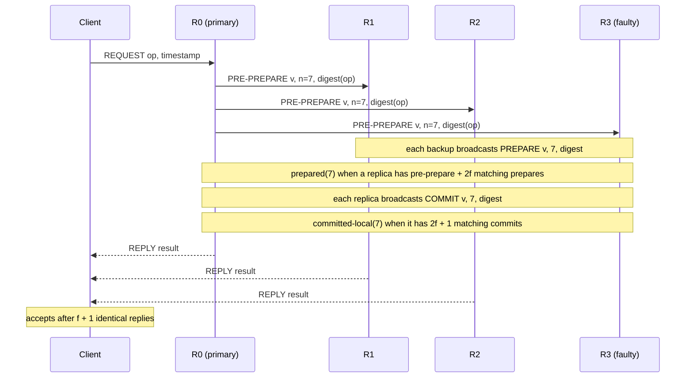

# Byzantine Fault Tolerance: PBFT in Outline

> 3f + 1 and why most payment systems do not need it: tolerating a node that lies costs a third more machines, three times the messages, and a trust model your bank already solved with a contract.

**Type:** Learn
**Languages:** —
**Prerequisites:** Phase 5 Lesson 02 (Failure Models), Phase 6 Lesson 04 (Single-Decree Paxos), Phase 6 Lesson 06 (Raft II: Log Replication), Phase 6 Lesson 03 (Quorums)
**Time:** ~75 minutes

## Learning Objectives

- Distinguish a Byzantine fault from a crash fault and from a security breach, and give one payments example of each
- Derive the 3f + 1 lower bound for asynchronous Byzantine agreement from quorum intersection, and show why 2f + 1 is not enough
- Walk the three phases of PBFT (pre-prepare, prepare, commit) and explain which safety property each phase buys and why the client waits for f + 1 matching replies
- Explain what a view change does, what the new primary needs from 2f + 1 replicas, and why PBFT needs a commit phase at all
- Decide, with a written procedure, whether a given payments component needs crash-fault tolerance, Byzantine-fault tolerance, or neither, and name what real networks use instead of BFT
- Contrast PBFT-style consensus with Nakamoto consensus on membership, finality, message cost, and the attacker it defends against

## The Problem

On 20 July 2008, Amazon S3 was unavailable for roughly eight hours. The post-incident report traced the cause to a single corrupted bit in a message passed between servers by the gossip protocol that spreads cluster state. The protocol had been designed to tolerate servers that crash. It had not been designed to tolerate a server that stays up and says something false, and the corrupted state was gossiped faithfully to every other server. The fix was to add checksums to gossip messages: the servers had never been malicious, but one of them had, in the failure-model sense, lied.

Now move the story into a payments context. A clearing house runs a five-node Raft cluster (Lesson 06) to order settlement instructions between twelve member banks. Raft guarantees that if a majority of nodes are up and honest, every node applies the same instructions in the same order. One night a node with a failing memory module acknowledges an `AppendEntries` for entries 4,000 through 4,100 and then, on the next heartbeat, reports a `matchIndex` of 4,100 while its log actually holds a different entry at 4,050. Raft's leader trusts the acknowledgement. When that node later wins an election, because the leader restarted and this node's term and last log index look highest, it replicates its corrupted entry 4,050 to the others, and the cluster converges on a settlement history in which one bank's 40,000,000.00 EUR instruction has become 4,000,000.00 EUR. Every node agrees. Raft worked exactly as specified; its specification simply assumes nodes do not misreport their own state.

The clearing house's engineers face a choice that this lesson is about. One option is Byzantine fault tolerance: a consensus protocol that stays correct even if up to f of its nodes send arbitrary, inconsistent, or deliberately false messages. It exists, it is well understood, and it costs 3f + 1 nodes instead of 2f + 1, O(n²) messages per decision instead of O(n), and a cryptographic signature or MAC on every message. The other option is to notice that the failure was not an adversary but a bad DIMM, and that an end-to-end checksum on every log entry, verified by every follower before acknowledging and by the state machine before applying, turns the lie into a detectable crash. Most payment systems take the second option, and this lesson explains when that is right and when it is not.

## The Concept

### Three kinds of wrong

Phase 5, Lesson 02 laid out the failure models. The distinctions that matter here:

| Model | A node may | Tolerated by | Detected by |
|-------|------------|--------------|-------------|
| Crash-stop | stop and never send again | Paxos, Raft, with 2f + 1 nodes | timeouts |
| Omission | drop some messages, in or out | Paxos, Raft (they only need a majority to respond) | retries, timeouts |
| Byzantine | send anything at all: wrong values, different values to different peers, old messages replayed, messages that pass every format check | PBFT and successors, with 3f + 1 nodes | agreement among the honest majority, never by inspecting one message |

A Byzantine node is defined by what it may do, not by why. A bit flip, a bug that corrupts state and keeps running, a misconfigured node pointed at the wrong cluster, a compromised node under an attacker's control, and an operator at a rival bank acting in bad faith are all Byzantine from the protocol's point of view. The protocol cannot tell them apart and does not try. This is both the strength and the cost of the model: it defends against everything, so it has to pay for everything.

A security breach is different from a Byzantine fault only in scale. BFT tolerates up to f faulty nodes; an attacker who controls f + 1 defeats it. BFT is therefore a defence against *independent* faults among parties who do not share an administrator, not a substitute for access control. If one team can push a bad build to every node at once, BFT buys nothing.

### The Byzantine generals

Lamport, Shostak, and Pease (1982) posed the problem as generals of the Byzantine army camped around a city, communicating by messenger, who must agree on attack or retreat even though some generals are traitors who will send different orders to different peers. Two conditions define a solution:

1. **Agreement.** All loyal generals decide on the same plan.
2. **Validity.** If the commanding general is loyal, every loyal general obeys the order he sent.

The paper's first result is negative: with *oral messages* (unsigned, so a traitor can forge what someone else said), three generals cannot cope with one traitor. The argument is a symmetry. If the commander is a traitor and sends "attack" to lieutenant 1 and "retreat" to lieutenant 2, each lieutenant hears the other relay a contradictory order. Lieutenant 1 sees commander: attack, lieutenant 2: retreat. But that is exactly what lieutenant 1 would see if the commander were loyal (attack) and lieutenant 2 were the traitor lying about what he received. Lieutenant 1 cannot distinguish the two worlds, must decide the same way in both, and validity in the second world forces "attack". By symmetry lieutenant 2 is forced to "retreat". Agreement fails. The general result: oral-message agreement with f traitors needs at least 3f + 1 generals.

With *signed messages* the bound in the original synchronous model drops, because a lieutenant can prove what the commander said. But signed messages do not help in the model that matters for real networks, which is the next section.

### Why 3f + 1, from quorums

Real systems are asynchronous: a message may take arbitrarily long, so a node that has not answered may be slow or may be dead or may be faulty and silent. In that model the 3f + 1 bound holds even with signatures, and the quorum argument from Lesson 03 gives it in three lines.

A protocol must be able to make progress with only n − f responses, because f nodes may never answer. So every decision is made from a quorum of n − f nodes. Now the uncomfortable case: the f nodes that stayed silent were honest but slow, and among the n − f that did answer, f are faulty and sent whatever they liked. The honest answers in the quorum number n − f − f = n − 2f. For the honest answers to outvote the faulty ones inside the quorum, n − 2f > f, so n > 3f, so **n ≥ 3f + 1**.

The same condition can be stated as quorum intersection. Two quorums of size n − f = 2f + 1 (when n = 3f + 1) overlap in at least (2f + 1) + (2f + 1) − (3f + 1) = f + 1 nodes. At most f of those are faulty, so **any two quorums share at least one honest node.** That honest node will not have voted for two conflicting values, which is what prevents two conflicting decisions. Compare Raft, where quorums of f + 1 out of 2f + 1 overlap in at least one node and that node is assumed honest; BFT needs the overlap to survive f liars, so it needs f more.

Worked example, n = 4, f = 1:

```text
nodes: R0 R1 R2 R3        quorum size = n - f = 3
R3 is faulty; R2 is honest but slow this round.

R0 proposes value A. Responses received: R0 (A), R1 (A), R3 (A to R0, B to R1).
Quorum for R0's view of "A": {R0, R1, R3} -> 3 of 4, decision would be made.
Could another quorum have decided B?  Any 3 of 4 overlap {R0,R1,R3} in 2 nodes.
Of those 2, at most 1 is R3. The other is R0 or R1, both of which said A.
So no quorum of 3 can contain 3 votes for B. Safe.

Now try n = 3, f = 1: quorum size 2. {R0, R3} can decide A, {R1, R3} can decide B.
Overlap is {R3}, the liar. Two conflicting decisions. Unsafe.
```

### PBFT: the protocol in outline

Castro and Liskov's Practical Byzantine Fault Tolerance (1999) was the first BFT protocol fast enough to use for a replicated service. It is a state machine replication protocol like Raft: clients send operations, replicas agree on an order, every replica executes the same operations in that order. There are n = 3f + 1 replicas. One is the **primary** for the current **view** v (primary = v mod n); the rest are **backups**. All messages carry the sender's authentication (a MAC per recipient in the optimised version, a signature in the simple one), so a replica cannot forge another's message, though it can send conflicting messages of its own.



The three phases, and what each one is for:

1. **Pre-prepare.** The primary assigns the request a sequence number n in view v and multicasts it. This is the proposal; it is the only place the primary's authority is used. A backup accepts it if the view matches, the digest is correct, and it has not accepted a different request with the same (v, n).
2. **Prepare.** Every backup that accepts the pre-prepare multicasts a PREPARE for (v, n, digest). A replica is **prepared** for (v, n, digest) once it has the pre-prepare and 2f matching prepares from different replicas (2f + 1 votes including the primary's pre-prepare). The prepared certificate proves that a quorum agreed on *this order within this view*: by quorum intersection, no other request can be prepared at the same (v, n), because the two quorums would share an honest replica that only prepares one digest per (v, n).
3. **Commit.** Each prepared replica multicasts COMMIT (v, n, digest). A replica is **committed-local** once it has 2f + 1 matching commits. It then executes the request (in sequence order) and replies to the client.

Why is the commit phase needed if prepare already fixes the order? Because prepare fixes it only *within a view*. If the primary fails and a view change happens, the new primary must learn which requests were prepared so it can preserve their sequence numbers. But a request may have been prepared at only one honest replica (the others' prepares were still in flight), and that replica might be among the f that the view change does not hear from. The commit phase ensures that when any honest replica executes a request, at least f + 1 honest replicas have prepared it, so **any** view-change quorum of 2f + 1 will include one of them and carry the request forward. Prepare is agreement on order; commit is agreement that enough replicas know about the agreement.

The client sends its request to the primary (or to all replicas if it suspects the primary) and waits for **f + 1 replies with the same result** from different replicas. At most f are faulty, so at least one of the matching replies came from an honest replica that executed the request, and honest replicas all execute the same sequence, so the result is right. This is the only Byzantine-aware step a client ever performs, and it is why a thin client cannot use a BFT service through a single load balancer: it must see f + 1 distinct responders.

### The safety argument in four steps

The whole of PBFT's safety reduces to four facts, each of which you can check against the worked example below:

1. An honest replica sends at most one PREPARE per (view, sequence number). It never changes its mind within a view.
2. A prepared certificate needs 2f + 1 votes (the pre-prepare plus 2f prepares), that is, a quorum. Two quorums share an honest replica, so at most one digest can be prepared per (view, sequence number).
3. An honest replica executes only after committed-local, which needs 2f + 1 COMMITs, each sent only by a replica that was prepared. So at least f + 1 honest replicas were prepared for the executed digest.
4. A view change collects 2f + 1 VIEW-CHANGE messages, which must include at least one of those f + 1 honest prepared replicas, whose certificate forces the new primary to re-propose the same digest at the same sequence number. The proof is checked by every backup.

Fact 2 is prepare; fact 3 is commit; fact 4 is why fact 3 is needed. Remove the commit phase and fact 3 fails: a request could be executed by one honest replica that was prepared alone, then lost in a view change that never heard from it.

### Message counts, concretely

For one client request with n replicas, PBFT sends roughly one pre-prepare multicast (n − 1 messages), n − 1 prepare multicasts (about n² messages), and n commit multicasts (about n² more), plus n replies:

| n | f tolerated | Messages per request (about) | Raft equivalent (2f + 1 nodes) |
|---|-------------|------------------------------|--------------------------------|
| 4 | 1 | 2 × 16 + 4 + 4 = 40 | 3 nodes: 4 |
| 7 | 2 | 2 × 49 + 7 + 7 = 112 | 5 nodes: 8 |
| 13 | 4 | 2 × 169 + 13 + 13 = 364 | 9 nodes: 16 |
| 31 | 10 | 2 × 961 + 31 + 31 = 1,984 | 21 nodes: 40 |

Batching many requests into one sequence number amortises this, and it is how PBFT reaches thousands of operations per second, but the quadratic growth is why permissioned ledgers rarely run more than a few dozen validators, and why HotStuff's linear communication mattered enough to redesign the protocol around it.

### View changes

The primary is a single point of liveness, not safety: a faulty primary can stall the system by not sending pre-prepares, or by sending them to only some backups, but it cannot cause two honest replicas to execute different sequences. Backups start a timer when they receive a client request and stop it when the request executes. On timeout, a backup multicasts VIEW-CHANGE for v + 1, containing proof of its last stable checkpoint and, for every sequence number above it, the prepared certificate (pre-prepare plus 2f prepares) if it has one.

The new primary (v + 1 mod n) waits for 2f + 1 VIEW-CHANGE messages, computes from their certificates the set of requests that *might* have been committed anywhere (any request with a valid prepared certificate in any of the messages), and multicasts NEW-VIEW containing those messages and fresh pre-prepares that re-propose each such request at its original sequence number, filling gaps with a no-op. Backups verify the NEW-VIEW by recomputing the same set from the included VIEW-CHANGE messages, so a faulty new primary cannot drop or reorder a committed request without being caught: the proof travels with the message.

The analogy with Raft's leader election is close and the differences are instructive. Raft's new leader is trusted to have the most complete log because a majority voted for it and voters are honest. PBFT's new primary is trusted for nothing: it must *show* 2f + 1 signed view-change messages, and every backup checks its arithmetic. Raft's safety argument is "the voter would not have voted"; PBFT's is "the proof would not verify".
### Authentication, and why it is not optional

Every PBFT message is authenticated. Without that, a faulty replica could send a PREPARE claiming to be from an honest one, and the counting arguments above collapse: "2f matching prepares from distinct replicas" means nothing if one replica can manufacture the other 2f. The original paper uses public-key signatures; the practical version uses a vector of MACs, one per recipient, computed with pairwise session keys, because a MAC is about three orders of magnitude cheaper than a signature and the message is only ever checked by its recipients.

The MAC optimisation has a cost that shows up in view changes. A signature is a proof anyone can verify, so a prepared certificate made of signed prepares can be forwarded to the new primary and checked by everyone. A MAC proves authenticity only to the one recipient it was computed for, so certificates made of MACs are not transferable, and the paper's view-change protocol has to be more elaborate to compensate. Modern BFT protocols such as HotStuff go back to signatures, specifically threshold signatures, so that 2f + 1 votes can be aggregated into one constant-size certificate; that is what brings the message complexity down to O(n).

The lesson for a payments engineer who will never deploy PBFT: authentication is the difference between "a majority of messages said X" and "a majority of *nodes* said X". A Raft cluster whose nodes talk over an unauthenticated network is one spoofed `AppendEntries` away from the same failure, and TLS with mutual authentication between replicas is the cheap version of what BFT requires anyway.

### Liveness and the timers

PBFT is always safe: no two honest replicas ever execute different requests at the same sequence number, regardless of timing, as long as at most f replicas are faulty. It is live only under a weak synchrony assumption: message delay does not grow faster than the timeout grows. The Fischer, Lynch, and Paterson result (1985) says this is the best possible, since no deterministic protocol can guarantee both safety and liveness in a fully asynchronous system with even one faulty node. PBFT's answer is the one every practical consensus protocol uses: timeouts that double on each view change, so eventually a view lasts long enough for an honest primary to complete the three phases. Raft makes the same trade with its randomised election timeouts. A BFT system under attack by a faulty primary therefore does not fail; it slows to one view-change timeout per faulty primary until the rotation reaches an honest one, which with f faulty replicas out of 3f + 1 is at most f + 1 views.


### Checkpoints and garbage collection

Replicas cannot keep every message forever. Every k requests (the paper uses 100) each replica multicasts a CHECKPOINT with the digest of its state at that sequence number. A checkpoint with 2f + 1 matching messages is **stable**, and everything below it can be discarded. Sequence numbers are only accepted within a window above the last stable checkpoint, the *low and high water marks*, which stops a faulty primary from exhausting sequence numbers and gives view changes a bounded amount of state to carry. This is the same role Raft's snapshots play (Lesson 07), with the extra requirement that a checkpoint must itself be agreed on, since one replica's claimed state digest proves nothing.

### The cost, side by side

| | Raft (crash faults) | PBFT (Byzantine faults) |
|--|--------------------|--------------------------|
| Nodes to tolerate f failures | 2f + 1 | 3f + 1 |
| Tolerate 1 failure | 3 nodes | 4 nodes |
| Tolerate 2 failures | 5 nodes | 7 nodes |
| Messages per decision | O(n): leader to followers and back | O(n²): every replica to every replica, twice |
| Message authentication | none required (TLS for transport at most) | MAC or signature on every message, verified by every recipient |
| Client trust | any one node's reply (after commit) | f + 1 matching replies from distinct replicas |
| Leader failure | election by majority vote | view change with 2f + 1 signed certificates |
| Typical commit latency, one datacenter | one round trip | three message delays plus verification, two to five times Raft |
| What it defends against | nodes that stop | nodes that stop, nodes that corrupt, nodes that lie, up to f of them |

HotStuff (Yin et al., 2019) reduces PBFT's O(n²) to O(n) per decision by threshold signatures and a rotating leader with a chained pipeline, at the cost of one extra phase; it is the basis of several production permissioned ledgers. The node count and the client-side f + 1 rule do not change: they are consequences of the model, not of the protocol.

### Where payment systems need BFT, and where they do not

The question is always: **who runs the nodes, and what is the recourse if one misbehaves?**

| Component | Who runs the replicas | Right tool | Why |
|-----------|-----------------------|------------|-----|
| A bank's internal ledger, Raft or Paxos backed | one organisation, one deploy pipeline | crash-fault tolerance plus end-to-end integrity: checksums on every log entry and state snapshot, verified before acknowledge and before apply | all nodes run the same code under the same admin; a compromised admin defeats BFT anyway; corruption becomes a detectable crash |
| A payment processor's configuration store or lock service | one organisation | crash-fault tolerance (etcd, ZooKeeper, Consul: all Raft or ZAB) | same reasons; this is what every large payments company does today |
| A card network (Visa, Mastercard), a wire system (Fedwire, TARGET2, CHAPS), SWIFT messaging | a single trusted operator with a legal mandate | a central operator, authenticated messages, and reconciliation with legal recourse | the trust problem is solved institutionally: members are vetted, messages are signed, disputes go to a rulebook and a court, not to a quorum |
| Interbank reconciliation between two institutions | two organisations that do not trust each other | detection, not prevention: each side keeps its own ledger and reconciles (Phase 10, Lesson 08); differences are disputed under contract | agreement is reached after the fact at human timescales; nobody needs to agree in 50 ms on a shared order |
| A consortium ledger with no operator: several banks co-running one replicated log, each hosting replicas | multiple organisations, no single administrator, replicas that may be independently compromised | BFT (PBFT, HotStuff, Tendermint-style) | this is the one case the model fits: independent faults among mutually distrusting parties, and no operator to appeal to |
| A central bank digital currency pilot, a permissioned settlement network run by several institutions | as above | BFT, or a trusted operator; many pilots chose BFT because the point was to have no operator | the choice is political as much as technical |

The honest summary: inside one company, Byzantine failures are real (bit flips, bugs, bad deploys) but the cheap defence is integrity checking, which turns them into crashes that Raft already handles. Between companies, the real-world mechanism is a trusted operator plus reconciliation plus law, which handles far more than f faulty parties and does so at the speed the business actually needs. BFT consensus is the right answer in the narrow band between: parties who will not trust an operator, need machine-speed agreement, and can tolerate a quarter of their members misbehaving but not more.

### Integrity checks: the cheap defence inside one organisation

The clearing-house incident from The Problem does not need BFT. It needs a Raft implementation that refuses to believe a replica's claims about its own log without evidence. The checks that convert each Byzantine behaviour into a detectable crash:

| Raft boundary | Check added | Byzantine behaviour it catches | What happens on mismatch |
|---------------|-------------|-------------------------------|--------------------------|
| Log entry on disk | per-entry CRC or hash, written with the entry | bit rot, torn write, bad DIMM corrupting an entry after fsync | the node treats its log as truncated at the first bad entry and re-syncs from the leader |
| `AppendEntries` request | the leader includes each entry's hash; the follower verifies before writing | corruption in flight, a buggy leader sending a different payload than it logged | follower rejects the RPC; leader retries; repeated failure is alerted |
| `AppendEntries` response | follower's `matchIndex` is accompanied by the hash of the entry at that index; leader checks against its own | a follower acknowledging entries it does not hold (the clearing-house failure) | leader ignores the response and decrements `nextIndex`; the follower will be forced to re-sync |
| `RequestVote` | candidate's `lastLogTerm`/`lastLogIndex` must be backed by the hash of that entry, which the voter can compare if it has the entry | a candidate inflating its log to win an election | voter denies the vote |
| State machine apply | the application verifies the entry's hash and a running state hash agreed at each snapshot | a divergent state machine on one node | the node halts and alerts rather than serving reads |
| Snapshot transfer | snapshot hash in the metadata, verified before install | corrupted or stale snapshot | reject and re-request |

None of this tolerates a node that *lies consistently*, that is, computes correct hashes over wrong data. That requires a compromised node, which is a security problem, and the response is key management, attestation, and access control, not a consensus protocol. The checks above turn the accidental Byzantine faults, which are the ones a single organisation actually sees, into crashes that 2f + 1 Raft already handles. They are what most storage systems do (ZooKeeper, etcd, and every serious WAL implementation checksum their records), and they are the right first answer to "what if a node is wrong".

### How to read a BFT claim

When a vendor or a design document says a system is Byzantine fault tolerant, ask:

- What is n and what is f? If f is not stated, the claim is decorative.
- Who operates the 3f + 1 replicas, and could f + 1 of them be compromised by one event (one admin credential, one build pipeline, one cloud account)? If so, the effective f is zero.
- Do clients wait for f + 1 matching replies, or do they talk to one endpoint? A BFT backend behind a single gateway is only as trustworthy as the gateway.
- Is finality deterministic or probabilistic, and if probabilistic, what confirmation depth does the business logic assume?
- What is the measured commit latency with n replicas across the real deployment's network, and is it within the product's budget? PBFT across three continents is hundreds of milliseconds per decision.

### Blockchain contrast

Nakamoto consensus (Bitcoin, 2008) is the other famous answer to Byzantine agreement, and it solves a different problem. PBFT assumes a **known, fixed set** of 3f + 1 replicas, so "f faulty" is meaningful. In an open network anyone can join with as many identities as they like, so counting nodes is meaningless: an attacker with a thousand virtual machines is a thousand votes. Nakamoto's answer is to replace *one node, one vote* with *one unit of work, one vote*: proof of work makes creating a block expensive, and the valid chain is the one with the most accumulated work. Honest participants extend the longest chain; an attacker needs more than half the network's total hash power to outrun it.

| | PBFT family (permissioned) | Nakamoto consensus (permissionless) | Proof-of-stake BFT (Tendermint, Ethereum's Gasper) |
|--|---------------------------|------------------------------------|---------------------------------------------------|
| Membership | known, fixed per view | open; anyone may mine | open to join by locking stake; validator set known per epoch |
| Vote weight | one replica, one vote | hash power | stake |
| Fault threshold | f < n/3 of replicas | less than 50 percent of hash power (lower with selfish mining) | less than one third of stake |
| Finality | deterministic: once committed-local, never reversed | probabilistic: a block is "final" after enough confirmations that reversal is uneconomic | deterministic for finalised blocks, after two rounds of two-thirds votes |
| Throughput and latency | thousands of ops per second, sub-second | about 7 transactions per second, about 10 minutes per block, an hour to high confidence | hundreds to thousands per second, seconds to a few minutes to finality |
| Sybil resistance | not needed; membership is administered | proof of work | economic: stake can be slashed |
| Suited to | consortium ledgers, settlement networks among known parties | open cryptocurrency | public chains that want BFT-style finality |

Proof-of-stake BFT systems are PBFT descendants: Tendermint is a rotating-leader BFT protocol with two voting rounds (pre-vote and pre-commit, the analogues of prepare and commit) and a two-thirds threshold, which is exactly the 3f + 1 quorum. Ethereum's Casper FFG finalises checkpoints with two-thirds of staked votes for the same reason. The ideas in this lesson are the ideas in those systems; what changed is how membership and vote weight are determined.

For a payments engineer, the practical contrast is finality. A card authorization or an RTGS transfer is final at a known instant. A proof-of-work settlement is final with a probability that approaches one; a system built on it must pick a confirmation count and accept that it is a risk parameter, not a guarantee. BFT finality, permissioned or proof-of-stake, restores the known instant, which is why institutional settlement experiments almost always chose it over proof of work.

### A decision procedure

1. List every party that will run a replica. If the answer is "us", stop: use Raft or Paxos, add end-to-end integrity checks, and spend the saved budget on backups and testing.
2. If more than one party runs replicas, ask whether one of them could be the operator everyone else trusts, with signed messages and a rulebook. If yes, that is cheaper, faster, and has legal recourse: use it.
3. If no party can be the operator, ask whether agreement is needed at machine speed. If the parties can reconcile after the fact, do that.
4. Only if several mutually distrusting parties need machine-speed agreement with no operator: BFT, with n ≥ 3f + 1, clients that wait for f + 1 matching replies, and an honest accounting of the message and latency cost.
5. Whatever you chose, write down f, the number of simultaneous bad actors you are claiming to survive, and check it against how replicas are actually deployed. Four replicas in one cloud account under one admin have f = 0 against the failure that matters.

### What this lesson does not cover

PBFT's full proof of liveness, the MAC-based authentication optimisations, the proactive recovery mechanism that lets the system survive more than f faults over its lifetime (Castro and Liskov's 2002 paper), and the many successors (Zyzzyva, SBFT, HotStuff, Tendermint) are outside the outline. None of them changes the bound, the three-phase shape, or the decision procedure.

## Worked Example

Four replicas R0 to R3, f = 1, view 0, primary R0. R3 is faulty: it will try to split the others. A client submits `transfer(A, B, 100.00)`.

```text
1. Client -> R0: REQUEST transfer(A, B, 100.00), t=41
2. R0 -> all: PRE-PREPARE (v=0, n=7, d=H(req))
3. R1 -> all: PREPARE (0, 7, d)      R2 -> all: PREPARE (0, 7, d)
   R3 -> R1:  PREPARE (0, 7, d)      R3 -> R2: PREPARE (0, 7, d')     (d' is a forged digest)
4. R1 logs: pre-prepare (d), its own PREPARE (d), R2's (d), R3's (d) -> 3 prepares from backups >= 2f -> prepared(0, 7, d)
   R2 logs: pre-prepare (d), its own PREPARE (d), R1's (d), R3's (d') -> 2 prepares from backups match d = 2f -> prepared(0, 7, d)
   R3's forged d' is simply not counted toward d; it is a vote for a value nobody else will ever vote for
5. R0 logs: its own pre-prepare + prepares from R1, R2 -> 2f matching -> prepared(0, 7, d)
6. R0, R1, R2 -> all: COMMIT (0, 7, d).  R3 -> all: COMMIT (0, 7, d') or nothing
7. Could any replica prepare d' at (0, 7)? It would need a pre-prepare for d' (R0 sent only d) and 2f = 2
   prepares for d' from distinct backups. Only R3 will ever send one. No.
8. R0, R1, R2 each hold 3 = 2f + 1 matching COMMITs for d -> committed-local(0, 7, d)
```

Step 4 is where the Byzantine replica's lie is absorbed. R2 received a conflicting PREPARE, but prepared status is defined by counting matching messages, and the honest replicas alone (its own prepare and R1's) reach the 2f threshold. R3 could have stayed silent instead; the count would be the same. A single faulty backup in a four-replica system cannot delay a decision by even one message hop, let alone split it. What it *can* do is lie to the client, which step 10 handles.

```text
9.  R0, R1, R2 execute n=7: A -= 100.00, B += 100.00
10. R0, R1, R2 -> client: REPLY (result ok, t=41). R3 -> client: REPLY (result FAILED, t=41)
11. Client has f + 1 = 2 matching replies "ok" from R0 and R1 -> accepts "ok"
    R3's dissenting reply is outvoted by construction: at most f replies can disagree with the truth
```

Now suppose instead that R0, the primary, is the faulty one and sends PRE-PREPARE (0, 7, d) to R1 and PRE-PREPARE (0, 7, e) for a different request to R2. R1 prepares d only if it receives 2f prepares for d; R2 and R3 (honest here) received e, so they send prepares for e. R1 gets at most one prepare for d (from nobody honest), never prepares, and its request timer fires. R2 and R3 may prepare e with each other's prepares plus R0's pre-prepare: 2f + 1 = 3 votes for e at (0, 7). This is fine: exactly one request is prepared at (0, 7), and R1 will learn about it in the view change or by catching up. The primary could not make two honest replicas prepare different requests at the same sequence number, because that would require two quorums of three with no honest replica in common, and any two quorums of three out of four share two replicas.

If R0 then stalls entirely, R1, R2, R3 time out and send VIEW-CHANGE for view 1 with their prepared certificates. R1 (the new primary, 1 mod 4) collects 2f + 1 = 3 view-change messages (its own, R2's, R3's), sees R2's and R3's certificates for e at sequence 7, and re-proposes e at 7 in NEW-VIEW. Nothing that was committed is lost; nothing that was not prepared is invented.

## Exercises

1. **Reinforce.** Redo the quorum-intersection argument for n = 7, f = 2: compute the quorum size, the minimum overlap of two quorums, and how many of the overlap can be faulty. Then show by a concrete assignment of faulty nodes that n = 6, f = 2 admits two conflicting decisions.
2. **Apply.** Take the clearing-house Raft cluster from The Problem. Design the integrity additions that would have turned the corrupted entry into a detectable crash: what is checksummed, who verifies it, at which of Raft's message boundaries, and what the follower does on a mismatch. Then write one paragraph on which Byzantine behaviours this still does not defend against, and whether the clearing house should care.
3. **Extend.** Lesson 05's Raft election simulator has a deterministic network. Add a `Byzantine` node type that reports a `lastLogIndex` one higher than it holds in every `RequestVote`, and show with a trace that it can win an election it should lose and overwrite a committed entry. Then add the Lesson 03 style quorum check that would be needed to tolerate it (n = 4, votes from 3) and explain why the fix is a different protocol rather than a patch. This combines Phase 6, Lessons 03 and 05.

## Key Terms

| Term | What people say | What it actually means |
|------|-----------------|------------------------|
| Byzantine fault | "a malicious node" | A node that may send any message at all, including different messages to different peers; covers hardware corruption, bugs, misconfiguration, and compromise alike; the protocol does not distinguish motives |
| 3f + 1 | "you need four nodes" | The minimum replicas to tolerate f Byzantine faults in an asynchronous system; it is what makes any two quorums of 2f + 1 share at least one honest node |
| Quorum certificate | "proof it was agreed" | A set of 2f + 1 authenticated matching messages for one value at one sequence number; it travels in view changes so the new primary's claims can be verified rather than trusted |
| Prepared / committed-local | "the two commit phases" | Prepared: a quorum fixed this request's order within the view. Committed-local: a quorum knows it was prepared, so the order survives a view change |
| View change | "leader election for BFT" | Replacing a suspected primary by collecting 2f + 1 signed view-change messages; the new primary must prove, not assert, what was prepared |
| f + 1 matching replies | "ask a few nodes" | The client-side rule: at least one of f + 1 identical replies came from an honest replica, so the result is correct; a single reply, even via a load balancer, proves nothing |
| Deterministic vs probabilistic finality | "it's final after six blocks" | BFT commits are irreversible once reached; proof-of-work blocks are reversible with probability that decays with depth, so finality is a risk parameter rather than a guarantee |
| Permissioned vs permissionless | "private vs public blockchain" | Whether the replica set is administered (so f is meaningful) or open (so votes must be weighted by work or stake to resist Sybil identities) |

## Further Reading

- [Lamport, Shostak, Pease, "The Byzantine Generals Problem" (ACM TOPLAS, 1982)](https://lamport.azurewebsites.net/pubs/byz.pdf) — the problem, the three-generals impossibility, and the 3f + 1 result for oral messages; section 3 is the argument this lesson reproduces.
- [Castro, Liskov, "Practical Byzantine Fault Tolerance" (OSDI 1999)](https://pmg.csail.mit.edu/papers/osdi99.pdf) — the protocol in full: the three phases, view changes, checkpoints, and the proof sketch for why commit is needed.
- [Fischer, Lynch, Paterson, "Impossibility of Distributed Consensus with One Faulty Process" (JACM 1985)](https://groups.csail.mit.edu/tds/papers/Lynch/jacm85.pdf) — why no asynchronous protocol, Byzantine or not, can guarantee liveness; PBFT's timers are the standard way around it.
- [Amazon S3 Availability Event: July 20, 2008](https://status.aws.amazon.com/s3-20080720.html) — the single-bit gossip corruption and the checksum fix; the clearest real-world example of a Byzantine fault with no attacker.
- [Nakamoto, "Bitcoin: A Peer-to-Peer Electronic Cash System" (2008)](https://bitcoin.org/bitcoin.pdf) — nine pages; section 11 is the probabilistic finality calculation to contrast with PBFT's deterministic commit.
- [Yin, Malkhi, Reiter, Gueta, Abraham, "HotStuff: BFT Consensus in the Lens of Blockchain" (PODC 2019)](https://arxiv.org/abs/1803.05069) — linear message complexity and the pipelined chained design that modern permissioned ledgers use; read after PBFT to see what changed and what could not.
