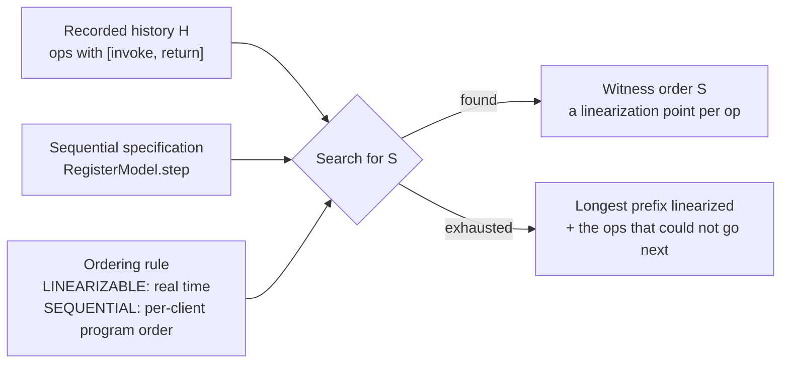

# Linearizability Checking with Recorded Histories

> Prove your replicated register wrong with a history checker.

**Type:** Build
**Languages:** Java, Python, Go
**Prerequisites:** Phase 5 Lesson 05 (Consistency Models), Phase 6 Lesson 02 (Replication Lag and Read-Your-Writes), Phase 6 Lesson 06 (Raft II: Log Replication)
**Time:** ~90 minutes

## Learning Objectives

- Define linearizability precisely in terms of invocation and response events, and distinguish it from sequential consistency with a two-operation history
- Record a history of client operations with an injected clock so that the recording itself is deterministic and replayable
- Implement the Wing-Gong backtracking search that decides whether a history has a valid linearization against a sequential specification
- Add the (linearized set, state) memo that turns a factorial search into an exponential one, and measure the difference
- Read a checker's failure output (the longest linearizable prefix) and locate the stale operation that caused it
- Explain why the problem is NP-complete in general, why that is acceptable for test histories, and what production checkers add

## The Problem

A payments platform keeps each customer's available balance in a replicated register: a Raft group (Lesson 06) with a leader that serves writes, and followers that are allowed to serve reads to cut leader load. A customer with a 500.00 balance sends a withdrawal of 200.00. The ledger service writes `bal = 300` through the leader, the leader commits it with a majority, and the response goes back to the customer at 14:02:09.412. At 14:02:09.431, the risk service, deciding whether to approve a second withdrawal of 450.00 from the same account, reads `bal` from a follower that has not yet applied the committed entry and gets `500`. Risk approves. The account goes to −150.00. The customer did nothing wrong; the system told two of its own services two different balances for the same moment.

Every engineer on the team believes the store is "strongly consistent" because it runs Raft. The log is linearizable: committed entries are totally ordered and every state machine applies them in that order. But the read path bypassed the mechanism that made the log safe. A follower read returns whatever that replica has applied so far, and nothing in Raft's commit protocol stops a follower from being 19 milliseconds behind. The system as the client sees it, the thing with `read` and `write` operations and real-time ordering, is not linearizable, and no amount of staring at the Raft implementation will show that, because the Raft implementation is correct.

The question that matters is a question about observed behaviour: given what the clients saw and when they saw it, is there any single-copy explanation? Here there is not. The write of 300 returned at .412; the read of 500 started at .431. In any sequential execution of a register, a read that starts after a write finishes must return that write's value or a later one. The history is impossible for a register, and so the system is not a register, whatever its documentation says.

This lesson builds the tool that answers that question mechanically. You record operations with their invocation and response times, hand the record to a checker along with a sequential specification of what the object is supposed to be, and the checker either produces a witness order or tells you where it got stuck. It is how Jepsen found stale reads in etcd, MongoDB, and a dozen other systems that documented themselves as strongly consistent, and it is the test you run against your own replicated ledger before anyone else does.

## The Concept

### Histories: invocations, responses, and real time

Herlihy and Wing (1990) define a *history* as a sequence of events, each an invocation of an operation by a client or a response to one. An operation is *complete* when both events are present. Two complete operations are ordered in real time if one's response comes before the other's invocation; otherwise they are *concurrent*. Concurrency is the whole subject. If no two operations ever overlapped, the history would already be a sequence and checking it would be running the specification once.

This lesson represents a completed operation as `Op(id, client, kind, key, value, invokedAt, returnedAt)`. For a `WRITE`, `value` is what was written; for a `READ`, it is what came back. The timestamps are the client's own: taken immediately before the request is sent and immediately after the response arrives. The client's clock does not need to agree with the server's or even with other clients' clocks for the checker to be sound, provided every client's intervals are measured against the same clock, which is why the lesson injects one `FakeClock` shared by the recorder.

A history is drawn as intervals on a time line. The interval is where the operation *might* have taken effect; the single instant where it did is its *linearization point*, and the checker's job is to find one for every operation.

| Op | Client | Operation | Invoked | Returned | Real-time relation |
|----|--------|-----------|---------|----------|--------------------|
| #0 | ledger | write(bal=500) | 0 | 4 | precedes #1, #2, #3 |
| #1 | ledger | write(bal=300) | 6 | 9 | precedes #2, #3 |
| #2 | risk | read(bal) returns 500 | 10 | 12 | precedes #3 |
| #3 | app | read(bal) returns 300 | 13 | 15 | last |

Nothing overlaps here, so the real-time order is total and there is exactly one candidate sequence: #0, #1, #2, #3. Running a register through it fails at #2: after `write(300)`, a read must return 300. The history is not linearizable, and the stale read is identified without any search at all. Search is needed only when intervals overlap.

### The definition

A history `H` is *linearizable* if there exists a sequential history `S` (one operation at a time, each response immediately after its invocation) such that:

1. `S` contains exactly the operations of `H` with the same results;
2. `S` is a legal execution of the object's *sequential specification*; for a register, every read returns the value of the most recent preceding write, or the initial value if there is none;
3. `S` respects the real-time order of `H`: if operation `a` returned before `b` was invoked in `H`, then `a` comes before `b` in `S`.

Condition 3 is what distinguishes linearizability from weaker models. Drop it and keep only each client's program order, and you have *sequential consistency* (Lamport, 1979). Drop that too and you have little more than "every value read was written at some point." The checker in this lesson implements the search for `S` under either condition 3 or its sequential-consistency replacement, so the difference is one branch in `mayGoNext`.



### Worked example: sequentially consistent, not linearizable

```text
#0 ledger write(bal=300)  [0, 4]
#1 risk   read(bal) -> 0  [6, 8]
```

Linearizability: #0 returned at 4, #1 was invoked at 6, so #0 must precede #1 in `S`. The only candidate is `#0, #1`. The register holds 300 after #0; #1 returned 0. Rejected. There is no `S`.

Sequential consistency: the two operations belong to different clients, so no program-order constraint relates them. The candidate `#1, #0` is allowed: the read returns the initial value 0, then the write sets 300. Accepted.

This is exactly the follower-read bug from The Problem, reduced to two operations. A system whose replicas apply writes in the same order but at different times is sequentially consistent and not linearizable, and the gap between the two is the replication lag. Lesson 02 measured that lag; this lesson detects it from the outside without knowing anything about the implementation.

### Worked example: linearizable only because of the overlap

```text
#0 ledger write(bal=300)   [0, 10]
#1 risk   read(bal) -> 0   [5, 15]
#2 app    read(bal) -> 300 [6, 8]
```

All three intervals overlap one another: no operation returned before another was invoked, so real time imposes no constraints and all six orders are candidates. The search tries them against the register:

```text
#0 #1 #2   write 300; read -> 0?  the register holds 300.  rejected at #1
#0 #2 #1   write 300; read -> 300 ok; read -> 0? rejected at #1
#1 #0 #2   read -> 0 ok (initial); write 300; read -> 300 ok.  ACCEPTED
```

The witness says: risk's read took effect at some instant before the write did, which is allowed because the read was in flight while the write was in flight. The customer-visible meaning is that risk saw the balance *before* the withdrawal, and that is legitimate: the withdrawal had not been acknowledged yet. Change one number, `#1 risk read(bal) -> 0 [11, 15]`, and the read now starts after the write returned; #0 must precede #1; and no order works. The same stale value is fine in one history and a bug in the other, and the only difference is whether the client could have known the write was complete. That is the precise content of "linearizable".

### The search: Wing and Gong's algorithm

Wing and Gong (1993) gave the standard decision procedure. Maintain the set of operations already linearized and the specification's state after applying them in that order. At each step, an operation may be chosen next if it is *minimal*: no operation that is still unlinearized returned before it was invoked. Try each minimal operation; if the specification accepts its result from the current state, recurse with it added; if the recursion fails, undo and try the next. Success is linearizing every operation; failure is exhausting the candidates at the root.

```text
search(done, state):
  if done == all ops: return FOUND
  for each op i not in done, in id order:
    if some op j not in done has j.returnedAt < i.invokedAt: skip      (i is not minimal)
    next = step(state, op i); if next is REJECT: skip                   (result impossible here)
    if search(done + {i}, next): return FOUND
  return NOT FOUND
```

The minimality rule is a *partial* order: two overlapping operations are both minimal and the search tries both orders. Operations that do not overlap anything are linearized in their only possible position with no branching. The cost is therefore governed by how many operations overlap at once, not by the history's length.

Correctness has two halves. Soundness: any order the search returns satisfies all three conditions by construction, because every operation was accepted by the specification from the state its predecessors produced and was minimal when chosen. Completeness: if a linearization `S` exists, its first element is minimal in the full set (nothing precedes it in real time), the specification accepts it from the initial state, and the rest of `S` is a linearization of the remainder; by induction the search finds `S` or something equally valid before exhausting the tree.

### The memo: same set, same state, same answer

The plain search is factorial in the number of concurrent operations. Eight fully concurrent writes followed by a read that must observe the first one gives a tree with over 16,000 nodes, because depth-first search in id order keeps trying permutations that put the first write first. Lowe (2017) made the observation that fixes most of it: the outcome of `search(done, state)` depends only on `done` and `state`, not on the order in which `done` was reached. Two different orderings of the same seven writes leave the same set linearized and the register holding the same last value, so if the first ordering led to failure, the second will too. Record every `(done, state)` that failed; skip any you see again.

The demo measures it on that eight-write history: 1,389 states with the memo and 16,081 without; on twelve writes the memoised search finishes in about 56,000 states while the plain one exceeds a 100,000-state budget. The bound with the memo is the number of distinct `(subset, state)` pairs, at most `2^n` times the number of reachable states, which for a register is at most `n` values. Exponential instead of factorial is the difference between a checker that handles twenty overlapping operations in milliseconds and one that cannot handle twelve.

The memo key is the bitmask of linearized ids and a canonical string for the state (`"bal=300"`), which is why the lesson caps a history at 64 operations: the set fits in one `long`/`int`/`uint64`. Production checkers use bitsets of arbitrary length and partition the history by key first, since operations on independent registers never constrain each other.

### Complexity and what the checker promises

| Quantity | Value | Why it matters |
|----------|-------|----------------|
| Decision problem | NP-complete (Gibbons and Korach, 1997), even for a single register | No algorithm is polynomial in the worst case; test histories are kept short and low in concurrency on purpose |
| Plain Wing-Gong | `O(n!)` worst case, `O(n)` when nothing overlaps | Cost is set by the width of concurrency, not the length of the history |
| With the (set, state) memo | `O(2^n * S)` where `S` is the number of reachable states | A register has at most `n+1` states; a key-value map with `k` keys has far more, which is why real checkers split by key |
| Partitioning by key | independent sub-histories checked separately | For a KV store, the exponent becomes the largest per-key concurrency, not the total |
| Space | the memo table, up to `2^n` entries | The state budget in the code bounds both time and memory |

What the checker promises: if it says yes, the witness order is a valid linearization and the history is consistent with a single-copy register. If it says no, no linearization exists and the system violated its specification at least once in that history, with the longest prefix showing where the explanation ran out. What it does not promise: a yes on one history is not proof of correctness. A linearizability checker finds bugs; it never proves their absence, because the next history might contain the schedule that exposes them. That is why the generated-history test in this lesson runs fifty seeds, and why Jepsen runs for hours.

### What this lesson does not do

- **Incomplete operations.** A client that times out does not know whether its write took effect. The correct treatment is to let the search include or omit the operation (Porcupine and Knossos both do), which doubles the branching. The recorder here refuses to produce a history with pending operations; Exercise 2 lifts that.
- **Richer objects.** The specification is a register per key with `read` and `write`. Compare-and-swap, append-only logs, and queues are different `step` functions on the same search; Exercise 1 adds CAS.
- **Clock skew across clients.** The recorder assumes one clock. With per-client clocks you must widen every interval by the maximum skew before checking, or you will reject correct histories. Phase 5, Lesson 04 is the lesson on how large that skew can be.
- **Proof.** A passing history is evidence, not proof. For proof, see the TLA+ specification referenced in Lesson 06.

## Build It

The primary walkthrough is in Java. The Python and Go files implement the same design with the same names; the subsections at the end show only what differs.

### Step 1: Operations and their real-time relation

```java
record Op(int id, String client, OpKind kind, String key, int value, int invokedAt, int returnedAt) {
    Op {
        if (returnedAt < invokedAt) throw new IllegalArgumentException("op " + id + " returned before it was invoked");
    }

    boolean precedes(Op other) { return returnedAt < other.invokedAt; }

    boolean concurrentWith(Op other) { return !precedes(other) && !other.precedes(this); }
}
```

`precedes` is the entire real-time order: strict inequality, so an operation that returned at tick 10 and one invoked at tick 10 are concurrent. That choice is conservative; if your clock is coarse, two operations that were really sequential are treated as overlapping, which can only make the checker accept more histories, never reject a correct one. The constructor rejects an interval that ends before it begins, because every later rule assumes intervals are well formed.

**Predict:** `#0 [0, 10]` and `#1 [10, 15]`: does #0 precede #1, and what would change if `precedes` used `<=`?

### Step 2: The history and its 64-op limit

```java
final class History {
    static final int MAX_OPS = 64;
    private final List<Op> ops = new ArrayList<>();

    History add(String client, OpKind kind, String key, int value, int invokedAt, int returnedAt) {
        if (ops.size() >= MAX_OPS) throw new IllegalArgumentException("this checker handles at most " + MAX_OPS + " ops per history");
        ops.add(new Op(ops.size(), client, kind, key, value, invokedAt, returnedAt));
        return this;
    }

    History write(String client, String key, int value, int invokedAt, int returnedAt) { return add(client, OpKind.WRITE, key, value, invokedAt, returnedAt); }
    History read(String client, String key, int value, int invokedAt, int returnedAt) { return add(client, OpKind.READ, key, value, invokedAt, returnedAt); }
}
```

Ids are assigned densely in insertion order, which is what lets the search represent "the set of linearized operations" as one `long` with bit `i` set for op `i`. The fluent `write`/`read` builders exist so that test histories read like the tables in The Concept.

### Step 3: Recording with an injected clock

```java
final class HistoryRecorder {
    private final FakeClock clock;
    private final Map<Integer, Pending> pending = new HashMap<>();
    private final List<Op> completed = new ArrayList<>();

    int invokeWrite(String client, String key, int value) { return invoke(client, OpKind.WRITE, key, value); }
    int invokeRead(String client, String key) { return invoke(client, OpKind.READ, key, 0); }

    void complete(int id, int value) {
        Pending p = pending.remove(id);
        if (p == null) throw new IllegalArgumentException("no pending op " + id);
        int v = p.kind() == OpKind.WRITE ? p.value() : value;
        completed.add(new Op(id, p.client(), p.kind(), p.key(), v, p.invokedAt(), clock.now()));
    }

    History history() {
        if (!pending.isEmpty()) throw new IllegalStateException(pending.size() + " ops never completed; this checker needs a complete history");
        ...
    }
}
```

The recorder is the shape of a test harness: call `invoke*` before the request leaves, `complete` after the response arrives, and the two timestamps bracket the operation. A read's value is unknown until completion, so `invokeRead` stores a placeholder and `complete` fills it in; a write's value is known at invocation and `complete`'s argument is ignored. The clock is injected so a recorded history is a pure function of the test script, and the `history()` method refuses pending operations because the checker, as written, needs to know every operation's result.

**Predict:** a test calls `invokeRead` and then the process crashes before `complete`. What should the harness record, and what are the two things the read might have done?

### Step 4: The sequential specification

```java
final class RegisterModel {
    Map<String, Integer> initial() { return new TreeMap<>(); }

    Map<String, Integer> step(Map<String, Integer> state, Op op) {
        int current = state.getOrDefault(op.key(), 0);
        if (op.kind() == OpKind.READ) return current == op.value() ? state : null;
        Map<String, Integer> next = new TreeMap<>(state);
        next.put(op.key(), op.value());
        return next;
    }

    String key(Map<String, Integer> state) { /* "a=1,b=2" */ }
}
```

The model is the only place the word "register" has meaning. `step` returns the next state, or `null` if the operation's observed result is impossible from this state, which for a register means a read returned something other than the current value. Writes always succeed and produce a new map; the old one is kept because the search will backtrack to it. `key` is a canonical string for the memo table, built from a `TreeMap` so that `{a=1, b=2}` and `{b=2, a=1}` produce the same key. Swap this class for a queue or a CAS register and the search below is unchanged.

### Step 5: The search

```java
private boolean search(long done, Map<String, Integer> state) {
    explored++;
    if (explored > stateBudget) throw new IllegalStateException("state budget of " + stateBudget + " exceeded; history too concurrent for this checker");
    if (order.size() > longestPrefix.size()) longestPrefix = new ArrayList<>(order);
    if (Long.bitCount(done) == ops.size()) return true;
    String memoKey = memoize ? done + "|" + model.key(state) : null;
    if (memoize && failedConfigs.contains(memoKey)) { memoHits++; return false; }
    for (int i = 0; i < ops.size(); i++) {
        if ((done & (1L << i)) != 0 || !mayGoNext(i, done)) continue;
        Map<String, Integer> next = model.step(state, ops.get(i));
        if (next == null) continue;
        order.add(i);
        if (search(done | (1L << i), next)) return true;
        order.remove(order.size() - 1);
    }
    if (memoize) failedConfigs.add(memoKey);
    return false;
}
```

This is the pseudocode from The Concept with three additions. The `explored` counter and `stateBudget` make a runaway search fail fast with a message rather than running for an hour; a test can assert that a given history stays under a budget, which is the lesson's "performance bound" test. `longestPrefix` records the deepest partial order ever reached, which is what the failure report shows: the operations that could be explained and, by elimination, the ones that could not. And the memo: a configuration is recorded as failed only after every candidate from it has been tried, and is consulted before any candidate is tried.

**Predict:** why is the memo keyed on `done` and the state, but not on `order`? What would break if two different orders of the same set could lead to different states?

### Step 6: Who may go next

```java
private boolean mayGoNext(int i, long done) {
    Op candidate = ops.get(i);
    for (int j = 0; j < ops.size(); j++) {
        if (j == i || (done & (1L << j)) != 0) continue;
        Op other = ops.get(j);
        if (consistency == Consistency.LINEARIZABLE) {
            if (other.precedes(candidate)) return false;
        } else if (other.client().equals(candidate.client()) && other.invokedAt() < candidate.invokedAt()) {
            return false;
        }
    }
    return true;
}
```

The one place the two consistency models differ. For linearizability, `i` is blocked by any unlinearized operation that returned before `i` was invoked, regardless of client. For sequential consistency, `i` is blocked only by an earlier unlinearized operation of the same client. The loop is `O(n)` per candidate, so each search node costs `O(n^2)`; for the history sizes this checker accepts that is irrelevant next to the exponential, and the clarity is worth more than a precomputed predecessor bitmask (Exercise 1 of the performance kind, if you want it).

### Step 7: Reporting

```java
record CheckResult(boolean ok, Consistency model, List<Integer> order, List<Integer> longestPrefix, int explored, int memoHits) {
    String describe(History h) {
        if (ok) { /* "LINEARIZABLE: yes. Witness order:" + each op */ }
        else    { /* "LINEARIZABLE: NO. Longest linearizable prefix (k of n ops):" + each op + "no remaining op can go next" */ }
        /* "(explored states, memo hits)" */
    }
}
```

A yes comes with its witness so a reviewer can read the linearization points off the intervals. A no comes with the longest prefix. In the stale-read history the prefix is both writes; the two reads are missing, and the first missing operation in id order (`#2 risk read -> 500`) is the one that could not be explained: after both writes the register holds 300. In a history with more overlap the culprit is less obvious, and the right move is to delete operations from the end until the history passes; the last deletion that flips the verdict is the stale one.

### Step 8: Generating histories that must pass

```java
static History linearizable(long seed, int n, int clients, int window) {
    Rng rng = new Rng(seed);
    History h = new History();
    int value = 0;
    for (int k = 0; k < n; k++) {
        int point = 10 * (k + 1);
        int invoked = point - rng.nextInt(window), returned = point + rng.nextInt(window);
        String client = "c" + rng.nextInt(clients);
        if (rng.nextInt(2) == 0) { value = 1 + rng.nextInt(9); h.write(client, "x", value, invoked, returned); }
        else h.read(client, "x", value, invoked, returned);
    }
    return h;
}
```

The generator runs a register sequentially, assigning each operation a linearization point `10k`, and then widens it into an interval `[10k − a, 10k + b]` with random `a, b` below `window`. Every history it produces has a linearization by construction (the order of the points), and with `window = 15` neighbouring intervals overlap often enough that the checker has to work. Fifty seeds pass; a checker bug that over-constrained the search would fail one of them. The SplitMix64 generator is the same one as Lessons 05 and 06, so the fifty histories are identical in all three languages.

### Step 9: Run it

```bash
cd phases/06-replication-and-consensus/12-linearizability-checking/code/java
javac -d .out *.java && java -cp .out Main
java -cp .out MainTest
```

Expected output, abbreviated:

```console
== A lagging replica: risk reads 500 after the write of 300 returned (stale read) ==
  #0 ledger write(bal=500) [0,4]
  #1 ledger write(bal=300) [6,9]
  #2 risk read(bal)->500 [10,12]
  #3 app read(bal)->300 [13,15]
LINEARIZABLE: NO. Longest linearizable prefix (2 of 4 ops):
  #0 ledger write(bal=500) [0,4]
  #1 ledger write(bal=300) [6,9]
  no remaining op can go next from here
  (3 states explored, 0 memo hits)

== Sequentially consistent but not linearizable ==
  #0 ledger write(bal=300) [0,4]
  #1 risk read(bal)->0 [6,8]
LINEARIZABLE: NO. Longest linearizable prefix (1 of 2 ops):
  #0 ledger write(bal=300) [0,4]
  no remaining op can go next from here
SEQUENTIAL: yes. Witness order:
  #1 risk read(bal)->0 [6,8]
  #0 ledger write(bal=300) [0,4]

== Linearizable only because of the concurrency window: risk's read of 0 overlaps the write ==
LINEARIZABLE: yes. Witness order:
  #1 risk read(bal)->0 [5,15]
  #0 ledger write(bal=300) [0,10]
  #2 app read(bal)->300 [6,8]

== Why the memo matters: 8 fully concurrent writes followed by one read ==
  with memo:    ok=true, 1389 states explored, 924 memo hits
  without memo: ok=true, 16081 states explored (depth-first in id order keeps retrying permutations that put write(x=1) first)

== 50 generated histories (20 ops, 3 clients, window 15) that are linearizable by construction ==
  passed 50/50; most states explored by any one check: 21
```

The output of `main.py` and `main.go` is byte-identical.

### In Python

The Python port (`code/python/main.py`) is the same design with four differences. **`int` is the bitmask:** Python integers are unbounded, so the 64-op cap is a design choice kept for parity rather than a language limit, and `int.bit_count()` (3.10+) replaces `Long.bitCount`. **`CheckResult.order` is a tuple,** not a list, so a result cannot be mutated by a caller and compares by value in tests. **`RegisterModel.step` returns `None`** for a rejected op, the idiomatic absent value, where Java returns `null` and Go returns `(state, false)`. **Recursion depth** is bounded by the 64-op cap, well under the default limit of 1000, so no `sys.setrecursionlimit` is needed.

Run it from `code/python/` with `python3 main.py`; test with `python3 -m unittest -v`.

#### Step 1: Operations and their real-time relation

`Op` is a frozen dataclass; the compact-constructor check becomes `__post_init__` raising `ValueError`. `precedes` is the strict inequality and `concurrent_with` is its negation both ways.

```python
    id: int
    client: str
    kind: OpKind
    key: str
    value: int
    invoked_at: int
    returned_at: int

    def __post_init__(self) -> None:
        if self.returned_at < self.invoked_at:
            raise ValueError(f"op {self.id} returned before it was invoked")

    def precedes(self, other: "Op") -> bool:
        return self.returned_at < other.invoked_at

    def concurrent_with(self, other: "Op") -> bool:
        return not self.precedes(other) and not other.precedes(self)
```

#### Step 2: The history and its 64-op limit

`MAX_OPS` is a class attribute. `add` assigns the id from the current length and returns `self`, so the fluent `write`/`read` builders chain; the `ops` property returns a copy of the list so a caller cannot reorder the history under the checker.

```python
class History:
    MAX_OPS = 64

    def __init__(self) -> None:
        self._ops: list[Op] = []

    def add(self, client: str, kind: OpKind, key: str, value: int, invoked_at: int, returned_at: int) -> "History":
        if len(self._ops) >= History.MAX_OPS:
            raise ValueError(f"this checker handles at most {History.MAX_OPS} ops per history")
        self._ops.append(Op(len(self._ops), client, kind, key, value, invoked_at, returned_at))
        return self

    def write(self, client: str, key: str, value: int, invoked_at: int, returned_at: int) -> "History":
        return self.add(client, OpKind.WRITE, key, value, invoked_at, returned_at)

    def read(self, client: str, key: str, value: int, invoked_at: int, returned_at: int) -> "History":
        return self.add(client, OpKind.READ, key, value, invoked_at, returned_at)

    @property
    def ops(self) -> list[Op]:
        return list(self._ops)
```

#### Step 3: Recording with an injected clock

`_invoke` stamps `clock.now()` into a private `_Pending` dataclass; `complete` pops it with `dict.pop(id, None)` and raises on an unknown id. A read takes the completion value, a write keeps the value it was invoked with. `history()` refuses pending ops with `RuntimeError` and rebuilds the history densely in id order.

```python
    def invoke_write(self, client: str, key: str, value: int) -> int:
        return self._invoke(client, OpKind.WRITE, key, value)

    def invoke_read(self, client: str, key: str) -> int:
        return self._invoke(client, OpKind.READ, key, 0)

    def _invoke(self, client: str, kind: OpKind, key: str, value: int) -> int:
        op_id = self._next_id
        self._next_id += 1
        self._pending[op_id] = _Pending(client, kind, key, value, self._clock.now())
        return op_id

    def complete(self, op_id: int, value: int) -> None:
        p = self._pending.pop(op_id, None)
        if p is None:
            raise ValueError(f"no pending op {op_id}")
        v = p.value if p.kind == OpKind.WRITE else value
        self._completed.append(Op(op_id, p.client, p.kind, p.key, v, p.invoked_at, self._clock.now()))

    def history(self) -> History:
        if self._pending:
            raise RuntimeError(f"{len(self._pending)} ops never completed; this checker needs a complete history")
        h = History()
        for o in sorted(self._completed, key=lambda o: o.id):
            h.add(o.client, o.kind, o.key, o.value, o.invoked_at, o.returned_at)
        return h
```

#### Step 4: The sequential specification

`State` is a type alias for `dict[str, int]`. `step` returns the same dict for an accepted read, `None` for a rejected one, and a copy (`dict(state)`) with the write applied otherwise, so backtracking still has the old state. `key` sorts the items so the memo key is canonical.

```python
State = dict[str, int]


class RegisterModel:
    def initial(self) -> State:
        return {}

    def step(self, state: State, op: Op) -> State | None:
        current = state.get(op.key, 0)
        if op.kind == OpKind.READ:
            return state if current == op.value else None
        nxt = dict(state)
        nxt[op.key] = op.value
        return nxt

    def key(self, state: State) -> str:
        return ",".join(f"{k}={v}" for k, v in sorted(state.items()))
```

#### Step 5: The search

The same recursive search over an `int` bitmask. The budget check raises `RuntimeError`, the longest prefix is snapshotted with `list(self._order)`, and `done.bit_count()` tests for completion. The memo key is an f-string of the mask and the model key, and a failed configuration is recorded only after every candidate has been tried.

```python
    def _search(self, done: int, state: State) -> bool:
        self._explored += 1
        if self._explored > self._state_budget:
            raise RuntimeError(f"state budget of {self._state_budget} exceeded; history too concurrent for this checker")
        if len(self._order) > len(self._longest_prefix):
            self._longest_prefix = list(self._order)
        if done.bit_count() == len(self._ops):
            return True
        memo_key = f"{done}|{self._model.key(state)}" if self._memoize else ""
        if self._memoize and memo_key in self._failed_configs:
            self._memo_hits += 1
            return False
        for i, op in enumerate(self._ops):
            if done & (1 << i) or not self._may_go_next(i, done):
                continue
            nxt = self._model.step(state, op)
            if nxt is None:
                continue
            self._order.append(i)
            if self._search(done | (1 << i), nxt):
                return True
            self._order.pop()
        if self._memoize:
            self._failed_configs.add(memo_key)
        return False
```

#### Step 6: Who may go next

`enumerate` gives both the index for the bitmask test and the op for the comparisons. The linearizable branch asks whether any unlinearized op precedes the candidate in real time; the sequential branch only looks at earlier ops of the same client.

```python
    def _may_go_next(self, i: int, done: int) -> bool:
        candidate = self._ops[i]
        for j, other in enumerate(self._ops):
            if j == i or done & (1 << j):
                continue
            if self._consistency == Consistency.LINEARIZABLE:
                if other.precedes(candidate):
                    return False
            elif other.client == candidate.client and other.invoked_at < candidate.invoked_at:
                return False
        return True
```

#### Step 7: Reporting

`CheckResult` is a frozen dataclass whose `order` and `longest_prefix` are tuples. `describe` builds the same lines as the Java: the witness order on success, the longest prefix and the "no remaining op" line on failure, and the state count either way.

```python
@dataclass(frozen=True)
class CheckResult:
    ok: bool
    model: Consistency
    order: tuple[int, ...]
    longest_prefix: tuple[int, ...]
    explored: int
    memo_hits: int

    def describe(self, h: History) -> str:
        lines = []
        if self.ok:
            lines.append(f"{self.model.value}: yes. Witness order:")
            lines.extend(f"  {h.op(i)}" for i in self.order)
        else:
            lines.append(f"{self.model.value}: NO. Longest {self.model.value.lower()} prefix ({len(self.longest_prefix)} of {h.size()} ops):")
            lines.extend(f"  {h.op(i)}" for i in self.longest_prefix)
            lines.append("  no remaining op can go next from here")
        lines.append(f"  ({self.explored} states explored, {self.memo_hits} memo hits)")
        return "\n".join(lines)
```

#### Step 8: Generating histories that must pass

The same SplitMix64 `Rng`, masked to 64 bits, draws the same four numbers per op in the same order, so the fifty histories are the Java's. The sequential run is implicit in `value`, which a write updates and a read reports.

```python
    @staticmethod
    def linearizable(seed: int, n: int, clients: int, window: int) -> History:
        rng = Rng(seed)
        h = History()
        value = 0
        for k in range(n):
            point = 10 * (k + 1)
            invoked = point - rng.next_int(window)
            returned = point + rng.next_int(window)
            client = f"c{rng.next_int(clients)}"
            if rng.next_int(2) == 0:
                value = 1 + rng.next_int(9)
                h.write(client, "x", value, invoked, returned)
            else:
                h.read(client, "x", value, invoked, returned)
        return h
```

#### Step 9: Run it

```bash
cd phases/06-replication-and-consensus/12-linearizability-checking/code/python
python3 main.py
python3 -m unittest -v
```

The output is byte-identical to the Java run:

```console
== Why the memo matters: 8 fully concurrent writes followed by one read ==
  with memo:    ok=true, 1389 states explored, 924 memo hits
  without memo: ok=true, 16081 states explored (depth-first in id order keeps retrying permutations that put write(x=1) first)

== 50 generated histories (20 ops, 3 clients, window 15) that are linearizable by construction ==
  passed 50/50; most states explored by any one check: 21
```

### In Go

The Go port (`code/go/main.go`) keeps the design and changes four things. **The budget is an error, not a panic:** `search` returns `(bool, error)` and `ErrBudget` propagates up through the recursion, so a caller can `errors.Is` it, where the Java and Python versions throw; `CheckLinearizable` is a convenience that panics on the error for demos and tests where a blown budget is a bug. **`History.Add` returns an error; `Write`/`Read` panic:** hand-built histories are programmer input, and a fluent builder cannot return an error, so the two APIs coexist, `Add` for recorded data and the builders for literals. **`State` is `map[string]int`** and `Step` copies it by hand before a write; maps are reference types, so forgetting the copy would let a backtracked branch see a later branch's write, which the Java `new TreeMap<>(state)` and Python `dict(state)` prevent more quietly. **`bits.OnesCount64`** replaces `Long.bitCount`, and the bitmask is `uint64`, so the shift `1 << uint(i)` needs the explicit conversion.

Run it from `code/go/` with `go run .`; test with `go test ./...`.

#### Step 1: Operations and their real-time relation

`Op` is a plain struct; the interval validation moves to `History.Add` because a struct literal has no constructor. `Precedes` and `ConcurrentWith` are one-liners.

```go
type Op struct {
	ID         int
	Client     string
	Kind       OpKind
	Key        string
	Value      int
	InvokedAt  int
	ReturnedAt int
}

func (o Op) Precedes(other Op) bool { return o.ReturnedAt < other.InvokedAt }

func (o Op) ConcurrentWith(other Op) bool { return !o.Precedes(other) && !other.Precedes(o) }
```

#### Step 2: The history and its 64-op limit

`Add` is the validating path and returns `ErrBadOp` for a backwards interval or a full history; `Write` and `Read` wrap it and panic so they can return `*History` for chaining. `Ops()` returns a copy of the slice.

```go
func (h *History) Add(client string, kind OpKind, key string, value, invokedAt, returnedAt int) error {
	if returnedAt < invokedAt {
		return fmt.Errorf("%w: op %d returned before it was invoked", ErrBadOp, len(h.ops))
	}
	if len(h.ops) >= MaxOps {
		return fmt.Errorf("%w: this checker handles at most %d ops per history", ErrBadOp, MaxOps)
	}
	h.ops = append(h.ops, Op{len(h.ops), client, kind, key, value, invokedAt, returnedAt})
	return nil
}

func (h *History) Write(client, key string, value, invokedAt, returnedAt int) *History {
	if err := h.Add(client, Write, key, value, invokedAt, returnedAt); err != nil {
		panic(err)
	}
	return h
}

func (h *History) Read(client, key string, value, invokedAt, returnedAt int) *History {
	if err := h.Add(client, Read, key, value, invokedAt, returnedAt); err != nil {
		panic(err)
	}
	return h
}

func (h *History) Ops() []Op    { return append([]Op(nil), h.ops...) }
```

#### Step 3: Recording with an injected clock

`Complete` and `History` return errors instead of throwing. The two-value map read finds the pending op, `delete` removes it, and a write keeps its invocation value. `History()` sorts a copy of the completed ops by id before rebuilding.

```go
func (r *HistoryRecorder) invoke(client string, kind OpKind, key string, value int) int {
	id := r.nextID
	r.nextID++
	r.pending[id] = pending{client, kind, key, value, r.clock.Now()}
	return id
}

func (r *HistoryRecorder) Complete(id, value int) error {
	p, ok := r.pending[id]
	if !ok {
		return fmt.Errorf("no pending op %d", id)
	}
	delete(r.pending, id)
	v := value
	if p.kind == Write {
		v = p.value
	}
	r.completed = append(r.completed, Op{id, p.client, p.kind, p.key, v, p.invokedAt, r.clock.Now()})
	return nil
}

func (r *HistoryRecorder) History() (*History, error) {
	if len(r.pending) > 0 {
		return nil, fmt.Errorf("%d ops never completed; this checker needs a complete history", len(r.pending))
	}
	sorted := append([]Op(nil), r.completed...)
	sort.Slice(sorted, func(i, j int) bool { return sorted[i].ID < sorted[j].ID })
	h := NewHistory()
	for _, o := range sorted {
		if err := h.Add(o.Client, o.Kind, o.Key, o.Value, o.InvokedAt, o.ReturnedAt); err != nil {
			return nil, err
		}
	}
	return h, nil
}
```

#### Step 4: The sequential specification

`Step` returns `(State, bool)`: the same map and `true` for an accepted read, `false` for a rejected one, and a freshly allocated copy with the write applied otherwise. A missing map key reads as 0, which is the register's initial value. `Key` sorts the keys because map iteration order is random.

```go
type State map[string]int

type RegisterModel struct{}

func (RegisterModel) Initial() State { return State{} }

func (RegisterModel) Step(state State, op Op) (State, bool) {
	current := state[op.Key]
	if op.Kind == Read {
		return state, current == op.Value
	}
	next := make(State, len(state)+1)
	for k, v := range state {
		next[k] = v
	}
	next[op.Key] = op.Value
	return next, true
}

func (RegisterModel) Key(state State) string {
	keys := make([]string, 0, len(state))
	for k := range state {
		keys = append(keys, k)
	}
	sort.Strings(keys)
	parts := make([]string, 0, len(keys))
	for _, k := range keys {
		parts = append(parts, fmt.Sprintf("%s=%d", k, state[k]))
	}
	return strings.Join(parts, ",")
}
```

#### Step 5: The search

The recursion returns `(bool, error)`; a budget overrun wraps `ErrBudget` and the `if err != nil || found` line propagates either a result or the error straight up. `bits.OnesCount64` is the population count, the memo is a `map[string]bool`, and the order is truncated with a reslice on backtrack.

```go
func (c *Checker) search(done uint64, state State) (bool, error) {
	c.explored++
	if c.explored > c.stateBudget {
		return false, fmt.Errorf("%w (budget %d)", ErrBudget, c.stateBudget)
	}
	if len(c.order) > len(c.longestPrefix) {
		c.longestPrefix = append([]int{}, c.order...)
	}
	if bits.OnesCount64(done) == len(c.ops) {
		return true, nil
	}
	memoKey := ""
	if c.memoize {
		memoKey = fmt.Sprintf("%d|%s", done, c.model.Key(state))
		if c.failedConfigs[memoKey] {
			c.memoHits++
			return false, nil
		}
	}
	for i, op := range c.ops {
		if done&(1<<uint(i)) != 0 || !c.mayGoNext(i, done) {
			continue
		}
		next, ok := c.model.Step(state, op)
		if !ok {
			continue
		}
		c.order = append(c.order, i)
		found, err := c.search(done|(1<<uint(i)), next)
		if err != nil || found {
			return found, err
		}
		c.order = c.order[:len(c.order)-1]
	}
	if c.memoize {
		c.failedConfigs[memoKey] = true
	}
	return false, nil
}
```

#### Step 6: Who may go next

The Java loop with `range` and the `uint` shift. The two consistency models differ only in the predicate inside the loop.

```go
func (c *Checker) mayGoNext(i int, done uint64) bool {
	candidate := c.ops[i]
	for j, other := range c.ops {
		if j == i || done&(1<<uint(j)) != 0 {
			continue
		}
		if c.consistency == Linearizable {
			if other.Precedes(candidate) {
				return false
			}
		} else if other.Client == candidate.Client && other.InvokedAt < candidate.InvokedAt {
			return false
		}
	}
	return true
}
```

#### Step 7: Reporting

`Describe` writes into a `strings.Builder`; `Consistency` has a `String()` method so `%s` prints `LINEARIZABLE`, and `strings.ToLower` produces the "linearizable prefix" wording.

```go
type CheckResult struct {
	OK            bool
	Model         Consistency
	Order         []int
	LongestPrefix []int
	Explored      int
	MemoHits      int
}

func (r CheckResult) Describe(h *History) string {
	var sb strings.Builder
	if r.OK {
		fmt.Fprintf(&sb, "%s: yes. Witness order:", r.Model)
		for _, id := range r.Order {
			fmt.Fprintf(&sb, "\n  %s", h.Op(id))
		}
	} else {
		fmt.Fprintf(&sb, "%s: NO. Longest %s prefix (%d of %d ops):", r.Model, strings.ToLower(r.Model.String()), len(r.LongestPrefix), h.Size())
		for _, id := range r.LongestPrefix {
			fmt.Fprintf(&sb, "\n  %s", h.Op(id))
		}
		sb.WriteString("\n  no remaining op can go next from here")
	}
	fmt.Fprintf(&sb, "\n  (%d states explored, %d memo hits)", r.Explored, r.MemoHits)
	return sb.String()
}
```

#### Step 8: Generating histories that must pass

A package-level function rather than a static method; the `uint64` SplitMix64 wraps natively and draws the same stream, so the fifty histories match the other two languages.

```go
func GenerateLinearizable(seed int64, n, clients, window int) *History {
	rng := NewRng(seed)
	h := NewHistory()
	value := 0
	for k := 0; k < n; k++ {
		point := 10 * (k + 1)
		invoked := point - rng.NextInt(window)
		returned := point + rng.NextInt(window)
		client := fmt.Sprintf("c%d", rng.NextInt(clients))
		if rng.NextInt(2) == 0 {
			value = 1 + rng.NextInt(9)
			h.Write(client, "x", value, invoked, returned)
		} else {
			h.Read(client, "x", value, invoked, returned)
		}
	}
	return h
}
```

#### Step 9: Run it

```bash
cd phases/06-replication-and-consensus/12-linearizability-checking/code/go
go run .
go test ./...
```

```console
== 50 generated histories (20 ops, 3 clients, window 15) that are linearizable by construction ==
  passed 50/50; most states explored by any one check: 21
```

Every other section of the output is identical to the Java and Python runs, including the memo counts.

## Use It

### Jepsen and Knossos

Jepsen (Kyle Kingsbury) is the test framework that made linearizability checking a routine part of database evaluation. It runs real clients against a real cluster while injecting partitions, clock skew, and process crashes, records every invocation and response with its own clock, and hands the history to a checker. Knossos, its original checker, is Wing-Gong with the Lowe memo in Clojure; Jepsen's published analyses of etcd (2014, 2020), MongoDB, and Redis-Raft are its output, and the stale-read-from-follower bug in The Problem is one it has reported against several systems that documented themselves as strongly consistent. What the real tool adds to this lesson's checker: indeterminate operations (a timed-out write is tried both as having happened and not), per-key partitioning, richer models (sets, queues, transactions), and a visualisation of the failing history as intervals.

### Porcupine

Porcupine (Anish Athalye, 2017) is the Go checker used by the MIT 6.824 Raft labs and by etcd's own robustness tests. Its interface is this lesson's `RegisterModel` almost exactly: a `Model` with `Init`, `Step(state, input, output) (bool, state)`, and a `Partition` function that splits a history by key, plus an `Equal` on states that serves as the memo's state key. It implements Lowe's algorithm with a `bitset` for the linearized set and a timeout instead of a state budget, and it returns `Ok`, `Illegal`, or `Unknown` (ran out of time), the third verdict being the honest answer that NP-completeness sometimes forces.

### etcd's robustness tests and ReadIndex

Since etcd 3.5, the project runs Porcupine over histories recorded from a live cluster under fault injection on every release. The bug class it guards against is the one in this lesson: a read served without confirming leadership. etcd's fix is `ReadIndex` (Raft thesis, section 6.4): before answering a linearizable read, the leader records its `commitIndex`, confirms it is still leader with a heartbeat round, waits for `lastApplied` to reach the recorded index, and only then reads its state machine. Follower reads forward a `ReadIndex` request to the leader and wait for their own `lastApplied` to catch up. The checker is how you know the fix works, because the fix is invisible in the Raft log and visible only in client histories.

### Payment systems

The available-balance register in The Problem is the real case. A ledger that serves balance reads from replicas must either accept that those reads are sequentially consistent (and label them so, with a "balance as of" timestamp, which is what most card issuers do for authorisation holds, Phase 10, Lesson 07) or route balance checks that gate a payment through a linearizable read path. Deciding which is a product decision; verifying that the path you chose actually has the property you claim is this lesson's checker running against a recorded history from your staging cluster under partition injection. The cost of getting it wrong is the −150.00 balance, multiplied by every account whose owner has two devices.

## Ship It

`outputs/checklist-consistency-claim-review.md` is a review checklist for any design document or API that claims a consistency level: what "strongly consistent" must mean operationally, which read paths are actually linearizable and which are not, how to record a history from a staging cluster and check it, and what to do with an `Unknown` verdict. Use it when a service's documentation says "consistent" and you need to know whether that word has been tested.

## Exercises

1. **Reinforce.** Add a `CAS(key, expected, new) -> succeeded` operation to `Op`, `RegisterModel.step`, and the recorder in all three languages. A CAS succeeds iff the current value equals `expected`, and the model must reject a history in which a CAS reported success from a state where the value was different. Write a history with two concurrent CAS operations on the same expected value where exactly one may succeed, and check that the checker accepts the history where one succeeded and rejects the one where both did.
2. **Apply.** Support incomplete operations. Give `HistoryRecorder.history()` a mode that includes pending operations with `returnedAt = infinity` and marks them indeterminate; in the search, an indeterminate write may be linearized (as a normal write) or skipped entirely, and the history passes if either choice leads to a full linearization. Reproduce the case where a client's write times out, a later read sees the value, and the history is linearizable only if the write is assumed to have happened. This is how Knossos and Porcupine treat `:info` operations.
3. **Extend.** Record a history from Lesson 06's Raft cluster. Add a `read(key)` client operation to that lesson's `Cluster` that returns the value from a chosen node's `stateMachine` (no leader confirmation), and use `HistoryRecorder` with the cluster's tick counter as the clock to record ten writes through the leader interleaved with reads from a follower during a partition. Show that the checker rejects the history, then implement `ReadIndex` (the read waits until the follower's `lastApplied` reaches the leader's `commitIndex` at the time of the request) and show that it passes across fifty seeds. This combines Lesson 06's replication with this lesson's checker and is the end-to-end test a replicated ledger should ship with.

## Key Terms

| Term | What people say | What it actually means |
|------|-----------------|------------------------|
| History | "the trace" | A record of invocations and responses with timestamps; the only thing a client-side correctness check has access to |
| Linearizability | "strong consistency" | There exists a single sequential order of all operations that the specification accepts and that respects real time: if `a` returned before `b` was invoked, `a` comes first |
| Sequential consistency | "everyone sees the same order" | A single sequential order that respects each client's program order but not real time; a replica lagging by one second is sequentially consistent and not linearizable |
| Linearization point | "when it really happened" | An instant inside the operation's interval at which it took effect atomically; the checker's witness assigns one to every operation |
| Concurrent operations | "they overlapped" | Neither returned before the other was invoked; the only operations whose relative order the checker is free to choose |
| Sequential specification | "the model" | A deterministic step function from state and operation to next state, or rejection; a register, a queue, a CAS cell, or a ledger |
| Wing-Gong search | "the checker" | Backtracking over minimal operations with the model as the oracle; sound and complete, factorial without memoisation |
| Stale read | "eventual consistency" | A read that returns a value older than a write that had already returned to its caller; the simplest linearizability violation, and the one replica reads produce |

## Further Reading

- [Linearizability: A Correctness Condition for Concurrent Objects](https://cs.brown.edu/~mph/HerlihyW90/p463-herlihy.pdf) (Herlihy and Wing, TOPLAS 1990) — the definition, with the proof that linearizability is local (a system is linearizable iff each object is) and non-blocking.
- [Testing and Verifying Concurrent Objects](https://www.cs.cmu.edu/~wing/publications/WingGong93.pdf) (Wing and Gong, JPDC 1993) — the backtracking algorithm in Step 5, and the first automated linearizability checker.
- [Testing for Linearizability](https://www.cs.ox.ac.uk/people/gavin.lowe/LinearizabiltyTesting/paper.pdf) (Lowe, Concurrency and Computation: Practice and Experience 2017) — the (linearized set, state) memo and its measured effect, plus the just-in-time variant that production checkers use.
- [On Testing Linearizability](https://doi.org/10.1137/S0097539794279614) (Gibbons and Korach, SIAM J. Computing 1997) — the NP-completeness result, and the polynomial special cases (known linearization points, read/write registers with bounded concurrency).
- [Jepsen: etcd 3.4.3](https://jepsen.io/analyses/etcd-3.4.3) (Kingsbury, 2020) — a full analysis using this lesson's method on a Raft-based store, including the history visualisations and the distinction between linearizable and serializable claims.
- [Porcupine](https://github.com/anishathalye/porcupine) (Athalye, 2017) — a production Go implementation of exactly this design; compare its `Model` interface to `RegisterModel`.
- [How to Make a Multiprocessor Computer That Correctly Executes Multiprocess Programs](https://lamport.azurewebsites.net/pubs/multi.pdf) (Lamport, IEEE TC 1979) — the one-page definition of sequential consistency, for the second branch of `mayGoNext`.
