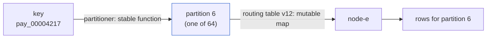
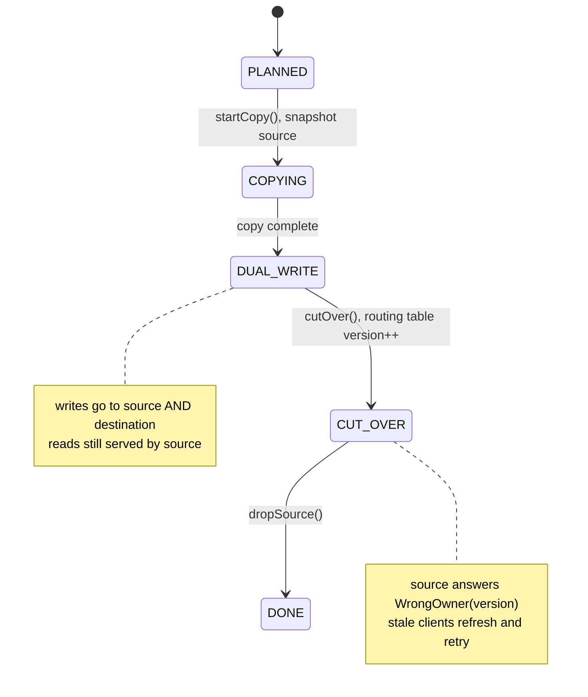

# Partitioning Strategies and Rebalancing

> Range vs hash, hot keys, and moving a shard without downtime.

**Type:** Build
**Languages:** Java, Python, Go
**Prerequisites:** Phase 1, Lesson 06 (Hash Maps from Scratch), Phase 3, Lesson 06 (Consistent Hashing and Virtual Nodes), Phase 6, Lesson 01 (Replication Strategies)
**Time:** ~75 minutes

## Learning Objectives

- Choose between range and hash partitioning for a given access pattern and state what each one gives up
- Detect a hot key from per-partition request counts and defuse it with salting without losing the ability to read it back
- Explain why `hash(key) mod N` moves almost every key when N changes, and why a fixed partition count or a consistent-hash ring does not
- Plan the minimum set of partition moves that rebalances a cluster after a node joins or leaves
- Move one partition between nodes with copy, dual-write, cutover, and drop phases while writes keep flowing
- Use a versioned routing table so a client with a stale copy is redirected instead of silently writing to the wrong node

## The Problem

A payment ledger runs on a single PostgreSQL primary. It stores 400 million postings and takes 6,000 writes per second at the evening peak. The disk is 71% full, the replication lag to the read replica spikes to 40 seconds during end-of-day batch settlement, and the vendor's largest instance type is the one you already have. There is no vertical left. The data has to be split across machines, and the question of *how* to split it decides whether the next two years are quiet or miserable.

The first attempt splits by `merchant_id` range: merchants `a..f` on node 1, `f..m` on node 2, and so on. It ships in a week because every query already filters by merchant. Three weeks later one marketplace merchant, which alone is 38% of all volume, lands on node 3, and node 3 is at 95% CPU while nodes 1 and 2 idle at 20%. Splitting node 3's range does not help; the hot merchant is a single key and cannot be split by range at all.

The second attempt uses `hash(payment_id) mod 4`. Load is flat. Then the team adds a fifth node to absorb growth, changes the modulus to 5, and 80% of all keys now hash to a different node than the one holding their data. Every lookup for a payment created before the resize misses. The team rolls back, and the rollback itself moves 80% of the keys again. The outage lasts 50 minutes and the postmortem has one line in its root cause: *the partitioning scheme coupled "which partition" to "how many nodes".*

This lesson builds the three mechanisms that avoid both failures: a partitioner that assigns keys to a fixed number of logical partitions independent of node count, a rebalancer that moves whole partitions with the minimum number of moves when nodes come and go, and a migration procedure that moves one partition between two live nodes without rejecting a single write. The routing table that ties them together is versioned, so a client holding an old copy learns it is stale from the node itself rather than from a corrupted ledger.

## The Concept

### Partition, shard, node

A **partition** (Cassandra and Kafka's term; MongoDB and Elasticsearch say *shard*, HBase says *region*, Spanner and CockroachDB say *range* or *tablet*) is a logical slice of the key space. A **node** is a machine. The whole design hinges on keeping the two separate: keys map to partitions by a stable function, and partitions map to nodes by a table you can change. Changing the table is a metadata operation. Changing the function is a data migration of everything.



With 64 partitions and 4 nodes, each node owns 16 partitions. Add a fifth node and you hand it 12 or 13 partitions, one at a time, each a self-contained unit you can copy and cut over. No key changes partition, ever, unless you deliberately re-partition the whole dataset.

### Range partitioning

Partition `i` holds keys in the half-open interval `[split[i-1], split[i])`. Keys stay sorted, so a query for "all postings for merchant acme between March 1 and March 31" touches one partition and one contiguous disk region. This is what Bigtable, HBase, Spanner, CockroachDB, TiKV, and every B-tree-based sharded SQL system do by default.

The cost is **skew**. Keys that are close in sort order land together, which is the point, but it means time-ordered keys (`2026-10-13T19:04:...`) all write to the last partition, and a merchant that is 38% of volume occupies 38% of one node. Range partitioning needs an operator or an automatic splitter watching partition size and request rate, and it needs a key design that does not put today's data on one node. Prefixing a timestamp key with a hash of the merchant (`hash(merchant) % 16 || timestamp`) spreads writes across 16 ranges while keeping each merchant's history scannable.

### Hash partitioning

Partition `i = hash(key) mod P`. A good hash scatters similar keys uniformly, so the write load is flat regardless of key shape. The cost is **range scans**: a query for all payments for a merchant has to ask every partition (scatter-gather), because there is no relationship between the key order and the partition order. Cassandra's partition key, DynamoDB's partition key, Kafka's default partitioner, and MongoDB's hashed shard key are all this.

The hash must be stable: the same bytes produce the same partition on every machine, in every language, in every version. `String.hashCode()` in Java is specified and stable, but Python's `hash()` is randomised per process, and Go's map hash is randomised too. Neither is usable for routing. This lesson uses FNV-1a, which is six lines, specified byte by byte, and identical in every language, followed by a finaliser that mixes the high bits, because FNV-1a's high bits are poorly distributed for short keys and a consistent-hash ring sorts by the full 64-bit value.

| | Range | Hash |
|---|---|---|
| Point lookup | one partition | one partition |
| Range scan on key | one or few partitions | every partition |
| Sequential keys (timestamps, auto-increment) | all writes hit one partition | spread evenly |
| One giant key | one partition is hot; cannot be split further | one partition is hot; cannot be split further |
| Rebalancing unit | split or merge a range at any key | move a whole fixed partition |
| Used by | Bigtable, HBase, Spanner, CockroachDB, TiKV | Cassandra, DynamoDB, Kafka, Riak, Redis Cluster |

Many systems offer both at once: Cassandra's `PRIMARY KEY ((partition_key), clustering_key)` hashes the first component and range-sorts the second within the partition. That is usually the right answer for a payments table: hash on `merchant_id`, sort by `created_at` inside.

### Hot keys

Neither scheme helps when a *single key* is hot. In the worked example in `main`, one merchant is 60% of traffic. Hashing sends all of it to one of 16 partitions, which then carries 62% of the load while its 15 peers carry 2.5% each: a skew of 10x (maximum over mean).

The fix is **salting**: append a small suffix to the hot key derived from something that varies per request, such as `hash(payment_id) mod 8`. `megamart` becomes `megamart#0 .. megamart#7`, eight keys that hash to up to eight different partitions. The write side is trivial. The read side pays for it: a query for all of megamart's rows now has to read all eight salted keys and merge. Fan-out of 8 on one merchant's reads is cheap; fan-out on every merchant is not, so salting is applied only to keys the detector flags, and the list of salted keys is itself a piece of routing metadata.

What salting cannot fix is a single *row* that is hot, such as one balance row that every payment updates. That is a ledger design problem and gets its own lesson (Phase 10, Lesson 11).

### Why `mod N` resizing moves everything

If partition is `hash mod N`, then changing N to N+1 reassigns every key whose `hash mod N != hash mod (N+1)`. For a uniform hash the fraction that stays put is `1/(N+1)` plus a small correction, so going from 4 to 5 nodes moves about 80% of the data. Here is the trace for four keys with small hashes:

```text
hash   mod 4   mod 5   moved?
  10     2       0     yes
  11     3       1     yes
  12     0       2     yes
  20     0       0     no
  21     1       1     no
  23     3       3     no
  27     3       2     yes
  33     1       3     yes
-> 5 of 8 moved; with 100,000 real keys the measured figure is 79.8%
```

There are two ways out, and this lesson implements both so you can measure them side by side:

1. **Fixed partition count, far more partitions than nodes.** Hash into P = 64 (or 1,024, or 16,384 in Redis Cluster) partitions once, forever. Nodes own partitions. Adding a node means moving `floor(P / (N+1))` partitions to it and nothing else. With P = 64 and 4 to 5 nodes that is 12 partitions, 18.9% of keys, and all of them move *to* the new node. The downside is that P is chosen once; too small and you cannot grow past P nodes, too large and per-partition overhead (files, metadata, connections) bites. Kafka topics, Elasticsearch indices, and Cassandra's original token scheme all live with this choice.
2. **Consistent hashing.** Nodes and keys are hashed onto the same 64-bit ring; a key belongs to the first node clockwise. Adding a node takes arcs from its neighbours only. With 150 virtual nodes per physical node the measured movement is 21.2%, within 1.2 points of the ideal 1/5, and every moved key moves to the new node. You built the ring in Phase 3, Lesson 06; here it is the control group. Its downside is the opposite of fixed partitions: there is no unit to copy, so "move the data for the arcs node-e took" is a scan over the neighbours.

### Rebalancing with the minimum number of moves

Given a fixed partition count, a rebalance after adding a node is a small planning problem: take partitions from the most loaded node until the new node has `floor(P / N)`. Each move changes one key range's owner and nothing else, so the number of moves is the lower bound; any plan that moves fewer partitions leaves the new node under-loaded, and any plan that moves partitions between existing nodes is wasted work. The plan is deterministic (highest-numbered partition from the most loaded node, ties broken by name order) so that two coordinators computing it independently agree.

Removing a node is the mirror image: hand each of its partitions to the currently least loaded survivor. The invariant after either plan is **max load minus min load is at most 1 partition**.

### Moving one partition while writes keep arriving

The move itself is the part that goes wrong in production. The naive sequence "stop writes, copy, flip the table, start writes" is a planned outage of the copy duration, which for a 40 GB partition over a saturated network is twenty minutes of declined payments. The sequence that works is four phases:



1. **Copy.** Snapshot the partition on the source and bulk-load it into the destination. Writes continue to the source only. Anything written after the snapshot is missing from the destination, which is why the next phase exists.
2. **Dual write.** Every write to the partition goes to both nodes. Reads still go to the source, which is complete. The destination catches up on everything written since the snapshot. In a real system there is also a backfill of writes that landed between "snapshot taken" and "dual write enabled"; this lesson takes the snapshot and enables dual writes atomically so that gap is zero, and Exercise 3 asks you to open it and close it with a log position.
3. **Cut over.** Bump the routing table: partition 6 is now owned by the destination. This is one metadata write. From this instant the source refuses requests for partition 6 with `WrongOwnerException(partition, currentVersion)`. A client that held version 1 of the table gets that exception, fetches version 2, and retries against the destination. No write is lost: either it reached the source before the flip (and was dual-written), or it was rejected and retried against the destination.
4. **Drop.** Once no in-flight request can still be targeting the source for this partition (a grace period of one request timeout), delete the old copy.

The invariant across all four phases: **every key in the partition is readable with its latest value at every instant, and no write is acknowledged to a node that will later be dropped without also being on the node that will survive.** The tests check it by writing before the copy, during dual-write, and after cutover, then verifying every value on the destination and nothing on the source.

### What this lesson does not do

- It does not replicate partitions. Each partition has one owner. Replication (Phase 6) layers under this: the "node" in the routing table becomes a replica group with a leader.
- It does not handle a partition that is itself too big. Splitting a range partition at its median key is the same copy-dual-write-cutover dance applied to half of it; splitting a hash partition requires choosing P larger from the start.
- It does not make cross-partition operations atomic. A transfer from a key on node-a to a key on node-e is two writes on two machines, which is Phase 7, Lesson 08 (Two-Phase Commit) and Lesson 12 (Sagas).

## Build It

All code is in `code/java/Main.java`; the types are package-private and live in one file so the lesson compiles with a single `javac`.

### Step 1: A stable hash

```java
interface Partitioner {
    int partitionOf(String key);
    int partitionCount();

    static long fnv1a64(String key) {
        long hash = 0xcbf29ce484222325L;
        for (int i = 0; i < key.length(); i++) {
            hash ^= key.charAt(i);
            hash *= 0x100000001b3L;
        }
        return hash;
    }

    static long hash64(String key) {
        long z = fnv1a64(key);
        z = (z ^ (z >>> 30)) * 0xbf58476d1ce4e5b9L;
        z = (z ^ (z >>> 27)) * 0x94d049bb133111ebL;
        return z ^ (z >>> 31);
    }
}
```

FNV-1a is the hash because it is fully specified (offset basis `0xcbf29ce484222325`, prime `0x100000001b3`, xor then multiply per byte) and trivially portable. The finaliser is the one from SplitMix64: without it, keys like `pay_00000001` and `pay_00000002` differ only in the low bits of the hash, which is fine for `mod P` but makes a consistent-hash ring, which sorts by the full value, cluster badly. The first version of this lesson omitted the finaliser and the ring moved 7.5% of keys instead of 20% on a node add; that is a measurable bug, and the test for the ring's movement fraction would catch it.

**Predict:** `fnv1a64("")` returns what, and why is that a useful test to keep?

### Step 2: Range and hash partitioners

```java
final class RangePartitioner implements Partitioner {
    private final List<String> splitPoints;    // strictly increasing

    public int partitionOf(String key) {
        int lo = 0, hi = splitPoints.size();
        while (lo < hi) {
            int mid = (lo + hi) >>> 1;
            if (splitPoints.get(mid).compareTo(key) <= 0) lo = mid + 1; else hi = mid;
        }
        return lo;                              // number of split points <= key
    }
    public int partitionCount() { return splitPoints.size() + 1; }
}

final class HashPartitioner implements Partitioner {
    private final int partitions;
    public int partitionOf(String key) {
        return (int) Long.remainderUnsigned(Partitioner.hash64(key), partitions);
    }
}
```

The range partitioner is a binary search for "how many split points are at or below this key", which is exactly the partition index when intervals are half-open on the right: split points `[f, m, s]` give partitions `[..f)`, `[f..m)`, `[m..s)`, `[s..)`, and the key `"f"` lands in partition 1, not 0. `Long.remainderUnsigned` matters in the hash partitioner: a signed `%` on a negative hash gives a negative partition, which is the classic `ArrayIndexOutOfBoundsException` in a homegrown router.

**Predict:** with split points `["f", "m", "s"]`, which partition does `"f"` land in, and what does the test assert?

### Step 3: Hot-key detection and salting

```java
final class HotKeyDetector {
    private final long[] hits;
    private long total;

    double skew() {                         // max / mean: 1.0 is flat, P means one partition takes everything
        if (total == 0) return 1.0;
        double mean = (double) total / hits.length;
        return hits[hottestPartition()] / mean;
    }

    static String salt(String key, String secondary, int fanout) {
        int s = (int) Long.remainderUnsigned(Partitioner.hash64(secondary), fanout);
        return key + "#" + s;
    }
}
```

Skew as max-over-mean is the single number to alert on: it is dimensionless, it is 1.0 for a perfectly balanced cluster, and it equals the partition count when one partition takes everything. The salt is derived from a secondary field (`payment_id`) so the same row always gets the same salted key and can be found again; a random salt would spread writes just as well and make every read a full fan-out with no way to know which suffix holds the row.

**Predict:** in the demo, 1,000 writes for `megamart` salted with fanout 8 over 16 partitions. What is the best possible skew, and why does the test accept anything below 8.0 rather than demanding 2.0?

### Step 4: The versioned routing table

```java
final class RoutingTable {
    private final Partitioner partitioner;
    private final String[] owner;           // partition -> node
    private long version = 1;

    RoutingTable(Partitioner partitioner, List<String> nodes) {
        this.owner = new String[partitioner.partitionCount()];
        for (int p = 0; p < owner.length; p++) owner[p] = nodes.get(p % nodes.size());
    }

    String nodeFor(String key) { return owner[partitioner.partitionOf(key)]; }

    void assign(int partition, String node) {
        if (!node.equals(owner[partition])) {
            owner[partition] = node;
            version++;
        }
    }
}
```

The table is an array indexed by partition plus a version counter. The version is the whole point: it is what a node compares against a client's request to detect staleness, and what a client fetches to recover. A no-op assignment does not bump the version, so a rebalancer that re-applies an already-applied plan (after a coordinator restart, say) does not invalidate every client's cache for nothing.

In production this table lives in a coordination service (ZooKeeper, etcd, Consul) or is gossiped (Cassandra, Redis Cluster), and the version is an epoch or a ZooKeeper zxid. Here it is a `long`.

### Step 5: Planning the minimum rebalance

```java
static List<Move> planAddNode(RoutingTable table, String newNode) {
    Map<String, List<Integer>> owned = new LinkedHashMap<>();
    for (String n : table.nodes()) owned.put(n, new ArrayList<>(table.partitionsOf(n)));
    owned.put(newNode, new ArrayList<>());
    int target = table.partitionCount() / owned.size();        // floor(P / N)
    List<Move> moves = new ArrayList<>();
    while (owned.get(newNode).size() < target) {
        String donor = mostLoaded(owned);
        List<Integer> donorParts = owned.get(donor);
        int partition = donorParts.remove(donorParts.size() - 1);   // highest-numbered: deterministic
        owned.get(newNode).add(partition);
        moves.add(new Move(partition, donor, newNode));
    }
    return moves;
}
```

Each iteration takes exactly one partition from whoever currently has the most. Because the donor is recomputed every iteration, the existing nodes shed load evenly: 16, 16, 16, 16 becomes 13, 13, 13, 13 with 12 moved, never 10, 16, 16, 10. The plan is a list of `Move(partition, from, to)` records that is returned, not applied, so the caller can log it, review it, and then run one `PartitionMigration` per move.

**Predict:** 64 partitions, 4 nodes, add a fifth. How many moves, how many keys move as a fraction, and is the result exactly balanced?

### Step 6: Nodes that know what they own

```java
final class StorageNode {
    void put(String key, String value) { requireOwner(key); data.put(key, value); }
    String get(String key)             { requireOwner(key); return data.get(key); }
    void putDirect(String key, String value) { data.put(key, value); }   // migration only

    private void requireOwner(String key) {
        int p = table.partitioner().partitionOf(key);
        if (!table.ownerOf(p).equals(name)) throw new WrongOwnerException(p, table.version());
    }
}
```

A node checks the routing table on every request. This is the server-side half of staleness detection: no matter how old the client's table is, the node refuses to serve a partition it does not own and tells the client which version to fetch. The MongoDB `mongos` router, Redis Cluster's `MOVED` reply, and Kafka's `NotLeaderForPartition` error all work this way. `putDirect` bypasses the check and exists only so the migration can load data into a node before the table says it owns it; it is the one method you would restrict to an internal port.

### Step 7: The migration state machine

```java
void startCopy() {
    requireState(State.PLANNED);
    state = State.COPYING;
    for (Map.Entry<String, String> e : source.snapshotOfPartition(partition).entrySet()) {
        destination.putDirect(e.getKey(), e.getValue());
        copied++;
    }
    state = State.DUAL_WRITE;
}

void write(String key, String value) {
    if (state == State.DUAL_WRITE) {
        source.put(key, value);
        destination.putDirect(key, value);
        dualWrites++;
    } else if (state == State.PLANNED || state == State.COPYING) {
        source.put(key, value);
    } else {
        destination.put(key, value);
    }
}

void cutOver() {
    requireState(State.DUAL_WRITE);
    table.assign(partition, destination.name);
    state = State.CUT_OVER;
}

int dropSource() {
    requireState(State.CUT_OVER);
    int dropped = source.dropPartition(partition);
    state = State.DONE;
    return dropped;
}
```

Every transition checks the current state, so `cutOver()` before `startCopy()` is an `IllegalStateException` rather than a routing table that points at an empty node. The `write` method is the client library during migration: it looks at the phase and sends the write to one or both nodes. After `cutOver`, `destination.put` goes through the ownership check and succeeds because the table now says so; a stale client calling `source.get` gets `WrongOwnerException` with `currentVersion = 2`.

**Predict:** a client wrote `pay_00002010 = v2` during `DUAL_WRITE`. After `cutOver()` and `dropSource()`, which node has it and what does `source.get` return?

### Step 8: Run it

```bash
cd phases/07-storage-and-transactions/01-partitioning-and-rebalancing/code/java
javac -d .out *.java && java -cp .out Main
java -cp .out MainTest
```

Expected output, abbreviated:

```console
== Hot key: one merchant is 60% of traffic ==
  unsalted: hottest partition 2 takes 6208 of 10000 (skew 9.9x)
  salted x8: hottest partition 13 takes 1753 of 10000 (skew 2.8x); reads for megamart now fan out to 8 partitions

== Adding a 5th node: how many keys move? ==
  hash mod N, N 4 -> 5:               79.8% of keys move (almost everything)
  64 fixed partitions, 4 -> 5 nodes:  18.9% of keys move (12 partition moves, layout {node-a=13, ... node-e=12})
  consistent hashing, 150 vnodes:     21.2% of keys move (ideal 1/5 = 20.0%)

== Moving partition 6 from node-a to node-e without downtime ==
  partition 6 has 236 keys on node-a; routing table v1
  bulk copy done: 236 keys copied, state DUAL_WRITE
  live write to pay_00002010 during migration went to both nodes (dual writes: 1)
  cut over: routing table v2, partition 6 owner = node-e
  stale client asked node-a: partition 6 not owned here; routing table is now at version 2
  node-e serves pay_00002010 = v2-written-during-migration
  dropped 237 keys from node-a; migration DONE
```

The three percentages in the middle block are the lesson. Keep them for the next design review where someone proposes `mod N`.

### In Python

```python
@staticmethod
def fnv1a64(key: str) -> int:
    h = 0xCBF29CE484222325
    data = key.encode("utf-16-be")
    for i in range(0, len(data), 2):
        h ^= (data[i] << 8) | data[i + 1]
        h = (h * 0x100000001B3) & MASK64
    return h
```

Differences, all in `code/python/main.py`:

- **64-bit wraparound is explicit.** Python integers never overflow, so every multiply in `fnv1a64` and `hash64` is masked with `MASK64 = 0xFFFFFFFFFFFFFFFF`. Forget one mask and the hash grows without bound and every partition number changes. The hash iterates UTF-16 code units, which is exactly what Java's `charAt` sees (and the same as the bytes for ASCII keys), so both languages route every key to the same partition. Python's built-in `hash()` is randomised per process and is never used.
- **Unsigned by default.** The masked value is already non-negative, so `hash64(key) % P` replaces `Long.remainderUnsigned`. The test compares `fnv1a64("")` with `0xCBF29CE484222325` directly; in Java the same bits are a negative `long`. The ring sorts unsigned values where Java's `TreeMap` sorts signed ones; that is a rotation of the same circle, so "first node clockwise" picks the same owner.
- **The ring is a sorted list plus `bisect`.** `bisect_left` on the sorted hashes is `TreeMap.ceilingEntry`, with an explicit wrap to index 0. `partitions_per_node` returns a dict built from `sorted(...)`, and dict insertion order stands in for `LinkedHashMap` in the rebalancer's donor choice.
- **Exceptions.** `IllegalArgumentException` maps to `ValueError`, `IllegalStateException` to `RuntimeError`, and `WrongOwnerException` is a `RuntimeError` subclass carrying `partition` and `current_version`. `Rebalancer.Move` is a frozen dataclass whose source field is `from_`, because `from` is a keyword.

```bash
cd phases/07-storage-and-transactions/01-partitioning-and-rebalancing/code/python
python3 main.py
python3 -m unittest -v
```

The demo prints the same numbers as the Java version (79.8%, 18.9%, 21.2%, 236 keys copied).

### In Go

```go
func Fnv1a64(key string) int64 {
    hash := uint64(0xcbf29ce484222325)
    for _, unit := range utf16.Encode([]rune(key)) {
        hash ^= uint64(unit)
        hash *= 0x100000001b3
    }
    return int64(hash)
}

func (h *HashPartitioner) PartitionOf(key string) int {
    return remainderUnsigned(Hash64(key), h.partitions) // int(uint64(hash) % uint64(n))
}
```

Differences, all in `code/go/main.go`:

- **Wraparound is free, signedness is explicit.** Go's `uint64` multiply wraps exactly like Java's `long`, so `Fnv1a64` and `Hash64` need no masks; they compute in `uint64` and convert to `int64` at the end so the ring sorts the same signed values Java's `TreeMap<Long>` does. `remainderUnsigned` is `Long.remainderUnsigned` written out: cast back to `uint64`, then `%`. The hash iterates UTF-16 code units via `unicode/utf16`, which is what Java's `charAt` sees, so every key lands on the same partition in all three languages.
- **Errors are values.** Every `IllegalArgumentException`/`IllegalStateException` becomes a sentinel (`ErrSplitPointsUnsorted`, `ErrNodePresent`, `ErrLastNode`, `ErrWrongState`, `ErrKeyNotInPartition`, ...) returned from a constructor or a state-machine method and checked with `errors.Is`. `WrongOwnerException` becomes `*WrongOwnerError` carrying `Partition` and `CurrentVersion`, which callers unwrap with `errors.As`. The one `panic` is `ConsistentHashRing.NodeFor` on an empty ring, a programming error with no caller that could handle it.
- **Ordered containers by hand.** The ring is a sorted `[]int64` plus a `map[int64]string`; `sort.Search` is `TreeMap.ceilingEntry` with an explicit wrap to index 0. `partitionsPerNode` returns a plain map and `formatLayout` sorts the keys to print `{node-a=13, ...}` the way Java's `TreeMap` does. The rebalancer's `LinkedHashMap` is an `ownedLoad` struct holding an insertion-order slice next to the map, so the donor on a tie is the same node Java picks and the plan is identical.
- **Map iteration is random.** `StartCopy` sorts the snapshot's keys before copying so the copy order (and the `Copied` count) is deterministic; `DropPartition` deletes during a range loop, which Go permits.

```bash
cd phases/07-storage-and-transactions/01-partitioning-and-rebalancing/code/go
go run .
go test ./...
```

The demo prints the same numbers as the Java version (79.8%, 18.9%, 21.2%, 236 keys copied).

## Use It

**Kafka** uses a fixed partition count per topic chosen at creation, `murmur2(key) mod P` as the default partitioner, and a controller that reassigns partitions to brokers; `kafka-reassign-partitions.sh` is `planAddNode` with throttling. Increasing P after the fact breaks key-to-partition stability, which is exactly the `mod N` problem, and the documentation warns about it.

**Redis Cluster** fixes P at 16,384 hash slots (`CRC16(key) mod 16384`), stores the slot-to-node map on every node, and answers a misrouted request with `-MOVED 6 node-e:6379`, which is `WrongOwnerException` as a wire protocol. Its `CLUSTER SETSLOT ... MIGRATING / IMPORTING` states are the `DUAL_WRITE` phase, with `-ASK` redirects for keys already moved.

**Cassandra and DynamoDB** hash the partition key onto a ring. Cassandra's `num_tokens: 16` virtual nodes per host is the `ConsistentHashRing(virtualNodes)` constructor; DynamoDB splits a partition automatically when it exceeds 10 GB or 3,000 RCU, and its "hot partition" throttling (`ProvisionedThroughputExceededException` on one key) is why the salting pattern is in its official design guidance under the name *write sharding*.

**MongoDB** supports both ranged and hashed shard keys, stores the chunk-to-shard map in the config servers with an epoch, and its balancer moves chunks with a copy, catch-up, and commit sequence; a `mongos` with a stale map gets a `StaleConfig` error and refreshes.

**Spanner, CockroachDB, TiKV** range-partition and split automatically on size and load; CockroachDB's load-based splitting is the `HotKeyDetector` driving range splits instead of salting.

What all of them hide from you: the version check on every request, the dual-write window, and the choice of P. What none of them can hide: a single hot row.

## Ship It

`outputs/design-doc-partitioning-review.md` is a design-review template for any proposal to shard a table or a service. It forces the proposer to name the partition key, show the expected skew with numbers, state the rebalancing unit, and write down the cutover and rollback sequence before a line of code exists. Use it the next time someone says "we will just hash by customer id".

## Exercises

1. **Reinforce.** Change the demo's `HashPartitioner(4)` to `HashPartitioner(8)` for the `mod N` comparison and record the moved fraction for 8 to 9 nodes. Then derive the formula for the expected fraction that *stays* when going from N to N+1 under a uniform hash and check it against your two measurements.
2. **Apply.** Add a `HotKeyDetector.topKeys(k)` that tracks the k most frequent *keys* (not partitions) using the Misra-Gries summary from Phase 3 (streaming), so the system can decide which keys to salt automatically. The salted set must be deterministic: two routers observing the same stream should salt the same keys.
3. **Extend.** Open the gap this lesson closes by fiat: make `startCopy` take a snapshot at a log position, keep accepting writes to the source only during the copy, and then replay the source's writes since that position to the destination before entering `DUAL_WRITE`. Use the WAL from Phase 7, Lesson 02 as the source's log. The test must write during the copy and prove the destination has every one of those writes after catch-up.

## Key Terms

| Term | What people say | What it actually means |
|------|-----------------|------------------------|
| Partition / shard | "the shard" | A logical slice of the key space with a stable key-to-slice function; distinct from the node that happens to store it |
| Range partitioning | "split by customer id" | Contiguous key intervals per partition; keeps sort order and range scans, concentrates sequential and giant keys |
| Hash partitioning | "hash it" | `hash(key) mod P` with a fixed P; flat load, no range scans, and P must never change casually |
| Hot key | "a hot shard" | A single key or small set of keys receiving a disproportionate share of requests; no partitioning scheme fixes it, only salting or redesign |
| Salting | "write sharding" | Appending a deterministic small suffix to a hot key so it spreads over `fanout` partitions, at the cost of fan-out on read |
| Skew | "unbalanced" | Max partition load divided by mean partition load; 1.0 is flat, P is one partition taking everything |
| Rebalancing | "resharding" | Changing the partition-to-node map with the minimum number of partition moves; never changes which partition a key is in |
| Dual write | "shadow writes" | During a migration, each write is applied to both the old and the new owner so the new copy catches up without blocking traffic |
| Routing table version | "the epoch" | A counter bumped on every ownership change so a node can tell a client its cached map is stale and must be refreshed |

## Further Reading

- [Karger et al., "Consistent Hashing and Random Trees" (STOC 1997)](https://dl.acm.org/doi/10.1145/258533.258660) — the original consistent hashing paper; section 4 has the bound on key movement that the ring measurement in `main` approximates.
- [DeCandia et al., "Dynamo: Amazon's Highly Available Key-value Store" (SOSP 2007)](https://www.allthingsdistributed.com/files/amazon-dynamo-sosp2007.pdf) — section 6.2 compares three partitioning strategies, including fixed partitions with Q tokens, and explains why Amazon moved to it.
- [Redis Cluster Specification](https://redis.io/docs/latest/operate/oss_and_stack/reference/cluster-spec/) — 16,384 hash slots, the `MOVED` and `ASK` redirects, and the `MIGRATING`/`IMPORTING` slot states; the whole lesson as a wire protocol.
- [Apache Kafka documentation: Expanding your cluster](https://kafka.apache.org/documentation/#basic_ops_cluster_expansion) — partition reassignment with throttling, and the warning on changing a topic's partition count.
- [Amazon DynamoDB Developer Guide: Using write sharding to distribute workloads evenly](https://docs.aws.amazon.com/amazondynamodb/latest/developerguide/bp-partition-key-sharding.html) — the salting pattern in production guidance, including the read-side fan-out cost.
- [FNV hash specification (Fowler, Noll, Vo)](http://www.isthe.com/chongo/tech/comp/fnv/index.html) — the offset basis and prime for FNV-1a 64, and the byte-order rule the Java and future ports must follow identically.
