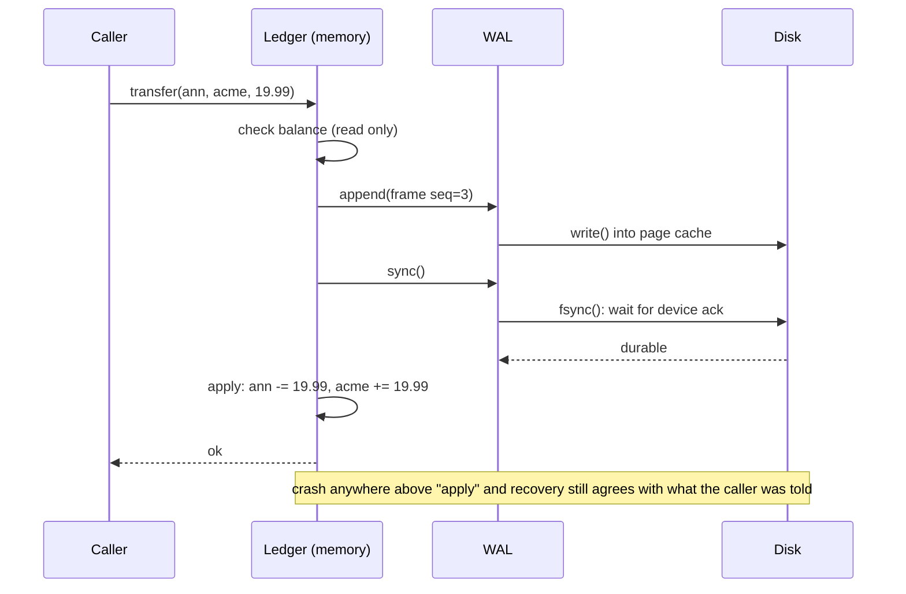

# Write-Ahead Logs and Crash Recovery

> fsync, torn writes, and a log you can replay after kill -9.

**Type:** Build
**Languages:** Java, Python, Go
**Prerequisites:** Phase 1 Lesson 11 (Bit Manipulation and Compact Encodings), Phase 3 Lesson 05 (LSM Trees), Phase 0 Lesson 07 (Decimal and Integer Arithmetic)
**Time:** ~120 minutes

## Learning Objectives

- Explain why "the write returned" and "the write is durable" are different events, and name the system call that separates them
- Frame a record as length, CRC-32, sequence number, and payload so that a reader can tell a complete record from a torn one and a torn one from a corrupt one
- Implement recovery that replays the longest valid prefix of a log, truncates a torn tail, and refuses to guess past corruption in the middle
- Build a balance ledger whose only durable state is the log, where every mutation is appended and synced before memory changes
- Checkpoint the ledger into a snapshot and prove, with a test, that a crash between the snapshot and the log truncation never double-applies a record

## The Problem

A payout service keeps merchant balances in memory for speed and writes each change to a file for safety. The code is `balances.put(account, newBalance); file.write(record);`. On a Tuesday the host loses power with 4,000 merchants mid-payout. When it restarts, the file ends in the middle of a record: the operating system had accepted the write, buffered it in the page cache, and never got it to the platter. The recovery loop reads a length prefix of 1,953,719,668 bytes (the ASCII of `"tran"`), tries to allocate that buffer, and the service refuses to start. Nobody can be paid until an engineer hex-edits the file by hand.

The second failure is quieter. A ledger service does the two steps in the other order, file first and then memory, but never calls `fsync`. A kernel panic drops the last 180 ms of writes, about 60 records. The service restarts, replays the file, and reports balances that are 60 transfers behind what it had already confirmed to callers. Downstream, a merchant who was told "payout sent: 1,999.00 USD" sees the money appear a second time when the retry logic replays the request against the recovered state, because the idempotency key for that request was in the same 60 lost records.

Both outages come from treating a file write as a durable event. It is not. `write(2)` moves bytes into kernel memory and returns. `fsync(2)` is the call that waits for the device to acknowledge them, and even then the device may reorder or partially apply a multi-sector write, so a record that straddles sectors can land half-written: the torn write. A write-ahead log (WAL) is the discipline that makes these facts survivable. Every change is appended to a log and synced *before* the in-memory state changes, each record carries enough framing to be validated independently, and recovery is defined as "replay the valid prefix and discard the rest." PostgreSQL, SQLite, RocksDB, Kafka, and every serious ledger database are built on exactly this. This lesson builds one, crashes it in every way a disk can crash, and shows what survives.

## The Concept

### Three events, three guarantees

A single logical write passes through three stages, each with a different failure mode:

| Stage | What happened | Survives process crash (`kill -9`)? | Survives power loss? |
|-------|---------------|-------------------------------------|----------------------|
| Buffered in the process | `BufferedOutputStream.write`, `bufio.Writer.Write`, Python `f.write` | No | No |
| Handed to the kernel | `write(2)` returned; bytes are in the page cache | Yes | No |
| Acknowledged by the device | `fsync(2)` / `fdatasync(2)` / `FileChannel.force(true)` returned | Yes | Yes, if the device honours flush |

Most "durability bugs" are code that stops at stage two. The page cache is flushed to disk every few seconds by the kernel (`dirty_writeback_centisecs`, default 5 s on Linux), so the window is small enough to never show up in testing and large enough to lose thousands of records in production. The fix is one line, `fsync`, and the cost is the reason people skip it: a sync on a spinning disk is 5-10 ms, on a SATA SSD 0.1-1 ms, on NVMe 10-50 µs. A ledger that syncs once per transfer is bounded by that latency, which is why group commit (sync once for a batch of appends) exists.

The lesson injects the durability boundary as a `Storage` interface with a `MemoryStorage` implementation that keeps two byte arrays: `visible`, what the process has written, and `durable`, what has reached the device. `sync()` copies visible to durable. `crash()` copies durable back to visible. `crashKeepingUnsynced(n)` keeps the first `n` unsynced bytes, which is the torn write. `flipBit(offset)` is bit rot in a byte that was already durable. With these four verbs a test can crash the machine at any byte and assert exactly what recovery sees.

### The record frame

A log is only replayable if the reader can find record boundaries and trust what it finds. Each record is framed as:

```text
offset  size  field
0       4     payload length, unsigned 32-bit big-endian
4       4     CRC-32 of (seq || payload), unsigned 32-bit big-endian
8       8     sequence number, unsigned 64-bit big-endian
16      n     payload bytes
```

Each field answers a question the reader has to ask:

- **Length** tells the reader where the next record starts. Without it, every record needs a delimiter and every payload has to be escaped.
- **CRC-32** tells the reader whether the bytes between here and the end of the payload are the bytes the writer wrote. CRC-32 (the ISO 3309 / ITU-T V.42 polynomial, which is what `java.util.zip.CRC32`, `zlib.crc32`, and Go's `hash/crc32.IEEETable` all compute) detects every single-bit error and every burst error up to 32 bits, and misses a random corruption with probability about 2^-32. It is not cryptographic: it detects accidents, not adversaries. A log that has to resist tampering uses an HMAC (Phase 3, Lesson 09).
- **Sequence number** tells the reader the record is the one that belongs here. The CRC covers the sequence number too, so a frame copied from one position to another fails its checksum. Replay also checks that sequence numbers are contiguous: a gap means a record was lost or the file was spliced, and neither is something recovery should paper over.
- **A maximum payload length** (1 MiB here) turns the first failure in The Problem into a clean error. A length of 1,953,719,668 is not a record; it is corruption, and the reader says so instead of allocating two gigabytes.

The CRC covers the sequence and payload but not the length. That is deliberate: if the length were corrupt you could not find the CRC to check it. Instead the reader bounds the length and lets the CRC catch everything downstream of it.

### The write-ahead rule

The invariant that gives the structure its name:

**No in-memory state reflects a change until the record describing that change is durable.**

Concretely, the ledger's `commit` is three lines in a fixed order: `append`, `sync`, `apply`. If the process dies after `append` but before `sync`, the record may or may not be on disk, and memory was never changed, so replay produces a state the process never acknowledged. If it dies after `sync` but before `apply`, the record is on disk, replay applies it, and the state is what the caller would have seen a microsecond later. There is no ordering of these three steps in which recovery produces a state that contradicts something the process already told a caller. Reverse the first two and that promise is gone.

The second half of the rule is that the record must describe a *complete* logical change. The ledger's `transfer` is one record with two balance updates, not two records. If it were two, a crash between them would leave money debited from one account and never credited to the other, and the WAL would faithfully replay that half-state forever. Atomicity is a property of the record boundary, not of the log.



### Recovery: the longest valid prefix

Recovery reads frames from offset 0 and stops at the first frame it cannot accept. The decision at that point is the heart of the lesson:

| What the reader sees | Meaning | Action |
|----------------------|---------|--------|
| Fewer than 16 bytes remain | Header was cut off mid-write | Torn tail: truncate here, continue normally |
| Length is larger than the maximum | Header bytes are garbage | Corruption: stop, raise, do not truncate |
| Fewer than `length` payload bytes remain | Payload was cut off mid-write | Torn tail: truncate here |
| CRC fails and this is the last frame in the file | Tail record half-written or garbage after the last sync | Torn tail: truncate here |
| CRC fails and there are bytes after this frame | A record that was fully written is now damaged | Corruption: stop, raise, do not truncate |
| Sequence is not previous + 1 | A record is missing or the file was spliced | Corruption: stop, raise |

The distinction between torn and corrupt rests on one observation: a torn write can only happen at the end of the file, because the log is append-only and the writer syncs after every append. Anything wrong *before* the last frame was durable at the time of the sync that followed it, so if it is damaged now, something other than a crash damaged it: a disk error, a bad RAID rebuild, an operator with a text editor. Recovery must not truncate in that case, because truncating would destroy records that were acknowledged to callers. It raises, names the offset, and leaves the file for a human.

When recovery does truncate, it truncates the *storage*, syncs, and sets the next sequence number to `lastSeq + 1`. The torn record's sequence number is reused by the next append. That is correct: the torn record was never acknowledged, so from every caller's point of view it never happened.

### Worked example: a torn transfer

Start from an empty log. Credit `acme` 100.00 USD and `ann` 50.00 USD, then transfer 19.99 from `ann` to `acme`. Each `encodeOp` payload is `1 + 2 + len(from) + 2 + len(to) + 3 + 8` bytes.

```text
seq 1  credit acme 10000     payload 1+2+4+2+0+3+8 = 20 bytes   frame 36 bytes   offsets   0..35
seq 2  credit ann   5000     payload 1+2+3+2+0+3+8 = 19 bytes   frame 35 bytes   offsets  36..70
seq 3  transfer ann->acme    payload 1+2+3+2+4+3+8 = 23 bytes   frame 39 bytes   offsets  71..109
```

After three syncs the file is 110 bytes and memory says `acme = 119.99, ann = 30.01`. Now append a fourth record, a transfer of 5.00 from `acme` to `ann` (frame 39 bytes, offsets 110..148), and lose power after 20 bytes of it reached the disk.

Recovery:

```text
offset   0: header ok, length 20, 110-0 >= 36, crc ok, seq 1 (first)      -> apply, offset = 36
offset  36: header ok, length 19, crc ok, seq 2 = 1+1                       -> apply, offset = 71
offset  71: header ok, length 23, crc ok, seq 3 = 2+1                       -> apply, offset = 110
offset 110: remaining = 130 - 110 = 20 >= 16, header ok, length 23
            remaining - 16 = 4 < 23                                           -> torn payload: break
truncate storage to 110, sync. replayed = 3, truncatedBytes = 20, nextSeq = 4
balances: acme = 119.99, ann = 30.01   (the torn transfer moved nothing)
```

The fourth transfer was never acknowledged (the process died before `sync` returned, so it never reached `apply`, so it never returned to the caller), and after recovery it has never happened. The caller's retry will re-issue it with sequence 4.

Now flip one bit in the payload of record 2 instead. Recovery delivers record 1, computes the CRC of record 2, finds a mismatch, sees 39 bytes after the frame, and raises `CorruptRecordException("corrupt record at offset 36: crc mismatch (stored ..., computed ...) with 39 bytes after it")`. The file is untouched. Record 2 was synced and acknowledged; a reader that silently dropped it and record 3 would report `acme = 100.00` to a merchant who was told `119.99`.

### Checkpoints and why sequence numbers are the safety net

A log grows forever. A ledger with ten million transfers has a ten-million-record recovery. The fix is a **checkpoint**: write the entire current state as one record to a second log (the snapshot log), tagged with the WAL sequence number it covers, sync it, then empty the WAL. Recovery becomes "load the newest snapshot, then replay only WAL records with a sequence number greater than the snapshot's."

The checkpoint has its own crash windows:

| Crash point | Snapshot log | WAL | What `open` does |
|-------------|--------------|-----|------------------|
| Before the snapshot sync | Torn tail, truncated on replay | Complete | Ignores the torn snapshot, replays the full WAL. State identical. |
| After the snapshot sync, before the WAL truncate | Complete, covers seq N | Still holds seq 1..N | Loads snapshot, sees every WAL record has seq <= N, skips them all, finishes the truncate. State identical. |
| After the WAL truncate | Complete | Empty | Loads snapshot. State identical. |

The second row is the one people get wrong. Without the `coveredSeq` tag, a recovering process would load the snapshot and then re-apply the records already inside it, crediting every account twice. The sequence number is what makes replay **idempotent**: applying the log to a snapshot that already contains some of it produces the same state as applying only the remainder. The test `covered records are skipped, not double-applied` constructs exactly this crash.

Complexity: `append` is O(payload) and one `write`; `sync` is one `fsync`; `replay` is O(bytes in the log) and reads each byte once; `checkpoint` is O(accounts). Recovery time is bounded by the WAL size since the last checkpoint, which is the knob you tune: PostgreSQL's `checkpoint_timeout` and `max_wal_size` are that knob.

### What this WAL does not do

- It does not buffer or batch. Every `commit` is one `fsync`. Group commit, where many appends share one sync, is Exercise 2.
- It does not undo. ARIES-style recovery logs both redo and undo information so that a transaction that was *in progress* at the crash can be rolled back. This log only contains committed, complete changes, so there is nothing to undo; that is the right design for a ledger and the wrong one for a database with long multi-statement transactions.
- It does not protect against a disk that lies. Some consumer drives acknowledge `fsync` before the data is in non-volatile storage. Enterprise drives and cloud block stores do not, which is one of the things you are paying for. Pillai et al. (OSDI 2014) catalogue what file systems actually guarantee; it is less than most code assumes.
- It does not detect a payload that is well-formed but semantically wrong. A debit that overdraws an account passes the CRC. The ledger validates before `append`, which is why a rejected debit appends nothing.

## Build It

The walkthrough is in Java. Python and Go implement the same types with the same names; the subsections at the end show what differs.

### Step 1: A disk you can crash

```java
interface Storage {
    long size();
    byte[] read(long offset, int length);
    void write(long offset, byte[] data);
    void truncate(long size);
    void sync();
}

final class MemoryStorage implements Storage {
    private byte[] visible = new byte[0];
    private byte[] durable = new byte[0];

    @Override public void sync() { durable = visible.clone(); syncCount++; }

    /** kill -9 or power loss: everything that was not synced is gone. */
    void crash() { visible = durable.clone(); }

    /** Power loss during a write: the first keepBytes of the unsynced tail reached the disk, the rest did not. */
    void crashKeepingUnsynced(int keepBytes) {
        int keep = Math.min(keepBytes, Math.max(0, visible.length - durable.length));
        visible = Arrays.copyOf(visible, durable.length + keep);
        System.arraycopy(durable, 0, visible, 0, durable.length);
        durable = visible.clone();
    }
}
```

Everything the WAL does goes through `Storage`, and production code would implement it with a `FileChannel` whose `sync()` calls `force(true)`. The in-memory version exists so a test can say "power fails nine bytes into this write" and assert what recovery does, deterministically, in microseconds. `crashKeepingUnsynced` is the torn write: the device applied part of a multi-sector write and lost the rest.

**Predict:** after `write` of 36 bytes, `sync`, `write` of 39 more, then `crashKeepingUnsynced(50)`, what is `size()`?

### Step 2: The frame

```java
static final int HEADER_BYTES = 16;
static final int MAX_PAYLOAD_BYTES = 1 << 20;

static long crc32(long seq, byte[] payload) {
    CRC32 crc = new CRC32();
    crc.update(ByteBuffer.allocate(8).putLong(seq).array());
    crc.update(payload);
    return crc.getValue();
}

static byte[] encode(long seq, byte[] payload) {
    if (payload.length > MAX_PAYLOAD_BYTES) throw new IllegalArgumentException("payload too large: " + payload.length);
    ByteBuffer frame = ByteBuffer.allocate(HEADER_BYTES + payload.length);
    frame.putInt(payload.length);
    frame.putInt((int) crc32(seq, payload));
    frame.putLong(seq);
    frame.put(payload);
    return frame.array();
}
```

`ByteBuffer` defaults to big-endian, which is the convention for on-disk and on-wire integers (network byte order). The CRC is fed the sequence number first and the payload second, so `crc32(1, "hello")` and `crc32(2, "hello")` differ. The test pins `crc32(1, "hello")` to `0x341ac4bc`, and the Python and Go tests pin the same value: the three implementations must produce byte-identical logs, because a WAL written by one service and read by another is a real deployment pattern (a Java ledger, a Go reconciliation job).

**Predict:** what does `encode(1, new byte[0])` return, and how long is it?

### Step 3: Append and sync

```java
long append(byte[] payload) {
    long seq = nextSeq;
    byte[] frame = encode(seq, payload);
    storage.write(end, frame);
    end += frame.length;
    nextSeq++;
    return seq;
}

void sync() { storage.sync(); }
```

`append` never writes anywhere but `end`. There is no update-in-place anywhere in this file, which is what makes the torn-tail reasoning in Step 4 sound: the only bytes that can be half-written are the ones after the last `sync`. `append` and `sync` are separate methods so that a caller can batch (Exercise 2); the ledger in Step 6 calls them back to back.

### Step 4: Replay, the longest valid prefix

```java
ReplayResult replay(RecordConsumer consumer) {
    long fileSize = storage.size();
    int replayed = 0;
    long offset = 0, lastSeq = 0;
    boolean first = true;
    while (offset < fileSize) {
        long remaining = fileSize - offset;
        if (remaining < HEADER_BYTES) break;                                // torn: header cut off
        ByteBuffer header = ByteBuffer.wrap(storage.read(offset, HEADER_BYTES));
        int length = header.getInt();
        int storedCrc = header.getInt();
        long seq = header.getLong();
        if (length < 0 || length > MAX_PAYLOAD_BYTES) {
            throw new CorruptRecordException(offset, "implausible length " + length);
        }
        if (remaining - HEADER_BYTES < length) break;                        // torn: payload cut off
        byte[] payload = storage.read(offset + HEADER_BYTES, length);
        int actualCrc = (int) crc32(seq, payload);
        boolean isLast = offset + HEADER_BYTES + length == fileSize;
        if (actualCrc != storedCrc) {
            if (isLast) break;                                               // torn: tail record half-written
            throw new CorruptRecordException(offset, "crc mismatch ... with bytes after it");
        }
        if (!first && seq != lastSeq + 1) {
            throw new CorruptRecordException(offset, "sequence gap: expected " + (lastSeq + 1) + ", found " + seq);
        }
        consumer.accept(new Record(seq, offset, payload));
        replayed++; lastSeq = seq; first = false;
        offset += HEADER_BYTES + length;
    }
    long truncated = fileSize - offset;
    if (truncated > 0) { storage.truncate(offset); storage.sync(); }
    end = offset;
    if (replayed > 0) nextSeq = lastSeq + 1;
    return new ReplayResult(replayed, offset, truncated, lastSeq);
}
```

Every `break` is a torn tail and every `throw` is corruption. The `isLast` check is what separates the two for a CRC failure: a bad checksum on the final frame is what a half-written record looks like, while a bad checksum with more data after it means a record that was fully written and synced is now wrong. `length < 0` catches a header whose top bit is set; Java has no unsigned int, so a length over 2^31 reads as negative.

Note the consumer is called *before* `offset` advances and before the truncate. If the consumer throws (a payload that decodes but makes no sense), the storage is untouched and the exception propagates with the offset in it.

**Predict:** a log holds three good records and then 15 bytes of a fourth. What are `recordsReplayed`, `truncatedBytes`, and `nextSeq` after replay?

### Step 5: The ledger's commit

```java
void transfer(String from, String to, Money amount) {
    requirePositive(amount);
    if (balance(from).minus(amount).isNegative()) {
        throw new IllegalStateException("insufficient funds in " + from);
    }
    commit(encodeOp(OP_TRANSFER, from, to, amount));
}

/** Write-ahead: append, sync, and only then mutate memory. */
private void commit(byte[] payload) {
    long seq = wal.append(payload);
    wal.sync();
    apply(new Record(seq, -1, payload));
}
```

Validation happens on the in-memory state before anything is written, so a rejected debit leaves no trace in the log. Then the three steps in the only safe order. `apply` is the same method recovery calls, so there is one code path that interprets a record, and it is exercised on every commit rather than only on the rare restart. A recovery routine that is only run after a crash is a recovery routine that has never been tested.

`Money` is the Phase 10, Lesson 01 type, trimmed to what this lesson needs: `long` minor units, a currency, checked `plus` and `minus`. The payload stores the amount as a signed 64-bit integer and the currency as three ASCII bytes. No float appears anywhere between the caller and the disk.

### Step 6: Open, with snapshot and sequence check

```java
static Ledger open(Storage walStorage, Storage snapshotStorage, Currency currency) {
    Ledger ledger = new Ledger(walStorage, snapshotStorage, currency);
    Record[] latest = new Record[1];
    ledger.snapshots.replay(r -> latest[0] = r);
    if (latest[0] != null) ledger.loadSnapshot(latest[0].payload());
    long covered = ledger.appliedSeq;
    ledger.lastRecovery = ledger.wal.replay(record -> {
        if (record.seq() <= covered) return;           // already inside the snapshot: skip, do not double-apply
        ledger.apply(record);
    });
    if (ledger.lastRecovery.lastSeq() <= covered) {
        ledger.wal.reset(covered + 1);                  // finish an interrupted checkpoint
    }
    return ledger;
}
```

The snapshot log is itself a `WriteAheadLog`, so a torn snapshot is handled by the same replay code: it is truncated and the previous snapshot (or none) is used. The `seq <= covered` guard is the idempotency of replay made explicit. The final `reset` handles the crash-after-snapshot-sync-before-truncate case by completing the truncate that the crashed process never got to.

### Step 7: Checkpoint

```java
void checkpoint() {
    ByteBuffer buf = ByteBuffer.allocate(size);
    buf.putLong(appliedSeq).putInt(balances.size());
    for (Map.Entry<String, Money> e : balances.entrySet()) {
        byte[] k = e.getKey().getBytes(StandardCharsets.UTF_8);
        buf.putShort((short) k.length).put(k);
        buf.put(e.getValue().currency().code().getBytes(StandardCharsets.US_ASCII)).putLong(e.getValue().minorUnits());
    }
    snapshots.append(buf.array());
    snapshots.sync();
    wal.reset(appliedSeq + 1);
}
```

Snapshot first, sync, then truncate the WAL. Never the other way round: a crash after truncating the WAL but before the snapshot is durable loses every record since the previous snapshot. `balances` is a `TreeMap`, so the snapshot bytes are deterministic regardless of insertion order; Go sorts the keys for the same reason.

### Step 8: Run it

```bash
cd phases/07-storage-and-transactions/02-write-ahead-logs/code/java
javac -d .out *.java && java -cp .out Main
java -cp .out MainTest
```

Expected output, abbreviated:

```console
== One frame on disk ==
crc32(seq=1, "hello") = 341ac4bc
frame = 00000005341ac4bc000000000000000168656c6c6f  (len | crc | seq | payload)

== Balances survive kill -9 ==
before crash: {customer:ann=30.01 USD, merchant:acme=119.99 USD}, wal bytes = 146, syncs = 3
after restart: {customer:ann=30.01 USD, merchant:acme=119.99 USD}, replayed 3 records

== A torn final record is dropped, not guessed ==
replayed 3, truncated 9 torn bytes, wal back to 146 (clean size was 146)
customer:bob = 0.00 USD

== A corrupt middle record stops replay ==
refused: corrupt record at offset 0: crc mismatch (stored b3ea3817, computed 32cf5d30) with 101 bytes after it

== Checkpoint compacts the log; sequence numbers make it safe ==
50 credits: wal bytes = 2396, applied seq = 53
after checkpoint: wal bytes = 0, snapshots = 1, snapshot bytes = 79
after restart: {customer:ann=31.01 USD, merchant:acme=120.49 USD}, replayed 1 wal record(s) on top of the snapshot, next seq = 55
```

The frame hex line is the one to memorise: four bytes of length, four of CRC, eight of sequence, then the payload. Every WAL you will ever read a hex dump of has roughly this shape.

### In Python

The Python port (`code/python/main.py`) is the same design with four differences. **`struct` replaces `ByteBuffer`:** the format string `">IIQ"` is the whole header layout, `>` is big-endian, and because `I` is unsigned a length over 2^31 reads as a large positive number rather than a negative one, so the only check needed is `length > MAX_PAYLOAD_BYTES`. **`zlib.crc32` is masked with `& 0xFFFFFFFF`:** on Python 3 the result is already unsigned, but the mask documents the intent and makes the value comparable to Java's `(int)` cast and Go's `uint32`. **`Storage` is a `typing.Protocol`:** any object with the five methods satisfies it, there is no `implements`, and `MemoryStorage` uses `bytearray` for both copies. **The ledger raises `RuntimeError` for insufficient funds and `ValueError` for a bad amount,** mirroring Java's `IllegalStateException` and `IllegalArgumentException`; `CorruptRecordError` carries `.offset` as an attribute, as the Java exception does.

Run it from `code/python/` with `python3 main.py`; test with `python3 -m unittest -v`.

#### Step 1: A disk you can crash

`Storage` is a `Protocol` with the five operations. `MemoryStorage` keeps `_visible` and `_durable` as `bytearray`s; `sync` copies visible into durable, `crash` copies durable back, and `crash_keeping_unsynced` keeps only the first `keep_bytes` of the unsynced tail, which is the torn write.

```python
class Storage(Protocol):
    def size(self) -> int: ...
    def read(self, offset: int, length: int) -> bytes: ...
    def write(self, offset: int, data: bytes) -> None: ...
    def truncate(self, size: int) -> None: ...
    def sync(self) -> None: ...


class MemoryStorage:
    def __init__(self) -> None:
        self._visible = bytearray()
        self._durable = bytearray()
        self.sync_count = 0

    def sync(self) -> None:
        self._durable = bytearray(self._visible)
        self.sync_count += 1

    def crash(self) -> None:
        self._visible = bytearray(self._durable)

    def crash_keeping_unsynced(self, keep_bytes: int) -> None:
        keep = min(keep_bytes, max(0, len(self._visible) - len(self._durable)))
        tail = self._visible[len(self._durable) : len(self._durable) + keep]
        self._visible = bytearray(self._durable) + tail
        self._durable = bytearray(self._visible)
```

#### Step 2: The frame

The header is one `struct.Struct` compiled once. `crc32` packs the sequence number as a big-endian `u64` and feeds it to `zlib.crc32` concatenated with the payload, which is the same polynomial as `java.util.zip.CRC32`; the test pins `0x341ac4bc` for `(1, b"hello")`. `encode` is `pack` plus the payload.

```python
HEADER_BYTES = 16
MAX_PAYLOAD_BYTES = 1 << 20  # 1 MiB: anything larger is a corrupt length, not a record
_HEADER = struct.Struct(">IIQ")  # u32 payload length | u32 crc32(seq || payload) | u64 seq, big-endian


def crc32(seq: int, payload: bytes) -> int:
    return zlib.crc32(struct.pack(">Q", seq) + payload) & 0xFFFFFFFF


def encode(seq: int, payload: bytes) -> bytes:
    if len(payload) > MAX_PAYLOAD_BYTES:
        raise ValueError(f"payload too large: {len(payload)}")
    return _HEADER.pack(len(payload), crc32(seq, payload), seq) + payload
```

#### Step 3: Append and sync

`append` writes the frame at `_end`, advances `_end` and `_next_seq`, and returns the sequence number; `sync` delegates to the storage. Nothing is durable until `sync` returns.

```python
    def append(self, payload: bytes) -> int:
        seq = self._next_seq
        frame = encode(seq, payload)
        self._storage.write(self._end, frame)
        self._end += len(frame)
        self._next_seq += 1
        return seq

    def sync(self) -> None:
        self._storage.sync()
```

#### Step 4: Replay, the longest valid prefix

`_HEADER.unpack` yields the three header fields in one call. The torn-tail cases `break`; the corruption cases raise `CorruptRecordError` with the offset. Because `length` is unsigned, the Java `length < 0` test disappears. The consumer is called before `offset` advances, and the torn bytes are truncated and synced only after the loop.

```python
    def replay(self, consumer: Callable[[Record], None]) -> ReplayResult:
        file_size = self._storage.size()
        replayed = 0
        offset = 0
        last_seq = 0
        first = True
        while offset < file_size:
            remaining = file_size - offset
            if remaining < HEADER_BYTES:
                break  # torn: header cut off
            length, stored_crc, seq = _HEADER.unpack(self._storage.read(offset, HEADER_BYTES))
            if length > MAX_PAYLOAD_BYTES:
                raise CorruptRecordError(offset, f"implausible length {length}")
            if remaining - HEADER_BYTES < length:
                break  # torn: payload cut off
            payload = self._storage.read(offset + HEADER_BYTES, length)
            actual_crc = crc32(seq, payload)
            is_last = offset + HEADER_BYTES + length == file_size
            if actual_crc != stored_crc:
                if is_last:
                    break  # torn: tail record half-written
                after = file_size - (offset + HEADER_BYTES + length)
                raise CorruptRecordError(
                    offset, f"crc mismatch (stored {stored_crc:08x}, computed {actual_crc:08x}) with {after} bytes after it"
                )
            if not first and seq != last_seq + 1:
                raise CorruptRecordError(offset, f"sequence gap: expected {last_seq + 1}, found {seq}")
            consumer(Record(seq, offset, payload))
            replayed += 1
            last_seq = seq
            first = False
            offset += HEADER_BYTES + length
        truncated = file_size - offset
        if truncated > 0:
            self._storage.truncate(offset)
            self._storage.sync()
        self._end = offset
        if replayed > 0:
            self._next_seq = last_seq + 1
        return ReplayResult(replayed, offset, truncated, last_seq)
```

#### Step 5: The ledger's commit

`transfer` validates against in-memory state first (`RuntimeError` for insufficient funds, `ValueError` from `_require_positive`) and then calls `_commit`, which is append, sync, apply in that order. `_apply` is the same method recovery calls.

```python
    def transfer(self, source: str, target: str, amount: Money) -> None:
        self._require_positive(amount)
        if self.balance(source).minus(amount).is_negative():
            raise RuntimeError(f"insufficient funds in {source}: {self.balance(source)} < {amount}")
        self._commit(encode_op(OP_TRANSFER, source, target, amount))

    def _require_positive(self, amount: Money) -> None:
        if amount.currency != self._currency:
            raise ValueError(f"ledger is {self._currency.code}")
        if amount.minor_units <= 0:
            raise ValueError(f"amount must be positive: {amount}")

    def _commit(self, payload: bytes) -> None:
        seq = self._wal.append(payload)
        self._wal.sync()
        self._apply(Record(seq, -1, payload))
```

#### Step 6: Open, with snapshot and sequence check

`open` is a static method. The snapshot log is replayed into a list and the last record is loaded; then a closure over `covered` skips WAL records the snapshot already contains. The final `reset` completes an interrupted checkpoint.

```python
    @staticmethod
    def open(wal_storage: Storage, snapshot_storage: Storage, currency: Currency) -> "Ledger":
        ledger = Ledger(wal_storage, snapshot_storage, currency)
        latest: list[Record] = []
        ledger._snapshots.replay(lambda r: latest.append(r))
        if latest:
            ledger._load_snapshot(latest[-1].payload)
        covered = ledger._applied_seq

        def on_record(record: Record) -> None:
            if record.seq <= covered:
                return  # already inside the snapshot: skip, do not double-apply
            ledger._apply(record)

        ledger.last_recovery = ledger._wal.replay(on_record)
        if ledger.last_recovery.last_seq <= covered:
            ledger._wal.reset(covered + 1)  # every WAL record (if any) is inside the snapshot: finish the interrupted checkpoint
        return ledger
```

#### Step 7: Checkpoint

The snapshot payload is built with `struct.pack` into a `bytearray`, iterating `sorted(self._balances.items())` so the bytes are deterministic (the Java `TreeMap` order). Append, sync, then `reset` the WAL, in that order.

```python
    def checkpoint(self) -> None:
        out = bytearray(struct.pack(">QI", self._applied_seq, len(self._balances)))
        for account, money in sorted(self._balances.items()):
            k = account.encode("utf-8")
            out += struct.pack(">H", len(k)) + k + money.currency.code.encode("ascii") + struct.pack(">q", money.minor_units)
        self._snapshots.append(bytes(out))
        self._snapshots.sync()
        self._wal.reset(self._applied_seq + 1)
```

#### Step 8: Run it

```bash
cd phases/07-storage-and-transactions/02-write-ahead-logs/code/python
python3 main.py
python3 -m unittest -v
```

The frame bytes and every count match the Java run:

```console
== One frame on disk ==
crc32(seq=1, "hello") = 341ac4bc
frame = 00000005341ac4bc000000000000000168656c6c6f  (len | crc | seq | payload)

== Balances survive kill -9 ==
before crash: {customer:ann=30.01 USD, merchant:acme=119.99 USD}, wal bytes = 146, syncs = 3
after restart: {customer:ann=30.01 USD, merchant:acme=119.99 USD}, replayed 3 records
```

### In Go

The Go port (`code/go/main.go`) keeps the design and changes four things. **Errors are values:** `Append`, `Replay`, `OpenLedger`, `Credit`, `Debit`, `Transfer`, and `Checkpoint` return `error`; `CorruptRecordError` is a pointer type that tests match with `errors.As`, and `ErrInsufficientFunds` is a sentinel matched with `errors.Is` and wrapped with `%w` so the message still names the account and amounts. **The consumer returns an error:** a Java consumer throws, a Go consumer returns, and `Replay` stops and propagates it before advancing `offset` or truncating. **`crc32.Update` chains the two inputs** without allocating a combined buffer; `hash/crc32` with `IEEETable` is the same polynomial as the Java and Python libraries, which the pinned `0x341ac4bc` test proves. **Unsigned types are native:** `length` is `uint32` and `seq` is `uint64`, so there is no negative-length check and sequence arithmetic cannot go negative; `View()` sorts map keys before printing because Go map iteration order is randomised.

Run it from `code/go/` with `go run .`; test with `go test ./...`.

#### Step 1: A disk you can crash

`Storage` is an interface and `MemoryStorage` holds two byte slices. Every copy is an `append([]byte(nil), ...)` so the two slices never share a backing array, which would make `Crash` a no-op. `CrashKeepingUnsynced` rebuilds `visible` as durable plus the kept tail.

```go
type Storage interface {
	Size() int64
	Read(offset int64, length int) []byte
	Write(offset int64, data []byte)
	Truncate(size int64)
	Sync()
}

type MemoryStorage struct {
	visible   []byte
	durable   []byte
	SyncCount int
}

func (s *MemoryStorage) Sync() {
	s.durable = append([]byte(nil), s.visible...)
	s.SyncCount++
}

func (s *MemoryStorage) Crash() { s.visible = append([]byte(nil), s.durable...) }

func (s *MemoryStorage) CrashKeepingUnsynced(keepBytes int) {
	unsynced := len(s.visible) - len(s.durable)
	if unsynced < 0 {
		unsynced = 0
	}
	keep := min(keepBytes, unsynced)
	tail := append([]byte(nil), s.visible[len(s.durable):len(s.durable)+keep]...)
	s.visible = append(append([]byte(nil), s.durable...), tail...)
	s.durable = append([]byte(nil), s.visible...)
}
```

#### Step 2: The frame

`CRC32` checksums the eight sequence bytes and then continues the running CRC over the payload with `crc32.Update`. `Encode` writes the three header fields with `binary.BigEndian` into fixed slots of a preallocated slice and returns an error, not a panic, for an oversized payload.

```go
const (
	HeaderBytes     = 16
	MaxPayloadBytes = 1 << 20 // 1 MiB: anything larger is a corrupt length, not a record
)

func CRC32(seq uint64, payload []byte) uint32 {
	var seqBytes [8]byte
	binary.BigEndian.PutUint64(seqBytes[:], seq)
	return crc32.Update(crc32.ChecksumIEEE(seqBytes[:]), crc32.IEEETable, payload)
}

func Encode(seq uint64, payload []byte) ([]byte, error) {
	if len(payload) > MaxPayloadBytes {
		return nil, fmt.Errorf("payload too large: %d", len(payload))
	}
	frame := make([]byte, HeaderBytes+len(payload))
	binary.BigEndian.PutUint32(frame[0:4], uint32(len(payload)))
	binary.BigEndian.PutUint32(frame[4:8], CRC32(seq, payload))
	binary.BigEndian.PutUint64(frame[8:16], seq)
	copy(frame[HeaderBytes:], payload)
	return frame, nil
}
```

#### Step 3: Append and sync

`Append` propagates `Encode`'s error and otherwise mirrors the Java; `Sync` is a one-line delegate.

```go
func (w *WriteAheadLog) Append(payload []byte) (uint64, error) {
	seq := w.nextSeq
	frame, err := Encode(seq, payload)
	if err != nil {
		return 0, err
	}
	w.storage.Write(w.end, frame)
	w.end += int64(len(frame))
	w.nextSeq++
	return seq, nil
}

func (w *WriteAheadLog) Sync() { w.storage.Sync() }
```

#### Step 4: Replay, the longest valid prefix

The header fields are decoded with `binary.BigEndian.Uint32`/`Uint64` from fixed slices. Corruption returns `&CorruptRecordError{...}`, and a consumer error is returned immediately, before `offset` moves. Everything else, including the torn-tail truncation after the loop, is the Java logic.

```go
func (w *WriteAheadLog) Replay(consumer func(Record) error) (ReplayResult, error) {
	fileSize := w.storage.Size()
	replayed := 0
	var offset int64
	var lastSeq uint64
	first := true
	for offset < fileSize {
		remaining := fileSize - offset
		if remaining < HeaderBytes {
			break // torn: header cut off
		}
		header := w.storage.Read(offset, HeaderBytes)
		length := binary.BigEndian.Uint32(header[0:4])
		storedCRC := binary.BigEndian.Uint32(header[4:8])
		seq := binary.BigEndian.Uint64(header[8:16])
		if length > MaxPayloadBytes {
			return ReplayResult{}, &CorruptRecordError{offset, fmt.Sprintf("implausible length %d", length)}
		}
		if remaining-HeaderBytes < int64(length) {
			break // torn: payload cut off
		}
		payload := w.storage.Read(offset+HeaderBytes, int(length))
		actualCRC := CRC32(seq, payload)
		isLast := offset+HeaderBytes+int64(length) == fileSize
		if actualCRC != storedCRC {
			if isLast {
				break // torn: tail record half-written
			}
			after := fileSize - (offset + HeaderBytes + int64(length))
			return ReplayResult{}, &CorruptRecordError{offset, fmt.Sprintf(
				"crc mismatch (stored %08x, computed %08x) with %d bytes after it", storedCRC, actualCRC, after)}
		}
		if !first && seq != lastSeq+1 {
			return ReplayResult{}, &CorruptRecordError{offset, fmt.Sprintf("sequence gap: expected %d, found %d", lastSeq+1, seq)}
		}
		if err := consumer(Record{seq, offset, payload}); err != nil {
			return ReplayResult{}, err
		}
		replayed++
		lastSeq = seq
		first = false
		offset += HeaderBytes + int64(length)
	}
	truncated := fileSize - offset
	if truncated > 0 {
		w.storage.Truncate(offset)
		w.storage.Sync()
	}
	w.end = offset
	if replayed > 0 {
		w.nextSeq = lastSeq + 1
	}
	return ReplayResult{replayed, offset, truncated, lastSeq}, nil
}
```

#### Step 5: The ledger's commit

`Transfer` returns the wrapped `ErrInsufficientFunds` sentinel, so callers can `errors.Is` it and humans can read the amounts. `commit` is append, sync, apply, with `apply`'s error returned to the caller.

```go
func (l *Ledger) Transfer(from, to string, amount Money) error {
	if err := l.requirePositive(amount); err != nil {
		return err
	}
	if l.Balance(from).Minus(amount).IsNegative() {
		return fmt.Errorf("%w in %s: %s < %s", ErrInsufficientFunds, from, l.Balance(from), amount)
	}
	return l.commit(EncodeOp(OpTransfer, from, to, amount))
}

func (l *Ledger) requirePositive(amount Money) error {
	if amount.Currency != l.currency {
		return fmt.Errorf("ledger is %s", l.currency.Code)
	}
	if amount.MinorUnits <= 0 {
		return fmt.Errorf("amount must be positive: %s", amount)
	}
	return nil
}

func (l *Ledger) commit(payload []byte) error {
	seq, err := l.wal.Append(payload)
	if err != nil {
		return err
	}
	l.wal.Sync()
	return l.apply(Record{seq, -1, payload})
}
```

#### Step 6: Open, with snapshot and sequence check

`OpenLedger` returns `(*Ledger, error)`. The snapshot replay captures the last record through a pointer; the WAL replay's closure skips covered sequence numbers and returns `apply`'s error, which `Replay` propagates. The interrupted-checkpoint `Reset` is the same as in Java.

```go
func OpenLedger(walStorage, snapshotStorage Storage, currency Currency) (*Ledger, error) {
	l := &Ledger{
		wal:       NewWriteAheadLog(walStorage),
		snapshots: NewWriteAheadLog(snapshotStorage),
		currency:  currency,
		balances:  map[string]Money{},
	}
	var latest *Record
	if _, err := l.snapshots.Replay(func(r Record) error { latest = &r; return nil }); err != nil {
		return nil, err
	}
	if latest != nil {
		if err := l.loadSnapshot(latest.Payload); err != nil {
			return nil, err
		}
	}
	covered := l.appliedSeq
	result, err := l.wal.Replay(func(r Record) error {
		if r.Seq <= covered {
			return nil // already inside the snapshot: skip, do not double-apply
		}
		return l.apply(r)
	})
	if err != nil {
		return nil, err
	}
	l.LastRecovery = result
	if result.LastSeq <= covered {
		l.wal.Reset(covered + 1) // every WAL record (if any) is inside the snapshot: finish the interrupted checkpoint
	}
	return l, nil
}
```

#### Step 7: Checkpoint

Map keys are sorted first so the snapshot bytes are deterministic, then the payload is built with the `binary.BigEndian.Append*` helpers. Append, sync, then `Reset`.

```go
func (l *Ledger) Checkpoint() error {
	keys := make([]string, 0, len(l.balances))
	for k := range l.balances {
		keys = append(keys, k)
	}
	sort.Strings(keys)
	buf := binary.BigEndian.AppendUint64(nil, l.appliedSeq)
	buf = binary.BigEndian.AppendUint32(buf, uint32(len(keys)))
	for _, k := range keys {
		m := l.balances[k]
		buf = binary.BigEndian.AppendUint16(buf, uint16(len(k)))
		buf = append(buf, k...)
		buf = append(buf, m.Currency.Code...)
		buf = binary.BigEndian.AppendUint64(buf, uint64(m.MinorUnits))
	}
	if _, err := l.snapshots.Append(buf); err != nil {
		return err
	}
	l.snapshots.Sync()
	l.wal.Reset(l.appliedSeq + 1)
	return nil
}
```

#### Step 8: Run it

```bash
cd phases/07-storage-and-transactions/02-write-ahead-logs/code/go
go run .
go test ./...
```

```console
== Checkpoint compacts the log; sequence numbers make it safe ==
50 credits: wal bytes = 2396, applied seq = 53
after checkpoint: wal bytes = 0, snapshots = 1, snapshot bytes = 79
after restart: {customer:ann=31.01 USD, merchant:acme=120.49 USD}, replayed 1 wal record(s) on top of the snapshot, next seq = 55
```

The earlier sections, including the `341ac4bc` frame, are byte-identical to the Java and Python output.

## Use It

### PostgreSQL

PostgreSQL's WAL (`pg_wal/`) is this design at scale. Each record carries a length, a CRC-32C (the Castagnoli polynomial, hardware-accelerated on x86), the previous record's position, and the transaction ID. Recovery after a crash reads from the last checkpoint's redo point and replays until it hits an invalid record, exactly the longest-valid-prefix rule; the manual's "Reliability and the Write-Ahead Log" chapter documents what is checked and what is trusted. The knobs are the ones this lesson exposed: `fsync` and `synchronous_commit` control whether `COMMIT` waits for the device, `wal_sync_method` picks `fdatasync` vs `O_DSYNC`, `checkpoint_timeout` and `max_wal_size` bound recovery time, and `full_page_writes` protects against torn writes to data pages (not WAL records, which are self-validating) by logging a full copy of each page the first time it is touched after a checkpoint. What PostgreSQL does that this lesson did not: undo for in-flight transactions via MVCC, group commit via `commit_delay`, and streaming the WAL to replicas, which is how physical replication works.

### SQLite

SQLite's WAL mode (`PRAGMA journal_mode=WAL`) appends whole modified pages to a `-wal` file, each with a frame header containing the page number, a salt, and a checksum. Readers use the WAL to see committed pages that have not yet been checkpointed back into the main database. The `-shm` file is the index into the WAL. It is the clearest small-scale example of "snapshot plus log" and its documentation explains checkpoint starvation, the failure where readers keep the WAL from ever being truncated.

### RocksDB and Kafka

RocksDB's `.log` files use a block-based format: 32 KiB blocks, each record a 7-byte header of CRC-32C, length, and type (full, first, middle, last) so that a record larger than a block is split and reassembled. It is the LSM memtable's durability (Phase 3, Lesson 05): the memtable is the in-memory state, the WAL is this lesson's log, and a flush to an SSTable is the checkpoint. Kafka's partition segments are the same structure again with the roles renamed: each record batch has a CRC-32C, the "sequence number" is the offset, `log.flush.interval.messages` is the group-commit knob, and `acks=all` is "wait for the replicas' fsync" (Phase 8, Lesson 01).

### Java, Python, Go file APIs

| Need | Java | Python | Go |
|------|------|--------|----|
| Durability point | `FileChannel.force(true)`; `RandomAccessFile(path, "rwd")` syncs every write | `os.fsync(f.fileno())` after `f.flush()` | `(*os.File).Sync()` |
| Append-only open | `StandardOpenOption.APPEND` | `open(path, "ab")` | `os.O_APPEND` |
| CRC-32 | `java.util.zip.CRC32`; `CRC32C` for Castagnoli | `zlib.crc32` | `hash/crc32` `IEEETable` or `MakeTable(Castagnoli)` |

Two traps. First, `flush()` on a buffered writer is stage one to stage two: it hands bytes to the kernel and is not durable. Second, creating a new file and syncing it is not enough; the *directory* must be synced too (`fsync` on the directory's file descriptor) or the file's existence may not survive a crash. Pillai et al. found that most application-level durability bugs were exactly this kind of ordering assumption.

## Ship It

`outputs/checklist-durability-review.md` is a review checklist for any code that claims to persist state: the three stages of a write, the frame fields, the torn-vs-corrupt decision, the write-ahead order, and the checkpoint crash windows. Use it on the next PR that adds a file write to a service that handles money.

## Exercises

1. **Reinforce.** Add a fifth corruption case to all three test suites: a frame whose stored sequence number is `lastSeq + 1` but whose CRC was computed over a different sequence number (simulate by hand-writing the header). Confirm the CRC catches it and explain, in the test name, why covering the sequence number in the CRC is what makes a mis-spliced log detectable.
2. **Apply.** Implement group commit. Add a `WriteAheadLog.appendAll(List<byte[]>)` that appends every payload and syncs once, and change `Ledger` to accept a batch of operations that commit together. Measure `syncCount` for 1,000 single commits versus one batch of 1,000. Then write the test that shows what happens when the batch is torn in the middle: either all records before the tear are applied and none after, or, if your batch is one logical unit, none at all. Decide which semantics a ledger wants and justify it.
3. **Extend.** Combine with Phase 3, Lesson 05 (LSM Trees). Replace the `TreeMap` of balances with your memtable, make the WAL its durability, and make the SSTable flush the checkpoint. Then measure recovery time against WAL size for 10^3, 10^4, and 10^5 records and pick a checkpoint interval. This is, in outline, how RocksDB works.

## Key Terms

| Term | What people say | What it actually means |
|------|-----------------|------------------------|
| fsync | "flush to disk" | `fsync(2)`: block until the device acknowledges every dirty page of the file; `write(2)` and `flush()` do not do this |
| Torn write | "half the record got written" | A multi-sector write that was partially applied at power loss; it can only occur after the last sync, at the end of an append-only log |
| Write-ahead | "log it first" | The invariant that no in-memory state changes until the record describing the change is durable; the order is append, sync, apply |
| CRC-32 | "a checksum" | A 32-bit cyclic redundancy check (ISO 3309 polynomial) that detects all single-bit and most burst errors; it detects accidents, not tampering |
| Longest valid prefix | "replay what you can" | Recovery delivers every frame up to the first one it cannot validate, truncates a torn tail, and refuses to continue past corruption that has data after it |
| Checkpoint | "snapshot" | Writing the full state tagged with the log position it covers, then truncating the log; the tag is what keeps replay idempotent |
| Idempotent replay | "safe to re-run" | Applying the log to a state that already contains some of its records produces the same result as applying only the remainder, enforced by sequence numbers |
| Group commit | "batch the fsyncs" | Appending many records and syncing once, trading a bounded window of unacknowledged writes for throughput |

## Further Reading

- [PostgreSQL manual, chapter 28: Reliability and the Write-Ahead Log](https://www.postgresql.org/docs/current/wal.html) — what the database checks, what it trusts the hardware for, and the `fsync`, `synchronous_commit`, and `full_page_writes` knobs.
- [Mohan et al., "ARIES: A Transaction Recovery Method Supporting Fine-Granularity Locking and Partial Rollbacks Using Write-Ahead Logging" (ACM TODS, 1992)](https://dl.acm.org/doi/10.1145/128765.128770) — the paper that defines WAL recovery with redo and undo; read sections 1-3 for the write-ahead and log sequence number rules this lesson implements.
- [Pillai et al., "All File Systems Are Not Created Equal: On the Complexity of Crafting Crash-Consistent Applications" (OSDI 2014)](https://www.usenix.org/conference/osdi14/technical-sessions/presentation/pillai) — a study of what file systems actually guarantee about ordering and atomicity, and the application bugs that result from assuming more.
- [SQLite: Write-Ahead Logging](https://www.sqlite.org/wal.html) — a complete, readable description of a production WAL including frame format, checkpointing, and checkpoint starvation.
- [RocksDB Wiki: Write Ahead Log File Format](https://github.com/facebook/rocksdb/wiki/Write-Ahead-Log-File-Format) — the block-based record format with CRC-32C and record types, for comparison with the simpler frame here.
- [ITU-T Recommendation V.42, section 8.1.1.6.2](https://www.itu.int/rec/T-REC-V.42) — the 32-bit frame check sequence (the CRC-32 polynomial) that `java.util.zip.CRC32`, `zlib.crc32`, and Go's `hash/crc32` IEEE table all implement.
