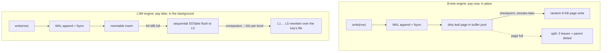

# Storage Engines: B-Tree vs LSM in Practice

> Read amplification, write amplification, space amplification.

**Type:** Learn
**Languages:** —
**Prerequisites:** Phase 3 Lesson 04 (B-Trees), Phase 3 Lesson 05 (LSM Trees), Phase 7 Lesson 02 (Write-Ahead Logs)
**Time:** ~75 minutes

## Learning Objectives

- Define read, write, and space amplification precisely and compute each one for a B-tree and a leveled LSM with real numbers
- Trace what happens on disk when a ledger posting is written to a B-tree engine and to an LSM engine, from WAL append to durable page or SSTable
- Explain what the page cache and the WAL each buy, and why fsync cost rather than disk bandwidth usually sets the write ceiling
- Decide, with a written procedure, whether a given table belongs on a B-tree engine (PostgreSQL, InnoDB) or an LSM engine (RocksDB, Cassandra, Pebble)
- Name the failure modes each engine has in production: write stalls, compaction debt, bloat, and index fragmentation
- Read an engine's own statistics to measure the three amplifications instead of guessing

## The Problem

A payments company stores two things that look alike and are not. The first is the **ledger**: one row per account balance and one row per posting, read constantly by balance checks, risk rules, and customer-facing screens, updated in place when a hold is captured or a posting is corrected. The second is the **event log**: every state transition of every payment, appended once, read in bulk by reconciliation jobs, analytics, and the occasional incident investigation, never updated.

Both sit in the same PostgreSQL cluster because that is what was there. The event log grows by 900 million rows a month. Its B-tree indexes on `(payment_id, sequence)` and `(created_at)` are each larger than the table was a year ago. Every insert touches two index leaf pages that are almost never in the buffer pool, so a batch of 10,000 events becomes roughly 20,000 random 8 KB page reads followed by 20,000 dirty pages that the checkpointer must flush. Autovacuum cannot keep up with the dead tuples from the rare updates, the table is 2.3x its live data size, and the nightly reconciliation scan takes four hours because it reads 2.3 bytes for every byte it needs.

The team tries the obvious fix and moves the event log to a RocksDB-backed service. Writes drop from 4 ms to 40 microseconds. Six weeks later the on-call engineer is paged for 2-second write latencies with no change in traffic: level 0 has filled up, compaction has fallen behind, and the engine is throttling writers until it catches up. In the same quarter someone proposes moving the ledger balances to RocksDB too, "because it is faster", and a point read of a balance that was 1 page read in PostgreSQL becomes a check of a memtable, two level-0 files, and one file per deeper level: up to six Bloom-filter probes and, on a miss, as many disk reads.

Nobody in this story is wrong about the facts. They are wrong about which costs each engine moves where. A storage engine does not eliminate work; it chooses *when* and *where* to pay for a write: at write time in place (B-tree), or later in the background (LSM). This lesson gives you the three numbers that make that choice quantitative and a procedure for applying them to a ledger, an event log, an idempotency store, and an index.

## The Concept

### The three amplifications

Every storage engine can be scored on three ratios, all defined relative to the logical work the application asked for:

| Amplification | Definition | What drives it |
|---|---|---|
| **Read** (RA) | bytes (or I/Os) read from storage per byte (or lookup) the query needed | how many places a key might be, and how big the unit of I/O is |
| **Write** (WA) | bytes written to storage per byte the application wrote | how many times the same data is rewritten over its life |
| **Space** (SA) | bytes occupied on disk per byte of live data | dead versions, fragmentation, and not-yet-reclaimed copies |

The RUM conjecture (Athanassoulis et al., 2016) states that you cannot minimise all three at once: an engine that is optimal for two of read, update, and memory overhead must pay in the third. B-trees and LSM trees are the two most common points on that trade-off surface.



Both diagrams start with the same WAL append. Everything after it is where the engines part ways: the B-tree carries a debt of dirty pages that random writes will eventually pay; the LSM carries a debt of unmerged files that sequential compaction will eventually pay.

### B-tree engine: pay at write time, in place

A B-tree (Phase 3, Lesson 04) stores sorted key-value pairs in fixed-size pages, usually 4 KB to 16 KB, with a fan-out of a few hundred. A key is in exactly one leaf page, found by walking from the root through two or three interior pages.

**Read path.** For a point lookup: walk root to leaf, O(log_B n) pages. With a fan-out of 300 and a billion keys, that is 4 levels, and the top 2 or 3 are always in the page cache, so a cold point read is 1 or 2 disk reads. For a range scan: find the start leaf, then follow sibling pointers; leaf pages are mostly sequential on a fresh index and increasingly scattered as the index ages.

**Write path.** For an update: write the new record to the WAL (sequential append, one `fsync` per commit group), then modify the leaf page in the buffer pool. The dirty page is written back later by a checkpointer or by eviction, as a full page. If the page is full, split it, which dirties two leaves and a parent. Every update to a row with k indexes dirties k+1 pages.

The amplification arithmetic for a 100-byte row update on a B-tree with 8 KB pages and two indexes:

```text
WAL write:              ~ 100 bytes of record + ~ 50 bytes header, group-committed
Table page write-back:  8192 bytes (full page, even though 100 changed)
2 index page writes:    2 * 8192 bytes
Total physical:         ~ 24,700 bytes per 100-byte logical write
Write amplification:    ~ 247x per update that eventually reaches disk
```

That looks catastrophic and usually is not, because the page cache absorbs repeated updates to the same page between checkpoints. If a hot balance row is updated 500 times between checkpoints, the page is written back once, and the effective WA for those 500 updates is `(500 * 150 + 3 * 8192) / (500 * 100) = 2x`. The B-tree's write amplification is therefore a function of locality: terrible for random inserts into a cold index, fine for hot rows.

The checkpoint interval is the knob. PostgreSQL also writes a **full-page image** to the WAL the first time a page is dirtied after each checkpoint (to survive torn writes, Lesson 02), so a shorter interval means more full-page images as well as more page write-backs:

```text
10,000 hot balance rows, each updated 50 times/minute, all pages cached
checkpoint every 1 min:   10,000 pages * 8 KB written back + 10,000 full-page WAL images = 160 MB/min
checkpoint every 10 min:  same 160 MB, but once per 10 min                                 =  16 MB/min
logical writes:           10,000 * 50 * 150 B                                              =  75 MB/min
WA at 1 min interval:  (160 + 75) / 75  = 3.1x        recovery replays <= 1 min of WAL
WA at 10 min interval: ( 16 + 75) / 75  = 1.2x        recovery replays <= 10 min of WAL
```

Longer intervals cut write amplification and lengthen crash recovery. There is no setting that gives both; there is only the setting you chose on purpose.

**Space.** PostgreSQL keeps old row versions in the heap until `VACUUM` reclaims them (MVCC, Lesson 06), and index pages that split stay half-full until they refill. A table with heavy updates and lagging vacuum at 2.3x live size is common. InnoDB keeps old versions in a separate undo log so the clustered index stays tighter, but secondary indexes still fragment.

### LSM engine: pay later, in the background

An LSM tree (Phase 3, Lesson 05) buffers writes in a sorted in-memory memtable, flushes it as an immutable sorted file (SSTable) when full, and merges files in the background (compaction) into progressively larger, non-overlapping levels.

**Write path.** Append the record to the WAL, insert into the memtable. That is all a write does synchronously: one sequential append and one in-memory insert. A 64 MB memtable fills, is frozen, and is written as one sequential 64 MB file. No random I/O on the write path at all, which is why RocksDB writes are measured in tens of microseconds.

**Read path.** A key may be in the memtable, in any level-0 file (they overlap), or in exactly one file per deeper level. A point read checks each in order, newest first, stopping at the first hit. Bloom filters (Phase 3, Lesson 01) on each file skip most of the files that do not have the key, so a hit typically costs one or two actual file reads; a miss, which Bloom filters handle at ~1% false positive rate, costs close to zero reads. A range scan cannot use Bloom filters: it must open an iterator on every level and merge them, so range scans on an LSM are consistently more expensive than on a B-tree.

**Compaction and write amplification.** Leveled compaction (RocksDB's default, LevelDB's design) keeps each level 10x the size of the one above it. When level L fills, a file from L is merged with the overlapping files in L+1, which rewrites roughly 10 bytes of L+1 for every byte of L moved down. A byte that lives to the bottom of a 6-level tree is written once to the WAL, once to L0, and then rewritten at each of 5 level transitions, each at ~10x:

```text
WAL:                1x
L0 flush:           1x
L0 -> L1:           ~ 10x (L1 files overlapping an L0 file are rewritten)
L1 -> L2:           ~ 10x
L2 -> L3:           ~ 10x
L3 -> L4:           ~ 10x
L4 -> L5:           ~ 10x
Write amplification ~ 52x for a key that reaches the bottom level
```

In practice RocksDB with leveled compaction reports 10-30x because most keys are overwritten or deleted before reaching the bottom, and because level 1 is often small enough to rewrite cheaply. **Tiered** (size-tiered, Cassandra's STCS, RocksDB universal) compaction merges files of similar size without the 10x fan-in, bringing WA down to 4-10x at the cost of more overlapping files per level, which raises read amplification and space amplification.

**Compaction debt.** Sustained ingest is bounded by compaction, not by how fast the memtable accepts writes. If the disk can write 1 GB/s and the engine's steady-state write amplification is 20x, then the engine can absorb at most 50 MB/s of application writes indefinitely; anything above that accumulates as unmerged L0 files until the stall threshold is hit. A burst of 200 MB/s for ten minutes builds 120 GB of application data that needs 2.4 TB of compaction I/O to digest, which at 1 GB/s is 40 minutes of degraded performance after the burst ends. That arithmetic, not the microsecond write latency, is what to put in the capacity model.

**Space.** Until compaction removes them, old versions of a key exist in several levels at once. Leveled compaction keeps space amplification near 1.1x (the bottom level holds 90% of the data and is always clean); tiered compaction can transiently hit 2x during a large merge, which is why Cassandra documentation tells you to keep 50% disk headroom with STCS.

### Side by side

| Property | B-tree (PostgreSQL, InnoDB, WiredTiger) | LSM, leveled (RocksDB, LevelDB, Pebble) | LSM, tiered (Cassandra STCS, RocksDB universal) |
|---|---|---|---|
| Point read, hot | 0 disk reads (page cached) | 0 disk reads (memtable or block cache) | same |
| Point read, cold | 1-2 reads | 1-2 reads with Bloom filters, up to levels+L0 files without | more files to probe |
| Range scan | one leaf chain, good locality | merge across all levels, worse | merge across more files, worst |
| Write latency | WAL fsync + in-memory page update | WAL fsync + memtable insert | same |
| Write amplification | 1-3x for hot rows, up to 100x+ for cold random inserts | 10-30x | 4-10x |
| Space amplification | 1.3-2.5x (bloat, half-full pages) | ~1.1x | 1.5-2x transiently |
| Background work | checkpoint, vacuum, index rebuild | compaction, continuous | compaction, bursty |
| Failure mode | bloat, lock contention on hot pages, long checkpoints | write stalls when compaction falls behind | space exhaustion during merges |
| Deletes | mark dead, vacuum later | tombstone written, removed at compaction | tombstones linger longest |

### Compression and the unit of I/O

The two engines also differ in how well they compress, and compression changes read amplification by bytes directly. A B-tree page is updated in place, so it must be stored in a form that can be rewritten without rewriting its neighbours; most B-tree engines either do not compress pages (PostgreSQL compresses only oversized TOAST values) or compress each page independently with modest ratios (InnoDB's page compression, WiredTiger's block compression at 2-3x). An SSTable is immutable, so the engine can compress 4-32 KB blocks with a dictionary trained on the file and never pay for a rewrite; 3-5x on JSON-like payment events is typical with zstd.

| | B-tree page (8 KB, in place) | SSTable block (4-32 KB, immutable) |
|---|---|---|
| Compression ratio on event rows | 1x (PostgreSQL) to 2-3x (InnoDB, WiredTiger) | 3-5x (zstd, lz4 with dictionary) |
| Cost of compression | on every write-back of the page | once at flush and once per compaction |
| Bytes read for a 200-byte row | 8 KB | 1-2 KB after decompressing one 4 KB block |
| Where the cache holds data | compressed or uncompressed pages | uncompressed blocks (block cache) plus OS page cache of compressed files |

For a nightly scan over a month of events, that ratio is the difference between reading 2.3 TB and reading 500 GB, which is the four-hour reconciliation job from The Problem becoming a one-hour job before anything else changes.

### What the WAL and the page cache each buy

Both engines have a WAL (Lesson 02), and both have a cache of recently used data. They play different roles in each.

In a B-tree engine, the WAL exists so the engine can **defer** random page writes: the commit is durable once the WAL record is fsynced, and the dirty page can stay in memory for minutes. The page cache is therefore a write-coalescing buffer as much as a read cache, and the checkpoint interval is the knob that trades recovery time (longer interval, more WAL to replay) against write amplification (longer interval, more updates coalesced per page write).

In an LSM engine, the WAL exists only to make the memtable durable; once the memtable is flushed to an SSTable, the corresponding WAL segment is deleted. There is no deferred random write to protect. The block cache serves reads only; it holds uncompressed SSTable blocks and index/filter blocks, and it has no dirty pages because SSTables are immutable.

### fsync is the ceiling

A commodity NVMe SSD writes sequentially at 2-3 GB/s. It completes an `fsync` (a flush of the device write cache so the data survives power loss) in 20-100 microseconds on a datacenter drive with power-loss protection and 1-5 milliseconds on a consumer drive that must actually flush its DRAM cache. Cloud block storage (EBS gp3, Persistent Disk) sits at 0.5-2 ms per flush.

A payments database commits every transaction with an fsync. At 1 ms per fsync, a single writer gets 1,000 commits per second regardless of how small the records are or how fast the engine is. Both B-tree and LSM engines solve this the same way, **group commit**: the WAL writer collects every transaction that arrived during the previous fsync and flushes them together with one call. PostgreSQL's `commit_delay`, InnoDB's `innodb_flush_log_at_trx_commit`, and RocksDB's `WriteOptions.sync` with the group write path are the same mechanism. At 50 concurrent writers and 1 ms fsync, group commit gives roughly 50,000 commits per second from the same drive.

The engine choice does not change the fsync cost. It changes what else is on the write path: for a B-tree, nothing synchronous besides the WAL, but a growing debt of dirty pages; for an LSM, nothing synchronous besides the WAL, but a growing debt of compaction.

### Reading the engine's own numbers

Both engines publish the raw counts that make the three amplifications measurable rather than estimated. Measure after a week of production traffic, because a freshly loaded B-tree has no bloat and a freshly loaded LSM has not compacted yet.

PostgreSQL, from the statistics views:

```sql
-- bytes the WAL wrote and pages the checkpointer and backends wrote back since stats reset
SELECT wal_bytes FROM pg_stat_wal;
SELECT (buffers_checkpoint + buffers_clean + buffers_backend) * 8192 AS data_bytes_written FROM pg_stat_bgwriter;
-- dead tuples as a proxy for space amplification on one table
SELECT relname, n_live_tup, n_dead_tup, pg_total_relation_size(relid) FROM pg_stat_user_tables WHERE relname = 'postings';
```

Write amplification is `(wal_bytes + data_bytes_written) / logical_bytes_inserted_or_updated`, where the logical figure comes from your own application metrics (rows times average row size). Space amplification is `pg_total_relation_size / (n_live_tup * avg_row_size)`.

RocksDB, from `GetProperty("rocksdb.stats")` or the statistics object:

```console
Compaction Stats [default]
Level    Files   Size     Score Read(GB)  Rn(GB) Rnp1(GB) Write(GB) Wnew(GB) Moved(GB) W-Amp
  L0      4/0    256 MB    1.0      0.0     0.0      0.0      10.0     10.0       0.0   1.0
  L1      8/0    512 MB    1.0     98.1     9.9     88.2      97.0      8.8       0.0   9.8
  L2     71/0    5.1 GB    1.0     94.3     9.4     84.9      93.1      8.2       0.0   9.9
  ...
 Sum     ...                      ...                        386.2                       19.3
Cumulative writes: 10G writes, 10G keys, 10G bytes user data, ...
Stalls(count): 3 level0_slowdown, 0 level0_numfiles, 1 pending_compaction_bytes
```

The `W-Amp` column is write amplification per level; the `Sum` row is the whole tree, here 19.3x. `Stalls(count)` is the number you alert on. Read amplification is `rocksdb.bytes.read / bytes returned to the application`, or more usefully the per-read histogram `rocksdb.db.get.micros` compared against the block cache hit rate.

### Decision procedure

For each table or keyspace, answer in order:

1. **Is the key space updated in place with high locality (balances, account state, sessions)?** B-tree. The page cache coalesces the updates; an LSM would write a new version to L0 for every update and spend compaction rewriting the same key dozens of times.
2. **Is it append-mostly with keys arriving in roughly sorted order (events, logs, time series)?** Either engine is fine on writes; a B-tree with a monotonically increasing key appends to the rightmost leaf and never splits randomly. Choose on read pattern: range scans by time favour the B-tree slightly, but an LSM's compression (SSTables compress 3-5x; B-tree pages compress poorly) often makes the LSM cheaper per byte stored and scanned.
3. **Is it append-mostly with random keys (idempotency keys, UUID-keyed records, deduplication sets)?** LSM. Random inserts into a cold B-tree index are the worst case: one random page read and one random page write per insert, with splits. The LSM turns them into sequential writes.
4. **Are range scans the dominant read?** B-tree, or an LSM with the scan range confined to one partition and few levels.
5. **Is the working set far larger than memory and point reads dominate?** LSM with Bloom filters, because a cold B-tree read is 1-2 random I/Os and a cold LSM read with filters is also 1-2, but the LSM's smaller on-disk footprint means more of it fits in cache.
6. **Is predictable tail latency more important than throughput?** B-tree. Compaction stalls are the LSM's characteristic tail-latency failure and require careful tuning (rate limiting, more L0 files allowed, larger memtables) that a B-tree does not need.

For the two tables in The Problem: the ledger (rule 1) stays on a B-tree; the event log (rule 2 or 3, depending on whether `payment_id` or `created_at` leads the key) goes to an LSM with leveled compaction and a size-based retention policy that deletes whole SSTables rather than issuing tombstones.

### Failure modes you will meet

**LSM write stall.** RocksDB stops or slows writers when L0 has more than `level0_slowdown_writes_trigger` files (default 20) or pending compaction bytes exceed a soft limit. The symptom is write latency jumping from microseconds to seconds with flat throughput upstream. The cause is compaction throughput below ingest rate: too few compaction threads, a disk saturated by compaction reads, or a sudden ingest spike. The fix is never "disable the stall"; it is to size compaction for peak ingest and to accept that an LSM's sustained write rate is bounded by compaction bandwidth divided by write amplification.

**LSM tombstone accumulation.** A delete writes a tombstone that must outlive every older version of the key, which means it survives until it reaches the bottom level. A keyspace with heavy deletes (a queue, a TTL cache) can be 90% tombstones, and a range scan has to read and discard every one. Cassandra's `tombstone_warn_threshold` exists because of this. Design around it by deleting whole files (time-partitioned keys, `DeleteRange`) rather than individual keys.

**B-tree bloat.** PostgreSQL's MVCC leaves dead tuples in heap and index pages until vacuum. A long-running transaction (a report, a stuck connection) holds back the vacuum horizon, dead tuples pile up, and every scan reads them. Symptom: table size grows with no growth in row count; `pg_stat_user_tables.n_dead_tup` climbs. Fix: kill the long transaction, tune autovacuum to be more aggressive on the hot table, and consider `fillfactor < 100` so updates can use HOT (heap-only tuple) updates that skip the indexes.

**B-tree hot page contention.** Every update to a balance row for the same account contends on the same leaf page and, for monotonically increasing keys, every insert contends on the rightmost leaf. Lock waits on a single page are a B-tree problem that an LSM structurally does not have, because the memtable is a skip list with fine-grained concurrency. This is one of the few reasons to put a hot *append* workload on an LSM even when a B-tree would otherwise fit.

### What this lesson does not cover

- **Column stores** (Parquet, ClickHouse's MergeTree, Redshift) are a third point on the surface, optimised for scans that read few columns of many rows; they are the right answer for analytics over the event log, not for serving it.
- **Hash indexes** (Bitcask, Riak's original engine) give O(1) point reads and no range scans at all; they appear in the idempotency-store lesson (Phase 5, Lesson 09) because that workload has no ranges.
- **Transaction isolation** is independent of the engine: PostgreSQL implements MVCC over a B-tree heap, CockroachDB implements MVCC over RocksDB/Pebble, and both get to serializable. Lessons 04 through 07 cover isolation on its own.

## Worked Example

Trace a single ledger posting through each engine. The posting is 200 bytes: `(posting_id, account_id, amount_minor, currency, created_at, idempotency_key)`. The table has a primary key on `posting_id` (sequential) and a secondary index on `(account_id, created_at)` (random with respect to arrival order). Pages are 8 KB, the dataset is far larger than memory, and the secondary index's leaf pages are cold.

**B-tree (PostgreSQL):**

```text
1. BEGIN; INSERT posting; COMMIT
2. WAL: append ~ 250 bytes (heap insert + 2 index inserts + commit), fsync (group commit)
3. Heap: append tuple to the current fill page -> page already in cache, 1 dirty page shared with neighbours
4. PK index: rightmost leaf -> cached, 1 dirty page shared with neighbours
5. Secondary index: leaf for (account_id, created_at) -> cold -> 1 random 8 KB READ, then 1 dirty page
6. Checkpoint later: write 3 dirty pages (24 KB), but heap and PK pages amortise over ~ 40 postings each
Per posting, steady state:  ~ 1 random read, ~ 8.4 KB written to data files + 250 B WAL
Write amplification:        ~ 43x   (8650 / 200)
Read amplification on `SELECT * WHERE posting_id = ?`:  1-2 page reads = 8-16 KB for 200 B  ->  40-80x by bytes, 1-2 by I/Os
```

The random read in step 5 is the cost that scales badly: at 10,000 postings per second with a cold secondary index that is 10,000 random reads per second before any write happens, and the write path is now bounded by read IOPS.

**LSM (RocksDB, leveled, 64 MB memtable, 6 levels, secondary index as a second column family):**

```text
1. WriteBatch { put(pk_cf, posting_id -> row), put(idx_cf, account_id|created_at -> posting_id) }
2. WAL: append ~ 250 bytes, fsync (group commit)
3. Memtable insert x2: in memory, no disk I/O, no read of existing data
4. Flush when memtable fills: 64 MB sequential write holding ~ 330,000 postings
5. Compaction over the key's lifetime: ~ 10x per level transition, 5 transitions
Per posting, steady state:  0 reads on the write path, ~ 250 B WAL + ~ 200 B * (1 + 50) compaction
Write amplification:        ~ 11-30x in practice (most keys compact fewer than 5 times before retention deletes them)
Read amplification on `GET posting_id`:  Bloom probes on ~ 6 files, 1 block read (4 KB) on hit  ->  ~ 20x by bytes, 1 by I/Os
Read amplification on range scan of account_id:  iterators on all levels merged, every level's overlapping blocks read
```

To see where the LSM's 10x per level comes from, trace one compaction step with real sizes. Level 1 is capped at 256 MB in files of 64 MB; level 2 is capped at 2.56 GB in 64 MB files whose key ranges tile the space, so each L1 file overlaps about ten L2 files:

```text
Trigger:   L1 holds 5 files = 320 MB > 256 MB cap, score 1.25
Pick:      L1 file F (64 MB, keys [pay_0310.. pay_0379])
Overlap:   10 L2 files covering [pay_0310.. pay_0379], 640 MB total
Merge:     read 64 MB + 640 MB = 704 MB, write ~ 640 MB of new L2 files (old versions dropped)
Result:    64 MB of L1 data moved down at the cost of ~ 640 MB written  ->  10x for this step
```

The ratio is the level size multiplier. Setting the multiplier to 4 lowers per-step amplification to ~4x but adds levels (more files to probe on a read miss), which is the RUM trade-off in a single knob.

Now put the two side by side for the two tables from The Problem:

| | Ledger balances (update in place, hot) | Event log (append, random secondary key, scanned nightly) |
|---|---|---|
| B-tree WA | ~2x (page cache coalesces) | ~43x and bounded by random reads |
| LSM WA | ~20x (every update is a new version to compact) | ~11-30x, no reads on the write path |
| B-tree point read | 0-1 I/O | 1-2 I/Os |
| LSM point read | 1 I/O after filter probes | 1 I/O after filter probes |
| Nightly scan | heap in insertion order, fine | SSTables compressed 4x: 4x fewer bytes read |
| Verdict | B-tree | LSM |

The arithmetic says what the incident said: the engine that was "faster" was faster for one of the two tables.

## Exercises

1. **Reinforce.** Using the RocksDB statistics names `rocksdb.bytes.written`, `rocksdb.flush.write.bytes`, `rocksdb.compact.write.bytes`, and `rocksdb.wal.bytes`, write the formula for measured write amplification and compute it for a run that reports 10 GB of application writes, 10 GB of WAL, 9.5 GB flushed, and 180 GB of compaction output. Then do the same for PostgreSQL using `pg_stat_wal.wal_bytes` and `pg_stat_bgwriter.buffers_checkpoint * 8192` and explain why the PostgreSQL number depends on `checkpoint_timeout`.
2. **Apply.** A merchant-facing API stores idempotency keys (random 32-byte strings) with a 24-hour TTL at 20,000 inserts per second, and the working set is 1.7 billion keys. Run the decision procedure and write a one-page recommendation that names the engine, the compaction style, the key layout that lets expiry delete whole files instead of writing tombstones, and the Bloom filter bits-per-key you would configure and why.
3. **Extend.** Take the LSM tree you built in Phase 3, Lesson 05 and add counters for bytes written by flushes and bytes written by compactions. Insert 1 million random keys, then 1 million sequential keys, and report the write amplification for each. Then connect it to the WAL from Lesson 02 and measure how group commit changes the commits-per-fsync ratio under 1, 8, and 64 concurrent writers with a simulated 1 ms fsync.

## Key Terms

| Term | What people say | What it actually means |
|------|-----------------|------------------------|
| Write amplification | "it writes a lot" | Bytes physically written to storage divided by bytes the application wrote; includes WAL, page write-back or flushes, and compaction rewrites |
| Read amplification | "reads are slow" | Bytes or I/Os read from storage per byte or lookup the query needed; a 200-byte row costing one 8 KB page read is 40x by bytes and 1x by I/Os |
| Space amplification | "bloat" | Bytes on disk per byte of live data; dead tuples, half-full pages, and uncompacted old versions |
| Page cache / buffer pool | "the cache" | In a B-tree engine, the memory that both serves reads and holds dirty pages so random writes can be deferred and coalesced until a checkpoint |
| Compaction | "background merging" | Rewriting SSTables to merge overlapping key ranges, drop overwritten versions and tombstones, and keep each level sorted and non-overlapping |
| Write stall | "the database froze" | An LSM engine throttling or stopping writers because level 0 or pending compaction has exceeded a threshold; compaction bandwidth is below ingest rate |
| Tombstone | "a delete marker" | A record that says a key is deleted; must persist until it has been compacted past every older version, which can be the bottom level |
| Group commit | "batching fsyncs" | Flushing the WAL once for every transaction that arrived during the previous flush, so commits per second is bounded by concurrency times 1/fsync latency rather than 1/fsync latency |

## Further Reading

- [O'Neil, Cheng, Gawlick, O'Neil, "The Log-Structured Merge-Tree (LSM-Tree)" (Acta Informatica, 1996)](https://www.cs.umb.edu/~poneil/lsmtree.pdf) — the original paper; section 3 derives the write cost of leveled merging that the 10x-per-level figure comes from.
- [Athanassoulis et al., "Designing Access Methods: The RUM Conjecture" (EDBT 2016)](https://stratos.seas.harvard.edu/files/stratos/files/rum.pdf) — the formal statement that read, update, and memory overheads cannot all be minimised, with B-trees and LSMs placed on the trade-off surface.
- [RocksDB Wiki: Leveled Compaction](https://github.com/facebook/rocksdb/wiki/Leveled-Compaction) and [Write Stalls](https://github.com/facebook/rocksdb/wiki/Write-Stalls) — the level size multiplier, the L0 triggers, and the exact conditions under which RocksDB slows or stops writers.
- [PostgreSQL documentation, Chapter 30: Reliability and the Write-Ahead Log](https://www.postgresql.org/docs/current/wal.html) — WAL, checkpoints, full-page writes, and the `commit_delay` group-commit knob; section 30.5 explains why checkpoint spacing controls write amplification.
- [Dong et al., "Optimizing Space Amplification in RocksDB" (CIDR 2017)](https://www.cidrdb.org/cidr2017/papers/p82-dong-cidr17.pdf) — Facebook's account of tuning leveled compaction so the bottom level holds 90% of data and space amplification stays near 1.1x, with measurements against InnoDB.
- [Apache Cassandra documentation: Compaction](https://cassandra.apache.org/doc/latest/cassandra/managing/operating/compaction/index.html) — size-tiered vs leveled vs time-window compaction, the 50% headroom rule, and tombstone thresholds.
