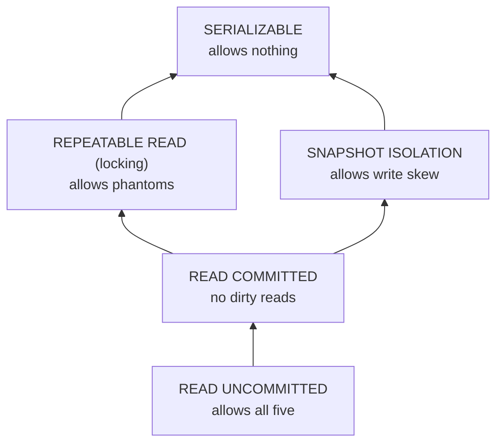

# Isolation Levels and Their Anomalies

> Dirty reads, lost updates, write skew: produce each one on purpose, because the one you have never seen is the one in production.

**Type:** Build
**Languages:** Java, Python, Go
**Prerequisites:** Phase 7 Lesson 02 (Write-Ahead Logs), Phase 4 Lesson 02 (Locks and Atomics), Phase 0 Lesson 07 (Decimal and Integer Arithmetic)
**Time:** ~120 minutes

## Learning Objectives

- Define the five classic anomalies (dirty read, non-repeatable read, phantom, lost update, write skew) as interleavings, not as vague symptoms, and write each one as a two-transaction script
- Build an in-memory transactional store whose isolation level is a constructor argument, and show with tests which level allows which anomaly
- Explain why lock-based `REPEATABLE READ` and snapshot isolation are incomparable: each prevents an anomaly the other allows
- State the Berenson et al. critique of the ANSI SQL-92 definitions and why "prevents the three ANSI phenomena" does not mean "serializable"
- Map the five levels of this lesson onto what PostgreSQL, MySQL InnoDB, Oracle, and SQL Server actually run when you ask for a level by name
- Choose an isolation level for a balance check, a ledger posting, a statement report, and an idempotency lookup, and justify each choice by the anomaly it must exclude

## The Problem

A wallet lets a customer hold money in a checking pocket and a savings pocket and promises that the customer can overdraw either one as long as the two together stay at or above zero. The withdrawal handler is written exactly as the product manager described it: read both balances, check that `checking + savings - amount >= 0`, then debit the pocket the customer chose. It runs inside a database transaction at the database's default isolation level, which the team believes is "basically serializable".

A customer with 6.00 USD in each pocket taps withdraw-10.00-from-checking on their phone and, within the same 20 ms, their partner on a shared account taps withdraw-10.00-from-savings. Both transactions read `6.00 + 6.00 = 12.00`, both conclude that `12.00 - 10.00 >= 0`, one writes checking to `-4.00`, the other writes savings to `-4.00`, and both commit. Every read saw committed data. No read changed between the first and second look. No row was updated twice. Nothing the ANSI SQL standard names as a phenomenon occurred. The combined balance is `-8.00`, which the product promised could never happen, and the database did exactly what its documentation says it does at that level.

The same team had already survived two simpler versions of this. A reporting job once summed every balance in the book and got a total that matched no moment in the ledger's history, because it read account A before a transfer and account B after it (non-repeatable reads across rows). A deposit endpoint once ran two concurrent `read balance, add amount, write balance` transactions and one deposit vanished (a lost update); they fixed it by moving to a stricter level and declared the problem class solved. The write-skew incident above is what taught them that isolation levels are not a dial from "fast" to "safe". They are a menu of specific interleavings each level forbids, and a level that forbids more interleavings than another is not necessarily safe against the one you have.

This lesson builds a store where the level is a parameter and each anomaly is a scripted interleaving you can run at every level and watch succeed or be refused. The matrix it prints is the one from Berenson, Bernstein, Gray, Melton, O'Neil, and O'Neil's 1995 critique, and the point of building it is that you will never again accept "we use REPEATABLE READ" as an answer to "can this invariant be violated".

## The Concept

### Anomalies are interleavings

An isolation level is defined by what it forbids, and the things it forbids are specific patterns of reads and writes by two or more concurrent transactions. The ANSI SQL-92 standard (ISO/IEC 9075:1992, section 4.28) names three phenomena, P1 to P3, and defines four levels by which of them each excludes. Berenson et al. showed that the standard's English definitions were ambiguous, that a strict reading of them lets through anomalies the authors clearly meant to exclude, and that two more phenomena, lost update (P4) and write skew (A5B), are needed to describe the levels real databases implement.

Each anomaly below is written as a history. `r1(x)` is transaction 1 reading item x; `w2(x)` is transaction 2 writing it; `c` and `a` are commit and abort. The payments scenario is the one the code runs.

| Anomaly | History | Payments scenario |
|---------|---------|-------------------|
| P1 dirty read | `w1(x) ... r2(x) ... a1` | T2 approves a payment against a balance T1 wrote and then rolled back |
| P2 non-repeatable read | `r1(x) ... w2(x) c2 ... r1(x)` | T1 reads a balance twice within one transaction and gets two answers |
| P3 phantom | `r1(P) ... w2(y in P) c2 ... r1(P)` | T1 counts a merchant's postings twice; a posting appears between the counts |
| P4 lost update | `r1(x) r2(x) w1(x) c1 w2(x) c2` | Two deposits read the same balance; the second overwrites the first |
| A5B write skew | `r1(x) r1(y) r2(x) r2(y) w1(x) w2(y) c1 c2` | Two withdrawals each check `x + y >= amount`, each debit a different pocket |

Dirty *writes* (`w1(x) w2(x)` before either commits) are excluded at every level by every real database, and by this lesson's store, because allowing them makes rollback impossible: if T1 aborts, what value should x revert to?

### The levels and what they forbid

The store runs at five levels. Three are the lock-based ANSI levels as a classic engine implements them; `SNAPSHOT` is snapshot isolation as Berenson et al. define it; `SERIALIZABLE` is lock-based with predicate locks.

| Level | Reads | Writes | Dirty read | Non-repeatable | Phantom | Lost update | Write skew |
|-------|-------|--------|------------|----------------|---------|-------------|------------|
| READ_UNCOMMITTED | no locks; sees in-place writes | X lock to commit | allowed | allowed | allowed | allowed | allowed |
| READ_COMMITTED | no locks; sees committed values | X lock to commit, buffered | prevented | allowed | allowed | allowed | allowed |
| REPEATABLE_READ | S lock per item to commit | X lock to commit | prevented | prevented | allowed | prevented | prevented |
| SNAPSHOT | private snapshot taken at begin | no locks; first-committer-wins at commit | prevented | prevented | prevented | prevented | allowed |
| SERIALIZABLE | S item locks plus predicate locks | X lock, checked against predicates | prevented | prevented | prevented | prevented | prevented |

Two cells in this table are the whole lesson. Lock-based `REPEATABLE_READ` allows phantoms but prevents write skew; `SNAPSHOT` prevents phantoms but allows write skew. Neither is stronger than the other. The ANSI standard, which only knows P1 to P3, ranks snapshot isolation above repeatable read because it excludes P3; Berenson et al. pointed out that it nonetheless lets through A5B, which repeatable read excludes. This is the critique in one sentence: *a level defined by which of three phenomena it excludes cannot express the guarantees of a mechanism that excludes a different set.*



The diagram is a partial order, not a line. Anything that draws isolation as a single slider from weak to strong is wrong about the middle.

### Why each mechanism allows what it allows

**Dirty read** happens when a reader can see a value before the writer commits. The only way to see it is for the writer to modify shared state in place. `READ_UNCOMMITTED` does exactly that (with an undo log so it can roll back). Every other level buffers writes privately until commit, so there is nothing uncommitted to see.

**Non-repeatable read** happens when a committed write lands between two reads by the same transaction. `READ_COMMITTED` reads the current committed value each time, so it sees the change. `REPEATABLE_READ` takes a shared lock on the first read and holds it to commit; the writer's exclusive lock request conflicts and the writer is refused (in this store) or waits (in a blocking engine). `SNAPSHOT` reads from a private copy taken at begin, so the committed write is simply not in the copy.

**Phantom** is a non-repeatable read of a *set*. `REPEATABLE_READ` locks the items it read, but a row that does not exist yet has no lock to take, so an insert into the range slips through. `SNAPSHOT` reads the set from its private copy, which cannot grow. `SERIALIZABLE` takes a predicate lock on the range (here, a key prefix) and refuses any write under that prefix by another transaction.

**Lost update** needs two transactions to both read x before either writes it. Under `REPEATABLE_READ` both hold S on x; the first to write needs X, which conflicts with the other's S, and is refused. Under `SNAPSHOT` both write freely, but at commit the second checks whether x was committed after its snapshot was taken (first-committer-wins) and aborts. `READ_COMMITTED` has no memory of having read x and lets the second write go through.

**Write skew** needs two transactions to each read x and y, then write *different* items. Under `REPEATABLE_READ` both hold S on both; the first writer's X request on x conflicts with the other's S on x and is refused: the lock on what was *read* protects the invariant. Under `SNAPSHOT`, first-committer-wins only checks the items each transaction *wrote*. T1 wrote x, T2 wrote y, nobody wrote the same item, both commit. The invariant `x + y >= 0` was a property of the read set, and snapshot isolation does not validate read sets. That is the precise statement of the hole, and Lesson 07 (serializable snapshot isolation) is about plugging it without locks.

### The worked example, by hand

Alice has 6.00 USD in checking and 6.00 USD in savings. Two withdrawals of 10.00 USD run under `SNAPSHOT`:

```text
T1 begin  snapshot = {checking: 600, savings: 600}   snapshotVersion = 0
T2 begin  snapshot = {checking: 600, savings: 600}   snapshotVersion = 0
T1 read checking = 600, read savings = 600    -> 1200 - 1000 >= 0, allowed
T2 read checking = 600, read savings = 600    -> 1200 - 1000 >= 0, allowed
T1 write checking = -400   (buffered)
T2 write savings  = -400   (buffered)
T1 commit: for k in {checking}: versionOf[k] = 0, not > 0  -> ok; commitClock = 1; publish
T2 commit: for k in {savings}:  versionOf[k] = 0, not > 0  -> ok; commitClock = 2; publish
combined balance = -400 + -400 = -800
```

The same interleaving under `SERIALIZABLE`:

```text
T1 read checking (S lock), read savings (S lock)
T2 read checking (S lock shared), read savings (S lock shared)
T1 write checking: needs X; T2 holds S  -> ConflictException, T1 aborted, locks released
T2 write savings: needs X; only T2 holds S -> upgrade granted
T2 commit: savings = -400; combined = 600 + -400 = 200 >= 0
```

One withdrawal succeeded and one was refused and must be retried, at which point it will read `600 + (-400) = 200 < 1000` and be declined. That is the serial outcome: it is what would have happened if the two taps had arrived a second apart.

### No-wait versus blocking

This store never blocks. When a lock request conflicts, the requester is aborted immediately with a `ConflictException`. A production lock manager would instead queue the request and let the transaction wait, which introduces deadlock, which is Lesson 05. The anomaly matrix is the same either way: whether T2 is refused or made to wait until T1 commits, it cannot observe the forbidden interleaving. No-wait keeps this lesson's scripts deterministic and keeps the focus on *which* operations conflict, not on what happens while waiting.

### What the levels do not promise

- No level below `SERIALIZABLE` protects an invariant that spans items you only read. If your check is `sum(x, y) >= amount`, either run serializable or convert the read into a write (`SELECT ... FOR UPDATE`, or materialize the sum as a row and update it).
- `SNAPSHOT` does not guarantee that a committed transaction's reads were current at commit. It guarantees they were a consistent view *as of begin*. For a balance check that is the wrong instant.
- `READ_COMMITTED` does not guarantee that two statements in one transaction agree with each other. A report that reads account A in one statement and account B in the next can see a transfer half-applied.
- Isolation levels say nothing about durability or about what another *node* sees; those are the WAL (Lesson 02) and replication (Phase 6).

### Complexity

| Operation | READ_UNCOMMITTED | READ_COMMITTED | REPEATABLE_READ | SNAPSHOT | SERIALIZABLE |
|-----------|------------------|----------------|-----------------|----------|--------------|
| begin | O(1) | O(1) | O(1) | O(n) copy of the store | O(1) |
| read | O(1) | O(1) | O(1) plus lock | O(log n) in the snapshot | O(1) plus lock |
| scan prefix | O(k) | O(k) | O(k) plus k locks | O(k) | O(k) plus k locks plus O(L) predicate scan |
| write | O(1) in place | O(1) buffer | O(1) buffer plus lock | O(1) buffer | O(P) predicate check |
| commit | O(w) | O(w) | O(w) | O(w) validation | O(w) |

The `SNAPSHOT` begin cost is the honest price of a private copy; a real engine pays it incrementally with multi-version storage (Lesson 06) instead of copying. The predicate check at `SERIALIZABLE` scales with the number of outstanding predicate locks P, which is why real engines lock index ranges instead of arbitrary predicates.

## Build It

The store holds balances in minor units as `long` values keyed by string. One committed value per key; no version chains yet. Isolation comes from a no-wait lock table or, at `SNAPSHOT`, from a private copy plus commit-time validation. Everything is single-threaded: concurrency is modelled by interleaving calls to two `Txn` objects in a script.

### Step 1: The levels and the lock table

```java
enum Isolation { READ_UNCOMMITTED, READ_COMMITTED, REPEATABLE_READ, SNAPSHOT, SERIALIZABLE }

final class ConflictException extends RuntimeException {
    ConflictException(String message) { super(message); }
}

final class LockEntry {
    final Set<Integer> shared = new HashSet<>();
    Integer exclusive;

    boolean heldByOthers(int me) {
        if (exclusive != null && exclusive != me) return true;
        for (int s : shared) if (s != me) return true;
        return false;
    }
}
```

A `LockEntry` is one key's lock state: any number of shared holders or one exclusive holder. `heldByOthers` ignores the caller, which is what lets a transaction upgrade its own S lock to X when it is the sole reader.

```java
void lockShared(int tx, String key) {
    LockEntry e = locks.computeIfAbsent(key, k -> new LockEntry());
    if (e.exclusive != null && e.exclusive != tx) throw new ConflictException("T" + tx + " S-lock " + key + " blocked by X of T" + e.exclusive);
    e.shared.add(tx);
}

void lockExclusive(int tx, String key) {
    LockEntry e = locks.computeIfAbsent(key, k -> new LockEntry());
    if (e.heldByOthers(tx)) throw new ConflictException("T" + tx + " X-lock " + key + " blocked by " + describeHolders(e, tx));
    e.shared.remove(tx);
    e.exclusive = tx;
}
```

No-wait: a conflicting request throws instead of queuing. The message names the holder because the trace is the teaching output.

**Predict:** T1 holds S on `acct:alice`. T2 calls `lockShared(2, "acct:alice")`. Then T1 calls `lockExclusive(1, "acct:alice")`. Which call throws, and what does that have to do with lost updates?

### Step 2: Predicate locks for the set that does not exist yet

```java
void lockPredicate(int tx, String prefix) {
    for (Map.Entry<String, LockEntry> e : locks.entrySet()) {
        if (e.getKey().startsWith(prefix) && e.getValue().exclusive != null && e.getValue().exclusive != tx) {
            throw new ConflictException("T" + tx + " predicate " + prefix + "* blocked by X of T" + e.getValue().exclusive + " on " + e.getKey());
        }
    }
    predicateLocks.computeIfAbsent(prefix, p -> new HashSet<>()).add(tx);
}

void checkPredicateConflict(int tx, String key) {
    for (Map.Entry<String, Set<Integer>> e : predicateLocks.entrySet()) {
        if (key.startsWith(e.getKey())) {
            for (int holder : e.getValue()) {
                if (holder != tx) throw new ConflictException("T" + tx + " write " + key + " blocked by predicate lock " + e.getKey() + "* of T" + holder);
            }
        }
    }
}
```

An item lock protects a row. A predicate lock protects a *question*: "all keys starting with `posting:m42:`". A scan at `SERIALIZABLE` registers the question; a write at `SERIALIZABLE` checks whether its key would change the answer to any registered question held by someone else. This is how a row that does not exist yet can still be locked, and it is the mechanism that `REPEATABLE_READ` lacks.

### Step 3: Begin, and the snapshot

```java
Txn(Store store, int id, Isolation level) {
    this.store = store;
    this.id = id;
    this.level = level;
    this.snapshot = level == Isolation.SNAPSHOT ? new TreeMap<>(store.committed) : null;
    this.snapshotVersion = store.commitClock;
}
```

At `SNAPSHOT` a transaction copies the whole committed store at begin. That is wasteful and correct; Lesson 06 replaces the copy with versions. `snapshotVersion` records the commit counter at that instant; it is what first-committer-wins compares against later. Every other level reads from `store.committed` directly.

### Step 4: Read, per level

```java
Long read(String key) {
    return guarded(() -> {
        Long v = switch (level) {
            case READ_UNCOMMITTED -> store.committed.get(key);
            case READ_COMMITTED -> writes.containsKey(key) ? writes.get(key) : store.committed.get(key);
            case REPEATABLE_READ, SERIALIZABLE -> {
                if (!writes.containsKey(key)) store.lockShared(id, key);
                yield writes.containsKey(key) ? writes.get(key) : store.committed.get(key);
            }
            case SNAPSHOT -> writes.containsKey(key) ? writes.get(key) : snapshot.get(key);
        };
        readSet.add(key);
        return v;
    });
}
```

Five levels, five read rules, one switch. `READ_UNCOMMITTED` reads `store.committed` too, but because its own and others' writes are applied there in place (Step 5), "committed" is a misnomer at that level and the dirty read falls out. `READ_COMMITTED` sees its own buffered writes and otherwise the latest commit. The locking levels take S before reading. `SNAPSHOT` reads its copy. The `guarded` wrapper catches a `ConflictException`, aborts the transaction, and rethrows, so a conflict is never silently swallowed.

**Predict:** under `READ_COMMITTED`, T1 reads `acct:alice`, T2 writes and commits a new value, T1 reads again. Which two lines of this method make T1 see two different values?

### Step 5: Write, per level

```java
void write(String key, long value) {
    guarded(() -> {
        switch (level) {
            case READ_UNCOMMITTED -> {
                store.lockExclusive(id, key);
                undo.putIfAbsent(key, store.committed.get(key));
                store.committed.put(key, value);
            }
            case READ_COMMITTED, REPEATABLE_READ -> {
                store.lockExclusive(id, key);
                writes.put(key, value);
            }
            case SERIALIZABLE -> {
                store.checkPredicateConflict(id, key);
                store.lockExclusive(id, key);
                writes.put(key, value);
            }
            case SNAPSHOT -> writes.put(key, value);
        }
        return null;
    });
}
```

Every level except `SNAPSHOT` takes an X lock, even `READ_UNCOMMITTED`: there are no dirty writes anywhere. `READ_UNCOMMITTED` is the only level that writes in place, saving the previous value for rollback; that in-place write is the dirty read's whole cause. `SNAPSHOT` takes no lock at all and defers conflict detection to commit.

**Predict:** at `REPEATABLE_READ`, T1 and T2 have both read `acct:alice`. T1 writes it. What is thrown, to whom, and what does the trace line say?

### Step 6: Commit, and first-committer-wins

```java
void commit() {
    guarded(() -> {
        if (level == Isolation.SNAPSHOT) {
            for (String k : writes.keySet()) {
                long v = store.versionOf.getOrDefault(k, 0L);
                if (v > snapshotVersion) throw new ConflictException("T" + id + " first-committer-wins: " + k + " committed at v" + v + " after snapshot v" + snapshotVersion);
            }
        }
        store.commitClock++;
        if (level == Isolation.READ_UNCOMMITTED) {
            for (String k : undo.keySet()) store.versionOf.put(k, store.commitClock);
        } else {
            for (Map.Entry<String, Long> w : writes.entrySet()) {
                store.committed.put(w.getKey(), w.getValue());
                store.versionOf.put(w.getKey(), store.commitClock);
            }
        }
        status = Status.COMMITTED;
        store.releaseAll(id);
        return null;
    });
}
```

The `SNAPSHOT` validation loop is the entire concurrency control of snapshot isolation: for each key *I wrote*, was it committed by someone else after my snapshot? Read the loop again and notice what it does not iterate over: `readSet`. Two write-skew transactions write disjoint keys, so neither finds a newer version of anything it wrote, and both pass. Lesson 07 adds the read-set check. Every level then publishes its buffered writes, stamps them with the new commit number, and releases its locks.

### Step 7: The anomaly scripts

```java
static Outcome writeSkew(Isolation level) {
    Store s = new Store();
    s.load("acct:alice:checking", 600);
    s.load("acct:alice:savings", 600);
    Txn t1 = s.begin(level), t2 = s.begin(level);
    long[] c = new long[2], sv = new long[2];
    quietly(() -> { c[0] = t1.read("acct:alice:checking"); sv[0] = t1.read("acct:alice:savings"); });
    quietly(() -> { c[1] = t2.read("acct:alice:checking"); sv[1] = t2.read("acct:alice:savings"); });
    quietly(() -> { if (c[0] + sv[0] - 1000 >= 0) t1.write("acct:alice:checking", c[0] - 1000); });
    quietly(() -> { if (c[1] + sv[1] - 1000 >= 0) t2.write("acct:alice:savings", sv[1] - 1000); });
    quietly(t1::commit);
    quietly(t2::commit);
    long sum = s.committed.get("acct:alice:checking") + s.committed.get("acct:alice:savings");
    boolean observed = sum < 0;
    return new Outcome("write skew", level, observed, "combined balance " + sum + " (invariant: >= 0); T1 " + t1.status + ", T2 " + t2.status, s.trace);
}
```

Each anomaly is a fixed interleaving, written once, run at every level. `quietly` swallows the `ConflictException` of a step that was refused and the `IllegalStateException` of a later step belonging to a transaction that was already aborted, which is how a retry loop in an application would behave: the aborted transaction's remaining steps do not run. The `observed` flag is the anomaly's definition as a predicate on the final state: for write skew, the invariant is broken; for lost update, both committed but the balance is not the sum; for a phantom, the two counts differ and T1 was not aborted.

```java
static Map<String, Map<Isolation, Boolean>> matrix() {
    Map<String, Map<Isolation, Boolean>> m = new LinkedHashMap<>();
    for (String a : ANOMALIES) {
        Map<Isolation, Boolean> row = new LinkedHashMap<>();
        for (Isolation l : Isolation.values()) row.put(l, run(a, l).observed());
        m.put(a, row);
    }
    return m;
}
```

Twenty-five runs produce the table from The Concept. The test file asserts every cell.

### Step 8: Run it

```bash
cd phases/07-storage-and-transactions/04-isolation-levels-and-anomalies/code/java
javac -d .out *.java && java -cp .out Main
java -cp .out MainTest
```

Expected output, abbreviated:

```console
== Which anomalies does each level allow? (Y = anomaly observed) ==
anomaly              READ_UNCOMMITTED   READ_COMMITTED   REPEATABLE_READ  SNAPSHOT   SERIALIZABLE
dirty read           Y                  -                -                -          -
non-repeatable read  Y                  Y                -                -          -
phantom              Y                  Y                Y                -          -
lost update          Y                  Y                -                -          -
write skew           Y                  Y                -                Y          -

== Write skew under SNAPSHOT: both pass the check, both commit, the invariant is gone ==
  T1 read acct:alice:checking = 600
  T1 read acct:alice:savings = 600
  T2 read acct:alice:checking = 600
  T2 read acct:alice:savings = 600
  T1 write acct:alice:checking = -400
  T2 write acct:alice:savings = -400
  T1 COMMIT (v1)
  T2 COMMIT (v2)
  => combined balance -800 (invariant: >= 0); T1 COMMITTED, T2 COMMITTED

== Same interleaving under SERIALIZABLE: the second writer is refused ==
  T1 X-lock acct:alice:checking blocked by S of T[2] -> T1 ABORTED
  T2 COMMIT (v1)
  => combined balance 200 (invariant: >= 0); T1 ABORTED, T2 COMMITTED

== Lost update under SNAPSHOT: first committer wins, second is told ==
  T2 first-committer-wins: acct:alice committed at v1 after snapshot v0 -> T2 ABORTED
  => final balance 1100 (expected 1300 if both deposits landed); T1 COMMITTED, T2 ABORTED
```

The phantom row is the one to stare at: `REPEATABLE_READ` shows `Y` while the level above and below it in ANSI's ordering both show `-`, and `SNAPSHOT`, which ANSI would rank higher, shows `Y` for write skew where `REPEATABLE_READ` shows `-`.

### In Python

The Python port (`code/python/main.py`) is the same design with four differences. **`match` replaces the `switch` expressions:** each operation is a nested `op` closure handed to `_guarded`, which plays the role of the Java `Supplier`; a `ConflictException` is traced, the transaction aborts and releases its locks, and the exception is re-raised. **Two error kinds, kept apart:** `ConflictException` subclasses `Exception`, not `RuntimeError`, while using an aborted or committed transaction raises `RuntimeError` (Java's `IllegalStateException`); `_quietly` catches both, but the tests can tell them apart, and one test asserts the classes stay unrelated. **No `TreeMap`:** `committed` and the snapshot are plain `dict`s, and `_with_prefix` sorts the keys and filters by prefix, which is what `tailMap(prefix)` plus the early `break` computes; balances are `int` minor units and never overflow. **Same trace text:** `_j` prints `None` as `null` and `_jmap` prints a scan like Java's `TreeMap.toString`, so `diff` of the two demos is empty, and there are no threads, since concurrency is the scripted interleaving, exactly as in Java.

Run it from `code/python/` with `python3 main.py`; test with `python3 -m unittest -v`.

#### Step 1: The levels and the lock table

`Isolation` is an `Enum`, `ConflictException` is a direct `Exception` subclass, and `LockEntry` keeps a `set` of shared holders and an `int | None` exclusive holder. The two lock methods use `dict.setdefault` for `computeIfAbsent`, and `set.discard` for the upgrade path, which does nothing if the caller held no S lock.

```python
class ConflictException(Exception):
    """Raised when an operation would conflict with another live transaction. The receiver is aborted.

    Deliberately not a RuntimeError, so it can never be mistaken for the "transaction is not active" error.
    """


class LockEntry:
    def __init__(self) -> None:
        self.shared: set[int] = set()
        self.exclusive: int | None = None

    def held_by_others(self, me: int) -> bool:
        if self.exclusive is not None and self.exclusive != me:
            return True
        return any(s != me for s in self.shared)
```

```python
    def lock_shared(self, tx: int, key: str) -> None:
        e = self.locks.setdefault(key, LockEntry())
        if e.exclusive is not None and e.exclusive != tx:
            raise ConflictException(f"T{tx} S-lock {key} blocked by X of T{e.exclusive}")
        e.shared.add(tx)

    def lock_exclusive(self, tx: int, key: str) -> None:
        e = self.locks.setdefault(key, LockEntry())
        if e.held_by_others(tx):
            raise ConflictException(f"T{tx} X-lock {key} blocked by {Store._describe_holders(e, tx)}")
        e.shared.discard(tx)
        e.exclusive = tx
```

#### Step 2: Predicate locks for the set that does not exist yet

`lock_predicate` scans the existing lock entries for an X lock under the prefix, then registers the prefix. `check_predicate_conflict` is the reverse question, asked by every `SERIALIZABLE` write; the holders are iterated in sorted order so the conflict message is deterministic.

```python
    def lock_predicate(self, tx: int, prefix: str) -> None:
        # conflict if another transaction holds X on any existing key under this prefix
        for key, e in self.locks.items():
            if key.startswith(prefix) and e.exclusive is not None and e.exclusive != tx:
                raise ConflictException(f"T{tx} predicate {prefix}* blocked by X of T{e.exclusive} on {key}")
        self.predicate_locks.setdefault(prefix, set()).add(tx)

    def check_predicate_conflict(self, tx: int, key: str) -> None:
        for prefix, holders in self.predicate_locks.items():
            if key.startswith(prefix):
                for holder in sorted(holders):
                    if holder != tx:
                        raise ConflictException(f"T{tx} write {key} blocked by predicate lock {prefix}* of T{holder}")
```

#### Step 3: Begin, and the snapshot

The constructor copies `store.committed` with `dict(...)` only at `SNAPSHOT`, and records `commit_clock` as `snapshot_version` for every level. `_guarded` is the wrapper every operation runs through: it checks the status, runs the closure, and on a conflict traces, aborts, and re-raises.

```python
    def __init__(self, store: Store, id: int, level: Isolation) -> None:
        self.store = store
        self.id = id
        self.level = level
        self.status = Txn.Status.ACTIVE
        self.writes: dict[str, int] = {}  # buffered writes (all levels except READ_UNCOMMITTED)
        self.undo: dict[str, int | None] = {}  # READ_UNCOMMITTED: previous committed value for in-place writes
        # SNAPSHOT: private copy taken at begin
        self.snapshot: dict[str, int] | None = dict(store.committed) if level is Isolation.SNAPSHOT else None
        self.snapshot_version = store.commit_clock
        self.read_set: set[str] = set()

    def _guarded(self, op: Callable[[], T]) -> T:
        self._require_active()
        try:
            return op()
        except ConflictException as c:
            self.store.trace.append(f"  {c} -> T{self.id} ABORTED")
            self.abort()
            raise
```

#### Step 4: Read, per level

A `match` with one arm per level, inside a closure passed to `_guarded`. The two locking levels share an arm with `|`. A missing key reads as `None`, which the trace prints as `null`.

```python
    def read(self, key: str) -> int | None:
        def op() -> int | None:
            match self.level:
                case Isolation.READ_UNCOMMITTED:
                    v = self.store.committed.get(key)  # sees in-place writes of others
                case Isolation.READ_COMMITTED:
                    v = self.writes[key] if key in self.writes else self.store.committed.get(key)
                case Isolation.REPEATABLE_READ | Isolation.SERIALIZABLE:
                    if key not in self.writes:
                        self.store.lock_shared(self.id, key)
                    v = self.writes[key] if key in self.writes else self.store.committed.get(key)
                case Isolation.SNAPSHOT:
                    v = self.writes[key] if key in self.writes else self.snapshot.get(key)
            self.read_set.add(key)
            self.store.trace.append(f"  T{self.id} read {key} = {_j(v)}")
            return v

        return self._guarded(op)
```

#### Step 5: Write, per level

Same shape. `READ_UNCOMMITTED` saves the previous value with `undo.setdefault` and writes in place; the buffered levels take X and write to `self.writes`; `SERIALIZABLE` checks predicate locks first; `SNAPSHOT` buffers without locking.

```python
    def write(self, key: str, value: int) -> None:
        def op() -> None:
            match self.level:
                case Isolation.READ_UNCOMMITTED:
                    self.store.lock_exclusive(self.id, key)  # still no dirty WRITES: X lock held to commit
                    self.undo.setdefault(key, self.store.committed.get(key))
                    self.store.committed[key] = value  # applied in place, visible to everyone now
                case Isolation.READ_COMMITTED | Isolation.REPEATABLE_READ:
                    self.store.lock_exclusive(self.id, key)
                    self.writes[key] = value
                case Isolation.SERIALIZABLE:
                    self.store.check_predicate_conflict(self.id, key)
                    self.store.lock_exclusive(self.id, key)
                    self.writes[key] = value
                case Isolation.SNAPSHOT:
                    self.writes[key] = value  # no locks; validated at commit
            self.store.trace.append(f"  T{self.id} write {key} = {value}")

        self._guarded(op)
```

#### Step 6: Commit, and first-committer-wins

The `SNAPSHOT` validation iterates `self.writes` only, never `read_set`, which is why write skew passes. Then the commit clock advances, buffered writes are published and stamped (or, for `READ_UNCOMMITTED`, the in-place keys are stamped), and the locks are released.

```python
    def commit(self) -> None:
        def op() -> None:
            s = self.store
            if self.level is Isolation.SNAPSHOT:
                for k in self.writes:
                    v = s.version_of.get(k, 0)
                    if v > self.snapshot_version:
                        raise ConflictException(
                            f"T{self.id} first-committer-wins: {k} committed at v{v} after snapshot v{self.snapshot_version}")
            s.commit_clock += 1
            if self.level is Isolation.READ_UNCOMMITTED:
                for k in self.undo:
                    s.version_of[k] = s.commit_clock
            else:
                for k, v in self.writes.items():
                    s.committed[k] = v
                    s.version_of[k] = s.commit_clock
            self.status = Txn.Status.COMMITTED
            s.release_all(self.id)
            s.trace.append(f"  T{self.id} COMMIT (v{s.commit_clock})")

        self._guarded(op)
```

#### Step 7: The anomaly scripts

Each script is a static method on `AnomalyLab`. `_quietly` swallows both `ConflictException` and `RuntimeError`, so an aborted transaction's later steps are skipped exactly as in Java. Mutable lists stand in for the Java arrays that the lambdas write into, and `matrix` is a nested dict comprehension over anomalies and levels.

```python
    @staticmethod
    def write_skew(level: Isolation) -> Outcome:
        s = Store()
        s.load("acct:alice:checking", 600)
        s.load("acct:alice:savings", 600)
        t1, t2 = s.begin(level), s.begin(level)
        q = AnomalyLab._quietly
        c = [0, 0]
        sv = [0, 0]

        def check(i: int, t: Txn) -> None:
            c[i] = t.read("acct:alice:checking")
            sv[i] = t.read("acct:alice:savings")

        q(lambda: check(0, t1))  # T1 checks: 1200 >= 1000
        q(lambda: check(1, t2))  # T2 checks: 1200 >= 1000
        q(lambda: t1.write("acct:alice:checking", c[0] - 1000) if c[0] + sv[0] - 1000 >= 0 else None)
        q(lambda: t2.write("acct:alice:savings", sv[1] - 1000) if c[1] + sv[1] - 1000 >= 0 else None)
        q(t1.commit)
        q(t2.commit)
        total = s.committed["acct:alice:checking"] + s.committed["acct:alice:savings"]
        observed = total < 0
        return Outcome("write skew", level, observed,
                       f"combined balance {total} (invariant: >= 0); T1 {t1.status.name}, T2 {t2.status.name}", s.trace)

    @staticmethod
    def matrix() -> dict[str, dict[Isolation, bool]]:
        return {a: {lvl: AnomalyLab.run(a, lvl).observed for lvl in Isolation} for a in AnomalyLab.ANOMALIES}
```

#### Step 8: Run it

```bash
cd phases/07-storage-and-transactions/04-isolation-levels-and-anomalies/code/python
python3 main.py
python3 -m unittest -v
```

The matrix and the four traces are the Java output:

```console
== Which anomalies does each level allow? (Y = anomaly observed) ==
anomaly              READ_UNCOMMITTED   READ_COMMITTED   REPEATABLE_READ  SNAPSHOT   SERIALIZABLE
dirty read           Y                  -                -                -          -
non-repeatable read  Y                  Y                -                -          -
phantom              Y                  Y                Y                -          -
lost update          Y                  Y                -                -          -
write skew           Y                  Y                -                Y          -
```

### In Go

The Go port (`code/go/main.go`) keeps the design and changes three things. **Conflicts are values, and they still abort:** `Read` returns `(int64, bool, error)` (the `bool` is Java's nullable `Long`), `Scan` returns `(map[string]int64, error)`, and `Write`/`Commit` return `error`; `ConflictError` implements `Is` so one sentinel `ErrConflict` matches every conflict while the message keeps the exact lock-table reason that the trace prints, `ErrNotActive` is the `IllegalStateException` for a finished transaction, and `guarded` does what the Java `guarded()` does minus the rethrow, because the scenarios simply discard the error, which is what the Java `quietly()` helper did. **Ordered maps by hand:** Java's `LinkedHashMap` for buffered writes becomes `orderedWrites` (a key slice plus a map) so `Commit` applies writes in the order they were issued, `TreeMap` iteration becomes `sortedKeys` wherever the order is observable (scan traces, `describeHolders`, the predicate-lock sweep), and `undoEntry{Value, Present}` stands in for a `null` previous value in the `READ_UNCOMMITTED` undo log. **No goroutines:** the store is single-threaded by design and concurrency is modelled by interleaving calls, so the port has no mutex and `go test -race` passes trivially; a version that drives transactions from goroutines must hold one mutex across every `Store` method, because the lock table is itself shared state.

Run it from `code/go/` with `go run .`; test with `go test ./...`. The demo prints the same matrix and the same four traces as the Java version, line for line.

#### Step 1: The levels and the lock table

`ConflictError` carries the message and implements `Is` against the `ErrConflict` sentinel; the `conflict` helper formats one. `LockEntry.Exclusive` uses 0 for "none" because transaction ids start at 1, and `Shared` is a `map[int]bool`. The lock methods return errors instead of throwing.

```go
type ConflictError struct{ Msg string }

func (e *ConflictError) Error() string        { return e.Msg }
func (e *ConflictError) Is(target error) bool { return target == ErrConflict }

func conflict(format string, args ...any) error {
	return &ConflictError{Msg: fmt.Sprintf(format, args...)}
}

type LockEntry struct {
	Shared    map[int]bool
	Exclusive int
}

func (e *LockEntry) HeldByOthers(me int) bool {
	if e.Exclusive != 0 && e.Exclusive != me {
		return true
	}
	for s := range e.Shared {
		if s != me {
			return true
		}
	}
	return false
}
```

```go
func (s *Store) LockShared(tx int, key string) error {
	e := s.lockEntry(key)
	if e.Exclusive != 0 && e.Exclusive != tx {
		return conflict("T%d S-lock %s blocked by X of T%d", tx, key, e.Exclusive)
	}
	e.Shared[tx] = true
	return nil
}

func (s *Store) LockExclusive(tx int, key string) error {
	e := s.lockEntry(key)
	if e.HeldByOthers(tx) {
		return conflict("T%d X-lock %s blocked by %s", tx, key, describeHolders(e, tx))
	}
	delete(e.Shared, tx)
	e.Exclusive = tx
	return nil
}
```

#### Step 2: Predicate locks for the set that does not exist yet

Both sweeps iterate `sortedKeys(...)` because Go map order is random and the first conflict found becomes the trace line. The per-prefix holder set is created lazily.

```go
func (s *Store) LockPredicate(tx int, prefix string) error {
	// conflict if another transaction holds X on any existing key under this prefix
	for _, key := range sortedKeys(s.Locks) {
		e := s.Locks[key]
		if strings.HasPrefix(key, prefix) && e.Exclusive != 0 && e.Exclusive != tx {
			return conflict("T%d predicate %s* blocked by X of T%d on %s", tx, prefix, e.Exclusive, key)
		}
	}
	if s.PredicateLocks[prefix] == nil {
		s.PredicateLocks[prefix] = map[int]bool{}
	}
	s.PredicateLocks[prefix][tx] = true
	return nil
}

func (s *Store) CheckPredicateConflict(tx int, key string) error {
	for _, prefix := range sortedKeys(s.PredicateLocks) {
		if !strings.HasPrefix(key, prefix) {
			continue
		}
		for _, holder := range sortedInts(s.PredicateLocks[prefix]) {
			if holder != tx {
				return conflict("T%d write %s blocked by predicate lock %s* of T%d", tx, key, prefix, holder)
			}
		}
	}
	return nil
}
```

#### Step 3: Begin, and the snapshot

`newTxn` copies the committed map key by key at `Snapshot` (maps are references, so assignment would alias). `guarded` returns `ErrNotActive` for a finished transaction, runs the closure, and on a conflict appends the trace line and aborts before returning the error to the caller.

```go
func newTxn(store *Store, id int, level Isolation) *Txn {
	t := &Txn{Store: store, ID: id, Level: level, Status: Active, Writes: newOrderedWrites(), Undo: map[string]undoEntry{}, ReadSet: map[string]bool{}}
	if level == Snapshot {
		t.Snapshot = make(map[string]int64, len(store.Committed))
		for k, v := range store.Committed {
			t.Snapshot[k] = v
		}
	}
	t.SnapshotVersion = store.CommitClock
	return t
}

func (t *Txn) guarded(op func() error) error {
	if t.Status != Active {
		return fmt.Errorf("%w: T%d is %s", ErrNotActive, t.ID, t.Status)
	}
	err := op()
	if errors.Is(err, ErrConflict) {
		t.Store.Trace = append(t.Store.Trace, fmt.Sprintf("  %s -> T%d ABORTED", err.Error(), t.ID))
		t.Abort()
	}
	return err
}
```

#### Step 4: Read, per level

Named return values let the closure set `value` and `present` and return only the error. `lookup` is the two-value map read, and `t.Writes.get` is the ordered map's equivalent. The locking levels take S only when the key is not already buffered.

```go
func (t *Txn) Read(key string) (value int64, present bool, err error) {
	err = t.guarded(func() error {
		switch t.Level {
		case ReadUncommitted:
			value, present = lookup(t.Store.Committed, key) // sees in-place writes of others
		case ReadCommitted:
			if value, present = t.Writes.get(key); !present {
				value, present = lookup(t.Store.Committed, key)
			}
		case RepeatableRead, Serializable:
			if _, buffered := t.Writes.get(key); !buffered {
				if e := t.Store.LockShared(t.ID, key); e != nil {
					return e
				}
			}
			if value, present = t.Writes.get(key); !present {
				value, present = lookup(t.Store.Committed, key)
			}
		case Snapshot:
			if value, present = t.Writes.get(key); !present {
				value, present = lookup(t.Snapshot, key)
			}
		}
		t.ReadSet[key] = true
		t.Store.Trace = append(t.Store.Trace, fmt.Sprintf("  T%d read %s = %s", t.ID, key, formatValue(value, present)))
		return nil
	})
	return value, present, err
}
```

#### Step 5: Write, per level

Every lock call's error is returned immediately. The `READ_UNCOMMITTED` undo log records an `undoEntry` with a `Present` flag (there is no `null` to store) and keeps `undoKeys` for ordered replay at commit.

```go
func (t *Txn) Write(key string, value int64) error {
	return t.guarded(func() error {
		switch t.Level {
		case ReadUncommitted:
			if e := t.Store.LockExclusive(t.ID, key); e != nil { // still no dirty WRITES: X lock held to commit
				return e
			}
			if _, seen := t.Undo[key]; !seen {
				old, present := lookup(t.Store.Committed, key)
				t.Undo[key] = undoEntry{old, present}
				t.undoKeys = append(t.undoKeys, key)
			}
			t.Store.Committed[key] = value // applied in place, visible to everyone now
		case ReadCommitted, RepeatableRead:
			if e := t.Store.LockExclusive(t.ID, key); e != nil {
				return e
			}
			t.Writes.put(key, value)
		case Serializable:
			if e := t.Store.CheckPredicateConflict(t.ID, key); e != nil {
				return e
			}
			if e := t.Store.LockExclusive(t.ID, key); e != nil {
				return e
			}
			t.Writes.put(key, value)
		case Snapshot:
			t.Writes.put(key, value) // no locks; validated at commit
		}
		t.Store.Trace = append(t.Store.Trace, fmt.Sprintf("  T%d write %s = %d", t.ID, key, value))
		return nil
	})
}
```

#### Step 6: Commit, and first-committer-wins

The validation and the publish loops both walk `t.Writes.keys`, the insertion-order slice, so writes land in the order they were issued. A missing `VersionOf` entry reads as 0, matching `getOrDefault(k, 0L)`.

```go
func (t *Txn) Commit() error {
	return t.guarded(func() error {
		if t.Level == Snapshot {
			for _, k := range t.Writes.keys {
				v := t.Store.VersionOf[k]
				if v > t.SnapshotVersion {
					return conflict("T%d first-committer-wins: %s committed at v%d after snapshot v%d", t.ID, k, v, t.SnapshotVersion)
				}
			}
		}
		t.Store.CommitClock++
		if t.Level == ReadUncommitted {
			for _, k := range t.undoKeys {
				t.Store.VersionOf[k] = t.Store.CommitClock
			}
		} else {
			for _, k := range t.Writes.keys {
				t.Store.Committed[k] = t.Writes.vals[k]
				t.Store.VersionOf[k] = t.Store.CommitClock
			}
		}
		t.Status = Committed
		t.Store.ReleaseAll(t.ID)
		t.Store.Trace = append(t.Store.Trace, fmt.Sprintf("  T%d COMMIT (v%d)", t.ID, t.Store.CommitClock))
		return nil
	})
}
```

#### Step 7: The anomaly scripts

The scripts are package-level functions. Errors from refused steps are discarded with `_ =`, and `readBoth` returns early if the first read fails, so an aborted transaction's later steps do not run; `guarded` already refuses them with `ErrNotActive`. `Matrix` iterates the `Anomalies` and `Levels` slices for a stable order.

```go
func WriteSkew(level Isolation) Outcome {
	s := NewStore()
	s.Load("acct:alice:checking", 600)
	s.Load("acct:alice:savings", 600)
	t1, t2 := s.Begin(level), s.Begin(level)
	var c, sv [2]int64
	readBoth := func(t *Txn, i int) {
		var err error
		if c[i], _, err = t.Read("acct:alice:checking"); err != nil {
			return
		}
		sv[i], _, _ = t.Read("acct:alice:savings")
	}
	readBoth(t1, 0) // T1 checks: 1200 >= 1000
	readBoth(t2, 1) // T2 checks: 1200 >= 1000
	if c[0]+sv[0]-1000 >= 0 {
		_ = t1.Write("acct:alice:checking", c[0]-1000) // withdraw 10.00 from checking
	}
	if c[1]+sv[1]-1000 >= 0 {
		_ = t2.Write("acct:alice:savings", sv[1]-1000) // withdraw 10.00 from savings
	}
	_ = t1.Commit()
	_ = t2.Commit()
	sum := s.Committed["acct:alice:checking"] + s.Committed["acct:alice:savings"]
	observed := sum < 0
	return Outcome{"write skew", level, observed,
		fmt.Sprintf("combined balance %d (invariant: >= 0); T1 %s, T2 %s", sum, t1.Status, t2.Status), s.Trace}
}

func (lab AnomalyLab) Matrix() map[string]map[Isolation]bool {
	m := map[string]map[Isolation]bool{}
	for _, a := range Anomalies {
		row := map[Isolation]bool{}
		for _, l := range Levels {
			out, _ := lab.Run(a, l)
			row[l] = out.Observed
		}
		m[a] = row
	}
	return m
}
```

#### Step 8: Run it

```bash
cd phases/07-storage-and-transactions/04-isolation-levels-and-anomalies/code/go
go run .
go test ./...
```

```console
  T2 first-committer-wins: acct:alice committed at v1 after snapshot v0 -> T2 ABORTED
  T2 ABORT
  => final balance 1100 (expected 1300 if both deposits landed); T1 COMMITTED, T2 ABORTED
```

The matrix above this and the other three traces are the Java output, line for line.

## Use It

### What the names mean in each engine

| You ask for | PostgreSQL | MySQL InnoDB | Oracle | SQL Server |
|-------------|------------|--------------|--------|------------|
| READ UNCOMMITTED | treated as READ COMMITTED | genuine dirty reads | not offered | genuine dirty reads (`NOLOCK`) |
| READ COMMITTED | per-statement snapshot (default) | per-statement consistent read (locking reads take next-key locks) | per-statement snapshot (default) | lock-based: S locks released at statement end (default), or per-statement snapshot with `READ_COMMITTED_SNAPSHOT` |
| REPEATABLE READ | snapshot isolation; write skew possible, phantoms impossible | snapshot reads plus gap and next-key locks on locking reads (default) | not offered | lock-based: S locks held to commit; phantoms possible |
| SNAPSHOT | (that is REPEATABLE READ) | (that is REPEATABLE READ) | SERIALIZABLE is snapshot isolation | `SNAPSHOT`: snapshot isolation, write skew possible |
| SERIALIZABLE | serializable snapshot isolation (Lesson 07) | strict 2PL with gap locks (Lesson 05) | snapshot isolation under the name SERIALIZABLE; write skew possible | strict 2PL with range locks |

Read the Oracle column twice. Oracle's `SERIALIZABLE` is snapshot isolation and permits write skew; this is the exact situation that motivated the 1995 critique. PostgreSQL's `REPEATABLE READ` is also snapshot isolation and also permits write skew; its documentation says so in plain words. The lesson's `REPEATABLE_READ` level (the lock-based one) corresponds to SQL Server's and to InnoDB's locking reads, not to PostgreSQL's.

### Which level for which payments operation

| Operation | Invariant | Minimum level, or technique |
|-----------|-----------|------------------------------|
| Balance check then debit | balance never below floor | `SELECT ... FOR UPDATE` at any level (turns the read into a write), or SERIALIZABLE, or a single conditional `UPDATE ... WHERE balance >= ?` |
| Multi-pocket or multi-account check | sum of several rows above floor | SERIALIZABLE, or lock a parent row for the account group, or materialize the sum |
| Ledger posting (debit one, credit one) | debits equal credits within the transaction | READ COMMITTED is enough: both writes are in one transaction and dirty writes are excluded everywhere |
| Idempotency key lookup then insert | at most one effect per key | a unique constraint, not an isolation level; the insert fails on the second attempt at every level |
| Statement or reconciliation report | all rows as of one instant | snapshot (PostgreSQL REPEATABLE READ, Oracle READ ONLY, SQL Server SNAPSHOT) |
| Counting postings for a limit check | count does not change under you | SERIALIZABLE, or a snapshot plus a `FOR UPDATE` on the account row to serialize checks |

The rule hiding in the table: the level you need is determined by the *shape of the invariant*, specifically whether it spans items you only read. If it does, snapshot isolation is not enough no matter what the vendor calls it.

### JDBC

`Connection.setTransactionIsolation(Connection.TRANSACTION_REPEATABLE_READ)` passes the name through to the engine, and the engine substitutes whatever it has under that name per the table above. The driver does not know the difference. A service that is deployed against PostgreSQL in production and H2 or MySQL in tests may run under different mechanisms with the same constant, and a write-skew test that passes in one place can fail in the other.

## Ship It

`outputs/checklist-isolation-review.md` is a review checklist for any transaction that reads and then writes money. It asks the reviewer to write the invariant, identify whether it spans read-only items, name the engine's actual mechanism for the requested level, and point at the test that reproduces the anomaly the level is supposed to exclude.

## Exercises

1. **Reinforce.** Add a sixth anomaly to `AnomalyLab`: the *read skew* history `r1(x) w2(x) w2(y) c2 r1(y)`, where T1 sees x before a transfer and y after it, so a report shows money leaving one account and never arriving. Run it at all five levels and extend the matrix test. Which column changes relative to non-repeatable read, and why is that expected?
2. **Apply.** The write-skew withdrawal can be fixed below `SERIALIZABLE` by turning the read of both pockets into a write: add a `Txn.readForUpdate(key)` that takes an X lock (at the locking levels) or records the key in `writes` with its current value (at `SNAPSHOT`, so first-committer-wins validates it). Show that the same interleaving now aborts one transaction at `SNAPSHOT` and at `READ_COMMITTED`, and state what it costs compared to the serializable fix.
3. **Extend.** Replace the no-wait lock table with a blocking one: a conflicting request is queued and the transaction's remaining script steps are deferred until the holder commits or aborts. The dirty-read and lost-update scripts now need an explicit "T1 commits before T2 continues" rule. Reproduce the matrix, then construct the interleaving where two `REPEATABLE_READ` deposits block each other forever. That is Lesson 05.

## Key Terms

| Term | What people say | What it actually means |
|------|-----------------|------------------------|
| Isolation level | "how safe the transaction is" | A named set of interleavings the engine forbids; levels form a partial order, and two levels can each forbid something the other allows |
| Dirty read (P1) | "reading uncommitted data" | A transaction observes a value written by another transaction that has not committed and may roll back; requires in-place writes |
| Non-repeatable read (P2) | "the value changed under me" | Two reads of the same item in one transaction return different committed values because another transaction committed between them |
| Phantom (P3) | "a row appeared" | Two evaluations of the same predicate in one transaction return different sets; item locks cannot prevent it because the new row had no lock to take |
| Lost update (P4) | "my write got overwritten" | Two transactions read the same item, then both write it; the second write is based on a stale read and the first update vanishes |
| Write skew (A5B) | "the check passed but the invariant broke" | Two transactions read overlapping items and write disjoint ones; each check was valid on its snapshot and the combination violates a constraint spanning the read set |
| Snapshot isolation | "repeatable read in PostgreSQL" | Reads come from a consistent snapshot as of begin; writes are validated only against other writes to the same items (first-committer-wins); permits write skew |
| Predicate lock | "range lock", "gap lock" | A lock on a condition rather than a row, so that inserting a row that would match the condition conflicts; the mechanism that excludes phantoms under locking |

## Further Reading

- [Berenson, Bernstein, Gray, Melton, O'Neil, O'Neil, "A Critique of ANSI SQL Isolation Levels" (SIGMOD 1995)](https://www.microsoft.com/en-us/research/publication/a-critique-of-ansi-sql-isolation-levels/) — the paper this lesson's matrix is taken from; sections 3 and 4 define P4 and A5B and show why snapshot isolation is not serializable.
- [ISO/IEC 9075:1992 (SQL-92), section 4.28 "SQL-transactions"](https://www.contrib.andrew.cmu.edu/~shadow/sql/sql1992.txt) — the original three phenomena and four levels; read it to see how little the English says.
- [PostgreSQL documentation: Transaction Isolation](https://www.postgresql.org/docs/current/transaction-iso.html) — the clearest vendor statement that REPEATABLE READ is snapshot isolation, with the write-skew example and the table of which level prevents what.
- [MySQL 8.4 Reference Manual: Transaction Isolation Levels](https://dev.mysql.com/doc/refman/8.4/en/innodb-transaction-isolation-levels.html) — the InnoDB mechanisms per level, including gap and next-key locks under REPEATABLE READ.
- [Oracle Database Concepts: Data Concurrency and Consistency](https://docs.oracle.com/en/database/oracle/oracle-database/19/cncpt/data-concurrency-and-consistency.html) — Oracle's SERIALIZABLE described in its own words; compare with the critique.
- [Fekete, Liarokapis, O'Neil, O'Neil, Shasha, "Making Snapshot Isolation Serializable" (ACM TODS 2005)](https://dl.acm.org/doi/10.1145/1071610.1071615) — the dangerous-structure characterization of write skew that Lesson 07 builds on.
