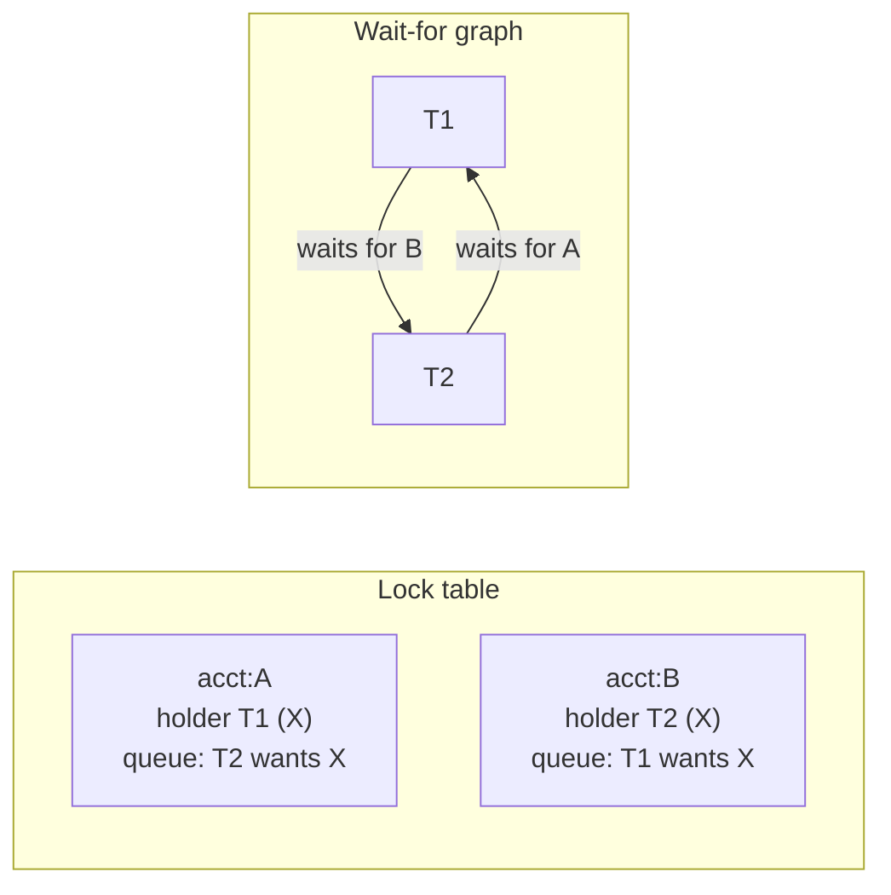

# Two-Phase Locking and Deadlock Detection

> Serializable the old way: hold every lock you take until you commit, and when two transactions each wait for the other, pick one and kill it.

**Type:** Build
**Languages:** Java, Python, Go
**Prerequisites:** Phase 7 Lesson 04 (Isolation Levels and Their Anomalies), Phase 4 Lesson 07 (Deadlocks, Lock Ordering, and Detection), Phase 2 Lesson 08 (Graph Traversal), Phase 0 Lesson 07 (Decimal and Integer Arithmetic)
**Time:** ~90 minutes

## Learning Objectives

- State the two-phase rule and explain why it, and not locking by itself, is what makes a schedule serializable
- Distinguish basic, strict, and rigorous 2PL and name the anomaly each stricter variant removes
- Build a lock manager with shared and exclusive modes, FIFO wait queues, and lock upgrades
- Derive the wait-for graph from the lock table, detect a cycle with depth-first search, and explain why a cycle is exactly a deadlock
- Reproduce the classic transfer deadlock (A to B against B to A) and the lock-upgrade deadlock, resolve each by aborting a victim, and show the final balances are the same as a serial run
- Compare victim-selection policies and relate them to what PostgreSQL, MySQL InnoDB, and SQL Server actually do

## The Problem

A wallet service runs on a single relational database. Its `transfer(from, to, amount)` handler is a textbook transaction: `UPDATE accounts SET balance = balance - ? WHERE id = from`, then `UPDATE accounts SET balance = balance + ? WHERE id = to`, then `COMMIT`. On a Friday evening a marketplace runs a settlement batch that pays every seller, while the sellers' customers are busy paying the marketplace. Thousands of transfers run from merchant accounts to customer accounts and, at the same moment, thousands run the other way.

Two of them collide. T1 moves 100.00 USD from A to B. It locks row A and decrements it. T2 moves 50.00 USD from B to A. It locks row B and decrements it. T1 now needs row B, which T2 holds, so T1 waits. T2 now needs row A, which T1 holds, so T2 waits. Neither will ever proceed; each holds exactly the thing the other needs. Within a second, forty more transfers queue behind A or B. The connection pool fills with waiting transactions. The handler's p99 latency goes from 8 ms to the statement timeout, 30 seconds, and the mobile app shows every customer a spinner.

The on-call engineer sees a hundred stuck connections, none using CPU, none doing I/O. Nothing is slow. Nothing is broken. Two transactions simply made opposite promises about the order in which they would acquire the same two rows, and the locking protocol that keeps their balances correct is also the thing that lets them wait on each other forever. The database eventually notices: PostgreSQL's `deadlock_timeout` fires after one second, it finds the cycle, aborts T2 with `ERROR 40P01 deadlock detected`, and T1 completes. The forty transfers behind them drain. The application, which never expected `40P01`, surfaces it to the customer as "Payment failed. Please try again."

This lesson builds the protocol that caused the stall and the detector that ended it. Two-phase locking is how every classic relational engine achieved serializability before multi-version techniques existed, and it is still the protocol under InnoDB's row locks, SQL Server's default isolation, and the `SELECT ... FOR UPDATE` you will write in Phase 10's ledger. Understanding why it deadlocks, how a deadlock is detected, and what the database does to the victim is the difference between an application that retries transparently and one that tells customers to try again.

## The Concept

### Locks alone are not enough

Lesson 04 showed that a lock on each row read or written does not prevent anomalies by itself. The lock must be held for the right duration. Consider two transactions that each read a balance, release the lock, then re-acquire it to write: between the release and the re-acquire the other one can slip in, and the result is a lost update even though every access was locked.

Two-phase locking (2PL) fixes the duration with one rule. Every transaction has two phases:

1. **Growing phase.** The transaction acquires locks. It may acquire as many as it needs, in any order, in shared (S) or exclusive (X) mode.
2. **Shrinking phase.** The transaction releases locks. Once it has released any lock, it may never acquire another.

The rule is the *lock point*: the instant a transaction holds its maximum set of locks, just before its first release. The theorem (Eswaran, Gray, Lorie, and Traiger, 1976) is that any schedule produced by transactions that all obey 2PL is conflict-serializable, and the equivalent serial order is the order of lock points. The proof sketch is short: if T1 and T2 conflict on item x and T1 accessed it first, T1 held a lock on x at its lock point and T2 could not acquire its conflicting lock until T1 released, which is after T1's lock point. So every conflict edge T1 to T2 implies lockpoint(T1) < lockpoint(T2), and the conflict graph cannot have a cycle.

### The compatibility matrix

| Holder has | Requester wants S | Requester wants X |
|------------|-------------------|-------------------|
| S | granted | waits |
| X | waits | waits |

Only readers coexist. An S holder that wants to write must *upgrade* to X, which succeeds only when it is the sole holder. Two S holders that both try to upgrade are the most common deadlock in application code, because `SELECT balance ... ; UPDATE accounts SET balance = ...` is the most common transaction shape.

### Three strengths of 2PL

| Variant | Rule | Removes | Cost |
|---------|------|---------|------|
| Basic 2PL | No lock acquired after the first release | Lost update, non-repeatable read, write skew | Cascading aborts: a reader of an early-released X lock has read uncommitted data and must abort if the writer does |
| Strict 2PL | X locks held until commit or abort | Dirty reads, cascading aborts | Writers block readers for the whole transaction |
| Rigorous (strong strict) 2PL | All locks held until commit or abort | Nothing further for correctness; makes the serial order equal the commit order | Readers block writers for the whole transaction |

Every production lock-based engine implements strict or rigorous 2PL. Basic 2PL is correct in the theorem's sense but useless in practice: once T1 releases X(A) and T2 reads A, T2's fate is tied to T1's. If T1 aborts, T2 must abort, and anything that read from T2 must abort. Recoverability, not just serializability, is why "hold until commit" is the real rule. The lesson's code implements rigorous 2PL by default and lets you release early only to demonstrate the damage.

### Deadlock is the price of waiting

Under 2PL, a transaction that cannot get a lock waits for the holder. Waiting is safe as long as the chain of waits ends somewhere. It fails to end exactly when it forms a cycle. The **wait-for graph** has one node per transaction and an edge Ti to Tj whenever Ti is waiting for a lock Tj holds (or for a lock request Tj queued ahead of it, under FIFO queuing). A deadlock exists if and only if the wait-for graph contains a cycle: every transaction on the cycle is waiting, and the only events that would wake any of them are commits or aborts by others on the cycle, which cannot happen because they are all waiting.



The transfer deadlock, traced with real balances, A = 1000.00 USD and B = 500.00 USD:

| Step | T1: 100.00 A to B | T2: 50.00 B to A | Lock table | Wait-for |
|------|-------------------|------------------|------------|----------|
| 1 | X(A) granted; A = 900.00 | | A: T1 | |
| 2 | | X(B) granted; B = 450.00 | A: T1, B: T2 | |
| 3 | X(B) requested, waits | | B queue: T1 | T1 to T2 |
| 4 | | X(A) requested, waits | A queue: T2 | T1 to T2, T2 to T1: cycle |
| 5 | | aborted as victim; B restored to 500.00; locks released | A: T1 | |
| 6 | X(B) granted; B = 600.00; commit | | empty | |
| 7 | | restarted: X(B), B = 550.00; X(A), A = 950.00; commit | empty | |

Final state A = 950.00, B = 550.00, total 1500.00: identical to running T1 then T2 serially. The victim's work was wasted, but nothing was lost or double-applied, because the abort undid its in-place write before releasing its locks.

### Detection, prevention, and avoidance

There are three ways to deal with the cycle:

- **Detection** (this lesson, PostgreSQL, InnoDB, SQL Server): let transactions wait; periodically or on a timeout build the wait-for graph and search for cycles; abort one transaction per cycle. Cost: a graph search, O(V + E) per detection, where V is the number of waiting transactions. PostgreSQL runs it only after a lock wait has lasted `deadlock_timeout` (default 1 s), so the common case pays nothing.
- **Timeout** (the crude form of detection): any wait longer than N seconds is assumed to be a deadlock and the waiter aborts. Cheap, but it aborts transactions that were merely slow, and under load everything is slow.
- **Prevention by ordering**: if every transaction acquires locks in a global order (say, ascending account id), a cycle is impossible, because the transaction holding the highest-numbered lock on any would-be cycle can always get its next one. This is the fix an application can apply itself and the one Exercise 2 asks for. It requires knowing all the rows up front, which a transfer does and an interactive session does not.
- **Prevention by timestamp** (wait-die and wound-wait, Rosenkrantz, Stearns, and Lewis, 1978): give each transaction a start timestamp. Under wait-die, an older transaction waits for a younger one but a younger one requesting a lock held by an older one aborts immediately. Under wound-wait, the older one aborts the younger holder. Both make cycles impossible because waits only point one way in age. Both abort more often than detection, including in cases that would have resolved themselves.

### Choosing the victim

Once a cycle is found, something must die. The choice is a policy, and the policies disagree:

| Policy | Chooses | Argument for | Argument against | Used by |
|--------|---------|--------------|------------------|---------|
| Youngest | the most recently started transaction | it has done the least work; the old one may have been retried already | a short new transaction can be killed repeatedly behind a long one (starvation) | SQL Server (by cost, approximately youngest) |
| Fewest locks | the one holding the fewest locks | cheapest to roll back; protects batch jobs that have locked thousands of rows | ignores how long it has run | InnoDB (fewest rows modified, approximately) |
| Lowest priority | caller-declared | lets payments outrank reports | needs cooperation from every client | SQL Server `DEADLOCK_PRIORITY` |
| Detector's own | whichever transaction ran the detection | no extra bookkeeping | arbitrary from the application's view | PostgreSQL |

The lesson implements `YOUNGEST` and `FEWEST_LOCKS`. Whatever the policy, the victim must be given a distinguishable error (`40P01` in PostgreSQL, error 1213 in MySQL, 1205 in SQL Server) because the correct application response to a deadlock is always the same: roll back and retry the whole transaction from the beginning, with the same idempotency key. Phase 12 builds that retry loop; this lesson's scheduler restarts victims automatically so you can see that the retry produces the serial result.

### Complexity

| Operation | Cost | Notes |
|-----------|------|-------|
| acquire | O(h + q) for h holders, q queued | one hash lookup plus a compatibility scan; h and q are tiny in practice |
| release | O(q) | grants from the head of the queue while compatible |
| wait-for graph | O(sum of queue lengths times holders) | built from the lock table on demand |
| cycle detection | O(V + E) | depth-first search with three colours |
| abort | O(writes) | undo in reverse order |

The lock table itself is the real cost in a production engine: one entry per locked row, which is why engines escalate thousands of row locks to one table lock, and why a batch job that updates ten million rows under strict 2PL blocks every other writer on the table.

### What 2PL promises and what it does not

2PL promises conflict-serializability: the committed result equals *some* serial order. It does not promise *which* order; rigorous 2PL makes it the commit order, basic 2PL does not. It does not promise progress: deadlocks are built in, and so are long waits behind a transaction that holds a lock while making a network call. It does not prevent phantoms unless the lock manager locks predicates or index ranges rather than rows (Lesson 04's `SERIALIZABLE` level did this with prefix locks; InnoDB does it with gap locks). It gives readers no snapshot: under strict 2PL a reader blocks every writer on the rows it has read until it commits, which is the three-hour statement job disaster that opens Lesson 06 and the reason MVCC exists.

## Build It

The implementation is a single-threaded simulation. Transactions are scripts of operations, and a scheduler decides whose turn it is, so every interleaving is deterministic and every deadlock is replayable. Balances are `Money` values in minor units, copied from the Phase 10 design.

### Step 1: Modes and the compatibility rule

```java
enum LockMode {
    S, X;

    boolean compatibleWith(LockMode other) { return this == S && other == S; }
}

record LockRequest(int tx, LockMode mode) {}

final class LockEntry {
    final Map<Integer, LockMode> holders = new LinkedHashMap<>();
    final Deque<LockRequest> queue = new ArrayDeque<>();

    boolean compatible(int tx, LockMode mode) {
        for (Map.Entry<Integer, LockMode> h : holders.entrySet()) {
            if (h.getKey() != tx && !mode.compatibleWith(h.getValue())) return false;
        }
        return true;
    }
}
```

The compatibility matrix is one expression. `LockEntry.compatible` ignores the requesting transaction's own entry, which is what makes an upgrade from S to X possible when it is the only holder. Holders are kept in insertion order and the queue is a FIFO deque; both choices are about determinism and fairness rather than speed.

**Predict:** T1 and T2 both hold S on a key. `compatible(1, X)` returns what, and why does that answer not depend on T1's own S lock?

### Step 2: Acquire, with queuing and upgrades

```java
boolean acquire(int tx, String key, LockMode mode) {
    LockEntry e = table.computeIfAbsent(key, k -> new LockEntry());
    LockMode held = e.holders.get(tx);
    if (held == LockMode.X || (held == LockMode.S && mode == LockMode.S)) return true;   // already covered
    boolean upgrade = held == LockMode.S && mode == LockMode.X;
    if ((e.queue.isEmpty() || upgrade) && e.compatible(tx, mode)) {
        e.holders.put(tx, mode);
        return true;
    }
    if (upgrade) e.queue.addFirst(new LockRequest(tx, mode)); else e.queue.addLast(new LockRequest(tx, mode));
    return false;
}
```

`acquire` returns `true` for granted and `false` for queued; the caller, not the lock manager, decides what waiting means. Two rules are hidden in the condition. First, a request behind a non-empty queue waits even when it is compatible with the current holders: without this, a steady stream of readers would keep an S lock permanently populated and a queued writer would starve. Second, an upgrade jumps the queue, because the upgrading transaction already holds S and nothing queued behind it can be granted before it releases anyway.

**Predict:** T1 holds S. T3 requests X and queues. T2 now requests S. Is T2 granted? What would happen to T3 if it were?

### Step 3: Release and the grant loop

```java
List<Integer> releaseAll(int tx) {
    List<Integer> granted = new ArrayList<>();
    for (String key : new ArrayList<>(table.keySet())) {
        LockEntry e = table.get(key);
        boolean held = e.holders.remove(tx) != null;
        e.queue.removeIf(r -> r.tx() == tx);
        if (held) granted.addAll(grantWaiters(key, e));
        if (e.isEmpty()) table.remove(key);
    }
    return granted;
}

private List<Integer> grantWaiters(String key, LockEntry e) {
    List<Integer> granted = new ArrayList<>();
    while (!e.queue.isEmpty() && e.compatible(e.queue.peekFirst().tx(), e.queue.peekFirst().mode())) {
        LockRequest r = e.queue.pollFirst();
        e.holders.put(r.tx(), r.mode());
        granted.add(r.tx());
    }
    return granted;
}
```

`releaseAll` is what commit and abort call: under rigorous 2PL it is the only release that ever happens. It also removes the transaction's own queued requests, which matters when the transaction being released is a deadlock victim that was itself waiting. The grant loop walks the queue from the head and stops at the first request that is still incompatible, so a queued X behind a departing X is granted, and the S requests queued behind that X keep waiting. The returned list tells the scheduler which blocked transactions can now continue.

### Step 4: The wait-for graph

```java
Set<Integer> blockersOf(int tx, String key, LockMode mode) {
    Set<Integer> out = new TreeSet<>();
    LockEntry e = table.get(key);
    for (Map.Entry<Integer, LockMode> h : e.holders.entrySet()) {
        if (h.getKey() != tx && !mode.compatibleWith(h.getValue())) out.add(h.getKey());
    }
    for (LockRequest ahead : e.queue) {
        if (ahead.tx() == tx) break;
        if (!mode.compatibleWith(ahead.mode())) out.add(ahead.tx());
    }
    return out;
}

WaitForGraph waitForGraph() {
    WaitForGraph g = new WaitForGraph();
    for (Map.Entry<String, LockEntry> e : table.entrySet()) {
        for (LockRequest r : e.getValue().queue) {
            for (int blocker : blockersOf(r.tx(), e.getKey(), r.mode())) g.addEdge(r.tx(), blocker);
        }
    }
    return g;
}
```

The graph is derived from the lock table rather than maintained alongside it, which is the simplest correct design and the one PostgreSQL uses: its detector walks the shared lock table when `deadlock_timeout` fires. A waiting request has an edge to every incompatible holder and to every incompatible request queued ahead of it. The second kind of edge is easy to forget and causes missed deadlocks: with FIFO queuing, T4's S request behind T3's queued X request really is waiting for T3, even though T3 holds nothing yet.

**Predict:** in the upgrade deadlock (T1 and T2 both hold S on A, both have queued X), what are the edges? Does T1's edge to T2 come from the holders loop, the queue loop, or both?

### Step 5: Finding the cycle

```java
Optional<List<Integer>> findCycle() {
    Map<Integer, Integer> colour = new TreeMap<>();       // 0 white, 1 grey (on stack), 2 black
    Deque<Integer> path = new ArrayDeque<>();
    for (int start : edges.keySet()) {
        Optional<List<Integer>> c = dfs(start, colour, path);
        if (c.isPresent()) return c;
    }
    return Optional.empty();
}

private Optional<List<Integer>> dfs(int node, Map<Integer, Integer> colour, Deque<Integer> path) {
    int c = colour.getOrDefault(node, 0);
    if (c == 2) return Optional.empty();
    if (c == 1) {
        List<Integer> cycle = new ArrayList<>();
        boolean in = false;
        for (int n : path) { if (n == node) in = true; if (in) cycle.add(n); }
        return Optional.of(cycle);
    }
    colour.put(node, 1);
    path.addLast(node);
    for (int next : edges.getOrDefault(node, new TreeSet<>())) {
        Optional<List<Integer>> found = dfs(next, colour, path);
        if (found.isPresent()) return found;
    }
    path.removeLast();
    colour.put(node, 2);
    return Optional.empty();
}
```

This is the three-colour depth-first search from Phase 2's graph traversal lesson. A grey node is on the current path; reaching one again means a back edge, and the cycle is the portion of the path from that node to the top. Returning the cycle rather than a boolean matters because the victim is chosen from the cycle's members, and a transaction that is waiting *on* the cycle without being part of it (T9 waits for T5 while T5, T6, T7 wait on each other) must not be a candidate: aborting it would free nothing. Node and edge sets are `TreeMap` and `TreeSet` so the first cycle found is the same on every run.

### Step 6: Transactions and the scheduler

```java
sealed interface Op permits Op.Read, Op.Add, Op.Unlock, Op.Commit {
    record Read(String key) implements Op {}
    record Add(String key, Money delta) implements Op {}
    record Unlock(String key) implements Op {}
    record Commit() implements Op {}
}

boolean step(Txn t) {
    if (t.status != Txn.Status.ACTIVE) return false;
    Op op = t.script.get(t.pc);
    if (execute(t, op)) { t.pc++; return true; }
    t.status = Txn.Status.BLOCKED;
    detectAndResolve();
    return true;
}
```

A transaction is a script of operations and a program counter. `Read` takes S and records what it saw; `Add` takes X and applies a delta in place, saving the old value in an undo map; `Commit` releases everything. `Unlock` exists only to demonstrate basic 2PL. `step` runs one operation; if the operation's lock request was queued, the transaction becomes `BLOCKED` with its program counter still pointing at the operation, and the scheduler immediately checks for a deadlock, because a new wait is the only event that can create one.

```java
private boolean lock(Txn t, String key, LockMode mode) {
    if (t.phase == Txn.Phase.SHRINKING && !locks.keysHeldBy(t.id).contains(key)) {
        throw new TwoPhaseViolationException("T" + t.id + " requested " + mode + "(" + key + ") after releasing a lock");
    }
    return locks.acquire(t.id, key, mode);
}
```

The two-phase rule is enforced here: a transaction that has released anything is in its shrinking phase and may not acquire a lock on a key it does not already hold. This is the line that distinguishes 2PL from "locking".

**Predict:** `Add` writes in place. Under rigorous 2PL, why is that safe, and which single line in the `Op.Unlock` branch makes it unsafe?

### Step 7: Resolving the deadlock

```java
Optional<Integer> detectAndResolve() {
    WaitForGraph g = locks.waitForGraph();
    Optional<List<Integer>> cycle = g.findCycle();
    if (cycle.isEmpty()) return Optional.empty();
    deadlocksDetected++;
    int victim = chooseVictim(cycle.get());
    abort(txns.get(victim));
    return Optional.of(victim);
}

int chooseVictim(List<Integer> cycle) {
    return switch (policy) {
        case YOUNGEST -> cycle.stream().mapToInt(Integer::intValue).max().orElseThrow();
        case FEWEST_LOCKS -> {
            int best = cycle.get(0);
            for (int id : cycle) {
                int mine = locks.keysHeldBy(id).size(), theirs = locks.keysHeldBy(best).size();
                if (mine < theirs || (mine == theirs && id > best)) best = id;   // tie: youngest
            }
            yield best;
        }
    };
}
```

Transaction ids are assigned at `begin`, so the largest id is the youngest. `FEWEST_LOCKS` falls back to youngest on a tie so that the choice is total and deterministic.

```java
void abort(Txn t) {
    List<Map.Entry<String, Money>> entries = new ArrayList<>(t.undo.entrySet());
    for (int i = entries.size() - 1; i >= 0; i--) db.put(entries.get(i).getKey(), entries.get(i).getValue());
    t.undo.clear();
    t.status = Txn.Status.ABORTED;
    grant(locks.releaseAll(t.id));
    if (restartVictims) {
        t.status = Txn.Status.ACTIVE;
        t.phase = Txn.Phase.GROWING;
        t.pc = 0;
        t.restarts++;
    }
}
```

The order inside `abort` is the order a real engine uses: undo first, then release. If locks were released before the undo completed, another transaction could read the half-undone balance. Undo runs newest to oldest so that a key written twice ends at its original value. Restarting the victim from `pc = 0` with the same script is the retry loop the application would run; because the script re-reads balances rather than reusing values from the failed attempt, the retry sees the committed state.

### Step 8: Run it

```bash
cd phases/07-storage-and-transactions/05-two-phase-locking/code/java
javac -d .out *.java && java -cp .out Main
java -cp .out MainTest
```

Expected output, abbreviated:

```console
== Two transfers in opposite directions: A->B and B->A, strict 2PL ==
  T1 X(acct:A) granted
  T1 acct:A 1000.00 USD -> 900.00 USD
  T2 X(acct:B) granted
  T2 acct:B 500.00 USD -> 450.00 USD
  T1 X(acct:B) WAITS for T2
  T2 X(acct:A) WAITS for T1
  DEADLOCK T1 -> T2 -> T1 -> victim T2 (YOUNGEST)
  T2 ABORT (undo 1 write)
  T1 X(acct:B) granted (was waiting)
  T1 acct:B 500.00 USD -> 600.00 USD
  T2 restarted (attempt 2)
  T1 COMMIT
  ...
  => final A = 950.00 USD, B = 550.00 USD, total = 1500.00 USD

== Lock upgrade deadlock: two deposits each read the balance (S) then write it (X) ==
  T1 S(acct:A) granted
  T2 S(acct:A) granted
  T1 X(acct:A) WAITS for T2
  T2 X(acct:A) WAITS for T1
  DEADLOCK T1 -> T2 -> T1 -> victim T2 (YOUNGEST)
  ...
  => final A = 1030.00 USD (both deposits landed; no lost update)

== Why strict: basic 2PL releases X(A) before commit, a reader sees a balance that never existed ==
  => T2 committed having read 100.00 USD; the committed balance is 1000.00 USD
  => T1 requested S(j) after releasing a lock: the two-phase rule forbids growing after shrinking
```

The test file checks 40 assertions: the compatibility matrix, FIFO grant order, cycle detection on chains and on a cycle with a hanger-on, both deadlock shapes, both victim policies, conservation of money, equality with the serial schedule, undo order, the early-release anomaly, and the two-phase rule.

### In Python

The Python port (`code/python/main.py`) is the same design with four differences. **The sealed `Op` becomes four frozen dataclasses** attached to an `Op` base class, so the scripts still read `Op.Add("acct:A", usd(-1))`, and `match`/`case` with class patterns replaces the Java `switch` over records. **Ordering is explicit:** Java's `TreeMap` and `TreeSet` give sorted iteration for free, so Python iterates `sorted(self.table)` in `release_all` and `wait_for_graph`, and `find_cycle` visits start nodes and neighbours in sorted order; that is what makes the cycle `[1, 2]` and the victim `T2` identical in both languages. Holders stay in an insertion-ordered `dict` (`LinkedHashMap`) and the queue is a `collections.deque`, with `appendleft` for upgrades. **`Money` checks overflow by hand:** `Money.plus` calls `add_exact`, which raises `OverflowError` outside the signed 64-bit range, because Python's `int` would otherwise grow past `Long.MAX_VALUE` silently, and a Python-only test pins this; `Optional<List<Integer>>` becomes `list[int] | None`. **No threads, no GIL question:** the scheduler interleaves steps itself, so every deadlock is replayed by `run(1, 2, 1, 2)` in both languages and the demo output is identical.

Run it from `code/python/` with `python3 main.py`; test with `python3 -m unittest -v`.

#### Step 1: Modes and the compatibility rule

`LockMode` is an `Enum` with the one-expression matrix. `LockEntry.holders` is a plain dict, which keeps insertion order, and `queue` is a `deque`. `compatible` is an `all(...)` over the holders that skips the requester's own entry.

```python
class LockMode(Enum):
    S = "S"
    X = "X"

    def compatible_with(self, other: "LockMode") -> bool:
        return self is LockMode.S and other is LockMode.S


@dataclass(frozen=True)
class LockRequest:
    tx: int
    mode: LockMode


class LockEntry:
    def __init__(self) -> None:
        self.holders: dict[int, LockMode] = {}  # insertion-ordered, like LinkedHashMap
        self.queue: deque[LockRequest] = deque()

    def compatible(self, tx: int, mode: LockMode) -> bool:
        return all(h == tx or mode.compatible_with(m) for h, m in self.holders.items())

    def is_empty(self) -> bool:
        return not self.holders and not self.queue
```

#### Step 2: Acquire, with queuing and upgrades

The same two hidden rules: a non-empty queue blocks even a compatible request unless it is an upgrade, and an upgrade goes to the front with `appendleft`. The port also writes the `granted`/`WAITS for` trace lines here, which is why the demo output matches the Java.

```python
    def acquire(self, tx: int, key: str, mode: LockMode) -> bool:
        e = self.table.setdefault(key, LockEntry())
        held = e.holders.get(tx)
        if held is LockMode.X or (held is LockMode.S and mode is LockMode.S):
            return True  # already covered
        upgrade = held is LockMode.S and mode is LockMode.X
        if (not e.queue or upgrade) and e.compatible(tx, mode):
            e.holders[tx] = mode
            self.log.append(f"  T{tx} {mode.name}({key}) granted")
            return True
        if upgrade:
            e.queue.appendleft(LockRequest(tx, mode))
        else:
            e.queue.append(LockRequest(tx, mode))
        who = ",".join(f"T{b}" for b in self.blockers_of(tx, key, mode))
        self.log.append(f"  T{tx} {mode.name}({key}) WAITS for {who}")
        return False
```

#### Step 3: Release and the grant loop

`release_all` iterates `self._keys()` (a sorted snapshot of the table's keys), removes the holder with `dict.pop`, rebuilds the deque without the transaction's own requests, and grants waiters only if the transaction actually held something. `_grant_waiters` peeks at `queue[0]` and pops from the left while the head is compatible.

```python
    def release_all(self, tx: int) -> list[int]:
        granted: list[int] = []
        for key in self._keys():
            e = self.table[key]
            held = e.holders.pop(tx, None) is not None
            e.queue = deque(r for r in e.queue if r.tx != tx)
            if held:
                granted.extend(self._grant_waiters(key, e))
            if e.is_empty():
                del self.table[key]
        return granted

    def _grant_waiters(self, key: str, e: LockEntry) -> list[int]:
        granted: list[int] = []
        while e.queue and e.compatible(e.queue[0].tx, e.queue[0].mode):
            r = e.queue.popleft()
            e.holders[r.tx] = r.mode
            self.log.append(f"  T{r.tx} {r.mode.name}({key}) granted (was waiting)")
            granted.append(r.tx)
        return granted
```

#### Step 4: The wait-for graph

`blockers_of` collects incompatible holders and incompatible requests queued ahead into a set and returns it sorted (the Java `TreeSet`). `wait_for_graph` walks the sorted keys and every queued request, adding one edge per blocker.

```python
    def blockers_of(self, tx: int, key: str, mode: LockMode) -> list[int]:
        out: set[int] = set()
        e = self.table.get(key)
        if e is None:
            return []
        for h, m in e.holders.items():
            if h != tx and not mode.compatible_with(m):
                out.add(h)
        for ahead in e.queue:
            if ahead.tx == tx:
                break  # only requests ahead of ours
            if not mode.compatible_with(ahead.mode):
                out.add(ahead.tx)
        return sorted(out)

    def wait_for_graph(self) -> "WaitForGraph":
        g = WaitForGraph()
        for key in self._keys():
            for r in self.table[key].queue:
                for blocker in self.blockers_of(r.tx, key, r.mode):
                    g.add_edge(r.tx, blocker)
        return g
```

#### Step 5: Finding the cycle

The three-colour DFS with a list as the path. A back edge returns `path[path.index(node):]`, the slice from the grey node to the top, which is one line where the Java loops. Start nodes and neighbours are visited in sorted order so the first cycle found is deterministic.

```python
    def find_cycle(self) -> list[int] | None:
        colour: dict[int, int] = {}  # 0 white, 1 grey (on stack), 2 black
        path: list[int] = []
        for start in sorted(self.edges):
            c = self._dfs(start, colour, path)
            if c is not None:
                return c
        return None

    def _dfs(self, node: int, colour: dict[int, int], path: list[int]) -> list[int] | None:
        c = colour.get(node, 0)
        if c == 2:
            return None
        if c == 1:  # back edge: the cycle is the path from node to here
            return path[path.index(node):]
        colour[node] = 1
        path.append(node)
        for nxt in sorted(self.edges.get(node, ())):
            found = self._dfs(nxt, colour, path)
            if found is not None:
                return found
        path.pop()
        colour[node] = 2
        return None
```

#### Step 6: Transactions and the scheduler

The four operation classes are frozen dataclasses bound onto `Op` as attributes, so `Op.Read(...)` constructs one and `case Op.Read(key=key)` matches it. `step` and `_lock` are the Java methods; `_lock` raises `TwoPhaseViolationException` (a `RuntimeError`) when a shrinking transaction asks for a key it does not hold.

```python
class Op:
    """The steps a scripted transaction can take (Java: sealed interface Op). Add is a read-modify-write under X."""


@dataclass(frozen=True)
class _Read(Op):
    key: str


@dataclass(frozen=True)
class _Add(Op):
    key: str
    delta: Money


Op.Read, Op.Add, Op.Unlock, Op.Commit = _Read, _Add, _Unlock, _Commit
```

```python
    def step(self, t: Txn) -> bool:
        if t.status is not Txn.Status.ACTIVE:
            return False
        op = t.script[t.pc]
        if self._execute(t, op):
            t.pc += 1
            return True
        t.status = Txn.Status.BLOCKED
        self.detect_and_resolve()
        return True

    def _lock(self, t: Txn, key: str, mode: LockMode) -> bool:
        if t.phase is Txn.Phase.SHRINKING and key not in self.locks.keys_held_by(t.id):
            raise TwoPhaseViolationException(f"T{t.id} requested {mode.name}({key}) after releasing a lock")
        return self.locks.acquire(t.id, key, mode)
```

#### Step 7: Resolving the deadlock

`detect_and_resolve` returns the victim id or `None`. `choose_victim` is a `match` on the policy: `max(cycle)` for `YOUNGEST`, the fewest-locks scan with a youngest tie-break otherwise. `abort` undoes in reverse insertion order (`reversed(list(t.undo.items()))`), then releases, then optionally restarts the victim at `pc = 0`.

```python
    def detect_and_resolve(self) -> int | None:
        cycle = self.locks.wait_for_graph().find_cycle()
        if cycle is None:
            return None
        self.deadlocks_detected += 1
        self.cycles.append(cycle)
        victim = self.choose_victim(cycle)
        self.victims.append(victim)
        self.log.append(f"  DEADLOCK {Scheduler.describe(cycle)} -> victim T{victim} ({self.policy.name})")
        self.abort(self.txns[victim])
        return victim

    def choose_victim(self, cycle: list[int]) -> int:
        match self.policy:
            case VictimPolicy.YOUNGEST:
                return max(cycle)
            case VictimPolicy.FEWEST_LOCKS:
                best = cycle[0]
                for id in cycle:
                    mine, theirs = len(self.locks.keys_held_by(id)), len(self.locks.keys_held_by(best))
                    if mine < theirs or (mine == theirs and id > best):  # tie: youngest
                        best = id
                return best
```

```python
    def abort(self, t: Txn) -> None:
        entries = list(t.undo.items())
        for key, value in reversed(entries):
            self.db[key] = value
        t.undo.clear()
        t.status = Txn.Status.ABORTED
        self.log.append(f"  T{t.id} ABORT (undo {len(entries)} write{'' if len(entries) == 1 else 's'})")
        self._grant(self.locks.release_all(t.id))
        if self.restart_victims:
            t.status = Txn.Status.ACTIVE
            t.phase = Txn.Phase.GROWING
            t.pc = 0
            t.reads.clear()
            t.restarts += 1
            self.log.append(f"  T{t.id} restarted (attempt {t.restarts + 1})")
```

#### Step 8: Run it

```bash
cd phases/07-storage-and-transactions/05-two-phase-locking/code/python
python3 main.py
python3 -m unittest -v
```

The four traces are the Java traces, line for line:

```console
== Two transfers in opposite directions: A->B and B->A, strict 2PL ==
T1 begin
T2 begin
  T1 X(acct:A) granted
  T1 acct:A 1000.00 USD -> 900.00 USD
  T2 X(acct:B) granted
  T2 acct:B 500.00 USD -> 450.00 USD
  T1 X(acct:B) WAITS for T2
  T2 X(acct:A) WAITS for T1
  DEADLOCK T1 -> T2 -> T1 -> victim T2 (YOUNGEST)
  T2 ABORT (undo 1 write)
  T1 X(acct:B) granted (was waiting)
```

### In Go

The Go port (`code/go/main.go`) keeps the design and changes four things. **Two kinds of "no":** `Acquire` returns a plain `bool` (granted now, or queued), exactly as in Java, because waiting is a normal outcome; the two-phase rule is a programming error in the script, so `Step`, `Run`, `Abort` and `DetectAndResolve` return an `error` that wraps the sentinel `ErrTwoPhaseViolation` (checked with `errors.Is`) instead of throwing, `Money.Plus` returns `(Money, error)` with `ErrCurrencyMismatch`/`ErrOverflow` so an in-place `OpAdd` can never silently wrap an `int64`, and `DetectAndResolve` returns `(victim, found, err)` in place of `Optional<Integer>`. **Sealed interface to type switch:** `Op` is an interface with an unexported marker method, `OpRead`, `OpAdd`, `OpUnlock`, `OpCommit` are the four permitted structs, and `execute` is a `switch o := op.(type)`; the compiler does not check exhaustiveness the way Java's `switch` over a sealed type does, so the switch has no `default` on purpose, and an unknown `Op` would simply be treated as a no-op step. **Ordered maps by hand:** `TreeMap` iteration becomes `sortedKeys`/`sortedIntKeys` wherever order is observable (`ReleaseAll`, `KeysHeldBy`, the wait-for graph's DFS start order, `Txns` in round-robin), the `LinkedHashMap` undo log is a key slice plus a map so `Abort` can replay it in reverse, and the lock manager appends to the scheduler's log through a `*[]string`, mirroring the shared `List<String>` in Java. **No goroutines:** concurrency is modelled by the scheduler's interleaving, which is what makes every deadlock replayable, so there is no mutex and `go test -race` passes trivially; a port that drives transactions from goroutines must run `Acquire`, `ReleaseAll` and the detector under one mutex, and should run detection on a timer rather than on every wait.

Run it from `code/go/` with `go run .`; test with `go test ./...`. The demo prints the same four traces as the Java version, line for line.

#### Step 1: Modes and the compatibility rule

`LockMode` is an `iota` enum with the matrix as a one-line method. `Holders` is a `map[int]LockMode` and `Queue` a slice used as a FIFO. `Compatible` ranges over the holders, skipping the requester.

```go
type LockMode int

const (
	S LockMode = iota
	X
)

func (m LockMode) CompatibleWith(other LockMode) bool { return m == S && other == S }

type LockRequest struct {
	Tx   int
	Mode LockMode
}

type LockEntry struct {
	Holders map[int]LockMode
	Queue   []LockRequest
}

func (e *LockEntry) Compatible(tx int, mode LockMode) bool {
	for holder, held := range e.Holders {
		if holder != tx && !mode.CompatibleWith(held) {
			return false
		}
	}
	return true
}

func (e *LockEntry) IsEmpty() bool { return len(e.Holders) == 0 && len(e.Queue) == 0 }
```

#### Step 2: Acquire, with queuing and upgrades

The two-value map read gives `holding`, which stands in for Java's `held == null` check. An upgrade is prepended with `append([]LockRequest{{tx, mode}}, e.Queue...)`; everything else queues at the back. The trace lines are written through `logf`.

```go
func (lm *LockManager) Acquire(tx int, key string, mode LockMode) bool {
	e, ok := lm.Table[key]
	if !ok {
		e = newLockEntry()
		lm.Table[key] = e
	}
	held, holding := e.Holders[tx]
	if holding && (held == X || (held == S && mode == S)) {
		return true // already covered
	}
	upgrade := holding && held == S && mode == X
	if (len(e.Queue) == 0 || upgrade) && e.Compatible(tx, mode) {
		e.Holders[tx] = mode
		lm.logf("  T%d %s(%s) granted", tx, mode, key)
		return true
	}
	if upgrade {
		e.Queue = append([]LockRequest{{tx, mode}}, e.Queue...)
	} else {
		e.Queue = append(e.Queue, LockRequest{tx, mode})
	}
	who := make([]string, 0)
	for _, b := range lm.BlockersOf(tx, key, mode) {
		who = append(who, fmt.Sprintf("T%d", b))
	}
	lm.logf("  T%d %s(%s) WAITS for %s", tx, mode, key, strings.Join(who, ","))
	return false
}
```

#### Step 3: Release and the grant loop

`ReleaseAll` walks `sortedKeys(lm.Table)`, deletes the holder, filters the queue in place with the `kept := e.Queue[:0]` idiom, and grants waiters only if the transaction held something. `grantWaiters` pops from the front with a reslice.

```go
func (lm *LockManager) ReleaseAll(tx int) []int {
	granted := []int{}
	for _, key := range sortedKeys(lm.Table) {
		e := lm.Table[key]
		_, held := e.Holders[tx]
		delete(e.Holders, tx)
		kept := e.Queue[:0]
		for _, r := range e.Queue {
			if r.Tx != tx {
				kept = append(kept, r)
			}
		}
		e.Queue = kept
		if held {
			granted = append(granted, lm.grantWaiters(key, e)...)
		}
		if e.IsEmpty() {
			delete(lm.Table, key)
		}
	}
	return granted
}

func (lm *LockManager) grantWaiters(key string, e *LockEntry) []int {
	granted := []int{}
	for len(e.Queue) > 0 && e.Compatible(e.Queue[0].Tx, e.Queue[0].Mode) {
		r := e.Queue[0]
		e.Queue = e.Queue[1:]
		e.Holders[r.Tx] = r.Mode
		lm.logf("  T%d %s(%s) granted (was waiting)", r.Tx, r.Mode, key)
		granted = append(granted, r.Tx)
	}
	return granted
}
```

#### Step 4: The wait-for graph

`BlockersOf` collects into a `map[int]bool` and returns `sortedInts`, the `TreeSet` order. `WaitForGraph` iterates sorted keys so the edges are added in the same order every run.

```go
func (lm *LockManager) BlockersOf(tx int, key string, mode LockMode) []int {
	set := map[int]bool{}
	e, ok := lm.Table[key]
	if !ok {
		return []int{}
	}
	for holder, held := range e.Holders {
		if holder != tx && !mode.CompatibleWith(held) {
			set[holder] = true
		}
	}
	for _, ahead := range e.Queue {
		if ahead.Tx == tx {
			break // only requests ahead of ours
		}
		if !mode.CompatibleWith(ahead.Mode) {
			set[ahead.Tx] = true
		}
	}
	return sortedInts(set)
}

func (lm *LockManager) WaitForGraph() *WaitForGraph {
	g := NewWaitForGraph()
	for _, key := range sortedKeys(lm.Table) {
		for _, r := range lm.Table[key].Queue {
			for _, blocker := range lm.BlockersOf(r.Tx, key, r.Mode) {
				g.AddEdge(r.Tx, blocker)
			}
		}
	}
	return g
}
```

#### Step 5: Finding the cycle

`FindCycle` returns `([]int, bool)` in place of `Optional`. The path is passed as a `*[]int` so the recursive calls share one slice; a missing colour reads as 0 (white), and the back-edge branch copies the path from the grey node onward.

```go
func (g *WaitForGraph) FindCycle() ([]int, bool) {
	colour := map[int]int{} // 0 white, 1 grey (on stack), 2 black
	path := []int{}
	for _, start := range sortedIntKeys(g.Edges) {
		if c, found := g.dfs(start, colour, &path); found {
			return c, true
		}
	}
	return nil, false
}

func (g *WaitForGraph) dfs(node int, colour map[int]int, path *[]int) ([]int, bool) {
	switch colour[node] {
	case 2:
		return nil, false
	case 1: // back edge: the cycle is the path from node to here
		cycle := []int{}
		in := false
		for _, n := range *path {
			if n == node {
				in = true
			}
			if in {
				cycle = append(cycle, n)
			}
		}
		return cycle, true
	}
	colour[node] = 1
	*path = append(*path, node)
	for _, next := range sortedInts(g.Edges[node]) {
		if found, ok := g.dfs(next, colour, path); ok {
			return found, true
		}
	}
	*path = (*path)[:len(*path)-1]
	colour[node] = 2
	return nil, false
}
```

#### Step 6: Transactions and the scheduler

The marker-method interface is Go's sealed type. `Step` returns `(advanced, error)`, and `lock` returns the two-phase violation as a wrapped error rather than a panic, so `Run` can surface it to the demo.

```go
type Op interface{ isOp() }

type OpRead struct{ Key string }
type OpAdd struct {
	Key   string
	Delta Money
}
type OpUnlock struct{ Key string }
type OpCommit struct{}

func (OpRead) isOp()   {}
func (OpAdd) isOp()    {}
func (OpUnlock) isOp() {}
func (OpCommit) isOp() {}
```

```go
func (s *Scheduler) Step(t *Txn) (bool, error) {
	if t.Status != Active {
		return false, nil
	}
	ok, err := s.execute(t, t.Script[t.PC])
	if err != nil {
		return false, err
	}
	if ok {
		t.PC++
		return true, nil
	}
	t.Status = Blocked
	_, _, err = s.DetectAndResolve()
	return true, err
}

func (s *Scheduler) lock(t *Txn, key string, mode LockMode) (bool, error) {
	if t.Phase == Shrinking && !containsString(s.Locks.KeysHeldBy(t.ID), key) {
		return false, fmt.Errorf("%w: T%d requested %s(%s) after releasing a lock", ErrTwoPhaseViolation, t.ID, mode, key)
	}
	return s.Locks.Acquire(t.ID, key, mode), nil
}
```

#### Step 7: Resolving the deadlock

`DetectAndResolve` returns the victim, a found flag, and any error from the abort. `ChooseVictim` starts from `cycle[0]` and scans for the largest id or the fewest locks with a youngest tie-break. `Abort` replays `undoKeys` backwards, releases, and restarts the victim if configured.

```go
func (s *Scheduler) DetectAndResolve() (int, bool, error) {
	g := s.Locks.WaitForGraph()
	cycle, found := g.FindCycle()
	if !found {
		return 0, false, nil
	}
	s.DeadlocksDetected++
	s.Cycles = append(s.Cycles, cycle)
	victim := s.ChooseVictim(cycle)
	s.Victims = append(s.Victims, victim)
	s.logf("  DEADLOCK %s -> victim T%d (%s)", Describe(cycle), victim, s.Policy)
	if err := s.Abort(s.Txns[victim]); err != nil {
		return victim, true, err
	}
	return victim, true, nil
}

func (s *Scheduler) ChooseVictim(cycle []int) int {
	best := cycle[0]
	switch s.Policy {
	case Youngest:
		for _, id := range cycle {
			if id > best {
				best = id
			}
		}
	case FewestLocks:
		for _, id := range cycle {
			mine, theirs := len(s.Locks.KeysHeldBy(id)), len(s.Locks.KeysHeldBy(best))
			if mine < theirs || (mine == theirs && id > best) { // tie: youngest
				best = id
			}
		}
	}
	return best
}
```

```go
func (s *Scheduler) Abort(t *Txn) error {
	n := len(t.undoKeys)
	for i := n - 1; i >= 0; i-- {
		s.DB[t.undoKeys[i]] = t.Undo[t.undoKeys[i]]
	}
	t.Undo = map[string]Money{}
	t.undoKeys = nil
	t.Status = Aborted
	if err := s.grant(s.Locks.ReleaseAll(t.ID)); err != nil {
		return err
	}
	if s.RestartVictims {
		t.Status = Active
		t.Phase = Growing
		t.PC = 0
		t.Reads = map[string]Money{}
		t.Restarts++
		s.logf("  T%d restarted (attempt %d)", t.ID, t.Restarts+1)
	}
	return nil
}
```

#### Step 8: Run it

```bash
cd phases/07-storage-and-transactions/05-two-phase-locking/code/go
go run .
go test ./...
```

```console
  T1 ABORT (undo 1 write)
  => T2 committed having read 100.00 USD; the committed balance is 1000.00 USD
  => T1 requested S(j) after releasing a lock: the two-phase rule forbids growing after shrinking
```

The two deadlock traces above this are the Java traces, line for line.

## Use It

### PostgreSQL

Row locks are taken by `UPDATE`, `DELETE`, and `SELECT ... FOR UPDATE` and held to commit: rigorous 2PL for writes. Plain reads do not take row locks because PostgreSQL reads from an MVCC snapshot (Lesson 06), so the three-hour-statement-job problem does not arise, but two `UPDATE`s in opposite order deadlock exactly as in this lesson. The detector runs when a backend has waited `deadlock_timeout` (default 1 s), walks the shared lock table, and aborts the backend that ran the check with `SQLSTATE 40P01`. `pg_locks` is the lock table, and `pg_stat_activity.wait_event_type = 'Lock'` is the queue.

### MySQL InnoDB

InnoDB holds row locks and *gap locks* (locks on the space between index entries, which is how it blocks phantoms) until commit. Its detector runs on every wait, not after a timeout, and picks the transaction that has modified the fewest rows, close to `FEWEST_LOCKS`. The error is 1213, `Deadlock found when trying to get lock; try restarting transaction`. `SHOW ENGINE INNODB STATUS` prints the last deadlock's wait-for cycle in the same shape as this lesson's trace. `innodb_lock_wait_timeout` (default 50 s) is the separate timeout for waits that are not deadlocks.

### SQL Server

The default `READ COMMITTED` without the snapshot option is lock-based: S locks are taken on read and released at statement end (so not even basic 2PL for reads; this is why its default allows non-repeatable reads), X locks held to commit. A lock monitor thread searches for cycles every five seconds, more often if it keeps finding them, and picks the victim by estimated rollback cost unless `SET DEADLOCK_PRIORITY` says otherwise. Error 1205. SQL Server also escalates row locks to a table lock after about 5,000 locks on one object, which is 2PL's memory cost made visible.

### `java.util.concurrent` and the in-process version

`ReentrantReadWriteLock` is the S/X pair for in-memory state, and it has no deadlock detector at all; two threads that take two such locks in opposite order hang until the process is restarted, and a thread dump of `jstack` is the wait-for graph you build by hand. `ReentrantLock.tryLock(timeout)` is the timeout approach. The ordering fix (Exercise 2) is the standard answer in both worlds.

### What the application must do

The database detects and resolves; the application must retry. A transaction that received `40P01` or 1213 has been rolled back in full. The correct handler re-runs the entire transaction, including re-reading every balance, with the same idempotency key so a double retry cannot double-apply. It does not retry forever: a bound of three to five attempts with jitter, then surface the failure. Phase 12, Lesson 04 (Smart Routing, Cascading, and Retry Policies) builds this loop.

## Ship It

`outputs/runbook-deadlock-triage.md` is an on-call runbook for a deadlock alert on PostgreSQL or MySQL: how to read the server's cycle report, map it to the two statements involved, decide between an ordering fix, a lock-scope fix, and a retry fix, and verify the fix with a reproducible interleaving like the ones in `MainTest`.

## Exercises

1. **Reinforce.** Add a `VictimPolicy.OLDEST` that aborts the transaction with the smallest id, and a test with three transactions in a cycle. Then write one paragraph on why no production engine ships this policy by default, using the settlement batch from The Problem as the example.
2. **Apply.** Implement deadlock *prevention* by ordering: a `static List<Op> orderedTransfer(from, to, amount)` that debits and credits in ascending key order regardless of direction (the credit may have to happen before the debit). Run the two opposing transfers under the same interleaving `1, 2, 1, 2` and assert `deadlocksDetected == 0`. Then explain which real transaction shapes cannot use this fix.
3. **Extend.** Implement wait-die (Rosenkrantz et al.): when a transaction requests a lock held by an *older* transaction it waits, but when it requests one held by a *younger* transaction it aborts and restarts immediately, keeping its original id so it keeps getting older. Add it as a third mode next to detection. Compare, for the transfer scenario and the upgrade scenario, how many aborts each approach causes and whether a transaction can starve. This combines the timestamp ordering from Phase 5, Lesson 03 (Lamport and Vector Clocks) with this lesson's lock manager.

## Key Terms

| Term | What people say | What it actually means |
|------|-----------------|------------------------|
| Two-phase locking | "lock everything you touch" | A transaction acquires locks in a growing phase and releases them in a shrinking phase, never acquiring after its first release; this, not locking alone, guarantees conflict-serializability |
| Lock point | | The instant a transaction holds its maximum lock set; the equivalent serial order of a 2PL schedule is the order of lock points |
| Strict / rigorous 2PL | "locks held until commit" | Strict holds X locks to commit (no dirty reads, no cascading aborts); rigorous holds all locks to commit (serial order equals commit order). Every production engine is one of these |
| Lock upgrade | "promote to a write lock" | Converting a held S lock to X, which succeeds only if no other S holder remains; two upgraders on one row always deadlock |
| Wait-for graph | "who is blocking whom" | Directed graph with an edge from each waiting transaction to each transaction it waits for; a cycle is exactly a deadlock |
| Victim selection | "the database killed my transaction" | The policy that chooses which transaction on a cycle to abort: youngest, fewest locks, lowest priority, or whichever one ran the detector |
| Wait-die / wound-wait | "deadlock prevention" | Timestamp-based schemes in which waits only ever point from older to younger (or vice versa), so cycles cannot form, at the price of more aborts |
| Lock escalation | "it took a table lock" | Replacing many row locks with one coarser lock when the lock table grows too large; trades concurrency for memory |

## Further Reading

- [Eswaran, Gray, Lorie, Traiger, "The Notions of Consistency and Predicate Locks in a Database System" (CACM, 1976)](https://dl.acm.org/doi/10.1145/360363.360369) — the paper that defines two-phase locking and proves it serializable; section 4 is the theorem this lesson's scheduler demonstrates.
- [Rosenkrantz, Stearns, Lewis, "System Level Concurrency Control for Distributed Database Systems" (ACM TODS, 1978)](https://dl.acm.org/doi/10.1145/320251.320260) — wait-die and wound-wait, for Exercise 3.
- [PostgreSQL documentation: Deadlocks](https://www.postgresql.org/docs/current/explicit-locking.html#LOCKING-DEADLOCKS) — the transfer example from this lesson, almost verbatim, with the server's advice to acquire locks in a consistent order.
- [PostgreSQL documentation: `deadlock_timeout`](https://www.postgresql.org/docs/current/runtime-config-locks.html) — why detection runs only after a wait of one second and what that costs.
- [MySQL 8.4 Reference Manual: Deadlocks in InnoDB](https://dev.mysql.com/doc/refman/8.4/en/innodb-deadlocks.html) — detection on every wait, victim choice by rows modified, and how to read `SHOW ENGINE INNODB STATUS`.
- [Gray & Reuter, *Transaction Processing: Concepts and Techniques* (1993), chapters 7 and 8](https://www.elsevier.com/books/transaction-processing/gray/978-1-55860-190-1) — the lock manager design, lock escalation, and the full taxonomy of 2PL variants.
