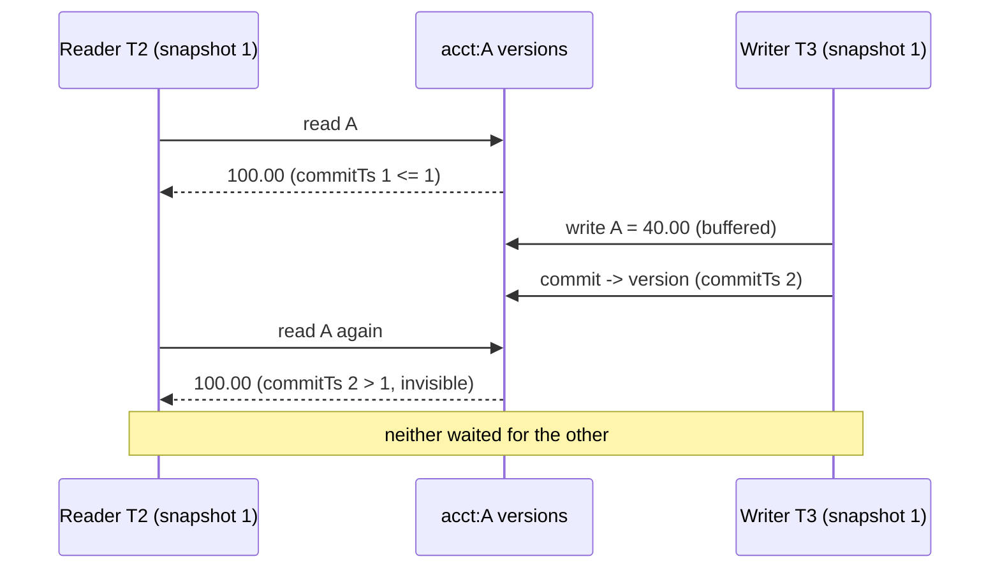

# MVCC and Snapshot Isolation

> Readers never block writers, and the write-skew they let through.

**Type:** Build
**Languages:** Java, Python
**Prerequisites:** Phase 7, Lesson 04 (Isolation Levels and Anomalies), Phase 7, Lesson 05 (Two-Phase Locking), Phase 10, Lesson 01 (Representing Money)
**Time:** ~120 minutes

## Learning Objectives

- Explain why a lock-based reader and a lock-based writer on the same balance row serialize each other, and what multi-versioning changes about that
- Build a multi-version store in which every transaction reads from a fixed snapshot timestamp and every commit publishes new versions at a fresh commit timestamp
- Implement first-committer-wins validation and prove with a test that it prevents lost updates without any transaction ever waiting
- Reproduce write skew, the anomaly snapshot isolation permits, on a pair of joint accounts with a shared overdraft constraint
- Implement version garbage collection bounded by the oldest active snapshot, and show that a single long-running read transaction stops it

## The Problem

A card-issuing ledger runs on a database with strict two-phase locking (Lesson 05). The authorization path reads the cardholder's available balance, checks the amount, and writes the new balance. The nightly statement job reads every balance on the book once, in one transaction, so that the statements it prints agree with each other to the cent.

At 02:14 the statement job reaches the 3.1 millionth account. Under 2PL its shared locks are held until it commits, so for the past forty minutes every authorization on any account it has already read has queued behind a shared lock, waiting for a job that will run for another two hours. The authorization service's p99 goes from 40 ms to 9 s. Card networks time out at around 10 s and decline. Nobody wrote a bug; the isolation mechanism did exactly what it promised, which is that a reader and a writer on the same row take turns.

The reverse is just as bad. Drop the statement job to `READ COMMITTED` so it does not hold locks, and it now reads account A before a transfer and account B after it, so the statements show 100.00 USD leaving A and never arriving at B. The customer calls. Finance opens an incident. Both failures come from one assumption: that there is exactly one copy of each row, so a reader and a writer must negotiate for it.

Multi-version concurrency control (MVCC) drops that assumption. A write does not overwrite; it appends a new version stamped with the writer's commit timestamp. A transaction reads the versions that were committed when it started, and nothing else, for as long as it runs. The statement job sees the book as it was at 02:14:00.000 for its entire three-hour run, and authorizations commit new versions beside the ones it is reading without waiting. That is snapshot isolation (SI), the default in PostgreSQL (where it is called `REPEATABLE READ`), Oracle, SQL Server with `READ_COMMITTED_SNAPSHOT`, MySQL InnoDB, CockroachDB, and Spanner. It is also, by itself, not serializable, and this lesson ends with the exact anomaly it permits and why a payments engineer must know its shape.

## The Concept

### Versions, snapshots, and two timestamps

Every committed write produces a `Version(commitTs, txnId, value)` appended to that key's version chain. A chain for `acct:A` after three commits looks like a history, not a cell:

| commitTs | txnId | value |
|----------|-------|-------|
| 1 | T1 | 100.00 USD |
| 2 | T3 | 40.00 USD |
| 5 | T7 | 30.00 USD |

A transaction has two timestamps. Its **start timestamp** (the snapshot) is the value of a monotonic counter when it begins: "everything committed at or before this instant". Its **commit timestamp** is a fresh value from the same counter, taken at commit, strictly larger than every timestamp handed out before. The counter is the `TimestampOracle`; in a real database it is the transaction-id or log-sequence counter, and in Spanner it is TrueTime (Lesson 09).

The **visibility rule** is one comparison. Transaction T with snapshot S sees, for key k, the newest version whose `commitTs <= S`. If that version is a tombstone, k does not exist for T. If T itself has written k, it sees its own buffered write first. Nothing else is ever visible: not uncommitted writes, not versions committed after S.



Three consequences follow directly:

1. **Reads are repeatable.** The same read inside one transaction always returns the same value, because the set of versions with `commitTs <= S` never changes once S is fixed. Non-repeatable reads and phantoms (Lesson 04) are impossible.
2. **Reads never wait.** Visibility is a function of data that is already there. A reader never needs a lock, so it never blocks and is never blocked.
3. **Writes never wait on reads.** A writer appends a version; it does not need the reader to finish with the old one. In this lesson writers do not wait on other writers either, which brings us to validation.

### First committer wins

If two transactions with the same snapshot both read A = 100.00 and both write a new A, letting both commit is a lost update: the second commit silently discards the first. Locks prevent this by making the second writer wait. SI prevents it with a rule at commit time: **a transaction may commit only if no key in its write set has a version with `commitTs` greater than the transaction's snapshot.** If one does, somebody else committed to that key first, and this transaction aborts.

Worked example, with the oracle at 2 after setup:

```text
T5 begins, snapshot 2          T6 begins, snapshot 2
T5 reads A -> 40.00            T6 reads A -> 40.00
T5 writes A = 30.00 (buffered) T6 writes A = 15.00 (buffered)
T5 commits: newest A has commitTs 2, not > 2, OK -> publish at commitTs 3
                               T6 commits: newest A has commitTs 3 > 2 -> WriteConflict, abort
```

T6 did not lose because it wrote second; it lost because it *committed* second while a conflicting commit landed in its window. Had T6 committed first, T5 would have aborted. Hence the name. PostgreSQL implements the same rule with a twist: the second writer blocks until the first commits or aborts, then aborts with `ERROR: could not serialize access due to concurrent update` if the first committed. Our store never blocks, so the check happens entirely at commit; the outcome is the same and the code is a loop over the write set.

A read-only transaction has an empty write set, always passes validation, and consumes no commit timestamp. Read-only transactions under SI are free: no locks, no validation, no aborts.

### What snapshot isolation promises

Against the anomaly catalogue of Lesson 04:

| Anomaly | Under SI | Why |
|---------|----------|-----|
| Dirty read | Impossible | Only committed versions have a commitTs |
| Dirty write | Impossible | Writes are private until commit |
| Non-repeatable read | Impossible | Snapshot is fixed at start |
| Phantom read | Impossible | Same reason: the visible set is frozen |
| Lost update | Impossible | First committer wins |
| Read skew | Impossible | All reads come from one instant |
| **Write skew** | **Allowed** | Disjoint write sets never conflict |

Every row of that table except the last is why SI became the industry default. The last row is why Lesson 07 exists.

### Write skew, the anomaly SI permits

Two accounts A and B belong to one customer with a joint overdraft rule: `A + B >= 0`. Each account individually may go negative. Two withdrawals arrive at once:

```text
A = 100.00, B = 100.00, oracle at 4

W1 (snapshot 4): reads A=100, B=100; 200 - 150 >= 0, OK; writes A = -50.00
W2 (snapshot 4): reads A=100, B=100; 200 - 150 >= 0, OK; writes B = -50.00
W1 commits: write set {A}; newest A commitTs 4, not > 4 -> commit at 5
W2 commits: write set {B}; newest B commitTs 4, not > 4 -> commit at 6

Result: A = -50.00, B = -50.00, A + B = -100.00
```

Both transactions were individually correct. Each one's check was true on the snapshot it saw. Neither wrote a key the other wrote, so first-committer-wins has nothing to say. Yet no serial order of the two produces this state: W1 then W2 would have W2 see A = -50 and refuse; W2 then W1 symmetrically. The result is non-serializable, and SI accepted it.

The general shape is: **T1 reads something T2 writes, and T2 reads something T1 writes, and each one's write depends on its read.** Berenson et al. named it write skew in 1995. It appears in payments as: two refunds against one order each checking "refunded so far plus this refund <= order total"; two ops engineers each marking themselves the second on-call for a shift that requires exactly two; two approvals on a payout that requires at least one approver and at most one. The fix is either to make the write sets overlap (write the constraint row, so first-committer-wins catches it), to use `SELECT ... FOR UPDATE` on the rows the check depends on (bringing back a lock), or to use serializable snapshot isolation (Lesson 07), which detects this exact read-write pattern.

### Choosing the fix for a write-skew-shaped check

| Fix | Mechanism | Cost | Use when |
|-----|-----------|------|----------|
| Materialised constraint row | Both transactions also write `constraint:<customer>`; first-committer-wins now sees overlapping write sets | One extra write per transaction; aborts only between transactions on the same constraint | The constraint has a natural key (one customer, one order, one shift) |
| `SELECT ... FOR UPDATE` on the inputs | Reintroduces an exclusive lock on the rows the decision reads | Writers on those rows serialize; readers elsewhere unaffected | Few rows feed the decision and contention is low |
| Database constraint (`CHECK`, unique index, trigger) | The engine evaluates the rule on the final state at commit | Only works for rules the engine can express; triggers run under the same snapshot and can be fooled | Single-row rules and uniqueness |
| `SERIALIZABLE` (Lesson 07) | Engine tracks read-write dependencies and aborts one transaction in a dangerous structure | More aborts under contention; every writer needs a retry loop | Rules that span many rows or cannot be enumerated in advance |

The first option is the one most payment ledgers pick for per-customer rules, because it keeps the cheap read path and turns the anomaly into an ordinary serialization failure that the retry loop already handles. It does not generalise to rules over the whole tenant, because then every transaction writes the same constraint row and throughput collapses to one commit at a time.

### Garbage collection of old versions

Append-only chains grow without bound. A version is **dead** when no current or future snapshot can see it: a newer version of the same key exists with `commitTs <= horizon`, where the horizon is the oldest start timestamp among active transactions (or the oracle's current value if none are active). Every active transaction has `S >= horizon`, so each one sees that newer version or a later one, and every future transaction starts at or after the current oracle value. The dead version is unreachable and can be freed.

Trace with a reader pinned at snapshot 6 while five commits land on A at timestamps 7 through 11:

```text
chain(A) = [ts 6 -> 100.00, ts 7, ts 8, ts 9, ts 10, ts 11 -> 105.00]
horizon = min(active start ts) = 6
newest version with commitTs <= 6 is ts 6 (index 0); nothing before it -> 0 removed
reader commits; horizon = oracle.current() = 11
newest version with commitTs <= 11 is ts 11 (index 5); indices 0..4 dead -> 5 removed
```

This is PostgreSQL's `VACUUM` and its `xmin` horizon, InnoDB's purge thread and `history_list_length`, Oracle's undo retention. The operational consequence is the one in The Problem, mirrored: under SI the long-running statement job no longer blocks writers, but it does pin every version written during its run. A three-hour transaction on a ledger doing 2,000 writes per second pins 21.6 million dead versions. Table and index bloat, slower scans, and in PostgreSQL the risk of transaction-id wraparound follow. The job that was a locking problem under 2PL becomes a storage problem under MVCC. It does not become free.

A tombstone follows the same rule with one extra step: when the newest version at or below the horizon is a tombstone, the key is gone for everyone, so the tombstone itself is removed and the chain disappears.

### Complexity

| Operation | Cost | Notes |
|-----------|------|-------|
| `begin` | O(1) | One counter read, one map insert |
| `read` | O(v) | Scan the chain from newest backwards; v = live versions of that key, usually 1 or 2 |
| `write` | O(1) | Insert into the private write set |
| `commit` | O(w) | One newest-version check per written key, then w appends |
| `vacuum` | O(total versions) | Linear sweep; databases do it incrementally |

Databases keep `read` near O(1) by storing the newest version in place and chaining older versions behind it (InnoDB undo logs, SQL Server version store) or by keeping both in the heap and relying on vacuum (PostgreSQL). The worked trace above is faithful to all of them; the data layout differs.

### What this store does not do

- It does not provide serializability. Write skew commits. Lesson 07 adds the read-write dependency tracking that turns this store into an SSI store.
- It does not block a second writer until the first finishes, as PostgreSQL does. Eager abort at commit is simpler and shows the rule more clearly, but a production system that blocked would convert some aborts into waits.
- It is single-node. Spanner and CockroachDB keep the same visibility rule across machines by making the timestamp oracle global (Lesson 09).
- It does not persist. The version chain is the durable record in a real engine; Lesson 02's write-ahead log is where the commits would go.

## Build It

The implementation is `code/java/Main.java`: a `TimestampOracle`, a generic `MvccStore<V>`, `Transaction<V>`, `Version<V>`, and a `Money` value type copied from Phase 10, Lesson 01 so the demo moves real amounts. Build it in the order the concept was explained.

### Step 1: The oracle and the version

```java
final class TimestampOracle {
    private long last = 0;
    long current() { return last; }   // what a new snapshot sees
    long next() { return ++last; }    // a commit timestamp
}

record Version<V>(long commitTs, long txnId, V value) {
    boolean isTombstone() { return value == null; }
}
```

Two methods, deliberately asymmetric. `begin` calls `current()`: a snapshot is "everything committed so far" and must not consume a timestamp, or two transactions beginning back to back would have different snapshots for no reason and a read-only workload would exhaust the counter. `commit` calls `next()`: a commit must be strictly newer than every snapshot taken before it, so that no existing snapshot can see it.

**Predict:** if `begin` used `next()` instead of `current()`, would a transaction ever see a version committed after it began? Would any test in `MainTest` fail?

### Step 2: The transaction

```java
final class Transaction<V> {
    final long id;
    final long startTs;
    final Map<String, V> writes = new LinkedHashMap<>();   // null value = delete
    TxnStatus status = TxnStatus.ACTIVE;
    long commitTs = -1;
}
```

The write set is private to the transaction and insertion-ordered, so the published versions are appended in the order the transaction wrote them (which matters only for deterministic output). A delete is a write of `null`, which becomes a tombstone version at commit. `status` is checked on every operation so a transaction that aborted at commit cannot be reused by accident, a bug that in a connection-pooled service shows up as "the retry worked but the balance is wrong".

### Step 3: Snapshot reads

```java
Transaction<V> begin() {
    Transaction<V> txn = new Transaction<>(nextTxnId++, oracle.current());
    active.put(txn.id, txn);
    return txn;
}

Optional<V> read(Transaction<V> txn, String key) {
    requireActive(txn);
    if (txn.writes.containsKey(key)) return Optional.ofNullable(txn.writes.get(key));
    Version<V> v = visibleVersion(key, txn.startTs);
    return v == null || v.isTombstone() ? Optional.empty() : Optional.of(v.value());
}

private Version<V> visibleVersion(String key, long snapshotTs) {
    List<Version<V>> chain = versions.get(key);
    if (chain == null) return null;
    for (int i = chain.size() - 1; i >= 0; i--) {
        if (chain.get(i).commitTs() <= snapshotTs) return chain.get(i);
    }
    return null;
}
```

`visibleVersion` is the whole of snapshot isolation's read side: walk the chain from newest to oldest and return the first version at or below the snapshot. Because chains are appended in commit order, they are sorted by `commitTs`, and the loop stops at the first hit. Note the order of checks in `read`: own writes first (read-your-writes inside a transaction), then the snapshot. A transaction that deletes a key and reads it back sees `empty`, not the old value.

**Predict:** T2 begins at snapshot 1, T3 commits a version at 2, T2 reads. What does the loop compare and what does it return? Now T4 begins; what is its snapshot?

### Step 4: First committer wins

```java
long commit(Transaction<V> txn) {
    requireActive(txn);
    for (String key : txn.writes.keySet()) {
        Version<V> newest = newestVersion(key);
        if (newest != null && newest.commitTs() > txn.startTs) {
            abort(txn);
            throw new WriteConflictException(txn + " lost " + key + " to T" + newest.txnId() + " ...");
        }
    }
    long ts = txn.writes.isEmpty() ? txn.startTs : oracle.next();
    for (Map.Entry<String, V> e : txn.writes.entrySet()) {
        versions.computeIfAbsent(e.getKey(), k -> new ArrayList<>()).add(new Version<>(ts, txn.id, e.getValue()));
    }
    txn.status = TxnStatus.COMMITTED;
    txn.commitTs = ts;
    active.remove(txn.id);
    commits++;
    return ts;
}
```

Validation before publication, and all-or-nothing: the loop checks every key before any version is appended, so a transaction that conflicts on its third key leaves no trace of its first two. The check compares against the *newest* version of the key, not the one the transaction read, which is equivalent because any version newer than the snapshot is a conflict regardless of what was read. The whole validate-and-publish runs as one step; in a real engine that atomicity comes from a latch on the commit path or from the WAL's single appender.

Read-only transactions take the early exit: no write set, no timestamp, no versions, no conflict possible. This is why "run the report in a transaction" is cheap under SI.

**Predict:** T1 and T2 both start at snapshot 1 and both write key A. T1 commits at 2. T2 then *reads* A before committing. Does the read change what happens at T2's commit?

### Step 5: Aborts and dead transactions

```java
void abort(Transaction<V> txn) {
    if (!txn.isActive()) return;
    txn.status = TxnStatus.ABORTED;
    txn.writes.clear();
    active.remove(txn.id);
    aborts++;
}

private void requireActive(Transaction<V> txn) {
    if (!txn.isActive()) throw new IllegalStateException(txn + " is " + txn.status);
}
```

Abort is cheap because nothing was published: clear the private write set and remove the transaction from the active set so it no longer pins the horizon. The removal is the part people forget in hand-rolled stores; a transaction that aborts but stays in `active` holds the vacuum horizon forever, which is the in-memory analogue of a connection left `idle in transaction`. `requireActive` makes misuse loud: a caller that catches `WriteConflictException` and then keeps reading through the same transaction object gets an `IllegalStateException` rather than stale answers.

**Predict:** `commit` calls `abort` before throwing `WriteConflictException`. Which test in `MainTest` would fail if it threw first and aborted never?

### Step 6: Vacuum against the horizon

```java
int vacuum() {
    long horizon = oldestActiveSnapshot();
    int removed = 0;
    List<String> emptyKeys = new ArrayList<>();
    for (Map.Entry<String, List<Version<V>>> e : versions.entrySet()) {
        List<Version<V>> chain = e.getValue();
        int keepFrom = 0;
        for (int i = 0; i < chain.size(); i++) if (chain.get(i).commitTs() <= horizon) keepFrom = i;
        if (keepFrom > 0) { removed += keepFrom; chain.subList(0, keepFrom).clear(); }
        Version<V> oldestKept = chain.get(0);
        if (oldestKept.isTombstone() && oldestKept.commitTs() <= horizon) { chain.remove(0); removed++; }
        if (chain.isEmpty()) emptyKeys.add(e.getKey());
    }
    emptyKeys.forEach(versions::remove);
    return removed;
}

long oldestActiveSnapshot() {
    long horizon = oracle.current();
    for (Transaction<V> t : active.values()) horizon = Math.min(horizon, t.startTs);
    return horizon;
}
```

`keepFrom` is the index of the newest version visible at the horizon. Everything before it is invisible to every active snapshot (they all have `S >= horizon` and so see `keepFrom` or later) and to every future snapshot. The tombstone rule applies only when the tombstone is the oldest surviving version *and* is at or below the horizon: a tombstone above the horizon still hides an older value from new readers while an old reader still needs that value.

The horizon is the single number an operator watches. In PostgreSQL it is the `xmin` of the oldest `pg_stat_activity` row (and of the oldest replication slot and prepared transaction); in InnoDB it is the oldest read view. One forgotten `BEGIN` in a `psql` session pins it, and the demo's section 4 shows what that looks like.

**Predict:** with the chain `[ts 6, ts 7, ts 8]` and one active transaction at snapshot 7, what is `keepFrom` and how many versions does vacuum remove?

### Step 7: Run it

```bash
cd phases/07-storage-and-transactions/06-mvcc-and-snapshot-isolation/code/java
javac -d .out *.java && java -cp .out Main
java -cp .out MainTest
```

Expected output, abbreviated:

```console
== 1. Readers never block writers (and never see them) ==
T2@1 reads A = 100.00 USD
T3@1 wrote A = 40.00 and committed at ts 2 without waiting for T2@1
T2@1 reads A again = 100.00 USD  (same snapshot, same answer)
T4@2 (new snapshot) reads A = 40.00 USD

== 2. Lost update: first committer wins, second aborts ==
T5@2 committed A = 30.00 USD
rejected: T6@2 lost acct:A to T5 (committed at 3 > snapshot 2)

== 3. Write skew: the anomaly snapshot isolation lets through ==
T9@4 checks A+B = 200.00 >= 150.00 -> true, writes A = -50.00
T10@4 checks A+B = 200.00 >= 150.00 -> true, writes B = -50.00
both committed (disjoint write sets). A = -50.00 USD, B = -50.00 USD, A+B = -100.00 USD  <- constraint violated

== 4. Garbage collection: a long-running snapshot pins old versions ==
versions of A before vacuum: 10, total: 13
vacuum with T12@6 still open removed 6 versions (horizon = ts 6)
vacuum after it finished removed 5; versions of A now: 1, total: 2
```

Section 4 is worth reading twice. The first vacuum, with the long-running transaction open, did remove six versions: history older than its snapshot was already dead. What it could not remove were the five versions committed *during* the transaction, because the transaction's snapshot sits below all of them. Those five are the bloat a long reader causes.

### In Python

```python
def read(self, txn: Transaction[V], key: str) -> V | None:
    self._require_active(txn)
    if key in txn.writes:
        return txn.writes[key]
    v = self._visible_version(key, txn.start_ts)
    return None if v is None or v.is_tombstone() else v.value
```

Differences, all in `code/python/main.py`:

- **`Optional<V>` becomes `V | None`.** A tombstone is a `Version` whose `value` is `None`, and an own buffered delete is a `None` in `txn.writes`, so `read` returns `None` for "absent" in every case. `write` rejects `None` with `TypeError`, as Java's `requireNonNull` does, so a delete can only come from `delete()`. The store is `Generic[V]` for readers; at runtime the tests store plain `int`s and the demo stores `Money`.
- **Overflow is checked by hand.** `Money.plus` and `minus` route through `_check_int64`, which raises `OverflowError` outside the signed 64-bit range: the Python twin of `Math.addExact`. `Money` also rejects floats in `__post_init__`, as the Phase 10 reference does. A Python-only test pins the overflow.
- **Errors.** `WriteConflictException` is a `RuntimeError` subclass; using a finished transaction raises a plain `RuntimeError` (Java's `IllegalStateException`), and the test checks it is not the conflict type. `history` returns a tuple, the read-only view `Collections.unmodifiableList` gives in Java.
- **No threads.** Concurrency is the order of calls, as in Java, so the demo's timestamps, the conflict message and the vacuum counts (6 with the long runner open, then 5) match line for line.

```bash
cd phases/07-storage-and-transactions/06-mvcc-and-snapshot-isolation/code/python
python3 main.py
python3 -m unittest -v
```

### Porting notes

A Go port returns `(V, bool)` from `Read` and `error` from `Commit` with a sentinel `ErrWriteConflict` for `errors.Is`; the version chain is a `[]Version` and vacuum reslices it. The port needs no goroutines: the store is single-threaded by design and concurrency is modelled by interleaving calls. If it does add goroutines, the whole `commit` must hold one mutex, because validate-then-publish is the critical section.

## Use It

### PostgreSQL

PostgreSQL's `REPEATABLE READ` is snapshot isolation under another name, and every row carries the versioning in plain sight: the system columns `xmin` (creating transaction) and `xmax` (deleting or updating transaction) are the `commitTs` and tombstone of this lesson expressed as transaction ids, with a separate commit log (`pg_xact`) saying whether each id committed. Visibility is computed per row per snapshot, exactly as `visibleVersion` does.

```sql
BEGIN ISOLATION LEVEL REPEATABLE READ;
SELECT balance FROM accounts WHERE id = 'A';     -- snapshot taken here, at first statement
-- another session: UPDATE accounts SET balance = balance - 10 WHERE id = 'A'; COMMIT;
SELECT balance FROM accounts WHERE id = 'A';     -- same value as before
UPDATE accounts SET balance = balance - 25 WHERE id = 'A';
-- ERROR:  could not serialize access due to concurrent update
```

What PostgreSQL does that the from-scratch store made explicit: the conflicting `UPDATE` *blocks* until the other session commits, then fails; `VACUUM` runs incrementally and autonomously, with `autovacuum` tuned by table; the horizon includes replication slots and prepared transactions, two sources of pinned snapshots that are invisible to `pg_stat_activity`. The trap is the snapshot being taken at the first statement, not at `BEGIN`: a transaction that opens, waits, then reads has a later snapshot than the developer assumed. The second trap is `READ COMMITTED` (the default), which takes a new snapshot per statement and therefore allows read skew across statements while still never blocking readers.

### MySQL InnoDB, Oracle, SQL Server

InnoDB's `REPEATABLE READ` reads from a consistent snapshot too, but locking reads (`SELECT ... FOR UPDATE`, `UPDATE`) use the current version plus next-key locks, so a mixed transaction can see two different states of the same row; InnoDB keeps old versions in the undo log and purges them against the oldest read view (`History list length` in `SHOW ENGINE INNODB STATUS`). Oracle's default `READ COMMITTED` is statement-level SI with undo segments, and its famous `ORA-01555: snapshot too old` is vacuum winning against a long reader: the old version was reclaimed before the reader finished. SQL Server stores versions in `tempdb` when `READ_COMMITTED_SNAPSHOT` or `SNAPSHOT` isolation is on, and `SNAPSHOT` implements first-committer-wins with error 3960.

### Distributed SI

CockroachDB, TiDB (via Percolator), and Spanner implement the same visibility rule with a globally meaningful timestamp instead of a local counter. Lesson 09 covers how they get one.

## Ship It

`outputs/checklist-snapshot-isolation-review.md` is a review checklist for any service that runs on an SI database: where the snapshot is taken, which checks are write-skew-shaped, which transactions are long enough to pin the horizon, and what the retry policy on serialization failure is. Run it against your ledger service's transaction boundaries before the next on-call rotation.

## Exercises

1. **Reinforce.** Add `MvccStore.readAsOf(long snapshotTs, String key)` that performs a point-in-time read outside any transaction (a "time travel" query). Write tests showing that `readAsOf(1, "A")` still returns the setup value after five later commits, and that it returns `empty` after a vacuum has removed that version. State in a comment what the horizon must be for `readAsOf(ts)` to be guaranteed to work.
2. **Apply.** Fix the write-skew demo without changing the isolation level: make `withdrawIfJointlyCovered` also write a `constraint:A+B` key (a materialised constraint row), so that the two withdrawals' write sets overlap and first-committer-wins aborts the second. Measure how many extra aborts this introduces when fifty transactions touch fifty *different* customers' joint accounts; it should be zero. Then explain why this trick does not scale to "the sum of all balances in the tenant must be non-negative".
3. **Extend.** Combine with Lesson 02 (Write-Ahead Logs). Make `commit` append a `COMMIT(txnId, commitTs, writes)` record to a WAL before publishing versions, and write `recover(wal)` that rebuilds the version chains from the log. Then crash (throw) between the WAL append and the version publication, recover, and prove with a test that the committed versions are present and no half-published state survives. Note that the oracle's `last` must be recovered too, or the next commit would reuse a timestamp.

## Key Terms

| Term | What people say | What it actually means |
|------|-----------------|------------------------|
| MVCC | "the database keeps old copies" | Each write appends a version stamped with its commit timestamp; readers choose the version visible at their snapshot, so reads and writes do not contend for one copy |
| Snapshot isolation | "repeatable read" | Every read in a transaction comes from the set of versions committed at or before its start timestamp; writes validated by first-committer-wins; permits write skew |
| Snapshot / start timestamp | "when the transaction started" | The value of the timestamp counter at begin; the upper bound on visible `commitTs`; taken at the first statement in PostgreSQL, not at `BEGIN` |
| Commit timestamp | "the commit time" | A fresh counter value strictly larger than every snapshot taken earlier, so that no existing snapshot can see the new versions |
| First committer wins | "optimistic locking" | A transaction aborts at commit if any key it wrote has a version newer than its snapshot; prevents lost updates without blocking |
| Write skew | "a race condition" | Two transactions each read what the other writes and commit disjoint write sets that are jointly inconsistent; allowed by SI, caught by SSI or by overlapping the write sets |
| Horizon | "the oldest transaction" | The minimum start timestamp among active transactions; versions superseded at or below it are unreachable and can be reclaimed |
| Vacuum / purge | "cleaning up dead rows" | Removing versions that no current or future snapshot can see; blocked by any long-running snapshot, which is why long transactions cause bloat |

## Further Reading

- [Berenson, Bernstein, Gray, Melton, O'Neil, O'Neil: A Critique of ANSI SQL Isolation Levels (SIGMOD 1995)](https://www.microsoft.com/en-us/research/wp-content/uploads/2016/02/tr-95-51.pdf) — the paper that defined snapshot isolation, first-committer-wins, and write skew (their A5B) with the exact example shape used here.
- [PostgreSQL documentation, Chapter 13: Concurrency Control](https://www.postgresql.org/docs/current/mvcc.html) — the `REPEATABLE READ` section describes the serialization failure and the retry obligation; read it alongside the system columns `xmin`/`xmax`.
- [PostgreSQL documentation: Routine Vacuuming](https://www.postgresql.org/docs/current/routine-vacuuming.html) — the `xmin` horizon, bloat, and transaction-id wraparound, which is the production form of this lesson's section 4.
- [Oracle Database Concepts: Data Concurrency and Consistency](https://docs.oracle.com/en/database/oracle/oracle-database/19/cncpt/data-concurrency-and-consistency.html) — undo-based multiversioning and the `snapshot too old` error as vacuum winning against a reader.
- [MySQL 8.0 Reference Manual: InnoDB Multi-Versioning](https://dev.mysql.com/doc/refman/8.0/en/innodb-multi-versioning.html) — undo logs, read views, and purge; note where locking reads bypass the snapshot.
- [Fekete, Liarokapis, O'Neil, O'Neil, Shasha: Making Snapshot Isolation Serializable (TODS 2005)](https://www.cs.umb.edu/~poneil/ROAnom.pdf) — the formal account of which SI histories are non-serializable; the bridge to Lesson 07.
