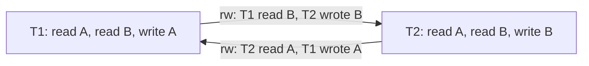

# Serializable Snapshot Isolation

> Detect the dangerous structure instead of locking.

**Type:** Build
**Languages:** Java, Python, Go
**Prerequisites:** Phase 7 Lesson 06 (MVCC and Snapshot Isolation), Phase 7 Lesson 05 (Two-Phase Locking), Phase 0 Lesson 07 (Decimal and Integer Arithmetic)
**Time:** ~90 minutes

## Learning Objectives

- Define a read-write antidependency (rw-edge) between two concurrent transactions and draw the serialization graph of the write-skew history from Lesson 06
- State the Fekete dangerous-structure theorem: every non-serializable snapshot-isolation history contains a pivot with an incoming and an outgoing rw-edge
- Extend the Lesson 06 store with SIREAD locks that record reads without blocking and are retained after commit while concurrent transactions remain
- Implement the two detection points (on read of a newer version, on write of a key someone read) and the abort rule at commit, and prove with a test that write skew now aborts exactly one transaction
- Explain why a single rw-edge is harmless, why SSI has false positives, and what retry obligation it places on a payments service

## The Problem

Lesson 06 ended with a joint account overdrawn by 100.00 USD under snapshot isolation. Two withdrawals each checked `A + B >= 150.00`, each saw 200.00, and each committed because they wrote different rows. The ledger team has three ways to close the hole. They can add `SELECT ... FOR UPDATE` to the balance reads, bringing back the locks that Lesson 06 removed and making the three-hour statement job a blocker again if it ever touches those rows. They can write a per-customer constraint row so the write sets overlap, which works for this rule and does not work for the next one (the compliance rule that caps a customer's total outbound volume across all accounts per day, which any of forty transaction types can touch). Or they can ask the database for `SERIALIZABLE` and let it find the problem.

For twenty years the third option meant two-phase locking with predicate locks, and nobody running a payments ledger picked it, because serializable 2PL makes every reader a blocker. In 2008 Cahill, Röhm, and Fekete published a different approach: keep snapshot isolation exactly as it is, record what each transaction reads without blocking anyone, and look for one specific shape in the graph of dependencies between concurrent transactions. When the shape appears, abort one transaction. Everything else commits as it did under SI. PostgreSQL shipped it as `SERIALIZABLE` in 9.1 (2011), and CockroachDB's `SERIALIZABLE` default is a cousin.

The shape is small enough to draw on a whiteboard, and that is the point of this lesson: once you can see it, you can read any transaction and say whether it is in danger. The store from Lesson 06 grows by one map, two sets per transaction, and about sixty lines.

## The Concept

### Dependencies between transactions

A history of concurrent transactions is serializable if some serial order of the same transactions produces the same reads and the same final state. The serialization graph has a node per committed transaction and three kinds of edges, each saying "T1 must come before T2 in any equivalent serial order":

| Edge | Written | Meaning | Under SI |
|------|---------|---------|----------|
| write-read | T1 -wr-> T2 | T2 read a version T1 wrote | Only possible if T1 committed before T2's snapshot: never between concurrent transactions |
| write-write | T1 -ww-> T2 | T2 overwrote a version T1 wrote | Only possible if T1 committed before T2's snapshot: first-committer-wins forbids it between concurrent transactions |
| read-write (antidependency) | T1 -rw-> T2 | T1 read a version that T2 later overwrote; T1 saw the world *before* T2 | Possible between concurrent transactions; **the only edge SI allows between them** |

A history is serializable exactly when its graph has no cycle. Under SI, the first two edge types always point from an earlier-committed transaction to a later one, so they cannot close a cycle by themselves. Any cycle must contain rw-edges between concurrent transactions.

The write-skew history from Lesson 06, drawn:



Two rw-edges, a cycle of length two, non-serializable. Neither first-committer-wins nor anything else in SI looks at reads, so SI cannot see it.

### The dangerous structure

Fekete et al. (2005) proved something sharper than "look for cycles". In every cycle that SI permits, there is a transaction, call it the **pivot**, with an rw-edge coming in and an rw-edge going out, both to transactions concurrent with it:

```text
T_in  -rw->  T_pivot  -rw->  T_out
```

and furthermore T_out is the first of the three to commit. Cahill et al. turned the theorem into an algorithm: track rw-edges between concurrent transactions, and when any transaction acquires both an incoming and an outgoing one, abort something. Every non-serializable history contains the structure, so aborting whenever it appears guarantees serializability. The converse does not hold: the structure can appear in a history that happens to be serializable, so the algorithm has **false positives**. They are the price of never blocking. PostgreSQL reduces them with the commit-order condition (T_out must have committed first) and a few more refinements; this lesson's store aborts on the structure alone, which is sound and slightly more eager.

In the write-skew history both transactions are pivots: T1 has `in = {T2}` (T2 read A, T1 wrote it) and `out = {T2}` (T1 read B, T2 wrote it); T2 symmetrically. Whichever commits first is aborted. The abort removes its edges, the other transaction is left with no edges at all, and it commits. One abort, one retry, and the constraint holds.

### Why one edge is harmless

T5 reads A = 100.00. T6 writes A = 75.00 and commits. T5 commits. There is one edge, T5 -rw-> T6, and the graph is acyclic: the serial order "T5 then T6" explains every read. SI already produced the right answer here, and SSI must not abort it. This is the difference between SSI and the naive rule "abort any transaction whose read was overwritten", which is optimistic concurrency control (OCC) with read validation and aborts far more often. SSI waits for the *second* edge on the *same* transaction.

### Worked example: the read-only anomaly

The structure does not need two writers that both check a constraint. Fekete's example uses a checking account `x` and a savings account `y`, both at 0, and a bank rule that a withdrawal overdrawing the *pair* incurs a 1.00 fee:

```text
T1 (deposit):   reads y, writes y = 20.00
T2 (withdraw):  reads x, reads y (sees 0, 0), writes x = -11.00 (10.00 withdrawal + 1.00 fee, since x + y < 0 on its snapshot)
T3 (statement): reads x, reads y
```

Interleave as: T2 reads x and y; T1 begins, writes y, commits; T3 begins, reads x = 0 and y = 20.00, commits; T2 writes x = -11.00, commits. Every pairwise interaction is legal under SI (T1 and T2 have disjoint write sets). But T3 printed a statement with x = 0 and y = 20.00, which implies "deposit happened, withdrawal not yet", and the withdrawal later charged a fee that only applies if the deposit had *not* happened. No serial order explains both. The edges: T2 -rw-> T1 (T2 read the old y), T3 -rw-> T2 (T3 read the old x). T2 is the pivot with `in = {T3}` and `out = {T1}`, and the store aborts it at commit. Had T3 not run, T2 would have had only an out-edge and committed; the *read-only* T3 is what made the history non-serializable, which is why SSI must take SIREADs for read-only transactions too.

### SIREAD locks: a lock that never blocks

To find rw-edges the store must know who read what. A **SIREAD lock** is a record "transaction T read key k". It conflicts with nothing and blocks nobody; it exists so that a later writer of k can discover T. Two properties distinguish it from an ordinary shared lock:

1. **It is checked by writers, not acquired against them.** When T writes k, it looks up the SIREAD holders of k and, for each one R that is concurrent with T, records R -rw-> T.
2. **It outlives its transaction.** If R read k and committed, and T (which began before R committed) now writes k, the edge R -rw-> T is still real: R saw the old k, T is making a new one, and both ran at once. So R's SIREADs must stay until every transaction concurrent with R has finished. This is why PostgreSQL's `pg_locks` shows `SIReadLock` rows for transactions that have already committed, and why `max_pred_locks_per_transaction` exists.

The symmetric detection point is on read: when T reads k and finds a version newer than its snapshot (committed, or sitting in an active transaction's write buffer), T has read the old version while someone wrote a newer one: T -rw-> W.

### Concurrency is about event order, not timestamps

"Concurrent" means neither transaction finished before the other began. Lesson 06's timestamps cannot express this: a read-only transaction commits with `commitTs == startTs`, so a reader that committed one microsecond before a writer began and a reader that committed one microsecond after it began look identical. The store therefore keeps a separate event counter, incremented at every begin, commit, and abort, and gives each transaction a `beginSeq` and an `endSeq`. T and U are concurrent when `T.beginSeq < U.endSeq && U.beginSeq < T.endSeq`. In PostgreSQL this role is played by the transaction's `xmin` snapshot contents: U was concurrent with T if U's id was in-progress in T's snapshot.

### Worked example: the committed pivot

The abort-at-commit rule is not enough on its own, because the pivot may already have committed by the time the second edge appears. Trace, starting from A = 100.00, B = -50.00:

```text
P begins (seq 1)        Q begins (seq 2)
P reads A               SIREAD(A) = {P}
P writes B = 5.00       readers of B concurrent with P: none yet
P commits at ts 5       P.in = {}, P.out = {} -> not a pivot, commit
                        Q reads B: version at ts 5 is newer than Q's snapshot
                          -> Q -rw-> P.   Q.out = {P}, P.in = {Q}.  P committed, P.out empty: fine
                        Q writes A: SIREAD(A) = {P}; P concurrent with Q (P ended at seq 3 > Q began at 2)
                          -> P -rw-> Q.   P.out = {Q}, Q.in = {P}
                          P is committed and now has in AND out: committed pivot
                          Q is the only one left to abort -> SerializationFailure, immediately
```

Q -rw-> P -rw-> Q is a cycle of two with P as the pivot. Had the store waited for Q's commit to check Q's own sets, it would have found Q to be a pivot too (`in = {P}`, `out = {P}`) and aborted it there; aborting at the write saves Q the rest of its work. The two eager checks in `recordRw` exist for exactly this: when the other side is already committed and already has the opposite edge, the structure is complete and the transaction in hand is the only one that can still be aborted.

### Phantoms and predicate reads

The store takes SIREADs on keys. A query of the form "all payouts for merchant M with status PENDING" reads a *predicate*, not a key, and a concurrent transaction that inserts a new matching payout creates an rw-edge that key-level SIREADs cannot see: the reader never touched the new key. This is the phantom problem of Lesson 04 wearing SSI clothes. Production engines solve it by locking the access path rather than the rows found: PostgreSQL takes SIREADs on the B-tree index pages the scan visited (an insert into that range lands on one of those pages and is detected), or on the whole relation for a sequential scan. The lesson's store would need a `scan(prefix)` operation that records a SIREAD on the prefix and a write path that checks prefixes as well as keys; Exercise 1 of Lesson 10 builds the index that such a scan would lock. Until then, treat every multi-key read in this store as a set of point reads, which is exactly what it is.

### Four ways to get serializability, compared

| Mechanism | Readers block? | Writers block? | Aborts | Phantoms | Where used |
|-----------|----------------|----------------|--------|----------|------------|
| Strict 2PL with predicate locks (Lesson 05) | Yes, held to commit | Yes | Deadlock victims only | Handled by range/predicate locks | SQL Server default, DB2, InnoDB `SERIALIZABLE` |
| Optimistic concurrency control (read validation) | No | No | Any transaction whose read set changed | Handled by re-validating predicates | Hekaton, many in-memory stores |
| SSI (this lesson) | No | No | Pivots plus false positives | Handled by access-path SIREADs | PostgreSQL `SERIALIZABLE` |
| Timestamp ordering with read refresh | No | No, but may restart | Transactions whose refresh fails | Handled by the timestamp cache on spans | CockroachDB |

OCC and SSI look alike but differ in what they abort: OCC aborts on *one* rw-edge (your read is stale), SSI on *two edges meeting at one transaction*. The difference is the entire abort rate gap between them on read-heavy workloads, which is why the read-mostly ledger lesson in Phase 10 assumes SSI rather than OCC.

### What SSI promises and what it does not

| Promise | Holds? | Notes |
|---------|--------|-------|
| Every committed history is serializable | Yes | Soundness from the dangerous-structure theorem |
| Readers never block, writers never block | Yes | Detection is bookkeeping; the only outcome is commit or abort |
| No aborts in serializable histories | No | False positives; the rate is low in practice (Ports and Grittner measured a few percent at worst on TPC-C-like loads) and zero when transactions touch disjoint keys |
| Read-only transactions are free | Almost | They take SIREADs and can be aborted (the read-only anomaly); PostgreSQL's `SERIALIZABLE READ ONLY DEFERRABLE` waits for a safe snapshot instead |
| Bounded memory | No, without care | SIREAD retention grows with long-running transactions, like vacuum debt in Lesson 06; PostgreSQL summarises old locks coarsely under pressure, increasing false positives |
| Works across nodes | Not as written | Distributed SSI needs the conflict sets to be shared or the timestamps to be globally ordered (Lesson 09) |

The practical contract for a payments service is one sentence: **every transaction under SSI must be wrapped in a retry loop that re-reads its inputs**, because the database may say `could not serialize access` to a transaction that did nothing wrong.

### Complexity

Relative to Lesson 06, a read costs an additional O(versions newer than the snapshot + active transactions) scan and one set insertion; a write costs O(readers of the key); commit adds an O(1) check of two set sizes; abort costs O(transactions tracked) to remove edges. All of it is bookkeeping on in-memory structures, which is why the PostgreSQL authors reported SSI within a few percent of SI throughput on their benchmarks.

## Build It

The implementation is `code/java/Main.java`. `SsiStore<V>` is the Lesson 06 `MvccStore<V>` with the additions below; `Money`, `TimestampOracle`, `Version`, and first-committer-wins are unchanged.

### Step 1: Two conflict sets and an event order

```java
final class Transaction<V> {
    final long id;
    final long startTs;
    final Map<String, V> writes = new LinkedHashMap<>();
    final Set<Long> inConflicts = new LinkedHashSet<>();    // T_in -rw-> this
    final Set<Long> outConflicts = new LinkedHashSet<>();   // this -rw-> T_out
    final long beginSeq;
    long endSeq = Long.MAX_VALUE;
    TxnStatus status = TxnStatus.ACTIVE;

    boolean isPivot() { return !inConflicts.isEmpty() && !outConflicts.isEmpty(); }
    boolean concurrentWith(Transaction<?> other) { return beginSeq < other.endSeq && other.beginSeq < endSeq; }
}
```

Cahill's paper uses two booleans, `inConflict` and `outConflict`. Sets of transaction ids do the same job and allow one more thing: when a transaction aborts, its edges can be removed from everyone else's sets, so a false alarm does not cascade. PostgreSQL also tracks the actual conflict list for this reason. `endSeq` starts at infinity: an active transaction is concurrent with everything that has begun.

**Predict:** T begins (seq 1) and commits (seq 2). U begins (seq 3). Is `T.concurrentWith(U)` true? What if U had begun at seq 1.5, between T's begin and commit?

### Step 2: Reads take SIREADs and look for newer versions

```java
Optional<V> read(Transaction<V> txn, String key) {
    requireActive(txn);
    sireads.computeIfAbsent(key, k -> new LinkedHashSet<>()).add(txn.id);
    List<Version<V>> chain = versions.getOrDefault(key, List.of());
    for (Version<V> v : chain) {
        if (v.commitTs() > txn.startTs) recordRw(txn, txns.get(v.txnId()));
    }
    for (Transaction<V> other : new ArrayList<>(txns.values())) {
        if (other != txn && other.isActive() && other.writes.containsKey(key)) recordRw(txn, other);
    }
    if (!txn.isActive()) throw new SerializationFailureException(txn.abortReason);
    // ... then the Lesson 06 snapshot read, unchanged
}
```

Three things happen before the value is even looked up. The SIREAD is recorded. Every committed version newer than the snapshot is an rw-edge to its writer: the reader is about to return an older version than one that exists. Every *active* transaction with this key in its write buffer is also an rw-edge: that write will become a newer version when it commits, and the reader is reading the version before it. The copy of `txns.values()` is there because `recordRw` can abort `txn` and remove it from the map mid-loop. The final check turns an abort inside `recordRw` into an exception at the call site.

**Predict:** T reads key k that has never been written. How many edges are recorded, and what does the SIREAD table contain afterwards?

### Step 3: Writes look for readers

```java
void write(Transaction<V> txn, String key, V value) {
    requireActive(txn);
    txn.writes.put(key, Objects.requireNonNull(value, "use delete() for tombstones"));
    checkReadersOf(txn, key);
}

private void checkReadersOf(Transaction<V> txn, String key) {
    for (Long readerId : new ArrayList<>(sireads.getOrDefault(key, Set.of()))) {
        Transaction<V> reader = txns.get(readerId);
        if (reader == null || reader == txn) continue;
        if (reader.concurrentWith(txn)) recordRw(reader, txn);
    }
    if (!txn.isActive()) throw new SerializationFailureException(txn.abortReason);
}
```

A write still goes into the private buffer; nothing is published. Then every SIREAD holder of the key that is concurrent with the writer gets an edge pointing at the writer. The `concurrentWith` test is what makes retained locks correct: a reader that committed before this writer began is skipped, because the serial order "reader then writer" already explains both. Deletes go through the same check, since a tombstone is a new version like any other.

**Predict:** R reads k and commits. Then T begins and writes k. Is an edge recorded? Now swap the order of R's commit and T's begin.

### Step 4: Recording an edge, and the committed-pivot checks

```java
private void recordRw(Transaction<V> reader, Transaction<V> writer) {
    if (reader == null || writer == null || reader == writer) return;
    if (!reader.isActive() && !reader.isCommitted()) return;
    if (!writer.isActive() && !writer.isCommitted()) return;
    reader.outConflicts.add(writer.id);
    writer.inConflicts.add(reader.id);
    if (reader.isActive() && writer.isCommitted() && !writer.outConflicts.isEmpty()) {
        abort(reader, reader + " -rw-> " + writer + " -rw-> ...: " + writer + " is a committed pivot");
    } else if (writer.isActive() && reader.isCommitted() && !reader.inConflicts.isEmpty()) {
        abort(writer, "... -rw-> " + reader + " -rw-> " + writer + ": " + reader + " is a committed pivot");
    }
}
```

The two `if` branches are the eager checks from the worked example. First branch: the reader just acquired an out-edge to a committed writer that already has an out-edge of its own, so the writer is a committed pivot (`reader -rw-> writer -rw-> X`) and the reader is the only live participant. Second branch, mirror image: the writer just acquired an in-edge from a committed reader that already has an in-edge (`X -rw-> reader -rw-> writer`). Aborted transactions are skipped entirely; their edges were removed when they aborted.

**Predict:** in the write-skew demo, which branch fires, if any, before either transaction commits? Why?

### Step 5: Commit aborts the pivot; abort cleans up

```java
long commit(Transaction<V> txn) {
    requireActive(txn);
    // ... first committer wins, unchanged from Lesson 06 ...
    if (txn.isPivot()) {
        abort(txn, "T" + txn.inConflicts.iterator().next() + " -rw-> " + txn + " -rw-> T" + txn.outConflicts.iterator().next() + ": " + txn + " is the pivot");
        throw new SerializationFailureException(txn.abortReason);
    }
    // ... publish versions at a fresh commitTs, set endSeq, unchanged otherwise ...
}

void abort(Transaction<V> txn, String reason) {
    if (!txn.isActive()) return;
    txn.status = TxnStatus.ABORTED;
    txn.abortReason = reason;
    txn.endSeq = ++seq;
    txn.writes.clear();
    for (Set<Long> readers : sireads.values()) readers.remove(txn.id);
    for (Transaction<V> other : txns.values()) {
        other.inConflicts.remove(txn.id);
        other.outConflicts.remove(txn.id);
    }
    txns.remove(txn.id);
    aborts++;
}
```

The order of checks in `commit` matters: first-committer-wins runs first because a write-write conflict is a certain loss, while the pivot check may be a false positive. Abort does four things, and skipping any of them produces a wrong store: drop the writes (so they are never published), drop the SIREADs (an aborted transaction's reads constrain nothing), remove the edges from other transactions (so the survivor in write skew is not aborted too), and record `endSeq` (so the transaction stops being concurrent with new arrivals).

### Step 6: Releasing retained locks

```java
int releaseFinished() {
    long oldestActiveBegin = seq + 1;
    for (Transaction<V> t : txns.values()) if (t.isActive()) oldestActiveBegin = Math.min(oldestActiveBegin, t.beginSeq);
    List<Long> done = new ArrayList<>();
    for (Transaction<V> t : txns.values()) if (t.isCommitted() && t.endSeq < oldestActiveBegin) done.add(t.id);
    for (Long id : done) {
        txns.remove(id);
        for (Set<Long> readers : sireads.values()) readers.remove(id);
    }
    sireads.values().removeIf(Set::isEmpty);
    return done.size();
}
```

A committed transaction that ended before every active transaction began is concurrent with nothing that can still write, so its SIREADs can never be the reader side of a new edge. This is the SSI equivalent of Lesson 06's vacuum horizon, and it has the same failure mode: one long-running transaction keeps every SIREAD taken since it began alive. PostgreSQL copes by promoting fine-grained locks to page and relation granularity when `max_pred_locks_per_transaction` is exceeded, which keeps memory bounded at the cost of more false positives.

### Step 7: Run it

```bash
cd phases/07-storage-and-transactions/07-serializable-snapshot-isolation/code/java
javac -d .out *.java && java -cp .out Main
java -cp .out MainTest
```

Expected output, abbreviated:

```console
== 1. Write skew from Lesson 06, now under SSI ==
T2 read A,B (SIREAD on both), wrote A = -50.00; readers of A = [2]
T3 read A,B, wrote B = -50.00
edges: T3 -rw-> T2 (T3 read A, T2 writes A); T2 -rw-> T3 (T2 read B, T3 writes B)
  T2 in=[3] out=[3] pivot=true
  T3 in=[2] out=[2] pivot=true
T2 ABORTED: T3 -rw-> T2 -rw-> T3: T2 is the pivot
after the abort, T3 in=[] out=[]
T3 committed at ts 2
A = 100.00 USD, B = -50.00 USD, A+B = 50.00 USD  <- constraint holds

== 2. One rw-antidependency alone is harmless ==
T5 reads A = 100.00 USD
T6 writes A = 75.00; edge T5 -rw-> T6
T6 committed at ts 3
T5 committed at ts 2  (serializable order: T5 before T6)

== 3. SIREAD locks outlive their transaction ==
T7 reads B = -50.00 USD and commits: T7 committed at ts 3
readers of B still recorded: [3, 4, 7] (retained locks = 6)
T8 (started before T7 committed) writes B: edge T7 -rw-> T8; T8 in=[7]
T8 committed at ts 4  (one edge, no pivot)
released 7 finished transactions; retained locks now 0

== 4. The pivot has already committed: abort the newcomer on the spot ==
T9 reads A, writes B, commits: T9 committed at ts 5
T10 reads B (older version than T9 wrote): edge T10 -rw-> T9
T10 tries to write A, which T9 read: ABORTED immediately: T10 -rw-> T9 -rw-> T10: T9 is a committed pivot
```

Section 3 shows readers `[3, 4, 7]` on B: T3 and T4 committed long ago, but T8 (seq-wise concurrent with all of them) is still active, so their SIREADs are retained until `releaseFinished` runs after T8 commits.

### In Python

The Python port (`code/python/main.py`) is the same design with four differences. **Ordered sets are dicts:** the conflict sets and the SIREAD sets are `dict[int, None]`, because Python has no `LinkedHashSet` and a plain `set` has no first element; the abort messages name `iterator().next()` in Java, so `_first` takes `next(iter(...))` and both languages blame the same transaction, while membership (`p.id in q.out_conflicts`), removal (`pop(id, None)`) and emptiness read the same as with a set. **Iterate over copies when the loop can abort:** `read` and `_check_readers_of` loop over `list(...)` snapshots because `_record_rw` may abort the current transaction, which removes it from `_txns` and from every SIREAD set mid-loop; Python raises `RuntimeError: dictionary changed size during iteration` where Java would throw `ConcurrentModificationException`. **Errors and numbers:** `SerializationFailureException` and `WriteConflictException` are `RuntimeError` subclasses, using a finished transaction raises a plain `RuntimeError` naming the abort reason, and a test checks it is not the serialization failure; `end_seq` starts at `INT64_MAX` to mirror `Long.MAX_VALUE`, and `Money` checks 64-bit overflow by hand as in Lesson 06. **No threads:** concurrency is event order (`begin_seq`, `end_seq`), never wall-clock time, so the demo's edges, aborts and counts (`commits = 8, aborts = 2`) are identical to Java's.

Run it from `code/python/` with `python3 main.py`; test with `python3 -m unittest -v`.

#### Step 1: Two conflict sets and an event order

The two conflict sets are insertion-ordered dicts with `None` values, and `_first` is `LinkedHashSet.iterator().next()`. `end_seq` starts at `INT64_MAX`, so an active transaction is concurrent with everything that has begun; `is_pivot` is the two non-empty checks.

```python
def _first(ordered_set: dict[int, None]) -> int:
    return next(iter(ordered_set))


class Transaction(Generic[V]):
    def __init__(self, id: int, start_ts: int, begin_seq: int) -> None:
        self.id = id
        self.start_ts = start_ts
        self.writes: dict[str, V | None] = {}
        self.in_conflicts: dict[int, None] = {}  # T_in -rw-> this: they read a version this txn overwrote
        self.out_conflicts: dict[int, None] = {}  # this -rw-> T_out: they wrote a newer version of what this txn read
        self.status = TxnStatus.ACTIVE
        self.commit_ts = -1
        self.begin_seq = begin_seq
        self.end_seq = INT64_MAX
        self.abort_reason: str | None = None

    def concurrent_with(self, other: "Transaction") -> bool:
        return self.begin_seq < other.end_seq and other.begin_seq < self.end_seq

    def is_pivot(self) -> bool:
        return bool(self.in_conflicts) and bool(self.out_conflicts)
```

#### Step 2: Reads take SIREADs and look for newer versions

The SIREAD is `setdefault(key, {})[txn.id] = None`. Newer committed versions and active writers of the key each produce an rw-edge through `_record_rw`; the active-writer loop iterates `list(self._txns.values())` because the current transaction may be aborted and removed mid-loop. If that happened, the read raises `SerializationFailureException`; otherwise the Lesson 06 snapshot read follows.

```python
    def read(self, txn: Transaction[V], key: str) -> V | None:
        self._require_active(txn)
        self._sireads.setdefault(key, {})[txn.id] = None
        # rw-antidependency: we read an older version than someone has written or is writing
        for v in self._versions.get(key, ()):
            if v.commit_ts > txn.start_ts:
                self._record_rw(txn, self._txns.get(v.txn_id))
        for other in list(self._txns.values()):  # copy: _record_rw may abort and remove txn
            if other is not txn and other.is_active() and key in other.writes:
                self._record_rw(txn, other)
        if not txn.is_active():
            raise SerializationFailureException(txn.abort_reason)
        if key in txn.writes:
            return txn.writes[key]
        v = self._visible_version(key, txn.start_ts)
        return None if v is None or v.is_tombstone() else v.value
```

#### Step 3: Writes look for readers

`write` buffers the value (rejecting `None` with `TypeError`) and calls `_check_readers_of`, which walks a `list(...)` copy of the key's SIREAD holders and records `reader -rw-> txn` for each concurrent one. `delete` buffers `None` and runs the same check.

```python
    def write(self, txn: Transaction[V], key: str, value: V) -> None:
        self._require_active(txn)
        if value is None:
            raise TypeError("use delete() for tombstones")
        txn.writes[key] = value
        self._check_readers_of(txn, key)

    def _check_readers_of(self, txn: Transaction[V], key: str) -> None:
        for reader_id in list(self._sireads.get(key, {})):
            reader = self._txns.get(reader_id)
            if reader is None or reader is txn:
                continue
            if reader.concurrent_with(txn):
                self._record_rw(reader, txn)
        if not txn.is_active():
            raise SerializationFailureException(txn.abort_reason)
```

#### Step 4: Recording an edge, and the committed-pivot checks

The two edges are dict insertions, and the two eager checks are the Java branches with `_first` naming the third transaction in the abort reason. Aborted participants on either side are skipped.

```python
    def _record_rw(self, reader: Transaction[V] | None, writer: Transaction[V] | None) -> None:
        if reader is None or writer is None or reader is writer:
            return
        if not reader.is_active() and not reader.is_committed():
            return
        if not writer.is_active() and not writer.is_committed():
            return
        reader.out_conflicts[writer.id] = None
        writer.in_conflicts[reader.id] = None
        if reader.is_active() and writer.is_committed() and writer.out_conflicts:
            self.abort(reader, f"{reader} -rw-> {writer} -rw-> T{_first(writer.out_conflicts)}: "
                               f"{writer} is a committed pivot")
        elif writer.is_active() and reader.is_committed() and reader.in_conflicts:
            self.abort(writer, f"T{_first(reader.in_conflicts)} -rw-> {reader} -rw-> {writer}: "
                               f"{reader} is a committed pivot")
```

#### Step 5: Commit aborts the pivot; abort cleans up

`commit` runs first-committer-wins, then the pivot check, each aborting before raising its own exception type. `abort` does the four cleanups: clear writes, `pop` our id from every SIREAD set, `pop` our id from every other transaction's conflict sets, and record `end_seq` before leaving `_txns`.

```python
    def commit(self, txn: Transaction[V]) -> int:
        self._require_active(txn)
        for key in txn.writes:
            newest = self._newest_version(key)
            if newest is not None and newest.commit_ts > txn.start_ts:
                self.abort(txn, f"first committer wins on {key}")
                raise WriteConflictException(txn.abort_reason)
        if txn.is_pivot():
            self.abort(txn, f"T{_first(txn.in_conflicts)} -rw-> {txn} -rw-> T{_first(txn.out_conflicts)}: "
                            f"{txn} is the pivot")
            raise SerializationFailureException(txn.abort_reason)
        ts = txn.start_ts if not txn.writes else self._oracle.next()
        for key, value in txn.writes.items():
            self._versions.setdefault(key, []).append(Version(ts, txn.id, value))
        txn.status = TxnStatus.COMMITTED
        txn.commit_ts = ts
        self._seq += 1
        txn.end_seq = self._seq
        self._commits += 1
        return ts

    def abort(self, txn: Transaction[V], reason: str) -> None:
        if not txn.is_active():
            return
        txn.status = TxnStatus.ABORTED
        txn.abort_reason = reason
        self._seq += 1
        txn.end_seq = self._seq
        txn.writes.clear()
        for readers in self._sireads.values():
            readers.pop(txn.id, None)
        for other in self._txns.values():
            other.in_conflicts.pop(txn.id, None)
            other.out_conflicts.pop(txn.id, None)
        self._txns.pop(txn.id, None)
        self._aborts += 1
```

#### Step 6: Releasing retained locks

The horizon is the smallest `begin_seq` among active transactions (or `seq + 1` if none). Committed transactions that ended before it are collected with a comprehension, removed from `_txns` and from every SIREAD set, and empty SIREAD sets are dropped by rebuilding the dict, the Python version of `removeIf(Set::isEmpty)`.

```python
    def release_finished(self) -> int:
        oldest_active_begin = self._seq + 1
        for t in self._txns.values():
            if t.is_active():
                oldest_active_begin = min(oldest_active_begin, t.begin_seq)
        done = [t.id for t in self._txns.values() if t.is_committed() and t.end_seq < oldest_active_begin]
        for id in done:
            del self._txns[id]
            for readers in self._sireads.values():
                readers.pop(id, None)
        self._sireads = {k: r for k, r in self._sireads.items() if r}
        return len(done)
```

#### Step 7: Run it

```bash
cd phases/07-storage-and-transactions/07-serializable-snapshot-isolation/code/python
python3 main.py
python3 -m unittest -v
```

The four sections are the Java output, including which transaction is named as the pivot:

```console
== 1. Write skew from Lesson 06, now under SSI ==
T2 read A,B (SIREAD on both), wrote A = -50.00; readers of A = [2]
T3 read A,B, wrote B = -50.00
edges: T3 -rw-> T2 (T3 read A, T2 writes A); T2 -rw-> T3 (T2 read B, T3 writes B)
  T2 in=[3] out=[3] pivot=true
  T3 in=[2] out=[2] pivot=true
T2 ABORTED: T3 -rw-> T2 -rw-> T3: T2 is the pivot
after the abort, T3 in=[] out=[]
T3 committed at ts 2
A = 100.00 USD, B = -50.00 USD, A+B = 50.00 USD  <- constraint holds
```

### In Go

The Go port (`code/go/main.go`) keeps the design and changes four things. **Every operation can fail, so every operation returns an error:** `Read` is `(V, bool, error)`, where the `bool` is Java's `Optional` and the `error` is an `*AbortError` when the read itself closed a dangerous structure, or `ErrNotActive` on a finished transaction; `Write`/`Delete` return `error`, `Commit` returns `(int64, error)`, and one `AbortError` type serves both rules, its `Is` method letting `errors.Is(err, ErrSerializationFailure)` and `errors.Is(err, ErrWriteConflict)` tell them apart while `err.Error()` is exactly the `AbortReason` the Java exception carried. **Ordered sets by hand:** `InConflicts`/`OutConflicts` are an `idSet` (slice plus map) standing in for `LinkedHashSet<Long>`, so `First()` is the same transaction Java's `iterator().next()` names in the abort message; the store keeps `txnOrder` beside its map so the rw-edge sweep in `Read` visits transactions in begin order, as the `LinkedHashMap` does, and `ReadersOf` returns a sorted `[]int64` because Java's `HashSet<Long>` happens to print small ids ascending. **Generics with an explicit tombstone:** `SsiStore[V any]`, `Transaction[V]` and `Version[V]` are type parameters, a deleted key is `Version{Tombstone: true}` and a buffered delete is `pendingWrite{Delete: true}`, since Go has no `null` for an arbitrary `V`, and `BeginSeq`/`EndSeq` are `int64` with `math.MaxInt64` for "still open". **No goroutines:** the detection logic is sequential by design, the port has no mutex and `go test -race` passes trivially; if goroutines are introduced, the event counter `seq`, the SIREAD table and every conflict set must be protected by one store-wide mutex.

Run it from `code/go/` with `go run .`; test with `go test ./...`. The demo prints the same four sections as the Java version, line for line (commits = 8, aborts = 2).

#### Step 1: Two conflict sets and an event order

The conflict sets are `*idSet` values, and `EndSeq` is initialised to `math.MaxInt64` in the constructor. `ConcurrentWith` and `IsPivot` are the Java expressions on those fields.

```go
type Transaction[V any] struct {
	ID        int64
	StartTs   int64
	writeKeys []string
	Writes    map[string]pendingWrite[V]
	InConflicts *idSet
	OutConflicts *idSet
	Status       TxnStatus
	CommitTs     int64
	BeginSeq    int64
	EndSeq      int64
	AbortReason string
}

func newTransaction[V any](id, startTs, beginSeq int64) *Transaction[V] {
	return &Transaction[V]{ID: id, StartTs: startTs, Writes: map[string]pendingWrite[V]{}, InConflicts: newIDSet(), OutConflicts: newIDSet(),
		Status: Active, CommitTs: -1, BeginSeq: beginSeq, EndSeq: math.MaxInt64}
}

func (t *Transaction[V]) ConcurrentWith(other *Transaction[V]) bool {
	return t.BeginSeq < other.EndSeq && other.BeginSeq < t.EndSeq
}

func (t *Transaction[V]) IsPivot() bool     { return !t.InConflicts.IsEmpty() && !t.OutConflicts.IsEmpty() }
```

#### Step 2: Reads take SIREADs and look for newer versions

The SIREAD set is created lazily. The active-writer sweep uses `orderedTxns()`, a begin-ordered snapshot of the map, so it is both deterministic and safe against `recordRw` removing the current transaction. An abort during the read is returned as an `*AbortError` wrapping `ErrSerializationFailure`.

```go
func (s *SsiStore[V]) Read(txn *Transaction[V], key string) (V, bool, error) {
	var zero V
	if err := s.requireActive(txn); err != nil {
		return zero, false, err
	}
	if s.sireads[key] == nil {
		s.sireads[key] = newIDSet()
	}
	s.sireads[key].Add(txn.ID)
	// rw-antidependency: we read an older version than someone has written or is writing
	for _, v := range s.versions[key] {
		if v.CommitTs > txn.StartTs {
			s.recordRw(txn, s.txns[v.TxnID])
		}
	}
	for _, other := range s.orderedTxns() {
		if other != txn && other.IsActive() {
			if _, writes := other.Writes[key]; writes {
				s.recordRw(txn, other)
			}
		}
	}
	if !txn.IsActive() {
		return zero, false, &AbortError{ErrSerializationFailure, txn.AbortReason}
	}
	if w, ok := txn.Writes[key]; ok {
		if w.Delete {
			return zero, false, nil
		}
		return w.Value, true, nil
	}
	v, ok := s.visibleVersion(key, txn.StartTs)
	if !ok || v.IsTombstone() {
		return zero, false, nil
	}
	return v.Value, true, nil
}
```

#### Step 3: Writes look for readers

`Write` buffers through `put` and returns whatever `checkReadersOf` returns. The reader sweep iterates `readers.IDs()`, a copy, since `recordRw` can mutate the set; a two-value map read skips readers that have since been forgotten.

```go
func (s *SsiStore[V]) Write(txn *Transaction[V], key string, value V) error {
	if err := s.requireActive(txn); err != nil {
		return err
	}
	txn.put(key, pendingWrite[V]{Value: value})
	return s.checkReadersOf(txn, key)
}

func (s *SsiStore[V]) checkReadersOf(txn *Transaction[V], key string) error {
	if readers := s.sireads[key]; readers != nil {
		for _, readerID := range readers.IDs() { // copy: recordRw may mutate the set
			reader, ok := s.txns[readerID]
			if !ok || reader == txn {
				continue
			}
			if reader.ConcurrentWith(txn) {
				s.recordRw(reader, txn)
			}
		}
	}
	if !txn.IsActive() {
		return &AbortError{ErrSerializationFailure, txn.AbortReason}
	}
	return nil
}
```

#### Step 4: Recording an edge, and the committed-pivot checks

`idSet.Add` ignores duplicates, and `First()` names the third participant in the abort reason, exactly as the Java `iterator().next()` does. The two branches are unchanged.

```go
func (s *SsiStore[V]) recordRw(reader, writer *Transaction[V]) {
	if reader == nil || writer == nil || reader == writer {
		return
	}
	if !reader.IsActive() && !reader.IsCommitted() {
		return
	}
	if !writer.IsActive() && !writer.IsCommitted() {
		return
	}
	reader.OutConflicts.Add(writer.ID)
	writer.InConflicts.Add(reader.ID)
	if reader.IsActive() && writer.IsCommitted() && !writer.OutConflicts.IsEmpty() {
		s.Abort(reader, fmt.Sprintf("%s -rw-> %s -rw-> T%d: %s is a committed pivot", reader, writer, writer.OutConflicts.First(), writer))
	} else if writer.IsActive() && reader.IsCommitted() && !reader.InConflicts.IsEmpty() {
		s.Abort(writer, fmt.Sprintf("T%d -rw-> %s -rw-> %s: %s is a committed pivot", reader.InConflicts.First(), reader, writer, reader))
	}
}
```

#### Step 5: Commit aborts the pivot; abort cleans up

`Commit` returns an `*AbortError` with the right `Kind` after aborting: `ErrWriteConflict` for first-committer-wins, `ErrSerializationFailure` for the pivot. `Abort` removes our id from every SIREAD set and every other transaction's conflict sets, then from the store through `removeTxn`, which keeps `txnOrder` in step with the map.

```go
func (s *SsiStore[V]) Commit(txn *Transaction[V]) (int64, error) {
	if err := s.requireActive(txn); err != nil {
		return 0, err
	}
	for _, key := range txn.writeKeys {
		if newest, ok := s.newestVersion(key); ok && newest.CommitTs > txn.StartTs {
			s.Abort(txn, "first committer wins on "+key)
			return 0, &AbortError{ErrWriteConflict, txn.AbortReason}
		}
	}
	if txn.IsPivot() {
		s.Abort(txn, fmt.Sprintf("T%d -rw-> %s -rw-> T%d: %s is the pivot", txn.InConflicts.First(), txn, txn.OutConflicts.First(), txn))
		return 0, &AbortError{ErrSerializationFailure, txn.AbortReason}
	}
	ts := txn.StartTs
	if len(txn.writeKeys) > 0 {
		ts = s.oracle.Next()
	}
	for _, key := range txn.writeKeys {
		w := txn.Writes[key]
		s.versions[key] = append(s.versions[key], Version[V]{CommitTs: ts, TxnID: txn.ID, Value: w.Value, Tombstone: w.Delete})
	}
	txn.Status = Committed
	txn.CommitTs = ts
	s.seq++
	txn.EndSeq = s.seq
	s.commits++
	return ts, nil
}

func (s *SsiStore[V]) Abort(txn *Transaction[V], reason string) {
	if !txn.IsActive() {
		return
	}
	txn.Status = Aborted
	txn.AbortReason = reason
	s.seq++
	txn.EndSeq = s.seq
	txn.Writes = map[string]pendingWrite[V]{}
	txn.writeKeys = nil
	for _, readers := range s.sireads {
		readers.Remove(txn.ID)
	}
	for _, other := range s.txns {
		other.InConflicts.Remove(txn.ID)
		other.OutConflicts.Remove(txn.ID)
	}
	s.removeTxn(txn.ID)
	s.aborts++
}
```

#### Step 6: Releasing retained locks

The horizon scan ranges over the map (order is irrelevant for a minimum), but the `done` list is built from `txnOrder` so releases happen in begin order. Deleting empty SIREAD sets inside a range over the same map is permitted in Go.

```go
func (s *SsiStore[V]) ReleaseFinished() int {
	oldestActiveBegin := s.seq + 1
	for _, t := range s.txns {
		if t.IsActive() && t.BeginSeq < oldestActiveBegin {
			oldestActiveBegin = t.BeginSeq
		}
	}
	done := []int64{}
	for _, id := range s.txnOrder {
		if t := s.txns[id]; t.IsCommitted() && t.EndSeq < oldestActiveBegin {
			done = append(done, id)
		}
	}
	for _, id := range done {
		s.removeTxn(id)
		for _, readers := range s.sireads {
			readers.Remove(id)
		}
	}
	for key, readers := range s.sireads {
		if readers.IsEmpty() {
			delete(s.sireads, key)
		}
	}
	return len(done)
}
```

#### Step 7: Run it

```bash
cd phases/07-storage-and-transactions/07-serializable-snapshot-isolation/code/go
go run .
go test ./...
```

```console
== 4. The pivot has already committed: abort the newcomer on the spot ==
T9 reads A, writes B, commits: T9 committed at ts 5
T10 reads B (older version than T9 wrote): edge T10 -rw-> T9
T10 tries to write A, which T9 read: ABORTED immediately: T10 -rw-> T9 -rw-> T10: T9 is a committed pivot
commits = 8, aborts = 2
```

The three sections before this one are the Java output, line for line.

## Use It

### PostgreSQL `SERIALIZABLE`

```sql
BEGIN ISOLATION LEVEL SERIALIZABLE;
SELECT balance FROM accounts WHERE id IN ('A', 'B');     -- takes SIReadLock on the rows (or the index range)
UPDATE accounts SET balance = balance - 150 WHERE id = 'A';
COMMIT;
-- in the symmetric session:
-- ERROR:  could not serialize access due to read/write dependencies among transactions
-- DETAIL:  Reason code: Canceled on identification as a pivot, during commit attempt.
-- HINT:  The transaction might succeed if retried.
```

The error text names the mechanism: *pivot*. What PostgreSQL does that this lesson's store made explicit: SIREAD locks are taken at tuple, page, or relation granularity depending on how the row was reached (an index range scan locks the index pages, which is how it catches phantoms); locks are promoted to coarser granularity under memory pressure; the commit-order refinement (T_out committed first) and a "safe snapshot" optimisation for read-only transactions reduce false positives; and `SERIALIZABLE READ ONLY DEFERRABLE` lets a long report wait for a snapshot that can never be involved in a dangerous structure, then run with no SIREADs at all. The trap: a sequential scan of a large table takes a relation-level SIREAD, so a report that scans `ledger_entries` conflicts with every writer to it. Give reports an index path or the deferrable mode.

### CockroachDB

CockroachDB's default and only isolation level was `SERIALIZABLE` for most of its history (it added `READ COMMITTED` in 2023). Its mechanism differs: it tracks each transaction's read timestamp and refreshes it forward when a write encounters a newer version, aborting only if a read would change (a "read refresh"). The outcome is serializable without SIREAD retention, at the cost of more restarts under contention. The retry obligation on the client is the same, and its error code is also `40001`.

### What the application still owns

No isolation level removes the retry loop. Under SSI it fires on true conflicts and on false positives; under CockroachDB it fires on refresh failures; under 2PL it fires on deadlocks. A payments service wraps every money-moving transaction in `retryOnSerializationFailure(() -> ...)`, bounds the attempts, backs off with jitter, and makes sure nothing outside the database happened inside the body (Lesson 13). The lesson's `SerializationFailureException` is the local stand-in for SQLSTATE `40001`.

## Ship It

`outputs/interview-card-ssi.md` is a one-page card: the three edge types, the dangerous structure, the two detection points, the write-skew trace, and the five questions an interviewer asks about `SERIALIZABLE` in PostgreSQL. Use it to explain, in under five minutes, why your ledger runs on SSI and what the retry loop is for.

## Exercises

1. **Reinforce.** Add a `TxnStatus`-aware `conflictGraph()` method that returns the current rw-edges as a list of `(from, to)` pairs, and a test that, in the write-skew history just before the first commit, returns exactly `[(T2, T3), (T3, T2)]`. Then add a second test with three transactions forming a cycle of length three (T1 -rw-> T2 -rw-> T3 -rw-> T1) and show that the store aborts at least one of them.
2. **Apply.** Implement the commit-order refinement: a pivot is dangerous only if its `T_out` committed before both the pivot and `T_in`. Change `isPivot()` into `isDangerousPivot()` that checks the commit timestamps of the out-conflict transactions, and find a history in which the refined rule commits a transaction the unrefined rule would abort. Measure the abort rate of both rules on a seeded random workload of 1,000 transactions over 20 keys.
3. **Extend.** Combine with Lesson 05 (Two-Phase Locking). Add `readForUpdate(txn, key)` that takes a real exclusive intent: it records the SIREAD as usual but also aborts any *other* active transaction that later writes the key (a "first writer wins" on that key). Show that the write-skew program no longer needs SSI's pivot detection when both withdrawals use `readForUpdate` on both accounts, and count the aborts under each approach on fifty concurrent customers. Write a paragraph on when a ledger team should pick `FOR UPDATE` over SSI and when the reverse.

## Key Terms

| Term | What people say | What it actually means |
|------|-----------------|------------------------|
| rw-antidependency | "a read-write conflict" | T1 read a version of k and concurrent T2 wrote a newer one; T1 must precede T2 in any equivalent serial order; the only dependency SI permits between concurrent transactions |
| Dangerous structure | "the SSI pattern" | T_in -rw-> T_pivot -rw-> T_out among concurrent transactions; present in every non-serializable SI history (Fekete et al.), so aborting on it guarantees serializability |
| Pivot | "the transaction in the middle" | A transaction with at least one incoming and one outgoing rw-edge; the one SSI aborts when it tries to commit |
| SIREAD lock | "a predicate lock" | A record that a transaction read a key, taken on read, blocking nothing, kept after commit until no concurrent transaction remains, so that later writers can find the rw-edge |
| False positive | "a spurious serialization failure" | An abort of a transaction in a history that was in fact serializable; inherent in detecting a structure rather than a cycle; reduced by the commit-order refinement |
| Serialization failure | "40001" | The error (PostgreSQL SQLSTATE `40001`) telling the client to retry the whole transaction with fresh reads; the client's obligation under SSI, OCC, and 2PL alike |
| Read-only anomaly | "even a report can be aborted" | A read-only transaction can be T_in of a dangerous structure and be aborted; PostgreSQL's `READ ONLY DEFERRABLE` avoids it by waiting for a safe snapshot |

## Further Reading

- [Cahill, Röhm, Fekete: Serializable Isolation for Snapshot Databases (SIGMOD 2008)](https://courses.cs.washington.edu/courses/cse444/08au/544M/READING-LIST/fekete-sigmod2008.pdf) — the algorithm this lesson implements: SIREAD locks, `inConflict`/`outConflict`, and the abort rules, with Berkeley DB measurements.
- [Ports, Grittner: Serializable Snapshot Isolation in PostgreSQL (VLDB 2012)](https://drkp.net/papers/ssi-vldb12.pdf) — how the algorithm became production code: lock granularity and promotion, the commit-order refinement, safe snapshots, and the retained-lock memory bound.
- [Fekete, Liarokapis, O'Neil, O'Neil, Shasha: Making Snapshot Isolation Serializable (TODS 2005)](https://www.cs.umb.edu/~poneil/ROAnom.pdf) — the dangerous-structure theorem and the read-only anomaly.
- [PostgreSQL documentation: Transaction Isolation, Serializable Isolation Level](https://www.postgresql.org/docs/current/transaction-iso.html#XACT-SERIALIZABLE) — the operational contract: retry on `40001`, `READ ONLY DEFERRABLE`, and the tuning parameters.
- [PostgreSQL documentation: Serializable Snapshot Isolation (README-SSI)](https://github.com/postgres/postgres/blob/master/src/backend/storage/lmgr/README-SSI) — the implementers' notes, including the exact conditions under which a transaction is cancelled and the known false-positive cases.
- [Adya: Weak Consistency: A Generalized Theory and Optimistic Implementations for Distributed Transactions (MIT PhD thesis, 1999)](https://pmg.csail.mit.edu/papers/adya-phd.pdf) — the dependency-graph formalism (wr, ww, rw edges) that all of the above builds on.
