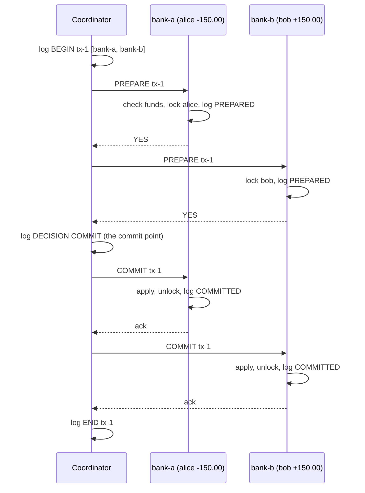

# Two-Phase Commit and Its Blocking Problem

> Two-phase commit makes two ledgers agree, and makes both of them wait, lock held, for as long as the coordinator is dead.

**Type:** Build
**Languages:** Java, Python, Go
**Prerequisites:** Phase 7 Lesson 02 (Write-Ahead Logs), Phase 5 Lesson 02 (Failure Models), Phase 5 Lesson 08 (Timeouts and Deadline Propagation), Phase 0 Lesson 07 (Decimal and Integer Arithmetic)
**Time:** ~120 minutes

## Learning Objectives

- Explain why a sequential "debit here, then credit there" across two databases is not atomic, and name the two windows in which money is created or destroyed
- Build a coordinator and two participant ledgers that run prepare, vote, decide, and acknowledge over a deterministic simulated network and clock
- State the one write that is the commit point of the whole protocol, and prove with a test that a crash on either side of it is recovered correctly from logs
- Reproduce the blocking problem: a participant that voted YES holds its lock until the coordinator returns, and no timeout can safely release it
- Implement presumed-abort recovery from the coordinator log and idempotent commit/abort on participants so redelivery is safe
- Decide when a payments system should accept 2PC and when it should reach for a saga (Lesson 12) or an outbox (Lesson 13) instead

## The Problem

A wallet provider runs two ledgers on two PostgreSQL clusters. `bank-a` holds customer wallets; `bank-b` holds merchant settlement accounts. A payment of 150.00 USD from alice to bob is two statements on two connections:

```sql
-- connection to bank-a
UPDATE accounts SET balance = balance - 15000 WHERE id = 'alice' AND balance >= 15000;
COMMIT;
-- connection to bank-b
UPDATE accounts SET balance = balance + 15000 WHERE id = 'bob';
COMMIT;
```

Each statement is atomic on its own cluster. The pair is not. If the service process is killed between the two commits, alice has been debited and bob has not been credited: 150.00 USD has left the system. If a developer "fixes" this by reversing the order, the failure mode flips: bob is credited, alice is never debited, and the system has printed money. A retry does not help, because the retrying process does not know which half ran. Over a year the reconciliation team finds a few hundred of these, each one a manual investigation, each one an apology.

The single-database answer is a transaction: write both rows under one lock set, write one commit record, and the database guarantees that either both updates are visible after a crash or neither is. Two-phase commit (2PC) is the attempt to extend that guarantee across two databases that do not share a log. One process, the coordinator, asks each participant to promise it can commit, and only when every participant has promised does it write the single record that decides the outcome. The protocol is correct. It is also the reason most payments architectures do not use it between services: a participant that has made its promise cannot take it back, so if the coordinator dies after collecting promises and before announcing the decision, every participant sits with its rows locked, unable to commit, unable to abort, until the coordinator comes back. That is the blocking problem, and this lesson builds the protocol far enough to watch it happen.

## The Concept

### Atomic commitment

The problem has a formal name: atomic commitment. A set of participants each hold a local piece of a transaction. Each one has a local opinion: it can commit (its constraints hold, it has the funds, it has the lock) or it cannot. The protocol must produce a single decision such that:

1. **Agreement.** All participants that decide, decide the same value.
2. **Validity.** COMMIT is decided only if every participant voted YES. If any participant voted NO, the decision is ABORT.
3. **Stability.** Once a participant has decided, it never changes its mind.
4. **Termination.** If there are no failures, every participant eventually decides.

Note what termination does not say: it does not promise a decision when failures occur. That gap is where the blocking problem lives, and it is not a defect of a particular implementation. Skeen's 1981 result shows that no commit protocol can be both non-blocking and tolerate the loss of the coordinator together with a network partition; 2PC is the simplest protocol that gives agreement and validity and accepts the blocking consequence.

### The two phases



**Phase 1, the vote.** The coordinator logs that the transaction has begun and which participants are in it, then sends PREPARE to each. A participant that receives PREPARE checks everything it will ever need to check: the account exists, the balance will not go negative, nobody else holds the lock. If any check fails it votes NO and is done; it will never hear from this transaction again except to be told what it already knows. If every check passes it takes the lock, writes a `PREPARED` record to its own durable log, and only then votes YES. The order matters. The YES vote is a promise that survives a participant crash, and a promise that is not on disk is not a promise.

**The decision.** When the coordinator has a YES from everyone, it appends `DECISION COMMIT` to its log. If it received a NO, or a PREPARE timed out, it appends `DECISION ABORT`. This single append is the commit point of the entire distributed transaction. Before it, the outcome is undetermined and a recovering coordinator is free to choose ABORT. After it, the outcome is fixed and every recovery path must deliver that same decision.

**Phase 2, the decision delivery.** The coordinator sends the decision to each participant. A participant that receives COMMIT applies its posting, releases the lock, and logs `COMMITTED`. One that receives ABORT discards the posting, releases the lock, and logs `ABORTED`. Either way it acknowledges. When every participant has acknowledged, the coordinator logs `END` and may forget the transaction. Until then it must keep retrying delivery, because a participant that never hears the decision stays in doubt forever.

### The states of a participant

| State | Meaning | Can it commit on its own? | Can it abort on its own? |
|-------|---------|---------------------------|--------------------------|
| `NONE` | Never heard of the transaction, or has not yet voted | n/a | Yes: it has promised nothing |
| `PREPARED` | Voted YES, lock held, posting logged | No | **No** |
| `COMMITTED` | Applied the posting | Already done | Never |
| `ABORTED` | Discarded the posting | Never | Already done |

The `PREPARED` row is the whole lesson. Before voting, a participant may abort unilaterally: it has not told anyone anything. After voting YES, it has given up that right. The coordinator may already have logged COMMIT on the strength of that vote and told another participant to apply its half. If the prepared participant were to time out and abort, agreement would be violated and the ledgers would disagree by exactly the amount of the transaction.

### The blocking problem, traced

Walk the failure that matters. alice has 500.00 USD at bank-a, bob has 100.00 USD at bank-b. The coordinator starts a 25.00 USD transfer.

```text
t=0     coordinator logs BEGIN tx-4 [bank-a, bank-b]
t=5     bank-a: 500.00 - 25.00 = 475.00 >= 0, lock alice, log PREPARED, vote YES
t=10    bank-b: lock bob, log PREPARED, vote YES
t=10    coordinator process is killed before appending DECISION

bank-a: alice locked, in doubt on tx-4
bank-b: bob locked, in doubt on tx-4
```

Now a second payment arrives for alice, from a different coordinator. bank-a receives PREPARE for tx-5 on account alice. The account is locked by an in-doubt transaction. bank-a has three options and all of them are bad:

- **Vote NO.** Correct and safe. alice cannot transact. Every account touched by an in-doubt transaction is frozen for as long as the coordinator is down. If the coordinator was a service with a hundred concurrent transactions in flight, a hundred account pairs are frozen.
- **Abort tx-4 unilaterally and vote YES to tx-5.** Unsafe. bank-a does not know whether the coordinator logged COMMIT before it died. If it did, bank-b will eventually be told to commit its half, and the transfer will have credited bob without debiting alice.
- **Ask bank-b what it knows.** This is the cooperative termination protocol from the R* paper. It helps only if some participant has already heard a decision. Here both are PREPARED, so neither knows anything, and the question returns "I am in doubt too."

The locks are released only when the coordinator restarts and reads its log. There is no `BEGIN` for tx-4 followed by a `DECISION`, so under the presumed-abort rule it decides ABORT, logs it, and delivers ABORT to both participants. Total time blocked equals coordinator downtime. In the simulation that is one method call; in production it is however long it takes to fail over a database or restart a service, and every second of it is a customer whose payment is spinning.

### Timeouts: which ones are safe

A protocol with a network has to decide what each side does when a message does not arrive.

| Who is waiting | For what | Safe action on timeout | Why |
|----------------|----------|------------------------|-----|
| Coordinator | A vote in phase 1 | Decide ABORT | No decision has been logged, so ABORT is always a legal outcome |
| Participant in `NONE` | PREPARE that never came | Abort locally | It has promised nothing |
| Participant in `PREPARED` | The decision | **Nothing safe.** Wait, or ask peers | It has promised; the coordinator may already have decided COMMIT |
| Coordinator | An ack in phase 2 | Retry delivery until acked | The decision is final; the participant simply has not heard it |

The simulated network in this lesson charges `latencyMs` for every delivered message and `timeoutMs` for every message to a partitioned node, and advances the clock accordingly. The demo prints the elapsed time so you can see that a single partitioned participant costs a full timeout in phase 1 and then costs another one on every retry in phase 2 until it heals.

### Presumed abort and the coordinator log

The coordinator log holds four kinds of record per transaction: `BEGIN` (with the participant list), `DECISION` (COMMIT or ABORT), and `END`. Recovery replays them and applies two rules:

- **`BEGIN` without `DECISION`: presume abort.** No commit record exists, so no participant was ever told COMMIT (the decision record is written before any phase-2 message leaves). ABORT is therefore a legal decision, and the recovered coordinator logs it and delivers it. Participants that were PREPARED release their locks; participants that voted NO already know.
- **`DECISION` without `END`: redeliver.** The outcome is fixed. Some participants may have applied it and some may not. Redeliver to every participant on the `BEGIN` list; participants that already applied it treat the duplicate as a no-op and ack.

"Presumed abort" is the optimisation from the R* system that lets the coordinator skip writing an `ABORT` record before telling participants to abort and skip the `END` for aborted transactions, because absence of information means abort. This lesson keeps the ABORT decision record for readability, but the recovery rule is the same: absence means abort.

### What 2PC promises and what it does not

Promises:

- Atomicity across participants: both postings apply or neither does, provided every node eventually recovers and logs are durable.
- Correct recovery of either side from its own log, with no shared storage.
- Idempotent phase 2, so lost acknowledgements are harmless.

Does not promise:

- **Liveness under coordinator failure.** Prepared participants block.
- **Isolation across participants.** Between bank-a's COMMIT and bank-b's COMMIT, a reader who queries both sees 150.00 USD missing. 2PC gives atomic durability, not atomic visibility; that needs a global snapshot (Spanner's commit-wait is one answer).
- **Protection against a lying participant.** A participant that votes YES and then loses its log has broken the protocol. 2PC assumes crash-recovery failures, not Byzantine ones.
- **Performance.** Two round trips and at least three forced log writes (participant PREPARED, coordinator DECISION, participant COMMITTED) sit on the critical path of every transaction. Across data centres that is tens of milliseconds and a lock held for the whole span.

### Complexity

For `n` participants, one transaction costs `2n` messages in the happy path plus `n` acknowledgements, and `2n + 1` forced log writes (`n` PREPARED, one DECISION, `n` COMMITTED); the coordinator's END record is written lazily under presumed abort, since losing it only costs a harmless redelivery on recovery, so it adds a log append but no fsync to the critical path. Latency is two round trips plus the slowest participant's fsync in each phase. Lock hold time is the full two round trips, which is why throughput on a hot account collapses under 2PC: every transfer touching alice serialises behind the previous one for the entire protocol duration, not just the duration of the local update.

## Build It

The walkthrough is in Java. Python and Go implement the same `Ledger`, `SimNetwork`, `Coordinator`, `DurableLog`, and `CrashPoint` with the same method names; the subsections at the end show what differs. Money is the integer-minor-units `Money` from Phase 10, Lesson 01, copied into each file.

### Step 1: The durable log and the crash

```java
record LogRecord(String txId, String kind, String detail) { }

final class DurableLog {
    private final List<LogRecord> records = new ArrayList<>();
    void append(String txId, String kind, String detail) { records.add(new LogRecord(txId, kind, detail)); }
    List<LogRecord> records() { return List.copyOf(records); }
}

final class CrashException extends RuntimeException {
    CrashException(String where) { super("crash at " + where); }
}

enum CrashPoint { NONE, AFTER_VOTES_BEFORE_DECISION_LOG, AFTER_DECISION_LOG_BEFORE_SEND }
```

The log is a list because this lesson is about the protocol, not about fsync; Lesson 02 already built the real thing. The rule the simulation enforces is: an append is the durability point, and everything not in a log is lost on crash. A `CrashException` is thrown at an injected crash point and caught by the demo where the real process would have died. The two crash points sit on either side of the DECISION append, because that append is the commit point and the recovery behaviour is different on each side of it.

**Predict:** why is there no crash point *during* the phase-1 loop, between the first and second PREPARE? What would recovery do, and is it any different from `AFTER_VOTES_BEFORE_DECISION_LOG`?

### Step 2: The participant votes

```java
Vote prepare(String txId, Posting posting) {
    if (states.get(txId) == TxState.PREPARED) return Vote.YES;      // duplicate prepare: same answer
    if (states.containsKey(txId)) return Vote.NO;                     // already decided: too late
    Money current = balances.get(posting.account());
    if (current == null || lockedAccounts.contains(posting.account())) {
        log.append(txId, "ABORTED", "vote NO: " + (current == null ? "unknown account" : "account locked"));
        states.put(txId, TxState.ABORTED);
        return Vote.NO;
    }
    if (current.plus(posting.delta()).isNegative()) {
        log.append(txId, "ABORTED", "vote NO: insufficient funds in " + posting.account());
        states.put(txId, TxState.ABORTED);
        return Vote.NO;
    }
    lockedAccounts.add(posting.account());
    prepared.put(txId, posting);
    states.put(txId, TxState.PREPARED);
    log.append(txId, "PREPARED", posting.account() + " " + posting.delta());
    return Vote.YES;
}
```

Every check the participant will ever make about this transaction happens here, before the vote. After YES there are no more checks, because there is no longer any legal way to say no. The lock is taken before the log record so that a crash between the two leaves nothing to recover (the lock is in memory and dies with the process; the log has no PREPARED record, so recovery does not re-take it). The `PREPARED` record carries the posting, because after a crash the posting must be rebuilt from the log alone.

A duplicate PREPARE returns the same vote, which makes the coordinator's phase 1 safe to retry. A PREPARE for a transaction this participant has already aborted (because it voted NO earlier) returns NO again: the answer never changes once given.

**Predict:** the second `if` returns `Vote.NO` for a transaction in state `COMMITTED`. Can that ever happen with a correct coordinator? What kind of bug would produce it?

### Step 3: The participant applies the decision, idempotently

```java
void commit(String txId) {
    TxState state = stateOf(txId);
    if (state == TxState.COMMITTED) return;
    if (state != TxState.PREPARED) throw new IllegalStateException(name + ": commit of " + txId + " in state " + state);
    Posting p = prepared.remove(txId);
    balances.put(p.account(), balances.get(p.account()).plus(p.delta()));
    lockedAccounts.remove(p.account());
    states.put(txId, TxState.COMMITTED);
    log.append(txId, "COMMITTED", "");
}

void abort(String txId) {
    TxState state = stateOf(txId);
    if (state == TxState.ABORTED) return;
    if (state == TxState.COMMITTED) throw new IllegalStateException(name + ": cannot abort committed " + txId);
    Posting p = prepared.remove(txId);
    if (p != null) lockedAccounts.remove(p.account());
    states.put(txId, TxState.ABORTED);
    log.append(txId, "ABORTED", "");
}
```

Both are idempotent: a second COMMIT or ABORT returns without touching the balance, which is what makes phase-2 redelivery safe. The asymmetry between them is deliberate. `commit` from `NONE` is a protocol violation and throws, because a coordinator can only have decided COMMIT after this participant voted YES, and voting YES moved it to PREPARED. `abort` from `NONE` is legal, because the coordinator may decide ABORT after a different participant voted NO, before this participant was ever asked. `abort` from `COMMITTED` throws because stability says a decision never changes.

### Step 4: Participant recovery from its own log

```java
Ledger crashAndRecover() {
    Ledger fresh = new Ledger(name, initialBalances, log);
    Map<String, Posting> pending = new LinkedHashMap<>();
    for (LogRecord r : log.records()) {
        switch (r.kind()) {
            case "PREPARED" -> {
                String[] parts = r.detail().split(" ");
                pending.put(r.txId(), new Posting(parts[0], parseMoney(parts[1], parts[2])));
                fresh.states.put(r.txId(), TxState.PREPARED);
            }
            case "COMMITTED" -> {
                Posting p = pending.remove(r.txId());
                fresh.balances.put(p.account(), fresh.balances.get(p.account()).plus(p.delta()));
                fresh.states.put(r.txId(), TxState.COMMITTED);
            }
            case "ABORTED" -> { pending.remove(r.txId()); fresh.states.put(r.txId(), TxState.ABORTED); }
            default -> throw new IllegalStateException("unknown record " + r);
        }
    }
    for (Map.Entry<String, Posting> e : pending.entrySet()) {
        fresh.prepared.put(e.getKey(), e.getValue());
        fresh.lockedAccounts.add(e.getValue().account());
    }
    return fresh;
}
```

Recovery starts from the opening balances and replays every record. A `PREPARED` with no later `COMMITTED` or `ABORTED` is an in-doubt transaction: the posting goes back into `prepared`, the lock is re-taken, and the state is `PREPARED`. The recovered participant cannot resolve it. It can only wait for the coordinator, which is exactly the blocking problem persisting across a participant restart. Test "participant recovery keeps the in-doubt lock" pins this.

**Predict:** a participant crashes after appending `PREPARED` but before its YES vote reaches the coordinator. After recovery it is in doubt. What does the coordinator do, and does the participant's lock ever get released?

### Step 5: The coordinator's commit point

```java
Outcome run(String txId, Map<String, Posting> postings) {
    participants.put(txId, postings);
    log.append(txId, "BEGIN", String.join(",", postings.keySet()));

    Decision decision = Decision.COMMIT;
    String reason = "all voted YES";
    for (Map.Entry<String, Posting> e : postings.entrySet()) {
        Optional<Vote> vote = net.prepare(e.getKey(), txId, e.getValue());
        if (vote.isEmpty()) { decision = Decision.ABORT; reason = e.getKey() + " timed out in prepare"; break; }
        if (vote.get() == Vote.NO) { decision = Decision.ABORT; reason = e.getKey() + " voted NO"; break; }
    }

    if (crashPoint == CrashPoint.AFTER_VOTES_BEFORE_DECISION_LOG) throw new CrashException("after votes, before decision log");

    log.append(txId, "DECISION", decision.name());        // the commit point
    decisions.put(txId, decision);
    unacked.put(txId, new HashSet<>(postings.keySet()));

    if (crashPoint == CrashPoint.AFTER_DECISION_LOG_BEFORE_SEND) throw new CrashException("after decision log, before send");

    boolean complete = deliver(txId);
    return new Outcome(txId, decision, complete, complete ? reason : reason + "; awaiting acks from " + unacked.get(txId));
}
```

`BEGIN` records the participant list so that recovery knows whom to tell. Phase 1 stops at the first NO or timeout: there is no point asking the remaining participants to lock resources for a transaction that is already dead. `Optional.empty()` from the network means the request timed out, and the coordinator treats that exactly like a NO, which is safe because it has not logged a decision.

The `DECISION` append is the line to remember. Everything before it can be redone from scratch after a crash with ABORT as the answer. Everything after it is delivery of a fixed decision.

### Step 6: Delivery, retry, and recovery from the coordinator log

```java
boolean deliver(String txId) {
    Decision decision = decisions.get(txId);
    Set<String> waiting = unacked.get(txId);
    if (waiting == null) return true;
    for (String node : new ArrayList<>(waiting)) {
        if (net.decide(node, txId, decision)) waiting.remove(node);
    }
    if (waiting.isEmpty()) { unacked.remove(txId); log.append(txId, "END", ""); return true; }
    return false;
}

static Coordinator recover(Coordinator crashed, SimNetwork net) {
    Coordinator fresh = new Coordinator(net);
    Map<String, List<String>> begun = new LinkedHashMap<>();
    Set<String> ended = new HashSet<>();
    for (LogRecord r : crashed.log.records()) {
        fresh.log.append(r.txId(), r.kind(), r.detail());
        switch (r.kind()) {
            case "BEGIN" -> begun.put(r.txId(), List.of(r.detail().split(",")));
            case "DECISION" -> fresh.decisions.put(r.txId(), Decision.valueOf(r.detail()));
            case "END" -> ended.add(r.txId());
            default -> { }
        }
    }
    for (Map.Entry<String, List<String>> e : begun.entrySet()) {
        String txId = e.getKey();
        if (ended.contains(txId)) continue;
        if (!fresh.decisions.containsKey(txId)) {
            fresh.log.append(txId, "DECISION", Decision.ABORT.name());   // presumed abort
            fresh.decisions.put(txId, Decision.ABORT);
        }
        fresh.unacked.put(txId, new HashSet<>(e.getValue()));
        fresh.deliver(txId);
    }
    return fresh;
}
```

`deliver` sends the decision to everyone still unacknowledged and logs `END` only when the set is empty. `retryPending` calls it for every open transaction, which is what a background thread would do in production. `recover` is the presumed-abort rule in code: for every `BEGIN` without `END`, if there is no `DECISION`, write ABORT; then redeliver whatever the decision is to every participant on the `BEGIN` list. Redelivery to a participant that already applied the decision is absorbed by the idempotent `commit` and `abort` from Step 3. Test "recovery is idempotent" recovers the recovered coordinator and checks that nothing is pending.

**Predict:** `recover` redelivers to every participant on the `BEGIN` list, including ones that voted NO and are already `ABORTED`. Why is that harmless, and what would break if `abort` from `ABORTED` threw instead of returning?

### Step 7: The simulated network

```java
private boolean reachable(String node) {
    messagesSent++;
    if (partitioned.contains(node)) { clock.advance(timeoutMs); timeouts++; return false; }
    clock.advance(latencyMs);
    return true;
}

Optional<Vote> prepare(String node, String txId, Posting posting) {
    if (!reachable(node)) return Optional.empty();
    Vote vote = nodes.get(node).prepare(txId, posting);
    if (crashAfterVote.remove(node)) partitioned.add(node);
    return Optional.of(vote);
}
```

The network is a map from node name to `Ledger`, a set of partitioned names, and a clock. Delivery to a partitioned node costs a full timeout and returns nothing. `crashAfterVote` models the participant that votes YES and then dies: its vote is delivered (it was logged before being sent) and then the node goes dark, so phase 2 cannot reach it until it recovers and the partition heals. Every scenario in the demo and the tests is built from these three knobs plus `CrashPoint`, and every run is identical because nothing reads a wall clock or a thread scheduler.

### Step 8: Run it

```bash
cd phases/07-storage-and-transactions/08-two-phase-commit/code/java
javac -d .out *.java && java -cp .out Main
java -cp .out MainTest
```

Expected output, abbreviated:

```console
== 1. Happy path: 150.00 USD alice@bank-a -> bob@bank-b ==
  tx-1 -> COMMIT
  bank-a: alice=350.00 USD locked=false | bank-b: bob=250.00 USD locked=false | total=600.00 USD
  coordinator log: [tx-1 BEGIN bank-a,bank-b, tx-1 DECISION COMMIT, tx-1 END]

== 3. bank-b unreachable during prepare: timeout is a NO ==
  tx-3 -> ABORT (incomplete: bank-b timed out in prepare; awaiting acks from [bank-b])
  waited 2010 ms; bank-a state for tx-3 = ABORTED

== 4. Coordinator dies after both YES votes, before logging the decision ==
  bank-a in doubt: [tx-4], bank-b in doubt: [tx-4]
  bank-a: alice=350.00 USD locked=true | bank-b: bob=250.00 USD locked=true | total=600.00 USD
  another coordinator tries alice while she is locked: NO  <- this is the blocking problem
  recovered coordinator: presumed abort -> tx-4 = ABORT

== 5. Coordinator dies after logging COMMIT, before telling anyone ==
  participants still PREPARED: PREPARED, PREPARED
  recovered coordinator redelivers COMMIT -> COMMITTED, COMMITTED
```

The `total=600.00 USD` column never changes across all six scenarios. That is the atomicity invariant, and the tests assert it after every crash.

### In Python

```python
def prepare(self, node: str, tx_id: str, posting: Posting) -> Vote | None:
    if not self._reachable(node):
        return None
    vote = self._nodes[node].prepare(tx_id, posting)
    if node in self._crash_after_vote:
        self._crash_after_vote.discard(node)
        self._partitioned.add(node)
    return vote
```

Differences, all in `code/python/main.py`:

- **`None` instead of `Optional.empty()`.** A timed-out prepare returns `None`, and the coordinator checks `if vote is None` before `if vote is Vote.NO`. The order matters: `None` and `Vote.NO` are both falsy-adjacent in careless code, and conflating them is harmless here but would not be in a protocol where a missing answer and a negative answer have different recovery paths.
- **`CrashError` is a `RuntimeError`.** The demo catches it with `except CrashError`; the tests use `assertRaises`. Python has no checked exceptions, so the crash point is documented in the docstring of `run` rather than in a `throws` clause.
- **Dict ordering is insertion order**, so the participant list recorded in `BEGIN` and the order of PREPARE messages is deterministic without the `LinkedHashMap` Java needs.

### In Go

```go
func (c *Coordinator) Run(txID string, order []string, postings map[string]Posting) (Outcome, error) {
    ...
    if c.CrashPoint == AfterVotesBeforeDecisionLog {
        return Outcome{}, fmt.Errorf("%w at after votes, before decision log", ErrCrash)
    }
```

Differences, all in `code/go/main.go`:

- **A crash is an error value.** `Run` returns `(Outcome, error)` and the only error it returns wraps `ErrCrash`, tested with `errors.Is`. A protocol violation inside a participant (commit from `NONE`) is a `panic`, because it is a bug in the coordinator, not a condition the caller can handle.
- **Map iteration is random**, so `Run` takes an explicit `order []string` in addition to the postings map, and `PendingTransactions` and `InDoubt` sort their output. Without this the `BEGIN` record, the message count, and the test expectations would vary run to run, which is precisely what a deterministic simulation must not do.
- **Prepare returns `(Vote, bool)`.** The `ok` flag is the Go idiom for "the answer may be absent", mirroring `Optional` and `None`.

## Use It

### XA and the JDBC/JTA transaction managers

The X/Open XA specification standardises 2PC between a transaction manager and resource managers (databases, message brokers). In Java, `javax.transaction.xa.XAResource` exposes exactly the verbs built here: `prepare`, `commit`, `rollback`, `recover`. A JTA transaction manager (Narayana, Atomikos, the one inside WebLogic) is the coordinator; its log is the `DurableLog`; `recover()` returns the list of in-doubt branches, which is `inDoubt()`. PostgreSQL supports it as `PREPARE TRANSACTION 'tx-1'` followed by `COMMIT PREPARED 'tx-1'` or `ROLLBACK PREPARED 'tx-1'`, and `pg_prepared_xacts` is the table a DBA queries when accounts are mysteriously locked. The documentation for `PREPARE TRANSACTION` warns that prepared transactions hold locks and prevent vacuum until resolved, which is the blocking problem stated as an operational caveat.

What XA does for you: the log format, the recovery scan, the heuristic-outcome bookkeeping, and integration with the database's own lock manager. What it does not do: make the coordinator highly available. A JTA transaction manager running in a single application server is exactly the single point of failure from scenario 4.

### Spanner, CockroachDB, and consensus-backed coordinators

Google's Spanner runs 2PC across shards but makes the coordinator a Paxos group, so a single machine dying does not lose the decision. The blocking problem does not disappear; it is converted into "blocked until the Paxos group elects a new leader," which is seconds rather than hours. CockroachDB does the same with Raft and adds a transaction record whose status is itself replicated, plus a parallel-commit optimisation that lets the transaction be considered committed once every write intent is replicated, before the explicit commit record. Both systems still pay two round trips of latency and still hold locks for the duration; they pay it because they are databases, and a database's job is to give you atomicity.

### Why payments systems between services avoid it

Between microservices, 2PC requires every participant to expose a prepare verb that holds a lock across a network round trip, and a coordinator that is at least as available as the most available participant. A card network, a bank's core ledger, and a third-party fraud service will not hold a row lock while your coordinator decides. Interac, Visa, and the Federal Reserve's FedNow all describe their clearing flows as sequences of individually final messages with explicit reversal messages, not as prepare/commit. Within one organisation, teams reach for the saga pattern (Lesson 12), which trades atomicity for compensations and never holds a lock across a service boundary, and the transactional outbox (Lesson 13), which makes a single local commit the source of truth and delivers everything else at least once. 2PC remains the right tool inside one database system, across the shards of one storage engine, or between a database and a message broker that both speak XA and share an operations team.

## Ship It

`outputs/decision-card-distributed-transactions.md` is a one-page decision card: the questions to ask before anyone proposes 2PC across services, the answers that justify it, and the alternatives to name when they do not. Bring it to the design review.

## Exercises

1. **Reinforce.** Add a third participant, `bank-c`, that holds a fee account, and make `transfer` post a 0.30 USD fee to it. Confirm that one NO from `bank-c` aborts all three, that the total across three ledgers is conserved through every crash scenario, and count the messages: the formula in the Complexity section predicts `3n` for the happy path.
2. **Apply.** Implement the cooperative termination protocol from the R* paper: when a participant has been in doubt for longer than `inDoubtTimeoutMs`, it asks every other participant on the transaction what it knows. If any peer has COMMITTED or ABORTED, adopt that decision. If any peer is in `NONE` (never prepared), the coordinator cannot have logged COMMIT, so ABORT. If every peer is PREPARED, remain blocked. Write the test that shows the third case still blocks, so nobody on your team believes the protocol fixed the problem.
3. **Extend.** Replace `DurableLog` with the segmented, checksummed write-ahead log from Lesson 02 and add a torn-write crash point: the `PREPARED` record is half-written when the participant dies. On recovery the checksum fails, the record is discarded, and the participant must be in `NONE`, not `PREPARED`. Then explain in the test's comment why this is safe: a vote that never reached durable storage was never a promise, and the coordinator's phase-1 timeout handles it.

## Key Terms

| Term | What people say | What it actually means |
|------|-----------------|------------------------|
| Atomic commitment | "distributed transaction" | The problem of getting several participants to agree on a single COMMIT or ABORT such that all who decide, decide the same, and COMMIT requires unanimous YES |
| Prepare | "phase one" | A participant checks every constraint it will ever check, takes its locks, writes a durable PREPARED record, and only then votes; after YES it has given up the right to abort on its own |
| Commit point | "when it commits" | The single durable write of the coordinator's DECISION record; before it a recovering coordinator may choose ABORT, after it the outcome is fixed and must be delivered |
| In doubt | "stuck transaction" | A participant in PREPARED that has not heard the decision; it holds its locks and can resolve nothing by itself |
| Blocking problem | "2PC is slow" | A prepared participant must wait for a dead coordinator to recover, with locks held, because no timeout can safely choose between COMMIT and ABORT |
| Presumed abort | "no news is bad news" | The recovery rule that a BEGIN with no DECISION record means ABORT, justified because the DECISION record is written before any COMMIT message is sent |
| Heuristic outcome | "someone forced it" | An operator or participant unilaterally commits or aborts an in-doubt branch to free locks; XA records it as a heuristic hazard because agreement may now be violated |
| Idempotent delivery | "safe to retry" | A second COMMIT or ABORT for the same transaction changes nothing and acknowledges; required because phase-2 acks can be lost |

## Further Reading

- [Gray, "Notes on Data Base Operating Systems" (1978)](https://jimgray.azurewebsites.net/papers/dbos.pdf) — the original description of two-phase commit, the participant states, and the recovery rules, in the section on transaction management.
- [Mohan, Lindsay, Obermarck, "Transaction Management in the R* Distributed Database Management System" (ACM TODS 1986)](https://dl.acm.org/doi/10.1145/7239.7266) — presumed abort, presumed commit, and the cooperative termination protocol built in Exercise 2.
- [Skeen, "Nonblocking Commit Protocols" (SIGMOD 1981)](https://dl.acm.org/doi/10.1145/582318.582339) — the proof that no commit protocol can avoid blocking under coordinator failure plus partition, and the three-phase alternative with its own trade-offs.
- [X/Open Distributed Transaction Processing: The XA Specification](https://pubs.opengroup.org/onlinepubs/009680699/toc.pdf) — the standard interface (`xa_prepare`, `xa_commit`, `xa_rollback`, `xa_recover`) that every JTA transaction manager and XA-capable database implements.
- [PostgreSQL documentation: PREPARE TRANSACTION](https://www.postgresql.org/docs/current/sql-prepare-transaction.html) — the participant side of 2PC in a production database, with the operational warning about locks held by prepared transactions.
- [Corbett et al., "Spanner: Google's Globally-Distributed Database" (OSDI 2012)](https://research.google/pubs/spanner-googles-globally-distributed-database-2/) — 2PC with a Paxos-replicated coordinator, which bounds the blocking window without eliminating it.
