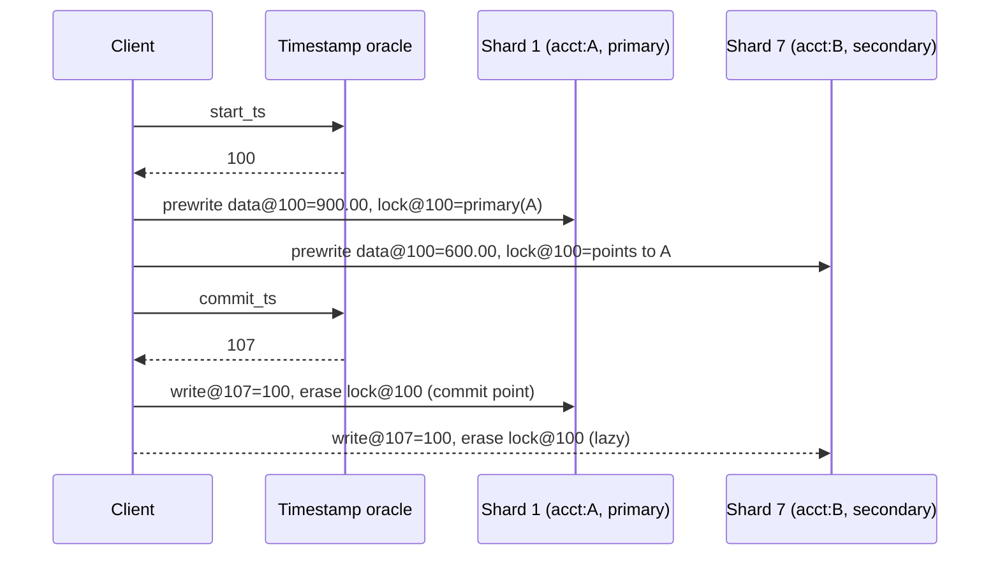

# Percolator and Spanner-Style Transactions

> Timestamps as the coordinator: when every write carries a globally ordered timestamp, the coordinator's decision becomes a cell in the data, and the clock, not a process, decides who came first.

**Type:** Learn
**Languages:** —
**Prerequisites:** Phase 7 Lesson 08 (Two-Phase Commit), Phase 7 Lesson 06 (MVCC and Snapshot Isolation), Phase 5 Lesson 04 (Physical Clocks, NTP, and Hybrid Logical Clocks), Phase 6 Lesson 06 (Raft II: Log Replication)
**Time:** ~90 minutes

## Learning Objectives

- Explain how Percolator removes the blocking coordinator from two-phase commit by storing the commit decision in the primary row's lock and write columns
- Trace a cross-shard transfer through Percolator's prewrite and commit phases with real timestamps, including what a reader does when it finds a stale lock
- Define external consistency and show, with a numeric example, why a bounded-uncertainty clock plus commit wait achieves it and a plain timestamp does not
- Describe Spanner's commit protocol: Paxos groups, the coordinator leader, prepare and commit timestamps, TrueTime, and commit wait
- Explain how CockroachDB adapts the same design to commodity clocks with hybrid logical clocks, uncertainty intervals, and read refreshes, and what guarantee it gives up
- Choose between Percolator-style, Spanner-style, and classic 2PC for a given cross-shard payments operation and defend the choice

## The Problem

A ledger is sharded by account. A transfer from account A on shard 1 to account B on shard 7 has to debit one and credit the other atomically, so the team builds two-phase commit (Lesson 08): a coordinator service asks both shards to prepare, then tells both to commit. It works until the coordinator host is rebooted during a deployment with four hundred transfers in the prepared state. Both shards hold row locks on four hundred accounts and cannot release them, because releasing requires knowing a decision that existed only in the coordinator's memory and its local log on a disk that is now unreachable. Customers whose accounts are among the four hundred cannot pay for twenty-six minutes.

The team's second problem is quieter. After the transfer commits, the fraud service reads account B's balance on shard 7 and account A's on shard 1 to compute exposure. Shard 7 has applied the commit; shard 1 has not yet, because the commit messages arrived in a different order. The fraud read sees money in B that has not left A. The sum of balances across the two shards is 100.00 USD too high for a few milliseconds, and the fraud rule that fires on a sudden balance increase triggers a review of a legitimate customer. There is no bug in either shard: there is simply no single instant at which "the transfer committed" is true on both.

Both problems have the same root: in classic 2PC, the commit decision lives in a process, and the order of commits lives nowhere at all. The two systems in this lesson fix this by making timestamps do the coordinating. Percolator (Google, 2010) stores the decision in the data itself, in the primary row's columns, so any client that finds a lock can finish or undo the transaction without the coordinator. Spanner (Google, 2012) assigns every commit a timestamp from a clock with bounded uncertainty and waits out that uncertainty before acknowledging, so that any transaction that starts after an acknowledgement is guaranteed a later timestamp and will see the commit. CockroachDB ports the Spanner design to machines without GPS and atomic clocks. The result, in all three, is a cross-shard transaction whose atomicity does not depend on one process staying alive, and whose ordering is something a reader can rely on.

## The Concept

### Percolator: two-phase commit without a coordinator process

Percolator was built to update Google's web index incrementally on top of Bigtable, a sharded key-value store with single-row atomic operations and no multi-row transactions. The design adds snapshot isolation across rows using nothing but single-row atomicity, a timestamp oracle, and three extra columns per user column:

| Column | Holds | Written during |
|--------|-------|----------------|
| `data` | the value, versioned by `start_ts` | prewrite |
| `lock` | a marker, versioned by `start_ts`, naming the transaction's *primary* cell | prewrite |
| `write` | a pointer from `commit_ts` to the `start_ts` whose data is now committed | commit |

Every transaction gets a `start_ts` from the timestamp oracle at begin, a strictly increasing counter served by one process that batches requests (Percolator's served about two million per second). Reads at `start_ts` look in the `write` column for the latest `commit_ts` at or below `start_ts`, follow the pointer to the `data` version, and return it: snapshot isolation, as in Lesson 06, with the oracle as the version counter.

Writes are buffered until commit. Commit is 2PC, but the roles are different:

1. **Prewrite** (prepare). The client picks one of its cells as the *primary*; the others are *secondaries*. For each cell, in one Bigtable row transaction: abort if the `write` column has any entry with `commit_ts > start_ts` (someone committed after we started: write-write conflict, first-committer-wins); abort if the `lock` column has any entry at all (someone else is mid-commit); otherwise write `data@start_ts = value` and `lock@start_ts = primary`.
2. **Commit**. Get `commit_ts` from the oracle. In one row transaction on the *primary*: if `lock@start_ts` is gone, abort (a cleaner rolled us back); otherwise write `write@commit_ts = start_ts` and erase `lock@start_ts`. **This single row write is the commit point.** Then, for each secondary, write its `write@commit_ts` and erase its lock. These can happen later, lazily, and can be done by anyone.

The decision no longer lives in a coordinator's memory. It lives in the primary cell: if the primary's lock is gone and its write record exists, the transaction committed; if the primary's lock is gone and no write record exists, it aborted; if the lock is still there, it is in flight. Any client that encounters a secondary's stale lock reads the primary and knows what to do.



### Lock cleanup and the liveness question

A reader at `start_ts = 110` that finds `lock@100` on `acct:B` has found a transaction that may be running, may have committed without finishing its secondaries, or may be dead. It resolves this by looking at the primary:

| Primary state | Meaning | Reader's action on the secondary |
|---------------|---------|----------------------------------|
| `lock@100` present, owner alive | still committing | wait a little and retry |
| `lock@100` present, owner dead (liveness via Chubby lock service) | crashed before commit point | erase the primary lock (abort), then erase the secondary lock |
| `lock@100` gone, `write@107 = 100` present | committed | roll forward: write `write@107 = 100` on the secondary, erase its lock |
| `lock@100` gone, no write record | aborted | erase the secondary lock |

Rolling back requires erasing the *primary* lock first, in one row transaction. Because erasing the primary lock and writing the primary's write record are the same single-row atomic operation from the committer's side, the cleaner and the committer cannot both win. This is the same "exactly one of commit or abort" property Lesson 08's coordinator log provided, now guaranteed by one row's atomicity instead of one process's disk.

What Percolator gives up: latency. Every cell operation is a Bigtable RPC, prewrite and commit are each a round trip per cell, and the timestamp oracle is two more. Google's paper reports transaction latencies in the tens to hundreds of milliseconds and says it was built for throughput on a latency-tolerant workload. It also only gives snapshot isolation: write skew (Lesson 04) is possible, and the ordering of commit timestamps is just the oracle's counter, which says nothing about real time.

### Percolator in pseudocode

The protocol fits in a page. This sketch follows Figure 6 of the paper; `row.atomic` is Bigtable's single-row transaction, the only atomicity primitive available.

```java
long startTs = oracle.next();
Cell primary = writes.get(0);

// Phase 1: prewrite every cell, primary first
for (Cell c : writes) {
    boolean ok = c.row.atomic(() -> {
        if (c.write.hasEntryAfter(startTs)) return false;        // someone committed after we started
        if (c.lock.hasAnyEntry()) return false;                  // someone else is mid-commit
        c.data.put(startTs, c.newValue);
        c.lock.put(startTs, primary.address());
        return true;
    });
    if (!ok) { cleanupOwnLocks(); throw new WriteConflict(); }
}

// Phase 2: commit the primary; this one row write is the commit point
long commitTs = oracle.next();
boolean committed = primary.row.atomic(() -> {
    if (!primary.lock.has(startTs)) return false;                // a cleaner rolled us back
    primary.write.put(commitTs, startTs);
    primary.lock.erase(startTs);
    return true;
});
if (!committed) throw new Aborted();

// Secondaries: can be lazy, can be done by anyone
for (Cell c : secondaries) {
    c.row.atomic(() -> { c.write.put(commitTs, startTs); c.lock.erase(startTs); return true; });
}
```

Three details carry the correctness. The prewrite's first check implements first-committer-wins over `[startTs, now]`, which is the snapshot-isolation rule from Lesson 06. The second check refuses to prewrite over any lock, even a stale one, because the only safe way to clear a stale lock is to consult its primary. And the commit's `if (!primary.lock.has(startTs))` is what makes the committer and a concurrent cleaner mutually exclusive: both operate on the primary row atomically, and whichever runs second sees the other's result.

A read is the mirror image:

```java
Value read(Cell c, long startTs) {
    while (true) {
        if (c.lock.hasEntryBefore(startTs)) {                   // a pending write that might be visible to us
            resolveLock(c, startTs);                             // consult the primary: wait, roll forward, or roll back
            continue;
        }
        long latestCommit = c.write.latestAtOrBefore(startTs);   // commit_ts -> start_ts pointer
        return c.data.get(c.write.get(latestCommit));
    }
}
```

The reader only cares about locks with `start_ts` below its own snapshot. A lock from a transaction that started *after* the reader cannot belong to a write the reader should see, so it is skipped. This is why Percolator readers rarely block: they wait only on transactions that began before them and are still in the few-millisecond window between prewrite and primary commit.

### Spanner: external consistency from a clock you can trust

Spanner replaces the single timestamp oracle with a *global* notion of time and uses it to deliver a stronger guarantee than snapshot isolation. The guarantee is **external consistency**: if transaction T1 commits (its client receives the acknowledgement) before transaction T2 starts, in real time, then T1's commit timestamp is less than T2's. Equivalently, the timestamp order of transactions agrees with any order an outside observer could have witnessed. In the terms of Phase 5, Lesson 05 (Consistency Models), this is strict serializability for transactions.

The ingredient is **TrueTime**: an API that returns not a timestamp but an interval. `TT.now()` returns `[earliest, latest]` with the promise that the true time is inside it. The interval's half-width, epsilon, comes from GPS receivers and atomic clocks in every datacenter plus a model of local clock drift between synchronisations; the paper reports epsilon averaging around 4 ms and bounded at 6 to 7 ms. `TT.after(t)` is true when `TT.now().earliest > t`: the true time is definitely past t.

Spanner's data is sharded into *tablets*, each replicated by a Paxos group (Phase 6, Lesson 04) with a long-lived leader. A read-write transaction:

1. Reads go to the leader of each involved group, which takes read locks (two-phase locking, Lesson 05, with wound-wait for deadlock prevention). Writes are buffered at the client.
2. At commit, the client chooses one group as the *coordinator* and sends the buffered writes to every participant leader. Each participant acquires write locks, chooses a *prepare timestamp* larger than any it has assigned before, and logs a prepare record through its own Paxos group. The prepare is replicated, so a participant leader's death does not lose it.
3. The coordinator leader waits for all prepares, chooses a *commit timestamp* `s` that is at least every prepare timestamp, at least `TT.now().latest` at the moment it received the commit request, and larger than any timestamp it has assigned, and logs the commit record through its Paxos group.
4. **Commit wait.** The coordinator waits until `TT.after(s)` is true, then releases locks and acknowledges the client. Participants apply the commit at `s` when told.

The coordinator's state is replicated by Paxos, so the Lesson 08 blocking problem is bounded by Paxos leader election, not by a host reboot. That is one of the two improvements over classic 2PC. The other is step 4.

### Why commit wait is necessary, with numbers

Take epsilon = 3 ms. T1's coordinator receives the commit request when the true time is 10.007 s. `TT.now()` returns `[10.004, 10.010]`. It picks `s1 = 10.010` (at least `latest`).

Without commit wait the coordinator acknowledges immediately, at true time 10.007. The client, on hearing the ack, starts T2 at true time 10.008 on a different machine whose TrueTime says `[10.005, 10.011]`. T2 is a read-only transaction and picks `s2 = TT.now().latest = 10.011`: fine, `s2 > s1`. But a slower machine, whose clock is behind within its error bound, could return `[10.005, 10.009]` at the same true instant, giving `s2 = 10.009 < s1 = 10.010`. T2 started after T1 was acknowledged and yet has a smaller timestamp. A read at `s2` does not see T1's write. External consistency is violated: the client did something after being told the money moved, and the system shows it the money has not moved.

With commit wait the coordinator holds the acknowledgement until `TT.after(10.010)`, that is until every machine's `earliest` is past 10.010, which happens at true time 10.010 + epsilon = 10.013 (the paper puts the expected wait at about 2 epsilon from when `s` was chosen). Only then does the client learn of the commit. Any T2 that starts after that has `TT.now().latest >= true time > 10.010 = s1`, on every machine, because `latest` is never less than the true time. So `s2 > s1` is guaranteed, and a snapshot read at `s2` includes T1.

```text
true time   10.007   coordinator picks s1 = TT.now().latest = 10.010
            10.007   (without wait) ack -> T2 could pick s2 = 10.009 < s1   VIOLATION
            10.013   TT.after(10.010) becomes true on every machine: ack
            10.014   T2 begins, picks s2 = TT.now().latest >= 10.014 > s1    OK
```

The cost is explicit and small: a commit is delayed by roughly 2 epsilon, 8 to 14 ms in the paper's deployment, overlapped with the Paxos commit round trip so it is often nearly free. The benefit is that *any* replica can serve a read-only transaction at timestamp `s_read = TT.now().latest` without locks and without talking to a coordinator, as soon as that replica's Paxos log is known to be complete up to `s_read` (its *safe time*). That is how Spanner serves consistent global reads from the nearest datacenter.

### CockroachDB: the same shape on ordinary clocks

CockroachDB has Spanner's architecture, Raft groups per range instead of Paxos, a transaction record instead of a coordinator log, and write intents instead of Percolator's lock column, but it runs on cloud VMs with NTP. Its clock is a **hybrid logical clock** (Phase 5, Lesson 04): physical time plus a logical counter, with the operator-configured `max_offset` (default 500 ms) as the maximum tolerated skew between any two nodes. A node whose clock drifts beyond `max_offset` from its peers shuts itself down.

Without TrueTime's tight bound, waiting out 500 ms per commit is unacceptable, so CockroachDB does not commit-wait by default. Instead it moves the uncertainty to the reader:

- A transaction reading at timestamp `t` treats any value with a timestamp in `(t, t + max_offset]` as *uncertain*: it may have been committed before the reader started, by a node whose clock was ahead. The reader cannot ignore it and cannot safely return it without risking a stale read, so the transaction **restarts at a timestamp just above the uncertain value** and tries again. With HLCs, a value's timestamp carries the writer's clock, and after the restart the reader has observed it, so the same value cannot cause a second restart.
- A read-write transaction may also need to move its timestamp forward at commit (because a write conflicted with a later write). Before committing at the new timestamp it runs a **read refresh**: it checks every key it read has not changed between the old and new timestamps. If none changed, the transaction's reads are valid at the new timestamp and it commits serializably; if any changed, it restarts. This is how CockroachDB offers `SERIALIZABLE` by default rather than snapshot isolation.
- **Parallel commits** write the transaction record in the staging state concurrently with the write intents, so a commit takes one round of consensus rather than two; a reader that finds a staging record checks that every intent was written and finalises it, the same recovery-by-reader idea as Percolator's primary lock.

What it gives up: external consistency across transactions with no causal link. If T1 commits on node X and, within `max_offset`, an unrelated client starts T2 on node Y whose clock is behind, T2 can receive a lower timestamp than T1 and miss it. CockroachDB calls this a *causal reverse*; it cannot happen between transactions that touch overlapping keys (the uncertainty restart handles those) or between transactions where T2's client learned of T1 through the database, but it can between two independent clients talking out of band. The documentation offers linearizable mode, which is commit wait with `max_offset`, for those who need it and will pay for it.

### Read-only transactions and safe time

Commit wait buys Spanner its cheapest and most used operation. A read-only transaction declares itself up front, receives `s_read = TT.now().latest`, and then reads at `s_read` from *any* replica of each group it needs, without locks and without a coordinator. The replica must only be sure that its copy of the Paxos log contains every write with a timestamp at or below `s_read`. It knows this through two numbers it tracks locally:

- `t_paxos_safe`: the timestamp of the latest Paxos write it has applied. Because a leader assigns timestamps in increasing order, nothing below this is missing.
- `t_tm_safe`: one less than the smallest prepare timestamp of any transaction that is prepared but not yet committed at this group. A prepared transaction might commit at any timestamp above its prepare timestamp, so reads above it are unsafe until it resolves.

The replica's safe time is the minimum of the two. A read at `s_read` waits until safe time passes `s_read`, which on a healthy replica is a few milliseconds behind the leader. The trace for the fraud read of the worked example, with epsilon 3 ms:

```text
true 10.020  fraud service: s_read = TT.now().latest = 10.023
true 10.020  nearest replica of shard 7: t_paxos_safe = 10.019, no prepared txns -> safe = 10.019 < s_read, wait
true 10.024  replica applies Paxos write stamped 10.023 (a different transaction): safe = 10.023 >= s_read, serve
             returns acct:B as of 10.023, which includes the transfer committed at s1 = 10.010
```

Compare the three systems' read-only path:

| | Percolator | Spanner | CockroachDB |
|--|-----------|---------|-------------|
| Read timestamp | `start_ts` from the oracle | `TT.now().latest` | HLC now |
| Where it reads | the Bigtable tablet server (one copy) | any replica past safe time, usually the nearest | leaseholder by default; any replica with follower reads at a slightly older timestamp |
| Can block on | a lock from an older in-flight transaction | safe time catching up | an uncertain value (restart) or an intent (push the writer) |
| Sees a commit acknowledged before it started | yes if the oracle issued the commit timestamp first (always, since the oracle is central) | yes, by commit wait | yes if causally connected; otherwise only within linearizable mode |

### Latency budget

Where the time goes for one cross-shard transfer, in round trips (RTT) and waits, assuming two participants:

| Step | Percolator | Spanner | CockroachDB |
|------|------------|---------|-------------|
| get start timestamp | 1 RTT to oracle | 0 (TrueTime is local) | 0 (HLC is local) |
| reads | 1 RTT per cell | 1 RTT per group to its leader, plus lock wait | 1 RTT per range to its leaseholder |
| prepare | 1 RTT per cell (serial on primary first) | 1 RTT per participant, each a Paxos round | 1 RTT per range, each a Raft round, in parallel with the record |
| commit decision | 1 RTT to oracle plus 1 RTT to primary | 1 Paxos round at the coordinator | included in parallel commit |
| wait | none | about 2 epsilon | none (or `max_offset` in linearizable mode) |
| ack to client | after primary commit | after commit wait | after all intents and the staging record are durable |
| cleanup | lazy, by anyone | participants apply on notification | asynchronous intent resolution |

Percolator's cost is dominated by per-cell RTTs, which is why it suits batch indexing and why TiKV added one-phase commit for single-region transactions. Spanner's is dominated by consensus and commit wait, both of which grow with geographic spread. CockroachDB's parallel commit brings the common case to one consensus round, at the price of a more complex recovery path.

### Comparison

| | Classic 2PC (Lesson 08) | Percolator | Spanner | CockroachDB |
|--|------------------------|------------|---------|-------------|
| Clock | none | central timestamp oracle | TrueTime (GPS + atomic) | hybrid logical clock, NTP |
| Isolation | whatever the participants provide | snapshot isolation | serializable, externally consistent | serializable; external consistency only with linearizable mode |
| Where the decision lives | coordinator's log | primary cell's lock and write columns | coordinator group's Paxos log | transaction record, Raft-replicated |
| Who finishes a stalled transaction | coordinator only, after recovery | any reader that finds a lock | coordinator group's new leader | any reader that finds an intent |
| Blocking window | until coordinator recovers | until primary lock owner is declared dead | until Paxos re-elects a leader | until Raft re-elects a leader |
| Commit latency | 2 round trips plus log writes | 2 round trips per cell plus oracle | 1 Paxos round plus commit wait of about 2 epsilon | 1 Raft round with parallel commits |
| Read-only transactions | take locks or read dirty | at a snapshot, no locks | at `TT.now().latest`, any up-to-date replica, no locks | at HLC now, may restart on uncertainty |
| Production use | XA, JTA, legacy TP monitors | TiDB/TiKV | Google Spanner, Cloud Spanner | CockroachDB, YugabyteDB (similar design) |

### Choosing for a payments operation

| Operation | Needs | Pick | Why |
|-----------|-------|------|-----|
| Transfer between accounts on different shards | atomicity, no blocking on a dead coordinator | Percolator-style or Spanner-style | the decision is recoverable by any client, or replicated by consensus |
| Fraud or risk read of several accounts after a payment the client was told succeeded | must see the payment | Spanner-style with commit wait, or CockroachDB linearizable mode | only external consistency guarantees a later start sees an earlier acknowledged commit |
| Nightly reconciliation of all balances | one consistent instant, high volume, latency tolerant | any snapshot read: Percolator snapshot, Spanner read-only at `TT.now().latest`, CockroachDB `AS OF SYSTEM TIME` | no locks, no coordinator, reads from any up-to-date replica |
| Idempotency key check and insert | at most one effect | none of these; a unique constraint on one shard | choose the shard key so the key and its effect live together, and the transaction is local |
| Balance check with a floor across two pockets | serializable, not snapshot | Spanner (locks) or CockroachDB (read refresh); not plain Percolator | Percolator is snapshot isolation and permits write skew (Lesson 04) |
| Legacy systems that only speak XA | atomicity across existing databases | classic 2PC with a replicated coordinator log | you cannot add columns to a system you do not own; harden the coordinator instead |

The common move in all three designs, and the one to copy into your own system even if you never run them, is to **make the commit decision a durable, addressable record that anyone can read**, rather than a fact in one process's memory. A payment state machine (Phase 12, Lesson 02) that stores `COMMITTED` in the payment row before fanning out to ledgers is doing exactly what Percolator's primary does.

### Failure modes you will meet in production

- **Timestamp oracle outage.** Percolator's oracle is a single process; if it is down, no transaction can begin or commit. TiDB runs it inside its Placement Driver, a Raft group, and pre-allocates ranges of timestamps so a leader change does not reissue one. Any design with a central counter needs the same.
- **Lock cleanup storms.** A client that prewrites thousands of secondaries and dies leaves thousands of locks for readers to resolve, each resolution a round trip to the primary. Readers slow down for every key the dead client touched until a background cleaner catches up. Keep transactions small and bound the number of cells per transaction.
- **Clock failure as node failure.** TrueTime and CockroachDB both treat a clock outside its bound as a dead machine. A fleet-wide NTP misconfiguration can therefore take down a cluster that has no other fault. The clock is part of the consensus hardware now; monitor it as such.
- **Commit wait inflation.** Epsilon grows between clock synchronisations (the sawtooth in the Spanner paper) and jumps when a GPS receiver or time master fails. Commit latency follows it. A p99 latency alert on cross-shard commits is partly a clock health alert.
- **Hot ranges.** A ledger that puts every posting for a popular merchant in one range makes that range's Raft or Paxos leader the bottleneck and every transaction touching it a cross-range transaction for everyone else. Shard by account, co-locate postings with balances, and expect transfers to be the cross-range case.
- **Causal reverse surprises.** On CockroachDB without linearizable mode, a test that commits on one node and immediately reads on another through an out-of-band channel can see stale data within `max_offset`. Teams discover this in integration tests that pass on one node and fail on three.

### What these designs do not do

- They do not remove the prepare phase. Every participant still has to durably record "I can commit" before anyone commits. The difference is where the *decision* is recorded and who may act on it.
- They do not make cross-shard transactions cheap. Percolator's are slow; Spanner's pay commit wait and cross-datacenter Paxos; CockroachDB's pay a Raft round and the risk of restart. All three systems recommend designing keys so that most transactions stay within one shard or range. For a ledger that means co-locating an account's postings with its balance, and accepting that a transfer between accounts is the expensive case.
- Snapshot-isolation Percolator does not prevent write skew; Spanner's locking and CockroachDB's read refresh do.
- Commit wait does not help a reader whose own clock is wrong by more than epsilon. TrueTime's guarantee rests on the hardware and on marking a machine with a bad clock as failed; CockroachDB does the same with `max_offset`.

## Worked Example

A transfer of 100.00 USD from `acct:A` (balance 1000.00) to `acct:B` (balance 500.00), each on a different shard, run through Percolator, then the same transfer concurrent with a read of both accounts.

**Begin.** Oracle hands out `start_ts = 100`. The client reads `acct:A` at 100: the latest `write` entry at or below 100 is `write@90 = 85`, pointing to `data@85 = 1000.00`. Likewise `acct:B`: `write@92 = 88`, `data@88 = 500.00`. Both reads also confirm there is no `lock` entry on either cell. The client buffers `A = 900.00`, `B = 600.00` and chooses `acct:A` as primary.

**Prewrite A.** One row transaction on shard 1: no `write` entry with `commit_ts > 100` (latest is 90), no `lock` entry. Write `data@100 = 900.00`, `lock@100 = "primary"`.

**Prewrite B.** One row transaction on shard 7: no `write` after 100 (latest is 92), no lock. Write `data@100 = 600.00`, `lock@100 = "primary: acct:A"`.

**Commit.** Oracle hands out `commit_ts = 107`. One row transaction on shard 1: `lock@100` is present, so write `write@107 = 100` and erase `lock@100`. The transfer is now committed; nothing that happens afterwards can undo it. The client sends the secondary commit to shard 7 and, for the sake of the example, crashes before it arrives.

**A reader arrives.** The fraud service begins at `start_ts = 110` and reads `acct:B` first. It finds `lock@100` pointing to `acct:A`. It reads the primary: `lock@100` is gone and `write@107 = 100` exists, so the transaction committed at 107, which is at or below 110 and therefore visible. The reader rolls the secondary forward: writes `write@107 = 100` on `acct:B` and erases its lock, then follows the pointer and returns `600.00`. It then reads `acct:A` at 110: `write@107 = 100`, `data@100 = 900.00`. The reader sees 900.00 and 600.00: both halves of the transfer, total 1500.00, even though the committing client died halfway through its cleanup. Had the reader started at `start_ts = 105` instead, it would have found the same lock, learned from the primary that the commit timestamp is 107 which is above 105, and returned the previous version `500.00` for B and `1000.00` for A: also consistent, as of before the transfer.

The column state after each step, for both cells. Each entry is `column@timestamp = value`:

| After step | `acct:A` (primary) | `acct:B` (secondary) |
|------------|--------------------|----------------------|
| begin | `data@85 = 1000.00`, `write@90 = 85` | `data@88 = 500.00`, `write@92 = 88` |
| prewrite A | plus `data@100 = 900.00`, `lock@100 = primary` | unchanged |
| prewrite B | unchanged | plus `data@100 = 600.00`, `lock@100 = primary: acct:A` |
| commit primary | `lock@100` erased, plus `write@107 = 100` | unchanged (lock still present) |
| client crashes | unchanged | `lock@100` still present |
| reader rolls forward | unchanged | `lock@100` erased, plus `write@107 = 100` |

Between "commit primary" and "reader rolls forward" the transaction is committed but half-cleaned. Any reader at `start_ts >= 107` sees both halves; any reader below 107 sees neither. There is no timestamp at which exactly one half is visible, which is the atomicity the fraud service in The Problem needed.

**The same reader on Spanner.** The read-only transaction picks `s_read = TT.now().latest`. If the fraud service started after the transfer's client received its acknowledgement, commit wait guarantees `s_read > s_commit`, so both shards serve the post-transfer values once their safe time passes `s_read`. There is no instant at which an observer who was told "committed" can read and not see it. On CockroachDB without linearizable mode, the same guarantee holds if the fraud service learned about the transfer through the database (its read would hit the uncertainty window and restart above the commit) but not if it learned about it through, say, a message queue, within `max_offset` of the commit.

## Exercises

1. **Reinforce.** Write out the state of the `data`, `lock`, and `write` columns of both cells after each step of the worked example as a table with one row per step. Then add a step in which a cleaner finds `lock@100` on `acct:B` *before* the committer has written the primary's write record, decides the owner is alive, and waits. Explain, with reference to the single-row atomicity of the primary, why the cleaner and committer cannot both succeed.
2. **Apply.** Spanner's commit wait is about 2 epsilon. Suppose a ledger's cross-shard transfers commit at 2,000 per second with epsilon = 5 ms, and the system has a lock-wait budget. Compute how many transfers are, on average, holding locks solely because of commit wait at any instant, and compare it with the number holding locks because of a 40 ms Paxos round trip. Then explain why Spanner recommends that read-write transactions avoid cross-region participants where possible, in terms of which of these two numbers it affects.
3. **Extend.** Lesson 08's 2PC simulator has a coordinator that crashes after sending prepare. Redesign its participants so that the commit decision is a record in the first participant's store (Percolator's primary), and change the recovery procedure so that a *second client* that finds a prepared record on another participant resolves it by reading the primary. Write the recovery table from The Concept as a test, including the case where the primary's record says "aborted".

## Key Terms

| Term | What people say | What it actually means |
|------|-----------------|------------------------|
| Primary lock | "the Percolator coordinator" | The one cell per transaction whose lock column holds the commit decision; erasing it together with writing its write record is the commit point, and any client can read it to resolve the others |
| Timestamp oracle | "the clock service" | A single process handing out strictly increasing integers in batches; it orders snapshots and commits but knows nothing about real time |
| TrueTime | "Google's atomic clocks" | An API returning an interval `[earliest, latest]` guaranteed to contain the true time, backed by GPS and atomic clocks, with a half-width epsilon of a few milliseconds |
| Commit wait | "Spanner waits before acking" | Holding the acknowledgement of a commit at timestamp `s` until `TT.after(s)`, so that any transaction starting afterwards receives a timestamp greater than `s` |
| External consistency | "strict serializability" | If T1's commit is acknowledged before T2 starts in real time, T1's timestamp is less than T2's; the system's order matches any observer's order |
| Uncertainty interval | "CockroachDB's clock skew window" | The range `(t, t + max_offset]` above a reader's timestamp in which a value might have been committed earlier in real time; finding one forces the reader to restart above it |
| Read refresh | | CockroachDB's check, before committing at a moved-forward timestamp, that no key the transaction read has changed; it is what upgrades snapshot isolation to serializable |
| Safe time | "the replica is caught up" | The timestamp below which a replica knows its log contains every committed write, so it can serve a snapshot read at that timestamp without contacting the leader |

## Further Reading

- [Peng, Dabek, "Large-scale Incremental Processing Using Distributed Transactions and Notifications" (OSDI 2010)](https://research.google/pubs/large-scale-incremental-processing-using-distributed-transactions-and-notifications/) — the Percolator paper; section 2.2 is the transaction protocol and Figure 6 is the pseudocode the worked example follows.
- [Corbett et al., "Spanner: Google's Globally-Distributed Database" (OSDI 2012)](https://research.google/pubs/spanner-googles-globally-distributed-database-2/) — TrueTime (section 3), the commit protocol and commit wait (section 4.2), and the measured epsilon (section 5.3).
- [Bacon et al., "Spanner: Becoming a SQL System" (SIGMOD 2017)](https://research.google/pubs/spanner-becoming-a-sql-system/) — what changed when Spanner became a general database; useful for the read-only transaction path.
- [CockroachDB Architecture: Transaction Layer](https://www.cockroachlabs.com/docs/stable/architecture/transaction-layer.html) — transaction records, write intents, parallel commits, read refresh, and the uncertainty interval, in the vendor's own words.
- [Kulkarni, Demirbas, Madappa, Avva, Leone, "Logical Physical Clocks and Consistent Snapshots in Globally Distributed Databases" (OPODIS 2014)](https://cse.buffalo.edu/tech-reports/2014-04.pdf) — the hybrid logical clock paper CockroachDB's clock is based on.
- [TiKV documentation: Transaction overview](https://tikv.org/deep-dive/distributed-transaction/percolator/) — a production Percolator implementation, including the optimisations (async commit, one-phase commit for single-region transactions) that address the latency cost.
