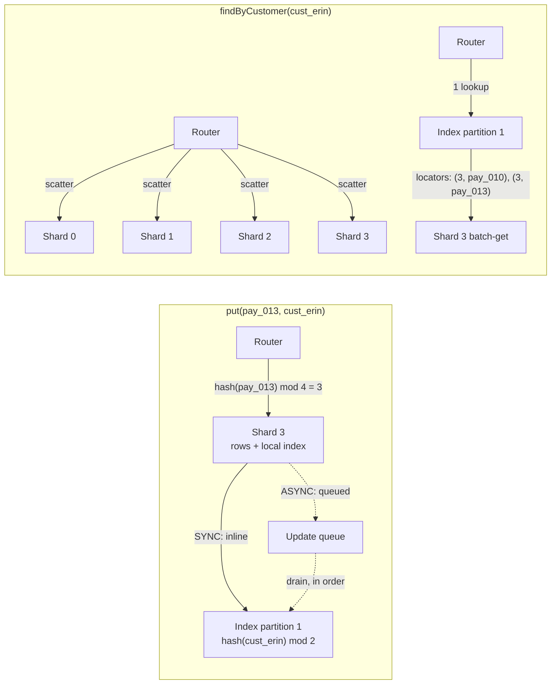

# Secondary Indexes: Local vs Global

> Find all payments for a customer across shards.

**Type:** Build
**Languages:** Java, Python, Go
**Prerequisites:** Phase 7 Lesson 01 (Partitioning Strategies and Rebalancing), Phase 7 Lesson 02 (Write-Ahead Logs), Phase 3 Lesson 06 (Consistent Hashing and Virtual Nodes)
**Time:** ~75 minutes

## Learning Objectives

- Explain why a table partitioned by primary key cannot answer a query on any other attribute without either fanning out to every partition or maintaining a second, differently partitioned structure
- Build a local (document-partitioned) secondary index that is updated atomically with the row, and a global (term-partitioned) index that is partitioned by the indexed attribute
- Measure the read cost of scatter-gather against the read cost of a global index, in requests per query, on the same data
- Implement asynchronous global-index maintenance with an ordered update queue, and demonstrate the staleness window and the dangling-entry problem it creates
- Rebuild a global index from a scan of the primary partitions and audit it for missing and dangling entries
- Choose between local and global indexes for a given access pattern using write amplification, read fan-out, and consistency as the criteria

## The Problem

A payments platform stores every payment in a table partitioned by `payment_id`. The id is random, so hashing it spreads load evenly across 64 shards, and a lookup by id is one request to one shard. The write path is clean: the API gateway hashes the id, writes the row to its shard, returns 201. For two years nobody needs anything else, because every call site that touches a payment already has the id.

Then the customer support console gets a new screen: "all payments for this customer, newest first." A customer has a `customer_id`, not a list of `payment_id`s. The first implementation does the only thing the table supports: ask all 64 shards "do you have rows for `cust_8812`?" and merge the answers. Each query is 64 network round trips and 64 index lookups, and the slowest shard sets the latency. The support console does this on every page load. The 64 shards, which were sized for one request per payment, now see 64 requests per console page. At 200 support agents the shards' p99 climbs from 4 ms to 180 ms and the latency shows up in the checkout path, which shares the shards. One screen in an internal tool has degraded the payment API.

The second implementation builds a separate table keyed by `customer_id` that lists the payment ids. Now a customer query is one request to find the ids, then fetches from the shards that hold them. But that table is itself partitioned, by customer, and a single payment write now has to update two shards: the payment's and the customer's. They are different machines. If the write to the second one fails, the payment exists and the customer screen does not show it. If the team makes the second write asynchronous to keep checkout fast, the screen is wrong for a few seconds after every payment, and a refund-then-query race shows a payment that no longer exists.

Every partitioned store faces exactly this fork. The partition key answers one question cheaply. Every other question needs a secondary index, and a secondary index over a partitioned table can be kept either with the data it points to (local) or with the attribute it is keyed by (global). The two choices have opposite costs: local indexes make writes cheap and reads expensive; global indexes make reads cheap and writes expensive or stale. This lesson builds both over the same store and counts the requests.

## The Concept

### Why the partition key only answers one question

A partitioned table routes a row to a shard by a function of one key: `shard = hash(payment_id) mod N`. Anything that knows the key can find the row in one step. Anything that does not know the key knows nothing about where the row is, because the hash deliberately destroys any relationship between the row's other attributes and its location. Two payments by the same customer are as likely to be on different shards as any two random rows.

So a query on a non-key attribute has exactly two options:

1. **Ask everyone.** Send the query to every shard and merge the results. Correct, always current, and costs `N` requests regardless of how many rows match.
2. **Keep a map from attribute value to location.** A second structure, maintained on every write, that says "customer `cust_8812` has rows at (shard 3, pay_001), (shard 17, pay_005), ...". Costs extra work on every write, and the map can disagree with the table.

A secondary index is the second option. The question is where that map lives.

### Local secondary index (document-partitioned)

Each shard keeps its own index over its own rows. When shard 3 stores `pay_001` for `cust_8812`, it also adds `pay_001` to its local `customer -> ids` map. The row and the index entry are on the same machine, written in the same local transaction, so they are never out of step. The index is partitioned the same way as the data, by the primary key, which is why Kleppmann calls it *document-partitioned*: each document's index entries live with the document.

The cost moves to the read. A customer's payments are on arbitrary shards, so the query must still ask every shard's local index. That is the scatter-gather in The Problem. The index saves each shard from scanning its rows, but it does not save the client from visiting every shard.

### Global secondary index (term-partitioned)

The global index is a separate table partitioned by the *indexed attribute*. All entries for `cust_8812` live in index partition `hash(cust_8812) mod M`, whatever shards the payments themselves are on. A customer query is one request to one index partition, which returns locators `(shardId, paymentId)`, followed by one batch fetch per distinct shard that holds a hit. Kleppmann calls this *term-partitioned*: the index is partitioned by the term being looked up.

The cost moves to the write. Inserting `pay_001` touches the payment's shard and the index partition for its customer, and those are on different machines. Keeping them consistent means either a distributed transaction (Lesson 08's two-phase commit, which doubles write latency and introduces a coordinator) or asynchronous propagation (the row commits, an update is queued, the index catches up later). Almost every production system picks asynchronous, which means the global index is eventually consistent with the table it indexes.

### The two choices side by side

| | Local secondary index | Global secondary index |
|---|---|---|
| Partitioned by | Primary key (same as the data) | Indexed attribute |
| Write cost | One shard, one local transaction | One shard plus one remote index partition |
| Index freshness | Always current (same write) | Lags by the propagation delay |
| Read cost for one attribute value | `N` requests, one per shard | `1 + k` requests, `k` = distinct shards holding hits |
| Read latency | Slowest of `N` shards | One index hop then slowest of `k` shards |
| Hot attribute value | Spread over all shards | Concentrated on one index partition |
| Failure of one shard | Query is partial or fails | Index still answers; fetch from the dead shard fails |
| Production examples | DynamoDB LSI, Cassandra secondary indexes, Elasticsearch per-shard indexes, MongoDB per-shard indexes | DynamoDB GSI, Riak search, Elasticsearch term-partitioned alternative, HBase coprocessor indexes |

### Counting requests by hand

Four shards, two index partitions, twelve payments. Customer `cust_alice` has five payments that happen to hash to all four shards; `cust_erin` has one payment on shard 3.

```text
Scatter-gather for cust_alice:  4 shard requests (every shard) + 0 index requests = 4
Global for cust_alice:          1 index request + 4 shard batch-gets (hits on all 4) = 5

Scatter-gather for cust_erin:   4 shard requests + 0 index requests = 4
Global for cust_erin:           1 index request + 1 shard batch-get = 2
```

The global index did not help `cust_alice`: her rows are everywhere, so after the index hop the fetch still visits every shard. It helped `cust_erin` by a factor of two. Generalise: with `N` shards and a customer whose rows cover `k` distinct shards, scatter-gather costs `N` and the global index costs `1 + k`. The global index wins when `k < N - 1`, which is the common case as `N` grows: with 64 shards, a customer with 5 payments touches at most 5, so the global path costs at most 6 requests against 64. The more shards you have, the more a global index is worth, because scatter-gather fan-out grows with `N` and the global path grows only with the result set.

The write side is the mirror image. Twelve puts into the synchronous store produced 12 shard writes and 12 index-partition writes: every write is doubled, and the second half crosses the network. Twelve puts into the asynchronous store produced 12 shard writes, 0 index writes, and 12 queued updates.



### The staleness window

With asynchronous maintenance there is a window between the row committing on its shard and the index entry appearing on its partition. During that window:

- `get(pay_013)` by primary key finds the row. The row is durable.
- The global index query for `cust_erin` returns one payment, not two. The index has not heard.
- The scatter-gather query returns two. Local indexes were written with the row.

A customer who just paid and refreshes the "my payments" page sees the payment missing. Then it appears. This is the *read-your-own-writes* failure from Phase 6, Lesson 02, resurfacing at the index level. Mitigations are the same: route the reader to the primary for a few seconds after a write, pin to a known-fresh index replica, or return the new row from the write path's response and let the client merge it.

The window's length is the queue depth times the drain rate. In the simulation, `drainIndexUpdates(max)` lets you apply any number of queued updates and observe the index at each intermediate state. In production the queue is a change stream (Lesson 11) and the drain rate is the index writer's throughput, so a burst of writes lengthens the window for everyone.

### Dangling entries and ghosts

Deletes have the same window, inverted. `delete(pay_013)` removes the row and queues an index delete. Until it drains, the index still holds locator `(3, pay_013)`. A query that trusts the index would return a payment that does not exist. The implementation here never trusts the index for anything but locations: it always fetches the row from the owning shard and drops locators whose row is gone. The cost is that the fetch step cannot be skipped even when the index could hold a copy of the data; the benefit is that a ghost is never shown. The audit method reports such an entry as *dangling*; the mirror case, a row with no index entry, is *missing*.

The same mechanism handles an indexed attribute changing. Re-attributing `pay_100` from `cust_x` to `cust_y` emits two updates: a delete under the old key and an insert under the new one. Between them, or before either is applied, `cust_x`'s index entry is dangling and `cust_y`'s is missing. Ordering matters: applying the insert before the delete is fine, but applying a later delete before an earlier insert for the same locator would leave a permanent ghost. The queue preserves emission order with a sequence number so that cannot happen.

### Bootstrap and repair

An index that is maintained incrementally has to start from somewhere. Adding a global index to a table with a billion rows means scanning every shard once and emitting an insert per row, while live writes keep queuing updates. The simulation's `rebuildGlobalIndex` does the simple version: clear the index, discard the queue, scan every shard, insert every row. A production backfill cannot pause writes, so it takes a snapshot position in the change stream, scans, then replays the stream from that position; Lesson 11 builds exactly that handoff. The audit method is the reconciliation job you run afterwards, and periodically: compare every index entry to the table and every row to the index, and report the two kinds of disagreement.

### What this lesson does not do

- It does not make the global index a *covering* index. Every query fetches the row from its shard, which keeps ghosts out but costs a hop. Exercise 2 adds a projected copy of the amount to the index and asks what that does to consistency.
- It does not handle index partitions being replicated or failing. A dead index partition makes every customer hashed to it unqueryable; that is Lesson 01's rebalancing problem applied to a second table.
- It does not implement range queries on the indexed attribute ("customers whose id starts with cust_a"). Hash partitioning of the index destroys order the same way it does on the primary table; a range-partitioned index would support it and concentrate load on one partition for popular prefixes.
- It does not resolve the staleness window. It makes the window observable and gives the audit tools to measure it. Lesson 11 (change data capture) and Lesson 13 (transactional outbox) are the two production answers to "how does the update reliably get from the shard to the index."

## Build It

The implementation is a single-process simulation in which each network request is a method call that increments a counter. Those counters are the measurements the lesson is about, so every read of a shard or index partition goes through a counted method.

### Step 1: Money, Payment, and a deterministic hash

```java
record Payment(String id, String customerId, String merchantId, Money amount, long createdAt) {
    Payment {
        Objects.requireNonNull(id, "id");
        Objects.requireNonNull(customerId, "customerId");
        Objects.requireNonNull(merchantId, "merchantId");
        Objects.requireNonNull(amount, "amount");
    }
}

record Locator(int shardId, String paymentId) implements Comparable<Locator> { /* ordered by shard, then id */ }

final class Hashing {
    static long fnv1a64(String key) {
        long h = 0xcbf29ce484222325L;
        for (byte b : key.getBytes(StandardCharsets.UTF_8)) {
            h ^= (b & 0xff);
            h *= 0x100000001b3L;
        }
        return h;
    }
    static int partitionFor(String key, int partitions) {
        return Math.floorMod(fnv1a64(key), partitions);
    }
}
```

`Money` and `Currency` are the Phase 10, Lesson 01 records: integer minor units plus an ISO 4217 code. `Payment` is the row; `id` is the partition key and `customerId` is the attribute we will index. `Locator` is what a global index entry points at: not the row, but its address. The hash is FNV-1a over UTF-8 bytes so that a Python or Go port routes `pay_001` to the same shard; `Math.floorMod` rather than `%` because the hash is a signed `long` and `%` of a negative number is negative.

**Predict:** `Hashing.partitionFor("pay_001", 4)` and `Hashing.partitionFor("cust_alice", 4)` are computed by the same function. Is there any relationship between a payment's shard and its customer's index partition?

### Step 2: A shard with a local index

```java
final class Shard {
    final int id;
    private final TreeMap<String, Payment> rows = new TreeMap<>();
    private final TreeMap<String, TreeSet<String>> byCustomer = new TreeMap<>();
    private int requests = 0;

    Payment put(Payment p) {
        requests++;
        Payment previous = rows.put(p.id(), p);
        if (previous != null && !previous.customerId().equals(p.customerId())) unindex(previous);
        byCustomer.computeIfAbsent(p.customerId(), k -> new TreeSet<>()).add(p.id());
        return previous;
    }

    List<Payment> lookupCustomer(String customerId) {
        requests++;
        TreeSet<String> ids = byCustomer.get(customerId);
        if (ids == null) return List.of();
        List<Payment> out = new ArrayList<>(ids.size());
        for (String id : ids) out.add(rows.get(id));
        return out;
    }
}
```

`rows` is the primary table for this shard. `byCustomer` is the local secondary index: it maps a customer to the ids of rows *on this shard*. `put` updates both in one method call with no intervening I/O, which is the simulation's stand-in for a single-node transaction; in a real engine the two writes go into the same WAL record (Lesson 02). If the row is being replaced and its customer changed, the old index entry is removed first. `lookupCustomer` answers only for this shard's rows; it has no idea what the other shards hold.

Every public method begins with `requests++`. That counter is the network.

**Predict:** after `put` of a payment whose customer did not change, how many entries does `byCustomer` hold for that customer? Can it ever hold a duplicate?

### Step 3: The global index, partitioned by customer

```java
final class GlobalIndex {
    private final List<TreeMap<String, TreeSet<Locator>>> partitions = new ArrayList<>();
    private final int[] requests;

    int partitionFor(String customerId) { return Hashing.partitionFor(customerId, partitions.size()); }

    void apply(IndexUpdate u) {
        int p = partitionFor(u.customerId());
        requests[p]++;
        TreeMap<String, TreeSet<Locator>> part = partitions.get(p);
        if (u.delete()) {
            TreeSet<Locator> set = part.get(u.customerId());
            if (set != null) {
                set.remove(u.locator());
                if (set.isEmpty()) part.remove(u.customerId());
            }
        } else {
            part.computeIfAbsent(u.customerId(), k -> new TreeSet<>()).add(u.locator());
        }
    }

    List<Locator> lookup(String customerId) {
        int p = partitionFor(customerId);
        requests[p]++;
        TreeSet<Locator> set = partitions.get(p).get(customerId);
        return set == null ? List.of() : new ArrayList<>(set);
    }
}
```

The index is a list of partitions, each a map from customer to a sorted set of locators. The partition is chosen by hashing the *customer*, so every locator for one customer is in one partition and `lookup` is a single counted request. `apply` is idempotent: inserting a locator that is already present changes nothing, and deleting one that is absent changes nothing. That property is what makes the asynchronous queue safe to replay after a crash, which Lesson 11 depends on.

```java
record IndexUpdate(long seq, String customerId, Locator locator, boolean delete) {}
```

An `IndexUpdate` is one change to the index with a sequence number. The sequence number is not used by `apply`; it exists so a reader of the queue can see that order is preserved and so a later lesson can checkpoint it.

**Predict:** two customers hash to the same index partition. Does a query for one of them cost more requests than it would if they were on different partitions? Does it take longer?

### Step 4: The store and its two write modes

```java
enum IndexMode { SYNC, ASYNC }

void put(Payment p) {
    int shardId = shardFor(p.id());
    Payment previous = shards.get(shardId).put(p);
    if (previous != null && !previous.customerId().equals(p.customerId())) {
        emit(new IndexUpdate(nextSeq++, previous.customerId(), new Locator(shardId, p.id()), true));
    }
    if (previous == null || !previous.customerId().equals(p.customerId())) {
        emit(new IndexUpdate(nextSeq++, p.customerId(), new Locator(shardId, p.id()), false));
    }
}

private void emit(IndexUpdate u) {
    if (mode == IndexMode.SYNC) globalIndex.apply(u); else pending.addLast(u);
}

int drainIndexUpdates(int max) {
    int applied = 0;
    while (applied < max && !pending.isEmpty()) {
        globalIndex.apply(pending.pollFirst());
        applied++;
    }
    return applied;
}
```

`put` always writes the shard. Then it works out what the global index needs to hear: nothing if the row was overwritten with the same customer, an insert if the row is new, a delete-then-insert if the customer changed. `emit` is the fork in the road. `SYNC` applies the update now, which in a real system is a second remote write inside the request and the reason synchronous global indexes need two-phase commit or accept partial failure. `ASYNC` appends to a queue, and `drainIndexUpdates` is the index writer, called by the test and the demo with whatever batch size reproduces the state they want to observe.

**Predict:** in `ASYNC` mode, a payment is put, then deleted, then `drainIndexUpdates(1)` is called. What does the index contain for that customer? What does the audit report?

### Step 5: The two query strategies, with their bills

```java
QueryResult findByCustomerScatterGather(String customerId) {
    List<Payment> merged = new ArrayList<>();
    for (Shard s : shards) merged.addAll(s.lookupCustomer(customerId));
    merged.sort(Comparator.comparingLong(Payment::createdAt).thenComparing(Payment::id));
    return new QueryResult(Collections.unmodifiableList(merged), shards.size(), 0);
}

QueryResult findByCustomerGlobal(String customerId) {
    List<Locator> locators = globalIndex.lookup(customerId);
    Map<Integer, List<String>> byShard = new LinkedHashMap<>();
    for (Locator l : locators) byShard.computeIfAbsent(l.shardId(), k -> new ArrayList<>()).add(l.paymentId());
    List<Payment> merged = new ArrayList<>();
    for (Map.Entry<Integer, List<String>> e : byShard.entrySet()) {
        merged.addAll(shards.get(e.getKey()).getMany(e.getValue()));
    }
    merged.sort(Comparator.comparingLong(Payment::createdAt).thenComparing(Payment::id));
    return new QueryResult(Collections.unmodifiableList(merged), byShard.size(), 1);
}
```

Scatter-gather asks every shard's local index and merges. Its bill is always `N` shard requests, written directly into the `QueryResult`. The global strategy looks up locators, groups them by shard so each shard is asked once with a batch of ids, fetches, and merges. Its bill is one index request plus one shard request per distinct shard with a hit. `Shard.getMany` skips ids whose row is gone, which is how a dangling locator is filtered before the caller sees it.

Both strategies sort the merged result by `createdAt` then `id`. A merge from multiple partitions has no natural order, and a support screen that shows payments in shard order would appear to shuffle on every refresh.

**Predict:** `findByCustomerGlobal` on a customer with zero payments. How many shard requests?

### Step 6: Rebuild and audit

```java
int rebuildGlobalIndex() {
    globalIndex.clear();
    pending.clear();
    int entries = 0;
    for (Shard s : shards) {
        for (Payment p : s.scan()) {
            globalIndex.apply(new IndexUpdate(nextSeq++, p.customerId(), new Locator(s.id, p.id()), false));
            entries++;
        }
    }
    return entries;
}

IndexAudit auditGlobalIndex() {
    Map<Locator, String> indexed = globalIndex.allEntries();
    List<Locator> dangling = new ArrayList<>(), missing = new ArrayList<>();
    for (Map.Entry<Locator, String> e : indexed.entrySet()) {
        Payment row = shards.get(e.getKey().shardId()).get(e.getKey().paymentId());
        if (row == null || !row.customerId().equals(e.getValue())) dangling.add(e.getKey());
    }
    for (Shard s : shards) {
        for (Payment p : s.scan()) {
            Locator l = new Locator(s.id, p.id());
            if (!p.customerId().equals(indexed.get(l))) missing.add(l);
        }
    }
    return new IndexAudit(indexed.size(), dangling, missing);
}
```

`rebuildGlobalIndex` is the offline bootstrap: scan everything, insert everything. It discards the queue because every queued update is about a row the scan will see anyway, or a row that has since been deleted and the scan will not see. That reasoning only holds because writes are paused during the rebuild, which the single-threaded simulation guarantees and production does not; Lesson 11 removes that assumption.

`auditGlobalIndex` is two nested checks. Index to table: for each entry, does the row exist and still belong to that customer? If not, *dangling*. Table to index: for each row, is there an entry under the right customer? If not, *missing*. A consistent index has neither. The audit is `O(entries + rows)` and touches every shard, so in production it runs as a batch job, not on the request path.

**Predict:** immediately after `put` in `ASYNC` mode and before any drain, what does the audit report for the new row: dangling, missing, or both?

### Step 7: Run it

```bash
cd phases/07-storage-and-transactions/10-secondary-indexes/code/java
javac -d .out *.java && java -cp .out Main
java -cp .out MainTest
```

Expected output, abbreviated:

```console
== Placement: payments hash to shards by payment id, not by customer ==
cust_alice rows by shard: {0=[pay_011], 1=[pay_001, pay_005], 2=[pay_008], 3=[pay_003]}
cust_erin rows by shard:  {3=[pay_010]}

== Query: all payments for cust_alice ==
scatter-gather over local indexes: 5 rows, 4 shard requests, 0 index requests, total 124.14 USD
global index then fetch:           5 rows, 4 shard requests, 1 index requests, total 124.14 USD

== Query: cust_erin, a customer with a single payment ==
scatter-gather: 4 requests; global: 2 requests (1 index + 1 shard)

== Write cost: SYNC index pays on every put ==
SYNC store after 12 puts: shard requests 12, index-partition requests 12
ASYNC store after 12 puts: shard requests 12, index-partition requests 0, queued updates 12

== Staleness window: the row is durable, the index has not heard yet ==
get(pay_013) by primary key: found
global index query for cust_erin: 1 rows (expected 2)  <- stale, 1 update(s) queued
scatter-gather for cust_erin:     2 rows (local indexes are never stale)
after drain: global index query for cust_erin: 2 rows

== Dangling entry: delete the row, index update still queued ==
audit: 13 entries, 1 dangling, 0 missing
query filters the ghost: 1 rows returned for cust_erin
after drain: 0 dangling, 0 missing, consistent=true
```

The `cust_alice` line is the one to keep. Five rows across four shards means the global index saved nothing on reads for her, and cost an extra request. The index is a bet that most queries have `k` well below `N`.

### In Python

```python
@staticmethod
def fnv1a64(key: str) -> int:
    h = Hashing.FNV_OFFSET
    for b in key.encode("utf-8"):
        h ^= b
        h = (h * Hashing.FNV_PRIME) & MASK64
    return to_int64(h)

@staticmethod
def partition_for(key: str, partitions: int) -> int:
    return Hashing.fnv1a64(key) % partitions
```

Differences, all in `code/python/main.py`:

- **The hash is made signed on purpose.** Python ints never wrap, so every multiply is masked with `MASK64`, and `to_int64` reinterprets the result as the signed `long` Java holds. That matters for routing: Java uses `Math.floorMod` on the signed value, and Python's `%` with a positive divisor is exactly `floorMod`. Taking `%` of the *unsigned* value would send some keys to a different shard (for `n = 3` every negative hash moves, because `2**64 % 3 == 1`); a Python-only test pins the difference. Python's built-in `hash()` is randomised per process and is never used.
- **Ordered containers are sorted at read time.** `TreeMap` and `TreeSet` become `dict` and `set`, and `lookup_customer`, `lookup`, `scan` and `all_entries` call `sorted(...)`. `Locator` is a `@dataclass(frozen=True, order=True)`, whose field order `(shard_id, payment_id)` gives the same ordering as the Java `compareTo`. `find_by_customer_global` groups by shard in an insertion-ordered `dict`, standing in for `LinkedHashMap`.
- **Errors.** Constructor guards raise `ValueError` (Java `IllegalArgumentException`); a `Payment` with a `None` field raises `TypeError` where Java's `requireNonNull` throws `NullPointerException`. `QueryResult.payments` is a tuple, the read-only list `Collections.unmodifiableList` returns.
- **Same bills.** Request counters move on the same calls (including the `lookup_customer` calls `placement` makes), so every count in the demo matches Java line for line.

```bash
cd phases/07-storage-and-transactions/10-secondary-indexes/code/python
python3 main.py
python3 -m unittest -v
```

### In Go

```go
// Fnv1a64 returns the hash as a signed int64, the same bits Java's long holds.
func Fnv1a64(key string) int64 {
    h := fnvOffset
    for i := 0; i < len(key); i++ {
        h ^= uint64(key[i])
        h *= fnvPrime
    }
    return int64(h)
}

// floorMod is Java's Math.floorMod: the result has the sign of the divisor.
func floorMod(x int64, n int64) int {
    r := x % n
    if r < 0 {
        r += n
    }
    return int(r)
}

func PartitionFor(key string, partitions int) int {
    return floorMod(Fnv1a64(key), int64(partitions))
}
```

Differences, all in `code/go/main.go`:

- **The hash is made signed on purpose, and the remainder is `floorMod`.** The multiply runs in `uint64` so the wrap is free, but the result is converted to `int64` and the shard is `floorMod(hash, n)`, exactly `Math.floorMod` on Java's signed `long`. Taking `uint64(hash) % uint64(n)` instead looks natural and is wrong: for `n = 3` every negative hash lands on a different shard than Java (`2**64 % 3 == 1`), so `cust_alice` would move from index partition 1 to 2. A Go-only test pins the difference. The two agree only when `n` is a power of two, which is why the four-shard demo cannot reveal the bug.
- **Errors are values; absence is a `bool`.** `NewPartitionedStore`, `NewGlobalIndex` and `NewPayment` return `(T, error)` with sentinels `ErrNoShards`, `ErrNoIndexPartition` and `ErrMissingField` (the `NullPointerException` from the record constructor). `Shard.Get`, `Shard.Put` and `PartitionedStore.Get` return `(Payment, bool)` in place of a nullable row. `Money.Plus` returns `(Money, error)`, so `Total` does too. `GetMany` skipping missing ids is a filter, not an error, in all three languages.
- **Ordered sets by hand.** `TreeSet<Locator>` and `TreeMap` become maps plus `sortedKeys`/`sortedLocators`, with `Locator.Less` as the comparator, so `Lookup`, `Scan`, `LookupCustomer` and the audit visit entries in the same order Java does. `FindByCustomerGlobal` keeps a `shardOrder` slice beside its map to mirror the `LinkedHashMap`. Never rely on Go's randomised map iteration.
- **Concurrency.** This lesson is single-threaded by design, so there is no mutex and `go test -race` passes trivially. A port that drains the queue from a goroutine must guard the index partitions with a mutex; the staleness tests then need the drain to be externally triggered, exactly as here, or they become timing-dependent.

```bash
cd phases/07-storage-and-transactions/10-secondary-indexes/code/go
go run .
go test ./...
```

The demo prints the same placement, request counts and audits as the Java version, line for line.

## Use It

### DynamoDB: LSI and GSI are these two structures with a billing model attached

DynamoDB's **local secondary index** shares the table's partition key and adds an alternate sort key. Because it is co-located with the item, it is updated in the same write and reads are strongly consistent if requested. It can only be created with the table and shares the 10 GB per-partition-key limit, which is the co-location constraint made visible. A **global secondary index** has its own partition key and its own provisioned throughput, is updated asynchronously, supports only eventually consistent reads, and can be added to a live table, which triggers a backfill. DynamoDB's documentation states that GSI writes are propagated "usually within a fraction of a second" and that an application must tolerate the lag. The index-write cost shows up on the bill: a table with three GSIs pays for four writes per item. Projections (`KEYS_ONLY`, `INCLUDE`, `ALL`) are the covering-index decision from Exercise 2.

### Cassandra: local indexes and the fan-out warning

Cassandra's built-in secondary indexes are local: each node indexes its own data. A query on an indexed column without a partition key restriction fans out to every node, and the documentation warns against indexing high-cardinality columns for exactly the reason in The Problem. Storage-attached indexes (SAI, Cassandra 5) are still local; they reduce per-node work, not fan-out. Teams that need a global index in Cassandra build it as a second table maintained by the application or by materialized views, which is the asynchronous design above with the queue hidden.

### Elasticsearch: term-partitioned by default, document-partitioned for scale

Elasticsearch partitions an index into shards by document id and keeps a local inverted index per shard. A search fans out to every shard and merges (the query-then-fetch phase). Routing a document by a custom key (`?routing=customer_id`) co-locates a customer's documents on one shard so queries filtered by that customer can hit one shard, which is a global-index-like read cost achieved by changing the primary partitioning rather than adding an index.

### Relational databases

A single-node PostgreSQL or MySQL index is a local index over one partition: maintained in the same transaction, never stale, read with one lookup. Declarative partitioning in PostgreSQL creates one index per partition (local) and, since version 11, lets you declare the index on the parent so each partition gets one. There is no global index across partitions in PostgreSQL; a query on a non-partition-key column visits every partition, which the planner shows as a sequence of per-partition index scans. Oracle offers both global and local partitioned indexes and its documentation describes the maintenance trade-off in the same terms as this lesson: global indexes must be rebuilt or maintained when a partition is dropped.

### What the production versions hide

Every system above hides the queue. DynamoDB's GSI propagation, Cassandra's materialized-view updates, and the change stream a team wires from PostgreSQL to Elasticsearch are all the `pending` deque with a durable backing and a consumer. When the index is wrong, it is because that queue was lagging, lost an update, or applied them out of order. The audit method is the only tool that detects all three, and no managed service runs it for you.

## Ship It

`outputs/decision-card-secondary-indexes.md` is a one-page decision card for a design review: the questions to ask about an access pattern, the formula for comparing fan-out to index cost, the write-amplification budget, and the staleness and dangling-entry checks that must be in the design before a global index ships. Use it the next time someone proposes "we just need to query by customer."

## Exercises

1. **Reinforce.** Add a second indexed attribute, `merchantId`, as a global index with its own partitions. Make `put` emit updates for both indexes and `auditGlobalIndex` check both. Then measure: how many index-partition writes does one put now cost in `SYNC` mode, and how does the queue depth grow in `ASYNC` mode?
2. **Apply.** Make the global index *covering*: store the payment's `amount` and `createdAt` in the index entry alongside the locator, and add `findByCustomerCovering` that answers from the index alone with zero shard requests. Then write the test that shows the problem: a payment whose amount is updated on the shard while the index update is queued returns the old amount. Decide, in a comment, which screens may use the covering query and which must not.
3. **Extend.** Replace `drainIndexUpdates` with a consumer that reads from a durable log (Phase 7, Lesson 02's WAL) and checkpoints its position after each batch. Crash it mid-batch by throwing from `apply` on the third update, restart it from the checkpoint, and show that because `apply` is idempotent the index ends up consistent even though the first two updates were applied twice. This is the shape of Lesson 11's CDC consumer.

## Key Terms

| Term | What people say | What it actually means |
|------|-----------------|------------------------|
| Secondary index | "an index on another column" | A structure mapping a non-partition-key attribute value to the locations of rows that have it; over a partitioned table it must itself be partitioned, and how it is partitioned decides every cost |
| Local (document-partitioned) index | "each shard has its own index" | Index entries live on the same shard as the rows they point at, so they are written in the same local transaction; a query must consult every shard's index |
| Global (term-partitioned) index | "a separate index table" | Index entries are partitioned by the indexed attribute, so all entries for one value are in one place; a write to a row also writes a different partition, usually asynchronously |
| Scatter-gather | "fan out and merge" | Send one query to every partition and combine the results; cost is linear in the partition count and latency is the slowest partition |
| Write amplification | "writes cost more" | The number of physical writes caused by one logical write; one row plus `g` global indexes is `1 + g` writes to `1 + g` places |
| Staleness window | "eventually consistent index" | The interval between a row committing and its index entry being applied; during it, key lookups succeed and index queries miss the row |
| Dangling entry | "a ghost in the index" | An index entry whose row has been deleted or re-attributed; a query that trusts the index returns a row that does not exist, so the fetch step must filter it |
| Covering (projected) index | "answer from the index alone" | An index that stores a copy of some row attributes so a query needs no fetch; faster, but the copy can be stale independently of the locator |

## Further Reading

- [Amazon DynamoDB Developer Guide: Improving data access with secondary indexes](https://docs.aws.amazon.com/amazondynamodb/latest/developerguide/SecondaryIndexes.html) — the LSI/GSI comparison table, the eventual-consistency statement for GSI reads, and the projection options; the production form of this lesson's two structures.
- [Apache Cassandra documentation: Secondary indexes](https://cassandra.apache.org/doc/latest/cassandra/developing/cql/indexing/indexing-concepts.html) — why local indexes fan out and when the documentation tells you not to use them.
- [PostgreSQL documentation: Table Partitioning](https://www.postgresql.org/docs/current/ddl-partitioning.html) — partitioned indexes are created per partition; the absence of a global index in PostgreSQL and what the planner does instead.
- [Oracle Database VLDB and Partitioning Guide: Partitioned Indexes](https://docs.oracle.com/en/database/oracle/oracle-database/19/vldbg/partition-concepts.html) — a database that offers both local and global partitioned indexes and documents the maintenance trade-off directly.
- [Elasticsearch Guide: Search shard routing](https://www.elastic.co/guide/en/elasticsearch/reference/current/search-shard-routing.html) — custom routing as a way to turn a scatter-gather into a single-shard query by changing the primary partitioning.
- [Fowler, Noll, Vo: The FNV Non-Cryptographic Hash Algorithm (IETF draft)](https://datatracker.ietf.org/doc/html/draft-eastlake-fnv) — the hash used to route keys here, with the test vectors the test file checks.
