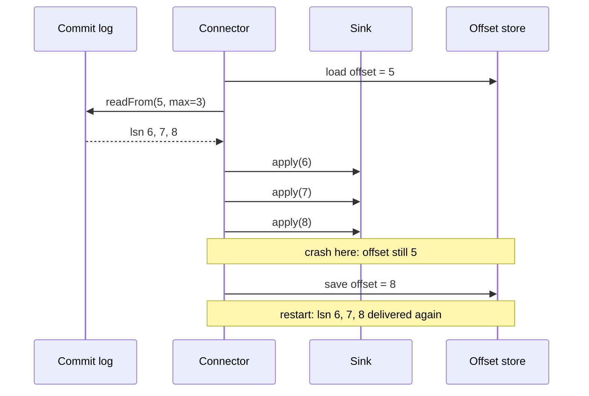

# Change Data Capture

> Turn the database log into an event stream.

**Type:** Build
**Languages:** Java, Python
**Prerequisites:** Phase 7, Lesson 02 (Write-Ahead Logs), Phase 7, Lesson 10 (Secondary Indexes: Local vs Global), Phase 6, Lesson 01 (Replication Strategies)
**Time:** ~75 minutes

## Learning Objectives

- Explain why writing to a database and then publishing an event is unsafe (the dual-write problem) and why reading the database's own commit log is the fix
- Build a commit log whose records carry a strictly increasing log sequence number (LSN), a transaction id, and before/after row images
- Implement a CDC connector that streams from a stored offset, commits the offset only after the sink has applied a batch, and therefore delivers at-least-once
- Bootstrap a consumer with a snapshot taken at a recorded LSN followed by streaming from that LSN, and explain why rows can arrive twice at the seam
- Write an idempotent sink that tolerates redelivery and snapshot overlap by remembering the last LSN applied per key
- Recognise the Debezium change-event envelope (`op`, `before`, `after`, `source.lsn`) and the retention failure that forces a re-snapshot

## The Problem

A ledger service commits a transfer: one row in `payments`, two updated rows in `accounts`. Three downstream systems need to know: the search index that answers "all payments for this customer" (Lesson 10), the fraud scorer that needs the new balance within a second, and the data warehouse. The first implementation does the obvious thing. After `commit()` returns, the service publishes a `PaymentCreated` event to the message bus.

Between the commit and the publish there is a gap. The process is killed by the orchestrator during a deploy, or the bus is unreachable for 200 ms, or an exception in the serializer is swallowed. The payment exists; the event was never sent. The search index never learns about it, the fraud scorer's balance is stale, and the warehouse is short one row. Nobody is alerted, because nothing failed loudly: a successful commit and a lost publish both look like a 201 to the caller. Swap the order, publish first then commit, and the failure inverts: an event for a payment that was rolled back. This is the dual-write problem. Two systems, two writes, no transaction spanning them, and every ordering of the two writes has a window in which exactly one of them happens.

The team's second attempt adds a retry loop around the publish. Now a slow bus makes the payment API slow, and a crash still loses whatever was in the loop. The third attempt is a nightly job that diffs the database against the index. It finds the gaps, twelve hours late, and does not fix the fraud scorer.

The database already solved this problem for itself. Every committed change is in the write-ahead log (Lesson 02), in commit order, before `commit()` returns, or the database could not recover from a crash. The log is the one place where "the payment exists" and "a record of the payment exists" are the same write. Change data capture reads that log and turns each record into an event. There is no second write to lose. The event is a view of the commit, not a separate action after it. This lesson builds the log reader, the offset that lets it resume, the snapshot that lets it start, and the sink that survives seeing the same event twice.

## The Concept

### The commit log as the source of truth for change

A transactional database writes each change to its log before acknowledging the commit. The log is ordered, durable, and complete: it contains every committed change and nothing that was rolled back. Replication (Phase 6) already ships this log to replicas. CDC is the observation that an external consumer can be another kind of replica: one that materializes the log into a search index, a cache, a stream, or a warehouse instead of another copy of the table.

Each log record in this lesson carries:

| Field | Meaning | Why the consumer needs it |
|---|---|---|
| `lsn` | Log sequence number, strictly increasing across the whole log | Total order of changes; the resume position; the idempotency key |
| `txId` | Which transaction committed it | Grouping records of one transaction; transaction boundaries for sinks that need them |
| `op` | `INSERT`, `UPDATE`, or `DELETE` | What to do to the materialized view |
| `table`, `key` | Which row | Routing and per-key ordering |
| `before` | Row image before the change (`null` for insert) | Deletes with no `after`; detecting which columns changed; updating an index keyed on an old value |
| `after` | Row image after the change (`null` for delete) | The new state of the row |

PostgreSQL's logical decoding exposes exactly this (`pg_lsn`, transaction id, `REPLICA IDENTITY FULL` for before images). MySQL's row-based binlog exposes it with a file+position or GTID instead of an LSN. MongoDB's oplog and change streams expose it with a resume token. The names differ; the shape does not.

### The Debezium envelope

Debezium, the most widely deployed open-source CDC system, wraps each record in a standard envelope that this lesson reproduces as `ChangeEvent`:

```json
{
  "op": "u",
  "before": {"balance_minor": "10000", "currency": "USD", "version": "1"},
  "after":  {"balance_minor": "7500",  "currency": "USD", "version": "2"},
  "source": {"table": "accounts", "lsn": 4, "txId": 2, "snapshot": "false"},
  "ts_ms": 1700000000000
}
```

`op` is `c` (create), `u` (update), `d` (delete), or `r` (read: a row emitted by a snapshot, not by a change). The `r` code is the part most people miss: it lets a sink distinguish "this row was just inserted" from "this row existed when I started", which matters for anything that counts creations.

Amount columns in this envelope are strings of integer minor units (`"7500"`), never JSON numbers with decimal points. Debezium's own `decimal.handling.mode` defaults to encoding `NUMERIC` columns as base64 binary for the same reason: a JSON number would be parsed as a double on the far side (Phase 10, Lesson 01).

### Four ways to get changes out, compared

| Approach | How it works | Misses changes? | Phantom changes? | Latency | Load on the database |
|---|---|---|---|---|---|
| Dual write | Application commits, then publishes | Yes: crash between the two | Yes, if publish comes first and commit fails | Low | None extra |
| Polling by `updated_at` | Consumer queries `WHERE updated_at > last_seen` | Yes: deletes leave no row; clock skew and same-timestamp rows at the boundary | No | Poll interval | A full index scan per poll |
| Trigger-written audit table | Triggers insert into a change table in the same transaction | No | No | Poll interval of the change table | Doubles write cost on every table |
| Log-based CDC | Read the commit log | No | No | Milliseconds behind commit | One sequential log reader |

Polling is the approach teams reach for second, after dual write fails, and it has its own silent gap: a `DELETE` removes the row, so there is nothing with a new `updated_at` for the poller to find. The trigger approach is correct and is what SQL Server's built-in CDC does internally; its cost is a second write per change on the primary's hot path. Log-based CDC is correct, cheap for the database, and the only one of the four that captures deletes and before images without changing the schema.

### Offsets and at-least-once delivery

A consumer stores one number: the LSN of the last record it has fully processed. On start it reads the log from that LSN forward. The question is when to store it.



Store the offset *after* the sink applies the batch and a crash in between redelivers the batch: **at-least-once**. Store it *before* and a crash loses the batch: **at-most-once**. There is no third option without making the offset write and the sink write a single atomic operation, which is possible only when the sink is itself a transactional store that can hold the offset in the same transaction as the data (the "exactly-once" that Kafka Connect's JDBC sink or a PostgreSQL-to-PostgreSQL pipeline can achieve, and that an HTTP call to a search service cannot).

Every serious CDC pipeline chooses at-least-once and pushes the consequence to the sink: **the sink must be idempotent**.

### Idempotent sinks

Two sinks in this lesson receive the same redelivered batch. `NaiveTotalsSink` adds each payment's amount to a running total. After a crash and replay it reports six payments and 80.00 USD when there were four and 45.00 USD. `IdempotentTotalsSink` remembers the payment keys it has counted and ignores a key it has seen. Same input, correct output.

For a materialized view keyed by row, the cleanest idempotency rule is the LSN itself. `BalanceViewSink` stores, per account, the LSN of the last event it applied. An incoming event with `lsn <= appliedLsn[key]` is skipped. Because LSNs are totally ordered and every change to a key has a unique one, this rule is exactly "apply each change once, in order," and it also handles the snapshot seam below. A sink that stores last-applied LSN per key is doing what a replica does with its replay position, at row granularity.

The rule has a cost: one extra value per key. The alternative, making the write itself naturally idempotent (an upsert of the full `after` image, a delete that tolerates a missing row), works for state-replacing sinks and fails for anything that accumulates (counters, sums, append-only logs). Know which kind of sink you have.

#### The LSN guard, traced by hand

Three events reach `BalanceViewSink` for `acc_alice`, then two of them again after a crash:

| Arrives | Event | `appliedLsn[acc_alice]` before | Action | Balance after |
|---|---|---|---|---|
| 1 | `r` lsn=5 after=7500 | 0 | 5 > 0: apply, set to 5 | 75.00 USD |
| 2 | `u` lsn=7 after=8500 | 5 | 7 > 5: apply, set to 7 | 85.00 USD |
| 3 | `u` lsn=10 after=8200 | 7 | 10 > 7: apply, set to 10 | 82.00 USD |
| 4 (replay) | `u` lsn=7 after=8500 | 10 | 7 <= 10: skip | 82.00 USD |
| 5 (replay) | `u` lsn=10 after=8200 | 10 | 10 <= 10: skip | 82.00 USD |

Without the guard, step 4 would set the balance back to 85.00 and step 5 forward to 82.00 again: correct at the end of this particular replay, but wrong in between, and wrong at the end if the replay were cut short after step 4. The guard makes every intermediate state correct too, which matters when the view is read while the replay is in progress.

### Snapshot, then stream

A new consumer cannot start from LSN 0: the log has been truncated, and even if it had not, replaying a year of changes to reconstruct a table that could be read directly is wasteful. The bootstrap is:

1. Record the current log head as `snapshotLsn`.
2. Read every row of the table and emit it as an `r` event carrying `snapshotLsn`.
3. Store `snapshotLsn` as the consumer's offset.
4. Stream from there.

Worked through with the demo's data. Two accounts and one transfer have been committed; the log head is LSN 5. The snapshot records `snapshotLsn = 5`, emits `acc_alice = 7500` and `acc_bob = 7500` as `r` events, and stores offset 5. A second transfer commits at LSNs 6, 7, 8. The first `poll` reads records with `lsn > 5`, delivers 6, 7, 8, and stores offset 8. The view now says `alice = 8500, bob = 6500`, which is what the database says.

The seam is step 2. In a real database the table read is not instantaneous and writes do not pause. A row changed at LSN 7, after the head was recorded but before the scan reached it, is read by the scan in its post-LSN-7 state and *also* arrives through the stream as the LSN 7 record. The sink sees the row twice. With the LSN rule this is harmless: the `r` event carries `snapshotLsn = 5`, the stream event carries 7, and whichever arrives second is either skipped (if 5 arrives after 7) or applied over an equivalent state (if 7 arrives after 5). Debezium's documentation calls this the snapshot "lock-free" mode and warns, in the same breath, that consumers must tolerate duplicates. The alternative, locking the table for the duration of the scan, is correct and unacceptable on a payments table.

### Retention and the forced re-snapshot

Logs are not kept forever. PostgreSQL recycles WAL segments once no replication slot needs them; MySQL purges binlogs after `binlog_expire_logs_seconds`; Kafka deletes segments past the retention window. A consumer that has been down longer than the retention window comes back with an offset the log no longer has. Its only correct move is to re-snapshot.

The `CommitLog` here models this with `truncateBefore(lsn)` and throws `LogTruncatedException` from `readFrom` when the requested position is below the oldest retained LSN. The demo's late consumer, offset 0 against a log that starts at 8, fails its first poll, takes a fresh snapshot at the current head, streams from there, and ends up identical to the consumer that was never behind.

The production trap runs the other way. PostgreSQL will *not* recycle WAL that an active replication slot still needs. A consumer that stops but leaves its slot in place pins every WAL segment since its offset; the disk fills; the primary stops accepting writes. A CDC slot is a promise to keep up, and an abandoned one is an outage waiting to happen. Monitor slot lag the way you monitor replica lag.

### Ordering guarantees, stated exactly

- **Within one log, total order.** Every record has a unique LSN and the connector delivers in LSN order. Two changes to the same row are never delivered out of order.
- **Within a transaction, the records are contiguous** in this implementation because `commit` appends them in one call. Real databases interleave records of concurrent transactions in the WAL and logical decoding reorders them so each transaction's records are emitted together at its commit LSN; the consumer sees transactions in commit order.
- **Across a partitioned stream, order holds per key only.** When the change stream is published to a partitioned topic, records for one key must go to one partition (Kafka's default key hashing does this) or per-row order is lost. Ordering across keys is not preserved and must not be assumed; a sink that needs "the payment row before the account rows of the same transaction" has to buffer by `txId`.

### What this lesson does not do

- It does not run the connector concurrently with writers. The database and connector are single-threaded, so the snapshot seam is described rather than exhibited; Exercise 3 adds the interleaving.
- It does not partition the stream across consumers. Fan-out, key-based partitioning, and consumer groups are Phase 8, Lesson 02 (Kafka-style logs).
- It does not decode a real WAL. The log here stores logical row images directly; a real decoder reconstructs them from physical page changes and the table's catalog, which is why PostgreSQL logical decoding needs `wal_level = logical` and a before-image needs `REPLICA IDENTITY FULL`.
- It does not solve the dual-write problem for writes that are not database writes. Calling a card network and then recording the result is still two systems; the transactional outbox (Lesson 13) is the pattern for making the outbound call's intent part of the database transaction so CDC can carry it.

## Build It

### Step 1: The log record and the log

```java
enum Op { INSERT, UPDATE, DELETE }

record LogRecord(long lsn, long txId, Op op, String table, String key,
                 Map<String, String> before, Map<String, String> after) {
    LogRecord {
        before = before == null ? null : Collections.unmodifiableMap(new LinkedHashMap<>(before));
        after = after == null ? null : Collections.unmodifiableMap(new LinkedHashMap<>(after));
    }
}

final class CommitLog {
    private final List<LogRecord> records = new ArrayList<>();
    private long truncatedBelow = 1;
    private long nextLsn = 1;

    long append(long txId, Op op, String table, String key, Map<String, String> before, Map<String, String> after) {
        LogRecord r = new LogRecord(nextLsn++, txId, op, table, key, before, after);
        records.add(r);
        return r.lsn();
    }

    List<LogRecord> readFrom(long afterLsn, int max) {
        if (afterLsn + 1 < truncatedBelow) throw new LogTruncatedException(afterLsn + 1, truncatedBelow);
        List<LogRecord> out = new ArrayList<>();
        for (LogRecord r : records) {
            if (r.lsn() > afterLsn) { out.add(r); if (out.size() >= max) break; }
        }
        return out;
    }
}
```

The record copies its maps into unmodifiable views so that nothing downstream can mutate history. `readFrom(afterLsn, max)` returns records *strictly after* the argument: an offset is "the last LSN I have processed," so a consumer that stored 5 asks for `readFrom(5)` and gets 6 onward. That convention makes offset 0 mean "from the beginning" without a special case. The truncation check is first: if the caller wants LSN `afterLsn + 1` and the log has already discarded it, the consumer cannot be given a contiguous stream and must be told so.

**Predict:** after `truncateBefore(8)`, does `readFrom(7, 100)` succeed? Does `readFrom(6, 100)`?

### Step 2: Transactions that commit to tables and log together

```java
long commit(Transaction tx) {
    long lastLsn = 0;
    for (Transaction.Write w : tx.writes) {
        TreeMap<String, Map<String, String>> t = tables.computeIfAbsent(w.table(), k -> new TreeMap<>());
        Map<String, String> before = t.get(w.key());
        Op op;
        if (w.after() == null) {
            if (before == null) continue;
            t.remove(w.key());
            op = Op.DELETE;
        } else {
            t.put(w.key(), new LinkedHashMap<>(w.after()));
            op = before == null ? Op.INSERT : Op.UPDATE;
        }
        lastLsn = log.append(tx.txId, op, w.table(), w.key(), before, w.after());
    }
    return lastLsn;
}
```

`Transaction` buffers `put` and `delete` calls; `commit` applies them to the tables and appends one log record per write, in one method call. That single call is the simulation's atomicity: there is no state in which the table has changed and the log has not. The `before` image is captured from the table at commit time, which is what a real engine's before-image is too. Deleting a row that does not exist logs nothing, because there is no change to capture. A rolled-back transaction never reaches `commit`, so it leaves no trace in the log, which is the property that makes the log safe to publish: consumers never see uncommitted data.

**Predict:** a transaction does `put("accounts", "a", ...)` twice with different values. How many log records does it produce, and what are their `op` values?

### Step 3: The envelope

```java
record ChangeEvent(String op, String table, String key, Map<String, String> before, Map<String, String> after,
                   long lsn, long txId, long tsMillis, boolean snapshot) {

    static ChangeEvent fromLog(LogRecord r, long tsMillis) {
        String op = switch (r.op()) { case INSERT -> "c"; case UPDATE -> "u"; case DELETE -> "d"; };
        return new ChangeEvent(op, r.table(), r.key(), r.before(), r.after(), r.lsn(), r.txId(), tsMillis, false);
    }

    static ChangeEvent snapshotRow(String table, String key, Map<String, String> row, long snapshotLsn, long tsMillis) {
        return new ChangeEvent("r", table, key, null, row, snapshotLsn, 0, tsMillis, true);
    }
}
```

Two constructors for two origins. `fromLog` maps a committed change to Debezium's `c`/`u`/`d`. `snapshotRow` wraps a row read by a snapshot as `r`, with no before image, no transaction, and the snapshot LSN as its position. A sink that keys idempotency on LSN therefore treats every snapshot row as "state as of `snapshotLsn`", which is exactly what it is. `tsMillis` comes from the injected `Clock`, so tests can assert it.

**Predict:** a sink counts `op == "c"` events to report "payments created today." After a re-snapshot, is the count right? What should it count instead?

### Step 4: The connector and its offset discipline

```java
int poll(int maxEvents, boolean crashBeforeCommit) {
    long from = offsets.load(name);
    List<LogRecord> batch = db.log().readFrom(from, maxEvents);
    if (batch.isEmpty()) return 0;
    long last = from;
    for (LogRecord r : batch) {
        deliver(ChangeEvent.fromLog(r, clock.nowMillis()));
        last = r.lsn();
    }
    if (!crashBeforeCommit) offsets.save(name, last);
    return batch.size();
}
```

Load the offset, read the next batch, apply every event, then save the offset. The `crashBeforeCommit` flag is a test hook that returns after the applies and before the save, which is precisely the window in the sequence diagram. Nothing else about the method changes, so the redelivery you see in the demo is the real behaviour of the real code path under a real crash, not a special simulation mode. The `OffsetStore` is a map here; in production it is a Kafka topic, a replication slot's `confirmed_flush_lsn`, or a row in the sink database.

**Predict:** `poll(3)` is called when the offset is 5 and the log head is 6. What is the offset afterwards, and what does a second `poll(3)` return?

### Step 5: Snapshot

```java
long snapshot(String table) {
    long snapshotLsn = db.log().headLsn();
    for (Map.Entry<String, Map<String, String>> e : db.scan(table).entrySet()) {
        deliver(ChangeEvent.snapshotRow(table, e.getKey(), e.getValue(), snapshotLsn, clock.nowMillis()));
    }
    offsets.save(name, snapshotLsn);
    return snapshotLsn;
}
```

Head first, then scan, then store the head as the offset. The order is the whole point. Recording the head *before* the scan means any change that lands during the scan has an LSN greater than the offset and will be streamed; the consumer may see such a row twice but never zero times. Recording it after the scan would make changes during the scan invisible to both the snapshot (if the scan passed that row already) and the stream (LSN below the offset): silent data loss.

**Predict:** swap the first and last lines so the offset is stored before the scan. What breaks if the process crashes mid-scan?

### Step 6: Two sinks, one idempotent

```java
final class BalanceViewSink implements Sink {
    private final Map<String, Money> balances = new TreeMap<>();
    private final Map<String, Long> appliedLsn = new HashMap<>();

    @Override public void apply(ChangeEvent e) {
        if (!e.table().equals("accounts")) return;
        long seen = appliedLsn.getOrDefault(e.key(), 0L);
        if (e.lsn() <= seen) { skipped++; return; }
        if (e.op().equals("d")) balances.remove(e.key());
        else balances.put(e.key(), Money.ofMinor(Long.parseLong(e.after().get("balance_minor")), Currency.USD));
        appliedLsn.put(e.key(), e.lsn());
        applied++;
    }
}

final class NaiveTotalsSink implements Sink {
    @Override public void apply(ChangeEvent e) {
        if (!e.table().equals("payments") || !e.op().equals("c")) return;
        paymentsSeen++;
        total = total.plus(Money.ofMinor(Long.parseLong(e.after().get("amount_minor")), Currency.USD));
    }
}
```

`BalanceViewSink` is a materialized view with the per-key LSN guard. The guard is three lines and turns at-least-once into effectively-once for this sink. `NaiveTotalsSink` has no guard and is in the lesson to be wrong: run the demo and watch it report 80.00 USD of payments when 45.00 USD were made. `IdempotentTotalsSink` in the source fixes it with a set of counted keys, and also counts `r` events, because a payment that existed at snapshot time is still a payment.

The amount is parsed from a string of minor units into `Money`. There is no `Double.parseDouble` anywhere in this file.

**Predict:** `BalanceViewSink` receives an `r` event for `acc_alice` at LSN 5 after it has already applied a `u` for the same key at LSN 7. What happens to the balance?

### Step 7: Run it

```bash
cd phases/07-storage-and-transactions/11-change-data-capture/code/java
javac -d .out *.java && java -cp .out Main
java -cp .out MainTest
```

Expected output, abbreviated:

```console
== 1. Transactions become log records with strictly increasing LSNs ==
  lsn=3 tx=2 op=c payments/pay_001 before=null after={from=acc_alice, to=acc_bob, amount_minor=2500, currency=USD}
  lsn=4 tx=2 op=u accounts/acc_alice before=10000 after=7500
  lsn=5 tx=2 op=u accounts/acc_bob before=5000 after=7500

== 2. Snapshot, then stream from the snapshot LSN ==
  snapshot at lsn=5 delivered 2 rows; view: {acc_alice=75.00 USD, acc_bob=75.00 USD}
  streamed 3 events after lsn=5; offset now 8; view: {acc_alice=85.00 USD, acc_bob=65.00 USD}

== 3. Crash after apply, before offset commit: at-least-once redelivery ==
  after crash: naive total=35.00 USD (2 payments), exact total=35.00 USD (2 payments), offsets still 0/0
  after restart: naive total=80.00 USD (6 payments)  <- double counted
                 exact total=45.00 USD (4 payments)  <- idempotent by payment key

== 4. The view catches up and the redelivered events are skipped by LSN ==
  crash/replay: 3 events redelivered; view applied=10 skipped=2; view: {acc_alice=90.00 USD, acc_bob=60.00 USD}

== 5. Log retention: an offset older than the log forces a re-snapshot ==
  poll failed: LSN 1 has been truncated; oldest available is 8
  re-snapshot at lsn=17 then stream; late view: {acc_alice=90.00 USD, acc_bob=60.00 USD}
  both views agree: true
```

Section 3 is the one to show a colleague who proposes a CDC consumer that increments a counter.

### In Python

```python
def _frozen(m: Mapping[str, str] | None) -> Mapping[str, str] | None:
    """Copy then wrap read-only: Collections.unmodifiableMap(new LinkedHashMap<>(m))."""
    return None if m is None else MappingProxyType(dict(m))

@dataclass(frozen=True)
class LogRecord:
    lsn: int
    tx_id: int
    op: Op
    ...
    def __post_init__(self) -> None:
        object.__setattr__(self, "before", _frozen(self.before))
        object.__setattr__(self, "after", _frozen(self.after))
```

Differences, all in `code/python/main.py`:

- **Immutable images.** A frozen dataclass stops reassigning `record.after`, but not `record.after["x"] = "y"`. `__post_init__` therefore copies each image and wraps it in `types.MappingProxyType`, so mutation raises `TypeError` where Java throws `UnsupportedOperationException`; the test asserts exactly that. `BalanceViewSink.all()` returns a key-sorted `MappingProxyType` for the same reason.
- **Interfaces become protocols.** `Clock` and `Sink` are `typing.Protocol`s; any object with `now_millis()` or `apply(event)` fits, which is how `RecordingSink`, the two totals sinks and the view plug into one `CdcConnector`. The Java `poll(max)` / `poll(max, crash)` overloads become one method with `crash_before_commit: bool = False`.
- **Numbers and errors.** Amounts are strings of minor units parsed with `int(...)`. `Money.plus` and `minus` check the signed 64-bit range by hand and raise `OverflowError`, mirroring `Math.addExact`; a Python-only test pins it. `LogTruncatedException` is a `RuntimeError` subclass carrying `requested` and `oldest_available`; committing a finished transaction raises plain `RuntimeError`.
- **Same output.** Maps print through `_jmap`, which matches Java's `{k=v}` format, so `diff` of the two demos is empty, including the skipped counts and the forced re-snapshot at LSN 17.

```bash
cd phases/07-storage-and-transactions/11-change-data-capture/code/python
python3 main.py
python3 -m unittest -v
```

### Porting notes

- **Numeric model.** Amounts travel as strings of minor units and are parsed with `strconv.ParseInt` in Go; Go needs a hand-written checked add in place of `Math.addExact`.
- **Immutability.** Go copies the map on construction and documents that callers must not mutate it, since Go has no immutable map.
- **Errors.** `LogTruncatedException` becomes a Go error type (`errors.As`) carrying `requested` and `oldestAvailable`; `IllegalStateException` on a finished transaction becomes an `error`.
- **Concurrency.** A Go port that runs `poll` in a goroutine alongside writers must guard `CommitLog` and the tables with a mutex and pass `go test -race`; the snapshot seam then becomes observable (Exercise 3) and the LSN guard in the sink is what keeps the view correct.

## Use It

### Debezium and Kafka Connect

Debezium runs as a Kafka Connect source connector. For PostgreSQL it creates a logical replication slot, reads decoded changes with the `pgoutput` plugin, wraps each in the envelope above, and publishes to one Kafka topic per table, keyed by primary key so per-row order survives partitioning. Its offset is the slot's `confirmed_flush_lsn` plus a Kafka Connect offset record; its snapshot modes (`initial`, `never`, `when_needed`, incremental) are the bootstrap decision from this lesson with production knobs. The incremental snapshot (DBLog algorithm, from Netflix) interleaves chunked table reads with the live stream and uses watermarks in the log to deduplicate, which is a more careful version of the "head first, then scan" ordering here. Debezium guarantees at-least-once and documents that consumers must be idempotent.

### Database-native change streams

PostgreSQL logical decoding (`pg_create_logical_replication_slot`, `pg_logical_slot_get_changes`) gives you the raw stream without Kafka. MySQL's binlog in `ROW` format is read by Debezium, Maxwell, and Canal. MongoDB change streams return a resume token per event and throw `ChangeStreamHistoryLost` when the token's oplog entry has been rotated out: the `LogTruncatedException` of this lesson with a different name. DynamoDB Streams and Cosmos DB change feed are managed equivalents with 24-hour and unlimited retention respectively. SQL Server has a feature literally called Change Data Capture that writes changes to shadow tables.

### What the production versions do for you, and the trap

They decode the physical log into logical rows, handle schema changes mid-stream, partition the output, manage offsets, and run the snapshot without locking. They do not make your sink idempotent, they do not stop a stopped consumer from pinning WAL on the primary, and they do not tell you that `op: "c"` after a snapshot does not mean "created today." The reconciliation audit from Lesson 10, run against the materialized view, is still the only check that the pipeline as a whole is correct.

## Ship It

`outputs/runbook-cdc-consumer.md` is an operations runbook for a CDC consumer: what to check when the view is wrong, when lag grows, when the log has been truncated, and when a schema change breaks the sink, with the exact failure signatures from this lesson mapped to their production names. Hand it to whoever is on call for the search index.

## Exercises

1. **Reinforce.** Add a `TransactionBoundarySink` that buffers events by `txId` and only applies a transaction's events once it has seen all of them, so the view never shows a payment row without its two account updates. Use the fact that this log appends a transaction's records contiguously, then write down what breaks when records of different transactions interleave.
2. **Apply.** Publish the change stream to `P` partitions by `hash(key) mod P` (reuse the FNV-1a hash from Lesson 10) and run one `BalanceViewSink` per partition. Prove with a test that per-key order is preserved and that cross-key order is not: construct two transfers whose account updates land in different partitions and show the two views can be at different LSNs.
3. **Extend.** Make the snapshot seam real: give `Database.scan` a callback that runs between rows, and in the callback commit a transfer that updates a row the scan has not reached yet. Show that `BalanceViewSink` ends correct because the stream event for that row has a higher LSN than the `r` event, then replace the LSN guard with a plain upsert and show that it is still correct, then replace `BalanceViewSink` with `NaiveTotalsSink` counting `r` and `c` and show that it is not. This is the setup for Phase 8, Lesson 03 (exactly-once semantics).

## Key Terms

| Term | What people say | What it actually means |
|------|-----------------|------------------------|
| Change data capture (CDC) | "stream the database" | Reading a database's commit log and emitting each committed change as an event, so that a change and the record of it are one write |
| Dual write | "save then publish" | Writing to two systems without a transaction spanning them; every ordering has a crash window in which exactly one write happens |
| LSN | "the log position" | Log sequence number: a strictly increasing identifier for each log record, used as the total order, the resume offset, and the idempotency key |
| Offset | "where the consumer is" | The LSN of the last record a consumer has fully processed; stored after apply for at-least-once, before apply for at-most-once |
| At-least-once | "might see duplicates" | Every committed change is delivered one or more times; the sink must be idempotent for the result to be correct |
| Snapshot | "initial load" | Emitting every current row as an `r` event at a recorded LSN, then streaming from that LSN; rows changed during the scan arrive twice |
| Idempotent sink | "safe to replay" | A consumer whose state after applying an event twice equals its state after applying it once; achieved by per-key LSN guards, natural upserts, or a set of seen keys |
| Retention | "the log rolled over" | The window after which old log records are discarded; a consumer behind the window cannot resume and must re-snapshot |

## Further Reading

- [Debezium documentation: Change event envelope and PostgreSQL connector](https://debezium.io/documentation/reference/stable/connectors/postgresql.html) — the `op`/`before`/`after`/`source` envelope, snapshot modes, at-least-once guarantee, and the replication-slot WAL retention warning.
- [PostgreSQL documentation: Logical Decoding](https://www.postgresql.org/docs/current/logicaldecoding.html) — how the WAL is decoded into row changes, what a replication slot is, and why `REPLICA IDENTITY` controls before images.
- [MySQL Reference Manual: The Binary Log](https://dev.mysql.com/doc/refman/8.0/en/binary-log.html) — row-based logging, GTIDs as the offset, and `binlog_expire_logs_seconds` as the retention window.
- [Andreakis and Papapanagiotou, DBLog: A Watermark Based Change-Data-Capture Framework (Netflix, 2019)](https://arxiv.org/abs/2010.12597) — the algorithm for taking a chunked snapshot interleaved with the live stream, without locks, using log watermarks to deduplicate; the production answer to the snapshot seam.
- [Kleppmann, Turning the database inside-out (2014)](https://martin.kleppmann.com/2015/03/04/turning-the-database-inside-out.html) — the argument that the commit log is the primary artifact and tables, indexes, and caches are materialized views of it.
- [MongoDB documentation: Change Streams](https://www.mongodb.com/docs/manual/changeStreams/) — resume tokens as offsets and `ChangeStreamHistoryLost` as the truncation failure.
