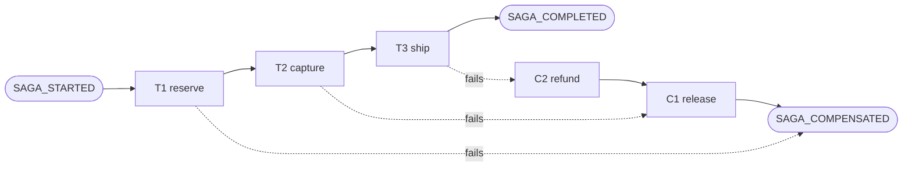

# The Saga Pattern: Compensations Instead of Locks

> Reserve funds, capture, ship, and undo in the right order when step three fails.

**Type:** Build
**Languages:** Java, Python, Go
**Prerequisites:** Phase 7 Lesson 02 (Write-Ahead Logs), Phase 7 Lesson 08 (Two-Phase Commit), Phase 0 Lesson 07 (Decimal and Integer Arithmetic)
**Time:** ~120 minutes

## Learning Objectives

- Explain why a multi-service payment flow cannot use a single ACID transaction and what a saga gives up in exchange for not holding locks across services
- Build an orchestrated saga that runs reserve, capture, and ship forward and runs their compensations in strict reverse order on failure
- Make every step and every compensation idempotent on the saga id so that re-execution after a crash is always safe
- Persist a saga log whose records are appended before and after every action, and recover an unfinished saga from that log alone
- Name the isolation anomaly sagas introduce and show how a semantic lock (a hold) prevents a concurrent saga from overdrawing an account

## The Problem

A checkout at a marketplace touches three services: the wallet service holds the customer balance, the ledger posts the debit, and the fulfilment service ships the goods. Each service owns its own database. When alice buys two widgets for 30.00 USD, the order service calls `wallet.debit(alice, 30.00)`, then `fulfilment.ship(widget, 2)`. On a Tuesday evening the shipping call returns `out of stock` for the fourth widget of a four-widget order. The order service catches the exception, logs it, and returns an error to the customer. Alice's balance is now 40.00 USD lower and nothing is shipping.

The engineer who built this knew about transactions. The trouble is that there is no transaction that spans a wallet database in one cluster, a ledger in another, and a fulfilment system run by a different team. Two-phase commit (Lesson 08) would give atomicity, but it requires every participant to hold locks from prepare to commit, and a shipping warehouse's inventory system is not going to hold a row lock while a payment network answers. 2PC across organisational boundaries is not a design anyone ships; across service boundaries inside one company it is rare, slow, and a single stuck coordinator blocks every participant.

So the flow runs as a sequence of local transactions, each committed before the next begins. That is the only option, and it has a consequence that most teams discover in production rather than in design review: **when step three fails, steps one and two have already committed and cannot be rolled back.** They can only be undone by a new forward action that semantically reverses them: a refund for a debit, a release for a hold, a cancellation for a shipment. Those reversing actions have to run in the right order, have to run even if the process doing them crashes halfway, and have to be safe to run twice. The structure that guarantees all three is the saga, named in Garcia-Molina and Salem's 1987 paper for long-lived database transactions and reborn as the standard pattern for workflows across microservices.

The same checkout exposes a second failure that is easier to miss. While alice's saga is between reserve and ship, a second request from alice reads her balance. If the first saga has debited and the second reads 70.00, fine. If the first saga has only "intended to debit" with nothing visible, the second reads 100.00, both proceed, and alice spends 130.00 of a 100.00 balance. Sagas have no isolation. Every saga design must answer the question "what does a concurrent reader see between my steps?" and the answer in payments is the hold: a reservation that is visible to everyone and reduces the available balance without moving the ledger balance. This lesson builds the hold as the first step and shows the exact trade-off it forces.

## The Concept

### A saga is a sequence of local transactions with compensations

A saga `S` is an ordered list of steps `T1, T2, ..., Tn`. Each step is a local transaction in one service: it either commits or it does not. Each step `Ti` has a compensation `Ci` that semantically undoes `Ti`'s effect. The saga guarantees exactly one of two outcomes:

- **Completed:** `T1, T2, ..., Tn` all committed.
- **Compensated:** `T1, ..., Tk` committed, `Tk+1` failed, and then `Ck, ..., C1` ran, in that order.

Nothing else is a legal end state. In particular, "T1 and T2 committed, T3 failed, process died" is a transient state that recovery must drive to Compensated. The saga for this lesson is:

| Step | Service | Forward action `Ti` | Compensation `Ci` |
|------|---------|---------------------|-------------------|
| 1 | wallet | `reserve(sagaId, account, amount)`: place a hold | `release(sagaId)`: drop the hold |
| 2 | wallet | `capture(sagaId)`: turn the hold into a debit | `refund(sagaId, account)`: credit the amount back |
| 3 | fulfilment | `ship(sagaId, sku, qty)`: decrement stock | `cancelShipment(sagaId, sku)`: restock |

The compensation order is reverse order. That is not a convention; it is a dependency. `refund` only makes sense after `capture` happened, and `release` of a hold that was captured is a no-op. If a failure at step 3 ran `C1` before `C2`, the release would find nothing to release (the hold was consumed by capture) and the refund would then credit money onto an account with no hold. The result would be correct in this specific wallet design but only by accident; in general, `Ci` assumes the world as `Ti` left it, which means every later step must already be undone.



### Compensation is not rollback

A rollback restores the exact prior state and leaves no trace. A compensation is a new committed transaction that moves the state to something equivalent, and both the original and the compensation stay in history. After alice's failed four-widget order, her wallet shows a debit of 40.00 and a credit of 40.00. Her balance is where it started; her statement is not empty. This matters in three ways:

1. **Ledgers are append-only** (Phase 10, Lesson 03). The debit was posted; it cannot be unposted. The refund is a second posting.
2. **Some actions have no perfect compensation.** An email cannot be unsent; a wire that left the building cannot be recalled by your code. The compensation for those is a second email, a return wire request, or a human task. Sagas model this honestly as a forward action with its own failure modes.
3. **Compensations must not fail.** Garcia-Molina and Salem are explicit: compensating transactions are required to succeed eventually, and the system retries them until they do. A compensation that can fail for business reasons ("refund declined") is a design error; refunds in a wallet you control never decline. Compensations may fail transiently (network), which is why they are retried, which is why they must be idempotent.

### Orchestration versus choreography

| | Orchestration | Choreography |
|--|---------------|--------------|
| Who decides the next step | A central orchestrator that calls each service | Each service reacts to the previous service's event |
| Where the saga state lives | The orchestrator's saga log | Spread across every participant's events |
| Adding a step | Edit the orchestrator's step list | Edit the producer and consumer of two events |
| Finding out why a saga is stuck | Read one log | Correlate events across topics |
| Coupling | Services know nothing of each other; orchestrator knows all | Services know the events of their neighbours |
| Cyclic dependency risk | None | Easy to create accidentally |

This lesson builds the orchestrated form because it makes the saga log explicit and recovery testable. Choreographed sagas are built on the transactional outbox (Lesson 13) and the event log (Phase 8); their recovery story is "each service's outbox relay eventually delivers", which is correct but much harder to reason about when ten services are involved. Payment systems at scale almost always orchestrate the money-moving saga and choreograph the notifications around it.

### The saga log and the two-write rule

The orchestrator is a process; processes die. If it dies after `capture` succeeded and before it called `ship`, somebody must notice and finish the job. The saga log is the durable record that makes this possible. The rule is simple and must be applied without exception:

**Append `STEP_STARTED` before invoking the step. Append `STEP_COMPLETED` after it returns.** Same for compensations: `COMP_STARTED`, `COMP_COMPLETED`.

Because there are two writes per action, a crash leaves the log in one of three states for any step, and each state has an unambiguous recovery:

| Log shows | What might have happened | Recovery does |
|-----------|--------------------------|---------------|
| no `STEP_STARTED` | step was never invoked | invoke it |
| `STEP_STARTED` only | step may or may not have executed | invoke it again |
| `STEP_STARTED` + `STEP_COMPLETED` | step executed | skip it |

The middle row is the whole reason idempotency is non-negotiable. The orchestrator cannot know whether the wallet captured before the crash. It invokes capture again. If the wallet already captured under this saga id, it must answer "done" and change nothing; if it never saw the call, it captures now. Either way, after recovery the step has executed exactly once in effect. This is the same discipline as the write-ahead log's replay (Lesson 02): the log is a prefix of intentions, and replay must be safe for any prefix.

The `SAGA_STARTED` record carries the full `Order`, so recovery can rebuild the request from the log alone. Nothing about the saga lives only in memory.

### Idempotency keys: the saga id is the key

Every mutating call to a participant takes an idempotency key. In this lesson the key is the saga id, which is sufficient because each step is called at most once per saga. (A saga that calls the same service twice, say two debits, would derive `sagaId + ":" + stepName`.) The participant stores the key with the outcome and replays the outcome on a repeat. For the wallet:

```text
reserve("saga-3", alice, 25.00)   -> hold created, key recorded
reserve("saga-3", alice, 25.00)   -> key seen, return without a second hold
capture("saga-3")                 -> balance 100.00 -> 75.00, key recorded
capture("saga-3")                 -> key seen, balance stays 75.00
```

The participant, not the orchestrator, owns the deduplication. An orchestrator-side "I already called this" flag is exactly the state that is lost in the crash we are protecting against.

Compensations get the same treatment and one extra property: **a compensation must be legal even if its forward step never ran.** Recovery may find `STEP_STARTED reserve` with no completion, decide the saga failed, and call `release`. If the reserve never reached the wallet, `release` finds no hold and must return success, not an error. Garcia-Molina and Salem call these "compensations that can be applied in any state"; in practice it means every compensation begins with "if there is nothing to undo, record that I ran and return."

### Worked example: the four-widget failure, by hand

Alice has 70.00 USD after a previous order; the warehouse has 3 widgets. She orders 4 for 40.00.

```text
seq  t     saga    record                      wallet balance / available   stock
 9   30    saga-2  SAGA_STARTED                70.00 / 70.00                3
10   30    saga-2  STEP_STARTED reserve-funds
11   40    saga-2  STEP_COMPLETED reserve-funds 70.00 / 30.00               3     <- hold of 40.00
12   40    saga-2  STEP_STARTED capture-funds
13   50    saga-2  STEP_COMPLETED capture-funds 30.00 / 30.00               3     <- hold consumed, debit posted
14   50    saga-2  STEP_STARTED ship-order
15   60    saga-2  STEP_FAILED ship-order (out of stock: widget has 3, need 4)
16   60    saga-2  COMP_STARTED capture-funds
17   70    saga-2  COMP_COMPLETED capture-funds 70.00 / 70.00               3     <- refund posted
18   70    saga-2  COMP_STARTED reserve-funds
19   80    saga-2  COMP_COMPLETED reserve-funds 70.00 / 70.00               3     <- nothing to release; recorded anyway
20   80    saga-2  SAGA_COMPENSATED
```

Three things to notice. The failed step (`ship-order`) is never compensated: it did not commit, so there is nothing to undo, and `cancelShipment` would be a no-op anyway. The compensation order is `capture` then `reserve`, the reverse of execution. And between records 13 and 17, for 20 simulated milliseconds, alice's balance was 30.00 with no goods on the way. Any report run in that window shows a debit that will later be reversed. That window is the price of not holding a lock, and it is the subject of the next section.

### The isolation problem and the semantic lock

ACID transactions give isolation: nobody sees an uncommitted intermediate state. Sagas commit every step, so every intermediate state is visible. Three anomalies follow, each with a payments name:

| Anomaly | What happens | Payments example |
|---------|--------------|------------------|
| Lost update | Saga B overwrites a value saga A changed, then A compensates by restoring its old value, erasing B's change | A sets limit to 500, B sets it to 800, A compensates to 300 |
| Dirty read | B reads a value A will later compensate | B sees a 40.00 debit that will be refunded and declines alice for insufficient funds |
| Non-repeatable read | B reads a value twice across A's step boundary and gets different answers | A fraud check reads balance before and after A's capture |

The countermeasure for the dirty read in money flows is the **semantic lock**: step 1 does not debit; it places a hold that every reader can see. Available balance is `balance - sum(live holds)`. A second saga that wants 50.00 while an 80.00 hold is live sees available 20.00 and fails at its own step 1, cleanly, with nothing to compensate. The hold is a lock in effect (it reserves capacity) but not in mechanism (no row is locked, no transaction is open, the wallet service is free to crash and restart). Card networks work exactly this way: an authorization is a hold with an expiry, and capture is a later message.

The cost is a false refusal. In the demo, saga A reserves 80.00, its orchestrator dies, saga B is refused on 20.00 of available funds, and then A resumes and fails at shipping and releases its hold. B was declined for money that, thirty milliseconds later, was available again. There is no free way around this. The alternatives are to let B through and risk an overdraft, or to make B wait on A, which reintroduces blocking. Payment systems choose the false refusal and attach an expiry to the hold so that a saga whose orchestrator never comes back cannot pin funds forever.

### Complexity and what the saga does not promise

A saga of `n` steps makes at most `n` forward calls and `n - 1` compensation calls, plus `2n + 2` log appends on the happy path and up to `4n` on failure. Recovery is linear in the log length for that saga. There is no coordination round, no prepare phase, no quorum. That is the point: the saga trades the atomicity and isolation of 2PC for liveness and loose coupling.

What it does not do:

- It does not give isolation. Intermediate states are visible; you add semantic locks, versioning, or re-reads where that matters.
- It does not guarantee a compensation is a perfect inverse. The debit and the refund both stay in history, and anything with external side effects (an email, a wire) may have no inverse at all.
- It does not protect against a compensation that fails for business reasons. If `refund` can be declined, the design is wrong, not the saga.
- It does not replace idempotency in participants. A saga over non-idempotent services is a saga that double-charges after its first crash.

## Build It

The implementation is one Java file plus its test: a money type copied from Phase 10 Lesson 01, two participant services with idempotent operations, an append-only saga log, and an orchestrator with injected crash points so recovery can be tested without a real process death.

### Step 1: Money, a simulated clock, and the two failure types

```java
record Money(long minorUnits, Currency currency) implements Comparable<Money> {
    Money plus(Money other) { requireSameCurrency(other); return new Money(Math.addExact(minorUnits, other.minorUnits), currency); }
    Money minus(Money other) { requireSameCurrency(other); return new Money(Math.subtractExact(minorUnits, other.minorUnits), currency); }
    @Override public int compareTo(Money other) { requireSameCurrency(other); return Long.compare(minorUnits, other.minorUnits); }
}

final class SimClock {
    private long nowMs;
    long now() { return nowMs; }
    void advance(long ms) { nowMs += ms; }
}

final class StepFailedException extends RuntimeException { ... }   // a step refused: compensate
final class CrashException extends RuntimeException { ... }        // the orchestrator died here
```

Two exception types because they mean opposite things. `StepFailedException` is a business refusal (insufficient funds, out of stock); the orchestrator catches it and compensates. `CrashException` is an injected process death; the orchestrator does not catch it, the demo and tests do, and recovery is a separate call afterwards. Conflating them would let a test "recover" from a failure that should have compensated.

**Predict:** if `reserve` threw `CrashException` instead of `StepFailedException` on insufficient funds, what would recovery do, and how many times would it do it?

### Step 2: The saga log

```java
record SagaRecord(long seq, long atMs, String sagaId, String kind, String step, String detail, Order order) { }

final class SagaLog {
    static final String SAGA_STARTED = "SAGA_STARTED", STEP_STARTED = "STEP_STARTED", STEP_COMPLETED = "STEP_COMPLETED",
            STEP_FAILED = "STEP_FAILED", COMP_STARTED = "COMP_STARTED", COMP_COMPLETED = "COMP_COMPLETED",
            SAGA_COMPLETED = "SAGA_COMPLETED", SAGA_COMPENSATED = "SAGA_COMPENSATED";

    private final List<SagaRecord> records = new ArrayList<>();

    void append(String sagaId, String kind, String step, String detail, Order order) {
        records.add(new SagaRecord(records.size() + 1, clock.now(), sagaId, kind, step, detail, order));
    }
    List<SagaRecord> forSaga(String sagaId) { ... }
    Set<String> sagaIds() { ... }   // insertion order, so recovery resumes sagas oldest first
}
```

Append-only, sequence-numbered, timestamped from the injected clock. The in-memory list stands in for a durable table; in production `append` is an `INSERT` that must be committed before the step is invoked, which is the same `fsync`-before-acknowledge discipline as the WAL in Lesson 02. The `Order` rides on the `SAGA_STARTED` record only, so recovery can reconstruct the request without any other store.

### Step 3: The wallet with holds and idempotent operations

```java
void reserve(String key, String account, Money amount) {
    calls++;
    if (holdAccount.containsKey(key)) return;                               // replay
    if (available(account).compareTo(amount) < 0) {
        throw new StepFailedException("insufficient available funds: " + available(account) + " < " + amount);
    }
    holdAccount.put(key, account);
    holdAmount.put(key, amount);
}

void capture(String key) {
    calls++;
    if (captured.containsKey(key)) return;                                  // replay
    if (!holdAccount.containsKey(key)) throw new StepFailedException("no hold to capture for " + key);
    Money amount = holdAmount.get(key);
    balances.put(account, balances.get(account).minus(amount));
    holdAmount.put(key, Money.zero(amount.currency()));
    holdAccount.remove(key);
    captured.put(key, amount);
}
```

`available(account)` is `balance - sum(live holds on account)`, and it is what `reserve` checks. That one line is the semantic lock. The `calls` counter exists for the tests: after a crash and recovery, the test asserts that `capture` was invoked once more and the balance moved zero more times.

The compensations follow the same shape with one addition:

```java
void release(String key) {
    calls++;
    if (released.contains(key)) return;
    if (holdAccount.containsKey(key)) {        // may be absent: reserve never ran, or capture consumed it
        holdAmount.put(key, Money.zero(holdAmount.get(key).currency()));
        holdAccount.remove(key);
    }
    released.add(key);
}

void refund(String key, String account) {
    calls++;
    if (refunded.contains(key)) return;
    if (captured.containsKey(key)) balances.put(account, balances.get(account).plus(captured.get(key)));
    refunded.add(key);
}
```

Both record that they ran even when there was nothing to undo. `refund` credits only if a capture is on file for this key, so refunding a saga that crashed before capture moves no money. That is what "a compensation must be legal in any state" looks like in code.

**Predict:** `wallet.capture("k")` is called with no prior `reserve("k", ...)`. Which exception, and is it the orchestrator's job to compensate or to recover?

### Step 4: Steps as objects

```java
interface SagaStep {
    String name();
    void execute(Order order);
    void compensate(Order order);
}

final class CaptureFunds implements SagaStep {
    public String name() { return "capture-funds"; }
    public void execute(Order o) { wallet.capture(o.sagaId()); }
    public void compensate(Order o) { wallet.refund(o.sagaId(), o.customer()); }
}
```

A step pairs a forward action with its compensation and gives both a stable name. The name is what goes in the log, so renaming a step is a migration, not a refactor: a log written under the old name will not match the step list on recovery. Keep step names as stable as database column names.

### Step 5: The orchestrator, forward and backward

```java
SagaOutcome run(Order order) {
    log.append(order.sagaId(), SagaLog.SAGA_STARTED, "", "", order);
    return forward(order, 0);
}

private SagaOutcome forward(Order order, int from) {
    for (int i = from; i < steps.size(); i++) {
        SagaStep step = steps.get(i);
        log.append(order.sagaId(), SagaLog.STEP_STARTED, step.name(), "");
        clock.advance(stepLatencyMs);
        try {
            step.execute(order);
        } catch (StepFailedException e) {
            log.append(order.sagaId(), SagaLog.STEP_FAILED, step.name(), e.getMessage());
            return backward(order, i - 1, step.name(), e.getMessage());
        }
        if (crashPoint.equals(CrashPoint.afterExecute(step.name()))) throw new CrashException(...);
        log.append(order.sagaId(), SagaLog.STEP_COMPLETED, step.name(), "");
    }
    log.append(order.sagaId(), SagaLog.SAGA_COMPLETED, "", "");
    return new SagaOutcome(order.sagaId(), SagaStatus.COMPLETED, "", "");
}
```

The crash point sits between the step's side effect and the `STEP_COMPLETED` append. That is the only interesting place to die: dying before `STEP_STARTED` is indistinguishable from never starting, and dying after `STEP_COMPLETED` is indistinguishable from a clean step. `backward(order, i - 1, ...)` starts at the step before the failed one and walks to zero:

```java
private SagaOutcome backward(Order order, int from, String failedStep, String reason) {
    for (int i = from; i >= 0; i--) {
        SagaStep step = steps.get(i);
        log.append(order.sagaId(), SagaLog.COMP_STARTED, step.name(), "");
        clock.advance(stepLatencyMs);
        step.compensate(order);
        if (crashPoint.equals(CrashPoint.afterCompensate(step.name()))) throw new CrashException(...);
        log.append(order.sagaId(), SagaLog.COMP_COMPLETED, step.name(), "");
    }
    log.append(order.sagaId(), SagaLog.SAGA_COMPENSATED, "", "");
    return new SagaOutcome(order.sagaId(), SagaStatus.COMPENSATED, failedStep, reason);
}
```

There is no `try/catch` around `compensate`. A compensation that throws `StepFailedException` would propagate out of the orchestrator, which is the correct behaviour for a design error: a compensation that can be refused must be fixed, not handled. Transient failures are the job of the retry loop around `recover()` in production.

**Predict:** a saga of three steps fails at step 1. How many `COMP_*` records does the log contain, and what status does it end with?

### Step 6: Recovery from the log alone

```java
static SagaStatus statusOf(List<SagaRecord> records) {
    SagaStatus status = SagaStatus.RUNNING;
    for (SagaRecord r : records) {
        switch (r.kind()) {
            case SagaLog.STEP_FAILED, SagaLog.COMP_STARTED -> status = SagaStatus.COMPENSATING;
            case SagaLog.SAGA_COMPLETED -> status = SagaStatus.COMPLETED;
            case SagaLog.SAGA_COMPENSATED -> status = SagaStatus.COMPENSATED;
            default -> { }
        }
    }
    return status;
}
```

Status is a fold over the records: a saga is `RUNNING` until something says otherwise. Recovery then handles each unfinished saga:

```java
List<SagaOutcome> recover() {
    crashPoint = CrashPoint.NONE;
    for (String sagaId : log.sagaIds()) {
        List<SagaRecord> records = log.forSaga(sagaId);
        SagaStatus status = statusOf(records);
        if (status == SagaStatus.COMPLETED || status == SagaStatus.COMPENSATED) continue;
        Order order = records.get(0).order();
        int lastCompleted = -1, lastCompensated = steps.size();
        for (SagaRecord r : records) {
            switch (r.kind()) {
                case SagaLog.STEP_COMPLETED -> lastCompleted = Math.max(lastCompleted, index.get(r.step()));
                case SagaLog.STEP_FAILED -> { failedStep = r.step(); reason = r.detail(); }
                case SagaLog.COMP_COMPLETED -> lastCompensated = Math.min(lastCompensated, index.get(r.step()));
                default -> { }
            }
        }
        if (status == SagaStatus.RUNNING) {
            resumed.add(forward(order, lastCompleted + 1));
        } else {
            int from = Math.min(lastCompensated - 1, failedStep.isEmpty() ? steps.size() - 1 : index.get(failedStep) - 1);
            resumed.add(backward(order, from, failedStep, reason.isEmpty() ? "resumed after crash" : reason));
        }
    }
    return resumed;
}
```

Only `*_COMPLETED` records move the resume point. A `STEP_STARTED` without its completion contributes nothing, so the step is re-run, and idempotency makes that safe. A `RUNNING` saga resumes forward from the step after the last completed one; a `COMPENSATING` saga resumes backward from the step before the last compensated one. Recovery is itself idempotent: calling it twice finds nothing unfinished the second time, and the test asserts this.

**Predict:** the log for a saga reads `SAGA_STARTED, STEP_STARTED reserve, STEP_COMPLETED reserve, STEP_STARTED capture`. The orchestrator restarts. Which step runs first, and what does the wallet do if the capture had actually happened?

### Step 7: Run it

```bash
cd phases/07-storage-and-transactions/12-saga-pattern/code/java
javac -d .out *.java && java -cp .out Main
java -cp .out MainTest
```

Expected output, abbreviated:

```console
== 2. Step three fails: 4 widgets wanted, 3 in stock. Compensate in reverse ==
  saga-2 -> COMPENSATED (failed at ship-order: out of stock: widget has 3, need 4)
  alice balance=70.00 USD available=70.00 USD | widget stock=3
    15 t=60 saga-2 STEP_FAILED ship-order (out of stock: widget has 3, need 4)
    16 t=60 saga-2 COMP_STARTED capture-funds
    17 t=70 saga-2 COMP_COMPLETED capture-funds
    18 t=70 saga-2 COMP_STARTED reserve-funds
    19 t=80 saga-2 COMP_COMPLETED reserve-funds
    20 t=80 saga-2 SAGA_COMPENSATED

== 3. Crash after capture executed, before it was logged. Recovery re-runs capture; the key makes it a no-op ==
  orchestrator: crash at after capture-funds executed, before STEP_COMPLETED logged
  before recovery: balance=45.00 USD (already captured), log status=RUNNING
  recover -> [saga-3 -> COMPLETED]
  alice balance=45.00 USD available=45.00 USD | widget stock=2

== 5. The semantic lock: a hold is visible to a concurrent saga, and the trade-off it forces ==
  alice balance=100.00 USD available=20.00 USD  <- the hold is the semantic lock
  saga-B wants 50.00 while A is pending: saga-B -> COMPENSATED (failed at reserve-funds: insufficient available funds: 20.00 USD < 50.00 USD)
  saga-A resumes, fails at shipping, compensates: [saga-A -> COMPENSATED (failed at ship-order: out of stock: widget has 0, need 1)]
  alice balance=100.00 USD available=100.00 USD
41 passed, 0 failed
```

Section 3 is the one to keep. The balance is 45.00 before recovery and 45.00 after, and the wallet's call counter shows capture was invoked a second time. That is the whole argument for idempotent participants in one line of output.

### In Python

The Python port (`code/python/main.py`) is the same design with four differences. **Two exception types, caught precisely:** `StepFailedException` and `CrashException` are both `RuntimeError` subclasses, and `_forward` catches only the first, so an injected crash escapes to the caller exactly as the Java `RuntimeException` does; `CurrencyMismatchException` extends `ValueError`, the Python twin of `IllegalArgumentException`. **Interfaces and records:** `SagaStep` is a `typing.Protocol`, the three steps are plain classes with `name`, `execute` and `compensate`, and `Order`, `SagaRecord`, `CrashPoint` and `SagaOutcome` are frozen dataclasses, so `crash_point == CrashPoint.after_execute(...)` is value equality like the Java record `equals`; `status_of` and `recover` use `match` on the `SagaLog` string constants (dotted names are value patterns, never captures). **Money:** `Money` rejects floats at construction, orders with `compare_to` (and `<` via `functools.total_ordering`), and checks the signed 64-bit range by hand in `plus` and `minus`, raising `OverflowError` where Java's `Math.addExact` throws, with a Python-only test pinning it; `usd` keeps the Java helper's behaviour of stripping the dot, so always pass two decimals. **No threads:** the simulated clock and the scripted crash points make every recovery replayable, and the demo prints the same log lines, `clock=250 ms` and `log records=42` in both languages.

Run it from `code/python/` with `python3 main.py`; test with `python3 -m unittest -v`.

#### Step 1: Money, a simulated clock, and the two failure types

`plus`, `minus` and `compare_to` go through `_require_same_currency`; `_exact` is the 64-bit range check. `SimClock` only moves on `advance`. The two exception classes are deliberately distinct so a `try`/`except StepFailedException` cannot swallow a crash.

```python
    def plus(self, other: "Money") -> "Money":
        self._require_same_currency(other)
        return Money(_exact(self.minor_units + other.minor_units), self.currency)

    def minus(self, other: "Money") -> "Money":
        self._require_same_currency(other)
        return Money(_exact(self.minor_units - other.minor_units), self.currency)

    def compare_to(self, other: "Money") -> int:
        self._require_same_currency(other)
        return (self.minor_units > other.minor_units) - (self.minor_units < other.minor_units)


class SimClock:
    def __init__(self, start_ms: int) -> None:
        self._now_ms = start_ms

    def now(self) -> int:
        return self._now_ms

    def advance(self, ms: int) -> None:
        self._now_ms += ms


class StepFailedException(RuntimeError):
    """A step refused to do its work. The saga reacts by compensating everything before it."""


class CrashException(RuntimeError):
    """Raised at an injected crash point. The simulation catches it where the real process would die."""

    def __init__(self, where: str) -> None:
        super().__init__(f"crash at {where}")
```

#### Step 2: The saga log

The record kinds are class attributes on `SagaLog`. `append` numbers from `len + 1` and stamps the injected clock; `order` defaults to `None` and is passed only for `SAGA_STARTED`. `saga_ids` uses `dict.fromkeys` to deduplicate while keeping first-appearance order, the `LinkedHashSet` behaviour recovery relies on.

```python
@dataclass(frozen=True)
class SagaRecord:
    seq: int
    at_ms: int
    saga_id: str
    kind: str
    step: str
    detail: str
    order: Order | None


class SagaLog:
    SAGA_STARTED = "SAGA_STARTED"
    STEP_STARTED = "STEP_STARTED"
    STEP_COMPLETED = "STEP_COMPLETED"
    STEP_FAILED = "STEP_FAILED"
    COMP_STARTED = "COMP_STARTED"
    COMP_COMPLETED = "COMP_COMPLETED"
    SAGA_COMPLETED = "SAGA_COMPLETED"
    SAGA_COMPENSATED = "SAGA_COMPENSATED"

    def __init__(self, clock: SimClock) -> None:
        self._records: list[SagaRecord] = []
        self._clock = clock

    def append(self, saga_id: str, kind: str, step: str, detail: str, order: Order | None = None) -> None:
        self._records.append(SagaRecord(len(self._records) + 1, self._clock.now(), saga_id, kind, step, detail, order))

    def for_saga(self, saga_id: str) -> list[SagaRecord]:
        return [r for r in self._records if r.saga_id == saga_id]

    def saga_ids(self) -> list[str]:
        return list(dict.fromkeys(r.saga_id for r in self._records))  # insertion-ordered set (LinkedHashSet)
```

#### Step 3: The wallet with holds and idempotent operations

Every operation bumps `calls`, checks its replay key first, and only then validates. `reserve` compares `available(account)` with `compare_to`; `capture` moves the money and records the captured amount. The compensations record that they ran even when there was nothing to undo: `release` tolerates a missing hold and `refund` credits only if a capture is on file.

```python
    def reserve(self, key: str, account: str, amount: Money) -> None:
        self.calls += 1
        if key in self._hold_account:
            return  # replay
        if account not in self._balances:
            raise StepFailedException(f"unknown account {account}")
        if self.available(account).compare_to(amount) < 0:
            raise StepFailedException(f"insufficient available funds: {self.available(account)} < {amount}")
        self._hold_account[key] = account
        self._hold_amount[key] = amount

    def capture(self, key: str) -> None:
        self.calls += 1
        if key in self._captured:
            return  # replay
        if key not in self._hold_account:
            raise StepFailedException(f"no hold to capture for {key}")
        account = self._hold_account[key]
        amount = self._hold_amount[key]
        self._balances[account] = self._balances[account].minus(amount)
        self._hold_amount[key] = Money.zero(amount.currency)
        del self._hold_account[key]
        self._captured[key] = amount
```

```python
    def release(self, key: str) -> None:
        self.calls += 1
        if key in self._released:
            return
        if key in self._hold_account:
            self._hold_amount[key] = Money.zero(self._hold_amount[key].currency)
            del self._hold_account[key]
        self._released.add(key)

    def refund(self, key: str, account: str) -> None:
        self.calls += 1
        if key in self._refunded:
            return
        if key in self._captured:
            self._balances[account] = self._balances[account].plus(self._captured[key])
        self._refunded.add(key)
```

#### Step 4: Steps as objects

`SagaStep` is a `Protocol` with the three methods; `CaptureFunds` satisfies it structurally and keeps the stable name `"capture-funds"` that goes into the log.

```python
class SagaStep(Protocol):
    def name(self) -> str: ...

    def execute(self, order: Order) -> None: ...

    def compensate(self, order: Order) -> None: ...


class CaptureFunds:
    def __init__(self, wallet: WalletService) -> None:
        self._wallet = wallet

    def name(self) -> str:
        return "capture-funds"

    def execute(self, o: Order) -> None:
        self._wallet.capture(o.saga_id)

    def compensate(self, o: Order) -> None:
        self._wallet.refund(o.saga_id, o.customer)
```

#### Step 5: The orchestrator, forward and backward

`_forward` catches only `StepFailedException` and hands off to `_backward` from `i - 1`; the crash check sits between the side effect and `STEP_COMPLETED`, and raises `CrashException`, which nothing in the orchestrator catches. `_backward` counts down with `range(frm, -1, -1)` and has no `try` around `compensate`.

```python
    def run(self, order: Order) -> SagaOutcome:
        self._log.append(order.saga_id, SagaLog.SAGA_STARTED, "", "", order)
        return self._forward(order, 0)

    def _forward(self, order: Order, frm: int) -> SagaOutcome:
        for i in range(frm, len(self._steps)):
            step = self._steps[i]
            self._log.append(order.saga_id, SagaLog.STEP_STARTED, step.name(), "")
            self._clock.advance(self._step_latency_ms)
            try:
                step.execute(order)
            except StepFailedException as e:
                self._log.append(order.saga_id, SagaLog.STEP_FAILED, step.name(), str(e))
                return self._backward(order, i - 1, step.name(), str(e))
            if self.crash_point == CrashPoint.after_execute(step.name()):
                raise CrashException(f"after {step.name()} executed, before STEP_COMPLETED logged")
            self._log.append(order.saga_id, SagaLog.STEP_COMPLETED, step.name(), "")
        self._log.append(order.saga_id, SagaLog.SAGA_COMPLETED, "", "")
        return SagaOutcome(order.saga_id, SagaStatus.COMPLETED, "", "")
```

```python
    def _backward(self, order: Order, frm: int, failed_step: str, reason: str) -> SagaOutcome:
        for i in range(frm, -1, -1):
            step = self._steps[i]
            self._log.append(order.saga_id, SagaLog.COMP_STARTED, step.name(), "")
            self._clock.advance(self._step_latency_ms)
            step.compensate(order)
            if self.crash_point == CrashPoint.after_compensate(step.name()):
                raise CrashException(f"after {step.name()} compensated, before COMP_COMPLETED logged")
            self._log.append(order.saga_id, SagaLog.COMP_COMPLETED, step.name(), "")
        self._log.append(order.saga_id, SagaLog.SAGA_COMPENSATED, "", "")
        return SagaOutcome(order.saga_id, SagaStatus.COMPENSATED, failed_step, reason)
```

#### Step 6: Recovery from the log alone

`status_of` folds the records with a `match` on the string constants. `recover` clears the crash point, skips finished sagas, rebuilds the `Order` from the first record, computes the resume points from `*_COMPLETED` records only, and calls `_forward` or `_backward` accordingly.

```python
    @staticmethod
    def status_of(records: list[SagaRecord]) -> SagaStatus:
        status = SagaStatus.RUNNING
        for r in records:
            match r.kind:
                case SagaLog.STEP_FAILED | SagaLog.COMP_STARTED:
                    status = SagaStatus.COMPENSATING
                case SagaLog.SAGA_COMPLETED:
                    status = SagaStatus.COMPLETED
                case SagaLog.SAGA_COMPENSATED:
                    status = SagaStatus.COMPENSATED
        return status
```

```python
    def recover(self) -> list[SagaOutcome]:
        self.crash_point = CrashPoint.NONE
        resumed: list[SagaOutcome] = []
        for saga_id in self._log.saga_ids():
            records = self._log.for_saga(saga_id)
            status = SagaOrchestrator.status_of(records)
            if status in (SagaStatus.COMPLETED, SagaStatus.COMPENSATED):
                continue
            order = records[0].order
            index = {s.name(): i for i, s in enumerate(self._steps)}
            last_completed, last_compensated = -1, len(self._steps)
            failed_step, reason = "", ""
            for r in records:
                match r.kind:
                    case SagaLog.STEP_COMPLETED:
                        last_completed = max(last_completed, index[r.step])
                    case SagaLog.STEP_FAILED:
                        failed_step, reason = r.step, r.detail
                    case SagaLog.COMP_COMPLETED:
                        last_compensated = min(last_compensated, index[r.step])
            if status is SagaStatus.RUNNING:
                resumed.append(self._forward(order, last_completed + 1))
            else:
                frm = min(last_compensated - 1, len(self._steps) - 1 if not failed_step else index[failed_step] - 1)
                resumed.append(self._backward(order, frm, failed_step, reason if reason else "resumed after crash"))
        return resumed
```

#### Step 7: Run it

```bash
cd phases/07-storage-and-transactions/12-saga-pattern/code/python
python3 main.py
python3 -m unittest -v
```

Section 3 is the Java section 3, balance unchanged across recovery:

```console
== 3. Crash after capture executed, before it was logged. Recovery re-runs capture; the key makes it a no-op ==
  orchestrator: crash at after capture-funds executed, before STEP_COMPLETED logged
  before recovery: balance=45.00 USD (already captured), log status=RUNNING
  recover -> [saga-3 -> COMPLETED]
  alice balance=45.00 USD available=45.00 USD | widget stock=2
```

The run ends with `clock=250 ms, log records=42`, as in Java.

### In Go

The Go port (`code/go/main.go`) keeps the design and changes four things. **Two kinds of error, told apart with `errors.Is`:** `SagaStep.Execute` and `Compensate` return `error`; a `*StepFailedError` (matching `ErrStepFailed`) is the saga's business and ends in a `COMPENSATED` outcome, exactly as the Java `catch (StepFailedException)`, while a `*CrashError` (matching `ErrCrash`) is returned from `Run` and `Recover` to the caller instead of being thrown, so tests assert on it with `errors.Is` and the demo prints `err.Error()`; both types implement `Is`, so the message stays verbatim (`out of stock: widget has 3, need 4`) while the sentinel still matches. **Money is checked:** `Plus` and `Minus` return `(Money, error)` with `ErrCurrencyMismatch`/`ErrOverflow`, `Compare` panics on a mismatch like the reference lesson, and inside the wallet, where the Java version relies on unchecked `Math.subtractExact`, `mustMoney` turns an impossible overflow into a panic rather than a silent wrap. **Structs where Java had records and nested types:** `CrashPoint` is a comparable struct (`==` replaces `equals`), `NoCrash` is its zero value, and `SagaRecord.Order` is a `*Order` that is non-nil only on `SAGA_STARTED`; the log kinds are untyped string constants, `SagaLog.Records()` and `SagaIDs()` return copies, and `SagaIDs` preserves first-appearance order as the `LinkedHashSet` did. **No concurrency:** the saga runs one step at a time by design, the semantic-lock demo is about visibility between sagas, not threads, and `go test -race` passes without a mutex.

Run it from `code/go/` with `go run .`; test with `go test ./...`. The demo prints the same five sections as the Java version, line for line (clock=250 ms, log records=42).

#### Step 1: Money, a simulated clock, and the two failure types

`Plus` and `Minus` return errors from the currency check and the checked arithmetic. The two error types each carry their message and implement `Is` against their sentinel; `CrashPoint` is a comparable struct with `NoCrash` as the zero value.

```go
func (m Money) Plus(other Money) (Money, error) {
	if err := m.requireSameCurrency(other); err != nil {
		return Money{}, err
	}
	sum, err := addChecked(m.MinorUnits, other.MinorUnits)
	return Money{sum, m.Currency}, err
}

type SimClock struct{ nowMs int64 }

func (c *SimClock) Now() int64            { return c.nowMs }
func (c *SimClock) Advance(ms int64)      { c.nowMs += ms }

type StepFailedError struct{ Msg string }

func (e *StepFailedError) Error() string        { return e.Msg }
func (e *StepFailedError) Is(target error) bool { return target == ErrStepFailed }

type CrashError struct{ Where string }

func (e *CrashError) Error() string        { return "crash at " + e.Where }
func (e *CrashError) Is(target error) bool { return target == ErrCrash }

type CrashPoint struct {
	Step               string
	DuringCompensation bool
}

var NoCrash = CrashPoint{}

func AfterExecute(step string) CrashPoint    { return CrashPoint{step, false} }
func AfterCompensate(step string) CrashPoint { return CrashPoint{step, true} }
```

#### Step 2: The saga log

`Append` takes a `*Order` that is nil for every kind but `SAGA_STARTED`. `Records` copies the slice; `SagaIDs` deduplicates with a seen-map while preserving first-appearance order.

```go
type SagaRecord struct {
	Seq    int64
	AtMs   int64
	SagaID string
	Kind   string
	Step   string
	Detail string
	Order  *Order
}

type SagaLog struct {
	records []SagaRecord
	clock   *SimClock
}

func (l *SagaLog) Append(sagaID, kind, step, detail string, order *Order) {
	l.records = append(l.records, SagaRecord{int64(len(l.records) + 1), l.clock.Now(), sagaID, kind, step, detail, order})
}

func (l *SagaLog) ForSaga(sagaID string) []SagaRecord {
	out := []SagaRecord{}
	for _, r := range l.records {
		if r.SagaID == sagaID {
			out = append(out, r)
		}
	}
	return out
}

func (l *SagaLog) SagaIDs() []string {
	seen := map[string]bool{}
	ids := []string{}
	for _, r := range l.records {
		if !seen[r.SagaID] {
			seen[r.SagaID] = true
			ids = append(ids, r.SagaID)
		}
	}
	return ids
}
```

#### Step 3: The wallet with holds and idempotent operations

`Reserve` and `Capture` return `stepFailed(...)` errors for refusals and nil on replay; the compensations return nothing because they cannot be refused. `mustMoney` unwraps the checked arithmetic inside the wallet, where a failure would be a bug.

```go
func (w *WalletService) Reserve(key, account string, amount Money) error {
	w.Calls++
	if _, replay := w.holdAccount[key]; replay {
		return nil
	}
	if _, ok := w.balances[account]; !ok {
		return stepFailed("unknown account %s", account)
	}
	if w.Available(account).Compare(amount) < 0 {
		return stepFailed("insufficient available funds: %s < %s", w.Available(account), amount)
	}
	w.holdAccount[key] = account
	w.holdAmount[key] = amount
	return nil
}

func (w *WalletService) Capture(key string) error {
	w.Calls++
	if _, replay := w.captured[key]; replay {
		return nil
	}
	account, held := w.holdAccount[key]
	if !held {
		return stepFailed("no hold to capture for %s", key)
	}
	amount := w.holdAmount[key]
	w.balances[account] = mustMoney(w.balances[account].Minus(amount))
	w.holdAmount[key] = Zero(amount.Currency)
	delete(w.holdAccount, key)
	w.captured[key] = amount
	return nil
}
```

```go
func (w *WalletService) Release(key string) {
	w.Calls++
	if w.released[key] {
		return
	}
	if _, held := w.holdAccount[key]; held {
		w.holdAmount[key] = Zero(w.holdAmount[key].Currency)
		delete(w.holdAccount, key)
	}
	w.released[key] = true
}

func (w *WalletService) Refund(key, account string) {
	w.Calls++
	if w.refunded[key] {
		return
	}
	if amount, ok := w.captured[key]; ok {
		w.balances[account] = mustMoney(w.balances[account].Plus(amount))
	}
	w.refunded[key] = true
}
```

#### Step 4: Steps as objects

`SagaStep` is an interface whose two actions return `error`. The three steps are one-field structs with value receivers; `Compensate` wraps a void wallet call and returns nil.

```go
type SagaStep interface {
	Name() string
	Execute(order Order) error
	Compensate(order Order) error
}

type ReserveFunds struct{ wallet *WalletService }

func (s ReserveFunds) Name() string             { return "reserve-funds" }
func (s ReserveFunds) Execute(o Order) error    { return s.wallet.Reserve(o.SagaID, o.Customer, o.Amount) }
func (s ReserveFunds) Compensate(o Order) error { s.wallet.Release(o.SagaID); return nil }

type CaptureFunds struct{ wallet *WalletService }

func (s CaptureFunds) Name() string             { return "capture-funds" }
func (s CaptureFunds) Execute(o Order) error    { return s.wallet.Capture(o.SagaID) }
func (s CaptureFunds) Compensate(o Order) error { s.wallet.Refund(o.SagaID, o.Customer); return nil }
```

#### Step 5: The orchestrator, forward and backward

`forward` distinguishes a step refusal (`errors.Is(err, ErrStepFailed)`, which compensates) from any other error (returned untouched). A crash point returns a `*CrashError` instead of panicking. `backward` returns a compensation's error rather than letting it escape, since Go has no exception to propagate.

```go
func (s *SagaOrchestrator) Run(order Order) (SagaOutcome, error) {
	o := order
	s.log.Append(order.SagaID, SagaStarted, "", "", &o)
	return s.forward(order, 0)
}

func (s *SagaOrchestrator) forward(order Order, from int) (SagaOutcome, error) {
	for i := from; i < len(s.steps); i++ {
		step := s.steps[i]
		s.log.Append(order.SagaID, StepStarted, step.Name(), "", nil)
		s.clock.Advance(s.stepLatencyMs)
		if err := step.Execute(order); err != nil {
			if !errors.Is(err, ErrStepFailed) {
				return SagaOutcome{}, err
			}
			s.log.Append(order.SagaID, StepFailed, step.Name(), err.Error(), nil)
			return s.backward(order, i-1, step.Name(), err.Error())
		}
		if s.CrashPoint == AfterExecute(step.Name()) {
			return SagaOutcome{}, &CrashError{"after " + step.Name() + " executed, before STEP_COMPLETED logged"}
		}
		s.log.Append(order.SagaID, StepCompleted, step.Name(), "", nil)
	}
	s.log.Append(order.SagaID, SagaCompleted, "", "", nil)
	return SagaOutcome{order.SagaID, Completed, "", ""}, nil
}
```

```go
func (s *SagaOrchestrator) backward(order Order, from int, failedStep, reason string) (SagaOutcome, error) {
	for i := from; i >= 0; i-- {
		step := s.steps[i]
		s.log.Append(order.SagaID, CompStarted, step.Name(), "", nil)
		s.clock.Advance(s.stepLatencyMs)
		if err := step.Compensate(order); err != nil {
			return SagaOutcome{}, err
		}
		if s.CrashPoint == AfterCompensate(step.Name()) {
			return SagaOutcome{}, &CrashError{"after " + step.Name() + " compensated, before COMP_COMPLETED logged"}
		}
		s.log.Append(order.SagaID, CompCompleted, step.Name(), "", nil)
	}
	s.log.Append(order.SagaID, SagaCompensated, "", "", nil)
	return SagaOutcome{order.SagaID, Compensated, failedStep, reason}, nil
}
```

#### Step 6: Recovery from the log alone

`StatusOf` is a package-level fold with a `switch`. `Recover` builds the step index once, dereferences the `*Order` from the first record, and computes the resume points the same way; the `forward`/`backward` result and error are captured together, and the first error stops recovery.

```go
func StatusOf(records []SagaRecord) SagaStatus {
	status := Running
	for _, r := range records {
		switch r.Kind {
		case StepFailed, CompStarted:
			status = Compensating
		case SagaCompleted:
			status = Completed
		case SagaCompensated:
			status = Compensated
		}
	}
	return status
}
```

```go
func (s *SagaOrchestrator) Recover() ([]SagaOutcome, error) {
	s.CrashPoint = NoCrash
	resumed := []SagaOutcome{}
	index := map[string]int{}
	for i, step := range s.steps {
		index[step.Name()] = i
	}
	for _, sagaID := range s.log.SagaIDs() {
		records := s.log.ForSaga(sagaID)
		status := StatusOf(records)
		if status == Completed || status == Compensated {
			continue
		}
		order := *records[0].Order
		lastCompleted, lastCompensated := -1, len(s.steps)
		failedStep, reason := "", ""
		for _, r := range records {
			switch r.Kind {
			case StepCompleted:
				lastCompleted = max(lastCompleted, index[r.Step])
			case StepFailed:
				failedStep, reason = r.Step, r.Detail
			case CompCompleted:
				lastCompensated = min(lastCompensated, index[r.Step])
			}
		}
		var out SagaOutcome
		var err error
		if status == Running {
			out, err = s.forward(order, lastCompleted+1)
		} else {
			failedIndex := len(s.steps) - 1
			if failedStep != "" {
				failedIndex = index[failedStep] - 1
			}
			if reason == "" {
				reason = "resumed after crash"
			}
			out, err = s.backward(order, min(lastCompensated-1, failedIndex), failedStep, reason)
		}
		if err != nil {
			return resumed, err
		}
		resumed = append(resumed, out)
	}
	return resumed, nil
}
```

#### Step 7: Run it

```bash
cd phases/07-storage-and-transactions/12-saga-pattern/code/go
go run .
go test ./...
```

```console
clock=250 ms, log records=42
```

The five sections before this closing line are the Java output, line for line, including the `45.00 USD` balance before and after recovery in section 3.

## Use It

### Temporal, Cadence, and Step Functions

Workflow engines are saga orchestrators with the log made first-class. Temporal (and its predecessor Cadence, from Uber) records every activity invocation and result in an event history; on worker crash, it replays the workflow code against that history and resumes at the first activity without a recorded result, exactly as `recover()` does with `STEP_COMPLETED`. The engine supplies the retry loop for compensations, timers for hold expiry, and a `Saga` helper in its SDKs that registers compensations as steps complete and runs them in reverse. What it does not supply is idempotency in your activities: Temporal guarantees at-least-once activity execution, and a non-idempotent `capture` will double-charge on the first worker restart. AWS Step Functions is the same model with the state machine defined in JSON and the history stored by the service.

### Card authorization and capture

The reserve/capture split is not an invention of this lesson; it is how card networks work. An authorization places a hold on the cardholder's available credit that is visible to every later authorization attempt, which is the semantic lock. Capture settles the amount; a void releases an uncaptured authorization; a refund reverses a captured one. Authorizations expire (typically 7 days for most merchant categories, up to 30 for some), which is the expiry you add to holds in Exercise 2. Stripe exposes this directly: `capture_method: manual` on a PaymentIntent gives you an authorization you capture later or cancel.

### Orchestration in a payment service

A payment orchestration service (Phase 12, Lesson 03) is a saga orchestrator specialised for one domain: its steps are risk check, authorization, ledger posting, and notification; its compensations are void, reversal posting, and a correction notification; and its saga log is usually a `payment_attempts` table with a status column and a step cursor. The part teams most often get wrong is the two-write rule: writing `status = 'capturing'` after calling the processor instead of before. The result is a payment that was captured by the processor and shows as `authorized` in your database after a crash, which your reconciliation job finds three days later.

### What the production versions hide

A workflow engine hides the log, the recovery scan, and the retry policy. It does not hide, and cannot fix, three things this lesson made explicit: the need for idempotency keys in every participant, the choice of a semantic lock to control what concurrent flows see, and the fact that a compensation is a new transaction with its own audit trail. Review those three in design, not in the incident retrospective.

## Ship It

`outputs/checklist-saga-design-review.md` is a review checklist for any multi-service flow that moves money: step and compensation inventory, idempotency, the two-write rule, recovery, isolation, and hold expiry. Use it when a design document says "we call service A, then service B".

## Exercises

1. **Reinforce.** Add a fourth step, `send-receipt`, whose forward action records a receipt id and whose compensation records a "correction notice" instead of deleting the receipt. Write the test for a failure at step 4 and confirm that the compensations run ship, capture, reserve, in that order, and that the receipt stays in history.
2. **Apply.** Give holds an expiry. `reserve` records `clock.now() + ttlMs`; `available()` ignores expired holds; `capture` of an expired hold throws `StepFailedException`. Then reproduce the semantic-lock demo with saga A's orchestrator never returning, and show that saga B succeeds once the hold has expired. Decide what recovery should do when it finds saga A's log later, and write that test too.
3. **Extend.** Replace the in-memory `SagaLog` with one backed by the write-ahead log from Phase 7, Lesson 02: each `append` becomes a WAL record, and `recover()` reads the WAL from the last checkpoint. Inject a crash between the WAL write and the in-memory list update and show that recovery still produces the correct outcome. State in the test's comment which of the two writes is the durability point and why the other one may be lost.

## Key Terms

| Term | What people say | What it actually means |
|------|-----------------|------------------------|
| Saga | "a distributed transaction" | A sequence of local transactions, each committed independently, with a compensation per step; guarantees all-complete or all-compensated, not atomicity or isolation |
| Compensation | "the rollback" | A new forward transaction that semantically reverses a committed step; both stay in history, and it must succeed eventually and be safe to repeat |
| Orchestration | "the workflow engine" | One component holds the step list and the saga log and calls each participant; the alternative, choreography, has participants react to each other's events |
| Saga log | "the state table" | The append-only record of `*_STARTED` and `*_COMPLETED` entries written around every action; the only input recovery needs |
| Idempotency key | "dedupe id" | A caller-supplied identifier the participant stores with the outcome so a repeated call returns the same outcome without repeating the effect; here, the saga id |
| Semantic lock | "a pending flag" | An application-level marker, such as a hold, that makes a saga's in-progress intent visible to concurrent sagas so they can refuse or wait instead of reading a stale value |
| Pivot transaction | "the point of no return" | The step after which the saga will complete rather than compensate; steps before it are compensatable, steps after it are retriable until they succeed |

## Further Reading

- [Garcia-Molina and Salem, "Sagas" (SIGMOD 1987)](https://www.cs.cornell.edu/andru/cs711/2002fa/reading/sagas.pdf) — the original paper: the definition, the compensation requirements, and the backward and forward recovery that this lesson's `recover()` implements.
- [Temporal documentation: Saga pattern and activity retries](https://docs.temporal.io/encyclopedia/workflows) — how a production workflow engine persists the event history and replays it after a worker crash; compare its activity history to this lesson's saga log.
- [Stripe API: PaymentIntents with manual capture](https://docs.stripe.com/payments/place-a-hold-on-a-payment-method) — the authorize-then-capture flow as a public API, including authorization expiry, which is the semantic lock with a TTL.
- [Pat Helland, "Life beyond Distributed Transactions: an Apostate's Opinion" (CIDR 2007)](https://www.ics.uci.edu/~cs223/papers/cidr07p15.pdf) — why systems at scale give up cross-entity transactions and what discipline (idempotent, at-least-once messages between entities) replaces them.
- [Gray and Reuter, "Transaction Processing: Concepts and Techniques", chapter 4](https://www.sciencedirect.com/book/9781558601901/transaction-processing) — the ACID definitions that sagas deliberately relax, and the logging rules that the two-write discipline descends from.
