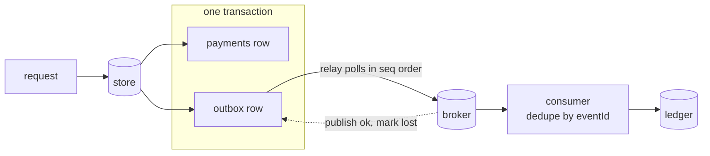

# The Transactional Outbox and Dual-Write Problem

> Commit the row and the event in one transaction or lose one of them.

**Type:** Build
**Languages:** Java, Python, Go
**Prerequisites:** Phase 7, Lesson 02 (Write-Ahead Logs), Phase 7, Lesson 11 (Change Data Capture), Phase 7, Lesson 12 (The Saga Pattern)
**Time:** ~90 minutes

## Learning Objectives

- Demonstrate the dual-write problem in both orders (commit-then-publish and publish-then-commit) and name the inconsistency each one produces
- Build an in-memory store with real transactions and write a business row and its outbox row in a single commit
- Build a polling relay that publishes outbox rows in commit order and delivers every row at least once across crashes
- Build a consumer that deduplicates by event id so that at-least-once delivery becomes effectively-once processing
- State what the outbox guarantees (no lost events, no ghost events, per-aggregate order) and what it leaves to the consumer (duplicates, latency)

## The Problem

A payment service accepts a 35.00 USD payment from merchant `acme`. It inserts a row into its `payments` table and commits. Then it publishes a `PaymentAccepted` event to Kafka so the ledger service can credit the merchant's balance, the notification service can email a receipt, and the analytics pipeline can count it. The code is eight lines and has been in production for two years.

One afternoon the Kafka cluster rebalances and the producer's `send()` times out for ninety seconds. During those ninety seconds the payment service accepts 412 payments. Each one commits to the database. Each publish fails, the exception is logged, and the HTTP handler returns 500, so the client retries, and the retry hits the idempotency store and returns the original 200. Everything looks healthy: no payment was lost, no customer saw an error that stuck. But the ledger never heard about 412 payments. Merchant balances are short by 61,000 USD in aggregate. Nobody notices until the Friday payout run, when 37 merchants are paid less than their dashboards show and the support queue fills.

A colleague proposes the obvious fix: publish first, then commit, so that a publish failure prevents the commit and the client sees a clean error. That trades one bug for a worse one. If the process dies between the publish and the commit (a deploy, an OOM kill, a node drain), the ledger credits a payment that does not exist in the payment service's database. Money appears from nowhere. Refunds against it fail because there is no payment to refund. Reconciliation finds an event with no source row, which is harder to explain to an auditor than a missing event.

Both orders fail because they are two writes to two systems with no transaction spanning them. This is the **dual-write problem**, and it has exactly one correct answer short of distributed transactions: write both things to the same database in one transaction, and let a separate process move the second thing to the broker afterwards. That second thing is the outbox row; the process is the relay. This lesson builds both, breaks them at every interesting point, and shows which guarantees survive.

## The Concept

### Two writes, one transaction

A database transaction is atomic across every row it touches, in every table, as long as the tables are in the same database. A message broker is not in the database. So instead of writing to the broker, the service writes a row describing the message into an `outbox` table in the same transaction as the business row:

```sql
BEGIN;
INSERT INTO payments (payment_id, merchant, amount_minor, currency, created_at) VALUES ('pay-5', 'acme', 3500, 'USD', now());
INSERT INTO outbox (event_id, aggregate_id, type, payload, created_at, published_at)
  VALUES ('evt-pay-5', 'acme', 'PaymentAccepted', '{"paymentId":"pay-5",...}', now(), NULL);
COMMIT;
```

Either both rows exist or neither does. A separate relay process polls `outbox WHERE published_at IS NULL ORDER BY seq`, publishes each row to the broker, and sets `published_at`. The broker is never touched inside the request path, so a broker outage cannot cause a lost event or a failed request; it can only cause a delay.



### The invariant

**Every committed business row has exactly one outbox row, committed with it, and every outbox row is eventually published at least once.** The first half is the database's atomicity; the second half is the relay's liveness. Nothing in the design makes "exactly once on the broker" true, and the lesson is honest about that: the relay publishes, then marks; if it dies between those two steps, the next poll publishes the same row again. Deduplication is the consumer's responsibility, which is why every outbox row carries an `eventId` that is stable across republishes.

What the outbox does not promise:

- **Not exactly-once delivery.** Duplicates are possible on the broker. Consumers must be idempotent on `eventId` (or on a business key that the event carries).
- **Not low latency.** Events reach the broker one relay poll after commit. Poll intervals of 50 to 500 milliseconds are typical; CDC-based relays (Debezium reading the WAL) bring this down to the replication lag.
- **Not global order.** Rows are published in commit order within one relay. Order on the broker is per partition, so the relay must key messages by `aggregateId` to keep one merchant's events in order.
- **Not a saga.** The outbox delivers an event; it does not decide what happens when the consumer rejects it. That is Lesson 12 and Phase 8, Lesson 10 (dead-letter queues).

### Comparison: the three ways to publish

| Approach | Lost events | Ghost events | Request latency | Delivery latency | Extra component |
|----------|-------------|--------------|-----------------|------------------|-----------------|
| Commit, then publish | Yes, on broker failure or crash | No | Includes broker round trip | Immediate | None |
| Publish, then commit | No | Yes, on crash before commit | Includes broker round trip | Immediate (and wrong when the commit fails) | None |
| Outbox + polling relay | No | No | Database only | One poll interval | Relay process |
| Outbox + CDC relay | No | No | Database only | Replication lag | Debezium or equivalent reading the WAL |
| Two-phase commit (XA) | No | No | Prepare + commit on both | Immediate | XA-capable broker and coordinator; blocking on coordinator failure |

The two naive rows are the dual-write problem. XA exists (Kafka does not support it; some JMS brokers do) and is rarely used for the reasons Lesson 08 covered: a coordinator failure leaves both participants holding locks. The outbox gets the same safety with no cross-system locks by giving up immediacy.

### Worked example: the relay crash, by hand

The store has two committed payments for `globex`, 100.00 and 1.00, with outbox rows `#1 evt-pay-6` and `#2 evt-pay-7`, both pending. The relay polls with batch size 10.

```text
poll 1
  read unpublished -> [#1, #2]
  publish #1 evt-pay-6         broker offset 0
  <crash before UPDATE outbox SET published_at WHERE seq = 1>

state after crash
  broker: [offset 0: evt-pay-6]
  outbox: #1 pending, #2 pending      <- the mark was never committed

poll 2 (relay restarted)
  read unpublished -> [#1, #2]
  publish #1 evt-pay-6         broker offset 1   <- duplicate, same eventId
  mark #1 published
  publish #2 evt-pay-7         broker offset 2
  mark #2 published

consumer
  offset 0 evt-pay-6  not seen -> apply +100.00   applied = {evt-pay-6}
  offset 1 evt-pay-6  seen     -> ignore           duplicatesIgnored = 1
  offset 2 evt-pay-7  not seen -> apply +1.00      applied = {evt-pay-6, evt-pay-7}
  balance globex = 101.00
```

Three messages on the broker for two events; one balance, and it is right. Swap the order of publish and mark in the relay (mark first, then publish) and a crash between them loses `evt-pay-6` forever: the row says published, the broker never got it. Publish-then-mark is the only order that preserves the invariant, and it forces duplicates, and duplicates are the cheaper problem because a consumer can detect them and a consumer cannot detect an event that never arrived.

### Why the consumer dedupes and not the relay

The relay could try to avoid the duplicate by checking the broker before publishing ("did I already send `evt-pay-6`?"). Brokers do not offer that query cheaply, and even if they did, the check and the publish are two operations with a crash window between them. Kafka's idempotent producer solves the narrow case of a retried `send()` within one producer session by attaching a sequence number per partition, and a transactional producer can make publish-and-commit-offsets atomic within Kafka; neither survives a relay process restart with a fresh producer id. The durable fix is at the consumer: it owns a store (the ledger, in this lesson) and can record applied event ids in the same transaction as its own business write. That is the outbox pattern again, mirrored: the consumer's "I processed this" marker commits with the consumer's effect.

The event id must be assigned by the producer at write time, inside the outbox row, not by the broker. A broker offset is unique per republish and therefore useless for dedupe; `evt-pay-6` is the same string every time the row is republished.

### Ordering and the relay's batch

The outbox `seq` is assigned at commit, in commit order, so `ORDER BY seq` is commit order. The relay reads a batch, publishes rows one at a time, and stops the batch at the first broker failure rather than skipping the failed row. Skipping would let `#2` reach the broker before `#1`, which for one merchant's events means the ledger might see a refund before the payment it refunds. The cost of stopping is head-of-line blocking: one row that the broker rejects permanently (an oversized payload) stalls every row behind it. Production relays add a per-row retry count and move a row that exceeds it to a dead-letter table so the line moves again; the ordering guarantee is then "in order except for rows that were quarantined", and the quarantine has an alert.

Note that commit order is not request order. Two requests can interleave so that the one that started second commits first. The outbox preserves what the database saw, which is the only order that is defined.

### Thin events, fat events, and what goes in the payload

The outbox row's payload is a design decision with downstream consequences:

| Payload style | Contents | Consumer must | Trap |
|---------------|----------|---------------|------|
| Thin (notification) | `{"paymentId": "pay-5"}` | Call back to the payment service to fetch the state | The callback reads the *current* state, which may have changed since the event; the consumer sees a refunded payment for a `PaymentAccepted` event |
| Fat (event-carried state) | Full payment: id, merchant, amount, currency, timestamps | Nothing; the event is self-contained | Schema evolution: every consumer parses every field, so renaming one is a coordinated change (Phase 8, Lesson 11) |
| Delta | What changed: `{"paymentId": "pay-5", "status": "accepted", "amount": ...}` | Apply the change to its own copy | Consumers must process in order, or a delta applies to the wrong base |

This lesson uses a fat payload (`paymentId|merchant|amount`) because the ledger consumer should be able to post from the event alone. Whatever the style, the payload is built once, at write time, from the same in-memory object that becomes the business row, so the two cannot disagree. A payload built later by re-reading the row is a dual read with the same class of bug as the dual write.

Two fields are non-negotiable regardless of style: `eventId` (stable across republishes, assigned before commit) and `aggregateId` (the partition key, so one merchant's events stay in order on the broker). A third, `createdAt` from the service's clock, lets consumers detect stale events after a long relay outage.

### Multiple relays and the lease

One relay is a single point of delay: if it dies, events wait until it restarts. Two relays polling the same table will both read `#1`, both publish it, and both try to mark it. The duplicate is harmless (the consumer dedupes), but at scale it doubles broker traffic and makes the "duplicates ignored" metric useless as a crash signal. The fix is a lease on the rows a relay is working on:

```sql
SELECT seq, event_id, aggregate_id, type, payload
FROM outbox
WHERE published_at IS NULL
ORDER BY seq
LIMIT 100
FOR UPDATE SKIP LOCKED;
```

`FOR UPDATE` locks the selected rows for the duration of the relay's transaction; `SKIP LOCKED` lets a second relay skip them and take the next batch. The two relays now publish disjoint rows, and ordering is preserved *per relay's batch* but not across batches: relay B may publish `#101` before relay A finishes `#100`. If two rows for the same aggregate land in different batches, the broker can see them out of order. Partitioned outboxes (each relay owns `aggregateId % N`) restore per-aggregate order at the cost of a static assignment. CDC relays sidestep the whole problem because the WAL is a single ordered stream.

### Failure modes, named

| Failure | Dual write (commit, publish) | Dual write (publish, commit) | Outbox |
|---------|------------------------------|------------------------------|--------|
| Broker down during request | Orphan row | Request fails cleanly | Request succeeds; event delayed |
| Process dies between the two writes | Orphan row | Ghost event | Impossible: there is one write |
| Relay dies after publish, before mark | n/a | n/a | Duplicate on broker; consumer dedupes |
| Relay dies after mark, before publish | n/a | n/a | Impossible by construction (publish precedes mark) |
| Database down during request | Request fails cleanly | Ghost event | Request fails cleanly |
| Consumer dies after applying, before recording | Double apply on restart | Double apply on restart | Double apply unless apply and record share a transaction |

The last row is the reason Exercise 3 exists: the outbox fixes the producer side, and the consumer side needs its own transactional pairing of effect and marker. The two together are what people mean by "exactly-once" in an event-driven system, and neither half works without the other.

### Complexity

Each accepted request costs one extra row insert in the same transaction, which is a few microseconds and one more WAL record. The relay's poll is an index scan on `(published_at, seq)` returning at most `batchSize` rows, one publish per row, and one update per row (or one batched update per poll). The outbox table grows without bound unless rows are deleted after publishing; most teams delete or archive rows older than a retention window and keep an index on `published_at IS NULL` so the pending set stays small regardless of history.

## Build It

The implementation is one Java file with a transactional in-memory store, an in-memory broker, the naive dual-write service with injectable crash points, the outbox service, the relay, and a ledger consumer. Money is the Phase 10 Lesson 01 type.

### Step 1: A store with real transactions

```java
final class Store {
    private final Map<String, Payment> payments = new LinkedHashMap<>();
    private final Map<Long, OutboxEvent> outbox = new LinkedHashMap<>();
    private long nextSeq = 1;

    final class Tx {
        private final List<Payment> pendingPayments = new ArrayList<>();
        private final List<OutboxEvent> pendingEvents = new ArrayList<>();
        private final List<Long> pendingMarks = new ArrayList<>();

        Tx insertPayment(Payment p) { ...; pendingPayments.add(p); return this; }
        Tx insertOutbox(String eventId, String aggregateId, String type, String payload, long atMs) { ...; return this; }
        Tx markPublished(long seq) { pendingMarks.add(seq); return this; }

        void commit() {
            open = false;
            for (Payment p : pendingPayments) payments.put(p.paymentId(), p);
            for (OutboxEvent e : pendingEvents) {
                long seq = nextSeq++;
                outbox.put(seq, new OutboxEvent(seq, e.eventId(), e.aggregateId(), e.type(), e.payload(), e.createdAtMs(), false));
            }
            for (long seq : pendingMarks) { ... outbox.put(seq, e.markPublished()); }
        }

        void rollback() { open = false; }
    }
}
```

Writes are buffered in the `Tx` and applied to the tables only in `commit`, so a rollback discards the payment and its outbox row together and nothing is visible before commit. The `seq` is assigned inside `commit`, which is what makes `seq` order equal commit order. A real database does this with its WAL and a sequence; the store is single-threaded, so there is no concurrent-commit interleaving to worry about here.

**Predict:** a transaction inserts a payment and an outbox row and then throws before `commit()` is reached. How many rows are in each table?

### Step 2: The outbox row, the broker, and one payload builder

```java
record OutboxEvent(long seq, String eventId, String aggregateId, String type, String payload, long createdAtMs, boolean published) {
    OutboxEvent markPublished() { return new OutboxEvent(seq, eventId, aggregateId, type, payload, createdAtMs, true); }
}

final class Broker {
    private final List<Message> log = new ArrayList<>();
    boolean down = false;

    long publish(String eventId, String aggregateId, String type, String payload) {
        publishAttempts++;
        if (down) throw new BrokerUnavailableException();
        long offset = log.size();
        log.add(new Message(offset, eventId, aggregateId, type, payload));
        return offset;
    }
}

final class Events {
    static String eventIdFor(Payment p) { return "evt-" + p.paymentId(); }
    static String payloadFor(Payment p) { return p.paymentId() + "|" + p.merchant() + "|" + p.amount(); }
}
```

`OutboxEvent` is immutable; marking it published produces a new record, which is how a row update looks when the table is a map of records. The broker is an append-only list with a `down` switch: that is enough to model an outage, and the `offset` it returns is deliberately different from `eventId` so the tests can show that the broker's identity for a message is not stable across republishes while `eventId` is. `Events` builds the id and payload for both services, so the dual-write and outbox services differ only in how they write, never in what.

### Step 3: The dual-write service, both orders

```java
void accept(Payment p) {
    if (publishFirst) {
        broker.publish(Events.eventIdFor(p), p.merchant(), Events.PAYMENT_ACCEPTED, Events.payloadFor(p));
        if (crashPoint == CrashPoint.AFTER_PUBLISH_BEFORE_COMMIT) throw new CrashException("after publish, before commit");
        store.begin().insertPayment(p).commit();
    } else {
        store.begin().insertPayment(p).commit();
        if (crashPoint == CrashPoint.AFTER_COMMIT_BEFORE_PUBLISH) throw new CrashException("after commit, before publish");
        broker.publish(Events.eventIdFor(p), p.merchant(), Events.PAYMENT_ACCEPTED, Events.payloadFor(p));
    }
}
```

This is the code from The Problem with the two failure windows made explicit. Commit-then-publish loses the event when the broker is down or the process dies after the commit: an **orphan row**. Publish-then-commit creates an event for a row that never commits: a **ghost event**. The tests drive both and assert the ledger disagrees with the store in each case.

### Step 4: The outbox service

```java
void accept(Payment p) {
    store.begin()
            .insertPayment(p)
            .insertOutbox(Events.eventIdFor(p), p.merchant(), Events.PAYMENT_ACCEPTED, Events.payloadFor(p), clock.now())
            .commit();
}
```

The whole fix is that the broker does not appear in this method. `eventId` is derived from the payment id (`evt-pay-5`), so it is the same on every republish; `aggregateId` is the merchant, which becomes the broker partition key; the payload is built by the same `Events` helper the dual-write service used, so the two services emit identical events and the only difference is atomicity.

**Predict:** the broker is down for an hour. What does a client of `accept` observe during that hour, and what does the ledger observe?

### Step 5: The relay

```java
int poll() {
    int marked = 0;
    for (OutboxEvent e : store.unpublished(batchSize)) {
        try {
            broker.publish(e.eventId(), e.aggregateId(), e.type(), e.payload());
        } catch (BrokerUnavailableException ex) {
            failedAttempts++;
            return marked;                                   // leave the row pending; retry next poll
        }
        published++;
        if (crashPoint == CrashPoint.AFTER_PUBLISH_BEFORE_MARK) { crashPoint = CrashPoint.NONE; throw new CrashException(...); }
        store.begin().markPublished(e.seq()).commit();
        marked++;
    }
    return marked;
}
```

Publish, then mark, one row at a time, in `seq` order. A broker failure returns immediately so no later row overtakes the failed one. The crash point sits in the only place that matters: after the broker has the message and before the store knows. `drain(maxPolls)` loops `poll()` until nothing is pending or a poll makes no progress, with a bound so a dead broker cannot spin the demo forever.

A production relay also needs a lease so that two relay instances do not both publish the same batch (`SELECT ... FOR UPDATE SKIP LOCKED` is the usual idiom), and it batches the marks into one update per poll. Both are left out to keep the crash semantics visible.

**Predict:** swap the two lines so the relay marks first and publishes second, then crash between them. Which invariant breaks, and can any consumer detect it?

### Step 6: The consumer that makes duplicates harmless

```java
int consume() {
    int appliedNow = 0;
    for (Message m : broker.from(offset)) {
        offset = m.offset() + 1;
        if (!applied.add(m.eventId())) { duplicatesIgnored++; continue; }
        Money amount = parseMoney(m.payload().split("\\|")[2]);
        balances.merge(m.aggregateId(), amount, Money::plus);
        appliedNow++;
    }
    return appliedNow;
}
```

`applied` is a set of event ids; `add` returns `false` for a repeat, and the message is skipped before it touches a balance. In production the set is a table (`processed_events(event_id PRIMARY KEY)`) written in the same transaction as the ledger posting, so a consumer crash between "post" and "record" cannot happen either. The set grows with every event; bound it with a retention window longer than the longest plausible redelivery gap, or key it on a business identifier the ledger already stores (the payment id on the posting row) so no separate table is needed.

**Predict:** the consumer records `applied` in memory and crashes after applying `evt-pay-6` but before its offset is committed. On restart it re-reads from the old offset. What happens, and what change prevents it?

### Step 7: Run it

```bash
cd phases/07-storage-and-transactions/13-transactional-outbox/code/java
javac -d .out *.java && java -cp .out Main
java -cp .out MainTest
```

Expected output, abbreviated:

```console
== 1. Dual write, commit then publish: the broker is down at the wrong moment ==
  pay-2: row committed, then publish failed: broker unavailable
  store has 2 payments; broker has 1 messages
  ledger balance for acme = 20.00 USD  (store says 55.00: pay-2 is an orphan row, the ledger will never see it)

== 2. Dual write, publish then commit: the process dies between the two ==
  pay-3: crash after publish, before commit
  store has 0 payments; ledger balance for acme = 12.50 USD  (a ghost event: the ledger credits a payment that does not exist)

== 3. Outbox: one transaction, two rows; the relay delivers when the broker comes back ==
  broker down; store has 2 payments and 2 pending outbox rows
  relay polled 1 times, delivered 0, failed attempts 1
  broker back; relay delivered 2; pending now 0
  ledger balance for acme = 55.00 USD  (matches the store)

== 4. Relay crashes after publish, before mark: at-least-once, and the consumer dedupes ==
  relay: crash after publish of evt-pay-6, before mark
  broker has 1 message(s); store still has 2 pending rows
  relay restarted and drained; broker now has 3 messages for 2 payments
  ledger applied 2, ignored 1 duplicate; balance for globex = 101.00 USD

== 6. Ordering: outbox seq is commit order, and the relay publishes in that order per aggregate ==
  batch size 2, 3 polls, broker order: 11 12 13 14 15
40 passed, 0 failed
```

Sections 1 and 2 are the two halves of the dual-write problem; sections 3 and 4 are the fix and its one honest cost.

### In Python

```python
def commit(self) -> None:
    self._require_open()
    self._open = False
    s = self._store
    for p in self._pending_payments:
        s._payments[p.payment_id] = p
    for e in self._pending_events:
        seq = s._next_seq
        s._next_seq += 1
        s._outbox[seq] = replace(e, seq=seq, published=False)
    ...

def __exit__(self, exc_type, exc, tb) -> bool:
    if self._open:
        if exc_type is None:
            self.commit()
        else:
            self.rollback()
    return False
```

Differences, all in `code/python/main.py`:

- **The transaction is also a context manager.** `Store.Tx` keeps the Java API (`insert_payment(...).insert_outbox(...).commit()`, `rollback()`), and adds `__enter__`/`__exit__`, so `with store.begin() as tx:` commits on success and rolls back on an exception. That makes "both rows or neither" the default shape of the code, not a discipline; a Python-only test covers both exits. The inner class is a nested `class Tx` holding a reference to its `Store`, because Python has no implicit outer instance.
- **Records are frozen dataclasses.** `OutboxEvent.mark_published` and the seq assignment at commit use `dataclasses.replace`, the equivalent of building a new record. `Broker.from` is `from_`, because `from` is a keyword.
- **Errors and money.** `CrashException` and `BrokerUnavailableException` are `RuntimeError` subclasses, and the relay catches only the broker one, so a crash escapes `poll()` as it does in Java. A closed or duplicate transaction raises `RuntimeError` (`IllegalStateException`). `Money.plus` checks the signed 64-bit range by hand and raises `OverflowError`, as `Math.addExact` would.
- **Same output.** No threads, a simulated clock and scripted crash points: the demo's counts and the broker order `11 12 13 14 15` match Java exactly.

```bash
cd phases/07-storage-and-transactions/13-transactional-outbox/code/python
python3 main.py
python3 -m unittest -v
```

### In Go

```go
func (r *OutboxRelay) Poll() (int, error) {
    r.Polls++
    marked := 0
    for _, e := range r.store.Unpublished(r.BatchSize) {
        if _, err := r.broker.Publish(e.EventID, e.AggregateID, e.Type, e.Payload); err != nil {
            if errors.Is(err, ErrBrokerUnavailable) {
                r.FailedAttempts++
                return marked, nil // leave the row pending; retry next poll
            }
            return marked, err
        }
        r.Published++
        if r.CrashPoint == AfterPublishBeforeMark {
            r.CrashPoint = NoCrash
            return marked, &CrashError{"after publish of " + e.EventID + ", before mark"}
        }
        if err := r.store.Begin().MarkPublished(e.Seq).Commit(); err != nil {
            return marked, err
        }
        marked++
    }
    return marked, nil
}
```

Differences, all in `code/go/main.go`:

- **Errors are values, and the two failures are different values.** `Broker.Publish` returns `(offset, error)` with the sentinel `ErrBrokerUnavailable`; the relay treats it as the expected, transient outcome (count it, keep the row pending, return `nil`). The injected crash is a `*CrashError` that matches `ErrCrash` through `errors.Is` and is *returned* from `Poll`, `Drain` and `DualWritePaymentService.Accept` rather than thrown, so tests assert on it without `recover()` and the demo prints `err.Error()`. `Tx.Commit`/`Rollback` return `ErrTxClosed` on reuse; a duplicate payment id is remembered by the chaining `InsertPayment` and reported by `Tx.Err()` and `Commit` as `ErrDuplicatePayment`, so the transaction fails as a whole.
- **Chaining without exceptions.** `store.Begin().InsertPayment(p).InsertOutbox(...).Commit()` reads exactly like the Java, because `InsertPayment`, `InsertOutbox` and `MarkPublished` keep returning `*Tx` and stash the first error for `Commit` to surface. The nested `Store.Tx` becomes a top-level `Tx` holding a `*Store`.
- **Ordered data without `LinkedHashMap`.** The outbox is a `map[int64]OutboxEvent` keyed by `Seq`, and `OutboxRows` walks `1..nextSeq-1` so commit order is the iteration order; `Unpublished(limit)` builds on it. `OutboxEvent.MarkPublished` returns a modified copy of a value struct, the Go spelling of the Java record's `markPublished()`.
- **Money and payloads.** `Money.Plus` returns `(Money, error)`; `ParseMoney` returns `(Money, error)` from `strconv.ParseInt`, so `LedgerConsumer.Consume` returns `(applied, error)` instead of silently accepting a malformed payload. No goroutines: the relay is a polling loop driven by the test, so `go test -race` passes without a mutex. A relay goroutine with a `time.Ticker` is the natural next step, and then the store needs one.

```bash
cd phases/07-storage-and-transactions/13-transactional-outbox/code/go
go run .
go test ./...
```

The demo prints the same six sections as the Java version, line for line.

## Use It

### Debezium and CDC-based relays

The polling relay is simple and adds a poll interval of latency plus a scan on the outbox table. The production alternative is change data capture (Lesson 11): Debezium tails the database's WAL, sees every committed insert to the `outbox` table within milliseconds, and its Outbox Event Router turns each row into a Kafka record keyed by `aggregateId` with `eventId` in a header. Rows are deleted immediately after insert in the same transaction if you like (Debezium sees the insert in the WAL regardless), so the table never grows. The guarantees are identical: at-least-once, commit order per aggregate, consumer dedupes on the event id. What CDC hides is the lease and batching logic; what it does not hide is the need for an outbox table in the first place, which is why the pattern is called "outbox" and not "CDC".

### Kafka's idempotent and transactional producers

Kafka's idempotent producer (`enable.idempotence=true`) deduplicates retries of the same `send()` within one producer session using a per-partition sequence number; it removes the duplicate that a network retry would create but does nothing for a relay that restarts with a new producer id and republishes an unmarked row. Kafka transactions make "publish to topics A and B and commit consumer offsets" atomic within Kafka. Neither reaches into your database, so neither replaces the outbox; they complement it by removing one class of duplicate on the broker side.

### Payment platforms

Stripe's webhook documentation says that endpoints may receive the same event more than once and must handle duplicates by event id, which is this lesson's consumer rule stated as an API contract. Internally, every payment platform that emits events from a transactional core uses an outbox or CDC; the alternative is the orphan-row incident from The Problem, and every platform old enough has had one.

### What the production versions hide

Debezium hides the relay; Kafka hides the retry; a framework such as Spring's `@TransactionalEventListener(AFTER_COMMIT)` hides the ordering of commit and publish but, notably, does not persist the event, so it is the dual-write problem with better syntax. Read the framework's documentation for the word "durable" before trusting it to deliver anything.

## Ship It

`outputs/checklist-event-publishing-review.md` is a review checklist for any code path that writes to a database and then tells another system about it: the transaction boundary, the event id, the relay's order of operations, consumer idempotency, and the retention of both the outbox and the processed-events set.

## Exercises

1. **Reinforce.** Add a `deletePublished(olderThanMs)` operation to `Store` and have the relay call it after each successful poll. Write a test that proves no pending row is ever deleted, including a row that is older than the window but still unpublished because the broker was down.
2. **Apply.** Give `OutboxRelay` a per-row `attempts` counter and a dead-letter table: a row that fails `maxAttempts` times is moved aside and the batch continues. Then write the test that shows ordering is preserved for every row except the quarantined one, and decide, in a comment, what alert fires when the dead-letter table is non-empty.
3. **Extend.** Replace the in-memory `applied` set in `LedgerConsumer` with a second `Store` that holds both the ledger balances and a `processed_events` table, written in one transaction. Inject a crash between the balance update and the processed-events insert and show that, without the shared transaction, the consumer double-credits on restart, and with it, it does not. This connects to Phase 8, Lesson 03 (Delivery Guarantees).

## Key Terms

| Term | What people say | What it actually means |
|------|-----------------|------------------------|
| Dual write | "we save and then publish" | Two writes to two systems with no transaction across them; one of them can fail or be lost, leaving the systems disagreeing forever |
| Transactional outbox | "the outbox table" | A table in the business database that holds pending events, written in the same transaction as the business row, and drained by a separate process |
| Relay | "the publisher job" | The process that reads unpublished outbox rows in commit order, publishes each, then marks it; publish-before-mark gives at-least-once |
| At-least-once | "it might send twice" | Every event reaches the broker one or more times; the only delivery guarantee an outbox can give without the consumer's help |
| Effectively-once | "exactly-once processing" | At-least-once delivery combined with a consumer that detects and discards repeats by a stable event id |
| Orphan row | "the event got lost" | A committed business row whose event never reached the broker; produced by commit-then-publish when the publish fails |
| Ghost event | "phantom message" | An event on the broker whose business row never committed; produced by publish-then-commit when the commit fails |
| Change data capture | "Debezium" | Reading the database's WAL to observe committed changes; the outbox row becomes the event without a polling relay |

## Further Reading

- [Debezium documentation: Outbox Event Router](https://debezium.io/documentation/reference/stable/transformations/outbox-event-router.html) — the production CDC relay: how outbox rows become Kafka records, which column becomes the key, and how the event id travels in headers.
- [Pat Helland, "Life beyond Distributed Transactions: an Apostate's Opinion" (CIDR 2007)](https://www.ics.uci.edu/~cs223/papers/cidr07p15.pdf) — the argument that messages between entities must be at-least-once and that receivers must deduplicate; the outbox is the mechanism this paper assumes.
- [Apache Kafka documentation: Message Delivery Semantics](https://kafka.apache.org/documentation/#semantics) — what the idempotent and transactional producer do and do not guarantee, which bounds what the relay can expect from the broker.
- [Stripe documentation: Webhooks, handling duplicate events](https://docs.stripe.com/webhooks#handle-duplicate-events) — a public API contract that states the consumer-side dedupe rule this lesson derives.
- [Gray and Reuter, "Transaction Processing: Concepts and Techniques", chapter 10](https://www.sciencedirect.com/book/9781558601901/transaction-processing) — the logging and recovery rules that make "write it in the same transaction" a durability guarantee rather than a hope.
