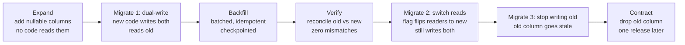

# Schema Migrations at Scale: Expand, Migrate, Contract

> Change a ledger table without stopping payments.

**Type:** Learn
**Languages:** —
**Prerequisites:** Phase 7, Lesson 05 (Two-Phase Locking), Phase 7, Lesson 11 (Change Data Capture), Phase 10, Lesson 01 (Representing Money)
**Time:** ~60 minutes

## Learning Objectives

- Explain why a single `ALTER TABLE` on a large, busy table is an outage and name the lock that causes it in PostgreSQL and MySQL
- Decompose any schema change into expand, migrate, and contract steps such that every intermediate state is compatible with both the old and the new application version
- Design a batched, idempotent, resumable backfill with a checkpoint, a throttle, and a replica-lag guard
- Choose between dual-write and change-data-capture for keeping old and new columns in step during the migrate phase, and state what each one costs
- Walk a ledger table from `amount NUMERIC(19,4)` to `amount_minor BIGINT + currency CHAR(3)` end to end with zero downtime and a verified reconciliation before the contract step
- Identify the operations that are instant, that rewrite the table, and that take a blocking lock in PostgreSQL, MySQL, and SQLite

## The Problem

A ledger stores `amount NUMERIC(19,4)` with the currency implied by the account. Phase 10, Lesson 01 made the case that this is wrong: the exponent belongs to the currency, a four-decimal column admits values no currency has, and every consumer rounds differently. The team agrees. The fix is two new columns, `amount_minor BIGINT NOT NULL` and `currency CHAR(3) NOT NULL`, and the removal of `amount`. The table has 2.1 billion rows, receives 4,000 inserts per second, and is read by the payment API, the reconciliation job, the fraud scorer, a CDC consumer feeding the warehouse, and a reporting replica.

The first plan is one migration file:

```sql
ALTER TABLE ledger_entries
  ADD COLUMN amount_minor BIGINT NOT NULL DEFAULT 0,
  ADD COLUMN currency CHAR(3) NOT NULL DEFAULT 'USD';
UPDATE ledger_entries SET amount_minor = ROUND(amount * 100), currency = 'USD';
ALTER TABLE ledger_entries DROP COLUMN amount;
```

Run against production it does the following. The `ALTER TABLE` requests an `ACCESS EXCLUSIVE` lock. A reconciliation query that started forty seconds ago holds an `ACCESS SHARE` lock on the table, so the `ALTER` waits. Every new `INSERT` from the payment API now queues behind the waiting `ALTER`, because PostgreSQL's lock queue is first-come-first-served and an `ACCESS EXCLUSIVE` request blocks everything behind it. Within three seconds the API's connection pool is exhausted. Payments fail. When the reconciliation query finishes, the `ALTER` runs, and on PostgreSQL 11 or later adding a column with a constant default is a catalog-only change that takes milliseconds. The lock releases. The queue drains. The outage lasted exactly as long as the longest running transaction plus the pool's recovery, and nobody had changed a single row yet.

Then the `UPDATE` begins. One statement, 2.1 billion rows, one transaction. It holds row locks on every row it has touched, takes hours, writes a 2.1-billion-row undo and redo trail, bloats the table to twice its size because PostgreSQL's MVCC (Lesson 06) writes a new tuple for every updated row, and blocks every `VACUUM` for its duration. If it fails at hour four for any reason, it rolls back, which takes another hour, and the table is still bloated. Meanwhile the payment API, deployed to read `amount_minor`, reads zero for every row the backfill has not reached. And the `DROP COLUMN` at the end breaks the fraud scorer, which nobody told, and which still selects `amount`.

Every one of these failures has the same shape: the migration assumed it could change the schema and the data and the application in one step. At scale there is no such step. There is a sequence of small steps, each of which leaves the system working for both the version of the code that is running and the version about to be deployed. This lesson is that sequence.

## The Concept

### The invariant: every intermediate state is compatible with two versions

A rolling deploy means two versions of the application run at the same time, for minutes or hours. A schema migration means two shapes of the table exist at the same time, during the backfill. The invariant that keeps the system up is that **at every moment, the running schema is compatible with every running application version**. Written as a rule for each step: before changing the schema, make sure no running code breaks on the new schema; before changing the code, make sure it works on both the current and the previous schema.

That rule rules out two common operations outright. **Renaming** a column is a drop and an add from the application's point of view, and there is no moment when old and new code both work; the fix is add-copy-switch-drop, which is the whole lesson. **Dropping** anything in the same release that stops using it means the previous version, still running during the rollout, is broken; a drop always ships at least one release after the last reader was removed.

### Expand, migrate, contract

The three-phase shape that satisfies the invariant:



| Phase | Schema change | Code change | Rollback is |
|---|---|---|---|
| Expand | Add nullable columns, no default or constant default only; add indexes concurrently | None | Drop the columns; nothing read them |
| Migrate 1 | None | Write old and new on every insert/update; read old | Deploy previous version; new columns go stale, harmless |
| Backfill | None (data only) | A batch job | Stop the job; partially filled columns are harmless because nothing reads them |
| Verify | None | A reconciliation job | Fix mismatches, re-verify |
| Migrate 2 | Add `NOT NULL` / check constraints (validated separately) | Flag flips reads to new columns | Flip the flag back; old column is still written |
| Migrate 3 | None | Stop writing old column | Redeploy dual-write and re-backfill the gap |
| Contract | Drop old column | Remove dead code paths | None: the drop is the point of no return |

Each row of the table is reversible except the last, and the last happens only when the previous one has been running cleanly long enough that no one needs to go back. The pattern has one more property worth stating: the backfill is the slow step and it has no deadline. It can run for a week at a rate the database barely notices, because nothing reads the columns it is filling until Verify says they are right.

### Lock hazards: what each database does when you alter a table

The operations below are the ones a payments team runs most. "Instant" means a catalog change that takes a short lock measured in milliseconds, which is still an outage if it queues behind a long transaction. "Rewrite" means every row is copied, with the table locked against writes for the duration unless the online variant is used.

| Operation | PostgreSQL (14+) | MySQL 8 InnoDB | SQLite |
|---|---|---|---|
| Add nullable column, no default | Instant, `ACCESS EXCLUSIVE` briefly | `ALGORITHM=INSTANT` | Instant |
| Add column with constant default | Instant since 11 (default stored in catalog) | `INSTANT` | Instant |
| Add column with volatile default (`now()`, `gen_random_uuid()`) | **Rewrite** | Not allowed as default; use trigger | Not allowed |
| Add `NOT NULL` to existing column | Full scan under `ACCESS EXCLUSIVE`; use `CHECK (col IS NOT NULL) NOT VALID` then `VALIDATE` | `INPLACE`, rebuilds | **Rewrite** (recreate table) |
| Add index | `CREATE INDEX` blocks writes; `CONCURRENTLY` does not, takes two scans, cannot run in a transaction | `INPLACE`, online | Blocks writes |
| Add foreign key | Validates all rows under `SHARE ROW EXCLUSIVE`; use `NOT VALID` then `VALIDATE CONSTRAINT` | Rebuild unless `foreign_key_checks=0` | Not enforced by default |
| Change column type | **Rewrite** (except some widening, e.g. `varchar(n)` to `text`) | **COPY** (`ALGORITHM=COPY`, blocks writes) | **Rewrite** |
| Drop column | Instant (marks column dead; space reclaimed by later rewrite) | `INSTANT` since 8.0.29, else `INPLACE` | Instant since 3.35 |
| Rename column | Instant, but breaks every reader | `INSTANT` | Instant since 3.25 |

Three hazards cut across all of them:

**The lock queue.** PostgreSQL grants locks in request order. An `ACCESS EXCLUSIVE` request waiting behind a long `SELECT` blocks every later `SELECT` and `INSERT`, even though those would be compatible with the `SELECT`. The defence is `SET lock_timeout = '2s'` before every DDL statement, so the `ALTER` gives up instead of queueing, and a retry loop around it. MySQL's metadata lock has the same queueing behaviour and the same fix (`lock_wait_timeout`).

**Rewrites that look instant.** The same statement can be instant or a rewrite depending on version and argument: adding a column with `DEFAULT now()` rewrites on every PostgreSQL version; `DEFAULT 'USD'` is instant on 11 and a rewrite on 10. Test every migration against a production-sized copy and read the `EXPLAIN` or the lock it takes; never infer from the statement's text.

**Validation scans.** `NOT NULL`, `CHECK`, and `FOREIGN KEY` all need to prove the existing rows comply. The blocking form scans under an exclusive lock. Both PostgreSQL and MySQL offer a two-step form: add the constraint without validating (`NOT VALID`), which is instant and enforces the rule for new rows, then `VALIDATE CONSTRAINT`, which scans with a lock that allows reads and writes. Always use the two-step form on a table larger than memory.

### A spec excerpt worth memorising

The PostgreSQL `ALTER TABLE` documentation states the rule that most of this lesson rests on:

> When a column is added with `ADD COLUMN` and a non-volatile `DEFAULT` is specified, the default is evaluated at the time of the statement and the result stored in the table's metadata. That value will be used for the column for all existing rows. If no `DEFAULT` is specified, NULL is used. In neither case is a rewrite of the table required. Adding a column with a volatile `DEFAULT` or changing the type of an existing column will require the entire table and its indexes to be rewritten.

Two facts follow. Adding a column is cheap *only* if the default is constant or absent; `DEFAULT now()` or `DEFAULT gen_random_uuid()` is a rewrite. And changing a type is always a rewrite, which is why the ledger migration adds `amount_minor` as a new column rather than altering `amount` in place. The same page lists the lock each form takes; the forms that take anything weaker than `ACCESS EXCLUSIVE` are the exceptions, not the rule.

### Ordering a migration against a rolling deploy

A rolling deploy of version `N+1` over version `N` takes minutes; a backfill takes days. The schema steps and the code steps interleave in a fixed order:

| Step | Who runs it | Must be true before it runs |
|---|---|---|
| Expand DDL | Migration job, before any deploy | Version `N` ignores unknown columns (it does, unless it uses `SELECT *` into a strict mapper) |
| Deploy `N+1` (dual-write, read old) | Deploy pipeline | Expand finished on every shard |
| Backfill | Batch job | `N+1` fully rolled out, so no `N` instance writes rows without the new columns (or the trigger covers it) |
| Verify | Batch job on a replica | Backfill reports completion for every range |
| Constraints DDL (`NOT VALID` then `VALIDATE`) | Migration job | Verify is zero |
| Flag: shadow, then switch reads | Flag system, no deploy | Constraints validated |
| Deploy `N+2` (stop writing old) | Deploy pipeline | Flag at 100% for long enough to trust |
| Contract DDL | Migration job, one release later | `N+1` no longer running anywhere; statement log shows no reader of the old column |

The common mistake is to ship the Expand DDL and the `N+1` code in the same deploy. If the DDL runs after some `N+1` instances start, those instances write to a column that does not exist and fail. If the DDL fails and the deploy proceeds, the same. Schema first, code second, always, with a check in the application's startup that the columns it needs exist.

### Failure modes and their signatures

| What you see | What it is | Fix |
|---|---|---|
| Connection pool exhausted seconds after the migration starts; DDL still "running" | Lock queue behind a long transaction | `lock_timeout` plus retry; find and kill or wait for the long transaction |
| Migration runs for hours; table size doubles; replicas fall behind | Rewrite or single-statement backfill | Add a new column instead of altering; batch the backfill |
| New code reads zero or `NULL` for old rows | Reads switched before backfill and verify | Flag back to old reads; finish backfill; verify; switch again |
| Rows with `NULL` in the new column appear after the backfill passed them | A write path not dual-writing | Add the trigger safety net; re-run the idempotent backfill |
| Verify finds rows that do not round-trip | Old column held precision the new one cannot | Business decision per category; corrected by reviewed script with an audit trail |
| A downstream job fails the day after Contract | An unknown reader of the dropped column | Restore from the pre-Contract snapshot if under retention; otherwise rebuild from the new column; add statement-log review to the Contract checklist |
| Rollback of `N+1` to `N` leaves new columns stale | Expected during Migrate 1 | Nothing: nothing reads them yet; re-run the backfill after redeploying |

### Backfill: batched, idempotent, resumable, throttled

The backfill fills the new columns for rows that existed before dual-write began. Its four properties, each fixing a failure from The Problem:

- **Batched by primary key range**, a few thousand rows per transaction. Short transactions mean short row-lock hold times, bounded undo, and `VACUUM` can run between batches. Range by primary key rather than `LIMIT ... OFFSET`, which rescans from the start on every batch.
- **Idempotent**: `UPDATE ... SET amount_minor = ... WHERE id BETWEEN ? AND ? AND amount_minor IS NULL`. Rerunning a batch does nothing. Dual-written rows are skipped because they are already filled.
- **Resumable**: the last completed range is written to a `migration_progress` table after each batch commits. A crash resumes from the checkpoint. This is Lesson 11's consumer offset applied to a batch job.
- **Throttled**: between batches, check replica lag and primary load; sleep when either exceeds a threshold. A backfill that runs at full speed saturates the WAL and pushes every replica, including the CDC consumer, hours behind.

The batch size is tuned, not guessed: start at 1,000, measure batch duration and replica lag, raise until a batch takes about 100 ms or lag starts to climb. On a 2.1-billion-row table at 5,000 rows per 100 ms with a 100 ms pause, the backfill takes roughly five days. That is fine. Nothing is waiting for it.

### Keeping the two columns in step: dual-write versus CDC

While the backfill runs, new rows arrive. Something must fill `amount_minor` for them too, or the backfill chases a moving target. Two designs:

**Dual-write in the application.** The new code writes `amount`, `amount_minor`, and `currency` in the same `INSERT`. Same row, same transaction, so there is no consistency gap; this is not the dual-write *problem* from Lesson 11, which is about two different systems. The cost is code: every write path must be found and changed, and a missed path (a bulk importer, a manual SQL fixup script, a second service with its own connection) produces rows with `amount_minor IS NULL` after the backfill has passed them. The verify step catches these; the fix is to make the backfill re-runnable and run it again.

**Database-side derivation.** A trigger (`BEFORE INSERT OR UPDATE ... SET NEW.amount_minor = ROUND(NEW.amount * 100)`) or a generated column (`amount_minor BIGINT GENERATED ALWAYS AS (ROUND(amount * 100)) STORED`) fills the new column for every write path, including ones the team forgot. The cost is that the derivation runs on the database's CPU for every write, and a generated column in PostgreSQL requires a table rewrite to add. A trigger is the usual choice during the migrate phase and is dropped at contract.

**CDC-driven backfill** (Lesson 11) suits the case where the new shape lives in a different table or database rather than a new column: a consumer reads the change stream and writes the new table, with the snapshot-then-stream bootstrap doing the backfill. For a new column in the same table, the trigger is simpler and transactional.

### Feature flags as the switch

The reads move from `amount` to `amount_minor` behind a runtime flag, not a deploy. A flag can be flipped per service, per percentage of traffic, and back in seconds; a deploy takes minutes and a rollback takes a release. The read path during Migrate 2 looks like:

```java
Money amountOf(LedgerRow row) {
    if (flags.isEnabled("ledger.read_minor_units")) {
        return Money.ofMinor(row.amountMinor(), Currency.of(row.currency()));
    }
    return Money.fromDecimalString(row.amountLegacy(), Currency.of(row.accountCurrency()));   // old path
}
```

A useful intermediate flag mode is **shadow read**: read both, compare, log a mismatch metric, return the old value. Run it at 100% for a day before flipping to the new value. The mismatch metric going to zero is the evidence that the backfill and dual-write are complete, independent of the reconciliation job.

### Verify before you contract

The step most often skipped. Before any reader switches, a reconciliation query proves the two representations agree on every row:

```sql
SELECT count(*) FROM ledger_entries
WHERE amount_minor IS NULL
   OR currency IS NULL
   OR amount_minor <> ROUND(amount * 100);
```

Run in batches by primary key range on a replica, the same way as the backfill. The expected result is zero. Any nonzero count is a write path that is not dual-writing, a rounding disagreement between the backfill's `ROUND` and the application's rounding mode, or a row with more than two decimals in `amount`, which the old schema allowed and the new one correctly cannot represent. That last category is a business decision, not a bug: someone has to say what `12.3456` meant.

A useful second check is aggregate: `SUM(amount) * 100` versus `SUM(amount_minor)` per account. If the per-row check is zero the aggregate check is redundant, but it is cheap and it is what finance will ask for.

### Migrating across shards

A partitioned ledger (Lesson 01) has one table per shard, on separate nodes. The same sequence runs per shard, and the application invariant now spans shards: every version of the code must work against a shard that is at any phase of the migration. In practice that means Expand runs on every shard before Migrate 1 deploys anywhere, and Contract runs nowhere until Migrate 3 has been verified everywhere. A `schema_version` row per shard, read by the application at startup and checked on every connection, makes the mixed state explicit instead of discovered.

### Downstream consumers are part of the migration

The CDC consumer from Lesson 11 sees the new columns appear in `after` images at Expand, sees `amount` vanish at Contract, and sees `amount_minor` change from `NULL` to a value on every backfilled row, which is 2.1 billion update events. Tell the warehouse team before the backfill starts. Stop the consumer before Contract if its sink has a strict schema. The reporting replica's queries that select `amount` are readers too; find them with the database's statement log before Contract, not with an error after.

### What this lesson does not do

- It does not cover migrating between databases or engines (PostgreSQL to a sharded store). That is a CDC-driven dual-read migration, which composes Lesson 11's connector with the switch-reads step here, and its verify step is a full-table comparison across two systems.
- It does not cover schema-less stores. Document databases move the problem into the application: every version of the code must read every version of the document, and "contract" is a background job that rewrites old documents. The expand-migrate-contract shape is identical; only the enforcement point moves.
- It does not prescribe a migration tool. Flyway, Liquibase, Alembic, Rails migrations, and `golang-migrate` all run ordered SQL files; none of them makes a rewrite non-blocking or a lock queue safe. Tools that do (`gh-ost`, `pt-online-schema-change` for MySQL; `pgroll`, `reshape` for PostgreSQL) implement the shadow-table version of this lesson: copy the table in the background, keep it in sync with triggers or the binlog, then swap names in an instant rename.

## Worked Example

The ledger table, end to end. 2.1 billion rows, PostgreSQL 15, 4,000 inserts per second, five readers. Each step names the day, the statement or code change, the lock it takes, and the rollback.

**Day 0, Expand.**

```sql
SET lock_timeout = '2s';
ALTER TABLE ledger_entries ADD COLUMN amount_minor BIGINT;
ALTER TABLE ledger_entries ADD COLUMN currency CHAR(3);
```

Two catalog-only changes, each holding `ACCESS EXCLUSIVE` for under 10 ms once acquired. The `lock_timeout` makes each statement fail rather than queue if a long transaction holds the table; the deploy script retries up to 20 times with a two-second pause. No default, no `NOT NULL`: both would be constraints the existing rows cannot yet satisfy. Nothing reads the columns. Rollback: `DROP COLUMN`, instant.

```sql
CREATE OR REPLACE FUNCTION ledger_fill_minor() RETURNS trigger AS $$
BEGIN
  IF NEW.amount_minor IS NULL THEN
    NEW.amount_minor := ROUND(NEW.amount * 100);
    NEW.currency := COALESCE(NEW.currency, 'USD');
  END IF;
  RETURN NEW;
END $$ LANGUAGE plpgsql;
CREATE TRIGGER ledger_fill_minor BEFORE INSERT OR UPDATE ON ledger_entries
  FOR EACH ROW EXECUTE FUNCTION ledger_fill_minor();
```

The trigger fills the new columns for every write path from this moment, including the ones the team has not found. `IF NEW.amount_minor IS NULL` means the application can start writing the columns itself later without the trigger overriding it. From Day 0 onward, every new row has both representations.

**Day 1, Migrate 1 (dual-write).** The application's insert path is changed to write `amount`, `amount_minor`, and `currency` explicitly, using `Money.ofMinor` and the account's currency rather than the trigger's `'USD'` assumption. The trigger stays as a safety net. Reads still use `amount`. Deployed as a normal rolling release; the previous version, which writes only `amount`, is still correct because the trigger covers it.

**Days 2 to 7, Backfill.**

```sql
-- one batch; the job loops over id ranges and records progress after each commit
UPDATE ledger_entries
   SET amount_minor = ROUND(amount * 100), currency = 'USD'
 WHERE id BETWEEN $1 AND $2 AND amount_minor IS NULL;
INSERT INTO migration_progress (name, last_id) VALUES ('ledger_minor', $2)
  ON CONFLICT (name) DO UPDATE SET last_id = EXCLUDED.last_id;
```

5,000 rows per batch, about 90 ms each, 100 ms pause, pause extended whenever `pg_stat_replication` shows any replica more than 5 seconds behind. Roughly 420,000 batches; the job runs for five and a half days and is restarted twice during deploys, resuming from `migration_progress` both times. `VACUUM` keeps up because each batch's dead tuples are freed before the next thousand batches arrive. The `currency = 'USD'` assumption is checked first: `SELECT DISTINCT currency FROM accounts` returns one row, and the backfill is written to fail loudly if that ever changes.

**Day 8, Verify.**

```sql
SELECT count(*) FROM ledger_entries
 WHERE id BETWEEN $1 AND $2
   AND (amount_minor IS NULL OR amount_minor <> ROUND(amount * 100));
```

Run across all ranges on the reporting replica: 1,912 mismatches. All 1,912 are rows where `amount` has three or four decimal places, inserted by a 2019 FX-fee process that has since been removed. Finance rules that these were half-cent fees that should have been rounded `HALF_EVEN` at the time; the 1,912 rows are corrected by a reviewed script, with the before and after values written to an audit table. Re-verify: zero. The aggregate check per account also matches.

**Day 9, constraints.**

```sql
ALTER TABLE ledger_entries ADD CONSTRAINT ledger_minor_not_null CHECK (amount_minor IS NOT NULL) NOT VALID;
ALTER TABLE ledger_entries ADD CONSTRAINT ledger_currency_not_null CHECK (currency IS NOT NULL) NOT VALID;
ALTER TABLE ledger_entries VALIDATE CONSTRAINT ledger_minor_not_null;
ALTER TABLE ledger_entries VALIDATE CONSTRAINT ledger_currency_not_null;
```

`NOT VALID` makes the constraints instant and enforced for new rows; `VALIDATE` scans under `SHARE UPDATE EXCLUSIVE`, which blocks nothing the application does. Fourteen minutes each.

**Day 10, Migrate 2 (switch reads).** The flag `ledger.read_minor_units` goes to shadow mode: both columns read, compared, the old value returned, a mismatch counter emitted. Twenty-four hours at zero mismatches. The flag flips to 5% of reads returning the new value, then 50%, then 100%, over a day, with the rollback being a flag flip. The fraud scorer and the reconciliation job, which have their own read paths, go through the same flag sequence a day later.

**Day 14, Migrate 3.** The application stops writing `amount`. The trigger is dropped. `amount` begins to go stale on new rows, which is fine: the verify query is no longer run, and no reader uses the column. The CDC consumer's team is told that `amount` will disappear from `after` images in two weeks.

**Day 28, Contract.**

```sql
SET lock_timeout = '2s';
ALTER TABLE ledger_entries DROP COLUMN amount;
```

Instant: PostgreSQL marks the column dead and the space is reclaimed as rows are rewritten by normal updates and vacuum. Two weeks between Migrate 3 and Contract is the window in which an unknown reader would have surfaced in the statement log or the error budget. None did. The migration took 28 days and zero seconds of downtime, and the only moment with any blocking lock was the sub-10 ms `ALTER` on Day 0.

The sequence above is distilled into `outputs/checklist-zero-downtime-migration.md`, a review checklist for any pull request that contains DDL against a table that serves payments. Attach it to the migration PR template.

## Exercises

1. **Reinforce.** The Day 0 `ALTER TABLE` is run without `lock_timeout` while a 90-second analytics query holds the table. Draw the lock queue at second 0, second 30, and second 91 for the following requests, in order: the analytics `SELECT`, the `ALTER`, forty `INSERT`s from the payment API, a `SELECT` from the fraud scorer. State which requests are blocked at each moment and why the `INSERT`s are blocked even though they are compatible with the `SELECT`.
2. **Apply.** Write the backfill loop as pseudocode or in Java against an in-memory table: batch by id range, idempotent predicate, progress checkpoint after each commit, and a throttle callback that receives replica lag and returns a pause duration. Then kill it mid-batch in a test and show that the restart neither repeats a completed batch nor skips the interrupted one.
3. **Extend.** The ledger is partitioned across 16 shards (Lesson 01) and the `currency` assumption from the worked example is false on two of them: those shards hold EUR and GBP accounts. Rewrite Days 0 to 8 so that `currency` is derived from the `accounts` table rather than hard-coded, decide whether that derivation belongs in the trigger, the application, or the backfill, and specify the verify query so that a row whose `currency` disagrees with its account's currency is caught before any reader switches. Then state how the CDC consumer (Lesson 11) feeding the warehouse should be told about the schema change, and at which day.

## Key Terms

| Term | What people say | What it actually means |
|------|-----------------|------------------------|
| Expand / migrate / contract | "add, backfill, drop" | A decomposition of a schema change into steps where every intermediate schema works with both the running and the next application version; the drop ships at least one release after the last reader is gone |
| Backfill | "fill in the old rows" | A batched, idempotent, checkpointed, throttled job that populates new columns for rows that existed before dual-write began; it has no deadline because nothing reads its output until Verify |
| Dual-write (migration sense) | "write both columns" | Writing old and new representations in the same row and transaction so they cannot diverge; distinct from the dual-write *problem* of Lesson 11, which involves two systems |
| Shadow read | "compare in production" | Reading both representations, returning the old one, and emitting a mismatch metric; the evidence that the switch is safe |
| Lock queue | "the ALTER hung" | Lock requests are granted in order; an exclusive request waiting behind one long transaction blocks every compatible request behind it; `lock_timeout` turns a queue into a retry |
| `NOT VALID` / `VALIDATE` | "add the constraint later" | Adding a constraint that applies to new rows immediately without scanning existing ones, then scanning under a weaker lock; the only safe way to add `NOT NULL`, `CHECK`, or `FOREIGN KEY` to a large table |
| Table rewrite | "the migration took four hours" | A DDL operation that copies every row into a new physical table; blocks writes for its duration unless done by a shadow-table tool; triggered by type changes, volatile defaults, and some constraint additions |
| Shadow table (online DDL) | "gh-ost" | Create a new table with the target schema, copy rows in the background, replay changes via triggers or the log, then swap names atomically; expand-migrate-contract performed by a tool at the table level |

## Further Reading

- [PostgreSQL documentation: ALTER TABLE](https://www.postgresql.org/docs/current/sql-altertable.html) — the Notes section states exactly which forms rewrite the table, which take `ACCESS EXCLUSIVE`, and how `NOT VALID` and `VALIDATE CONSTRAINT` behave; read it before every migration.
- [PostgreSQL documentation: Explicit Locking](https://www.postgresql.org/docs/current/explicit-locking.html) — the lock conflict table that explains why an `ALTER` waiting behind a `SELECT` blocks every `INSERT`.
- [MySQL 8.0 Reference Manual: Online DDL Operations](https://dev.mysql.com/doc/refman/8.0/en/innodb-online-ddl-operations.html) — the per-operation table of `INSTANT`, `INPLACE`, and `COPY` algorithms and whether concurrent DML is permitted.
- [SQLite: ALTER TABLE](https://www.sqlite.org/lang_altertable.html) — the limited set of supported alterations and the documented twelve-step procedure for everything else, which is expand-migrate-contract in miniature.
- [GitHub Engineering: gh-ost, GitHub's online schema migration tool for MySQL (2016)](https://github.blog/2016-08-01-gh-ost-github-s-online-migration-tool-for-mysql/) — the shadow-table approach driven by the binlog rather than triggers, with the reasons triggers were rejected.
- [Stripe Engineering: Online migrations at scale (2017)](https://stripe.com/blog/online-migrations) — a four-phase dual-write, backfill, switch-reads, remove-old sequence applied to a payments data model, with the verification step described.
- [Sadalage and Fowler, Refactoring Databases: Evolutionary Database Design (2006)](https://databaserefactoring.com/) — the transition-period model behind expand/contract, with a catalogue of refactorings and their compatibility windows.
