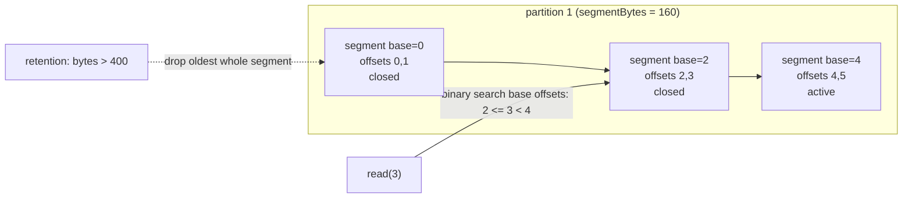

# The Append-Only Log: Partitions, Offsets, and Segments

> A log is not a queue: nothing is removed when it is read, the position belongs to the reader, and the only write is an append.

**Type:** Build
**Languages:** Java, Python, Go
**Prerequisites:** Phase 1, Lesson 07 (Hash Functions and Collisions), Phase 7, Lesson 02 (Write-Ahead Logs)
**Time:** ~120 minutes

## Learning Objectives

- Explain why a partitioned, append-only log replaces a message queue when more than one consumer needs the same records and replay must be possible
- Build a topic with N partitions, a hash-mod-N partitioner, and per-partition offsets that are dense and monotonic
- Implement segments that roll at a byte limit, a sparse offset index, and a read path that resolves any offset in O(log segments + log index + bounded scan)
- Implement retention that drops whole segments from the oldest end and moves the log start offset, and show what that does to a lagging consumer
- State the consumer position contract (committed offset is the next offset to read) and reproduce at-least-once redelivery after a crash

## The Problem

A payment authorization service publishes one event per approved authorization to a message broker. Three downstream services subscribe: the ledger poster, the fraud scorer, and a nightly archiver that writes to cold storage. The broker is a traditional queue: a message is delivered to one consumer and then deleted. To fan out to three services, the platform team runs three queues and the producer publishes every event three times. On a Tuesday afternoon the publish to the ledger queue times out for forty seconds while the other two succeed. Four thousand authorizations are now in the fraud and archive queues and not in the ledger. Nobody notices until the next morning, when reconciliation finds four thousand captures that never had an authorization posted. There is no way to replay: the queue deleted the messages the fraud service consumed, and the producer's retry logic gave up after three attempts.

The second failure is ordering. The fraud scorer runs eight workers pulling from one queue. Merchant `m-coffee` sends an authorization and, 200 ms later, a reversal. Worker 3 pulls the authorization and stalls on a garbage-collection pause. Worker 5 pulls the reversal and processes it first. The scorer now sees a reversal for an authorization it has never heard of and raises an alert. The queue made no ordering promise across workers, and it could not: a shared queue with competing consumers destroys order the moment the second consumer connects.

Both failures come from the same design choice: the broker owned the position. It decided what "consumed" meant, deleted accordingly, and could not tell three readers apart. The fix is to turn the broker into an append-only log. Records are appended, assigned a dense offset, and kept until a retention rule says otherwise. Every reader owns its own offset and can rewind. Records with the same key go to the same partition, so one merchant's events are always in production order. This lesson builds that log: topic, partitions, segments, a sparse index, retention, and the consumer position contract, in the shape Apache Kafka uses, with in-memory byte segments that have the exact layout a file would.

## The Concept

### From queue to log

| Property | Queue (AMQP-style) | Log (Kafka-style) |
|----------|--------------------|-------------------|
| Read removes the message | Yes (ack deletes) | No; retention deletes |
| Multiple independent readers | Need multiple queues or fan-out exchange | Any number, each with its own offset |
| Replay from the past | No | Yes, to the log start offset |
| Ordering | Per queue with one consumer; lost with competing consumers | Per partition, always |
| Position owned by | Broker | Reader (committed to the broker) |
| Parallelism | Competing consumers on one queue | One consumer per partition |

The one-sentence mental model: **a log is an array of records that only grows at the end, and a partition is one such array; the offset is the array index.** Everything else in this lesson is about making that array survive on disk (segments), making index lookup cheap without storing an entry per record (sparse index), bounding its size (retention), and letting readers remember where they are (committed offsets).

### Topic, partition, offset

A topic is a name and a list of partitions. A partition is an ordered, immutable sequence of records with offsets `0, 1, 2, ...` with no gaps. Two invariants hold per partition and never across partitions:

1. **Offsets are dense and monotonic.** The record appended after offset `k` receives `k + 1`. There is no offset that was skipped and no offset that was reused.
2. **Order is production order.** If record A was appended before record B in partition 3, every reader of partition 3 sees A before B.

Across partitions there is no order at all. Offset 5 in partition 0 and offset 5 in partition 1 have no relationship. That is the price of parallelism, and it is why the partitioner matters.

### The partitioner

A record with a non-null key goes to partition `hash(key) mod N`. The hash must be deterministic across producers, languages, and restarts; this lesson uses FNV-1a (32-bit) because it is five lines and bit-identical in Java, Python, and Go. Kafka's default Java producer uses murmur2 with the sign bit masked off; the shape is the same.

Because the partition is a pure function of the key, all records for `m-coffee` land in the same partition and therefore have a total order among themselves. That is the ordering guarantee a payments system actually needs: order per merchant, per card, or per account, with parallelism across them. Records with a null key are not ordered with respect to anything, so they rotate round-robin to spread load.

The partitioner has one consequence people forget: **changing N changes every key's home.** `hash("m-coffee") mod 3` and `hash("m-coffee") mod 4` are different numbers. Adding a partition to a live topic splits each key's history across two partitions, and ordering across that boundary is gone. Phase 3, Lesson 06 (Consistent Hashing) is the structure that avoids this for caches; Kafka simply tells you not to do it to a keyed topic.

### Segments

A partition that holds a year of authorizations is tens of gigabytes. One file of that size cannot be deleted from the front, and an index over it would be huge. So the partition is cut into segments: contiguous runs of records, each with a base offset (the offset of its first record) and a byte limit. The last segment is active and accepts appends; every earlier segment is closed and immutable. When the active segment cannot fit the next record, a new segment is created whose base offset is the current log end offset.



Finding the segment for an offset is a binary search over base offsets for the last base `<= offset`. Retention becomes trivial: drop whole segments from the front, oldest first, never the active one. Deleting a segment is one unlink, not a rewrite, and the log start offset simply becomes the base offset of the new oldest segment.

### The frame

Each record is stored as a self-describing frame so a reader can skip it without decoding it:

| Field | Size | Meaning |
|-------|------|---------|
| frameLength | int32 | bytes after this field |
| offset | int64 | assigned by the partition |
| timestamp | int64 | from the injected clock |
| keyLength | int32 | -1 for a null key |
| key | keyLength bytes | |
| valueLength | int32 | |
| value | valueLength bytes | |

A record with key `m-fuel` (6 bytes) and value `ok` (2 bytes) occupies `4 + 24 + 6 + 2 = 36` bytes. The length prefix is the whole reason a sparse index works: from any frame boundary, the reader can hop to the next boundary by reading four bytes.

### The sparse index

An index with one entry per record costs 12 bytes per record and defeats the point of storing records compactly. Instead, each segment keeps an entry `(relativeOffset, bytePosition)` roughly every `indexIntervalBytes` of appended data, always starting with `(0, 0)`. To find offset `k`:

1. Binary-search the index for the last entry with `relativeOffset <= k - baseOffset`.
2. Jump to its byte position.
3. Hop frame by frame, reading only each length prefix, until the target offset is reached.

Step 3 is bounded by `indexIntervalBytes`, so the lookup is `O(log segments) + O(log indexEntries) + O(indexIntervalBytes / minFrameSize)`. Kafka's default `log.index.interval.bytes` is 4096, and the same three-step lookup lives in `OffsetIndex.lookup` followed by a scan in `LogSegment.translateOffset`.

### Worked example by hand

Configuration: `segmentBytes = 120`, `indexIntervalBytes = 40`, key `"k"` (1 byte), value `"0123456789"` (10 bytes). Every frame is `4 + 24 + 1 + 10 = 39` bytes.

```text
append #1  offset 0  segment base 0  size 0 -> 39    index: (0, 0)   bytesSinceIndex 39
append #2  offset 1  size 39 -> 78                    39 < 40, no entry; bytesSinceIndex 78
append #3  offset 2  size 78 -> 117                   78 >= 40 -> index (2, 78); reset
append #4  offset 3  117 + 39 = 156 > 120 -> roll     new segment base 3; index (0, 0)
...
after 10 appends: segments base 0, 3, 6, 9  (3 records each, last has 1)
```

Now `read(fromOffset = 2, maxRecords = 4)`:

```text
segmentIndexFor(2): bases [0,3,6,9], last base <= 2 is 0  -> segment 0
segment 0 positionOf(2): relative 2; index [(0,0),(2,78)] -> entry (2,78); no scan needed
decode frame at 78 -> offset 2; position 117 == size, segment exhausted
continue in segment base 3 from offset 3: positionOf(3) = relative 0 -> position 0
decode 0 -> offset 3, decode 39 -> offset 4, decode 78 -> offset 5; have 4 records, stop
result: offsets 2, 3, 4, 5
```

Now retention with `retentionBytes = 250`. Total bytes are `117 + 117 + 117 + 39 = 390`. Drop base 0: 273, still over. Drop base 3: 156, under. Two segments removed; `logStartOffset` is now 6; `read(2, 1)` is out of range; `read(6, 1)` returns offset 6.

### The consumer position contract

A consumer belongs to a group and holds a position: the next offset it will read. `poll(max)` reads from the position and advances it past the last record returned. `commit()` writes the position to an offset store keyed by `(group, partition)`. The committed value is **the next offset to read, not the last one processed**; Kafka's `__consumer_offsets` topic and `OffsetAndMetadata` follow exactly this convention, and off-by-one bugs here are the most common cause of a duplicated or skipped record in a new consumer.

When a consumer starts, it reads the committed offset for its group. If there is none, or if retention has moved the log start past it, it resets to the log start offset (Kafka's `auto.offset.reset=earliest`). The consequence that matters for payments: everything polled after the last commit is redelivered after a crash. That is at-least-once delivery, and it is why every consumer of a payments log must be idempotent (Phase 8, Lesson 03) or must commit transactionally with its side effect.

### What the log does not do

- It does not deduplicate. Two appends of the same payload are two records with two offsets. Idempotency belongs to the producer (idempotent producer sequence numbers) or the consumer.
- It does not replicate. A single-replica log loses data when its disk dies; Phase 6 covers replication and the high watermark that this lesson's `logEndOffset` stands in for.
- It does not coordinate consumers. Which consumer in a group owns which partition is Lesson 02's rebalancing protocol. Here a `Consumer` is bound to one partition explicitly.
- It does not compact. Kafka's log compaction (keep the latest record per key) is a different retention policy; this lesson implements size-based retention only.

## Build It

The primary walkthrough is in Java. Python and Go implement the same types with the same names; the subsections at the end show only what differs.

### Step 1: Configuration, records, and the storage boundary

```java
record LogConfig(int segmentBytes, int indexIntervalBytes, long retentionBytes) {
    LogConfig {
        if (segmentBytes <= 0) throw new IllegalArgumentException("segmentBytes must be positive");
        if (indexIntervalBytes <= 0) throw new IllegalArgumentException("indexIntervalBytes must be positive");
        if (retentionBytes <= 0) throw new IllegalArgumentException("retentionBytes must be positive");
    }
}

record StoredRecord(long offset, long timestamp, byte[] key, byte[] value) { }
record RecordMetadata(int partition, long offset) {}
record IndexEntry(int relativeOffset, int position) {}

interface SegmentData {
    void append(byte[] bytes);
    int size();
    byte[] read(int position, int length);
}

interface SegmentStorage {
    SegmentData create(int partition, long baseOffset);
    void delete(int partition, long baseOffset);
    List<Long> baseOffsets(int partition);
}
```

`SegmentData` is the byte-level contract a file would satisfy: append at the end, report the size, read a range. `SegmentStorage` creates and deletes segment data by `(partition, baseOffset)`, which is exactly the `<topic>-<partition>/<baseOffset>.log` directory layout on a Kafka broker. The rest of the code never touches a byte array directly, so swapping `InMemoryStorage` for a `FileChannel`-backed implementation changes nothing above this line. `InMemoryStorage` (in `Main.java`) keeps a `TreeMap<Long, InMemorySegmentData>` per partition and grows each byte array by doubling.

**Predict:** `storage.create(1, 0)` is called twice with the same arguments. What should happen, and why would silently returning the existing data be dangerous?

### Step 2: The frame codec

```java
static byte[] encode(long offset, long timestamp, byte[] key, byte[] value) {
    ByteBuffer buf = ByteBuffer.allocate(frameSize(key, value));
    buf.putInt(buf.capacity() - LENGTH_PREFIX);
    buf.putLong(offset);
    buf.putLong(timestamp);
    if (key == null) {
        buf.putInt(-1);
    } else {
        buf.putInt(key.length);
        buf.put(key);
    }
    buf.putInt(value.length);
    buf.put(value);
    return buf.array();
}

static int frameLengthAt(byte[] data, int position) {
    return LENGTH_PREFIX + ByteBuffer.wrap(data, position, 4).getInt();
}
```

`ByteBuffer` defaults to big-endian, which is network byte order and what Kafka's wire protocol uses. `-1` as the key length distinguishes "no key" from "empty key", a distinction the partitioner needs. `frameLengthAt` reads four bytes and returns the total frame size including its own prefix, which is the hop the sparse-index scan performs.

The hash used by the partitioner lives beside the codec:

```java
static int fnv1a32(byte[] bytes) {
    int hash = 0x811C9DC5;
    for (byte b : bytes) {
        hash ^= (b & 0xFF);
        hash *= 0x01000193;
    }
    return hash;
}
```

Java `int` multiplication wraps at 32 bits, which is what FNV-1a specifies. The `& 0xFF` matters: a Java `byte` is signed, and XOR-ing in `-56` instead of `200` gives a different hash from Python and Go.

**Predict:** `fnv1a32(new byte[0])`. What does it return, and is that a bug?

### Step 3: Segment append with a sparse index

```java
long append(byte[] key, byte[] value, long timestamp) {
    int frame = RecordCodec.frameSize(key, value);
    if (!isEmpty() && !hasRoomFor(frame)) throw new SegmentFullException(baseOffset);
    long offset = nextOffset;
    byte[] encoded = RecordCodec.encode(offset, timestamp, key, value);
    if (bytesSinceIndexEntry >= indexIntervalBytes) {
        index.add(new IndexEntry((int) (offset - baseOffset), data.size()));
        bytesSinceIndexEntry = 0;
    }
    data.append(encoded);
    bytesSinceIndexEntry += encoded.length;
    nextOffset++;
    return offset;
}
```

Three details carry the invariants. `nextOffset` starts at `baseOffset` and increments by exactly one per append, so offsets are dense. `bytesSinceIndexEntry` is initialised to `Integer.MAX_VALUE` so the very first record always gets an index entry at `(0, 0)`; without that, `positionOf` would have nothing to binary-search. And an empty segment accepts a frame larger than `maxBytes`: a 2 MB record on a 1 MB segment limit still lands, alone in its own segment, rather than being rejected forever.

### Step 4: Resolving an offset to a byte position

```java
int positionOf(long offset) {
    if (offset < baseOffset || offset >= nextOffset) throw new OffsetOutOfRangeException(offset, baseOffset, nextOffset - 1);
    int relative = (int) (offset - baseOffset);
    int lo = 0, hi = index.size() - 1, best = 0;
    while (lo <= hi) {
        int mid = (lo + hi) >>> 1;
        if (index.get(mid).relativeOffset() <= relative) { best = mid; lo = mid + 1; } else { hi = mid - 1; }
    }
    IndexEntry entry = index.get(best);
    int position = entry.position();
    long current = baseOffset + entry.relativeOffset();
    while (current < offset) {
        position += frameLengthAt(position);
        current++;
    }
    return position;
}
```

The binary search is the "last entry `<=` target" variant, not an exact match, because most offsets have no index entry. The forward scan reads one length prefix per hop and is bounded by the number of frames that fit in `indexIntervalBytes`. `(lo + hi) >>> 1` avoids the overflow that `(lo + hi) / 2` has at two billion entries; it is a habit worth keeping even when the index is small.

**Predict:** with `indexIntervalBytes = 100` and 39-byte frames, what is the maximum number of hops the scan performs?

### Step 5: Partition append, roll, and cross-segment read

```java
long append(byte[] key, byte[] value, long timestamp) {
    Segment active = active();
    int frame = RecordCodec.frameSize(key, value);
    if (!active.isEmpty() && !active.hasRoomFor(frame)) {
        active = newSegment(active.nextOffset());
        segments.add(active);
    }
    return active.append(key, value, timestamp);
}

List<StoredRecord> read(long fromOffset, int maxRecords) {
    long start = logStartOffset(), end = logEndOffset();
    if (fromOffset < start || fromOffset > end) throw new OffsetOutOfRangeException(fromOffset, start, end);
    List<StoredRecord> out = new ArrayList<>();
    if (fromOffset == end) return out;
    long next = fromOffset;
    for (int i = segmentIndexFor(fromOffset); i < segments.size() && out.size() < maxRecords; i++) {
        List<StoredRecord> chunk = segments.get(i).read(next, maxRecords - out.size());
        out.addAll(chunk);
        if (!chunk.isEmpty()) next = chunk.get(chunk.size() - 1).offset() + 1;
    }
    return out;
}
```

The roll is decided by the partition, not the segment, because the partition owns the list; the new segment's base offset is the old one's `nextOffset`, which keeps offsets dense across the boundary. The read distinguishes three cases the way Kafka does: `fromOffset == logEndOffset` returns an empty list (nothing yet, poll again); below `logStartOffset` or above `logEndOffset` is an `OffsetOutOfRangeException`; anything else walks segments from `segmentIndexFor(fromOffset)` (a binary search over base offsets) until it has `maxRecords` or runs out.

### Step 6: Retention and the partitioner

```java
int enforceRetention() {
    int removed = 0;
    while (segments.size() > 1 && sizeBytes() > config.retentionBytes()) {
        Segment oldest = segments.remove(0);
        storage.delete(id, oldest.baseOffset);
        removed++;
    }
    return removed;
}

int partitionFor(byte[] key) {
    if (key == null) return (int) (roundRobin++ % partitions.size());
    return (RecordCodec.fnv1a32(key) & 0x7FFFFFFF) % partitions.size();
}
```

Retention removes whole segments from index 0 and tells storage to delete them; the active segment is never removed even if it alone exceeds the limit, because deleting the only segment would lose the offset counter. `logStartOffset()` is simply the base of whatever segment is now first, so it advances for free. The partitioner masks the sign bit before the modulo because Java's `%` on a negative `int` yields a negative result, and a negative partition index is an `ArrayIndexOutOfBoundsException` in production at 3 a.m.

**Predict:** a topic has 3 partitions and you add a fourth. Which keys keep their partition?

### Step 7: Consumer position and commit

```java
Consumer(Partition partition, String group, OffsetStore offsets) {
    this.partition = partition;
    this.group = group;
    this.offsets = offsets;
    long committed = offsets.committed(group, partition.id);
    if (committed == OffsetStore.NONE || committed < partition.logStartOffset() || committed > partition.logEndOffset()) {
        position = partition.logStartOffset();
    } else {
        position = committed;
    }
}

List<StoredRecord> poll(int maxRecords) {
    List<StoredRecord> batch = partition.read(position, maxRecords);
    if (!batch.isEmpty()) position = batch.get(batch.size() - 1).offset() + 1;
    return batch;
}

void commit() { offsets.commit(group, partition.id, position); }
```

`position` is always "next to read". `poll` advances it to last-delivered plus one; `commit` stores exactly that number. The constructor handles both reset cases: no commit yet, and a commit that retention has retired (committed 2, log now starts at 17). The demo's "commit, crash, resume" section shows offsets 2 and 3 being delivered twice; the test asserts it.

### Step 8: Run it

```bash
cd phases/08-messaging-and-streams/01-the-append-only-log/code/java
javac -d .out *.java && java -cp .out Main
java -cp .out MainTest
```

Expected output, abbreviated:

```console
== Producing 12 keyed records into 3 partitions ==
m-coffee  -> partition 1 offset 0
m-books   -> partition 2 offset 0
m-grocer  -> partition 1 offset 1
m-fuel    -> partition 0 offset 0
...
== Partition layout after segment rolls (segmentBytes=160) ==
partition 0: logStart=0 logEnd=3 segments(base offsets)=[0] bytes=159
partition 1: logStart=0 logEnd=6 segments(base offsets)=[0, 2, 4] bytes=330
partition 2: logStart=0 logEnd=3 segments(base offsets)=[0, 2] bytes=162

== Commit, crash, resume (partition 1, six records) ==
processed 2 and committed: committed offset = 2
processed 2 more without committing: position 4 (then the process dies)
restart resumes at the committed offset: position 2 -> offsets 2 and 3 are delivered again (at-least-once)

== Retention: keep at most 400 bytes per partition, whole segments only ==
before: segments=[0, 3, 5, 7, 9, 11, 13, 15, 17, 19, 21] bytes=1239
after : dropped 8 segment(s), segments=[17, 19, 21] bytes=324 logStart=17
read(0) rejected: offset 0 is outside [17, 23]

== The frame on the wire ==
36 bytes: 0000002000000000000000070000018bcfe56800000000066d2d6675656c000000026f6b
```

Read the hex: `00000020` is 32, the bytes after the prefix; `0000000000000007` is offset 7; `00000006 6d2d6675656c` is a 6-byte key `m-fuel`; `00000002 6f6b` is the value `ok`.

### In Python

```python
_LENGTH_PREFIX = struct.Struct(">i")
_HEAD = struct.Struct(">qqi")

def fnv1a32(data: bytes) -> int:
    h = 0x811C9DC5
    for b in data:
        h ^= b
        h = (h * 0x01000193) & 0xFFFFFFFF
    return h
```

Differences, all in `code/python/main.py`:

- **`struct` instead of `ByteBuffer`.** `">i"` and `">qqi"` are big-endian int32 and (int64, int64, int32). `unpack_from(data, position)` reads at an offset without copying, which is what `frame_length_at` needs.
- **Integers do not wrap.** FNV-1a depends on 32-bit overflow, so the Python version masks with `& 0xFFFFFFFF` after every multiply. Forget the mask and the hash diverges from Java and Go after the first byte, and every key lands in a different partition than the other two implementations would choose.
- **Iterating `bytes` yields ints.** `for b in data` already gives `0..255`, so there is no signed-byte problem to fix; Java needed `& 0xFF` for the same reason.
- **Exceptions are `OffsetOutOfRangeError` and `SegmentFullError`**, subclasses of `Exception`, raised where Java throws.

Run it from `code/python/` with `python3 main.py`; test with `python3 -m unittest -v`. The demo prints the same offsets, segment layout, byte counts, and frame hex as the Java version.

### In Go

```go
func Encode(offset, timestamp int64, key, value []byte) []byte {
    buf := make([]byte, 0, FrameSize(key, value))
    buf = binary.BigEndian.AppendUint32(buf, uint32(FrameSize(key, value)-lengthPrefix))
    buf = binary.BigEndian.AppendUint64(buf, uint64(offset))
    ...
}

func (s *Segment) Read(offset int64, maxRecords int) ([]StoredRecord, error)
```

Differences, all in `code/go/main.go`:

- **Errors are values.** `Segment.Append`, `Read`, `PositionOf`, `SeekTo`, and `Commit` return `error`; `outOfRange(...)` wraps the sentinel `ErrOffsetOutOfRange` so tests use `errors.Is` where Java uses `checkThrows`. `SeekTo` is Java's `seek`, renamed because `go vet` reserves the name `Seek` for `io.Seeker`'s signature. `Partition.Append` returns a plain `int64`: a fresh segment accepts any frame, so the roll can never fail.
- **`binary.BigEndian.AppendUint32`** (Go 1.19+) builds the frame without a bytes.Buffer. `-1` for a null key is written as `uint32(0xFFFFFFFF)` and read back as `int32`, which is the two's-complement round trip Java gets for free.
- **`nil` versus empty slice.** A nil key means "no key"; an empty `[]byte{}` is a zero-length key with its own partition. `Decode` returns `nil` when `keyLength` is -1 so the partitioner's `key == nil` check agrees with Java's `null`.
- **`Fnv1a32` returns `uint32`**, so `PartitionFor` casts to `int` after masking the top bit; no negative modulo is possible.

Run it from `code/go/` with `go run .`; test with `go test ./...`. The demo prints the same offsets, segment layout, byte counts, and frame hex as the Java version.

## Use It

### Apache Kafka

Everything here has a direct counterpart in a Kafka broker. `Partition` is `UnifiedLog`; `Segment` is `LogSegment` with a `.log` file and a `.index` file; `indexIntervalBytes` is `log.index.interval.bytes` (default 4096); `segmentBytes` is `log.segment.bytes` (default 1 GiB); `retentionBytes` is `log.retention.bytes`, alongside the time-based `log.retention.ms` this lesson leaves as an exercise. `logStartOffset` and `logEndOffset` are Kafka's names. The consumer's committed offset is stored in the internal `__consumer_offsets` topic rather than a map, and `auto.offset.reset` chooses between `earliest` (what this lesson does) and `latest`.

What Kafka adds that the from-scratch version made visible by omission: replication with a high watermark (readers see only records all in-sync replicas have), a time index (`.timeindex`) for `offsetsForTimes`, record batching with compression and per-batch CRC, an idempotent producer with sequence numbers to deduplicate retries, and log compaction. Kafka's default partitioner also changed in 3.x: unkeyed records use a "sticky" partitioner that fills one batch per partition before moving on, rather than per-record round robin, because batching matters more than per-record spread.

### Other logs

Apache Pulsar separates the log (BookKeeper ledgers) from the serving layer, so segments live on different machines from the brokers. Amazon Kinesis calls partitions shards and offsets sequence numbers, with a hard 24-hour to 365-day retention window. Redis Streams (`XADD`, `XREAD`, consumer groups with `XACK`) is a single-node log with the same offset-owned-by-reader model and IDs of the form `timestamp-sequence`. PostgreSQL's write-ahead log is a single-partition append-only log with LSNs as offsets and `pg_wal` segment files of 16 MB, which is why Phase 7, Lesson 02 is a prerequisite here: a WAL is a log with one reader (recovery) and a database is a log with a very elaborate index.

### The trap

The commonest production mistake with any of these is treating the committed offset as "processed up to and including". A consumer that commits `lastOffset` instead of `lastOffset + 1` re-processes one record after every restart; one that commits `lastOffset + 1` before the side effect completes loses one record on every crash. Kafka's `commitSync(Map<TopicPartition, OffsetAndMetadata>)` documentation states the convention in one sentence, and it is the sentence to read twice.

## Ship It

`outputs/checklist-log-topic-design.md` is a design-review checklist for any new topic that will carry money-moving events: partition key choice, partition count, retention versus the slowest consumer, offset commit discipline, and the questions to ask before changing any of them in production. Attach it to the design review for the next topic your team creates.

## Exercises

1. **Reinforce.** Add time-based retention: `LogConfig.retentionMillis` and `enforceRetention(nowMillis)` that drops a closed segment when its newest record's timestamp is older than `now - retentionMillis`. Keep size-based retention; a segment goes when either rule says so. Test with the `TickClock`.
2. **Apply.** Implement `offsetForTimestamp(long ts)` on `Partition`: the first offset whose record timestamp is `>= ts`, or `logEndOffset` if none. Do it with a per-segment time index `(timestamp, relativeOffset)` written at the same interval as the offset index, then binary search, then scan. This is Kafka's `offsetsForTimes`, the mechanism behind "replay everything since 02:00".
3. **Extend.** Replace `InMemoryStorage` with a file-backed `SegmentStorage` that writes each segment to `<dir>/<partition>/<baseOffset>.log` using the WAL discipline from Phase 7, Lesson 02 (append, then `fsync` before acknowledging). Rebuild the sparse index on startup by scanning frames. Then measure: how many appends per second do you lose by fsyncing every record versus every 10 ms, and which would you choose for a ledger topic?

## Key Terms

| Term | What people say | What it actually means |
|------|-----------------|------------------------|
| Offset | "the message ID" | The dense, zero-based index of a record within one partition; meaningless across partitions |
| Partition | "a shard of the topic" | An independent append-only log with its own offsets and total order; the unit of parallelism and of ordering |
| Segment | "a chunk of the log" | A contiguous run of records starting at a base offset, stored as one file; the unit of retention |
| Sparse index | "the offset index" | One `(relativeOffset, position)` entry every N bytes, resolved by binary search plus a bounded forward scan |
| Log start / end offset | "earliest / latest" | The oldest offset still retained and the offset the next append will receive; a read at the end offset is empty, not an error |
| Committed offset | "where the consumer is" | The next offset the group will read, stored by the broker; everything after it is redelivered on restart |
| Retention | "how long we keep messages" | A rule (bytes, time, or compaction) that deletes whole closed segments from the oldest end; never touches the active segment |
| Partitioner | "the hashing" | A pure function from key to partition index; same key, same partition, for as long as the partition count does not change |

## Further Reading

- [Apache Kafka documentation, section 4 "Design" and 5.4 "Log"](https://kafka.apache.org/documentation/#log) — the segment file layout, the sparse index, and the exact read algorithm this lesson reproduces.
- [Kreps, Narkhede, Rao, "Kafka: a Distributed Messaging System for Log Processing" (NetDB 2011)](https://www.microsoft.com/en-us/research/wp-content/uploads/2017/09/Kafka.pdf) — the original paper; section 3.1 explains why the broker keeps no per-message state and the consumer owns the offset.
- [Jay Kreps, "The Log: What every software engineer should know about real-time data's unifying abstraction" (2013)](https://engineering.linkedin.com/distributed-systems/log-what-every-software-engineer-should-know-about-real-time-datas-unifying) — the argument that the log, not the queue, is the primitive for data integration.
- [Kafka `KafkaConsumer` Javadoc: offsets and consumer position](https://kafka.apache.org/documentation/#consumerconfigs_auto.offset.reset) — the "committed offset is the next offset to read" convention and the `auto.offset.reset` behaviours.
- [Fowler and Noll, FNV hash specification](http://www.isthe.com/chongo/tech/comp/fnv/) — the FNV-1a constants and algorithm used by the partitioner, including why the 32-bit variant multiplies by 16777619.
- [PostgreSQL documentation, chapter 30 "Reliability and the Write-Ahead Log"](https://www.postgresql.org/docs/current/wal-intro.html) — a single-partition log with 16 MB segment files and LSNs as offsets; compare with Kafka's layout.
